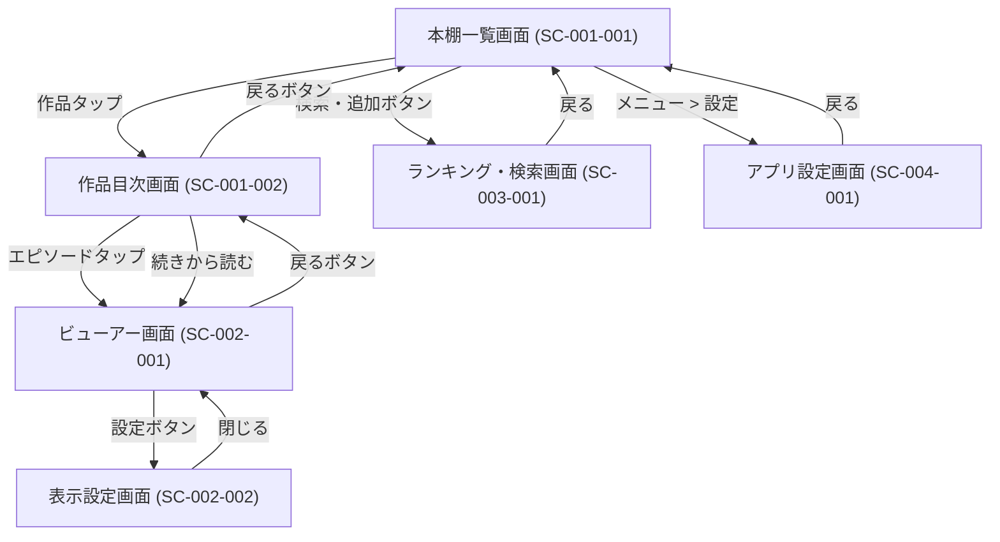

# 画面設計 概要

## 画面一覧

| 画面ID | 画面名 | 概要 |
| :--- | :--- | :--- |
| [SC-001](SC-001_本棚機能.md) | **本棚機能** | 登録した作品の管理・閲覧開始を行う機能群 |
| [SC-002](SC-002_ビューアー機能.md) | **ビューアー機能** | 小説本文の閲覧・表示設定を行う機能群 |
| [SC-003](SC-003_検索・登録機能.md) | **検索・登録機能** | 外部サイトからの作品検索・追加を行う機能群 |
| [SC-004](SC-004_共通・その他.md) | **共通・その他** | アプリ全体の設定・管理を行う機能群 |

## 画面詳細一覧

| 画面ID | 画面名 | 概要 |
| :--- | :--- | :--- |
| SC-001-001 | 本棚一覧画面 | 登録した作品を一覧表示し、読書を開始できるメイン画面。 |
| SC-001-002 | 作品目次画面 | 作品のエピソード一覧を表示し、読みたい話を選択する画面。 |
| SC-002-001 | ビューアー画面 | 小説本文を閲覧する画面。縦スクロール形式。 |
| SC-002-002 | 表示設定画面 | 文字サイズ、行間、テーマなどを設定する画面。 |
| SC-003-001 | ランキング・検索画面 | 小説サイトのランキングや検索結果を表示し、本棚に追加する画面。 |
| SC-004-001 | アプリ設定画面 | アプリ全体の振る舞い（先読み数、キャッシュなど）を設定する画面。 |
## 画面遷移図

## 画面遷移詳細

| 遷移元 | 遷移先 | トリガー | 備考 |
| :--- | :--- | :--- | :--- |
| 本棚一覧 (SC-001-001) | 作品目次 (SC-001-002) | 作品カードのタップ | |
| 本棚一覧 (SC-001-001) | 検索・登録 (SC-003-001) | 検索・追加アイコンのタップ | |
| 本棚一覧 (SC-001-001) | アプリ設定 (SC-004-001) | メニューからの設定選択 | |
| 作品目次 (SC-001-002) | ビューアー (SC-002-001) | エピソード行のタップ / 「続きから読む」のタップ | |
| ビューアー (SC-002-001) | 表示設定 (SC-002-002) | 設定アイコンのタップ / メニュー | オーバーレイ表示を想定 |
| 検索・登録 (SC-003-001) | 本棚一覧 (SC-001-001) | 戻るボタン / 作品追加完了（任意） | |

## 共通仕様

### エラーハンドリング戦略

全画面で統一したエラーハンドリングを実装する。

#### ネットワークエラー
- **発生条件**: スクレイピングリクエスト時にネットワーク未接続、タイムアウト（15秒）
- **UI表示**: エラーメッセージと「再試行」ボタンを表示
  - メッセージ例: 「ネットワークエラーが発生しました」
- **リトライ戦略**: 
  - 自動リトライ: 最大3回（指数バックオフ: 1秒、2秒、4秒）
  - 自動リトライ失敗後: ユーザーによる手動リトライのみ可能

#### 解析エラー
- **発生条件**: HTMLパースに失敗（DOM構造変更等）
- **UI表示**: エラーメッセージのみ表示（リトライボタンなし）
  - メッセージ例: 「データの取得に失敗しました。サイト構造が変更されている可能性があります」
- **フォールバック**: なし（要件定義にあるWebView表示は将来対応を検討）

#### データベースエラー
- **発生条件**: DB操作に失敗（UNIQUE制約違反以外）
- **UI表示**: Snackbarで通知
  - メッセージ例: 「データの保存に失敗しました」
- **リカバリ**: 楽観的UI更新を使用している場合はロールバック

### セキュリティポリシー

#### 外部URLホワイトリスト検証
- 外部ブラウザで開く全てのURLに対し、ホワイトリスト検証を実施
- **許可ドメイン**: 
  - `kakuyomu.jp`（カクヨム）
  - 将来的に `syosetu.com`, `ncode.syosetu.com`（小説家になろう）を追加
- **検証失敗時**: エラーダイアログを表示し、URLを開かない
- **ユーザー確認**: URL起動前に確認ダイアログを表示（「外部ブラウザで開きますか？」）

