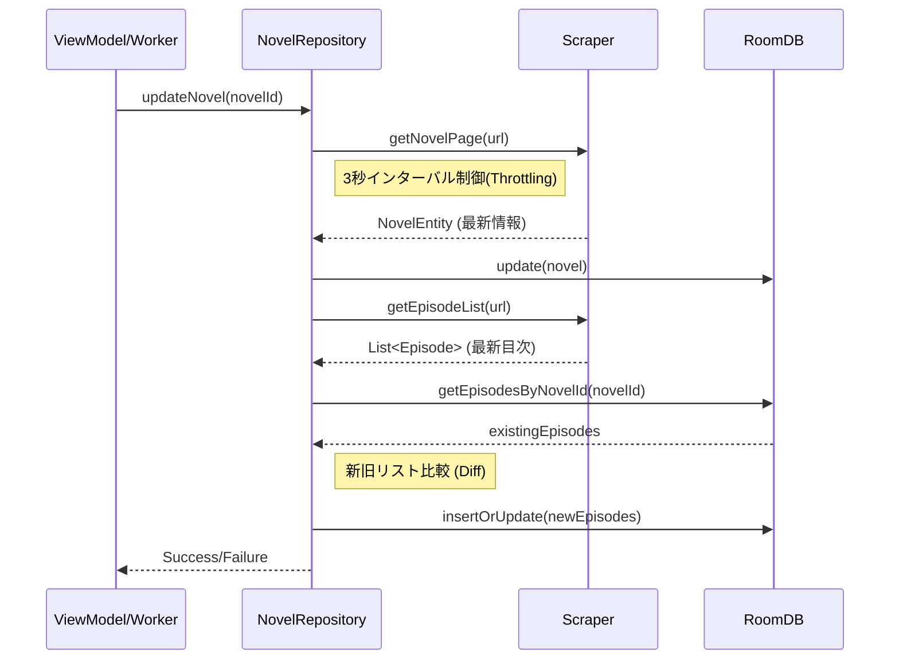

# 詳細設計書（作品更新機能）

| 項目 | 内容 |
| :--- | :--- |
| **ID** | FD-003 |
| **対象画面** | なし（バックグラウンド処理 / ViewModelから呼び出し） |
| **作成者** | Antigravity |
| **更新日** | 2026/02/18 |
| **ステータス** | Draft |

> [!IMPORTANT] 設計時の注意点
> - **実装可能なレベル**まで詳細化すること。
> - 変数名や関数名は、実際の実装と一致させること（キャメルケース等）。
> - 複雑なロジックは箇条書きやフローチャート（Mermaid）で記述すること。

---

## 1. 概要
登録されている小説の最新情報を取得し、データベースを更新する機能。
ユーザーによる手動操作（Swipe-to-Refreshやボタン）と、バックグラウンドでの定期実行（WorkManager）の両方に対応する。

> [!NOTE] 主要機能
> - 小説の基本情報（総話数、最終更新日時など）の更新。
> - 新規エピソードの検知と目次（Episodesテーブル）への追加。
> - **サーバー負荷対策**: 同一ドメインへの連続アクセス制限（最低3秒インターバル）。

---

## 2. クラス・ファイル構成

| 分類 | クラス名/ファイル名 | 役割・責務 |
| :--- | :--- | :--- |
| **Worker** | `NovelUpdateWorker.kt` | 定期実行用バックグラウンドタスク。全作品または指定作品の更新を行う。 |
| **Repository** | `NovelRepository.kt` | 更新ロジックの実装（スクレイピング実行、DB保存）。 |
| **Service** | `KakuyomuScraper.kt` | サイト（カクヨム）のHTML取得と解析。 |
| **Util** | `RequestThrottler.kt` | リクエスト間隔を制御するシングルトンまたはクラス。 |

---

## 3. 処理フロー

### 3.1. 更新処理（単体・一括共通）

### 3.2. WorkManager 定期実行

- **トリガー**: `PeriodicWorkRequest` (6時間ごと)
- **制約**: `Constraints.Builder().setRequiredNetworkType(NetworkType.CONNECTED)`
- **処理内容**:
    1. `NovelDao.getAllNovels()` で全作品取得。
    2. ループ処理で各作品に対し `updateNovel` を実行。
    3. 各リクエスト間に `delay(3000)` を挿入。
    4. **実行時間制限**: 1回の定期実行で更新する作品数は最大20件までとする（または10分以内に終了するように制御）。未更新の作品は次回の定期実行に回すなど、ローテーションを行う。
    5. 失敗した作品があっても継続し、最後に結果をまとめる。

---

## 4. 関数詳細

### 4.1. Repository: `NovelRepository`

| 関数名 | 引数 | 戻り値 | 処理概要 |
| :--- | :--- | :--- | :--- |
| `updateNovel` | `novelId: String` | `Result<Unit>` | 指定作品の更新を実行する。例外発生時は Result.failure を返す。 |
| `updateAllNovels` | なし | `WorkInfo` | 全作品更新処理（Worker経由が望ましいが、Repository内実装も可）。 |

#### 詳細ロジック (`updateNovel`)

1. **スロットリング**: 直近のリクエスト時刻を確認し、3秒未満なら `delay` する。
2. **トップページ取得**: `jsoup.connect(url).get()`。
3. **パース**:
    - タイトル、作者、あらすじ、タグ、**総話数**、**最終更新日時** を抽出。
    - `Novels` テーブルを更新（`updated_at` も更新）。
4. **目次取得**:
    - **スロットリング**: `getNovelPage` と同様、直前のアクセスから3秒経過しているか確認し、必要なら `delay` する（重要：トップページ取得とは別リクエストの場合は必須）。
    - エピソード一覧のリンク構造を解析。
    - 各エピソードの URL, タイトル, 投稿日時 を抽出。
5. **DB保存**:
    - 同一URLのエピソードが既にある場合はスキップ（または更新）。
    - 新規エピソードの場合は `insert`。
    - `index_order` を正しく設定する。

### 4.2. Worker: `NovelUpdateWorker`

| 関数名 | 引数 | 戻り値 | 処理概要 |
| :--- | :--- | :--- | :--- |
| `doWork` | なし | `Result` | バックグラウンド処理のエントリーポイント。 |

#### 詳細ロジック

1. `NovelRepository` をDI（Hilt等）で取得。
2. `repository.getAllNovels()`（同期版）を取得。
3. `forEach` でループ:
    - `try-catch` で個別の失敗を捕捉。
    - `repository.updateNovel(it.id)` を呼び出し。
    - 成功数、失敗数をカウント。
4. 全て完了後、失敗が多すぎる場合は `Result.retry()`、それ以外は `Result.success()`。
    - 通知チャネルを使って「N件の更新があります」と通知を出すことも検討（今回は必須ではないが推奨）。

---

## 5. データベース・API アクセス

### データベース (Room DAO)
- `NovelDao.update(novel: Novel)`
- `EpisodeDao.insertAll(episodes: List<Episode>)`
- `EpisodeDao.getAllByNovelId(novelId)`: 差分チェック用。

### API (Jsoup / OkHttp)
- `User-Agent` 設定: **Androidの標準的なWebViewのUser-Agent**を使用する（例: `Mozilla/5.0 (Linux; Android 10; K) AppleWebKit/537.36 (KHTML, like Gecko) Chrome/120.0.0.0 Mobile Safari/537.36`）。Botであることを明示するとアクセス拒否される可能性があるため、ブラウザとして振る舞う。
- タイムアウト設定: 接続15秒、読み込み30秒。

---

## 6. エラーハンドリング・境界値

| ケース | 挙動 | ログ/フィードバック |
| :--- | :--- | :--- |
| **ネットワーク圏外** | 処理開始前にWorkManagerが抑制する。手動時は即エラー。 | 「ネットワークに接続されていません」 |
| **サイト構造変更 (Parse Error)** | 解析失敗例外をキャッチ。 | ログにHTML構造変化の可能性を出力。UIでは「更新失敗」と表示。 |
| **サーバーエラー (503/429)** | リトライ機構（Exponential Backoff）で再試行。 | 手動時は「サーバーが混雑しています」と表示。 |
| **作品削除 (404)** | DBから削除せず、ステータスを「削除された可能性」とするか、エラー無視。 | ユーザーに勝手に削除されると困るため、アクセス不可状態として残す。 |

---

## 7. 補足 (スクレイピングマナー)

> [!CAUTION] 重要な制約
> - `Thread.sleep(3000)` または `delay(3000)` を**必ず**入れること。
> - 並列処理（`async`等による同時リクエスト）は**禁止**。必ず直列（Sequence/Loop）で実行すること。
