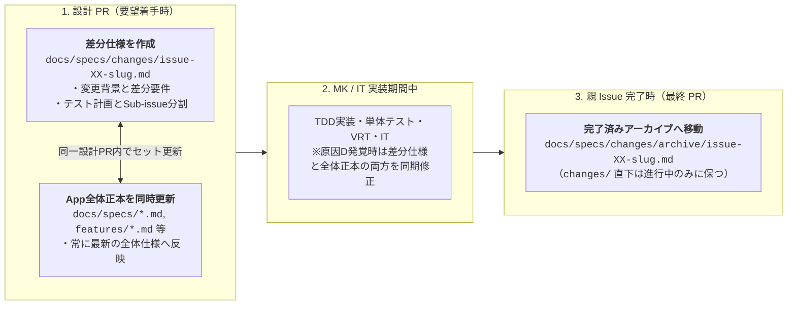

# Yommy ドキュメント全体マップ・規約

本ディレクトリ（`docs/`）は、Android 向け Web 小説リーダーアプリ **「Yommy」** における人間と AI エージェント双方の Single Source of Truth（SSOT：唯一の正本）です。

---

## 1. ディレクトリ構成と3本柱

ドキュメントが陳腐化（腐敗）せず、常に「現在のアプリ全体の仕様」と「要望ごとの変更差分」を明確に区別できるよう、以下の3本柱（`guidelines` / `specs` / `quality`）で構成します。

```text
docs/
├── README.md                          # ドキュメント全体マップ・ディレクトリ規約（本ファイル）
├── guidelines/                        # 【柱1：人間・AI共通の開発規約・基準の正本】
│   ├── workflow.md                    # 開発プロセス標準（マイクロWF、正本＋差分仕様の2層管理、Task Completion Gate 7条件、ミニMilestone運用）
│   ├── testing.md                     # テスト・実装規律の正本（TDD、3層責務境界、1対1 Story/UT、親子分離、縦書きVRT、C0/C1 100%、バグ記録・原因D設計同期）
│   └── review-comment-format.md       # レビューコメント記述基準（[P0]〜[P3] ＋ 4要素フォーマット、横断レビュー集約形式）
├── specs/                             # 【柱2：製品仕様・設計（App全体正本 ＋ 差分仕様の2層構成）】
│   ├── requirements.md                # [App全体正本] 全体要件定義・機能一覧・ミニMilestoneロードマップ（Phase 2で策定）
│   ├── architecture.md                # [App全体正本] 3層アーキテクチャと共通インターフェース契約（Phase 2で策定）
│   ├── db-schema.md                   # [App全体正本] SQLite 主要テーブル定義の正本（Phase 2で策定）
│   ├── screen-transitions.md          # [App全体正本] 主要画面一覧（SCR-xx）と画面遷移（TR-xx）の全体マップ（Phase 2で策定）
│   ├── features/                      # [App全体正本] 画面・機能別の現在仕様書（AC一覧・コンポーネント構成・テスト責務）
│   │   └── .gitkeep
│   ├── parsers/                       # [App全体正本] 小説サイト別の現在スクレイピング・DOM解析仕様書
│   │   └── .gitkeep
│   └── changes/                       # [差分仕様 (Delta Specs)] 要望（親Issue）ごとの設計差分・テスト計画・Sub-issue分割
│       ├── issue-XX-<slug>.md         # 現在進行中の要望Issueの差分仕様（Active）
│       └── archive/                   # 完了済みの差分仕様アーカイブ（親Issueクローズ時に git mv で移動）
│           └── .gitkeep
└── quality/                           # 【柱3：品質分析・バグ記録・申し送り管理】
    ├── bug-and-handover-log.md        # バグ記録票（製品/支援分離、原因5分類 L/S/D/B/A）＆ 申し送り事項（HO-xx）追跡シート
    └── reports/                       # ミニリリース Milestone ごとの品質分析・改善（Kaizen）レポート格納先
        └── .gitkeep
```

---

## 2. 人間・AI共通ルール（`docs/guidelines/`）とAIスキル（`.github/skills/`）の責務分離

- **共通ルールの正本化**:
  開発フロー、テスト規律、カバレッジ基準、レビューフォーマットなど **「人間も意識・合意すべきルール」は AI スキル内に閉じ込めず、`docs/guidelines/` 配下に正本として明記** します。
- **二重管理の防止**:
  `.github/skills/` 配下の各スキル（`SKILL.md`）は `docs/guidelines/` を参照し、AI 固有の実行手順やサブエージェント委託（オーケストレーション）手順のみを記述します。

---

## 3. `docs/specs/` の 2 層管理ルール（App 全体正本 ＋ 差分仕様）

Phase 4 以降のイテレーティブ開発では、**「① App 全体の現在仕様（正本：Canonical Specs）」** と **「② 今回の要望 Issue で何を変えるか（差分仕様：Delta Specs）」** の 2 つの観点を明確に分けて管理します。



### 3.1 2種類の仕様書の役割分担

| 区分 | 配置先 | 役割・記載内容 | ライフサイクル |
| :--- | :--- | :--- | :--- |
| **App 全体正本**<br>（Canonical Specs） | `docs/specs/*.md`<br>`docs/specs/features/*.md`<br>`docs/specs/parsers/*.md` | **「今この瞬間のアプリ全体の仕様」** を表す唯一の正本。<br>タスク分割や一時的な移行手順は書かず、恒久的な仕様（要件、3層契約、DB定義、画面遷移、各機能の `AC-xx` と構成）のみを記載する。 | Phase 2 で初期骨格を作成し、Phase 4 以降の各設計 PR で常に最新状態へ更新し続ける。 |
| **差分仕様**<br>（Delta / Change Specs） | `docs/specs/changes/issue-XX-<slug>.md`<br>（完了後: `changes/archive/`） | **「特定の要望 Issue（`#XX`）で何をどう追加・変更するか」** を定義する設計計画書。<br>変更背景、影響する全体正本ファイル一覧、追加・変更・廃止する仕様の差分、UT/VRT/IT テスト観点、Sub-issue 分割計画、申し送り（`HO-xx`）を記載する。 | 要望 Issue の設計 PR で `changes/` 直下に作成し、親 Issue 完了時（最終 PR）に **`changes/archive/` へ移動** する。 |

### 3.2 設計ドキュメントの共通メタデータ形式

#### A. App 全体正本（`docs/specs/*.md`, `features/*.md`, `parsers/*.md`）の冒頭メタデータ
```markdown
| 項目 | 内容 |
| :--- | :--- |
| **状態** | `Draft` / `Review (#Issue番号)` / `Approved (#Issue番号)` |
| **最終更新日** | `YYYY-MM-DD` |
| **関連正本・契約** | `docs/specs/architecture.md#見出し`, `docs/specs/db-schema.md#見出し` 等（該当なしは `なし`） |
| **関連テスト・シナリオ** | `src/.../*.test.ts`, `test/it/scenarios/scnXX-*.spec.ts` 等（該当なしは `なし`） |
```

#### B. 差分仕様（`docs/specs/changes/issue-XX-<slug>.md`）の冒頭メタデータと構成ひな形
```markdown
# 差分仕様書：[要望タイトル]（Issue #XX）

| 項目 | 内容 |
| :--- | :--- |
| **対象親 Issue** | `#XX` |
| **状態** | `Review (#XX)` / `Approved (#XX)` / `Completed (Archived)` |
| **最終更新日** | `YYYY-MM-DD` |
| **更新対象の App 全体正本** | `docs/specs/features/xxx.md`, `docs/specs/db-schema.md` 等 |

## 1. 変更の背景・目的（Why）
## 2. 仕様・設計の差分（What Changes）
- **追加・変更・削除する受け入れ条件（`AC-xx`）・画面遷移（`TR-xx`）**:
- **3層インターフェース / DB スキーマの変更点**:
- **対象コンポーネント・モジュール構成の変更点**:
## 3. テスト計画（UT / VRT / IT の検証観点）
## 4. 実装 Sub-issue 分割計画
## 5. 申し送り事項（Handover Items: `HO-xx`）
```

- **見出しアンカーの整合性**:
  関連項目はリポジトリルートからのパスと見出しアンカー（`path/to/file.md#見出し`）で参照し、実際の GitHub Flavored Markdown 見出し文字列と一致させてリンク切れを防止します。
