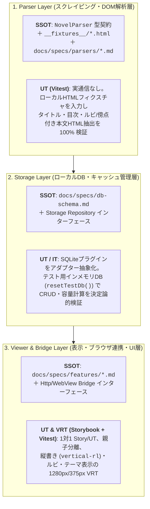

# テスト・実装規律の正本（SSOT）

本ドキュメントは、Yommy（React + TypeScript + Vite + Capacitor）における TDD（テスト駆動開発）、3層アーキテクチャのテスト責務境界、Storybook / Portable Stories / VRT 規約、カバレッジ基準、およびバグ記録・設計書同期ルールの正本（Single Source of Truth）です。

---

## 1. 基本原則（9つの鉄則）

1. **仕様・設計正本（SSOT）準拠**:
   `docs/specs/` 配下の設計書（`architecture.md`, `db-schema.md`, `features/*.md`, `parsers/*.md`）に定義された契約・受け入れ条件（`AC-xx`）を忠実に実装する。未定義の仕様を推測で実装してはならない。
2. **テストファースト（TDD）の徹底**:
   すべての機能実装・バグ修正は、単体テストを先に書く **Red（失敗確認） → Green（最小実装） → Refactor（構造改善）** のサイクルで進め、各ステップで個別にコミットを刻む。
3. **3層アーキテクチャと Capacitor Bridge の抽象化分離**:
   `Parser Layer`、`Storage Layer`、`Viewer & Bridge Layer` の責務を明確に分離し、Capacitor ネイティブ機能（`CapacitorHttp`, SQLite プラグイン, WebView インジェクション等）は薄いアダプター／インターフェース層で抽象化して、Node.js（Vitest）やブラウザ（Storybook / Playwright）上で決定論的にテスト可能にする。
4. **テスト配置の統一（Co-location）**:
   単体テスト（`*.test.ts`, `*.test.tsx`）および Storybook ファイル（`*.stories.tsx`）は、対象ソースファイルと同一ディレクトリに配置する。
5. **例外なしの 1 対 1 対応原則**:
   - 全 `*.tsx` ファイル（ただし §5.2 項4 に定めるブラウザ初期マウントエントリーポイント `src/main.tsx` を除く）に対して、同階層に **`*.stories.tsx`（必須）** と **`*.test.tsx`（Portable Stories `composeStories` 全件実行 ＋ ロジック補完）** を 1 対 1 で作成する。
   - 全 `*.ts` ファイル（型定義専用ファイルを除く）に対して、同階層に **`*.test.ts`（または `.test.tsx`）** を 1 対 1 で作成する。なお、実行時定数定義ファイル（`src/**/constants/*.ts` 等）およびバレルエクスポート（`src/**/index.ts` 等）も型専用ファイルに該当しないため、1 対 1 単体テスト（`*.test.ts`）を必須とする。ただし、テストや Storybook で使用する静的モックデータ定義専用の fixture ファイル（`src/**/__fixtures__/*.ts` 等）については、単体テスト・Storybook から呼び出されて検証される pure static fixtures であるため、個別の 1 対 1 単体テスト（`*.test.ts`）の作成は不要（除外対象）とする（R2-09）。
6. **親子コンポーネント分離原則（相乗りテスト禁止・`vi.spyOn` / `vi.mock` による直下の子 Props・コールバック検証徹底）**:
   親（Page / Container）のテストでは「状態管理・Loading/Error/Ready の切り替え・子への Props 渡し」のみを検証し、子コンポーネントの表示バリエーション・境界値・イベント発火は必ず子自身の `.stories.tsx` / `.test.tsx` で独立して検証する。特に非同期フックや DOM 計測（`ResizeObserver` 等）を持つ子・孫コンポーネント内部の DOM 要素を親の単体テストで重複検証すると保守性の低下や CI 高負荷下での非同期競合（Flakiness）の原因となるため、Container / Page の単体テストでは直下の子コンポーネントに対する `vi.spyOn`（または `vi.mock`）を用いて、渡された Props・コールバック配線のみを決定論的に検証すること（`R1-11`, `R1-23` 再発防止）。
7. **C0 / C1 / Functions 100% カバレッジ原則**:
   `src/` 配下の全対象ファイルにおいて、ステートメント（C0）・分岐（C1）・関数（Functions）カバレッジ **100%** を必須基準とする。
8. **日本語組版・縦書き/ルビを含む VRT の UT（Storybook）一本化**:
   視覚的回帰テスト（VRT）は Storybook の全 Story を対象として **1280px（デスクトップ/タブレット幅）および 375px（モバイル幅）** の2系統で実施する。結合テスト（Playwright IT）では VRT を行わず、画面遷移とエンドツーエンドの振る舞い検証に専念する。なお、非表示状態（`isOpen: false`）で空描画（null）となるモーダルダイアログ等のストーリーに限り、例外的に `tags: ["skip-vrt"]` の付与による VRT 除外を許可する（空要素キャプチャによる無意味なスナップショット防止、R1-33）。
9. **不備記録と原因分類 `D`（設計不備）の即時設計同期義務**:
   実装・テスト・AIレビュー中に検出された不備は製品コードと支援成果物を分離して記録する。原因が `D`（設計・仕様の誤認や不備）である場合、**コードのみを修正して設計書を放置することは厳禁**とし、必ず同一 PR 内で `docs/specs/` の設計書（App 全体正本および進行中の差分仕様）も同時修正する。

---

## 2. Yommy 3層アーキテクチャ別の SSOT とテスト規律

前プロジェクトにおける「OpenAPI ＋ MSW」の規律を、Web小説リーダー（React + Vite + Capacitor）の特性に合わせて以下の3層テスト規律として適用します。

### 2.1 Parser Layer（スクレイピング・DOM解析層）

- **SSOT（正本）**:
  - `NovelParser` 共通インターフェース契約（`docs/specs/architecture.md`）
  - サイト別スクレイピング仕様書（`docs/specs/parsers/*.md`）
  - 各小説サイトのサンプル HTML フィクスチャ（`__fixtures__/*.html`）
- **TDD・テスト規律**:
  - 単体テストでは外部ネットワーク通信を一切行わない。
  - ローカルのサンプル HTML フィクスチャ（正常ページ、ルビ `<ruby><rb><rt><rp>` や傍点を含む本文、複数ページ目次、短編、構造変更時の異常 HTML 等）を入力として、小説タイトル・著者・目次リスト・サニタイズ＆整形済み本文 HTML が正確に抽出されることを Vitest で C0/C1 100% 網羅する。
  - **実サイト HTML 構造・動的展開制限の事前調査鉄則**: 外部小説サイトのパーサー策定・実装時は、現行サイトの初期表示 DOM 件数制限（例: カクヨム作品トップの直近7話のみ DOM 表示）やトグル非表示章、`<script id="__NEXT_DATA__">` 等の埋め込み JSON データ構造を実サイト HTML で必ず事前調査し、7話超・複数章構成を含むフィクスチャで全件取得を検証すること。
  - 小説サイト側の DOM 仕様変更が発生した際は、まず新しい HTML フィクスチャをテストに追加して Red を確認してからパーサーのセレクタ・抽出ロジックを修正する。

### 2.2 Storage Layer（ローカルDB・キャッシュ管理層）

- **SSOT（正本）**:
  - `docs/specs/db-schema.md`（`novels`, `chapters`, `download_queue`, 設定テーブル等のスキーマ・制約定義）
  - Storage Repository インターフェース（`docs/specs/architecture.md`）
- **TDD・テスト独立性規律**:
  - `@capacitor-community/sqlite` 等のネイティブプラグインを UI やフックから直接呼び出さず、必ず Storage アダプター／リポジトリ層で抽象化する。
  - UT（Vitest）、Storybook、および Playwright IT（Webブラウザ実行）では、同一のインターフェースを満たすテスト用インメモリ DB（または SQLite アダプターのインメモリ実装）を使用する。
  - テスト間でデータが漏洩しないよう、`beforeEach` / `afterEach`（および IT の各テスト開始前）に必ず **`resetTestDb()`** を呼び出し、決定論的な初期シード状態にリセットする。
  - **新規設定カラム・DB カラム追加時の全層伝播チェック（原因 `D` 再発防止）**: DDL（`schema.ts` ＋ `ServiceProvider` での既存 DB バイナリ復元時マイグレーション `initializeDatabaseSchema`）→ 型定義（`types.ts`）→ Repository → Hook / Container → Page → View → Storybook / UT / IT の全層でプロップス・コールバック・マイグレーションが途切れず伝播しているか確認すること。

### 2.3 Viewer & Bridge Layer（表示・ブラウザ連携・UIコンポーネント層）

- **Capacitor Bridge の分離**:
  - CORS 回避用のネイティブ HTTP 通信（`CapacitorHttp`）、レートリミット・ダウンロードキュー制御、および内蔵 WebView からの DOM 抽出ブリッジは薄いインターフェースとして分離し、UT / Storybook / IT ではモックまたはフィクスチャ応答を注入可能にする。
  - **Android ネイティブプラグイン実装・検証規律（原因 `D` / `L` / `S` 再発防止）**: Capacitor ネイティブプラグイン（Java）では `startActivityForResult` 等の非推奨/非互換シグネチャを避け `ActivityResultContracts.StartIntentSenderForResult` ＋ `saveCall`/`getSavedCall`/`freeSavedCall` を使用し、401 リトライ時は `clearToken` でローカルキャッシュを破棄してから再取得すること。また `MainActivity` 等と共有する `static` 状態フラグ（例: `volumeKeyPagingEnabled`）は、Activity 再生成や WebView リロード時の状態残留リークを防ぐため必ずプラグインの `load()` および `handleOnDestroy()` で初期値（`false`）にリセットし、`.github/workflows/ci.yml` の `android-compile` ジョブおよび `scripts/android-build-config.test.ts` の静的契約テストで機械検証すること（`R1-03`, `R1-12` 再発防止）。さらに Web 側でネイティブイベントを購読する際は、イベント取りこぼしと Unhandled Rejection を防ぐため **必ず `add*Listener` を先行登録してから有効化メソッドを呼び出し、Promise には `.catch(() => {})` を付与すること**（`R1-04`, `R1-08` 再発防止）。
- **小説組版 UI 単体テスト & VRT**:
  - 縦書き（`writing-mode: vertical-rl`）/ 横書き切り替え、ルビ（`<ruby>`）・傍点表示、フォント切り替え（Noto CJK / IPAex / BIZ UD明朝・ゴシック / Klee）、カラーテーマ（白 / セピア / ダーク / 純黒）、しおり位置復元などの UI 状態を Storybook の Story として網羅する。
  - **スクロール・Overflow（直交フロー）検証の必須化**: スクロール・Overflow を伴う表示コンポーネント（特に親 `horizontal-tb` 内で `writing-mode: vertical-rl` となる直交フロー要素）では、`w-full max-w-full`（および親コンテナの `min-w-0`）等の幅制約を明示するとともに、画面外にはみ出す長文データを含めた Story（1280px / 375px 双方で Overflow するケース）を必須とし、VRT と実ブラウザ IT（負の `scrollLeft` 検証）の双方でスクロール可能性を保証すること。
  - **VRT 孤児スナップショット検知ガードの義務化**: Storybook のストーリー削除・置換時に古いスナップショット PNG が孤児アセットとして残存するのを防ぐため、`test/vrt/vrt.spec.ts` において `storybook-static/index.json` の対象ストーリー一覧と `test/vrt/snapshots/` 内 PNG のファイル一覧が 1 対 1 で完全一致すること（孤児スナップショット 0 件）を機械検証すること。
  - **非同期永続化におけるロールバック ＆ `role="alert"` エラー通知規律**: 設定画面等の非同期更新において、DB/ストレージ書き込み失敗時に直前の state へ状態をロールバックし、画面上部（ヘッダー直下等）に `role="alert"`（`data-testid="*-error-alert"`）でエラーメッセージを明示すること。
  - **ルーティング同一パスガード（no-op 制御）**: 下部タブバー等のナビゲーション操作において、既に表示中の同一パスへの遷移要求は重複して `history.pushState` を行わず no-op とし、OS バックキーの直前画面復帰（`TR-12` 等）の履歴破壊を防止すること。
  - **タッチゾーン・ジェスチャーの幾何学的排他設計（R1-34 再発防止）**: 画面左右端タップ（ページ送り左右各 20% 等）と画面端タッチゾーン（最下部オーバーレイ展開用約 72px 等）が同一画面に共存する場合、物理的な領域干渉による誤動作を防ぐため、排他条件や中央 60%（`left-[20%] right-[20%]`）への制限など幾何学的排他設計を仕様書に明記し、境界座標タップの単体テストおよび Storybook/IT で検証すること。
  - **バックグラウンド非同期処理の直列化待機・Abort ガード・参照安定性（R1-29 / R2-13 / R2-04 再発防止）**: 読書中先読み（`startPrefetch`）やクラウド同期など外部通信を伴うバックグラウンド処理は、先行タスク完了を待機する直列化（`activePrefetchPromiseRef` による Promise 直列待機）を導入し多重走行・レートリミット超過（503 IP BAN）を防止すること。また `AbortSignal` の下位関数（`fetchAndSaveChapterBody`）への伝播と HTTP 完了直後・DB 保存直前の `if (signal?.aborted) return` ガードおよびマウント状態ガードを徹底し、アンマウント後の DB 更新や State 更新を遮断すること。さらにエピソード遷移直後のルーター同期による重複初期化抑止（`lastGoToChapterIndexRef`）を徹底すること。
  - DevContainer と GitHub Actions で同一の日本語フォント環境を使用し、Storybook 全 Story に対して **1280px / 375px の VRT（視覚的回帰テスト）** を実行して組版崩れを機械的に検知する。

### 2.4 Worktree 運用・環境変数依存排除と DI モック分離規律

Git Worktree を用いた並行開発やフォーク環境において、環境変数の設定漏れによるテスト失敗や開発速度の低下を防止するため、以下の原則を厳格に順守します。

1. **ゼロコンフィグでのテスト・ビルド PASS 保証**:
   - リポジトリ内のすべての自動テスト（`npm run typecheck`, `npm run lint`, `npm run test:unit`, `npm run test:coverage`, `npm run test:vrt`, `npm run test:it`）および Web 本番ビルド（`npm run build`）は、**`.env.local` が存在しない初期状態でも 100% エラーなく決定論的に PASS する設計** とする。
   - `ServiceProvider` において外部サービス連携（Google Drive クラウド同期の `VITE_GOOGLE_CLIENT_ID` 等）のモックアダプター（`MockCloudSyncBridge` 等）を適切に DI 分離し、環境変数が未設定の場合は安全なモックまたは非活性モードにフォールバックさせる。
2. **テスト実行時の環境変数非依存性**:
   - ローカル開発環境に `.env.local` が存在する場合でも、テスト実行時（Vitest / Playwright）は決定論的なモック挙動を強制し、実環境変数の有無によってテスト結果がブレないようにする。
3. **`.env.example` の保守**:
   - アプリケーションで新たに環境変数を導入する際は、必ずリポジトリルートの `.env.example` に用途・デフォルト値・設定手順を明記し、開発者への周知を怠らない。

---

## 3. 単体テスト（UT / VRT）と結合テスト（IT）の責務マトリクス

| 観点                | UT（単体テスト & VRT）                                                                                                                                 | IT（結合テスト）                                                                                                     | Android 実機 / APK 検証                                                                                        |
| :------------------ | :----------------------------------------------------------------------------------------------------------------------------------------------------- | :------------------------------------------------------------------------------------------------------------------- | :------------------------------------------------------------------------------------------------------------- |
| **実行環境**        | Node.js（Vitest + `jsdom`/`happy-dom`）＋ Storybook                                                                                                    | Chromium 実ブラウザ（Playwright Test）                                                                               | Android Studio エミュレータ / 実機（または Actions APK ビルド）                                                |
| **外部通信・DB**    | HTML フィクスチャ ＋ モック Bridge ＋ インメモリ DB（`resetTestDb()`）                                                                                 | ローカル開発サーバー ＋ フィクスチャ通信モック ＋ インメモリ DB 初期化                                               | 実 `CapacitorHttp` ＋ 実 `@capacitor-community/sqlite` ＋ 内蔵 WebView                                         |
| **検証対象**        | ・Parser 抽出ロジック・異常系 ・Storage CRUD・容量計算・キュー制御 ・Hooks 状態遷移・非同期競合防止 ・全 `.tsx` の Props 分岐・操作（`play`） | ・画面間のルーティング遷移（`TR-xx`） ・URL取得〜DB保存〜リーダー閲覧〜キャッシュ削除の一貫シナリオ（`SCN-01`〜） | ・ネイティブ CORS 回避通信 ・ネイティブ SQLite 永続化 ・WebView フォールバック連携・ハードウェアキー操作 |
| **VRT（視覚検証）** | **実施（Storybook に一本化）**: 全 Story を 1280px / 375px でスナップショット検証                                                                      | **不実施**: 画面遷移と機能結合の振る舞い検証に特化                                                                   | 節目（Phase 3 / ミニMilestone）での実機表示確認                                                                |

### システム全体回帰保証（IT の進化原則）

- 結合テスト（`test/it/`）のシナリオ（`SCN-01`〜）は、今回追加した機能だけを孤立してテストするのではなく、**これまでに実装した全機能が現在のシステム仕様のもとで一貫して動作することを保証する統合スイート** として維持・進化させる。
- 過去のテストシナリオを古い仕様のまま放置・スキップ（`.skip`）することは禁止し、常に `test/it/` 全件 100% PASS を維持する。
- **結合テストにおけるページリロード後の確定的初期化待機（R1-31 / R1-24 再発防止）**: `page.reload()` 実行直後は、DOM 要素探索やアサーションを開始する前に**必ず直後**に `await page.waitForFunction(() => typeof window.__yommyServices !== "undefined" && window.__yommyServices.isReady === true)` を呼び出して DB およびサービスの初期化完了を決定論的に待機し、テストの Flakiness を根絶すること。DOM アサーション実行後に待機を置くような順序逆転は固く禁止する。
- **結合テスト（`SCN-01`〜`SCN-07`）の正本トレーサビリティ（`R1-05` 再発防止）**: `test/it/scenarios/` 配下に新規シナリオファイル（`SCN-xx`）を追加または検証範囲を拡張した際は、必ず `docs/specs/screen-transitions.md` §4 のシナリオマッピング表および対象機能仕様書（`docs/specs/features/*.md`）の E2E セクションへ対象 `SCR-xx` / `TR-xx` / `AC-xx` を登録し、仕様と E2E テストの双方向トレーサビリティを維持すること。

### 3.4 キャッシュ管理・同期整合性・イベント分離・時間非依存のテスト規約（v0.5 / v0.6 Kaizen）

1. **ローカルキャッシュ削除と同期タイムスタンプ不変性（R1-01）**:
   - `chapterRepository.deleteCachedBodies` や `deleteAllCachedBodies` 等のローカルキャッシュ削除処理は、ローカルストレージの容量整理に過ぎず作品メタデータ更新ではない。
   - `novels.updated_at` を更新してしまうと Google Drive 同期の LWW 競合調停および論理削除 Tombstone 伝播が破壊されるため、`updated_at` を更新してはならない。単体テストにおいて、キャッシュ削除実行後に `novels.updated_at` が変更されていないことを明示的にアサートすること。
2. **ページめくりモードにおける native DOM `scroll` イベント隔離（R1-22）**:
   - 実効 `paged` モードにおいて、スクロール位置リセット（`scrollLeft = 0; scrollTop = 0;`）や DOM フォーカス移動で発生する native DOM `scroll` イベントから `onScrollProgressChange` を発火させてはならない（しおり進捗が 0.0 で上書き巻き戻るバグを防止）。
   - 単体テストにおいて、実効 `paged` モード時に `scroll` イベントが発生しても `onScrollProgressChange` が呼び出されないことを検証すること。
3. **モバイル WebView における PointerEvent と TouchEvent の参照分離（R1-27）**:
   - ネイティブスクロールが共存する連続スクロールモードでは、WebView の仕様により指移動開始直後に `pointercancel` が発火する。
   - PointerEvent 用座標参照（`pointerStartRef`）と TouchEvent 用座標参照（`touchStartRef`）を別個の ref として分離管理し、`pointercancel` で Touch 座標を誤破棄しないこと。
4. **非同期ダイアログのアクセシビリティと Unhandled Rejection 防止（R1-21）**:
   - 削除中・処理中（`isClearing` / `isSubmitting`）は Escape キーや外周クリックによるダイアログ即時閉鎖を抑止（ガード）すること。
   - ダイアログ内の非同期コールバック呼び出しは `try/finally` で囲み、コールバック例外時でも Unhandled Promise Rejection を防止しつつダイアログ閉鎖等の後始末を確実に実行すること。また、Hook 側には `isMountedRef` によるアンマウント保護を徹底すること。
5. **実時間・固定過去日付依存（Time-bomb）の排除（v0.6 `R1-01` 再発防止）**:
   - 30日間 Tombstone 保持期限（`TOMBSTONE_RETENTION_MS`）や 7日間キャッシュ鮮度（`CACHE_TTL_MS`）など、実行時の `Date.now()` と比較されるロジックのテストにおいて、固定カレンダー日付（例: `"2026-10-05T00:00:00.000Z"`）をハードコードしてはならない（日数経過後にテストが突然失敗する時限爆弾となるため）。
   - 必ず `Date.now()` からの相対オフセット計算（例: `new Date(baseNow - 5 * 86_400_000).toISOString()`）または `vi.setSystemTime` を用い、いつ実行しても 100% 決定論的に PASS するよう記述すること。
6. **マルチパス DOM 計測を伴う初期位置復元の耐性保証（v0.6 `R1-26` 再発防止）**:
   - ページめくり組版のように初回マウント・コンテナ寸法反映・`requestAnimationFrame`・`document.fonts.ready` 等で総ページ数（`setTotalPages`）が複数回更新される UI では、最初の 1 回の計測コールバックだけで初期復元フラグを消費（`false` 化）してはならない（初回 0px 幅等の仮計測値に引きずられ、確定計測時に中間ページが最終ページや 1 ページ目へ化けるため）。
   - ユーザーが明示的なページ移動操作（`goToPage` 等）を行うまでの初期レイアウト確定期間中は、総ページ数が更新されるたびに保存済み進捗率（`initialScrollProgress`）から目標ページを再算出して復元し、また 3 ページ以上ある長文の中間ページ（先頭でも最終でもないページ）から別画面へ移動・再遷移するテストを UT および Playwright IT で検証すること。

### 3.5 リーダー非同期同期反映・探索世代ガード・結合テスト実体アサーション規約（v0.7 Kaizen）

1. **`useReader` における非同期参照・同期反映規律（No. 233, `R1-18`, `R1-19` 再発防止）**:
   - `loadInitialData` および `fetchNovelFromUrl` での小説データ読み込み時、`setNovel(loadedNovel)` の React State コミットを待たずに `novelRef.current` および `currentChapterIndexRef.current` を同期的（インライン）に更新すること。
   - `updateScrollProgress` および `flushBookmark` 等の非同期コールバックでは、`novelRef.current ?? novel` のフォールバック参照を行い、初期ロード直後のコミットラグによるしおり保存スキップを根絶すること。
   - 非同期 Hook では `isMountedRef` によるアンマウント後の DB 更新・State 更新遮断を徹底し、Web 小説の全話インデックス取得は必ず `fetchFullNovelIndex` に一本化すること（100話超作品の1ページ目頭打ち防止）。
2. **非同期探索・ページネーションにおけるリクエスト世代ガードと UI 相互排他（No. 209: `R1-01` 再発防止）**:
   - 検索・ランキングでの `loadMore`（次ページ取得）や通信中に、ユーザーが別サイト（`SiteSelector`）や検索条件・集計期間ピルを変更した際、遅延解決した旧リクエストの結果が新条件の一覧に混入・上書きされるのを防ぐため、各探索 Hook に `requestIdRef`（世代カウンタ）を配備して通信完了時に発行時点の最新リクエスト ID と一致するかを検証すること。
   - 画面側（`SearchPage`, `RankingPage`）では、`isLoading || isLoadingMore` 通信中は `isInteractingDisabled` フラグにより、サイトセレクターおよび条件ピル操作を UI レベルで非活性化（二重実行抑止）すること。
3. **結合テスト（IT）における実体アサーション徹底（No. 206, 207, 210, 216, 232: `R1-02`, `R1-08`, `R1-24` 再発防止）**:
   - 結合テスト（`test/it/`）での条件分岐（`if (await element.isVisible())`）による暗黙テストスキップは固く禁止し、`toBeVisible()` 等で要素の存在・可視性を決定論的にアサートすること。
   - フィルタ・ピル切替時は、一覧コンテナの可視性だけでなく `toHaveAttribute("aria-pressed", "true")` や `toHaveValue(...)` による「UI 選択状態の反映」を必ず検証すること。
   - 外部サイトパーサーの結合検証では、本文テキストだけでなくルビ（`<ruby>`）、傍点（`<em class="bouten">`）、区切り線（`
`）、前書き・後書きの実レンダリングを E2E で確実に検証すること。また固定待機 `waitForTimeout` の使用を禁止し、状態アサーション（`expect.poll` 等）に一本化すること。
4. **正本仕様書・OKF フロントマターの 3 点双方向トレーサビリティ同期（No. 202, 204, 211, 217, 218 等再発防止）**:
   - 新規受入条件（`AC-NR-xx`, `AC-RD-28` 等）新設時は、「① `requirements.md`（機能一覧 ＆ ロードマップ表）」「② `screen-transitions.md`（遷移表 ＆ E2E シナリオマッピング）」「③ 個別仕様書（`features/*.md` / `parsers/*.md`）」の 3 点セットで同時に双方向リンクを更新すること。
   - OKF YAML フロントマターの `tags`, `related_specs`, `related_tests` も相互に対称性を確認し、`validate-okf.mjs` による機械検証をマージ前必須とすること。

### 3.6 クラウド同期 LWW タイムスタンプ保護・探索パラメータ実体検証・狭幅ヘッダー＆トグル寸法不変性規約（v0.8 Kaizen）

1. **クラウド同期 LWW タイムスタンプ保護と Pull 初回復元・IT 時系列検証規律（No. 236, 254, 260, 263, 274: `R1-01`, `R1-19`, `R2-02`, `R2-05`, `R2-16` 再発防止）**:
   - `novels.updated_at`（および React State 上の `novel.updatedAt`）は、作品単位の LWW（Last-Write-Wins）同期調停タイムスタンプとして保護し、ユーザーの明示的な作品設定変更（作品追加、お気に入り変更等）時のみ更新すること。定常的な目次更新チェック、しおり更新、本文キャッシュ保存・削除、キャッシュ件数再集計、`useNovelDetail.startBatchCache` のループ内進捗更新等で `updated_at` / `updatedAt` を進めてはならない。
   - `SyncEngine.mergeNewNovel` でローカル未登録作品をクラウドから初回 Pull 復元する際は、`updateSyncMetadata` に `remoteNovel.createdAt` および `remoteNovel.updatedAt` の双方を渡し、未 Push Tombstone の削除時刻判定（`deletedAt > createdAt`）および LWW 比較基準の整合性を維持すること。
   - 結合テスト（`SCN-03`, `SCN-05`）で LWW 競合解決を検証する際は、未来時刻（`now + 10s` 等）に頼らず、過去時刻 `T1 < T2 < now` のタイムライン上で定常処理（目次再取得・しおり更新・本文キャッシュ保存）を実行しても `T2` のリモート変更が勝利すること、および Push ペイロードの `updatedAt` が変更前より増加していることを直接検証すること。
2. **外部小説サイト検索パラメータ複合条件の事前調査と確定クエリスナップショット・IT URL 検証（No. 238, 242, 268, 269, 276: `R1-03`, `R1-07`, `R2-10`, `R2-11`, `R2-18` 再発防止）**:
   - 外部サイトの検索フィルタ（短編・長編・完結等）を追加する際は、単一クエリパラメータだけで意図通り絞り込まれるか実サイト仕様を事前検証すること（例: カクヨム検索の「短編」は `serial_status=completed` 単独では長編完結作品が混入するため、`total_character_count_range=-20000` の複合指定が必須）。
   - 検索 Hook（`useNovelSearch`）では、検索実行時点の条件スナップショットを `committedQueryRef` に保持し、追加入力やピル変更後に「もっと読み込む（`loadMore`）」が押された場合でも確定済み条件で次ページを取得すること。またアンマウント時は `isMountedRef` と世代カウンタ更新で遅延遷移・State 更新を遮断すること。
   - 結合テスト（`SCN-02`）および `ServiceProvider` モック分岐では、一覧の描画確認にとどまらず `expect.poll` でリクエスト URL クエリパラメータ（`genre`, `not_word`, `work_variation`, `total_character_count_range`, `type` 等）の実体を全種別で厳密にアサートすること。
3. **モバイル狭幅（375px）ヘッダーの省スペース設計とトグルボタンの寸法不変性・排他ロック・動的 `aria-controls` 規律（No. 244, 245, 266, 267, 277, 278: `R1-09`, `R1-10`, `R2-08`, `R2-09`, `R2-19`, `R2-20` 再発防止）**:
   - モバイル狭幅（360px〜375px）の画面ヘッダーに複数のアクション・進捗バッジ・セレクトボックスを並べる場合、補助トグルボタンはアイコンのみ（`★` / `☆` ＋ `aria-label`）に省スペース化し、`shrink-0 whitespace-nowrap` で改行崩れを防止すること。
   - ON/OFF トグルボタン（お気に入りボタン等）は、状態切替時の高さ 2px 変化や横幅伸縮による実機レイアウトちらつきを防ぐため、ON/OFF 双方で常時 1px `border`（OFF 時は `border-transparent` または同幅枠線）を維持し、表示ラベル文字数も固定（`★ お気に入り` / `☆ お気に入り`）とすること。また `aria-label` は状態に依存しない固定文字列とし、状態は `aria-pressed` で表現すること。
   - 折りたたみパネルを制御するトグルボタンでは、`useId()` で一意な ID を生成し、パネル展開時（対象要素が DOM に存在する時）のみ `aria-controls` 属性を出力して折りたたみ時のダングリング ID 参照を防止すること。
   - 非同期永続化を伴うトグル操作（`useBookshelf.toggleFavorite`, `toggleFavoriteFilter`, `useNovelDetail.toggleFavorite` 等）には、作品 ID 単位（`Set<string>` ref）または操作単位の排他ロック ref を必ず設け、連打・多重タップによる並行呼び出しを防止すること。
4. **Markdown テーブル内のパイプ記号（`|`）禁止と原因 `D` 厳格分類（No. 234, 246, 261, 265: `R1-11`, `R2-03`, `R2-07` 再発防止）**:
   - Markdown テーブルセル内のインラインコードや本文では、Prettier 整形時の列分割破損を防ぐためパイプ記号（`|`）を使用せず、`/` 区切りや個別バッククォート併記（`` `A` / `B` ``）を使用すること。
   - バグ記録票において `docs/specs/` の正本仕様書修正を伴わないテスト・台帳・コメント修正は原因 `L` / `A` / `S` に分類し、原因 `D` に分類した項目には必ず具体的な設計書同期コミット SHA を記載すること。

### 3.7 WebView DOM インポート・永続キュー一括キャッシュ・Android ネイティブ安全性・結合テスト状態収束規約（v0.9 Kaizen）

1. **WebView DOM インポートにおける作品 URL 照合・エピソード一致検証と画面離脱保護（No. 284, 294, 295: `R1-01`, `R1-11`, `R1-12` 再発防止）**:
   - `useWebViewImport` 等の外部 DOM インポート処理では、インポート対象作品の `canonicalUrl` 完全一致を厳密に検証し、またエピソード URL から対象話数が解決できない場合は別話の上書きを遮断して安全なエラーを返却すること。
   - カスタム Hook 内で非同期通信（目次補完や本文保存）を行う際は、`isMountedRef` による画面離脱時の State 更新遮断を徹底し、アンマウント時にはネイティブ Bridge のクリーンアップ（`bridge.close()`）を呼び出すこと。また `httpClient` 等の依存オブジェクト未渡下時にも non-null アサーション（`!`）を用いず、防御的なフォールバックを設けること。
2. **Android ネイティブプラグインのセキュリティ強化とライフサイクル連動破棄（No. 293, 303: `R1-10`, `R1-20` 再発防止）**:
   - Android ネイティブの WebView 拡張プラグイン（`WebViewDomPlugin.java` 等）では、アプリ内部リソースやローカルファイルへの不正アクセスを防ぐため、`setAllowFileAccess(false)` および `setAllowContentAccess(false)` を明示的に設定すること。
   - 読み込み URL の検証では、`isAllowedScheme()` で `"https".equalsIgnoreCase(scheme)` 等による大文字小文字非依存の `https:` / `HTTPS:` のみを許可し、平文 `http:` や `file:`、`content:`、`javascript:`、`data:`、`intent:` などの安全でないスキームを確実に遮断すること。
   - ダイアログ閉鎖と WebView 破棄を 2 段階ライフサイクルで管理すること：`btnClose` / `btnCapture` / `Dialog.onDismiss` によるダイアログ単体閉鎖時（`dismissDialogOnly()`）は後続の JavaScript 側 `captureDom()` 呼び出しを成立させるため `webView` および直近 DOM キャッシュ（`lastCaptured*`）を保持し、セッション終了の `close()`、再 `open()`、および Activity/プラグイン破棄 `handleOnDestroy()` 時（`dismissAndDestroyDialog()`）に `webView.destroy()` と直近 DOM キャッシュ破棄を確実に実行すること。また JavaScript インジェクション用リスナー（`domCaptured`）の確実なバインド・破棄を行うこと。
3. **一括キャッシュ進行中の失敗件数リアルタイム表示と前回の失敗状態クリア（No. 287, 306: `R1-04` 再発防止）**:
   - 一括キャッシュ実行中に通信エラー等で各話取得失敗が発生した場合、画面ヘッダーの進捗表示（`NovelDetailHeader`）において `キャッシュ中 (${current}/${total}) [失敗 ${failedCacheCount}話]...` とリアルタイムに警告色（アンバー）で強調表示し、裏で全話失敗しているにもかかわらず正常進行しているように見える UX 誤認を防止すること。
   - `startBatchCache` 実行開始時には、前回の失敗状態（`setFailedCacheCount(0)`, `setFailedChapterIndexes([])`）を確実にリセットし、再試行時に誤った過去の失敗数が残存しない状態管理規律を確立すること。
4. **結合テスト（IT）における固定待機排除と状態駆動（`expect.poll`）アサーション（No. 292: `R1-09` 再発防止）**:
   - 非同期永続化（SQLite 一括キャッシュ、再試行、ダウンロードキュー更新）を検証する E2E 結合テストにおいて、固定ミリ秒待機（`page.waitForTimeout` 等）による flake を排除し、`expect.poll` による決定論的状態収束待ち（キュー空、ステータス変更）を義務化すること。
5. **UI コンポーネント単体テストにおける親子分離の徹底（No. 297: `R1-14` 再発防止）**:
   - 複数画面共通の下部タブバー（`BottomTabBar`）等の子コンポーネントを配置する親コンポーネントのテストにおいて、不要な隠し要素（`browser-go-button` 等）による裏技的テストを排除し、親は「子コンポーネントへの Props 配線（`currentTab="browser"` 等）」のみを検証する親子分離規約を徹底すること。

### 3.8 Android ネイティブ REST メソッド・インメモリ DB 直列化・親子分離徹底・CI 環境耐性規約（v1.0 Kaizen）

1. **Android ネイティブ REST メソッドオーバーライド規律（No. 381: `R3-01` 再発防止）**:
   - Java / Android 標準の `HttpURLConnection` は標準で `PATCH` メソッドをサポートしないため（`ProtocolException: Invalid HTTP method: PATCH` が発生）、Google Drive REST API 等で PATCH 呼び出しを行う際は `POST` リクエスト ＋ `X-HTTP-Method-Override: PATCH` ヘッダーを用いる方式を義務化すること。
   - `scripts/android-build-config.test.ts` において、`CloudSyncPlugin.java` が上記ヘッダーを用いた安全なリクエスト構成となっていることを契約テストで検証すること。
2. **Database Adapter 並行実行排他制御・トランザクション分離の同等性保証（No. 382: `R3-02` 再発防止）**:
   - `InMemoryDatabaseAdapter` においても、実機 `CapacitorSqliteAdapter` と同等の Promise チェーン排他 mutex（`opMutex`）を導入し、`execute` / `query` / `runTransaction` / `close` の全操作を直列化すること。
   - トランザクション実行中に並行クエリが割り込むことによる競合・不整合を遮断し、トランザクションコールバックには分離された `txAdapter` を提供してネストトランザクションを明示的に禁止すること。
3. **親コンポーネント単体テストにおける直下の子コンポーネント分離規律（No. 386: `R3-06` 再発防止）**:
   - Container / Page レベルの単体テストにおいて、直下の子コンポーネントおよび孫コンポーネントの内部 DOM（ボタンやテキスト）を直接探索・操作（`user.click(screen.getByTestId(...))` 等）することをリポジトリ全域で排除すること。
   - 直下の子コンポーネントモジュールに対する `vi.spyOn` を導入し、親から渡された Props の検証およびコールバック関数の呼び出し経由での動作検証に統一し、§1-6 の親子分離原則を厳格に順守すること。
4. **GitHub Actions CI における外部ネットワーク・APT ミラー耐性設計（No. 388 再発防止）**:
   - GitHub Actions CI ランナー環境におけるパッケージ取得の不安定性を解消するため、外部ミラーへの強引な置換を廃止し、Azure ネイティブミラーを維持するとともに、タイムアウト緩和（60秒）、再試行回数増加（5回）、および `--fix-missing` オプションを導入してビルドの堅牢性を確保すること。
5. **正本仕様書・単体テスト双方向トレーサビリティおよび品質記録台帳の原因分類適正化（No. 383, 384, 387: `R3-03`, `R3-04`, `R3-07` 再発防止）**:
   - 新規テストファイル追加時は、対応する正本仕様書のフロントマター `related_tests` およびディレクトリ構成図へ即座に登録すること。
   - バグ記録台帳において、正本仕様書の更新を伴う不備は厳格に原因 `D` に分類し、具体的な是正コミットおよび設計同期コミット SHA を 1 対 1 で明記すること。

---

## 4. TDD サイクルとコミット規約

### 4.1 Red → Green → Refactor の手順とコミット証跡

TDD の実践を Git 履歴から客観的に監査できるよう、各ステップで個別にコミットを刻みます。

| ステップ        | コミットメッセージ例                                                | コミット時点の状態と検証内容                                                                                           |
| :-------------- | :------------------------------------------------------------------ | :--------------------------------------------------------------------------------------------------------------------- |
| **1. Red**      | `test(parser): カクヨム小説本文のルビ抽出テストを追加（Red）`       | テストコード（およびフィクスチャ/Story）のみ追加。対象 UT を実行し、**未実装により期待通りの理由で失敗する**ことを確認 |
| **2. Green**    | `feat(parser): カクヨム小説本文のルビ・傍点抽出処理を実装（Green）` | テストを通す最小限の実装を追加（YAGNI 原則）。対象 UT を実行し、**全件 PASS する**ことを確認                           |
| **3. Refactor** | `refactor(parser): DOMサニタイズ処理を共通関数へ抽出（Refactor）`   | 振る舞いを変えずに可読性・型安全性を改善。対象 UT が**引き続き PASS する**ことを確認                                   |

### 4.2 テスト名・Storybook の日本語記述規約

- **Vitest テスト名（`it`）**:
  「〜すること」「〜する」等の自然な日本語で記述し、対応する受け入れ条件（`AC-xx`）があれば末尾に付記する（例: `it("ルビタグを保持したまま本文HTMLを抽出する (AC-02)", ...)`）。
- **Storybook ストーリー定義（必須チェックリスト）**:
  - [ ] **英語識別子**: エクスポート識別子は PascalCase の英語名（`export const VerticalDarkTheme: Story = ...`）とする。
  - [ ] **日本語 JSDoc**: 各 Story の直前に日本語の JSDoc コメント（ストーリーの意図・描画状態の説明）を付与する。
  - [ ] **日本語 `name` プロパティ**: `name: "縦書き・ダークテーマ"` のように、Storybook サイドバーに表示される日本語名を必ず明示する（省略時の英語自動変換に依存しない）。
  - [ ] **Portable Stories テスト連携**: 同階層の `.test.tsx` では `@storybook/react` の `composeStories` を用いて全 Story の描画および `play` 関数を実行し、Story だけで届かないエッジケース分岐を Vitest ケースとして補完する。

---

## 5. カバレッジ基準と除外ルール

### 5.1 必須基準

- **C0（Statements / Lines）**: **100%**
- **C1（Branches）**: **100%**
- **Functions**: **100%**

### 5.2 除外が許容されるケース

安易な `/* v8 ignore next */` の使用は禁止します。カバレッジ集計（`vite.config.ts` の `coverage.exclude`）から除外してよいのは以下の5点のみです：

1. 実行可能な JS コードを含まない純粋な型定義ファイル（`types.ts`, `*.d.ts`）
2. Storybook のストーリー定義ファイル自体（`*.stories.tsx`。実行検証は `.test.tsx` 側で行うため）
3. テスト環境セットアップ支援ファイル（`src/test/**`）
4. ブラウザ DOM ルートへの React 初期マウントエントリーポイント（`src/main.tsx`。結合テスト `smoke.spec.ts` で起動検証）
5. TypeScript の網羅性チェック用の到達不能分岐（`default: const _exhaustiveCheck: never = value;` 等、理由コメントを明記した場合のみ）

---

## 6. バグ記録と原因分類 `D`（設計不備）の即時同期ルール

TDD の Green/Refactor 段階、自動テスト、または独立 AI レビュー（`pr-reviewer` / `phase-final-reviewer`）において不備が検出された場合は、[docs/quality/bug-and-handover-log.md](../quality/bug-and-handover-log.md) および PR 本文に記録します（通常の TDD 初回 Red は除外し、既存実装の不備やレビュー指摘等を記録対象とする）。

### 6.1 成果物区分と原因 5 分類

- **成果物区分**:
  - `製品コード`: `src/` 配下の本番アプリケーションコード（製品バグ密度や DRE 計測の集計対象）
  - `支援成果物`: テストコード、Storybook、HTML フィクスチャ、モック、CI/設定ファイル等
- **原因分類コード（5分類）**:
  - **`L` (Logic)**: 条件式・アルゴリズム・セレクタ抽出等のロジック誤り
  - **`S` (State)**: React State・キャッシュ状態・しおり位置等の状態遷移誤り
  - **`D` (Design)**: 仕様・設計書の誤認、インターフェース契約や DB スキーマとの不一致、設計考慮漏れ
  - **`B` (Boundary)**: 空文字、0件、長大テキスト、不正 HTML、特殊文字等の境界値・エッジケース考慮漏れ
  - **`A` (Async)**: 非同期競合（Race Condition）、レートリミット制御、AbortController 未連携、二重実行防止漏れ

### 6.2 【最重要】原因分類 `D` の設計書即時同期義務

不備の原因が **`D`（設計・仕様不備）** に該当する場合、**コードやテストだけを修正して終わらせることは厳格に禁止**します。

1. 必ず対応する `docs/specs/` 配下の設計書（**App 全体正本、および進行中の差分仕様 `docs/specs/changes/issue-XX-*.md` の双方**）も同一 PR 内で修正し、設計と実装の 1 対 1 整合を回復させる。
2. バグ記録の是正内容欄には、**コード修正コミットと設計書修正コミットの双方** を明記する。
