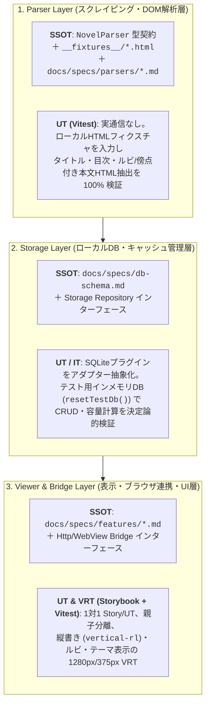

# テスト・実装規律の正本（SSOT）

本ドキュメントは、Yommy（React + TypeScript + Vite + Capacitor）における TDD（テスト駆動開発）、3層アーキテクチャのテスト責務境界、Storybook / Portable Stories / VRT 規約、カバレッジ基準、およびバグ記録・設計書同期ルールの正本（Single Source of Truth）です。

---

## 1. 基本原則（9つの鉄則）

1. **仕様・設計正本（SSOT）準拠**:
   `docs/specs/` 配下の設計書（`architecture.md`, `db-schema.md`, `features/*.md`, `parsers/*.md`）に定義された契約・受け入れ条件（`AC-xx`）を忠実に実装する。未定義の仕様を推測で実装してはならない。
2. **テストファースト（TDD）の徹底**:
   すべての機能実装・バグ修正は、単体テストを先に書く **Red（失敗確認） → Green（最小実装） → Refactor（構造改善）** のサイクルで進め、各ステップで個別にコミットを刻む。
3. **3層アーキテクチャと Capacitor Bridge の抽象化分離**:
   `Parser Layer`、`Storage Layer`、`Viewer & Bridge Layer` の責務を明確に分離し、Capacitor ネイティブ機能（`CapacitorHttp`, SQLite プラグイン, WebView インジェクション等）は薄いアダプター／インターフェース層で抽象化して、Node.js（Vitest）やブラウザ（Storybook / Playwright）上で決定論的にテスト可能にする。
4. **テスト配置の統一（Co-location）**:
   単体テスト（`*.test.ts`, `*.test.tsx`）および Storybook ファイル（`*.stories.tsx`）は、対象ソースファイルと同一ディレクトリに配置する。
5. **例外なしの 1 対 1 対応原則**:
   - 全 `*.tsx` ファイルに対して、同階層に **`*.stories.tsx`（必須）** と **`*.test.tsx`（Portable Stories `composeStories` 全件実行 ＋ ロジック補完）** を 1 対 1 で作成する。
   - 全 `*.ts` ファイル（型定義専用ファイルを除く）に対して、同階層に **`*.test.ts`（または `.test.tsx`）** を 1 対 1 で作成する。
6. **親子コンポーネント分離原則（相乗りテスト禁止）**:
   親（Page / Container）のテストでは「状態管理・Loading/Error/Ready の切り替え・子への Props 渡し」のみを検証し、子コンポーネントの表示バリエーション・境界値・イベント発火は必ず子自身の `.stories.tsx` / `.test.tsx` で独立して検証する。
7. **C0 / C1 / Functions 100% カバレッジ原則**:
   `src/` 配下の全対象ファイルにおいて、ステートメント（C0）・分岐（C1）・関数（Functions）カバレッジ **100%** を必須基準とする。
8. **日本語組版・縦書き/ルビを含む VRT の UT（Storybook）一本化**:
   視覚的回帰テスト（VRT）は Storybook の全 Story を対象として **1280px（デスクトップ/タブレット幅）および 375px（モバイル幅）** の2系統で実施する。結合テスト（Playwright IT）では VRT を行わず、画面遷移とエンドツーエンドの振る舞い検証に専念する。
9. **不備記録と原因分類 `D`（設計不備）の即時設計同期義務**:
   実装・テスト・AIレビュー中に検出された不備は製品コードと支援成果物を分離して記録する。原因が `D`（設計・仕様の誤認や不備）である場合、**コードのみを修正して設計書を放置することは厳禁**とし、必ず同一 PR 内で `docs/specs/` の設計書も同時修正する。

---

## 2. Yommy 3層アーキテクチャ別の SSOT とテスト規律

前プロジェクトにおける「OpenAPI ＋ MSW」の規律を、Web小説リーダー（React + Vite + Capacitor）の特性に合わせて以下の3層テスト規律として適用します。

### 2.1 Parser Layer（スクレイピング・DOM解析層）
- **SSOT（正本）**:
  - `NovelParser` 共通インターフェース契約（`docs/specs/architecture.md`）
  - サイト別スクレイピング仕様書（`docs/specs/parsers/*.md`）
  - 各小説サイトのサンプル HTML フィクスチャ（`__fixtures__/*.html`）
- **TDD・テスト規律**:
  - 単体テストでは外部ネットワーク通信を一切行わない。
  - ローカルのサンプル HTML フィクスチャ（正常ページ、ルビ `<ruby><rb><rt><rp>` や傍点を含む本文、複数ページ目次、短編、構造変更時の異常 HTML 等）を入力として、小説タイトル・著者・目次リスト・サニタイズ＆整形済み本文 HTML が正確に抽出されることを Vitest で C0/C1 100% 網羅する。
  - 小説サイト側の DOM 仕様変更が発生した際は、まず新しい HTML フィクスチャをテストに追加して Red を確認してからパーサーのセレクタ・抽出ロジックを修正する。

### 2.2 Storage Layer（ローカルDB・キャッシュ管理層）
- **SSOT（正本）**:
  - `docs/specs/db-schema.md`（`novels`, `chapters`, `download_queue`, 設定テーブル等のスキーマ・制約定義）
  - Storage Repository インターフェース（`docs/specs/architecture.md`）
- **TDD・テスト独立性規律**:
  - `@capacitor-community/sqlite` 等のネイティブプラグインを UI やフックから直接呼び出さず、必ず Storage アダプター／リポジトリ層で抽象化する。
  - UT（Vitest）、Storybook、および Playwright IT（Webブラウザ実行）では、同一のインターフェースを満たすテスト用インメモリ DB（または SQLite アダプターのインメモリ実装）を使用する。
  - テスト間でデータが漏洩しないよう、`beforeEach` / `afterEach`（および IT の各テスト開始前）に必ず **`resetTestDb()`** を呼び出し、決定論的な初期シード状態にリセットする。

### 2.3 Viewer & Bridge Layer（表示・ブラウザ連携・UIコンポーネント層）
- **Capacitor Bridge の分離**:
  - CORS 回避用のネイティブ HTTP 通信（`CapacitorHttp`）、レートリミット・ダウンロードキュー制御、および内蔵 WebView からの DOM 抽出ブリッジは薄いインターフェースとして分離し、UT / Storybook / IT ではモックまたはフィクスチャ応答を注入可能にする。
- **小説組版 UI 単体テスト & VRT**:
  - 縦書き（`writing-mode: vertical-rl`）/ 横書き切り替え、ルビ（`<ruby>`）・傍点表示、フォント切り替え（Noto CJK / IPAex / BIZ UD明朝・ゴシック / Klee）、カラーテーマ（白 / セピア / ダーク / 純黒）、しおり位置復元などの UI 状態を Storybook の Story として網羅する。
  - DevContainer と GitHub Actions で同一の日本語フォント環境を使用し、Storybook 全 Story に対して **1280px / 375px の VRT（視覚的回帰テスト）** を実行して組版崩れを機械的に検知する。

---

## 3. 単体テスト（UT / VRT）と結合テスト（IT）の責務マトリクス

| 観点 | UT（単体テスト & VRT） | IT（結合テスト） | Android 実機 / APK 検証 |
| :--- | :--- | :--- | :--- |
| **実行環境** | Node.js（Vitest + `jsdom`/`happy-dom`）＋ Storybook | Chromium 実ブラウザ（Playwright Test） | Android Studio エミュレータ / 実機（または Actions APK ビルド） |
| **外部通信・DB** | HTML フィクスチャ ＋ モック Bridge ＋ インメモリ DB（`resetTestDb()`） | ローカル開発サーバー ＋ フィクスチャ通信モック ＋ インメモリ DB 初期化 | 実 `CapacitorHttp` ＋ 実 `@capacitor-community/sqlite` ＋ 内蔵 WebView |
| **検証対象** | ・Parser 抽出ロジック・異常系 ・Storage CRUD・容量計算・キュー制御 ・Hooks 状態遷移・非同期競合防止 ・全 `.tsx` の Props 分岐・操作（`play`） | ・画面間のルーティング遷移（`TR-xx`） ・URL取得〜DB保存〜リーダー閲覧〜キャッシュ削除の一貫シナリオ（`SCN-01`〜） | ・ネイティブ CORS 回避通信 ・ネイティブ SQLite 永続化 ・WebView フォールバック連携・ハードウェアキー操作 |
| **VRT（視覚検証）** | **実施（Storybook に一本化）**: 全 Story を 1280px / 375px でスナップショット検証 | **不実施**: 画面遷移と機能結合の振る舞い検証に特化 | 節目（Phase 3 / ミニMilestone）での実機表示確認 |

### システム全体回帰保証（IT の進化原則）
- 結合テスト（`test/it/`）のシナリオ（`SCN-01`〜）は、今回追加した機能だけを孤立してテストするのではなく、**これまでに実装した全機能が現在のシステム仕様のもとで一貫して動作することを保証する統合スイート** として維持・進化させる。
- 過去のテストシナリオを古い仕様のまま放置・スキップ（`.skip`）することは禁止し、常に `test/it/` 全件 100% PASS を維持する。

---

## 4. TDD サイクルとコミット規約

### 4.1 Red → Green → Refactor の手順とコミット証跡
TDD の実践を Git 履歴から客観的に監査できるよう、各ステップで個別にコミットを刻みます。

| ステップ | コミットメッセージ例 | コミット時点の状態と検証内容 |
| :--- | :--- | :--- |
| **1. Red** | `test(parser): なろう小説本文のルビ抽出テストを追加（Red）` | テストコード（およびフィクスチャ/Story）のみ追加。対象 UT を実行し、**未実装により期待通りの理由で失敗する**ことを確認 |
| **2. Green** | `feat(parser): なろう小説本文のルビ・傍点抽出処理を実装（Green）` | テストを通す最小限の実装を追加（YAGNI 原則）。対象 UT を実行し、**全件 PASS する**ことを確認 |
| **3. Refactor** | `refactor(parser): DOMサニタイズ処理を共通関数へ抽出（Refactor）` | 振る舞いを変えずに可読性・型安全性を改善。対象 UT が**引き続き PASS する**ことを確認 |

### 4.2 テスト名・Storybook の日本語記述規約
- **Vitest テスト名（`it`）**:
  「〜すること」「〜する」等の自然な日本語で記述し、対応する受け入れ条件（`AC-xx`）があれば末尾に付記する（例: `it("ルビタグを保持したまま本文HTMLを抽出する (AC-02)", ...)`）。
- **Storybook ストーリー定義**:
  - エクスポート識別子は PascalCase の英語名（`export const VerticalDarkTheme: Story = ...`）とする。
  - `name` プロパティに簡潔な日本語表示名（例: `name: "縦書き・ダークテーマ"`）を設定し、JSDoc コメントで日本語の補足説明を記載する。
  - 同階層の `.test.tsx` では `@storybook/react` の `composeStories` を用いて全 Story の描画および `play` 関数を実行し、Story だけで届かないエッジケース分岐を Vitest ケースとして補完する。

---

## 5. カバレッジ基準と除外ルール

### 5.1 必須基準
- **C0（Statements / Lines）**: **100%**
- **C1（Branches）**: **100%**
- **Functions**: **100%**

### 5.2 除外が許容される唯一のケース
安易な `/* v8 ignore next */` の使用は禁止します。カバレッジ集計から除外してよいのは以下の3点のみです：
1. 実行可能な JS コードを含まない純粋な型定義ファイル（`types.ts`, `*.d.ts`）
2. Storybook のストーリー定義ファイル自体（`*.stories.tsx`。実行検証は `.test.tsx` 側で行うため）
3. TypeScript の網羅性チェック用の到達不能分岐（`default: const _exhaustiveCheck: never = value;` 等、理由コメントを明記した場合のみ）

---

## 6. バグ記録と原因分類 `D`（設計不備）の即時同期ルール

TDD の Green/Refactor 段階、自動テスト、または独立 AI レビュー（`pr-reviewer` / `phase-final-reviewer`）において不備が検出された場合は、[docs/quality/bug-and-handover-log.md](../quality/bug-and-handover-log.md) および PR 本文に記録します（通常の TDD 初回 Red は除外し、既存実装の不備やレビュー指摘等を記録対象とする）。

### 6.1 成果物区分と原因 5 分類
- **成果物区分**:
  - `製品コード`: `src/` 配下の本番アプリケーションコード（製品バグ密度や DRE 計測の集計対象）
  - `支援成果物`: テストコード、Storybook、HTML フィクスチャ、モック、CI/設定ファイル等
- **原因分類コード（5分類）**:
  - **`L` (Logic)**: 条件式・アルゴリズム・セレクタ抽出等のロジック誤り
  - **`S` (State)**: React State・キャッシュ状態・しおり位置等の状態遷移誤り
  - **`D` (Design)**: 仕様・設計書の誤認、インターフェース契約や DB スキーマとの不一致、設計考慮漏れ
  - **`B` (Boundary)**: 空文字、0件、長大テキスト、不正 HTML、特殊文字等の境界値・エッジケース考慮漏れ
  - **`A` (Async)**: 非同期競合（Race Condition）、レートリミット制御、AbortController 未連携、二重実行防止漏れ

### 6.2 【最重要】原因分類 `D` の設計書即時同期義務
不備の原因が **`D`（設計・仕様不備）** に該当する場合、**コードやテストだけを修正して終わらせることは厳格に禁止**します。
1. 必ず対応する `docs/specs/` 配下の設計書（**App 全体正本、および進行中の差分仕様 `docs/specs/changes/issue-XX-*.md` の双方**）も同一 PR 内で修正し、設計と実装の 1 対 1 整合を回復させる。
2. バグ記録の是正内容欄には、**コード修正コミットと設計書修正コミットの双方** を明記する。

