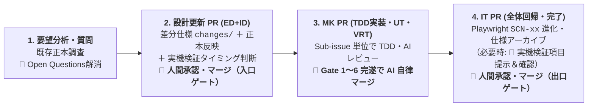

# 開発プロセス・ワークフロー標準（SSOT）

本ドキュメントは、Yommy プロジェクトにおける開発フェーズ進行、Issue 駆動マイクロ・ウォーターフォール、OKF フロントマターによる成果物ステータス管理、および完了ゲート（Task Completion Gate）の正本（Single Source of Truth）です。

---

## 1. 全体進行モデル（ハイブリッド進行）

プロジェクトのフェーズに応じて、スピードと品質ガバナンスのバランスを最適化したハイブリッド進行を採用します。

| フェーズ      | 名称・目的                                                                                 | 進行・コミット方式                                                                                         |
| :------------ | :----------------------------------------------------------------------------------------- | :--------------------------------------------------------------------------------------------------------- |
| **Phase 1**   | **AI開発基盤構築** （`docs/guidelines/`, `AGENTS.md`, Skills, Agents 整備）             | 人間と対話しながら `main` ブランチ等へ**直接コミット**で迅速に構築                                         |
| **Phase 2**   | **新要求仕様の深掘り・全体骨格設計** （`docs/specs/` 初期正本4冊の策定・合意）          | 人間と対話しながら**直接コミット**でスピーディに合意形成（合意後 `Approved` 化）                           |
| **Phase 3**   | **PoC（Walking Skeleton）** （Vite+React+Capacitor+CI 構築、技術リスク4点の最小縦貫通） | **GitHub Issue ＋ PR ＋ 独立AIレビュー（`pr-reviewer`）＋ Task Completion Gate（7条件）** を実地検証       |
| **Phase 4〜** | **本開発（イテレーティブ開発）** （PoC基盤を進化継承し、要望単位で機能開発）            | 要望（親Issue）単位の **Issue駆動マイクロ・ウォーターフォール** ＋ **ミニリリース Milestone 横断レビュー** |

---

## 2. Issue駆動マイクロ・ウォーターフォール（Phase 4 以降の標準サイクル）

要望（親 Issue）に対して、いきなりプロダクションコードを実装してはなりません。1つの要望（Feature / User Story）ごとに、以下の段階的詳細化パイプラインを小刻みに回します。

### 2.1 各ステップの進行規律

1. **Step 1: 要望分析と未確定事項（Open Questions）の確認**:
   - 親 Issue の背景・目的を確認し、既存の App 全体正本（`docs/specs/*.md`, `features/*.md`, `parsers/*.md`）とコードベースを調査する。
   - エッジケース、エラー時の振る舞い、境界値、UI 状態などで未確定事項があれば、推測で決め打ちせず人間に質問して合意を得る。
2. **Step 2: 設計更新 PR（「差分仕様の作成」＋「App 全体正本への反映」＋「実機検証計画の策定」のセット実施）【👤 人間承認・マージ】**:
   - **① 差分仕様ファイルの作成**: `docs/specs/changes/issue-XX-<slug>.md` を YAML フロントマター `type: spec-delta`, `status: Review (#親Issue番号)` で新規作成し、今回の変更目的、仕様・契約の差分、UT/VRT/IT テスト計画、実装 Sub-issue 分割リスト、および後続への申し送り事項（`HO-xx`）・実機検証計画を明記する。
   - **② App 全体正本の同時更新**: 同じ設計 PR 内で、影響を受ける App 全体正本（`requirements.md`, `architecture.md`, `db-schema.md`, `screen-transitions.md`, `features/*.md`, `parsers/*.md`）も最新仕様へ反映し、YAML フロントマターの `status` を `Review (#親Issue番号)` とする。
   - **③ Android 実機検証の実施粒度（親 Issue 単位 vs. Milestone 一括）の判断と記載**:
     - §2.2 の基準に従い、当該要望の実機検証を **「親 Issue 完了時に実施するか」** または **「Milestone 最終レビュー後にまとめて実施するか」** を判断する。
     - 判断結果と実機検証観点を以下の **3 箇所** に記載する：
       1. 差分仕様書（`docs/specs/changes/issue-XX-<slug>.md` の「5. 申し送り事項・実機検証計画」）
       2. 親 Issue 本文の進行チェックリスト（親 Issue 単位で実機検証を行う場合は確認項目リストも併記）
       3. `docs/quality/bug-and-handover-log.md` の `HO-xx` 完了ゲート欄（`親 Issue #XX 完了前` または `Milestone v0.X 完了前`）
   - **人間が設計 PR をレビュー・マージした時点で、差分仕様および更新された App 全体正本は `Approved`（局所的再承認）とみなす**（仕様の入口ゲート）。
3. **Step 3: MK（TDD実装・単体テスト・VRT）【🤖 Gate 1〜6 完遂で AI 自律マージ】**:
   - 分割された Sub-issue ごとに、[docs/guidelines/testing.md](testing.md) に従い TDD（Red → Green → Refactor）で実装する。
   - Sub-issue の推奨粒度は 1 PR あたり 200〜400 行程度（①Parser/Storage/Bridge ロジック層、②UI 子コンポーネント＋Storybook/VRT 層、③Page 結合層など）。ごく小さな機能は 1 PR に統合可。
   - 実装中に設計の不備・矛盾（原因分類 `D`）を発見した場合は、コードのみを修正せず、**同一 PR 内で差分仕様（`changes/issue-XX-*.md`）と App 全体正本の両方を同時修正** する。
   - MK Sub-issue PR（`Closes #Sub-issue番号`）において、§4 の Task Completion Gate 条件 1〜6 をすべて満たし、かつ **§4.1 の人間エスカレーション条件に該当しない場合、メインエージェント（Orchestrator）は `gh pr merge --squash --delete-branch` で PR を自律マージし、人間のマージを待たずに次の Sub-issue へ進んでよい**。
4. **Step 4: IT（結合テスト・全体回帰保証）・実機検証（対象時）・申し送り精算・差分仕様のアーカイブ【👤 人間承認・マージ】**:
   - Playwright 実ブラウザ結合テスト（`SCN-01`〜）を最新仕様に合わせて更新・追加し、過去機能を含め全シナリオ 100% PASS を確認する（小規模改修では MK PR に同梱可）。
   - `docs/quality/bug-and-handover-log.md` のバグ記録および該当 Issue の申し送り事項（`HO-xx`）がすべて消化（または Milestone 完了前ゲート分として明確に引き継ぎ）されていることを確認する。
   - 親 Issue を完了させる最終 PR（`Closes #親Issue番号`）において、完了した差分仕様ファイルの YAML フロントマター `status` を `Completed (Archived)` に更新した上で **`docs/specs/changes/archive/issue-XX-<slug>.md` へ移動（`git mv`）** し、`changes/` 直下には進行中の差分仕様のみが存在する状態を保つ。
   - **📱 親 Issue 単位での実機検証を実施する場合**:
     - 最終 PR（`Closes #親Issue番号`）を作成し、Task Completion Gate 条件 1〜6（CI / 独立 `pr-reviewer` レビュー収束）をすべて通過した段階で、AI は人間に **構造化された「Android 実機検証試験項目表」（前提・操作手順・期待される挙動）** を提示する。
     - 人間が実機検証を行い、問題なければそのまま最終 PR をマージして親 Issue を完了させる。実機検証で不具合が見つかった場合は、当該 PR（または追加 PR）で TDD 修正・設計同期・バグ記録追加・Gate 1〜6 再検証を行い、実機再確認 OK となってからマージする。
   - **親 Issue をクローズする最終 PR（`Closes #親Issue番号`）は必ず人間の最終確認・マージを待つ（親 Issue の出口ゲート）**。

### 2.2 Android 実機検証の実施判断基準と試験項目表フォーマット

単純に毎回すべての親 Issue の最後に実機検証を行うと開発のテンポが損なわれる一方、実機確認すべき事項が多い機能を Milestone 終盤まで溜めると手戻りが大きくなるため、**親 Issue の Step 2（設計時）に以下の基準で実施タイミングを判断** します。

| 区分                                                  | 判断基準（Step 2 設計時に判定）                                                                                                                                                                                                                                                                                                                        | `HO-xx` 完了ゲート      | 試験項目表の提示タイミング                                                                                             |
| :---------------------------------------------------- | :----------------------------------------------------------------------------------------------------------------------------------------------------------------------------------------------------------------------------------------------------------------------------------------------------------------------------------------------------- | :---------------------- | :--------------------------------------------------------------------------------------------------------------------- |
| **A. 親 Issue 単位で実機検証を実施**                  | 以下の **いずれか 1 つ以上** に該当し、実機での検証観点が複数見込まれる場合： 1. Android ネイティブ層（Java / Capacitor Plugin / WebView ブリッジ / OS 権限・インテント）の新設・変更 2. タッチ・スワイプ・ハードウェアキー等の物理操作、またはアニメーション・実機レイアウト計算を伴う変更 3. 実機検証項目が目安 **3 項目以上** 発生する場合 | `親 Issue #XX 完了前`   | **親 Issue の最終 PR（`Closes #親Issue`）が Gate 1〜6 を通過した直後**（人間の最終マージ前）                           |
| **B. Milestone 最終レビュー後に一括で実機検証を実施** | 上記 A に該当しない場合（純粋な Parser ロジック、DB クエリ、標準的な Web UI コンポーネント変更など、UT / Storybook VRT / Playwright IT で十分に担保でき、実機確認が軽微なスモーク確認に留まる場合）                                                                                                                                                    | `Milestone v0.X 完了前` | **Milestone Step 2（横断レビュー指摘是正 PR）を AI が自律マージした直後**（Milestone Step 3 品質分析・最終承認 PR 前） |

- **実機検証試験項目表の提示ルール**:
  実機検証タイミング（上記 A または B）に到達した際、AI は必ず以下の要素を備えた **「Android 実機検証試験項目表」** を人間へ出力する：
  1. **検証対象の `HO-xx` / Issue 番号とビルド対象ブランチ（または SHA）**
  2. **カテゴリ別の試験項目表**（`項番` / `確認項目` / `具体的な操作手順` / `期待される結果（OK条件）`）
  3. **効率的な一筆書き確認ルート**（最短手数で全項目を通し確認できる操作順ガイド）

---

## 3. 成果物ステータス管理（OKF YAML フロントマター `status`）

`docs/specs/` 配下の設計ドキュメントの状態は、各ファイル先頭の YAML フロントマター内の `status` フィールドで管理します（詳細は [docs/index.md](../index.md#4-okfopen-knowledge-formatyaml-フロントマター規約) 参照）。

| 状態            | `status` 表記例                         | 意味・遷移条件                                                                                                                                                               |
| :-------------- | :-------------------------------------- | :--------------------------------------------------------------------------------------------------------------------------------------------------------------------------- |
| **`Draft`**     | `Draft`                                 | 初期作成中・対話検討中（Phase 2 の初期ドラフト等）                                                                                                                           |
| **`Review`**    | `Review (#12)`                          | PR 提出済み・レビュー待ち。個別作業 PR では必ず `Review` 状態とし、AI が勝手に `Approved` に書き換えてはならない                                                             |
| **`Approved`**  | `Approved (Phase 2)` / `Approved (#12)` | 人間レビュアーによる合意・承認完了                                                                                                                                           |
| **`Completed`** | `Completed (Archived)`                  | 親 Issue の全工程が完了し `docs/specs/changes/archive/` へアーカイブされた差分仕様、または Milestone 完了（Step 3）に伴い `docs/quality/archive/` へアーカイブされた品質記録 |

### 局所的再承認（Local Re-approval）ルール

- 設計更新 PR（または実装中に原因 `D` で設計書を同期修正した PR）がレビューを経てマージされた時点で、当該設計書は承認（`Approved`）されたものとみなします。
- 節目（Phase 2 完了時やミニリリース Milestone 完了時）の全体横断レビュー完了時に、対象ドキュメントの YAML フロントマター `status` を一括で `Approved` に揃えます。

---

## 4. Task Completion Gate（7つの完了条件）

Phase 3 以降のすべての PR 作業において、**PR を作成しただけで作業完了と報告してはなりません**。以下の7条件を順番に完遂します。

1. **静的検査・自動テスト PASS**:
   - `npm run typecheck`, `npm run lint`, `npm run format:check` および対象フェーズの自動テスト（`npm run test:unit`, `npm run test:coverage` で C0/C1/Functions 100%）がすべて PASS していること。
   - `docs/` 配下を変更した場合は `node .github/skills/sdd/scripts/validate-okf.mjs` が PASS していること。
2. **VRT 整合性 PASS**:
   - UI コンポーネント（`*.tsx` / `*.stories.tsx`）を追加・変更した場合、`npm run test:vrt:update` でスナップショット（1280px / 375px）を更新し、`npm run test:vrt` が PASS していること。
3. **PR 作成と Issue 連動設定**:
   - PR 本文に目的・変更内容・検証結果・バグ記録＆申し送りミニテーブルを記載し、原則として `Closes #N` を設定すること（複数 PR に分割する途中段階のみ `Refs #N` を使用）。
   - **AI による Issue の直接クローズ（`gh issue close` 等）や `gh pr review --approve` による自己承認は厳禁**。必ず PR マージによって対象 Issue（または Sub-issue）が同期クローズされる仕組みを厳守する。
4. **GitHub Actions PASS**:
   - リモート上の必須 CI ワークフロー（静的検査・UT・VRT・IT・Build を包含する `quality-gate`）が PASS していること。
5. **独立 AI レビューの実施**:
   - 実装担当とは独立したレビュアー（`.github/agents/pr-reviewer.agent.md`）によるコード・設計照合レビューを実施し、[docs/guidelines/review-comment-format.md](review-comment-format.md) 準拠のコメントが PR に記録されていること。
6. **全指摘スレッドの是正・再検証・Resolve 収束**:
   - 指摘事項に対する修正コミットと返信を行い、レビュアーによる再確認を経て、すべての Actionable な指摘スレッドが解決（Resolved）されていること（原因 `D` の指摘は設計書も同時修正されていること）。
7. **PR 種別に応じたマージ完了（👤 人間承認・マージ待機 または 🤖 AI 自律マージ）**:
   - 上記 1〜6 の完了後、PR の種別に応じて以下の通りマージを行う：

| PR 種別                                                                                             |        マージ権限         | 完了アクション                                                                                                                                                                       |
| :-------------------------------------------------------------------------------------------------- | :-----------------------: | :----------------------------------------------------------------------------------------------------------------------------------------------------------------------------------- |
| **① Step 2: 設計更新 PR**（`Refs #親Issue`）                                                        |        **👤 人間**        | Gate 1〜6 完了を人間に報告し、人間の最終確認・マージを待つ（入口ゲート）。                                                                                                           |
| **② Step 3: MK Sub-issue PR**（`Closes #Sub-issue`）                                                | **🤖 AI（Orchestrator）** | §4.1 のエスカレーション条件に該当しないことを確認の上、`gh pr merge --squash --delete-branch` で自律マージし、直ちに次の Sub-issue（または Step 4）へ進む。                          |
| **③ Step 4: 最終 IT PR / 親 Issue 完了 PR**（`Closes #親Issue`）                                    |        **👤 人間**        | Gate 1〜6 完了を人間に報告（親 Issue 実機検証対象時は「Android 実機検証試験項目表」を併せて提示）し、人間の最終確認・マージを待つ（出口ゲート）。                                    |
| **④ Milestone Step 2: 横断レビュー指摘是正 PR**（`Closes #Sub-issue` / 実機不具合追加是正 PR 含む） | **🤖 AI（Orchestrator）** | §4.1 のエスカレーション条件に該当しないことを確認の上、自律マージし、直ちに「Android 実機検証試験項目表」を提示して実機検証フェーズ（実機 OK 後は Step 3 PR 作成）へ進む。           |
| **⑤ Milestone Step 3: 品質分析 Kaizen・ログアーカイブ・最終承認 PR**（`Closes #MilestoneIssue`）    |        **👤 人間**        | 横断レビュー是正と実機検証の完全収束後、品質分析レポート・再発防止 Kaizen・バグ＆HO アーカイブ・正本一括 `Approved` 化を行い、Gate 1〜6 完了を報告して人間の最終承認・マージを待つ。 |

### 4.1 AI 自律マージの停止（人間エスカレーション）条件

上記テーブルで「🤖 AI（Orchestrator）」が自律マージ可能な中間 PR（Step 3 MK Sub-issue PR、および Milestone Step 2 指摘是正 PR）であっても、**以下のいずれか 1 つ以上に該当する場合は自律マージを停止し、人間に報告して承認・マージを仰がなければなりません**：

1. **承認済み外部仕様・契約の変更を伴う原因 `D` の発生**:
   - 実装・検証中に、Step 2 で合意済みの「受入条件（`AC-xx`）」「画面遷移（`TR-xx`）」「DB スキーマ定義（テーブル/カラム）」「ユーザー向け UI/UX 挙動」を変更する必要が生じた場合（※内部関数名、定数切り出し、テストファイルパス追記等の外部挙動を変えない軽微な設計書同期は自律マージ可）。
2. **新規パッケージ・ネイティブ権限・外部通信先の追加**:
   - `package.json` や Gradle への新規依存パッケージ追加、`AndroidManifest.xml` のパーミッション追加、または承認済み設計に含まれない新規外部通信先ドメインを追加する場合。
3. **ワークフロー・ガバナンス・CI 定義自体の変更**:
   - `AGENTS.md`, `docs/guidelines/workflow.md`, `.github/workflows/*.yml` 等の開発憲法・ゲート定義自体を変更する場合。
4. **独立 AI レビューの未収束**:
   - `pr-reviewer` との指摘解消ループが 3 ラウンド以上収束しない場合、または仕様解釈・トレードオフ判断が割れた場合。
5. **親 Issue クローズを兼ねる統合 PR**:
   - 小規模な要望で MK と IT を 1 本の PR に統合し、PR に `Closes #親Issue番号` が設定されている場合（親 Issue の出口ゲートにあたるため人間マージとする）。

---

## 5. ミニリリース Milestone と品質改善（Kaizen）ループ

Phase 4 以降は、直近の要望（親 Issue）を 3〜5 件程度束ねた **「ミニリリース Milestone（`v0.1`, `v0.2` 等）」** を設定し、各 Milestone 内の要望 Issue がすべて完了した節目に以下の **3段階ゲート** で全体横断レビュー・実機検証・品質分析（Kaizen）・完了承認を実施します。

> [!IMPORTANT]
> **実機検証完了後に品質分析（Kaizen）とアーカイブを一括実施する理由**:
> 横断レビュー指摘の修正後に実施する Android 実機検証において追加の不具合が発見・是正されることがあるため、**品質分析レポート作成（バグ密度・DRE・原因分類集計）および再発防止策（Kaizen）は Step 2 ではなく、実機検証まで完全収束した Step 3 でバグ記録アーカイブ化と一緒に一括実施** し、手戻りや二重集計を防止します。

1. **Step 1: 全体横断レビュー（`phase-final-review`）【👤 人間が各モデルでキック】**:
   - 複数の読み取り専用サブエージェントを用いて、`docs/specs/`（正本）、プロダクションコード、単体テスト/VRT、結合テスト（`SCN-xx`）、および `docs/quality/bug-and-handover-log.md` の整合性をアンカリングなしで横断検証し、Milestone 承認 Issue に Round 1 レビュー結果をコメント記録する。
   - **マルチモデル・複数オーケストレーター並行レビュー**: モデルの推論深度や着眼点の違い（網羅性、アーキテクチャ整合性、潜在バグ検出等）を活かすため、人間が異なるモデル（Gemini Flash / Pro / Claude 等）でオーケストレーターを複数起動して並行レビューを実施する。
   - **追記スレッドと ID 連番規律（投稿直前フェッチ＋投稿直後の衝突検知・自動リナンバー）**:
     - 複数のオーケストレーターがほぼ同時に並行起動されるため、**レビュー開始時（Step 1 着手時）に `gh issue view <issue-number> --comments` で既存コメントを取得してはならない**（アンカリング防止、およびレビュー中の数分間に他エージェントが投稿して開始時点の最新 ID が陳腐化・重複するのを防ぐため）。
     - 各オーケストレーターは、全サブエージェントの検証・事実照合・ローカル品質ゲート確認がすべて完了し、**コメント本文を投稿する直前** に初めて既存コメントを取得して最終 ID の次番から採番し、さらに **投稿完了直後にも既存コメントを再取得** して万一他エージェントと ID が衝突していた場合は即座に自己コメントを PATCH 更新して連番に振り直す（詳細は [docs/guidelines/review-comment-format.md §5.1](review-comment-format.md#51-指摘-idfinding-idの採番ルールラウンドプレフィックス方式) 参照）。
2. **Step 2: 横断レビュー指摘是正 PR ＆ Android 実機検証【🤖 指摘是正 PR は AI 自律マージ → 📱 人間による実機検証】**:
   - **① 横断レビュー指摘（`R1-xx`）の是正 PR 作成・自律マージ**:
     - 全モデルの Round 1 コメントが出揃い人間から Step 2 開始指示を受けた後、Sub-issue を起票して横断レビューで検出された全指摘（`R1-xx`）を是正し、`docs/quality/bug-and-handover-log.md` にバグ記録を追記する（規模に応じて複数の Sub-issue PR に分割可）。
     - Gate 1〜6 完遂後、AI（Orchestrator）は Step 2 の指摘是正 PR（`Closes #Sub-issue`）を自律マージする。
   - **② Android 実機検証試験項目表の提示と実機確認・是正ループ**:
     - 指摘是正 PR の自律マージ直後、AI は未消化の実機申し送り事項（`HO-xx`）および横断レビューでの修正箇所を網羅した **「Android 実機検証試験項目表」** を人間に提示する。
     - 人間が実機検証を実施し、不具合が見つかった場合は AI が追加是正 PR（TDD 修正・設計同期・`bug-and-handover-log.md` 記録・Gate 1〜6 検証）を作成・自律マージし、実機再確認で全項目 OK（未解決 `HO-xx` が 0 件）となるまで収束させる。
3. **Step 3: 品質分析レポート（Kaizen）・バグ記録アーカイブ・正本仕様一括 `Approved` 化と Milestone 最終承認【👤 人間承認・マージ】**:
   - 横断レビュー是正および Android 実機検証がすべて完了・収束（Round 2 残存指摘 0 件・未解決 `HO-xx` 0 件）した確定状態に基づき、Milestone 承認 Issue をクローズする **最終 PR（`Closes #Milestone承認Issue`）** で以下の ①〜④ を一括実施する：
     - **① 品質分析レポート（`docs/quality/reports/<milestone>.md`）の作成とサマリー追記**:
       - 当該 Milestone で検出された全バグ記録（横断レビューおよび実機検証での検出分を含む確定値）を集計し、定量品質メトリクス、製品コードバグ密度、原因分類（`L`/`S`/`D`/`B`/`A`）傾向、欠陥除去率（DRE）、および精算済み申し送り事項（`HO-xx`）を分析した品質レポート（`type: quality-report`, `status: "Approved"`）を作成する。あわせて `docs/quality/bug-and-handover-log.md` §4 に当該 Milestone の振り返りサマリーを追記する。
     - **② 再発防止策（Kaizen）のガイドライン・スキル反映**:
       - 多発した原因や横断レビュー・実機検証まで流出した不備に対する再発防止策として、`docs/guidelines/testing.md` や `.github/skills/*/SKILL.md` の規約・チェックリスト改善を同一 PR に含める。
     - **③ バグ記録・解決済み申し送りのアーカイブ化**:
       - 当該 Milestone で完了したバグ記録（No. xx〜yy）および解決済み（`Resolved`）の申し送り事項（`HO-xx`）を `docs/quality/archive/<milestone>-log.md`（OKF `type: quality-log`, `status: "Completed (Archived)"`）へ移動しアーカイブ化する。
       - 正本台帳 `docs/quality/bug-and-handover-log.md` から完了分を除去し、「次期作業中マイルストーンのバグ記録枠」および「未解決（`Open`）の申し送り事項」のみが残るクリーンな状態に整理する（`docs/index.md` のツリーにも新規アーカイブおよびレポートを登録する）。
     - **④ 正本仕様の一括 `Approved` 化**:
       - `docs/specs/` 配下の正本仕様書のフロントマター `status` がすべて `"Approved"` に揃っていることを確認・更新する。
   - **⑤ 人間による最終承認とマージ**: 上記 Step 3 PR で Gate 1〜6 を完遂した上で人間に報告し、**人間がレビュー・マージすることで Milestone 完了を確定** し、次期 Milestone へ移行する。
