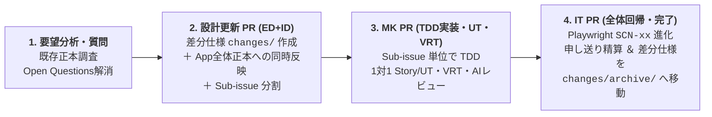

# 開発プロセス・ワークフロー標準（SSOT）

本ドキュメントは、Yommy プロジェクトにおける開発フェーズ進行、Issue 駆動マイクロ・ウォーターフォール、OKF フロントマターによる成果物ステータス管理、および完了ゲート（Task Completion Gate）の正本（Single Source of Truth）です。

---

## 1. 全体進行モデル（ハイブリッド進行）

プロジェクトのフェーズに応じて、スピードと品質ガバナンスのバランスを最適化したハイブリッド進行を採用します。

| フェーズ      | 名称・目的                                                                                 | 進行・コミット方式                                                                                         |
| :------------ | :----------------------------------------------------------------------------------------- | :--------------------------------------------------------------------------------------------------------- |
| **Phase 1**   | **AI開発基盤構築** （`docs/guidelines/`, `AGENTS.md`, Skills, Agents 整備）             | 人間と対話しながら `main` ブランチ等へ**直接コミット**で迅速に構築                                         |
| **Phase 2**   | **新要求仕様の深掘り・全体骨格設計** （`docs/specs/` 初期正本4冊の策定・合意）          | 人間と対話しながら**直接コミット**でスピーディに合意形成（合意後 `Approved` 化）                           |
| **Phase 3**   | **PoC（Walking Skeleton）** （Vite+React+Capacitor+CI 構築、技術リスク4点の最小縦貫通） | **GitHub Issue ＋ PR ＋ 独立AIレビュー（`pr-reviewer`）＋ Task Completion Gate（7条件）** を実地検証       |
| **Phase 4〜** | **本開発（イテレーティブ開発）** （PoC基盤を進化継承し、要望単位で機能開発）            | 要望（親Issue）単位の **Issue駆動マイクロ・ウォーターフォール** ＋ **ミニリリース Milestone 横断レビュー** |

---

## 2. Issue駆動マイクロ・ウォーターフォール（Phase 4 以降の標準サイクル）

要望（親 Issue）に対して、いきなりプロダクションコードを実装してはなりません。1つの要望（Feature / User Story）ごとに、以下の段階的詳細化パイプラインを小刻みに回します。

### 2.1 各ステップの進行規律

1. **Step 1: 要望分析と未確定事項（Open Questions）の確認**:
   - 親 Issue の背景・目的を確認し、既存の App 全体正本（`docs/specs/*.md`, `features/*.md`, `parsers/*.md`）とコードベースを調査する。
   - エッジケース、エラー時の振る舞い、境界値、UI 状態などで未確定事項があれば、推測で決め打ちせず人間に質問して合意を得る。
2. **Step 2: 設計更新 PR（「差分仕様の作成」＋「App 全体正本への反映」のセット実施）**:
   - **① 差分仕様ファイルの作成**: `docs/specs/changes/issue-XX-<slug>.md` を YAML フロントマター `type: spec-delta`, `status: Review (#親Issue番号)` で新規作成し、今回の変更目的、仕様・契約の差分、UT/VRT/IT テスト計画、実装 Sub-issue 分割リスト、および後続への申し送り事項（`HO-xx`）を明記する。
   - **② App 全体正本の同時更新**: 同じ設計 PR 内で、影響を受ける App 全体正本（`requirements.md`, `architecture.md`, `db-schema.md`, `screen-transitions.md`, `features/*.md`, `parsers/*.md`）も最新仕様へ反映し、YAML フロントマターの `status` を `Review (#親Issue番号)` とする。
   - 人間が設計 PR をレビュー・マージした時点で、差分仕様および更新された App 全体正本は `Approved`（局所的再承認）とみなす。
3. **Step 3: MK（TDD実装・単体テスト・VRT）**:
   - 分割された Sub-issue ごとに、[docs/guidelines/testing.md](testing.md) に従い TDD（Red → Green → Refactor）で実装する。
   - Sub-issue の推奨粒度は 1 PR あたり 200〜400 行程度（①Parser/Storage/Bridge ロジック層、②UI 子コンポーネント＋Storybook/VRT 層、③Page 結合層など）。ごく小さな機能は 1 PR に統合可。
   - 実装中に設計の不備・矛盾（原因分類 `D`）を発見した場合は、コードのみを修正せず、**同一 PR 内で差分仕様（`changes/issue-XX-*.md`）と App 全体正本の両方を同時修正（局所的再承認）** する。
4. **Step 4: IT（結合テスト・全体回帰保証）・申し送り精算・差分仕様のアーカイブ**:
   - Playwright 実ブラウザ結合テスト（`SCN-01`〜）を最新仕様に合わせて更新・追加し、過去機能を含め全シナリオ 100% PASS を確認する（小規模改修では MK PR に同梱可）。
   - `docs/quality/bug-and-handover-log.md` のバグ記録および該当 Issue の申し送り事項（`HO-xx`）がすべて消化（または次 Issue へ明確に引き継ぎ）されていることを確認する。
   - 親 Issue を完了させる最終 PR（`Closes #親Issue番号`）において、完了した差分仕様ファイルの YAML フロントマター `status` を `Completed (Archived)` に更新した上で **`docs/specs/changes/archive/issue-XX-<slug>.md` へ移動（`git mv`）** し、`changes/` 直下には進行中の差分仕様のみが存在する状態を保つ。

---

## 3. 成果物ステータス管理（OKF YAML フロントマター `status`）

`docs/specs/` 配下の設計ドキュメントの状態は、各ファイル先頭の YAML フロントマター内の `status` フィールドで管理します（詳細は [docs/index.md](../index.md#4-okfopen-knowledge-formatyaml-フロントマター規約) 参照）。

| 状態            | `status` 表記例                         | 意味・遷移条件                                                                                                   |
| :-------------- | :-------------------------------------- | :--------------------------------------------------------------------------------------------------------------- |
| **`Draft`**     | `Draft`                                 | 初期作成中・対話検討中（Phase 2 の初期ドラフト等）                                                               |
| **`Review`**    | `Review (#12)`                          | PR 提出済み・レビュー待ち。個別作業 PR では必ず `Review` 状態とし、AI が勝手に `Approved` に書き換えてはならない |
| **`Approved`**  | `Approved (Phase 2)` / `Approved (#12)` | 人間レビュアーによる合意・承認完了                                                                               |
| **`Completed`** | `Completed (Archived)`                  | 親 Issue の全工程が完了し、`docs/specs/changes/archive/` へアーカイブされた差分仕様                              |

### 局所的再承認（Local Re-approval）ルール

- 設計更新 PR（または実装中に原因 `D` で設計書を同期修正した PR）を人間がレビューしてマージした時点で、当該設計書は承認（`Approved`）されたものとみなします。
- 節目（Phase 2 完了時やミニリリース Milestone 完了時）の全体横断レビュー完了時に、対象ドキュメントの YAML フロントマター `status` を一括で `Approved` に揃えます。

---

## 4. Task Completion Gate（7つの完了条件）

Phase 3 以降のすべての PR 作業において、**PR を作成しただけで作業完了と報告してはなりません**。以下の7条件をすべて満たした時点で初めてタスク完了（人間マージ待機）となります。

1. **静的検査・自動テスト PASS**:
   - `npm run typecheck`, `npm run lint`, `npm run format:check` および対象フェーズの自動テスト（`npm run test:unit`, `npm run test:coverage` で C0/C1/Functions 100%）がすべて PASS していること。
2. **VRT 整合性 PASS**:
   - UI コンポーネント（`*.tsx` / `*.stories.tsx`）を追加・変更した場合、`npm run test:vrt:update` でスナップショット（1280px / 375px）を更新し、`npm run test:vrt` が PASS していること。
3. **PR 作成と Issue 連動設定**:
   - PR 本文に目的・変更内容・検証結果・バグ記録＆申し送りミニテーブルを記載し、原則として `Closes #N` を設定すること（複数 PR に分割する途中段階のみ `Refs #N` を使用）。
   - **AI による Issue の直接クローズ（`gh issue close` 等）や PR の自己承認・マージは厳禁**。人間が PR をマージすることで Issue が同期クローズされる仕組みを厳守する。
4. **GitHub Actions PASS**:
   - リモート上の必須ワークフロー（CI / VRT / IT）がすべて PASS していること。
5. **独立 AI レビューの実施**:
   - 実装担当とは独立したレビュアー（`.github/agents/pr-reviewer.agent.md`）によるコード・設計照合レビューを実施し、[docs/guidelines/review-comment-format.md](review-comment-format.md) 準拠のコメントが PR に記録されていること。
6. **全指摘スレッドの是正・再検証・Resolve 収束**:
   - 指摘事項に対する修正コミットと返信を行い、レビュアーによる再確認を経て、すべての Actionable な指摘スレッドが解決（Resolved）されていること（原因 `D` の指摘は設計書も同時修正されていること）。
7. **人間による最終承認・マージ待機**:
   - 上記 1〜6 の完了を人間に報告し、人間の最終確認とマージを待つこと。

---

## 5. ミニリリース Milestone と品質改善（Kaizen）ループ

Phase 4 以降は、直近の要望（親 Issue）を 3〜5 件程度束ねた **「ミニリリース Milestone（`v0.1`, `v0.2` 等）」** を設定し、各 Milestone 内の要望 Issue がすべて完了した節目に以下の **3段階ゲート** で全体横断レビューと継続的改善を実施します。

1. **Step 1: 全体横断レビュー（`phase-final-review`）**:
   - 複数の読み取り専用サブエージェントを用いて、`docs/specs/`（正本）、プロダクションコード、単体テスト/VRT、結合テスト（`SCN-xx`）、および `docs/quality/bug-and-handover-log.md` の整合性をアンカリングなしで横断検証し、Milestone 承認 Issue に Round 1 レビュー結果をコメント記録する。
   - **マルチモデル・複数オーケストレーター並行レビュー**: モデルの推論深度や着眼点の違い（網羅性、アーキテクチャ整合性、潜在バグ検出等）を活かすため、異なるモデル（Gemini Flash / Pro / Claude 等）でオーケストレーターを複数起動して並行レビューを実施することを推奨する。
   - **追記スレッドと ID 連番規律**: 各オーケストレーターはコメント投稿前に必ず Issue 上の既存コメントを確認する。先行するオーケストレーターのコメントが既に存在する場合、自身のレビュー対象モデル・視点を明記した独立した追記コメント（スレッド）として投稿し、指摘 ID（`R1-01` 等）は先行コメントの最終連番を引き継いで重複なく採番する。
2. **Step 2: 指摘是正・品質分析レポート作成（Kaizen PR）**:
   - 横断レビュー（各モデルの追記スレッドで検出された全指摘）を是正する。
   - `docs/quality/bug-and-handover-log.md` のバグ記録を集計し、製品コードバグ密度、原因分類（`L`/`S`/`D`/`B`/`A`）の傾向、欠陥除去率（DRE: 単体テスト・レビュー段階での除去率）、および未消化の申し送り事項（`HO-xx`）を分析した品質レポート（`type: quality-report`）を `docs/quality/reports/` に作成する。
   - 再発防止策として、`docs/guidelines/` や `.github/skills/*/SKILL.md` の規約・チェックリスト改善を同一 PR に含める。
3. **Step 3: 人間による Milestone 承認と次 Milestone への移行**:
   - 指摘収束（Round 2）と全品質ゲート PASS を確認し、人間の承認・マージをもって Milestone を完了とする。
