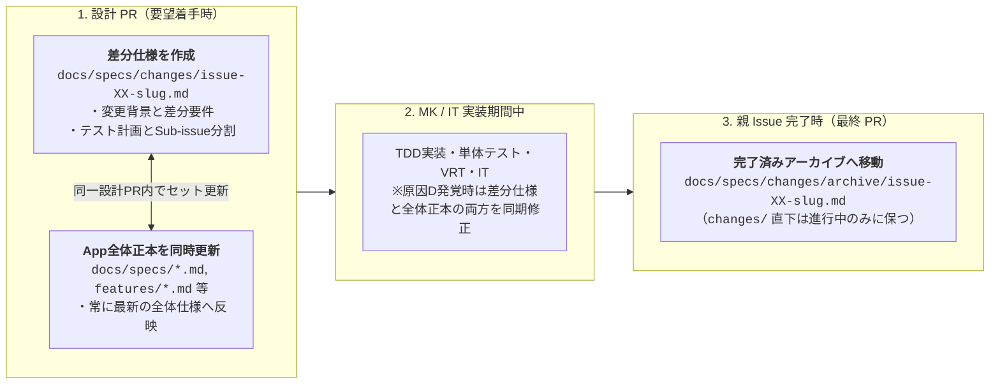

# Yommy ドキュメント全体マップ・OKF 知識バンドル規約

本ディレクトリ（`docs/`）は、Android 向け Web 小説リーダーアプリ **「Yommy」** における人間と AI エージェント双方の Single Source of Truth（SSOT：唯一の正本）であり、**OKF（Open Knowledge Format）** に準拠した知識バンドル（Knowledge Bundle）として管理されます。

---

## 1. ディレクトリ構成と3本柱

ドキュメントが陳腐化（腐敗）せず、常に「現在のアプリ全体の仕様」と「要望ごとの変更差分」を明確に区別できるよう、OKF 予約ファイルである本目次（`docs/index.md`）を起点に以下の3本柱（`guidelines` / `specs` / `quality`）で構成します。

```text
docs/
├── index.md                           # [OKF 予約名] ドキュメント全体目次・OKF 知識バンドル規約（本ファイル）
├── guidelines/                        # 【柱1：人間・AI共通の開発規約・基準の正本】
│   ├── workflow.md                    # 開発プロセス標準（マイクロWF、正本＋差分仕様の2層管理、Task Completion Gate 7条件、ミニMilestone運用）
│   ├── testing.md                     # テスト・実装規律の正本（TDD、3層責務境界、1対1 Story/UT、親子分離、縦書きVRT、C0/C1 100%、バグ記録・原因D設計同期）
│   └── review-comment-format.md       # レビューコメント記述基準（[P0]〜[P3] ＋ 4要素フォーマット、横断レビュー集約形式）
├── specs/                             # 【柱2：製品仕様・設計（App全体正本 ＋ 差分仕様の2層構成）】
│   ├── requirements.md                # [App全体正本] 全体要件定義・機能一覧・ミニMilestoneロードマップ
│   ├── architecture.md                # [App全体正本] 3層アーキテクチャと共通インターフェース契約
│   ├── db-schema.md                   # [App全体正本] SQLite 主要テーブル定義の正本
│   ├── screen-transitions.md          # [App全体正本] 主要画面一覧（SCR-xx）と画面遷移（TR-xx）の全体マップ
│   ├── features/                      # [App全体正本] 画面・機能別の現在仕様書（AC一覧・コンポーネント構成・テスト責務）
│   │   ├── bookshelf.md               # 本棚画面仕様書（SCR-01: BookshelfPage / NovelCard / useBookshelf）
│   │   ├── search.md                  # 検索画面仕様書（SCR-06: SearchPage / SearchNovelCard / useNovelSearch）
│   │   ├── ranking.md                 # ランキング画面仕様書（SCR-07: RankingPage / RankingNovelCard / useNovelRanking）
│   │   ├── novel-detail.md            # 作品詳細・目次画面仕様書（SCR-02: NovelDetailPage / EpisodeList / useNovelDetail）
│   │   ├── reader-view.md             # 小説リーダー画面仕様書（SCR-03: ReaderPage / ReaderView / ReaderBottomOverlay / ReaderChapterNav / useReader）
│   │   └── settings.md                # 設定画面仕様書（SCR-05: SettingsPage / SettingsContainer / SampleTextPreview / useSettings）
│   ├── parsers/                       # [App全体正本] 小説サイト別の現在スクレイピング・DOM解析仕様書
│   │   └── kakuyomu.md                # カクヨム パーサー・スクレイピング仕様書（kakuyomu.jp）
│   └── changes/                       # [差分仕様 (Delta Specs)] 要望（親Issue）ごとの設計差分・テスト計画・Sub-issue分割
│       ├── issue-79-four-tabs-search-ranking.md # [Review] 下部4タブ化・カクヨム検索・ランキング画面新設の差分仕様 (#79)
│       └── archive/                   # 完了済みの差分仕様アーカイブ（親Issueクローズ時に git mv で移動）
│           ├── issue-12-bookshelf-and-routing.md # [Archived] 本棚画面・共通ルーティング基盤の差分仕様 (#12)
│           ├── issue-13-novel-detail-and-toc.md # [Archived] 作品詳細・目次画面・オンデマンド取得の差分仕様 (#13)
│           ├── issue-14-reader-navigation-bookmark-settings.md # [Archived] 小説リーダー・前後話ナビ・しおり・組版設定の差分仕様 (#14)
│           ├── issue-15-app-icon-setup.md     # [Archived] アプリアイコン・ブランディング設定の差分仕様 (#15)
│           ├── issue-50-fullscreen-shell-and-settings.md # [Archived] 100dvh全画面シェル・下部タブ・設定画面・論理階層遷移の差分仕様（#50）
│           ├── issue-51-novel-detail-layout-and-scroll.md # [Archived] 作品詳細・目次画面（SCR-02）レイアウト固定・あらすじトグル・内部スクロール差分仕様 (#51)
│           ├── issue-52-reader-fullscreen-and-bottom-overlay.md # [Archived] 小説リーダー画面全画面テキスト表示化・下部オーバーレイ差分仕様 (#52)
│           ├── issue-78-apk-signing-and-back-button.md # [Archived] Android APK上書きインストール修正・実機戻るボタン論理階層遷移の差分仕様 (#78)
│           └── .gitkeep
└── quality/                           # 【柱3：品質分析・バグ記録・申し送り管理】
    ├── bug-and-handover-log.md        # バグ記録票（製品/支援分離、原因5分類 L/S/D/B/A）＆ 申し送り事項（HO-xx）追跡シート（作業中Milestone＋未解決HO）
    ├── archive/                       # 完了した各マイルストーンのバグ記録・解決済み申し送りアーカイブ（Step 3 で移動）
    │   ├── phase3-poc-log.md          # Phase 3 PoC バグ記録（No. 1〜31）＆ 申し送りアーカイブ
    │   ├── v0.1-mvp-log.md            # Milestone v0.1 MVP バグ記録（No. 32〜70）＆ 申し送りアーカイブ
    │   └── v0.2-ui-ux-log.md          # Milestone v0.2 UI/UX バグ記録（No. 71〜99）＆ 申し送りアーカイブ
    └── reports/                       # ミニリリース Milestone ごとの品質分析・改善（Kaizen）レポート格納先
        ├── phase3-poc.md              # Phase 3 PoC 品質分析・改善レポート
        ├── v0.1-mvp.md                # Milestone v0.1（カクヨム MVP）品質分析・改善レポート
        └── v0.2-ui-ux.md              # Milestone v0.2（UI/UX 刷新 ＆ 開発基盤整備）品質分析・改善レポート
```

> [!NOTE]
> リポジトリルート直下の `reference/` ディレクトリは初期立ち上げ時の一時参考資料置き場であり、本開発引き継ぎ後に削除されるため OKF 管理の対象外とします。

---

## 2. 人間・AI共通ルール（`docs/guidelines/`）とAIスキル（`.github/skills/`）の責務分離

- **共通ルールの正本化**:
  開発フロー、テスト規律、カバレッジ基準、レビューフォーマットなど **「人間も意識・合意すべきルール」は AI スキル内に閉じ込めず、`docs/guidelines/` 配下に正本として明記** します。
- **二重管理の防止**:
  `.github/skills/` 配下の各スキル（`SKILL.md`）は `docs/guidelines/` を参照し、AI 固有の実行手順やサブエージェント委託（オーケストレーション）手順のみを記述します。

---

## 3. `docs/specs/` の 2 層管理ルール（App 全体正本 ＋ 差分仕様）

Phase 4 以降のイテレーティブ開発では、**「① App 全体の現在仕様（正本：Canonical Specs）」** と **「② 今回の要望 Issue で何を変えるか（差分仕様：Delta Specs）」** の 2 つの観点を明確に分けて管理します。



| 区分                                     | 配置先                                                                       | 役割・記載内容                                                                                                                                                                                                                          | ライフサイクル                                                                                                     |
| :--------------------------------------- | :--------------------------------------------------------------------------- | :-------------------------------------------------------------------------------------------------------------------------------------------------------------------------------------------------------------------------------------- | :----------------------------------------------------------------------------------------------------------------- |
| **App 全体正本**<br>（Canonical Specs）  | `docs/specs/*.md`<br>`docs/specs/features/*.md`<br>`docs/specs/parsers/*.md` | **「今この瞬間のアプリ全体の仕様」** を表す唯一の正本。<br>タスク分割や一時的な移行手順は書かず、恒久的な仕様（要件、3層契約、DB定義、画面遷移、各機能の `AC-xx` と構成）のみを記載する。                                               | Phase 2 で初期骨格を作成し、Phase 4 以降の各設計 PR で常に最新状態へ更新し続ける。                                 |
| **差分仕様**<br>（Delta / Change Specs） | `docs/specs/changes/issue-XX-<slug>.md`<br>（完了後: `changes/archive/`）    | **「特定の要望 Issue（`#XX`）で何をどう追加・変更するか」** を定義する設計計画書。<br>変更背景、影響する全体正本ファイル一覧、追加・変更・廃止する仕様の差分、UT/VRT/IT テスト観点、Sub-issue 分割計画、申し送り（`HO-xx`）を記載する。 | 要望 Issue の設計 PR で `changes/` 直下に作成し、親 Issue 完了時（最終 PR）に **`changes/archive/` へ移動** する。 |

---

## 4. OKF（Open Knowledge Format）YAML フロントマター規約

`docs/` 配下のすべてのコンセプトファイル（`index.md` を除く `.md` ファイル）は、本文冒頭に Markdown のメタデータ表を置かず、**ファイル先頭の YAML フロントマターにメタデータを一本化** します。

### 4.1 必須・標準フィールド定義

> [!IMPORTANT]
> **YAML 特殊文字のエスケープ規約**:
> フロントマター内のスカラー値（`title`, `status`, `description` など）にコロン＋空白（`: `）、ハッシュ（`#`）、または記号が含まれる場合、クォートなしでは YAML 仕様上マッピングやコメントと誤解釈され構文エラーとなります。**必ずダブルクォート（`"..."`）で囲んでください**（機械検証スクリプト `validate-okf.mjs` で自動チェックされます）。

| フィールド名        |   必須   | 型         | 説明・記載ルール                                                                                                                                                                                                                                  |
| :------------------ | :------: | :--------- | :------------------------------------------------------------------------------------------------------------------------------------------------------------------------------------------------------------------------------------------------ |
| **`type`**          | **必須** | `string`   | OKF 必須の概念種別。下表「4.2 `type` タクソノミー一覧」のいずれかを指定する。                                                                                                                                                                     |
| **`title`**         | **必須** | `string`   | ドキュメントの人間向け表示タイトル。**コロン（`: `）や記号を含む場合は YAML 構文エラー防止のため必ずダブルクォートで囲む（例: `"本棚画面仕様書（SCR-01: Bookshelf）"`）**。                                                                       |
| **`description`**   | **必須** | `string`   | AI エージェントや検索がコンテキストを即座に把握するための 1 行要約。**コロン（`: `）を含む場合は必ずダブルクォートで囲む**。                                                                                                                      |
| **`status`**        | **必須** | `string`   | 成果物の状態（`Draft` / `Review (#N)` / `Approved (Phase N)` / `Approved (#N)` / `Completed (Archived)` / 恒久運用文書は `Approved`。完了差分仕様および完了品質記録アーカイブは `Completed (Archived)`）。記号 `#` を含むためダブルクォート推奨。 |
| **`updated`**       | **必須** | `string`   | 最終更新日（`"YYYY-MM-DD"` 形式）。                                                                                                                                                                                                               |
| **`tags`**          |   推奨   | `string[]` | 関連領域を表すタグ配列（例: `[parser, kakuyomu, tdd]`）。                                                                                                                                                                                         |
| **`related_specs`** |   推奨   | `string[]` | 関連する仕様書・ガイドラインのリポジトリルートからのパス配列（該当なしは `[]`）。                                                                                                                                                                 |
| **`related_tests`** |   推奨   | `string[]` | 関連する単体テストや Playwright IT シナリオのパス配列（該当なしは `[]`）。                                                                                                                                                                        |
| **`issue`**         |   任意   | `string`   | 差分仕様（`spec-delta`）における対象親 Issue 番号（例: `"#10"`）。                                                                                                                                                                                |

### 4.2 `type` タクソノミー（全10種）

> [!TIP]
> **機械的バリデーションの実行**:
> `docs/` 配下のファイルを追加・編集した際は、必ず以下のコマンドを実行して OKF フロントマターとリンク切れの機械検証を行ってください（Phase 3 以降は CI / Git Hook にも組み込みます）：
>
> ```sh
> node .github/skills/sdd/scripts/validate-okf.mjs
> ```

| `type` 値                | 対象ディレクトリ / ファイル                                           | 用途                                                                                         |
| :----------------------- | :-------------------------------------------------------------------- | :------------------------------------------------------------------------------------------- |
| `guideline`              | `docs/guidelines/*.md`                                                | 人間・AI 共通の開発プロセス・テスト・レビュー規約の正本                                      |
| `spec-requirements`      | `docs/specs/requirements.md`                                          | App 全体の要件定義・機能一覧・ロードマップの正本                                             |
| `spec-architecture`      | `docs/specs/architecture.md`                                          | 3層アーキテクチャと共通インターフェース契約の正本                                            |
| `spec-db-schema`         | `docs/specs/db-schema.md`                                             | SQLite ローカル DB スキーマ定義の正本                                                        |
| `spec-screen-transition` | `docs/specs/screen-transitions.md`                                    | 主要画面一覧（`SCR-xx`）と画面遷移（`TR-xx`）の正本                                          |
| `spec-feature`           | `docs/specs/features/*.md`                                            | 各画面・機能の現在仕様（外部設計 `AC-xx` ＋ 詳細設計）の正本                                 |
| `spec-parser`            | `docs/specs/parsers/*.md`                                             | 各小説サイトのスクレイピング・DOM 解析仕様の正本                                             |
| `spec-delta`             | `docs/specs/changes/**/*.md`                                          | 要望 Issue ごとの差分仕様・テスト計画・Sub-issue 分割計画                                    |
| `quality-log`            | `docs/quality/bug-and-handover-log.md`<br>`docs/quality/archive/*.md` | バグ記録票および申し送り事項（`HO-xx`）追跡シート（正本台帳および Milestone 完了アーカイブ） |
| `quality-report`         | `docs/quality/reports/*.md`                                           | ミニリリース Milestone ごとの品質分析・Kaizen レポート                                       |

### 4.3 記述テンプレート例

#### A. App 全体正本（`docs/specs/features/*.md` 等）の例

```markdown
---
type: spec-feature
title: 本棚画面仕様（SCR-01）
description: 登録済み小説の一覧表示、URLからの新規作品登録、しおり位置からの読書再開を提供する本棚画面の正本仕様。
status: Review (#10)
updated: "2026-10-25"
tags: [bookshelf, scr-01, ui]
related_specs:
  - docs/specs/requirements.md
  - docs/specs/screen-transitions.md
  - docs/specs/db-schema.md
related_tests:
  - src/features/bookshelf/BookshelfPage.test.tsx
  - test/it/scenarios/scn01-bookshelf.spec.ts
---

# 本棚画面仕様（SCR-01）

...
```

#### B. 差分仕様（`docs/specs/changes/issue-XX-<slug>.md`）の例

```markdown
---
type: spec-delta
title: カクヨム作品登録と本棚一覧表示の実装
description: Issue #10 に対する差分仕様、影響する全体正本、テスト計画、および実装Sub-issue分割計画。
issue: "#10"
status: Review (#10)
updated: "2026-10-25"
tags: [delta, kakuyomu, bookshelf]
related_specs:
  - docs/specs/features/bookshelf.md
  - docs/specs/parsers/kakuyomu.md
related_tests: []
---

# 差分仕様書：カクヨム作品登録と本棚一覧表示（Issue #10）

## 1. 変更の背景・目的（Why）

## 2. 仕様・設計の差分（What Changes）

## 3. テスト計画（UT / VRT / IT の検証観点）

## 4. 実装 Sub-issue 分割計画

## 5. 申し送り事項（Handover Items: `HO-xx`）
```
