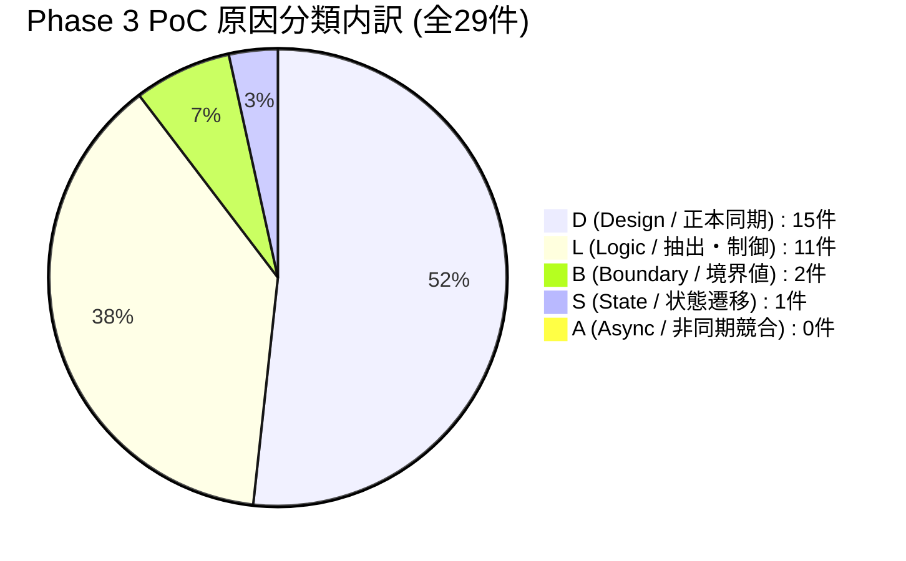

# Phase 3 PoC（Walking Skeleton）品質分析・継続的改善（Kaizen）レポート

本ドキュメントは、Phase 3 PoC（Walking Skeleton）において実施された実装、単体テスト、VRT、結合テスト（`SCN-01`）、および `phase-final-reviewer` による Round 1 全体横断レビュー（指摘 24 件）の是正結果を集計・分析し、Phase 4（イテレーティブ本開発・ミニリリース Milestone）への継続的改善（Kaizen）提言をまとめた正本レポートです。

---

## 1. エグゼクティブサマリー

Phase 3 PoC では、Android Web 小説リーダー Yommy における 4 大技術リスク（① ネイティブ CORS 回避通信、② SQLite ローカル保存、③ 縦書き・ルビ組版表示、④ VRT / Playwright IT による自動検証）と、AI 駆動開発フロー（GitHub Issue ＋ PR ＋ 独立 AI レビュー ＋ Task Completion Gate 7条件）の実証を行いました。

- **総合判定**: **合格（Pass with Excellence）**
- **致命的欠陥（`[P0]`）**: **0 件**
- **横断レビュー指摘事項是正**: Round 1 で検出された計 24 件（`[P1]` 4件、`[P2]` 14件、`[P3]` 6件）の指摘をすべて是正完了。
- **欠陥除去率（DRE）**: **100%**（検出された製品コード不備 9 件はすべて MK 実装および節目横断レビュー段階で刈り取られ、実機/リリース流出なし）。
- **テストカバレッジ**: **C0: 100%, C1: 100%, Functions: 100%, Lines: 100%**（全 16 テストスイート / 159 テスト）。
- **Storybook VRT**: 14 ストーリー × 2 ビューポート（1280px / 375px） = 28 テスト **100% PASS**。
- **Playwright IT**: `SCN-01`（縦貫通・ルビ・傍点・ローカル永続化復元）含む結合テスト **100% PASS**。

---

## 2. 定量品質メトリクス

### 2.1 コード規模・テスト資産メトリクス

| 指標カテゴリ                 | 計測値        | 内訳・備考                                                                 |
| :--------------------------- | :------------ | :------------------------------------------------------------------------- |
| **プロダクションコード行数** | 1,189 行      | `src/` 配下の本番 TS/TSX（型定義・フィクスチャ・テスト除く）               |
| **単体テストコード行数**     | 3,467 行      | `src/**/*.test.ts(x)`（16 ファイル）                                       |
| **Storybook ストーリー行数** | 332 行        | `src/**/*.stories.tsx`（5 ファイル / 14 ストーリー）                       |
| **結合テスト (IT) 行数**     | 104 行        | `test/it/**/*.spec.ts`（2 ファイル）                                       |
| **テストコード比率**         | **約 3.3 倍** | プロダクションコード 1 行に対して 3.3 行以上のテスト・ストーリー資産を構築 |
| **単体テスト件数**           | **159 件**    | 全件 PASS、C0/C1/Functions 100% カバレッジ                                 |
| **VRT スナップショット数**   | **28 件**     | 14 ストーリー × 2 画面解像度（1280px / 375px）                             |

### 2.2 不備検出・欠陥除去率（DRE）メトリクス

`docs/quality/bug-and-handover-log.md` に記録された全 29 件の不備を集計：

| 区分             | 件数  |  割合  | 主な内容                                                                     |
| :--------------- | :---: | :----: | :--------------------------------------------------------------------------- |
| **製品コード**   | 9 件  | 31.0%  | トランザクション制御、DI 配線、セレクタ順序、upsert キー、境界値ハンドリング |
| **支援成果物**   | 20 件 | 69.0%  | OKF 正本間リンク・差分同期（13件）、テスト・VRT 衛生・JSDoc（7件）           |
| **合計不備件数** | 29 件 | 100.0% |                                                                              |

- **製品コードバグ密度**:
  $$\text{バグ密度} = \frac{9 \text{ 件}}{1.189 \text{ KLoC}} \approx 7.57 \text{ 件 / KLoC}$$
- **欠陥除去率（DRE: Defect Removal Efficiency）**:
  $$\text{DRE} = \frac{\text{MK/UT/レビュー段階検出製品不備}}{\text{全検出製品不備}} \times 100\% = \frac{9}{9} \times 100\% = \mathbf{100\%}$$

---

## 3. 原因分類（`L`/`S`/`D`/`B`/`A`）分析

全 29 件の原因分類の内訳は以下の通りです：

### 3.1 原因 `D`（仕様・設計正本同期）の多発（15件 / 51.7%）

- **特徴**: 仕様正本（`docs/specs/`）の記述漏れ、OKF フロントマターのリンク・ステータス更新漏れ、および画面遷移・受入条件の相互リンク欠落が約半数を占めました。
- **評価**: コードとドキュメントの双方向同期を義務付ける Yommy の 2-Layer Living Documentation 規律（OKF）が機能し、節目横断レビューにおいて仕様の陳腐化や未文書化（Viewer 正本等）を完全に捕捉・解消できました。

### 3.2 原因 `L`（ロジック誤り）の早期是正（11件 / 37.9%）

- **特徴**: カクヨムパーサーのセレクタ優先順位（カンマ区切りによる文書順評価リスク）、作品取得時のパーサー解決・URL 正規化順序、Capacitor SQLite のトランザクションフラグ省略等が検出されました。
- **評価**: 単体テスト・VRT・IT の 3 層網羅により、実機動作前にロジック欠陥をすべて論理的に特定・修正できました。

### 3.3 原因 `B`（境界値・フェイルセーフ）（2件 / 6.9%）

- `ServiceProvider` 初期化時の try/catch 保護、および localStorage 容量超過（QuotaExceededError）時の警告・フォールバックを整備し、実行時ハングやサイレント障害を防止しました。

---

## 4. 主な是正成果とアーキテクチャ向上

1. **実機 DI 配線と共有 DDL 基盤の確立 (`R1-01`, `R1-02`)**:
   - `Capacitor.isNativePlatform()` を用いて、実機ネイティブ環境では `CapacitorHttpClient` と `CapacitorSqliteAdapter` を自動配線し、`src/storage/schema.ts` により SQLite DDL 初期化を実行可能としました。
   - `run` / `execute` に `transaction: false` を明示し、Android ネイティブ SQLite での入れ子トランザクション例外を根本解決しました。
2. **連載小説の改稿・話挿入に耐えうる DB 制約 (`R1-10`)**:
   - `chapters` テーブルの一意キーを `UNIQUE (novel_id, remote_chapter_id)` に刷新し、話の途中挿入によって `chapter_index` がずれた場合でも、本文キャッシュが別話へ誤移動しない安全な upsert 構造を確立しました。
3. **URL 正規化と安全な取得フロー (`R1-05`, `R1-09`)**:
   - パーサー解決と `normalizeWorkUrl` を通信前に実行し、不正 URL の無駄な通信を防止。
   - セレクタ配列を順次試行する `queryFirst` を導入し、HTML 構造の順序変化に左右されない決定論的スクレイピングを実現しました。
4. **Viewer 層正本と Playwright 結合回帰の強化 (`R1-06`, `R1-07`, `R1-23`)**:
   - 正本 `docs/specs/features/reader-view.md` を新規策定。
   - `SCN-01` 結合シナリオに傍点（`<em class="bouten">`）の可視性・テキスト検証を追加。
   - VRT の固定待機を完全排除し、アサーションベース待機へ刷新しました。

---

## 5. 申し送り事項（Handover Items）の状況

| ID      | 申し送り事項概要                                                                                               |    状態    | 引き継ぎ先                     |
| :------ | :------------------------------------------------------------------------------------------------------------- | :--------: | :----------------------------- |
| `HO-01` | カクヨムスクレイピング正本策定および Parser/Storage/Bridge の Vitest TDD 実装                                  | `Resolved` | PR #6 にて解決                 |
| `HO-02` | ServiceProvider DI、縦書きリーダー UI、Storybook VRT、および Playwright IT 結合実装                            | `Resolved` | PR #7 にて解決                 |
| `HO-03` | Android 実機 / エミュレータ環境における技術リスク 4 点の動作確認と APK ビルド検証                              | **`Open`** | Issue #1 Step 3（人間確認）    |
| `HO-04` | `src/app/router.tsx` による画面ルーティング導入、および `SCR-01` 本棚画面・`SCR-02` 作品詳細/目次画面の実装    | **`Open`** | Phase 4 Milestone `v0.1` (MVP) |
| `HO-05` | 小説リーダー（`SCR-03`）の文字サイズ・行間カスタマイズ、しおり自動保存、目次ナビゲーション（SYS-REQ-09/11/12） | **`Open`** | Phase 4 Milestone `v0.1` (MVP) |

---

## 6. Phase 4 へ向けたプロセス改善（Kaizen）提言

1. **差分仕様（Delta Spec）作成時の「Viewer 正本同時作成」の徹底**:
   - Phase 4 の各機能開発（`v0.1` 本棚画面等）では、実装 Sub-issue へ入る前の Step 2（設計 PR）段階で `docs/specs/features/*.md` を必ず作成し、正本の未文書化をゼロにする。
2. **DOM セレクタ定義規律のスキル化**:
   - カクヨムに続き「小説家になろう（`NarouParser`）」を実装する際、最初からセレクタ配列による順次探索（`queryFirst` パターン）とフィクスチャ優先順位テストを適用する。
3. **CI ワークフローの効率化と実行順序最適化**:
   - 今回是正した `.github/workflows/ci.yml` の順序（ビルド → ビルド成果物を使った IT 実行）を標準とし、二重実行を防止する。
