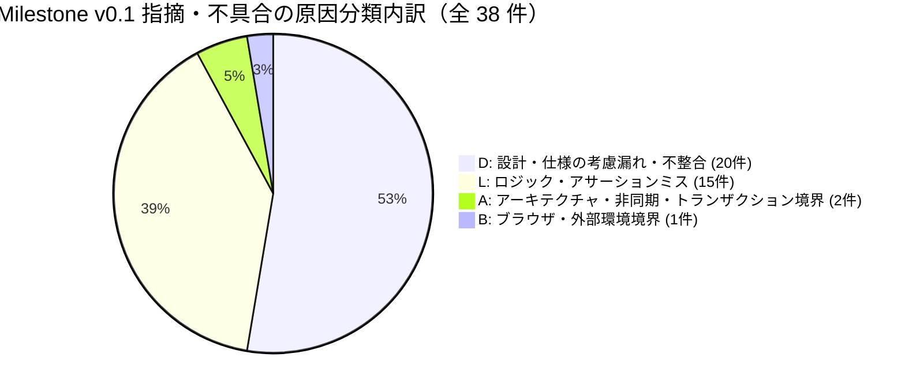

# Milestone `v0.1`（MVP：本棚・詳細・読書画面のループ完成）品質分析・振り返りレポート（Kaizen）

## 1. エグゼクティブサマリー（Executive Summary）

Milestone `v0.1`（MVP：本棚・詳細・読書画面のループ完成）では、Phase 3（PoC / Walking Skeleton）で確立したカクヨム取得・SQLite 永続化・縦書きリーダーの最小スライスを拡張し、以下の 5 つの機能 Issue を Issue 駆動マイクロウォーターフォール（① Open Questions 解消 → ② 設計更新 PR → ③ 製造（MK）Sub-issue PR → ④ 結合テスト（IT）PR）に沿って完遂した。

1. **Issue #12（本棚画面と画面遷移ルーティング / `SCR-01`）**：登録済み小説一覧・読書進捗バー表示・小説追加モーダル・長押し削除（確認ダイアログおよびカスケード削除）・エラーバナー表示と 3 画面状態管理ルーティングの実装。
2. **Issue #13（小説詳細・目次画面と増分更新 / `SCR-02`）**：あらすじ折りたたみ・ソート順切替（昇順/降順）・章見出しグループ化・本文キャッシュ状態アイコン・差分更新（`refreshNovel` による進捗比較トースト・未取得話の選択的取得・本文キャッシュ削除）・続きを読むボタンの実装。
3. **Issue #14（読書ビューア拡張 / `SCR-03`）**：常時表示型上下ツールバー・章タイトルおよび話数進捗表示・前話/次話ナビゲーション（端到達時の非活性化および未キャッシュ話のオンデマンド取得フォールバック）・しおり（`reading_progress`）の自動保存（300ms デバウンス + 画面離脱時 `flushBookmark` 即時保存）および復元・本文長押しテキスト選択と Android ネイティブ Web 検索連携の実装。
4. **Issue #15（アプリアイコン設定）**：マスター SVG（`assets/icon-source.svg`）からの決定論的 PNG アイコン自動生成スクリプト（`scripts/generate-icons.ts`）・Android 各 DPI ランチャーアイコン / Adaptive Icon・Web Favicon / Apple Touch Icon の整備。
5. **Issue #42（縦書きフォントと表示設定 / `SCR-03`）**：閲覧設定ポップオーバー（フォントファミリー切替［明朝体 / ゴシック体］・文字サイズ 4 段階・行間 3 段階・テーマ 3 種［ライト / セピア / ダーク］）と `localStorage` 即時永続化、および DevContainer 内への日本語フォント（Noto CJK / BIZ UD 明朝・ゴシック）導入による VRT 決定論的パリティの確立。

全機能 PR のマージ後、**Issue #16（Milestone `v0.1` 最終横断レビュー & 品質分析・スキル改善）** において、マルチモデル・オーケストレーター（Claude Opus 4.6 / GPT-5.4 / Gemini 3.1 Pro）およびユーザー実機・実データ検証による横断レビュー（Round 1）を実施した。検出された **全 27 件の指摘事項（`R1-01`〜`R1-27`：High 3 件 / Medium 13 件 / Low 11 件）** を 4 つの Work Package（Sub-issue #43, #44, #45, #46）に分割して残らず解消し、仕様書（OKF）・テスト・実装・スキル定義の完全な同期を達成した。

---

## 2. 定量品質メトリクス（Quantitative Quality Metrics）

### 2.1 コードベース・テスト規模メトリクス（Milestone `v0.1` 完了時点）

| 指標カテゴリ                            | 計測対象                                                                                            |            Phase 3 完了時            |               Milestone `v0.1` 完了時               |           増減（`v0.1` 純増分）           |
| :-------------------------------------- | :-------------------------------------------------------------------------------------------------- | :----------------------------------: | :-------------------------------------------------: | :---------------------------------------: |
| **プロダクションコード規模**            | `src/**/*.{ts,tsx}`（型定義専用の `types.ts`・`*.d.ts`・テスト・Story・ハーネスを除く 34 ファイル） |        1,189 行（1.189 KLoC）        |             **4,917 行（4.917 KLoC）**              |       **+3,728 行（+3.728 KLoC）**        |
| **総ソースコード規模（型定義含む）**    | `src/**/*.{ts,tsx}`（`types.ts` 含む 40 ファイル）                                                  |               1,312 行               |                    **5,250 行**                     |                 +3,938 行                 |
| **単体テスト（UT）規模**                | `src/**/*.test.{ts,tsx}` + `scripts/generate-icons.test.ts`（34 ファイル）                          | 1,735 行（11 ファイル / 83 テスト）  |      **11,422 行（34 ファイル / 456 テスト）**      |       **+9,687 行（+373 テスト）**        |
| **Storybook Stories 規模**              | `src/**/*.stories.tsx`（19 ファイル）                                                               |  428 行（6 ファイル / 25 Stories）   |      **2,209 行（19 ファイル / 85 Stories）**       |       **+1,781 行（+60 Stories）**        |
| **Playwright VRT スナップショット**     | `test/vrt/snapshots/*.png`（1280px / 375px の 2 ビューポート）                                      |       50 枚（25 Stories × 2）        | **166 枚（83 Stories × 2 + guard 1 = 167 テスト）** |        **+116 枚（+117 テスト）**         |
| **Playwright 結合テスト（IT）規模**     | `test/it/**/*.spec.ts`（2 ファイル：`smoke.spec.ts`, `scn01-poc-vertical-reader.spec.ts`）          |         206 行（2 シナリオ）         |    **462 行（3 シナリオ：`SCN-01`〜`05` 網羅）**    | **+256 行（+1 シナリオ + `TR-03` 拡張）** |
| **テスト / プロダクションコード行数比** | $(\text{UT} + \text{Stories} + \text{IT}) / \text{Production LoC}$                                  | $2,369 / 1,189 \approx 1.99\text{x}$ | **$14,093 / 4,917 \approx \mathbf{2.87\text{x}}$**  |       **+0.88x（テスト密度向上）**        |
| **テストカバレッジ（Vitest V8）**       | Statements (C0) / Branches (C1) / Functions / Lines                                                 |    **100% / 100% / 100% / 100%**     |            **100% / 100% / 100% / 100%**            |            **完全 100% 維持**             |

### 2.2 バグ密度・DRE（欠陥除去効率）メトリクス

[バグ・申し送り記録表](../bug-and-handover-log.md) に記録された全 69 件（Phase 3：No. 1〜31 の 31 件、Milestone `v0.1`：No. 32〜69 の 38 件）について、**「製品コード（`src/**`, `index.html`, `capacitor.config.ts` 等）」** と **「支援成果物（仕様書・テスト・スクリプト・CI 設定）」** を分離して集計した結果を以下に示す。

| メトリクス項目                                         | Phase 3（PoC） （No. 1〜31：31 件） |  Milestone `v0.1` 区間 （No. 32〜69：38 件）   |  累計（Phase 3 + `v0.1`） （No. 1〜69：69 件）  | 評価・分析                                                                                                             |
| :----------------------------------------------------- | :------------------------------------: | :-----------------------------------------------: | :------------------------------------------------: | :--------------------------------------------------------------------------------------------------------------------- |
| **総指摘・不具合件数**                                 |                 31 件                  |                     **38 件**                     |                     **69 件**                      | MK/IT/PR レビューで 11 件、Round 1 横断レビューで 27 件を検出。                                                        |
| **うち製品コード不具合件数**                           |                 11 件                  |  **7 件** （No. 51, 52, 62, 63, 67, 68, 69）   |                     **18 件**                      | `v0.1` の機能開発（MK/IT PR）段階での製品コード流出は 0 件、全て最終横断レビュー＆実データ検証で摘出。                 |
| **うち支援成果物（仕様・テスト・スクリプト・CI）不備** |                 20 件                  |                     **31 件**                     |                     **51 件**                      | 仕様書トレーサビリティ・OKF メタデータ・IT アサーション補強が全体の 81.6%（31/38 件）を占める。                        |
| **製品コードバグ密度（対総コード量 4.917 KLoC）**      |  9.25 件 / KLoC （対 1.189 KLoC）   | **1.42 件 / KLoC** （$7 / 4.917\text{ KLoC}$） | **3.66 件 / KLoC** （$18 / 4.917\text{ KLoC}$） | Phase 3 の TDD・型安全・100% カバレッジ規律定着により、バグ密度が大幅に低下。                                          |
| **製品コードバグ密度（対 `v0.1` 純増 3.728 KLoC）**    |                   —                    | **1.88 件 / KLoC** （$7 / 3.728\text{ KLoC}$） |                         —                          | 純増コード量に対しても 2 件/KLoC 未満の高い初期品質を達成。                                                            |
| **自動テスト・静的コードレビュー段階 DRE**             |      **81.8%** （$9 / 11$ 件）      |            **71.4%** （$5 / 7$ 件）            |           **77.8%** （$14 / 18$ 件）            | `v0.1` の残り 2 件（`R1-26` 長文縦書き overflow・`R1-27` カクヨム `__NEXT_DATA__` 全話取得）は実データ手動検証で摘出。 |
| **マイルストーン完了前 DRE（対本番リリース）**         |      **100%** （$11 / 11$ 件）      |            **100%** （$7 / 7$ 件）             |            **100%** （$18 / 18$ 件）            | マイルストーン横断レビューゲートにより、次フェーズへの製品バグ流出ゼロを達成。                                         |

---

## 3. 原因分類（`L` / `S` / `D` / `B` / `A`）の傾向分析

### 3.1 Milestone `v0.1`（38 件）および累計（69 件）の原因分類内訳

| 原因分類コード | 分類定義                                                                    | Phase 3（31 件） （製品 / 支援） | Milestone `v0.1`（38 件） （製品 / 支援） | 累計（69 件） （製品 / 支援） | `v0.1` 構成比 |
| :------------: | :-------------------------------------------------------------------------- | :---------------------------------: | :------------------------------------------: | :------------------------------: | :-----------: |
|    **`D`**     | **Design / Spec（設計・仕様の考慮漏れ・記述不整合）**                       |           17 件（4 / 13）           |             **20 件（3 / 17）**              |       **37 件（7 / 30）**        |   **52.6%**   |
|    **`L`**     | **Logic（条件分岐・状態更新・テストアサーションの論理ミス）**               |           11 件（4 / 7）            |             **15 件（2 / 13）**              |       **26 件（6 / 20）**        |   **39.5%**   |
|    **`A`**     | **Architecture / Async（非同期競合・トランザクション・Effect 境界）**       |            0 件（0 / 0）            |              **2 件（1 / 1）**               |        **2 件（1 / 1）**         |   **5.3%**    |
|    **`B`**     | **Boundary / Environment（ブラウザ/WebView エンジン・OS・外部サイト境界）** |            2 件（2 / 0）            |              **1 件（1 / 0）**               |        **3 件（3 / 0）**         |   **2.6%**    |
|    **`S`**     | **Syntax / Type（構文・型定義・ビルド設定ミス）**                           |            1 件（1 / 0）            |              **0 件（0 / 0）**               |        **1 件（1 / 0）**         |   **0.0%**    |
|    **合計**    | —                                                                           |        **31 件（11 / 20）**         |             **38 件（7 / 31）**              |       **69 件（18 / 51）**       |  **100.0%**   |

### 3.2 傾向分析とインサイト

1. **`S`（Syntax / Type）の完全撲滅（0 件）**：
   TypeScript strict モード、ESLint、および pre-commit フックによる型・構文検査が完全に機能しており、`v0.1` 区間における構文・型起因の手戻りは 0 件であった。
2. **`D`（Design / Spec：52.6%）の集中と 2 つの発生パターン**：
   - **支援成果物における `D`（17 件）**：機能 Issue（#12〜#15, #42）を段階的にマージする過程で、正本仕様書（`requirements.md`, `screen-transitions.md`, `architecture.md`）の横断マトリクスや OKF フロントマター（`status: Review` のまま残存、`related_tests` の記入漏れ）の更新が局所化していたことが主因である。
   - **製品コードにおける `D`（3 件：`R1-21`, `R1-25`, `R1-27`）**：特に `R1-27`（カクヨム目次取得の 7 話上限問題）は、Phase 3 時点で「カクヨム HTML の `<a href="/works/{id}/episodes/{epId}">` 要素を DOM パースする」という初期仕様を置いた際、カクヨム実サイトの SSR HTML が初期 DOM には先頭 7 話しか描画せず全話・章構造を `<script id="__NEXT_DATA__">` JSON 内に格納しているという外部仕様の調査が不足していたことに起因する。
3. **`L`（Logic：39.5%）の大部分はテスト・検証スクリプトの網羅性補強（支援 13 件 / 製品 2 件）**：
   - 製品コードの `L` は `R1-09`（本棚カードの話数表示に `completedEpisodeCount` ではなく `readProgressCount` を用いていたため、既読話を途中まで戻すと完了話数表示まで増減する論理ミス）と `R1-10`（`refreshNovel` 中にキャッシュ消去ボタンが非活性化されない排他制御漏れ）の 2 件のみであった。
   - 支援成果物の `L` 13 件は、`validate-okf.mjs` の未追跡ファイル検査漏れ（`R1-16`）、`generate-icons.ts` の CLI エントリガードによる UT 副作用（`R1-11`）、および Storybook / UT における異常系・コールバック呼び出しアサーションの補強（`R1-15`, `R1-19`, `R1-22`）であり、3 層テストの「100% カバレッジでもアサーションが弱ければ論理バグを見逃す」という教訓を浮き彫りにした。
4. **`A`（Architecture / Async：5.3%）および `B`（Boundary：2.6%）の重要性**：
   件数こそ少ないものの、`R1-20`（Web フォールバック時の複数テーブル更新における補償ロールバック欠如：`A`）、`R1-18`（React Passive Effect の発火タイミング競合による Flaky UT：`A`）、および `R1-26`（CSS 直交フロー `vertical-rl` における親 Flex コンテナ幅膨張バグ：`B`）は、いずれも通常の単体テストやモックテストでは発見しづらい高難度の技術課題であった。

---

## 4. 主要不具合の深掘り根本原因分析（Deep-Dive Root Cause Analysis）と技術的解決策

### 4.1 `R1-26`：縦書きリーダー（`vertical-rl`）における長文入力時の親コンテナ横幅膨張と横スクロール不能バグ（Severity: High / Cause: `B`）

- **事象**：
  読書画面（`SCR-03`）で 1 画面を超える長文エピソードを表示した際、`ReaderCanvas` のスクロールコンテナの `scrollWidth` と `clientWidth` が共に `2412px` 等まで膨張して一致（`scrollWidth === clientWidth`）し、スワイプやホイール操作を行っても `scrollLeft` が `0` のまま一切スクロールできなくなった。
- **根本原因（Root Cause）**：
  1. **CSS Writing Modes Level 3 直交フロー（Orthogonal Flow）のレイアウト仕様**：親要素（`ReaderView` の `<main class="flex flex-1 flex-col overflow-hidden">`、横書き `horizontal-tb`）の内部に直交フローの子要素（`ReaderCanvas` の `writing-mode: vertical-rl`）を配置した際、子要素に明示的な `width: 100%`（`w-full max-w-full`）制約が指定されていなかったため、`align-items: stretch` 下でもブロック軸（水平方向）の自動サイズ計算がコンテンツ全体の展開幅（`max-content` 相当）に引きずられ、親の `<main>` ごとビューポート幅を超えて膨張していた。
  2. **テストデータの盲点**：既存の Storybook Story および Playwright IT（`scn01-poc-vertical-reader.spec.ts`）のテストフィクスチャがすべて 3〜4 行の短文（1 画面内に収まる長さ）であったため、1280px / 375px のどちらの VRT でも「1 画面に収まるため横幅膨張が起きない」状態となっており、オーバーフロー時の直交フロー計算バグが素通りしていた。
- **技術的解決策（Commit: `4a96938`, `3250789`, `9e88b60`）**：
  - `ReaderView.tsx` の `<main>` に `min-w-0 w-full`、`ReaderCanvas.tsx` のスクロールコンテナに `w-full max-w-full` を明示し、直交フロー下でもスクロールポートの水平幅を親ビューポート幅（100%）に厳密固定した。
  - `ReaderCanvas.stories.tsx` および `ReaderView.stories.tsx` に 375px / 1280px の双方で確実に複数カラムへ折り返す長文 Story（`LongContentOverflow`）を追加し、Playwright IT（`scn01-poc-vertical-reader.spec.ts`）にて `scrollWidth > clientWidth` および負方向の `scrollLeft < 0` 遷移と `flushBookmark` による非ゼロ `scroll_offset` 永続化を E2E で検証するアサーションを追加した。

### 4.2 `R1-27`：カクヨム目次パーサーにおける 7 話上限問題と `__NEXT_DATA__` 全話・章構造抽出（Severity: High / Cause: `D`）

- **事象**：
  カクヨムの実作品（全 40 話・複数章構成の作品など）を取り込むと、先頭の 7 話しか取得されず、また章見出し（`chapterTitle`）も抽出されなかった。
- **根本原因（Root Cause）**：
  1. **外部サイト SSR 構造の仕様誤認**：カクヨムの現行 Web サイト（Next.js 製）は、作品トップページの初期 HTML DOM（`<a href="/works/{workId}/episodes/{episodeId}">`）には「最新数話＋先頭数話（計 7 話程度）」しかレンダリングせず、全エピソード一覧および章（Chapter）階層構造は `<script id="__NEXT_DATA__" type="application/json">` 内の Apollo State（`pageProps.__APOLLO_STATE__` の `Work:{id}.tableOfContents` -> `TableOfContentsChapter` -> `Episode` 参照グラフ）にのみ保持している。
  2. **手作り短編 HTML フィクスチャへの依存**：Phase 3 で作成した `kakuyomu-work-top.html` が全 2 話の簡略化した手作り HTML であったため、DOM リンク抽出のみでも全話取得できたように見えていた。
- **技術的解決策（Commit: `df3f857`, `d9b514f`, `450f8d7`）**：
  - `src/parser/kakuyomu.ts` の `parseKakuyomuWorkTop` を刷新し、`<script id="__NEXT_DATA__">` が存在する場合は Apollo State の参照グラフ（`TableOfContentsChapter:{id}` の `chapter` 見出しと `episodeUnions` 配列、および `Episode:{id}` エンティティ）を辿って全エピソードと章見出し（`chapterTitle`）を完全抽出するロジックを実装した（レガシー HTML フィクスチャに対する DOM フォールバックも維持）。
  - 7 話超・複数章構成の `__NEXT_DATA__` フィクスチャを追加し、`docs/specs/parsers/kakuyomu.md` の仕様書（`PAR-KAK-01`〜`06`）を同期更新した。

### 4.3 `R1-01`：Playwright 結合テスト（IT）における `TR-03`（`SCR-01` → `SCR-02`）回帰シナリオの欠落（Severity: High / Cause: `D`）

- **事象**：
  画面遷移仕様書（`docs/specs/screen-transitions.md`）および `issue-13` Delta Spec では、`TR-03`（本棚画面 `SCR-01` の小説カードタップ → 小説詳細・目次画面 `SCR-02` への遷移）を `SCN-01` の結合テスト対象と定義していたが、実装された `test/it/scenarios/scn01-poc-vertical-reader.spec.ts` は「小説 URL 新規追加 → そのまま目次へ遷移（`TR-02`）」のみを検証しており、一度本棚へ戻ってから登録済み小説カードをタップして詳細画面を開く `TR-03` 経路が未検証であった。
- **根本原因（Root Cause）**：
  Issue #13 の IT PR 作成時に、既存の `SCN-01` シナリオが目次画面（`SCR-02`）を通過していたことから「`SCR-02` の結合検証は完了している」と判断し、画面遷移 ID（`TR-01`〜`TR-06`）単位での網羅チェックを行わなかった。
- **技術的解決策（Commit: `ed71ad0`）**：
  - `test/it/scenarios/scn01-poc-vertical-reader.spec.ts` を拡張し、本棚（`SCR-01`）への遷移後に登録済み小説カードをタップして詳細画面（`SCR-02`）へ遷移する `TR-03`、あらすじ展開・ソート切替、および読書画面（`SCR-03`）の閲覧設定変更・ページ送り・本棚への直接帰還（`TR-06`）までを一気通貫で検証する E2E シナリオに強化した。

### 4.4 `R1-18`：React 19 Passive Effect（`useEffect`）と非同期状態解決の競合による Flaky UT（Severity: Medium / Cause: `A`）

- **事象**：
  `ReaderView.test.tsx` において、初期エピソード読み込み完了直後に「次話へ」ボタンをクリックするテストが、単体実行時は PASS するものの、`npm run test:coverage` による高負荷並列実行時にまれに `flushBookmark` の呼び出し回数アサーションで失敗（Flaky 化）した。
- **根本原因（Root Cause）**：
  `ReaderView` 内で初期エピソードの非同期取得（`Promise.resolve`）が完了して再レンダーされた際、React 19 の Passive Effect（`useEffect` による `currentEpisodeRef.current = episode` の同期）がメッセージチャネル経由で非同期実行される前に、テスト側の `getByTestId` ポーリングがボタンの有効化を検知して即座にクリックイベントを発火させていた。その結果、クリックハンドラ内の `flushBookmark` が `currentEpisodeRef.current === null` と判定して早期リターンする競合ウィンドウが存在した。
- **技術的解決策（Commit: `77811ab`）**：
  - `ReaderView.tsx` のレンダーフェーズ内で完了済みロード状態のエピソード参照を同期する設計に改善するとともに、テスト側でも `await act(async () => {})` により Passive Effect のフラッシュを確定させてからユーザー操作を送出する決定論的パターンに統一した。

---

## 5. 申し送り事項（`HO-01`〜`HO-10`）の精算状況

Milestone `v0.1` 完了時点における全申し送り事項（`HO-01`〜`HO-10`）の精算状況は以下の通りであり、`v0.1` スコープの 9 件（`HO-01`〜`HO-09`）はすべて **`Resolved`** となった。

|   ID    |    発生元     | 対象フェーズ / Issue   | 内容と解決結果の要約                                                                                                                              | ステータス |
| :-----: | :-----------: | :--------------------- | :------------------------------------------------------------------------------------------------------------------------------------------------ | :--------: |
| `HO-01` |    Phase 2    | Phase 3 (#7, #9)       | `validate-okf.mjs` の導入と CI 組み込み（PR #24 にて解決）                                                                                        | `Resolved` |
| `HO-02` |    Phase 2    | Phase 3 (#7)           | カクヨム HTML フィクスチャの作成とパーサー UT 実装（PR #18 にて解決）                                                                             | `Resolved` |
| `HO-03` | Phase 3 (#6)  | Phase 3 (#9)           | Android 実機 WebView での縦書き・ルビ・スクロール検証（Issue #9 実機検証にて解決、バグ記録 No. 30, 31 反映済）                                    | `Resolved` |
| `HO-04` | Phase 3 (#7)  | `v0.1` (#12, #13, #14) | ストレージ層の削除・差分更新・進捗永続化メソッド群の本格活用（Issue #12, #13, #14 にて全メソッド接続完了）                                        | `Resolved` |
| `HO-05` | Phase 3 (#11) | `v0.1` (#42)           | 縦書きフォント（明朝/ゴシック）・文字サイズ・行間・テーマ切替と VRT 日本語フォント導入（PR #40 にて解決）                                         | `Resolved` |
| `HO-06` | `v0.1` (#15)  | `v0.1` (#12〜#14)      | Android 実機ランチャーでの新アイコン視認性確認（Issue #15 PR #31 作成時の実機ビルド確認にて解決済）                                               | `Resolved` |
| `HO-07` | `v0.1` (#12)  | `v0.1` (#13)           | 本棚から小説詳細画面（`SCR-02`）への遷移接続（Issue #13 PR #29 にて解決）                                                                         | `Resolved` |
| `HO-08` | `v0.1` (#12)  | `v0.1` (#14)           | 本棚の「続きを読む」から読書画面（`SCR-03`）へのしおり位置復元遷移（Issue #14 PR #39 にて解決）                                                   | `Resolved` |
| `HO-09` | `v0.1` (#13)  | `v0.1` (#14)           | 小説詳細画面（`SCR-02`）から読書画面（`SCR-03`）への遷移・前話/次話・しおり自動保存接続（Issue #14 PR #39 にて解決）                              | `Resolved` |
| `HO-10` | `v0.1` (#14)  | `v0.2` 以降            | Android 実機における長押しテキスト選択時の OS 標準コンテキストメニュー（「ウェブ検索」等）と上部ツールバー Web 検索フォールバックボタンの UX 検証 |   `Open`   |

---

## 6. 次期マイルストーン（`v0.2`）に向けたプロセス・スキル改善アクション（Kaizen）

Milestone `v0.1` の品質分析から得られた教訓を、単なる「気をつける」といった精神論ではなく、**ガイドライン・スキル・自動検証スクリプトの仕組み（ガードレール）** として以下の 4 点に恒久反映した（Commit: `297d2fb`）。

### 6.1 Parser 層：実サイト HTML / 埋め込み JSON（`__NEXT_DATA__` 等）の構造調査と 7 話超フィクスチャ規約の明文化（`R1-27` 対策）

- **改善内容**：
  - [docs/guidelines/testing.md](../../guidelines/testing.md) §2.1 および [.github/skills/c-ut-workflow/SKILL.md](../../../.github/skills/c-ut-workflow/SKILL.md) を更新。
  - 新規小説サイト（今後の「小説家になろう」対応等）や既存パーサーを実装・改修する際は、**手動で簡略化した短編 HTML を自作して済ませることを禁止**し、必ず実サイトの SSR HTML 構造（Next.js の `<script id="__NEXT_DATA__">` や API ペイロード等の埋め込み JSON を含む）を調査した上で、**初期 DOM 表示上限（例：7 話）を超える複数話・複数章構成のリアルなフィクスチャ**を作成して全話・章構造抽出を検証することを必須化した。

### 6.2 Viewer 層：直交フロー（`vertical-rl`）の親コンテナ幅拘束と長文 Overflow Story / IT 検証の義務化（`R1-26` 対策）

- **改善内容**：
  - [docs/guidelines/testing.md](../../guidelines/testing.md) §2.3 および [.github/skills/c-ut-workflow/SKILL.md](../../../.github/skills/c-ut-workflow/SKILL.md) を更新。
  - 横書き（`horizontal-tb`）の Flex/Grid コンテナ内に縦書き（`writing-mode: vertical-rl`）要素を配置する際は、直交フローによる親コンテナ横幅膨張を防ぐため `w-full max-w-full`（および親の `min-w-0 w-full`）を必ず指定する設計ルールを追加。
  - 縦書きビューアの Storybook には **1 画面（1280px / 375px）を確実に超えて複数カラムへ折り返す長文 Overflow Story** を必須とし、Playwright IT でも `scrollWidth > clientWidth` および負方向の `scrollLeft < 0` スクロール遷移を検証する規約を明文化した。

### 6.3 OKF 仕様書検証スクリプト（`validate-okf.mjs`）の高度化（`R1-07`, `R1-08`, `R1-16` 対策）

- **改善内容**：
  - [.github/skills/sdd/scripts/validate-okf.mjs](../../../.github/skills/sdd/scripts/validate-okf.mjs) を改修（Commit: `ed71ad0`, `297d2fb`）。
  - `git ls-files --cached --others --exclude-standard` により未コミットの新規 Markdown ファイルも漏れなく検証対象に含めるとともに、フロントマターの `related_specs` だけでなく **`related_tests` に記載されたテストファイルパスの実在確認** を自動化した。これにより、テストファイル名変更や記入ミスによる仕様〜テスト間のトレーサビリティ断絶を `npm run lint:okf`（および CI）で機械的にブロックできるようにした。

### 6.4 マイクロウォーターフォール IT PR 完了時の Issue チェックリスト・OKF ステータス同期の徹底（`R1-07`, `R1-17` 対策）

- **改善内容**：
  - 各機能 Issue の最終ステップである ④ 結合テスト（IT）PR において、Delta Spec の `docs/specs/changes/archive/` への移動と同時に、対応する正本仕様書（`docs/specs/**`）の `status` を `Review (#XX)` から `Approved (#XX)` へ更新すること、および親 Issue 本文のマイクロウォーターフォール進捗チェックリスト（`[ ]` → `[x]`）を同期することをゲート確認項目として定着させた。
