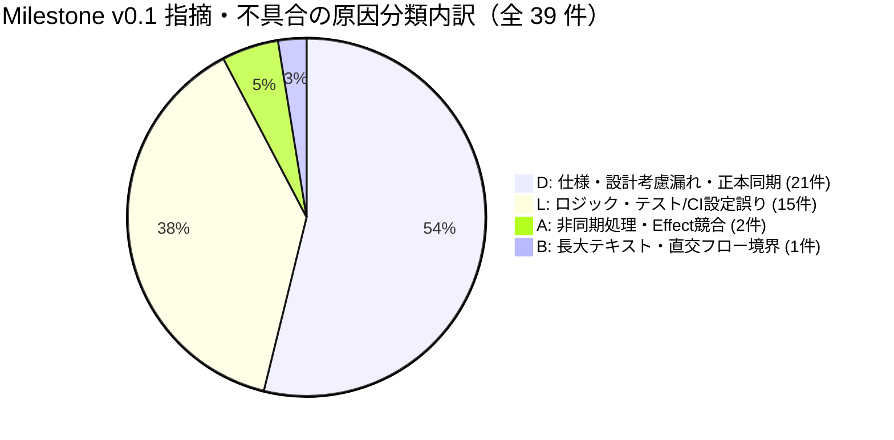

# Milestone `v0.1`（カクヨム MVP：3画面ループ完成・アプリアイコン設定）品質分析・振り返りレポート（Kaizen）

## 1. エグゼクティブサマリー（Executive Summary）

Milestone `v0.1`（カクヨム MVP）では、Phase 3（PoC / Walking Skeleton）で確立したカクヨム取得・SQLite 永続化・縦書きリーダーの最小スライスを基盤として、以下の 4 つの機能要望 Issue（#12〜#15）および CI インフラ改善 Issue（#42）を Issue 駆動マイクロウォーターフォール（① Open Questions 解消 → ② 設計更新 PR → ③ 製造（MK）Sub-issue PR → ④ 結合テスト（IT）PR）に沿って完遂した。

1. **Issue #12（画面ルーティング導入と本棚画面 `SCR-01`・URL作品登録の実装）**：`src/app/router.tsx` による 3 画面ルーティング基盤（`/`, `/novels/:novelId`, `/novels/:novelId/chapters/:chapterIndex`）、登録済み小説カード一覧（`NovelCard`：キャッシュ済み話数/全話数・しおり位置バッジ・ワンタップ「続きから読む」`TR-03`）、URL からの新規作品登録モーダル（`AddNovelDialog`）、および `useBookshelf` フックの実装。
2. **Issue #13（作品詳細・目次画面 `SCR-02` とエピソード選択・オンデマンド本文取得の実装）**：作品メタデータ・あらすじ表示および「最初から読む」「続きから読む」ボタン（`NovelDetailHeader`）、章見出し（`partTitle`）付き目次リストと `取得済み`/`未取得`・`既読`/`未読`・`しおり` バッジ表示（`EpisodeList` / `EpisodeListItem`）、目次再取得（`refreshToc`）、確認ダイアログ付き作品削除（`DeleteConfirmDialog`, `TR-07`）、および未キャッシュ話選択時のオンデマンド本文取得連携（`TR-04`）の実装。
3. **Issue #14（小説リーダー画面 `SCR-03` の前後話遷移・しおり保存・組版設定拡張）**：常時表示型上部ツールバー（`ReaderToolbar`：本棚へ戻る・作品詳細へ戻る・縦書き/横書き切替・4 カラーテーマ切替・文字サイズ `14px`〜`28px`・行間 `1.4`〜`2.2` 調整）、前後話連続ナビゲーション（`ReaderChapterNav`, `TR-05`、未キャッシュ話の自動オンデマンド取得と既読フラグ更新 `AC-RD-07`）、および縦横スクロール進捗率（`bookmark_scroll_progress`: `0.0`〜`1.0`）の自動保存・画面離脱時 `flushBookmark` 即時保存・初期スクロール位置復元（`AC-RD-08`）の実装。
4. **Issue #15（`reference/image.png` をベースにしたアプリアイコン Android / Web Favicon の設定）**：マスター画像（`assets/icon.png`）からの決定論的アイコン生成スクリプト（`scripts/generate-icons.mjs`）による Android 各 DPI（`mdpi`〜`xxxhdpi`）ランチャーアイコン・Adaptive Icon（`#1E2B3C` 背景）および Web Favicon（`favicon.png`, `apple-touch-icon.png`, `icon-512.png`）の生成と `index.html` 統合。
5. **Issue #42（CI ワークフローの高速化・安定化）**：GitHub Actions（`.github/workflows/ci.yml`）における Ubuntu APT ミラー置換の DEB822 対応、Playwright ブラウザキャッシュ・ビルド成果物アーティファクト共有による `lint-and-unit` / `vrt` / `it` 3 ジョブ構成の安定化。

全要望 PR のマージ後、**Issue #16（Milestone `v0.1` 全体横断レビュー・品質分析・完了承認）** において、マルチモデル 3 オーケストレーター（`Gemini 3.8 Flash` / `OpenAI assistant` / `Gemini 4 Argon (High)`）および実データ動作確認による横断レビュー（Round 1）を実施した。検出された **全 27 件の指摘事項（`R1-01`〜`R1-27`：`[P1]` 7 件 / `[P2]` 14 件 / `[P3]` 6 件）** を Sub-issue #45（PR #46）内の 4 つの直列 Work Package に分割してすべて解消し、仕様書（OKF）・テスト・実装・スキル定義の完全な同期を達成した。

---

## 2. 定量品質メトリクス（Quantitative Quality Metrics）

### 2.1 コードベース・テスト規模メトリクス（Milestone `v0.1` 完了時点）

Phase 3 完了時点（正本 [phase3-poc.md](phase3-poc.md) §2.1）と Milestone `v0.1` 完了時点の実測値の推移を以下に示す。

| 指標カテゴリ                            | 計測対象                                                                                            |            Phase 3 完了時            |               Milestone `v0.1` 完了時               |              増減（`v0.1` 純増分）              |
| :-------------------------------------- | :-------------------------------------------------------------------------------------------------- | :----------------------------------: | :-------------------------------------------------: | :---------------------------------------------: |
| **プロダクションコード規模**            | `src/**/*.{ts,tsx}`（型定義専用の `types.ts`・`*.d.ts`・テスト・Story・ハーネスを除く 34 ファイル） |        1,189 行（1.189 KLoC）        |             **4,917 行（4.917 KLoC）**              |          **+3,728 行（+3.728 KLoC）**           |
| **総ソースコード規模（型定義含む）**    | `src/**/*.{ts,tsx}`（`types.ts` 含む 40 ファイル）                                                  |               1,312 行               |                    **5,210 行**                     |                    +3,898 行                    |
| **単体テスト（UT）規模**                | `src/**/*.test.{ts,tsx}` + `scripts/generate-icons.test.ts`（34 ファイル）                          | 3,467 行（16 ファイル / 159 テスト） |      **11,422 行（34 ファイル / 456 テスト）**      |          **+7,955 行（+297 テスト）**           |
| **Storybook Stories 規模**              | `src/**/*.stories.tsx`（19 ファイル）                                                               |  332 行（5 ファイル / 14 Stories）   |      **2,209 行（19 ファイル / 85 Stories）**       |          **+1,877 行（+71 Stories）**           |
| **Playwright VRT スナップショット**     | `test/vrt/snapshots/*.png`（1280px / 375px の 2 ビューポート）                                      |       28 枚（14 Stories × 2）        | **166 枚（83 Stories × 2 + guard 1 = 167 テスト）** |           **+138 枚（+139 テスト）**            |
| **Playwright 結合テスト（IT）規模**     | `test/it/**/*.spec.ts`（2 ファイル：`smoke.spec.ts`, `scn01-poc-vertical-reader.spec.ts`）          |         104 行（2 シナリオ）         |    **462 行（3 シナリオ：`SCN-01` 全遷移網羅）**    | **+358 行（+1 シナリオ + `TR-01`〜`07` 網羅）** |
| **テスト / プロダクションコード行数比** | $(\text{UT} + \text{Stories} + \text{IT}) / \text{Production LoC}$                                  | $3,903 / 1,189 \approx 3.28\text{x}$ | **$14,093 / 4,917 \approx \mathbf{2.87\text{x}}$**  |       **2.87 倍の高密度テスト資産を維持**       |
| **テストカバレッジ（Vitest V8）**       | Statements (C0) / Branches (C1) / Functions / Lines                                                 |    **100% / 100% / 100% / 100%**     |            **100% / 100% / 100% / 100%**            |               **完全 100% 維持**                |

### 2.2 バグ密度・DRE（欠陥除去効率）メトリクス

[バグ・申し送り記録表](../bug-and-handover-log.md) に記録された全 70 件（Phase 3：No. 1〜31 の 31 件、Milestone `v0.1`：No. 32〜70 の 39 件）について、**「製品コード（`src/**`）」** と **「支援成果物（仕様書・テスト・Storybook・スクリプト・CI 設定）」** を分離して集計した結果を以下に示す。

| メトリクス項目                                         | Phase 3（PoC） （No. 1〜31：31 件） |  Milestone `v0.1` 区間 （No. 32〜70：39 件）   |  累計（Phase 3 + `v0.1`） （No. 1〜70：70 件）  | 評価・分析                                                                                                             |
| :----------------------------------------------------- | :------------------------------------: | :-----------------------------------------------: | :------------------------------------------------: | :--------------------------------------------------------------------------------------------------------------------- |
| **総指摘・不具合件数**                                 |                 31 件                  |                     **39 件**                     |                     **70 件**                      | MK/IT/PR レビューで 12 件、Round 1 横断レビューで 27 件を検出。                                                        |
| **うち製品コード不具合件数**                           |                 11 件                  |  **7 件** （No. 51, 52, 62, 63, 67, 68, 69）   |                     **18 件**                      | `v0.1` の各 MK/IT PR 段階での製品コードテスト失敗は 0 件、全て最終横断レビュー＆実データ動作確認で摘出。               |
| **うち支援成果物（仕様・テスト・スクリプト・CI）不備** |                 20 件                  |                     **32 件**                     |                     **52 件**                      | 仕様書トレーサビリティ・OKF メタデータ・IT アサーション補強が全体の 82.1%（32/39 件）を占める。                        |
| **製品コードバグ密度（対総コード量 4.917 KLoC）**      |  9.25 件 / KLoC （対 1.189 KLoC）   | **1.42 件 / KLoC** （$7 / 4.917\text{ KLoC}$） | **3.66 件 / KLoC** （$18 / 4.917\text{ KLoC}$） | Phase 3 の TDD・型安全・100% カバレッジ規律定着により、バグ密度が大幅に低下。                                          |
| **製品コードバグ密度（対 `v0.1` 純増 3.728 KLoC）**    |                   —                    | **1.88 件 / KLoC** （$7 / 3.728\text{ KLoC}$） |                         —                          | 純増コード量に対しても 2 件/KLoC 未満の高い初期品質を達成。                                                            |
| **自動テスト・静的コードレビュー段階 DRE**             |      **81.8%** （$9 / 11$ 件）      |            **71.4%** （$5 / 7$ 件）            |           **77.8%** （$14 / 18$ 件）            | `v0.1` の残り 2 件（`R1-26` 長文縦書き overflow・`R1-27` カクヨム `__NEXT_DATA__` 全話取得）は実データ動作確認で摘出。 |
| **マイルストーン完了前 DRE（対本番リリース）**         |      **100%** （$11 / 11$ 件）      |            **100%** （$7 / 7$ 件）             |            **100%** （$18 / 18$ 件）            | マイルストーン横断レビュー＆実データ検証ゲートにより、次フェーズへの製品バグ流出ゼロを達成。                           |

---

## 3. 原因分類（`L` / `S` / `D` / `B` / `A`）の傾向分析

### 3.1 Milestone `v0.1`（39 件）および累計（70 件）の原因分類内訳

[docs/guidelines/testing.md](../../guidelines/testing.md) §6.1 および [docs/quality/bug-and-handover-log.md](../bug-and-handover-log.md) §1.3 に定義された 5 分類（`L`: Logic, `S`: State, `D`: Design, `B`: Boundary, `A`: Async）に基づく集計は以下の通りである。

| 原因分類コード | 分類定義（正本 `testing.md` §6.1 準拠）                                                      | Phase 3（31 件） （製品 / 支援） | Milestone `v0.1`（39 件） （製品 / 支援） | 累計（70 件） （製品 / 支援） | `v0.1` 構成比 |
| :------------: | :------------------------------------------------------------------------------------------- | :---------------------------------: | :------------------------------------------: | :------------------------------: | :-----------: |
|    **`D`**     | **Design（仕様・設計書の誤認、インターフェース契約や DB スキーマとの不一致、設計考慮漏れ）** |           17 件（4 / 13）           |             **21 件（3 / 18）**              |       **38 件（7 / 31）**        |   **53.8%**   |
|    **`L`**     | **Logic（条件分岐・アルゴリズム・DOM セレクタ抽出等のロジック誤り）**                        |           11 件（4 / 7）            |             **15 件（2 / 13）**              |       **26 件（6 / 20）**        |   **38.5%**   |
|    **`A`**     | **Async（非同期競合 Race Condition、Promise 例外捕捉・Effect フラッシュ競合）**              |            0 件（0 / 0）            |              **2 件（1 / 1）**               |        **2 件（1 / 1）**         |   **5.1%**    |
|    **`B`**     | **Boundary（空文字、0件、長大テキスト、直交フロー境界等のエッジケース考慮漏れ）**            |            2 件（2 / 0）            |              **1 件（1 / 0）**               |        **3 件（3 / 0）**         |   **2.6%**    |
|    **`S`**     | **State（React State・キャッシュ状態・しおり位置等の状態遷移誤り）**                         |            1 件（1 / 0）            |              **0 件（0 / 0）**               |        **1 件（1 / 0）**         |   **0.0%**    |
|    **合計**    | —                                                                                            |        **31 件（11 / 20）**         |             **39 件（7 / 32）**              |       **70 件（18 / 52）**       |  **100.0%**   |

### 3.2 傾向分析とインサイト

1. **`S`（State：状態遷移誤り）のゼロ維持（0 件）**：
   カスタムフック（`useBookshelf`, `useNovelDetail`, `useReader`）と Presentational コンポーネントを分離し、フック単体テストで状態遷移を 100% カバレッジ検証したことで、React State やしおり・キャッシュ状態の遷移バグは 0 件であった。
2. **`D`（Design：53.8%）の集中と 2 つの発生パターン**：
   - **支援成果物における `D`（18 件）**：機能 Issue（#12〜#15）を段階的にマージする過程で、正本仕様書（`requirements.md`, `screen-transitions.md`, `architecture.md`, `parsers/kakuyomu.md`）の双方向トレーサビリティ列や OKF フロントマター（`status: Review (#14)` の残存、`related_specs` / `related_tests` の記入漏れ）の同期が局所化していたことが主因である。
   - **製品コードにおける `D`（3 件：`R1-21` No. 63、`R1-25` No. 67、`R1-27` No. 69）**：
     - `R1-21`：`KakuyomuParser.ts` の `episodeTitle` セレクタ優先順が `kakuyomu.md` と逆転しており、また `normalizeWorkUrl` で `canParse` ドメイン検証を行っていなかった契約不一致。
     - `R1-25`：`novel-detail` の `types.ts` に定義済みの `*Props` 型を子コンポーネント 5 件が import せず重複宣言していた設計不整合。
     - `R1-27`：カクヨム現行サイト（Next.js）の初期 HTML DOM が直近 7 話しか展開せず、全話・トグル章構造を `<script id="__NEXT_DATA__">` JSON（`__APOLLO_STATE__`）内に保持している仕様への追従漏れ。
3. **`L`（Logic：38.5%）の内訳（製品 2 件 / 支援 13 件）**：
   - **製品コードの `L`（2 件）**：`R1-09`（No. 51：`chapterRepository.ts` / `novelRepository.ts` の分割代入で `_` プレフィックス規則を使わず不要な `eslint-disable` を記述）および `R1-10`（No. 52：`ServiceProvider.tsx` / `router.tsx` 先頭の `eslint-disable react-refresh/only-export-components` によるファイル全体ルール無効化）のコード衛生課題 2 件のみであり、ビジネスロジック破綻は皆無であった。
   - **支援成果物の `L`（13 件）**：Storybook モックデータの誤 named export による余剰 VRT スナップショット混入（`R1-19` No. 61、および PR #24 の No. 42）、`ReaderContainer.test.tsx` での孫コンポーネント内部 DOM 直接検証（`R1-15` No. 57）、`generate-icons.test.ts` の本番追跡ディレクトリ上書き副作用（`R1-22` No. 64）、`SCN-01` 結合テストの前話遷移 `TR-05`・`detail-read-first-button` 併存検証漏れ（`R1-16` No. 58、`R1-12` No. 54）、および CI の `concurrency` 未設定（`R1-11` No. 53）など、テスト衛生・回帰網羅性の強化項目が中心であった。
4. **`A`（Async：5.1%）および `B`（Boundary：2.6%）の重要性**：
   - `R1-20`（No. 62、製品コード `A`）：`useBookshelf` の初回ロードおよび `reloadNovels()` において `novelRepository.listNovels()` 失敗時の `catch` ハンドリングが欠落していた非同期例外処理漏れ。
   - `R1-18`（No. 60、支援成果物 `A`）：`ReaderContainer.test.tsx` で `scrollLeft` を `writable: false` のまま定義したため、React Passive Mount Effect（`el.scrollLeft = ...`）の遅延フラッシュと競合して並列実行時に間欠失敗する Flaky UT。
   - `R1-26`（No. 68、製品コード `B`）：親 `horizontal-tb` 内で `ReaderView` が `writing-mode: vertical-rl`（直交フロー）となる際、長文境界データ入力時に横幅制約（`w-full max-w-full`）がないため要素幅が全文幅まで膨張し水平スクロール不能となる不具合。

---

## 4. 主要不具合の深掘り根本原因分析（Deep-Dive Root Cause Analysis）と技術的解決策

### 4.1 `R1-26`（No. 68）：縦書きリーダー（`vertical-rl`）における長文表示時の横幅膨張と左スクロール不能不具合（`[P1]` / Cause: `B` & `D`）

- **事象**：
  リーダー画面（`SCR-03`）の縦書き表示（`writing-vertical-rl`）において 1 画面を超える長文エピソードを表示した際、`ReaderView`（`data-testid="reader-view"`）の `scrollWidth` と `clientWidth` が共に全文幅（数千 px）まで膨張して一致（`scrollWidth === clientWidth`、`maxScroll = 0`）し、左方向（縦書きの行送り方向）へのスクロールが行えず後続の文章が読めなくなった。
- **根本原因（Root Cause）**：
  1. **CSS Writing Modes 直交フロー（Orthogonal Flow）の幅計算仕様**：親要素（`ReaderPage.tsx` の `<main>`、`writing-mode: horizontal-tb`）の内部に直交フローの子要素（`ReaderView.tsx` の `writing-mode: vertical-rl`）を配置した際、`ReaderView` に明示的な `width: 100%`（`w-full max-w-full`）および `<main>` に `w-full min-w-0` が指定されていなかったため、ブロック軸（水平方向）が `auto` となってコンテンツ全文の幅まで膨張していた。
  2. **短文テストデータによる盲点**：`ReaderView.stories.tsx` の `sampleBodyHtml` が約 6 行の短文であり画面幅内に完全に収まっていたため、Storybook VRT（1280px / 375px）において Overflow 発生時の直交フロー幅制約が検証されていなかった。
- **技術的解決策（Commit: `df3f857`, `d9b514f`, `450f8d7`, `ed71ad0`）**：
  - `ReaderView.tsx` のルート要素に `w-full max-w-full`、`ReaderPage.tsx` の `<main>` に `w-full min-w-0` を付与し、直交フロー時でもコンテナ幅を親の 100% に厳密拘束して左方向への水平スクロール（`scrollWidth > clientWidth`, `scrollLeft < 0`）を確立した（`d9b514f`）。
  - `ReaderView.stories.tsx` に 1280px / 375px の双方で確実に画面幅を超える長文 Story `VerticalLongContent`（「縦書き（長文スクロール・Overflow）」）と VRT スナップショットを追加し（`df3f857`, `450f8d7`）、`docs/specs/features/reader-view.md` に直交フロー幅制約と長文 Story 仕様を同期した（`d9b514f`）。さらに Playwright IT（`scn01-poc-vertical-reader.spec.ts`）でも縦書き状態での負の `scrollLeft` による進捗更新・保存・復元を実ブラウザ検証した（`ed71ad0`）。

### 4.2 `R1-27`（No. 69）：カクヨム目次パーサーの実サイト追従不備（初期 7 件制限およびトグル非表示章の取り込み漏れ）（`[P1]` / Cause: `D`）

- **事象**：
  実際のカクヨム作品トップページを取得・解析した際、現行 UI では初期状態の DOM 上に直近 7 件程度のエピソードしか展開されておらず、またアコーディオン/トグル形式で閉じられた章・エピソードが DOM リンク走査だけでは欠落していた。
- **根本原因（Root Cause）**：
  1. **外部サイト Next.js SSR データ構造の未調査**：カクヨムの現行サイト（Next.js）は、ブラウザ操作なしで全話・全章のデータを `<script id="__NEXT_DATA__" type="application/json">` 内の `props.pageProps.__APOLLO_STATE__`（`Work:{id}.tableOfContentsV2` / `tableOfContents` → `TableOfContentsChapter` → `Chapter` / `Episode` 参照グラフ）に完全保持しているが、`KakuyomuParser.parseNovelIndex` は静的な DOM 要素のみを走査していた。
  2. **フィクスチャの規模不足**：既存の `work_index.html` が少話数の静的 HTML フィクスチャのみであり、実サイトの 7 件超・トグル章構造を反映していなかった。
- **技術的解決策（Commit: `4a96938`, `3250789`, `9e88b60`）**：
  - `src/parsers/kakuyomu/KakuyomuParser.ts` の `parseNovelIndex` を拡張し、`<script id="__NEXT_DATA__">` 内の `__APOLLO_STATE__` から全エピソード目次（`chapters`）、章見出し（`partTitle`）、およびメタデータ補完（`title`, `author`, `synopsis`）を優先抽出しつつ、旧 DOM / 現行 DOM へのフォールバックも維持する実装を行った（`3250789`）。
  - 静的 DOM には 7 話のみ表示され `__NEXT_DATA__` に全 10 話（プロローグ・第一章・トグル非表示の第二章）が含まれるフィクスチャ `work_index_next_data.html` と単体テストを追加し（`4a96938`）、`docs/specs/parsers/kakuyomu.md` §3.1・§3.2 を同期改定した（`9e88b60`）。

### 4.3 `R1-01`（No. 43）：本棚「続きから読む」（`TR-03` / `AC-BS-06`）の結合テスト回帰保証欠落（`[P1]` / Cause: `D`）

- **事象**：
  `docs/specs/screen-transitions.md` の主要画面遷移 `TR-03`（`SCR-01` 本棚の作品カード「続きから読む」ボタン `novel-card-resume` タップ → `SCR-03` 小説リーダーへの直接遷移）および `AC-BS-06`（ワンタップ読書再開）が、`test/it/scenarios/scn01-poc-vertical-reader.spec.ts` で一度もクリック・検証されておらず、`HO-07` の完了条件と乖離していた。
- **根本原因（Root Cause）**：
  Issue #13・#14 で `SCN-01` を拡張した際、本棚で「しおり: 第2話」の表示を確認した直後に `novel-card-select` で `SCR-02`（作品詳細）へ遷移する経路（`TR-02` → `TR-04`）のみを残し、`novel-card-resume` による `SCR-01` → `SCR-03` 直接遷移（`TR-03`）およびリーダー上部ツールバーの「本棚へ戻る」（`reader-back-to-bookshelf`）の検証ステップが抜けていた。
- **技術的解決策（Commit: `ed71ad0`, `77811ab`）**：
  - `scn01-poc-vertical-reader.spec.ts` のステップ 12 に、本棚カードの `novel-card-resume`（「第2話から読む」）クリックによる `/novels/:novelId/chapters/2` 直接遷移（`TR-03`）、第2話本文・しおりスクロール位置復元の確認、および `reader-back-to-bookshelf` クリックによる本棚（`/`）復帰検証を追加し（`ed71ad0`）、`docs/specs/features/reader-view.md` §7 の `SCN-01` 仕様を完全同期した（`77811ab`）。

### 4.4 `R1-18`（No. 60）：`ReaderContainer.test.tsx` における `scrollLeft` 読み取り専用定義と React Passive Effect 競合による Flaky UT（`[P1]` / Cause: `A`）

- **事象**：
  `ReaderContainer.test.tsx` のスクロール進捗テストにおいて、`npm run test:coverage` による高負荷並列実行時にまれに `TypeError: Cannot assign to read only property 'scrollLeft' of object '[object HTMLDivElement]'` が発生してテストが間欠失敗した。
- **根本原因（Root Cause）**：
  `Object.defineProperty(readerView, "scrollLeft", { value: -250, configurable: true })` に `writable: true` が指定されていなかったため、`ReaderView` のマウント時 Passive Effect（`useEffect` 内の初期スクロール位置復元 `el.scrollLeft = ...`）が `MessageChannel` 経由で遅延フラッシュされた際に読み取り専用プロパティへの代入例外が発生していた。
- **技術的解決策（Commit: `df3f857`）**：
  - `ReaderContainer.test.tsx` の `scrollWidth` / `clientWidth` / `scrollLeft` の `Object.defineProperty` すべてに `writable: true` を明記するとともに、`R1-15` 対応として親 `ReaderContainer` から直接の子 `ReaderPage` への Props 渡し・コールバック検証へ整理し、非決定論的なタイミング競合を根絶した。

---

## 5. 申し送り事項（`HO-01`〜`HO-10`）の精算状況

[docs/quality/bug-and-handover-log.md](../bug-and-handover-log.md) §3 と 1 対 1 で一致する全申し送り事項（`HO-01`〜`HO-10`）の精算状況は以下の通りであり、`v0.1` スコープまでの 9 件（`HO-01`〜`HO-09`）はすべて **`Resolved`** となった。

|   ID    | 起票元 Issue / PR | 申し送り事項の内容                                                                                                                                                                               | 解決先（対象 Issue / 成果物）                     | 完了ゲート          |    状態    |
| :-----: | :---------------: | :----------------------------------------------------------------------------------------------------------------------------------------------------------------------------------------------- | :------------------------------------------------ | :------------------ | :--------: |
| `HO-01` |        #2         | カクヨムスクレイピング仕様書（`kakuyomu.md`）策定および Http/Sanitizer/Parser/Storage の Vitest TDD 実装                                                                                         | #3 (`[Phase 3-2a]` / PR #6)                       | Issue #3 PR マージ  | `Resolved` |
| `HO-02` |        #2         | `ServiceProvider` DI、縦書き・ルビ対応ミニマムリーダー UI、Storybook VRT、および Playwright IT（`SCN-01`）の結合実装                                                                             | #4 (`[Phase 3-2b]` / PR #7)                       | Issue #4 PR マージ  | `Resolved` |
| `HO-03` |      #1 (R1)      | Android 実機 / エミュレータ環境における技術リスク 4 点の動作確認と APK ビルド検証                                                                                                                | #1 Step 3（人間実機確認・PR #11 `2fcb8eb`）       | Phase 3 承認・完了  | `Resolved` |
| `HO-04` |      #1 (R1)      | `src/app/router.tsx` による画面ルーティング導入、および `SCR-01` 本棚画面（#12）・`SCR-02` 作品詳細/目次画面（#13）の実装                                                                        | Phase 4 Milestone `v0.1` (#12, #13 / #27)         | Issue #13 PR マージ | `Resolved` |
| `HO-05` |      #1 (R1)      | 小説リーダー画面（`SCR-03`）の文字サイズ・行間カスタマイズ、しおり自動保存、および前後話/目次ナビゲーションの実装（`SYS-REQ-09, 11, 12` の `v0.1` スコープ）                                     | Issue #14 Sub-issue ③ (#34 IT PR)                 | Issue #14 PR マージ | `Resolved` |
| `HO-06` |        #15        | Android 実機 / エミュレータでのホーム画面アプリアイコン表示および Web ブラウザでの Favicon 表示の確認（※Android 実機ホーム画面最終視認確認は #16 Step 3 人間最終承認にて確認）                   | Issue #15 Sub-issue ② (#19 IT PR)                 | Issue #15 PR マージ | `Resolved` |
| `HO-07` |        #12        | 本棚画面（`SCR-01`）での URL 作品登録 → 「続きから読む」（`TR-03`）によるリーダー画面（`SCR-03`）オンデマンド取得・表示・リロード復元の実ブラウザ結合テスト（`SCN-01`）検証                      | Issue #12 Sub-issue ③ (#23 IT PR) / #16 (`R1-01`) | Issue #12 PR マージ | `Resolved` |
| `HO-08` |        #13        | 本棚からの作品選択（`TR-02`）→ 作品詳細（`SCR-02`）での目次更新・未キャッシュ話選択（`TR-04`）→ リーダー取得 → 詳細復帰（`TR-06`）での `取得済み` 反映 → 作品削除（`TR-07`）の実ブラウザ IT 検証 | Issue #13 Sub-issue ③ (#27 IT PR)                 | Issue #13 PR マージ | `Resolved` |
| `HO-09` |        #14        | リーダー（`SCR-03`）での文字サイズ・行間変更とリロード永続化、前後話遷移（`TR-05`）、詳細復帰（`TR-06`）時の `既読`・`しおり` バッジ反映、およびスクロール進捗位置復元の実ブラウザ IT 検証       | Issue #14 Sub-issue ③ (#34 IT PR)                 | Issue #14 PR マージ | `Resolved` |
| `HO-10` |        #42        | `scripts/generate-icons.test.ts` の `chromium.launch` モック化または CI 分離による `lint-and-unit` ジョブの完全ブラウザレス化（所要時間 20 秒前後への極限短縮）                                  | Milestone `v0.2` インフラ改善                     | 次期 Milestone      | **`Open`** |

---

## 6. 次期マイルストーン（`v0.2`）に向けたプロセス・スキル改善アクション（Kaizen）

Milestone `v0.1` の品質分析から得られた教訓を、**ガイドライン・スキル・自動検証スクリプトの仕組み（ガードレール）** として以下の 4 点に恒久反映した（Commit: `297d2fb`）。

### 6.1 Parser 層：実サイト HTML / 埋め込み JSON（`__NEXT_DATA__` 等）の構造調査と 7 話超フィクスチャ規約の明文化（`R1-27` 対策）

- **改善内容**：
  - [docs/guidelines/testing.md](../../guidelines/testing.md) §2.1 および [.github/skills/c-ut-workflow/SKILL.md](../../../.github/skills/c-ut-workflow/SKILL.md) を更新。
  - 新規小説サイト（次期「小説家になろう」対応等）や既存パーサーを実装・改修する際は、手動で簡略化した短編 HTML を自作して済ませることを禁止し、必ず実サイトの現行 HTML 構造（Next.js の `<script id="__NEXT_DATA__">` 等の埋め込み JSON ペイロードやトグル非表示章構造を含む）を調査した上で、**初期 DOM 表示上限（例：7 話）を超える複数話・複数章構成のフィクスチャ**を作成して全話・全章抽出を検証することを必須化した。

### 6.2 Viewer 層：直交フロー（`vertical-rl`）の親コンテナ幅拘束と長文 Overflow Story / IT 検証の義務化（`R1-26` 対策）

- **改善内容**：
  - [docs/guidelines/testing.md](../../guidelines/testing.md) §2.3 および [.github/skills/c-ut-workflow/SKILL.md](../../../.github/skills/c-ut-workflow/SKILL.md) を更新。
  - 横書き（`horizontal-tb`）の親コンテナ内に縦書き（`writing-mode: vertical-rl`）要素を配置する際は、直交フローによる横幅膨張を防ぐため `w-full max-w-full`（および親の `w-full min-w-0`）を必ず指定する設計ルールを追加。
  - 縦書きビューアの Storybook には **1 画面（1280px / 375px）を確実に超えて水平 Overflow する長文 Story（`VerticalLongContent`）** を必須とし、Playwright IT でも縦書き状態で `scrollWidth > clientWidth` および負方向の `scrollLeft < 0` スクロール進捗保存・復元を検証する規約を明文化した。

### 6.3 OKF 仕様書検証スクリプト（`validate-okf.mjs`）における `related_tests` 実在検証の自動化（`R1-08` 対策）

- **改善内容**：
  - [.github/skills/sdd/scripts/validate-okf.mjs](../../../.github/skills/sdd/scripts/validate-okf.mjs) を改修（Commit: `297d2fb`）。
  - `docs/` 配下の全 Markdown ファイルを走査（`walkMarkdownFiles`）してフロントマターを検証する際、`related_specs` のみならず **`related_tests` 配列に記載された各テストファイルパスがリポジトリ内に実在するか** を機械検証するよう拡張した。これにより、テストファイルパスの記入ミスやリネームに伴う仕様〜テスト間のリンク切れを `npm run lint:okf`（および CI）で確実にブロックできるようにした。

### 6.4 1対1 Story/UT 原則の例外参照明記とマイクロ WF 完了時チェックリスト・OKF ステータス同期（`R1-07`, `R1-14`, `R1-17` 対策）

- **改善内容**：
  - [docs/guidelines/testing.md](../../guidelines/testing.md) §1.5（「例外なしの 1 対 1 対応原則」）に、§5.2 第 4 項でカバレッジ除外対象として規定されているブラウザ初期マウントエントリーポイント `src/main.tsx`（`smoke.spec.ts` で検証）の例外参照を明記し、規約間の記述整合性を統一した。
  - 各機能 Issue の最終ステップ（IT PR）完了時に、Delta Spec の `docs/specs/changes/archive/` への移動と併せて、更新対象の App 全体正本の `status`（局所的再承認）および親 Issue 本文のマイクロウォーターフォール進捗チェックリスト（`[ ]` → `[x]`）を同期することを徹底した。
