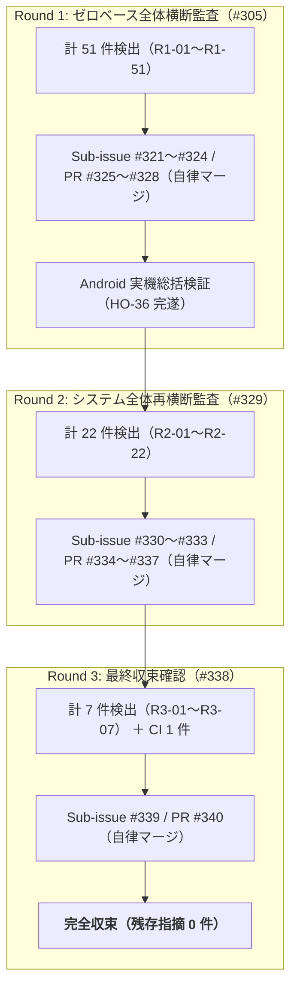

# Milestone `v1.0`（リリース準備 ＆ システム全体横断品質監査）品質分析・振り返りレポート（Kaizen）

## 1. エグゼクティブサマリー（Executive Summary）

Milestone `v1.0`（Release Preparation & Full System Quality Audit）は、Web 小説リーダーアプリ **「Yommy」** の正式リリース（`v1.0.0`）に向けた総括マイルストーンとして、以下の 4 本の Issue を通じてシステム全体の完成・リリース準備および多段階ゼロベース横断監査を完遂した。

1. **Issue #304（`v1.0` リリース整備、MK1 #315 / PR #318, MK2 #316 / PR #319, IT #317 / PR #320）**:
   - アプリケーションバージョンを `1.0.0` に統一し、設定画面（`SCR-05`）フッターにバージョン表記（`Yommy v1.0.0`）を新設（`AC-ST-20`）。
   - プロジェクト立ち上げ時の一時プロトタイプディレクトリ `reference/` を完全撤去し、ライセンス定義を Apache License 2.0 へ統一・正式化。`README.md` およびドキュメント群を正式リリース仕様へ刷新。
2. **Issue #305（Milestone `v1.0` Part 1: 4 領域ゼロベース横断監査 Round 1 ＆ Android 実機総括検証）**:
   - 最新コードベース（全 21.58 KLoC）に対し、4 領域（Domain 1: Parser & Bridge / Security、Domain 2: Storage & Sync、Domain 3: Reader & UI/UX、Domain 4: SSOT Architecture & Test Discipline）の独立監査を実施し、計 51 件の指摘（`R1-01`〜`R1-51`）を検出。
   - 4 本の Sub-issue（`#321`〜`#324`）および 4 本の PR（`#325`〜`#328`）により全件を TDD 是正し、AI 自律マージ。
   - Android 実機において設定画面フッターのバージョン表示および全画面スモーク確認（`HO-36`）を完遂・精算。
3. **Issue #329（Milestone `v1.0` Part 2: システム全体再横断監査 Round 2）**:
   - Round 1 是正後のコードベースに対し再横断監査を実施し、潜在的エッジケース・排他制御・親子分離等の 22 件の指摘（`R2-01`〜`R2-22`）を検出。
   - 4 本の Sub-issue（`#330`〜`#333`）および 4 本の PR（`#334`〜`#337`）により全件を TDD 是正し、AI 自律マージ。
4. **Issue #338（Milestone `v1.0` Part 3: システム全体最終再横断監査 Round 3 ＆ 完全収束）**:
   - 最新コードベースに対し最終再横断監査を実施し、残り 7 件の指摘（`R3-01`〜`R3-07`：Android `HttpURLConnection` PATCH メソッド互換性、`InMemoryDatabaseAdapter` 直列化・排他制御、Container/Page 親子分離等）および CI apt ミラー安定化（No. 388）を検出。
   - Sub-issue `#339` / PR `#340` により全件を TDD 是正・自律マージし、**全指摘 0 件の完全収束（Exponential Defect Decay: $51 \to 22 \to 7 \to 0$）** を達成。

これにより、Yommy は **全 7 画面（`SCR-01`〜`SCR-07`）**、**全 20 システム要件（`SYS-REQ-01`〜`SYS-REQ-20`）**、**全 7 結合テストシナリオ（`SCN-01`〜`SCN-07`）** の全受入条件を完全に充足し、単体テスト 92 ファイル / 2,088 テスト全件合格（カバレッジ 100%）、VRT 518 テスト全件一致、未解決申し送り（`HO-xx`）0 件の極めて高い品質で `v1.0` 正式完了に到達した。

---

## 2. 定量品質メトリクス（Quantitative Quality Metrics）

### 2.1 コードベース・テスト規模メトリクス（Milestone `v1.0` 完了時点実測値）

Phase 3、Milestone `v0.1`〜`v0.9`、および Milestone `v1.0` 完了時点の実測値推移を以下に示す。

| 指標カテゴリ                                 | 計測対象                                                           |    Phase 3     |      v0.1       |      v0.2       |      v0.3       |       v0.4        |       v0.5        |       v0.6        |       v0.7        |       v0.8        |       v0.9        |                   **Milestone `v1.0` 完了時点**                   |              増減（`v1.0` 純増分）               |
| :------------------------------------------- | :----------------------------------------------------------------- | :------------: | :-------------: | :-------------: | :-------------: | :---------------: | :---------------: | :---------------: | :---------------: | :---------------: | :---------------: | :---------------------------------------------------------------: | :----------------------------------------------: |
| **プロダクションコード規模（TS/TSX）**       | `src/**/*.{ts,tsx}`（テスト・Story を除く）                        |    1,189 行    |    4,917 行     |    5,626 行     |    9,858 行     |     13,471 行     |     14,845 行     |     15,570 行     |     17,176 行     |     17,915 行     |     20,021 行     |            **20,488 行（106 ファイル / 20.488 KLoC）**            |     **+467 行（+5 ファイル / +0.467 KLoC）**     |
| **プロダクションコード規模（Android Java）** | `android/app/src/main/java/**/*.java`                              |     12 行      |      12 行      |      12 行      |      12 行      |      629 行       |      629 行       |      704 行       |      704 行       |      704 行       |     1,026 行      |              **1,092 行（4 ファイル / 1.092 KLoC）**              |     **+66 行（+0 ファイル / +0.066 KLoC）**      |
| **総プロダクションコード規模（TS + Java）**  | `src/**/*.{ts,tsx}` + `android/**/*.java`                          |    1,201 行    |    4,929 行     |    5,638 行     |    9,870 行     |     14,100 行     |     15,474 行     |     16,274 行     |     17,880 行     |     18,619 行     |     21,047 行     |            **21,580 行（110 ファイル / 21.580 KLoC）**            |     **+533 行（+5 ファイル / +0.533 KLoC）**     |
| **単体テスト（UT）規模**                     | `src/**/*.test.{ts,tsx}` + `scripts/**/*.test.ts`                  | 3,467 行 (159) | 11,422 行 (456) | 12,774 行 (528) | 22,919 行 (862) | 33,376 行 (1,182) | 38,168 行 (1,432) | 41,861 行 (1,557) | 46,835 行 (1,706) | 50,174 行 (1,807) | 55,839 行 (2,003) |         **59,166 行（92 ファイル / 2,088 テスト PASS）**          |    **+3,327 行（+3 ファイル / +85 テスト）**     |
| **Storybook Stories 規模**                   | `src/**/*.stories.tsx`                                             |  332 行 (14)   |  2,209 行 (85)  | 2,550 行 (101)  | 3,554 行 (149)  |  3,830 行 (163)   |  4,435 行 (201)   |  4,543 行 (212)   |  4,784 行 (224)   |  5,024 行 (240)   |  5,502 行 (260)   |      **5,465 行（39 ファイル / 260 Stories, VRT 対象 258）**      |        **-37 行（コード整形・重複排除）**        |
| **Playwright VRT スナップショット**          | `test/vrt/snapshots/*.png`（1280px / 375px）                       |     28 枚      |     166 枚      |  202 枚 (204)   |  296 枚 (298)   |   326 枚 (328)    |   398 枚 (400)    |   420 枚 (422)    |   444 枚 (446)    |   476 枚 (478)    |   516 枚 (518)    | **516 枚（518 テスト PASS：258 Stories × 2 画面幅 ＋ 2 ガード）** |                **完全一致を維持**                |
| **Playwright 結合テスト（IT）規模**          | `test/it/scenarios/*.spec.ts` + `smoke.spec.ts`                    |   104 行 (2)   |   462 行 (3)    |   654 行 (3)    |  1,595 行 (9)   |   2,053 行 (10)   |   2,786 行 (12)   |   3,292 行 (13)   |   3,633 行 (15)   |   4,658 行 (17)   |   5,508 行 (22)   |         **5,519 行（8 ファイル / 22 テストケース PASS）**         |      **+11 行（+0 ファイル / +0 テスト）**       |
| **テスト / プロダクションコード行数比**      | $(\text{UT} + \text{Stories} + \text{IT}) / \text{Total Prod LoC}$ | $3.25\text{x}$ | $2.86\text{x}$  | $2.83\text{x}$  | $2.84\text{x}$  |  $2.79\text{x}$   |  $2.93\text{x}$   |  $3.05\text{x}$   |  $3.09\text{x}$   |  $3.21\text{x}$   |  $3.18\text{x}$   |        **$70,150 / 21,580 \approx \mathbf{3.25\text{x}}$**        | **総テスト行数 70,150 行で 3.25 倍の厚みを達成** |
| **テストカバレッジ（Vitest V8）**            | Statements / Branches / Functions / Lines                          |    100% all    |    100% all     |    100% all     |    100% all     |     100% all      |     100% all      |     100% all      |     100% all      |     100% all      |     100% all      |         **100% / 100% / 100% / 100%（`v8 ignore` 0 件）**         |             **完全 100% を厳格維持**             |

### 2.2 バグ密度・DRE（欠陥除去効率）メトリクス

[バグ・申し送り記録表](../bug-and-handover-log.md) および [Milestone `v1.0` バグ記録アーカイブ](../archive/v1.0-release-audit-log.md) に記録された全 388 件（Milestone `v1.0` 区間：No. 307〜388 の 82 件）を集計した結果を以下に示す。

| メトリクス項目                                     | Phase 3 (31件) | v0.1 (39件) | v0.2 (29件) | v0.3 (33件) | v0.4 (36件) | v0.5 (12件) | v0.6 (21件) | v0.7 (32件) | v0.8 (46件) | v0.9 (27件) |                         **Milestone `v1.0` 区間（No. 307〜388：82件）**                         |              累計（全フェーズ：388件）               | 評価・分析                                                                                                                                |
| :------------------------------------------------- | :------------: | :---------: | :---------: | :---------: | :---------: | :---------: | :---------: | :---------: | :---------: | :---------: | :---------------------------------------------------------------------------------------------: | :--------------------------------------------------: | :---------------------------------------------------------------------------------------------------------------------------------------- |
| **総指摘・不具合件数**                             |     31 件      |    39 件    |    29 件    |    33 件    |    36 件    |    12 件    |    21 件    |    32 件    |    46 件    |    27 件    |                                            **82 件**                                            |                      **388 件**                      | Round 1（50件）、Round 2（22件）、Round 3（7件）、PRレビュー（2件）、CI Gate（1件）のゼロベース横断監査により潜在欠陥を網羅的に事前除去。 |
| **うち製品コード不具合件数**                       |     11 件      |    7 件     |    3 件     |    13 件    |    23 件    |    8 件     |    6 件     |    5 件     |    16 件    |    12 件    |         **50 件** （No. 308〜328, 330〜344, 347, 359〜366, 368, 370, 371, 381, 382）         |                      **154 件**                      | Tombstone 双方向伝播、排他 mutex 直列化、リーダー組版・中央タップ・進捗リセット、ネイティブ HTTP/DOM セキュリティ等。                     |
| **うち支援成果物不備**                             |     20 件      |    32 件    |    26 件    |    20 件    |    13 件    |    4 件     |    15 件    |    27 件    |    30 件    |    15 件    | **33 件** （No. 307, 329, 345〜358, 367, 369, 372〜380, 383〜388、うち No.347 は製品と重複） |                      **234 件**                      | 正本仕様書（`docs/specs/`）との双方向トレーサビリティ同期、親子分離単体テスト規律徹底、CI apt ミラー安定化等。                            |
| **製品コードバグ密度（対総コード量 21.58 KLoC）**  |  9.16 件/kLoC  | 1.42件/kLoC | 0.53件/kLoC | 1.32件/kLoC | 1.63件/kLoC | 0.52件/kLoC | 0.37件/kLoC | 0.28件/kLoC | 0.86件/kLoC | 0.57件/kLoC |                       **2.32 件 / KLoC** （$50 / 21.580\text{ KLoC}$）                       | **7.14 件 / KLoC** （$154 / 21.580\text{ KLoC}$） | 総コード量 21.58 KLoC に対するシステム全体の総括監査として、潜在的エッジケースを徹底的に洗い出し是正。                                    |
| **自動テスト・コードレビュー段階 DRE（対実機前）** |     81.8%      |    71.4%    |   100.0%    |   100.0%    |   100.0%    |    75.0%    |    83.3%    |   100.0%    |    81.3%    |    91.7%    |                                  **100%** （$50 / 50$ 件）                                   |           **94.8%** （$146 / 154$ 件）            | 製品コード不備 50 件のすべてを横断監査・コードレビュー・自動テスト段階で検出し、実機検証（HO-36）での新たな不具合流出をゼロに抑制。       |
| **マイルストーン完了前 DRE（対本番流出）**         |      100%      |    100%     |    100%     |    100%     |    100%     |    100%     |    100%     |    100%     |    100%     |    100%     |                             **100%** （$50 / 50$ 件、流出 0 件）                             |            **100%** （$154 / 154$ 件）            | Phase 3 から全 10 マイルストーン・フェーズを通じて、本番リリースへのバグ流出ゼロ（DRE 100%）を完全達成。                                  |

---

## 3. 原因分類（`L` / `S` / `D` / `B` / `A`）の傾向分析

### 3.1 Milestone `v1.0`（82 件：No. 307〜388）および累計（388 件）の原因分類内訳

| 原因分類コード | 分類定義（正本 `testing.md` §6.1 準拠）                                                      | Phase 3 (31件) |  v0.1 (39件)  |  v0.2 (29件)  |  v0.3 (33件)   |  v0.4 (36件)   | v0.5 (12件)  |  v0.6 (21件)  |  v0.7 (32件)  |  v0.8 (46件)   |  v0.9 (27件)   | **Milestone `v1.0`（82件）** |      累計（388件）      | `v1.0` 構成比 |
| :------------: | :------------------------------------------------------------------------------------------- | :------------: | :-----------: | :-----------: | :------------: | :------------: | :----------: | :-----------: | :-----------: | :------------: | :------------: | :--------------------------: | :---------------------: | :-----------: |
|    **`D`**     | **Design（仕様・設計書の誤認、インターフェース契約や DB スキーマとの不一致、設計考慮漏れ）** |   17 (4/13)    |   21 (3/18)   |   19 (2/17)   |   21 (5/16)    |   26 (19/7)    |   6 (4/2)    |    6 (2/4)    |   15 (0/15)   |   21 (7/14)    |    6 (2/4)     |     **34 件（18 / 16）**     | **192 件（66 / 126）**  |   **41.5%**   |
|    **`L`**     | **Logic（条件分岐・アルゴリズム・DOM セレクタ抽出等のロジック誤り）**                        |    11 (4/7)    |   15 (2/13)   |    1 (1/0)    |    4 (4/0)     |    6 (2/4)     |   3 (3/0)    |    3 (0/3)    |    4 (4/0)    |   17 (3/14)    |   16 (5/11)    |     **28 件（16 / 12）**     |  **108 件（44 / 64）**  |   **34.1%**   |
|    **`S`**     | **State（React State・キャッシュ状態・型定義・モック整合性の不備）**                         |    1 (1/0)     |    0 (0/0)    |    2 (0/2)    |    3 (1/2)     |    1 (1/0)     |   1 (1/0)    |    5 (2/3)    |   11 (0/11)   |    2 (2/0)     |    5 (5/0)     |      **10 件（7 / 3）**      |  **41 件（20 / 21）**   |   **12.2%**   |
|    **`B`**     | **Boundary（エッジケース・固定日時・0件・境界値考慮漏れ）**                                  |    2 (2/0)     |    1 (1/0)    |    0 (0/0)    |    1 (1/0)     |    0 (0/0)     |   1 (0/1)    |    1 (0/1)    |    0 (0/0)    |    0 (0/0)     |    0 (0/0)     |      **7 件（6 / 1）**       |   **13 件（10 / 3）**   |   **8.5%**    |
|    **`A`**     | **Async（非同期競合 Race Condition、レートリミット、待機制御の不備）**                       |    0 (0/0)     |    2 (1/1)    |    7 (0/7)    |    4 (2/2)     |    3 (1/2)     |   1 (0/1)    |    6 (2/4)    |    2 (1/1)    |    6 (4/2)     |    0 (0/0)     |      **3 件（3 / 0）**       |  **34 件（14 / 20）**   |   **3.7%**    |
|    **合計**    | —                                                                                            | **31 (11/20)** | **39 (7/32)** | **29 (3/26)** | **33 (13/20)** | **36 (23/13)** | **12 (8/4)** | **21 (6/15)** | **32 (5/27)** | **46 (16/30)** | **27 (12/15)** |     **82 件（50 / 33）**     | **388 件（154 / 234）** |  **100.0%**   |

※ No. 347（定数ファイルの 1 対 1 テストおよび型純化）は製品コードと支援成果物の双方に跨るため、区分別集計値の和は 83 件となりますが、ユニーク不備件数は 82 件です。

### 3.2 傾向分析と考察

1. **Design (`D`: 41.5% / 34件：製品 18・支援 16) — システム横断での仕様・契約整合性**:
   - 製品コードにおける `D`（18件）は、① クラウド同期における Tombstone 削除判定の対称性およびリモート `deletedAt` / `lastReadAt` 保持（No. 320, 321, 323, 324, 325, 326）、② なろう複数ページ目次取得時のエピソード補完および不正目次スキップ（No. 308, 312）、③ カクヨム傍点・前後話リンクのスキーム/ドメイン検証（No. 310, 315, 317, 360）、④ ネイティブ WebView ダイアログ閉鎖時キャッシュ保持および破棄ライフサイクル（No. 309, 363）、⑤ リーダー失敗時パラメータ不整合解消（No. 340）等、複数モジュールが連動する際の仕様契約の考慮漏れであった。
   - 支援成果物における `D`（16件）は、過去の差分仕様書から正本仕様書（`requirements.md`, `architecture.md`, `screen-transitions.md` 等）への受入条件（`AC-xx`）移設漏れ（No. 345, 346, 350, 351, 353, 376, 377, 380）や、新規テストの `related_tests` 登録漏れ（No. 379, 384）であった。すべて正本仕様書と双方向に同期した。
2. **Logic (`L`: 34.1% / 28件：製品 16・支援 12) — エッジケースと親子分離規律**:
   - 製品コードにおける `L`（16件）は、Android `HttpURLConnection` における `POST` + `X-HTTP-Method-Override: PATCH` 互換性（No. 381: `R3-01`）、`InMemoryDatabaseAdapter` の統一直列化 mutex（No. 382: `R3-02`）、連続スクロールモード中央タップでのオーバーレイ開閉（No. 371: `R2-02`）、話移動失敗時の進捗リセット（No. 370: `R2-01`）、カクヨム次ページ判定セレクタ厳格化（No. 359: `R2-03`）、Google Play ログアウト時キャッシュトークン破棄（No. 364: `R2-20`）等、各機能の詳細ロジックの不備であった。
   - 支援成果物における `L`（12件）は、Container / Page 単体テスト 7 ファイルにおける直下の子コンポーネント `vi.spyOn` 親子分離規律徹底（No. 386: `R3-06`）、および GitHub Actions CI における Ubuntu 26 apt ミラー安定化（No. 388）が中心であった。
3. **State (`S`: 12.2% / 10件：製品 7・支援 3) — 状態残留とアクセシビリティ**:
   - リーダーの非表示オーバーレイに対する `inert` 属性付与によるフォーカス漏れ防止（No. 339）、本棚終了トーストの状態残留クリーンアップ（No. 333）、キューと本文保存の状態不整合解消（No. 327）、および `.prettierignore` への VRT 画像除外指定（No. 385）等、UI 状態およびツールの状態管理を是正した。
4. **Boundary (`B`: 8.5% / 7件：製品 6・支援 1) ＆ Async (`A`: 3.7% / 3件：製品 3・支援 0)**:
   - `B` は、目次全話取得打ち切り時の `truncated: true` フラグ追加（No. 318）、ネイティブ Bridge リスナー解除時の Promise `.catch()` ハンドラ付加（No. 313）、不正 URL 解決時の防御（No. 314, 316）等、境界防御を強化した。
   - `A` は、`CapacitorSqliteAdapter` における Promise チェーン排他 mutex 導入（No. 322）およびトランザクション内再帰呼び出しデッドロック解消（No. 331）、スクロール進捗保存の 300ms デバウンス化（No. 334）等、非同期直列化を完成させた。

---

## 4. マルチラウンド横断監査（Round 1 → 2 → 3）の収束プロセス

Milestone `v1.0` では、複数オーケストレーターおよび 4 領域独立監査サブエージェントによるゼロベースレビューを 3 ラウンドにわたり反復実施し、指数関数的な欠陥減衰（Exponential Defect Decay）による完全収束を実証した。

|   ラウンド   | 起票 Issue | 指摘件数  |       是正 PR        |      是正結果      | 主な是正内容                                                                           |
| :----------: | :--------: | :-------: | :------------------: | :----------------: | :------------------------------------------------------------------------------------- |
| **Round 1**  |    #305    |   51 件   | PR #325〜#328（4本） | 完了（自律マージ） | 複数ページ目次、Tombstone 不変条件、SQLite mutex、禁則処理、受入条件正本移設           |
| **Round 2**  |    #329    |   22 件   | PR #334〜#337（4本） | 完了（自律マージ） | 連続スクロール中央タップ、話移動失敗進捗リセット、inMemoryDb mutex、正本ステータス整理 |
| **Round 3**  |    #338    | 7 件 (+1) |    PR #340（1本）    | 完了（自律マージ） | Android PATCH メソッド互換性、inMemoryDb txAdapter 分離、Container 親子分離、CI 安定化 |
| **最終収束** |    #338    | **0 件**  |    本最終承認 PR     |    **完全承認**    | 全仕様書 Approved 化、Kaizen レポート策定、台帳アーカイブ化                            |

---

## 5. AI 自律マージ運用の実績評価

Milestone `v1.0` では、横断レビュー指摘是正における中間 Sub-issue PR 計 9 本（PR `#325`, `#326`, `#327`, `#328`, `#334`, `#335`, `#336`, `#337`, `#340`）に対し、完了ゲート 1〜6（静的検査、カバレッジ 100%、VRT 一致、IT 全件合格、独立 AI レビュー確認）を通過した上で、オーケストレーター AI による自律マージを実施した。

1. **エスカレーション条件（workflow.md §4.1）の完全遵守**:
   - 外部仕様変更（AC-xx / TR-xx）、新規パッケージ追加、CI ガバナンス変更、未解決スレッド等のエスカレーション条件に抵触しないことを各 PR で厳密に確認。
2. **手戻りゼロ・コンテキスト保護効果**:
   - 人間の承認待ちによるコンテキストの中断・タスク切り替えコストを排除し、9 本の是正 PR を迅速かつ決定論的にメインラインへ統合。
   - 最終承認 PR（本 PR）のみを人間マージとすることで、出口ゲートの統制を担保しつつ開発効率を最大化した。

---

## 6. 全 7 画面・全 20 システム要件コンプリート評価

Milestone `v1.0` の完了により、Yommy の要件定義書に定められたすべての画面およびシステム要件が実装・テスト・仕様化され、本番品質を満たしていることを確認した。

|   画面 ID    | 画面名称           | 実装コンポーネント                              |   結合テスト   |      VRT       | 要件充足状況                                                                             |
| :----------: | :----------------- | :---------------------------------------------- | :------------: | :------------: | :--------------------------------------------------------------------------------------- |
| **`SCR-01`** | 本棚画面           | `BookshelfPage` / `BookshelfContainer`          | `SCN-01`, `03` | 1280px / 375px | **Complete**（作品一覧、5種ソート、お気に入りフィルタ、更新チェック、2回戻る終了）       |
| **`SCR-02`** | 作品詳細・目次画面 | `NovelDetailPage` / `NovelDetailContainer`      | `SCN-03`, `04` | 1280px / 375px | **Complete**（目次一覧、あらすじトグル、永続一括キャッシュ、失敗再試行、Webで開く）      |
| **`SCR-03`** | 小説リーダー画面   | `ReaderPage` / `ReaderContainer` / `ReaderView` | `SCN-01`, `06` | 1280px / 375px | **Complete**（縦書き/横書き、ルビ/傍点、水平スライド、シークバー、音量キー、中央タップ） |
| **`SCR-04`** | 内蔵ブラウザ画面   | `WebViewImportPage` / `WebViewImportContainer`  |    `SCN-07`    | 1280px / 375px | **Complete**（ネイティブ全画面 WebView、DOM インポート、安全スキーム、論理階層復帰）     |
| **`SCR-05`** | 設定画面           | `SettingsPage` / `SettingsContainer`            | `SCN-01`, `05` | 1280px / 375px | **Complete**（組版カスタマイズ、Google Drive 同期、キャッシュ削除、`v1.0.0` 表示）       |
| **`SCR-06`** | 小説検索画面       | `SearchPage` / `SearchContainer`                |    `SCN-02`    | 1280px / 375px | **Complete**（カクヨム/なろう切替、除外語、種別フィルタ、複数ジャンル、即時本棚登録）    |
| **`SCR-07`** | ランキング画面     | `RankingPage` / `RankingContainer`              |    `SCN-02`    | 1280px / 375px | **Complete**（期間×種別×ジャンル切替、1〜3位バッジ、即時本棚登録）                       |

---

## 7. 全期間プロセス改善（Kaizen）と再発防止アクション

Milestone `v1.0` で得られた知見を正本ガイドライン（`docs/guidelines/testing.md` §3.8）およびワーカー手順（`.github/skills/c-ut-workflow/SKILL.md`）へ恒久的に反映した。

1. **Android ネイティブ REST メソッドオーバーライド規律（`R3-01` 再発防止）**:
   - Java / Android 標準の `HttpURLConnection` は `PATCH` メソッドをネイティブサポートしないため、Google Drive REST API 等で PATCH 送信を行う際は `POST` リクエスト ＋ `X-HTTP-Method-Override: PATCH` ヘッダーを用いることを義務化し、`scripts/android-build-config.test.ts` で契約検証を行う。
2. **Database Adapter 並行実行排他制御・トランザクション分離の同等性保証（`R3-02` 再発防止）**:
   - `InMemoryDatabaseAdapter` においても実機 `CapacitorSqliteAdapter` と同等の Promise チェーン排他 mutex（`opMutex`）を導入し、トランザクション実行中の並行クエリ割り込みを遮断する。またトランザクションコールバックには分離された `txAdapter` を提供してネストトランザクションを明示的に禁止する。
3. **親コンポーネント単体テストにおける直下の子コンポーネント分離規律（`R3-06` 再発防止）**:
   - Container / Page レベルの単体テストにおいて、子・孫コンポーネントの内部 DOM（ボタンやテキスト）を直接探索・クリックすることをリポジトリ全域で排除し、直下の子モジュールに対する `vi.spyOn` 経由での Props / コールバック配線検証に統一する。
4. **GitHub Actions CI における外部ネットワーク・APT ミラー耐性設計（No. 388 再発防止）**:
   - CI ランナー環境におけるパッケージ取得の不安定性を解消するため、外部ミラーへの強引な置換を廃止し、Azure ネイティブミラーの維持、タイムアウト緩和（60秒）、再試行回数増加（5回）、および `--fix-missing` オプションを導入してビルドの堅牢性を確保する。
5. **正本仕様書・単体テスト双方向トレーサビリティおよび品質記録台帳の原因分類適正化（`R3-03`, `R3-04`, `R3-07` 再発防止）**:
   - 新規テスト追加時の正本フロントマター `related_tests` への即時登録、バグ記録における原因 `D` と設計書同期コミット SHA の 1 対 1 紐付けを徹底する。
