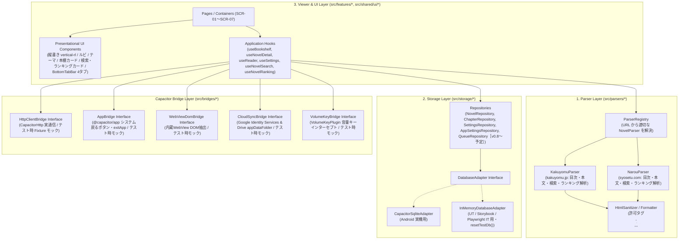

# 3層アーキテクチャと共通インターフェース契約（App 全体正本）

## 1. アーキテクチャ全体像と3層分離原則

AI による TDD 実装の確実性と保守性を最大化するため、Capacitor ネイティブ依存（HTTP 通信・SQLite・WebView ブリッジ）を薄いアダプター層に隔離し、アプリケーション全体を以下の3層（＋ Bridge 抽象層）に明確に分離します。



---

## 2. 標準ディレクトリ構成とアセット管理規約

### 2.1 リポジトリ全体ツリー

```text
Yommy/
├── assets/                            # 【マスターアセット】高解像度マスター画像（assets/icon.png 1024×1024）
├── public/                            # 【Web 静的アセット】favicon.ico, icon-192.png, icon-512.png, apple-touch-icon.png
├── android/                           # 【Android プロジェクト】Capacitor ネイティブコード＆リソース
│   ├── debug.keystore                 # 【固定署名鍵】開発・検証用一貫デバッグキーストア（Issue #78）
│   └── app/src/main/res/              # mipmap-* (ic_launcher*), values/ic_launcher_background.xml
├── scripts/                           # 【ビルド・補助スクリプト】generate-icons.mjs 等
└── src/                               # 【アプリケーションソースコード】
    ├── App.tsx                        # ルートコンポーネント（テーマ適用・ルーター配置・OS戻るボタン連携）
    ├── App.stories.tsx
    ├── App.test.tsx
    ├── app/                           # アプリケーション共通設定・DI Provider
    │   ├── router.tsx                 # 画面ルーティング定義（SCR-01〜SCR-07）
    │   ├── router.stories.tsx
    │   ├── router.test.tsx
    │   ├── ServiceProvider.tsx        # Storage / HttpBridge / AppBridge / ParserRegistry の Context DI（実機・テスト差し替え点）
    │   ├── ServiceProvider.stories.tsx
    │   └── ServiceProvider.test.tsx
    ├── bridges/                       # 【Capacitor Bridge 抽象層】
    │   ├── app/                       # 【AppBridge】システム戻るボタン・アプリ終了制御（Issue #78）
    │   │   ├── types.ts               # AppBridge, BackButtonEvent, BackButtonListener 定義
    │   │   ├── capacitorAppBridge.ts  # @capacitor/app 実装
    │   │   └── mockAppBridge.ts       # UT / Storybook / IT 用モック実装（triggerBackButton）
    │   ├── cloud-sync/                # 【CloudSyncBridge】Google Drive appDataFolder クラウド同期（Issue #120）
    │   │   ├── types.ts               # CloudSyncBridge, CloudSyncAuthState 定義
    │   │   ├── capacitorCloudSyncBridge.ts # Android ネイティブ Capacitor プラグイン実装
    │   │   └── mockCloudSyncBridge.ts # UT / Storybook / IT 用インメモリ同期モック
    │   ├── volume-key/                # 【VolumeKeyBridge】ハードウェア音量キーインターセプト・ページ送り（Issue #203）
    │   │   ├── types.ts               # VolumeKeyBridge, VolumeKeyEvent, VolumeKeyListener 定義
    │   │   ├── capacitorVolumeKeyBridge.ts # Capacitor プラグイン（VolumeKeyPlugin）ラッパー実装
    │   │   └── mockVolumeKeyBridge.ts # UT / Storybook / IT 用モック実装（triggerVolumeKey）
    │   ├── http/
    │   │   ├── types.ts               # HttpClientBridge インターフェース定義
    │   │   ├── capacitorHttpClient.ts # CapacitorHttp 実装（CORS回避・User-Agent・タイムアウト制御）
    │   │   └── mockHttpClient.ts      # UT / Storybook / IT 用フィクスチャ応答クライアント
    │   └── webview/                   # 【WebViewDomBridge】内蔵WebView DOMキャプチャ（v0.8〜予定）
    │       ├── types.ts
    │       └── webviewDomBridge.ts
    ├── features/                      # 【3. Viewer & UI Layer（画面・機能別モジュール）】
    │   ├── bookshelf/                 # SCR-01: 本棚一覧（空状態での検索/ランキング誘導・更新チェック・ソート）
    │   ├── novel-detail/              # SCR-02: 作品詳細・目次一覧・取得操作・一括キャッシュ
    │   ├── reader/                    # SCR-03: 小説リーダー（全画面100dvh・上下連動オーバーレイ＆RTLシークバー・縦書きCSSマルチカラム組版・2段階水平スライドアニメーション・音量キー送り・ルビ・しおり保存）
    │   ├── search/                    # SCR-06: 検索画面（カクヨム・小説家になろうサイト切替・作品検索・カードから本棚追加・SCR-02遷移）
    │   ├── ranking/                   # SCR-07: ランキング画面（カクヨム・小説家になろうサイト切替・期間/ジャンル別ランキング・カードから本棚追加・SCR-02遷移）
    │   ├── settings/                  # SCR-05: 設定画面（組版・テーマ・フォント・余白・音量キー送り設定・サンプル文章プレビュー・クラウド同期・キャッシュ管理）
    │   └── cloud-sync/                # クラウド同期（Google Drive appDataFolder・SyncEngine）（Issue #120）
    │       ├── types.ts               # YommySyncState, SyncNovelData 等の同期データ型定義
    │       └── services/              # スキーマ検証・競合マージ・デバウンス同期エンジン
    ├── parsers/                       # 【1. Parser Layer（スクレイピング・DOM解析層）】
    │   ├── types.ts                   # NovelParser, ParsedNovelMetadata, ParsedChapterContent, ParsedSearchResult, ParsedRankingResult 等の型契約
    │   ├── parserRegistry.ts          # URL から対応サイト（kakuyomu / narou 等）を判定・ディスパッチ
    │   ├── fetchFullNovelIndex.ts     # 複数ページ目次（nextTocPageUrl）連続取得・結合パイプライン（Issue #239）
    │   ├── sanitizer.ts               # 小説本文 HTML サニタイズ＆正規化（XSS防止・ルビ/傍点保持）
    │   ├── kakuyomu/                  # カクヨム用パーサーとローカル HTML フィクスチャ
    │   │   ├── KakuyomuParser.ts
    │   │   ├── KakuyomuParser.test.ts
    │   │   └── __fixtures__/
    │   └── narou/                     # 小説家になろう用パーサーとローカル HTML/JSON フィクスチャ（Issue #239, #240）
    │       ├── NarouParser.ts
    │       ├── NarouParser.test.ts
    │       ├── genres.ts
    │       └── __fixtures__/
    ├── storage/                       # 【2. Storage Layer（ローカルDB・キャッシュ管理層）】
    │   ├── types.ts                   # エンティティ型および各 Repository インターフェース契約
    │   ├── schema.ts                  # SQLite テーブル DDL および初期行定義（実機・インメモリ共有）
    │   ├── schema.test.ts
    │   ├── adapter/
    │   │   ├── types.ts               # DatabaseAdapter インターフェース
    │   │   ├── capacitorSqlite.ts     # @capacitor-community/sqlite アダプター実装
    │   │   └── inMemoryDb.ts          # テスト・Web開発用インメモリDB実装（resetTestDb() 提供）
    │   └── repositories/
    │       ├── novelRepository.ts     # novels テーブル操作
    │       ├── chapterRepository.ts   # chapters テーブル操作（本文キャッシュ保存・削除・容量集計）
    │       ├── settingsRepository.ts  # reader_settings 操作
    │       ├── appSettingsRepository.ts # app_settings 操作（ソート順等永続化）
    │       └── queueRepository.ts     # download_queue テーブル操作（v0.8〜予定）
    └── shared/                        # 複数機能で共有する汎用 UI コンポーネント・ユーティリティ
        ├── constants/                 # キャッシュ・レートリミット・タイポグラフィ等の共有定数（cache.ts, typography.ts）
        ├── utils/                     # キャッシュ判定・容量フォーマット等の共有ユーティリティ（cache.ts, formatByteSize.ts）
        └── ui/                        # BottomTabBar 等共通コンポーネント（モバイル幅での改行防止縦並び flex-col sm:flex-row ＋ whitespace-nowrap 最適化）
├── docs/                              # 【ドキュメント正本（OKF）】
└── test/                              # 【統合・結合テスト】Playwright 実ブラウザ IT シナリオ
```

---

## 3. 各層の基底インターフェース契約（TypeScript 型定義正本）

### 3.1 Http / Bridge Layer 契約（`src/bridges/http/types.ts`）

```ts
export interface HttpRequestOptions {
  url: string;
  headers?: Record<string, string>;
  timeoutMs?: number;
  signal?: AbortSignal;
}

export interface HttpResponse {
  status: number;
  url: string; // リダイレクト後の最終URL
  html: string;
  headers: Record<string, string>;
}

export interface HttpClientBridge {
  /**
   * 指定URLからHTMLテキストを取得する。
   * Android実機では CapacitorHttp を用いてCORSを回避し、テスト環境ではローカルFixtureを返す。
   */
  getHtml(options: HttpRequestOptions): Promise<HttpResponse>;
}
```

### 3.2 App / Native Bridge 契約（`src/bridges/app/types.ts`）

```ts
export interface BackButtonEvent {
  canGoBack: boolean;
}

export type BackButtonListener = (
  event: BackButtonEvent,
) => void | Promise<void>;

export interface AppBridge {
  /**
   * システム戻るボタン（またはテスト環境でのバックキー押下）のリスナーを登録する。
   * @returns リスナー解除関数
   */
  addBackButtonListener(listener: BackButtonListener): () => void;

  /**
   * アプリケーションを終了する。
   * Android 実機では @capacitor/app の App.exitApp() を実行し、モック環境では呼出フラグを記録する。
   */
  exitApp(): Promise<void>;
}
```

### 3.3 Parser Layer 契約（`src/parsers/types.ts`）

```ts
/** 対応サイト識別子 */
export type NovelSiteType = "kakuyomu" | "narou" | "generic";

/** 目次内の1エピソード情報 */
export interface ParsedTocItem {
  chapterIndex: number; // 1始まりの連番
  remoteChapterId: string; // サイト固有のエピソード識別子（カクヨムepisodeId、なろう話数等）
  partTitle: string | null; // 章・部見出し（存在しない場合は null）
  title: string; // サブタイトル（各話タイトル）
  url: string; // エピソード本文ページの正規化URL
  publishedAt: string | null; // 公開・更新日時文字列（取得可能な場合）
}

/** 作品トップ（目次）ページから抽出される作品メタデータと目次リスト */
export interface ParsedNovelIndex {
  siteType: NovelSiteType;
  remoteWorkId: string; // サイト固有の作品識別子（例: カクヨム workId, なろう ncode）
  canonicalUrl: string; // 正規化された作品トップURL
  title: string; // 作品タイトル
  author: string; // 著者名
  synopsis: string; // あらすじテキスト
  chapters: ParsedTocItem[]; // エピソード目次一覧
  nextTocPageUrl: string | null; // 目次が複数ページに分かれる場合の次ページURL（なろう等）
}

/** 各話ページから抽出される本文データ */
export interface ParsedChapterContent {
  remoteChapterId: string;
  title: string; // サブタイトル
  bodyHtml: string; // サニタイズ済み本文HTML（<p>, <br>, <ruby>, <rb>, <rt>, <rp>, <em> のみ許容）
  byteSize: number; // UTF-8 バイトサイズ
  prevChapterUrl: string | null;
  nextChapterUrl: string | null;
}

/** 検索・ランキング共通オプションおよび型 */
export type NovelSearchOrder =
  "weekly_ranking" | "popular" | "last_episode_published_at" | "published_at";
export type NovelSerialStatus = "all" | "running" | "completed";

export interface NovelSearchOptions {
  order?: NovelSearchOrder;
  serialStatus?: NovelSerialStatus;
  genre?: string;
  genres?: string[];
  excludeKeyword?: string;
  page?: number;
}

export type NovelRankingPeriod = "daily" | "weekly" | "monthly" | "entire";

export interface NovelRankingOptions {
  period?: NovelRankingPeriod;
  genre?: string;
  page?: number;
}

export interface NovelSearchResultItem {
  remoteWorkId: string;
  title: string;
  author: string;
  synopsis: string;
  genre: string;
  genreLabel: string;
  serialStatus: "running" | "completed";
  serialStatusLabel: string;
  episodeCount: number;
  characterCount: number;
  tags: string[];
  reviewPoints: number;
  lastEpisodePublishedAt: string | null;
  workUrl: string;
}

export interface NovelRankingResultItem extends NovelSearchResultItem {
  rank: number; // 順位（1始まり）
}

export interface ParsedSearchResult {
  items: NovelSearchResultItem[];
  pageInfo: {
    currentPage: number;
    hasNextPage: boolean;
    totalCount?: number;
  };
}

export interface ParsedRankingResult {
  items: NovelRankingResultItem[];
  pageInfo: {
    currentPage: number;
    hasNextPage: boolean;
  };
}

/** サイト別パーサーの共通インターフェース（Strategyパターン） */
export interface NovelParser {
  readonly siteType: NovelSiteType;

  /** 指定されたURLがこのパーサーの対象サイトかどうかを判定する */
  canParse(url: string): boolean;

  /** エピソードURL等から作品トップURLへ正規化する */
  normalizeWorkUrl(url: string): string;

  /** 作品トップHTMLから作品情報と目次一覧を抽出する（純粋関数・通信なし） */
  parseNovelIndex(html: string, pageUrl: string): ParsedNovelIndex;

  /** 各話HTMLから整形・サニタイズ済み本文HTMLを抽出する（純粋関数・通信なし） */
  parseChapterContent(html: string, pageUrl: string): ParsedChapterContent;

  /** 検索クエリ・オプションに応じた検索 URL を生成する（任意実装） */
  buildSearchUrl?(query: string, options?: NovelSearchOptions): string;

  /** 検索結果 HTML から作品一覧をパースする（任意実装・純粋関数） */
  searchNovels?(html: string, pageUrl: string): ParsedSearchResult;

  /** ランキング条件に応じたランキング URL を生成する（任意実装） */
  buildRankingUrl?(options?: NovelRankingOptions): string;

  /** ランキング結果 HTML から順位付き作品一覧をパースする（任意実装・純粋関数） */
  getRanking?(html: string, pageUrl: string): ParsedRankingResult;
}
```

---

### 3.4 Storage Layer 契約（`src/storage/types.ts`）

DB テーブル構造の詳細は [docs/specs/db-schema.md](db-schema.md) を正本とし、アプリケーション層は以下の Repository インターフェースを介してのみデータにアクセスします。

```ts
export type BookshelfSortOrder =
  "unread_first" | "last_read" | "latest_published" | "created_at" | "title";

export interface DeletedNovelRecord {
  id: string;
  deletedAt: number;
}

export type WritingMode = "vertical-rl" | "horizontal-tb";
export type ReaderTheme = "light" | "sepia" | "dark" | "black";

export interface NovelRecord {
  id: string;
  siteType: "kakuyomu" | "narou";
  remoteWorkId: string;
  canonicalUrl: string;
  title: string;
  author: string;
  synopsis: string;
  totalChapters: number;
  cachedChapters: number;
  totalByteSize: number;
  bookmarkChapterIndex: number | null;
  bookmarkScrollProgress: number;
  isFavorite: boolean;
  hasNewUpdate?: boolean;
  latestEpisodePublishedAt?: string | null;
  lastCheckedAt: string | null;
  lastReadAt: string | null;
  createdAt: string;
  updatedAt: string;
}

export type NovelSummary = Omit<NovelRecord, "synopsis">;

export interface ChapterRecord {
  id: string;
  novelId: string;
  chapterIndex: number;
  remoteChapterId: string;
  partTitle: string | null;
  title: string;
  url: string;
  bodyHtml: string | null;
  byteSize: number;
  isRead: boolean;
  publishedAt: string | null;
  downloadedAt: string | null;
}

export type ChapterSummary = Omit<ChapterRecord, "bodyHtml">;

export interface NovelRepository {
  listNovels(sortOrder?: BookshelfSortOrder): Promise<NovelSummary[]>;
  getNovelById(novelId: string): Promise<NovelRecord | null>;
  upsertNovelWithToc(
    index: ParsedNovelIndex,
    fetchedAt: string,
  ): Promise<NovelRecord>;
  updateBookmark(
    novelId: string,
    chapterIndex: number,
    scrollProgress: number,
  ): Promise<void>;
  deleteNovel(novelId: string): Promise<void>;
  clearNewUpdate(novelId: string): Promise<void>;
  updateLastCheckedAt(novelId: string, checkedAt: string): Promise<void>;
  getDeletedNovels?(): Promise<DeletedNovelRecord[]>;
  purgeDeletedNovels?(idList: string[]): Promise<void>;
  updateSyncMetadata?(
    novelId: string,
    metadata: { isFavorite?: boolean; lastReadAt?: string | null },
  ): Promise<void>;
  purgeExpiredDeletedNovels?(cutoffTimeMs: number): Promise<void>;
}

export interface AppSettingsRepository {
  getSetting(key: string): Promise<string | null>;
  setSetting(key: string, value: string): Promise<void>;
  getCloudSyncLastSyncedAt?(): Promise<number | null>;
  setCloudSyncLastSyncedAt?(timestamp: number | null): Promise<void>;
  getCloudSyncAccountEmail?(): Promise<string | null>;
  setCloudSyncAccountEmail?(email: string | null): Promise<void>;
}

export interface ChapterRepository {
  listChaptersByNovelId(novelId: string): Promise<ChapterSummary[]>;
  getChapter(
    novelId: string,
    chapterIndex: number,
  ): Promise<ChapterRecord | null>;
  saveChapterBody(
    novelId: string,
    chapterIndex: number,
    content: ParsedChapterContent,
    downloadedAt: string,
  ): Promise<void>;
  markChapterRead(
    novelId: string,
    chapterIndex: number,
    isRead: boolean,
  ): Promise<void>;
  deleteCachedBodies(
    novelId: string,
    options?: { onlyRead?: boolean },
  ): Promise<number>;
  deleteAllCachedBodies(options?: { onlyRead?: boolean }): Promise<number>;
  getStorageCacheSummary(): Promise<{
    totalCachedChapters: number;
    totalByteSize: number;
  }>;
}

/**
 * フォント種別（v0.5 Issue #169）
 * - biz-ud-mincho: UD明朝（既定値、'BIZ UDMincho', 'Noto Serif CJK JP', 'Noto Serif JP', 'IPAexMincho', serif）
 * - mincho: 明朝体（'Noto Serif CJK JP', 'Noto Serif JP', 'IPAexMincho', 'Hiragino Mincho ProN', 'Yu Mincho', serif）
 * - biz-ud-gothic: UDゴシック（'BIZ UDGothic', 'Noto Sans CJK JP', 'Noto Sans JP', 'IPAexGothic', sans-serif）
 * - gothic: ゴシック体（'Noto Sans CJK JP', 'Noto Sans JP', 'IPAexGothic', 'Hiragino Kaku Gothic ProN', 'Yu Gothic', sans-serif）
 * - klee: 教科書体（'Klee One', 'Klee', 'Noto Serif CJK JP', serif）
 */
export type ReaderFontFamily =
  "biz-ud-mincho" | "mincho" | "biz-ud-gothic" | "gothic" | "klee";

/**
 * ページ送り動作モード
 * - auto: 自動（縦書き時はページめくり、横書き時はスクロール）
 * - paged: ページめくり（縦書き時のみ有効、横書き時はスクロール固定）
 * - scroll: 常に連続スクロール
 * ※ v0.5 Issue #168: 横書き時は常に連続スクロールに固定され、設定画面では「ページめくり（縦書き時）」「連続スクロール」の2択に整理される。
 */
export type ReaderPagingMode = "auto" | "paged" | "scroll";

export interface ReaderSettings {
  writingMode: WritingMode;
  theme: ReaderTheme;
  fontFamily: ReaderFontFamily;
  fontSizePx: number;
  lineHeight: number;
  pageMarginPx: number;
  enableTapPaging: boolean;
  enableVolumeKeyPaging: boolean;
  pagingMode: ReaderPagingMode;
  updatedAt: string;
}

export interface SettingsRepository {
  getReaderSettings(): Promise<ReaderSettings>;
  updateReaderSettings(patch: Partial<ReaderSettings>): Promise<ReaderSettings>;
  getCloudSyncLastSyncedAt?(): Promise<number | null>;
  setCloudSyncLastSyncedAt?(timestamp: number | null): Promise<void>;
  getCloudSyncAccountEmail?(): Promise<string | null>;
  setCloudSyncAccountEmail?(email: string | null): Promise<void>;
}
```

### 3.5 Application Router 契約（`src/app/router.tsx`）

外部ルーティングライブラリへの依存を持たず、History API（`window.history.pushState` / `popstate` / `replaceState`）と React Context による軽量ルーターで画面遷移（[docs/specs/screen-transitions.md](screen-transitions.md)）を管理します。

```ts
export type AppRoute =
  | { name: "bookshelf"; path: "/" }
  | { name: "search"; path: "/search" }
  | { name: "ranking"; path: "/ranking" }
  | { name: "settings"; path: "/settings" }
  | { name: "novel-detail"; path: string; novelId: string }
  | { name: "reader"; path: string; novelId: string; chapterIndex: number };

export interface NavigateToReaderOptions {
  replace?: boolean;
  fromBookshelfResume?: boolean;
}

export interface RouterContextValue {
  currentPath: string;
  previousPath?: string;
  novelOrigin: string | null;
  settingsOrigin: string | null;
  route: AppRoute;
  navigate: (path: string) => void;
  navigateToBookshelf: () => void;
  navigateToSearch: () => void;
  navigateToRanking: () => void;
  navigateToNovelDetail: (novelId: string, origin?: string) => void;
  navigateToReader: (
    novelId: string,
    chapterIndex: number,
    options?: NavigateToReaderOptions,
  ) => void;
  navigateToSettings: () => void;
  back: () => void;
}
```

- `novelId`（例: `"kakuyomu:16817330658027210412"`）を URL パスに含める際は `encodeURIComponent` でエンコードし、ルート解決（`matchRoute`）時に `decodeURIComponent` でデコードする。
- `RouterProvider` は `initialPath?: string` プロパティを受け取り、Vitest 単体テストや Storybook において任意のルート状態を決定論的に再現できる。
- `navigate` は同一パスへの遷移呼び出し時（例: `/settings` での「設定」タブ再タップ、`/search` での「検索」タブ再タップ）は履歴追加（`pushState`）および `previousPath` の上書きを行わず no-op とする。
- **設定画面復帰オリジン制御（`settingsOrigin`、Issue #124 / R1-22）**:
  - 設定画面（`SCR-05: /settings`）への遷移時、直前画面がリーダー（`SCR-03`）または作品詳細（`SCR-02`）の場合はそのパスを `settingsOrigin` として保持する。
  - OS バックキー実行時、`settingsOrigin` が保持されていれば直前画面へ復帰し、`settingsOrigin` を `null` にリセットする。
  - 下部タブバー等で別の主画面（本棚・検索・ランキング）へ移動した際も `settingsOrigin` は `null` にリセットされる。
- **OS バックキー（@capacitor/app の AppBridge 経由およびブラウザ戻る操作）の論理階層遷移制御**:
  - ブラウザ履歴順に依存せず、常に論理階層順（**各話View `SCR-03` → 目次 `SCR-02` → 直前の遷移元（本棚 `SCR-01`、検索 `SCR-06`、ランキング `SCR-07`）**、**設定 `SCR-05` → 直前画面（リーダー `SCR-03`、作品詳細 `SCR-02`、または本棚 `SCR-01`）**、**検索 `SCR-06` / ランキング `SCR-07` → 本棚 `SCR-01`**）で戻るよう制御する。
  - 本棚の「続きから読む」から各話Viewへ直行した場合も、ルーターが履歴スタックに目次（`/novels/:novelId`）を介在させることで、バックキー 1 回で確実に目次画面へ戻る。
  - リーダー画面内の前後話連続遷移（第1話 → 第2話）では `history.replaceState` を適用し、履歴の肥大化を防ぎつつバックキー 1 回で目次へ復帰できるようにする。
  - リーダー離脱時には最新の閲覧話数・スクロール進捗率を SQLite へ自動保存（`flushBookmark`）する。
  - 作品詳細・目次画面（`SCR-02`）からのバックキー操作時は、直前の呼び出し元画面（本棚 `SCR-01`、検索 `SCR-06`、またはランキング `SCR-07`）へ戻る（`TR-07`、直前履歴が存在しない場合は本棚 `/` へ復帰）。
  - 設定画面（`SCR-05`）で OS バックキーを実行したとき、直前の画面（リーダー `SCR-03`、作品詳細 `SCR-02`）またはホームの本棚画面（`SCR-01`）へ復帰する。検索画面（`SCR-06`）、ランキング画面（`SCR-07`）ではホームの本棚画面（`/`）へ復帰する（`TR-12`）。
  - 本棚画面（`SCR-01: /`）でバックボタンが押された際は、2秒以内の連続2回押下で `AppBridge.exitApp()` を呼び出してアプリを終了し、1回目押下時は画面下部に「もう一度バックボタンを押すと終了します」の一時確認トースト（`role="status"`、2秒後に自動消去）を表示する（`TR-13`）。

### 3.6 クラウド同期データ構造契約（`src/features/cloud-sync/types.ts`、Issue #120 / R1-35）

Google Drive（`appDataFolder`）上の同期ファイル `yommy-sync-state.json` および同期エンジン（`SyncEngine`）で共有されるデータ構造契約です。

```ts
import type { NovelSiteType } from "../../parsers/types";

/**
 * yommy-sync-state.json のルートデータ構造
 */
export interface YommySyncState {
  /** スキーマバージョン（初期値: 1） */
  version: 1;
  /** 最終同期日時（ISO 8601 UTC 文字列） */
  lastSyncedAt: string;
  /** 作品基本情報・しおり・既読マップ（キー: novelId） */
  novels: Record<string, SyncNovelData>;
  /** 削除済み作品の Tombstone マップ（キー: novelId, 値: 削除日時 ISO 8601） */
  deletedNovels: Record<string, string>;
}

/**
 * 同期対象の個別作品データ構造
 */
export interface SyncNovelData {
  id: string; // "{site_type}:{remote_work_id}"
  siteType: NovelSiteType;
  remoteWorkId: string;
  canonicalUrl: string; // 作品トップURL
  title: string;
  author: string;
  synopsis: string;
  totalChapters: number;
  isFavorite: number; // 0 | 1
  hasNewUpdate: number; // 0 | 1
  latestEpisodePublishedAt: string | null;
  bookmarkChapterIndex: number | null; // しおり話数（1始まり）
  lastReadAt: string | null; // 最終閲覧日時（ISO 8601）
  readChapterIds: string[]; // 既読エピソードID（remote_chapter_id）の配列
  createdAt: string; // 初回登録日時（ISO 8601）
  updatedAt: string; // レコード更新日時（ISO 8601）
}
```

### 3.7 キャッシュ鮮度・先読み・一括キャッシュ制御ポリシー（v0.3 新設）

読書体験の快適化（待ち時間ゼロ）と外部小説サーバーへの負荷低減（503 IP BAN 防止）を両立するため、共通定数モジュール（`src/shared/constants/cache.ts`）に以下の定数を定義し、制御ポリシーを適用します。

```ts
/** キャッシュの有効期間（7日間） */
export const CACHE_TTL_MS = 7 * 24 * 60 * 60 * 1000;
/** 既存キャッシュが存在する場合の再取得短タイムアウト（3秒） */
export const SHORT_TIMEOUT_MS = 3000;
/** 未キャッシュ話等の初回取得標準タイムアウト（10秒） */
export const STANDARD_TIMEOUT_MS = 10000;
/** 先読みおよび一括キャッシュのリクエスト間隔ウェイト（1.5秒） */
export const PREFETCH_INTERVAL_MS = 1500;
/** 読書中の自動先読み対象話数（5話先まで） */
export const PREFETCH_COUNT = 5;
```

1. **キャッシュ鮮度判定（TTL 7日間）**:
   - `chapters.downloaded_at` が現在時刻から `CACHE_TTL_MS`（7日）以内の場合、キャッシュを「有効（Fresh）」とみなし、通信を行わず即座に SQLite の本文を描画する。
   - 先読みおよび一括キャッシュにおいても、有効なキャッシュを持つ話数はスキップされる。
2. **読書中 5 話自動先読み（`useReader`）**:
   - 第 $N$ 話の本文読み込み完了後、バックグラウンドで $N+1 \sim \min(N+5, \text{totalChapters})$ のエピソードを昇順で順次取得・SQLite 保存する。
   - 対象サーバーの過負荷防止（第 $N$ 話取得直後の連続リクエスト抑止）のため、最初の先読み（第 $N+1$ 話）リクエスト開始前に `PREFETCH_INTERVAL_MS`（1.5秒）の初期インターバルを空け、以降も 1話の取得完了ごとに 1.5秒のウェイトを空けて直列実行する。
   - 処理全体を `AbortController` で制御し、ユーザーが `goToChapter` で別エピソードへ移動した際やリーダー画面を離脱した際は、直ちに直前の処理をキャンセルしてリソースを解放する。またエピソード連続遷移時においても、先行先読みタスク（進行中の HTTP 通信含む）の Promise 完了を待機して直列化を保証し、1.5 秒の間隔規律を担保する。初期ロード通信完了後のマウント状態ガード（`isMounted`）および先読みタスクの `AbortSignal` 連動により、画面離脱後の DB 書き込みを防止する（R1-29）。
3. **作品詳細での未取得話一括キャッシュ（`useNovelDetail`）**:
   - 作品詳細ヘッダーの「未取得話を一括キャッシュ」操作（`TR-18`）により、未キャッシュエピソード（および TTL 7日経過した古いキャッシュ）を `PREFETCH_INTERVAL_MS`（1.5秒）間隔で順次直列取得する。
   - 1話取得成功ごとに SQLite へ保存し、ヘッダーの取得済み話数（`cachedChapters`）および各話リストのキャッシュバッジをリアルタイムに更新する。
   - ユーザー手動中断（「中断」ボタン）および画面アンマウント時は `AbortController` により安全に処理を停止する（取得済み話数は維持される）。
4. **7日経過キャッシュの短タイムアウトフォールバック**:
   - 取得から 7日以上経過したキャッシュは、閲覧時・先読み時・一括キャッシュ時に `SHORT_TIMEOUT_MS`（3秒）で再取得を試みる。
   - 3秒以内に取得成功した場合は新本文で DB および画面を更新する。
   - タイムアウト・オフライン・通信エラー等で失敗した場合は、**即座に既存の `bodyHtml` を使用してフォールバック表示** し（一括キャッシュ時は既存キャッシュを維持して次話へ進行）、エラー画面を表示せず読書を継続させる。

5. **複数ページ目次（`nextTocPageUrl`）の連続取得制御（v0.7 Issue #239 新設）**:
   - 小説家になろう（`ncode.syosetu.com`）の 100 話超作品のように作品目次が `?p=2`, `?p=3`... と複数ページに分割される場合、共通パイプライン `fetchFullNovelIndex`（`src/parsers/fetchFullNovelIndex.ts`）が `nextTocPageUrl` を順次辿って全目次ページを取得・結合する。
   - ページ間のリクエスト間隔ウェイトは `DEFAULT_TOC_PAGE_INTERVAL_MS`（`500ms`）、最大ページ上限は `MAX_TOC_PAGES`（`100` ページ ＝ 最大 10,000 話）とし、訪問済み URL セットによる無限ループ防止ガードを備える。
   - 2 ページ目以降の `nextTocPageUrl` 取得前には、SSRF および別作品混入を防ぐため **`https:` プロトコルかつ `parser.canParse(nextUrl) === true` かつ `parser.normalizeWorkUrl(nextUrl) === canonicalUrl`（同一作品）** を検証し、不一致の場合は通信を行わずループを終了する。
   - 2 ページ目以降の先頭エピソードに章見出し（`partTitle`）がない場合は直前ページ末尾の `partTitle` を引き継ぎ、全エピソードに `chapterIndex: 1..N` の連番を再採番する。
   - 途中ページの取得に失敗した場合は例外を送出して中断し、不完全な目次で既存 DB を上書きしない。

### 3.8 クラウド同期（Google Drive appDataFolder）および同期エンジンアーキテクチャ（v0.4 新設 / v0.7 マルチサイト拡張）

複数端末間での本棚登録作品・しおり位置・既読状態の同期、および機種変更時の引き継ぎを実現するため、Google Drive のアプリ専用領域（`appDataFolder`）に単一 JSON（`yommy-sync-state.json`）を保存・同期するアーキテクチャを導入します（Issue #120）。

#### 3.8.1 `CloudSyncBridge` インターフェース契約（`src/bridges/cloud-sync/types.ts`）

```ts
export type CloudSyncAuthState =
  | { status: "unlinked" }
  | { status: "authenticating" }
  | { status: "connected"; email?: string }
  | { status: "error"; message: string };

export interface CloudSyncBridge {
  /** 現在の Google 認証状態を取得する */
  getAuthState(): Promise<CloudSyncAuthState>;
  /** Google アカウント連携（認可フロー実行） */
  signIn(): Promise<CloudSyncAuthState>;
  /** 連携解除（OS トークン破棄および Google サーバーへの Revoke 実行） */
  signOut(): Promise<void>;
  /** appDataFolder から yommy-sync-state.json を取得する（存在しない場合は null） */
  pullFile(): Promise<string | null>;
  /** appDataFolder へ yommy-sync-state.json をアップロード・保存する */
  pushFile(content: string): Promise<void>;
}
```

- **`CapacitorCloudSyncBridge` における 401 判定（R2-14）**:
  - 作品 ID や URL に偶然 `"401"` が含まれる場合の誤判定を防ぐため、`isUnauthorizedError` では単語境界付き正規表現（`/\b401\s+Unauthorized\b/i`、`/\bHTTP\s+401\b/i`、`/\bstatus(?:\s*code)?\s*[:=]?\s*401\b/i`、`/\bUnauthorized\b/i`）で 401 認証エラーを厳格に検出する。

#### 3.8.2 同期エンジン（`SyncEngine`）の競合マージとゼロトラスト検証

- **ゼロトラスト検証**:
  - 受信した JSON に対し、通信前に厳格なランタイムスキーマ検証（`version === 1`、必須フィールド、数値範囲、プロトタイプ汚染防止）を実行する。
  - 作品 ID（`id`）が `${siteType}:${remoteWorkId}` と厳密に一致することを検証する。
  - `deletedNovels` のキーが空文字（`""`）や空白文字でないことを検証し、`novels` と `deletedNovels` の双方に同一キーが存在する場合は、作品の `updatedAt` と `deletedAt` を比較し、`updatedAt >= deletedAt` であれば再登録を優先して `deletedNovels` から除外、`deletedAt > updatedAt` であれば削除を優先して `novels` から該当作品を除去する（R1-28）。
  - 未登録作品の自動目次取得（`upsertNovelWithToc`）前に、`canonicalUrl` を `parseNovelUrl`（`https://kakuyomu.jp/works/<id>` および `https://ncode.syosetu.com/<ncode>/` のマルチサイトホワイトリスト検証、Issue #239）にかけ、不正な URL や未知ドメイン（`novel18.syosetu.com` 含む）へのリクエスト（SSRF）を遮断する。さらに `canonicalUrl` から抽出した `siteType` / `workId` とリモート作品データの整合性を検証し、正規化 URL および `fetchFullNovelIndex`（複数ページ目次対応）で通信を行う。
  - 401 Unauthorized エラーの判定は、作品 URL や作品 ID に偶然 `401` が含まれている場合の誤爆を防ぐため、HTTP ステータスコード 401、または単語境界を考慮した正規表現（`/\b401\s+Unauthorized\b/i` 等）を用いて厳格に行う（R1-13, R2-14）。
- **競合解決（マージ）ルール**:
  - 新規作品の自動目次補完: リモートにのみ存在する作品は `canonicalUrl` から目次を自動取得してローカル DB に登録し、リモートのしおり話数・既読状態、および最終読了日時（`lastReadAt`）・お気に入りフラグ（`isFavorite`）を正しく復元・反映する（`novelRepository.updateSyncMetadata`、R1-12）。
  - 作品単位のエラーハンドリング: リモート作品の目次取得・保存処理は作品単位で `try/catch` され、通信障害やパーサー不整合等で 1 作品の取り込みに失敗した場合でも警告ログを出力してスキップし、他の正常な作品の同期処理を継続する（R1-05）。
  - 作品削除の伝播（Tombstone）と再登録保護: `deletedNovels` の削除日時がローカル作品の登録/更新日時より新しければローカル DB からカスケード削除する。ローカルで削除された作品は、削除後に他端末で明示的に再追加された場合（リモートの `createdAt` がローカルの `deletedAt` より後である場合）にのみ復元を許可し、単なる `updatedAt` の更新による意図しない削除作品の復活を防止する（R1-11）。本棚へ作品が再登録された際は `deleted_novels` テーブルから該当作品 ID の Tombstone を即座に削除する（R1-28）。
  - Push 前の作品和集合およびフィールド単位マージ: `pushCurrentState` 実行時（`buildMergedSyncNovels`）、ローカルの `novels` のみでリモートを全上書きするのではなく、リモートに存在する `novels` と和集合をとってマージする（R1-10）。さらにローカルとリモートの双方に存在する作品（かつ新しい `deletedAt` で削除されていない作品）については、リモート値をローカル値で単純上書きせず、フィールド単位のマージ（`readChapterIds` の和集合、`lastReadAt` 比較による `bookmarkChapterIndex` / `lastReadAt` の LWW、`updatedAt` 比較による `isFavorite` / `updatedAt` の LWW）を実施して他端末の最新進捗消失を防止する（R2-01）。
  - 30日経過 Tombstone の自動パージ: 削除日時から30日（`TOMBSTONE_RETENTION_MS` = 30日）以上経過した古い Tombstone はローカル DB（`purgeExpiredDeletedNovels`）およびリモートへの Push 対象から自動的にパージし、同期データ容量の肥大化を防止する（R1-28）。
  - しおり話数のマージ: 同一作品が両端末にある場合、`lastReadAt` が新しい方の `bookmarkChapterIndex` を採用する（話数変更時はスクロール率を `0.0` にリセット、同一話数の場合は端末ローカルのスクロール率を維持）。
  - 既読状態のマージ: 両端末の既読エピソード ID の和集合（Union）を採用する。
- **自動同期トリガーと排他・デバウンス制御**:
  - 未連携時のガード: `cloudSyncBridge.getAuthState()` が `connected` 状態でない場合、`pullAndMerge()` および `pushCurrentState()` は通信を行わず即座に安全にリターンする（R1-14）。
  - 自動 Pull: アプリ起動時、およびバックグラウンド復帰時（休止から5分以上経過）。未送信ローカル変更がある場合はマージ後に自動 Push。
  - 自動 Push: 本棚作品追加・削除、およびリーダー話数遷移・既読更新時に 2〜3秒（2500ms）デバウンス付き非同期実行。
  - 多重並行実行防止（排他制御・Single-flight）: `SyncEngine` 内部に排他制御機構（`isSyncing` フラグおよび FIFO キュー排他制御）を導入し、`pullAndMerge`、`pushCurrentState`、`sync` が同時に重なって実行されないよう安全にガードする。`sync()` が実行中に重複して呼び出された場合、実行中の Promise を再利用して単一実行に合流（Single-flight）させる。`scheduleDebouncedPush()` では生成した Promise に内部で `.catch(() => {})` を登録し、未処理例外（`UnhandledPromiseRejection`）を防止するとともに、`cancelDebouncedPush()` 実行時には保留中の Promise ハンドラーを漏れなく `resolve()` して呼び出し元のハングを防止する（R2-09）。

#### 3.8.3 ネイティブ Google Identity Services と 5 層セキュリティ設計

1. **OAuth クライアント識別と環境変数構成（R2-18）**: Android ネイティブ実装（`CloudSyncPlugin.java`）では、Google Identity Services（`AuthorizationClient`）が Google Cloud Console に登録された APK パッケージ名（`com.yommy.app`）と署名証明書の SHA-1 フィンガープリントによって OAuth クライアントを自動識別する（`AuthorizationRequest` にクライアント ID 文字列は渡さない）。一方、`.env.local`（`VITE_GOOGLE_CLIENT_ID`）は Web / 開発環境向けの任意設定参照用であり、Web ブラウザおよび自動テスト環境では `MockCloudSyncBridge` に安全にフォールバックする。
2. **非公開 Keystore 管理**: 公開 `android/debug.keystore` の SHA-1 は GCP に登録せず、GitHub Secrets で保護された非公開 Keystore の SHA-1 のみを登録して偽造 APK のなりすましを防ぐ。
3. **ネイティブ `AuthorizationClient` 認証（R2-02, R2-03, R2-14）**: サードパーティプラグインに依存せず、社内 Capacitor プラグイン（`CloudSyncPlugin.java`）経由で Android 公式 `Identity.getAuthorizationClient` を呼び出し、`client_secret` 排除・WebView 内トークン保存ゼロ（OS 側で短寿命アクセストークンを都度取得）とする。
   - **起動時の認証状態復元（`getAuthState`、R2-03）**: アプリ再起動時は `SharedPreferences`（`yommy_cloud_sync`）の連携状態に基づきサイレント再認可（`authorize`）でトークンを復元する。この際、`result.hasResolution()` が `true`（ユーザーが同意を取り消した等、対話的ログインが必須）の場合にのみ `SharedPreferences` をクリアして `unlinked` を返し、オフライン等の一時的な失敗時には `SharedPreferences` の連携設定を保持したまま `{ status: "error", message }` を返却する。
   - **401 失効時のキャッシュ破棄と再取得（R2-02, R2-14）**: `pullFile` / `pushFile` / `findSyncFileId` において `"401 Unauthorized"` を検知した際は、まず `Identity.getAuthorizationClient(activity).clearToken(ClearTokenRequest)` で Google Play 開発者サービス内のキャッシュ済み無効トークンを破棄してから `refreshAccessToken()` によるサイレント再取得・リトライを実行する。
   - **安全なファイル作成とライフサイクル管理**: ファイル初回作成時は `multipart/related`（`uploadType=multipart`）の 1 リクエストで作成し空ファイル残存を防止する。Activity 再生成時のコールバック消失防止（`saveCall` / `getSavedCall` / `freeSavedCall`）およびプラグイン破棄時の ExecutorService 解放（`handleOnDestroy`）を徹底する。
4. **最小権限スコープ（`drive.appdata` 限定）と即時 Revoke**: スコープを `drive.appdata` に限定し、連携解除時は OS トークン破棄＋Google サーバー即時 Revoke を実行。遠隔での認可解除（`401 Unauthorized`）検知時も自動で未連携状態へ安全にフォールバックする。
5. **SSRF / インジェクション防御**: スキーマ検証と `parseNovelUrl` ホワイトリスト検証を通過したデータのみを処理する。

### 3.9 キャッシュ容量フォーマット規約およびストレージ管理契約（Issue #170）

#### 3.9.1 バイト容量フォーマット共通ユーティリティ（`src/shared/utils/formatByteSize.ts`）

端末ストレージを圧迫するキャッシュデータを視認性高く提示するため、以下の規約でフォーマットする純粋関数を提供します：

```ts
export function formatByteSize(bytes: number): string {
  if (bytes <= 0) return "0 B";
  if (bytes < 1024) return `${bytes} B`;
  if (bytes < 1024 * 1024) return `${(bytes / 1024).toFixed(1)} KB`;
  return `${(bytes / (1024 * 1024)).toFixed(1)} MB`;
}
```

#### 3.9.2 ストレージ・キャッシュ管理フック契約（`src/features/settings/hooks/useStorageCache.ts`）

設定画面（`SCR-05`）における全体キャッシュ容量の可視化と一括本文キャッシュ削除（既読のみ／全話）を管理するカスタムフック契約です：

```ts
export interface StorageCacheSummary {
  totalCachedChapters: number;
  totalByteSize: number;
}

export interface UseStorageCacheResult {
  summary: StorageCacheSummary;
  isLoading: boolean;
  isClearing: boolean;
  notice: string | null;
  error: string | null;
  clearCache: (options: { onlyRead: boolean }) => Promise<number>;
  refreshSummary: () => Promise<void>;
}
```

### 3.10 ハードウェア音量キーブリッジ（`VolumeKeyBridge`）およびネイティブ連携アーキテクチャ（v0.6 新設: Issue #203）

リーダー画面（`SCR-03`）における片手持ち操作性向上のため、ハードウェア音量キー（Volume Down / Up）を捕捉し、Web 側のページ送り・スクロール送りと連携させるブリッジ層を導入します。

#### 3.10.1 `VolumeKeyBridge` インターフェース契約（`src/bridges/volume-key/types.ts`）

```ts
export type VolumeKeyDirection = "up" | "down";

export interface VolumeKeyEvent {
  direction: VolumeKeyDirection;
}

export type VolumeKeyListener = (event: VolumeKeyEvent) => void | Promise<void>;

export interface VolumeKeyBridge {
  /**
   * 音量キーインターセプトの有効/無効を切り替える。
   * Android 実機では有効時のみ KEYCODE_VOLUME_DOWN / KEYCODE_VOLUME_UP を捕捉し、OS 音量バー表示を抑止する。
   * リーダー離脱時や設定 OFF 時は false にすることで通常の OS 音量調整に戻す。
   */
  setVolumeKeyPagingEnabled(enabled: boolean): Promise<void>;

  /**
   * 音量キー押下イベントリスナーを登録する。
   * @param listener 音量キーイベントリスナー
   * @returns リスナー解除関数
   */
  addVolumeKeyListener(listener: VolumeKeyListener): () => void;
}
```

#### 3.10.2 Android ネイティブ層（`VolumeKeyPlugin` & `MainActivity`）連携仕様

1. **`VolumeKeyPlugin`**:
   - Capacitor プラグイン（`@CapacitorPlugin(name = "VolumeKey")`）として実装。
   - `setVolumeKeyPagingEnabled`: Web 側からの有効/無効状態を `private static volatile boolean volumeKeyPagingEnabled` に保持。
   - **ライフサイクル初期化・破棄保護（`R1-03`）**: `load()`（プラグイン初期化・WebView リロード時）および `handleOnDestroy()`（Activity 破棄・画面回転による再生成時）において必ず `volumeKeyPagingEnabled = false` にリセットし、Web 側の `cleanup` が呼ばれる前に Activity 再生成やリロードが発生した場合でも、リーダー外画面で音量キーが誤ってインターセプトされ続ける状態リークを防止する。
   - `onVolumeKeyDown(direction)`: `notifyListeners("volumeKeyEvent", { direction })` により Web 側リスナーへ非同期通知。
2. **`MainActivity`（`dispatchKeyEvent` インターセプト）**:
   - `dispatchKeyEvent(KeyEvent event)` をオーバーライドし、`KEYCODE_VOLUME_DOWN` または `KEYCODE_VOLUME_UP` を捕捉。
   - `VolumeKeyPlugin.isVolumeKeyPagingEnabled()` が `true` の場合：
     - `event.getAction() == KeyEvent.ACTION_DOWN`: 初回押下（`event.getRepeatCount() == 0`）時のみ `VolumeKeyPlugin.onVolumeKeyDown(direction)` を呼び出し、長押しによる意図しない高速連打や境界誤遷移を防止する。初回・リピート時ともに `return true;` で消費して **OS のシステム音量バー表示および音量変更を抑止** する。
     - `event.getAction() == KeyEvent.ACTION_UP`: キー離上時の OS 音量 HUD 漏れや端末ビープ音発生を防ぐため、同様に `return true;` でイベントを消費する。
   - `VolumeKeyPlugin.isVolumeKeyPagingEnabled()` が `false`（または音量キー以外）の場合は `super.dispatchKeyEvent(event)` を呼び出し、OS 標準の音量調整として透過的に動作させる。
3. **ブラウザ／テスト用モック（`MockVolumeKeyBridge`）**:
   - `triggerVolumeKey(direction)` メソッドを提供し、UT や Playwright IT で決定論的に音量キーイベントを発火可能にする。
   - Web 実行時の利便性として、`enabled === true` の間のみ `window` の `keydown` イベントでハードウェア音量キーコード（`AudioVolumeDown` / `VolumeDown` → `direction: "down"`、`AudioVolumeUp` / `VolumeUp` → `direction: "up"`）を捕捉し、登録済みリスナーへ通知する。

---

## 4. テスト環境での DI（依存性注入）と決定論的初期化

- `src/app/ServiceProvider.tsx` を介して `HttpClientBridge`、`AppBridge`、`CloudSyncBridge`、`VolumeKeyBridge`、各 `Repository`（および基底の `DatabaseAdapter`）を React Context 経由で提供する。
- **Android / iOS ネイティブ実行時**: `Capacitor.isNativePlatform()` によりネイティブ環境を自動検知し、`CapacitorHttpClient`、`CapacitorAppBridge`、`CapacitorCloudSyncBridge`、`CapacitorVolumeKeyBridge`、および `createDefaultNativeSqliteAdapter`（`CapacitorSqliteAdapter` ＋ `src/storage/schema.ts` の DDL 初期化）を注入する。
- **Web ブラウザ / Dev 実行時**: `createInMemoryDb`（`sql.js`）および `localStorage` への Base64 バイナリバックアップ（`yommy_sqlite_db_backup`）によるハイブリッド永続化を提供し、`createDefaultMockHttpClient`、`MockAppBridge`、`MockCloudSyncBridge`、および `MockVolumeKeyBridge` を使用する。既存 DB バイナリからの復元時にも `initializeDatabaseSchema` によるスキーママイグレーションを確実に実行する。
- **UT（Vitest）/ Storybook / Playwright IT 実行時**: `MockHttpClient` ＋ `MockAppBridge` ＋ `MockCloudSyncBridge` ＋ `MockVolumeKeyBridge` ＋ `InMemoryDatabaseAdapter` を注入し、各テストの開始前に `resetTestDb()` を呼び出して 100% 決定論的な状態で検証する。
- **Worktree 運用・環境変数非依存設計**: すべてのテスト（Vitest, Storybook VRT, Playwright IT）およびビルドは、`.env.local` の有無に関わらず 100% 決定論的に PASS する設計（`ServiceProvider` による DI モック分離と安全なフォールバック）を必須とし、テスト実行時に環境変数未定義によるスキップや挙動のブレを生じさせない。

---

## 5. Android ビルド署名およびバージョン管理規約

Android Debug APK の継続的な検証と上書きインストール（`INSTALL_FAILED_UPDATE_INCOMPATIBLE` の抑止）を保証するため、以下のビルド署名・バージョン採番規約を適用します。

### 5.1 Debug 署名キーストアの固定化（`android/debug.keystore`）

- リポジトリ内 `android/debug.keystore` に開発・検証用共通デバッグキーストアを配置する。
- `android/app/build.gradle` において `signingConfigs.debug` に上記キーストア（Alias: `androiddebugkey`、Password: `android`）を明示指定し、CI ランナー上でのランダムキーストア自動生成を防止する。

### 5.2 `versionCode` / `versionName` の動的注入と CI コンパイル検証

- `android/app/build.gradle` の `defaultConfig` において、CI 環境変数（`BUILD_NUMBER`）および Gradle プロパティ（`versionCode` / `versionName`）から動的にバージョンを解決する。
- GitHub Actions（`.github/workflows/build-android.yml`）では `BUILD_NUMBER: ${{ github.run_number }}` を注入し、ビルドごとに `versionCode` を単調増加させる。また、GitHub Secrets（`ANDROID_KEYSTORE_BASE64` 等）を Gradle ビルドステップへ注入する。
- リモート CI（`.github/workflows/ci.yml`）の `quality-gate` において、`android-compile` ジョブによる `./gradlew compileDebugJavaWithJavac` を自動実行し、Java コンパイル安全性を保証する。
- ローカルビルド時はフォールバック値（`versionCode 1`、`versionName "0.3.0"`）を採用し、開発作業の利便性を損なわない構成とする。

### 5.3 Google OAuth 用署名鍵の秘密管理と SHA-1 なりすまし防止

- 公開 `android/debug.keystore` の SHA-1 は GCP に登録しない（第三者による偽造 APK の OAuth なりすまし防止）。
- GitHub Secrets（`ANDROID_KEYSTORE_BASE64` 等）に保管した非公開 Keystore の SHA-1 とパッケージ名（`com.yommy.app`）のみを GCP の Android OAuth クライアントに登録し、CI APK ビルド時に署名する。Secrets 未設定のローカル/PR 環境のみ `android/debug.keystore` へフォールバックする。
