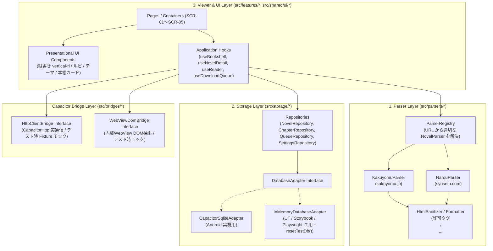

# 3層アーキテクチャと共通インターフェース契約（App 全体正本）

## 1. アーキテクチャ全体像と3層分離原則

AI による TDD 実装の確実性と保守性を最大化するため、Capacitor ネイティブ依存（HTTP 通信・SQLite・WebView ブリッジ）を薄いアダプター層に隔離し、アプリケーション全体を以下の3層（＋ Bridge 抽象層）に明確に分離します。



---

## 2. 標準ディレクトリ構成とアセット管理規約

### 2.1 リポジトリ全体ツリー

```text
Yommy/
├── assets/                            # 【マスターアセット】高解像度マスター画像（assets/icon.png 1024×1024）
├── public/                            # 【Web 静的アセット】favicon.ico, icon-192.png, apple-touch-icon.png
├── android/                           # 【Android プロジェクト】Capacitor ネイティブコード＆リソース
│   └── app/src/main/res/              # mipmap-* (ic_launcher*), values/ic_launcher_background.xml
├── scripts/                           # 【ビルド・補助スクリプト】generate-icons.mjs 等
└── src/                               # 【アプリケーションソースコード】
    ├── App.tsx                        # ルートコンポーネント（テーマ適用・ルーター配置）
    ├── App.stories.tsx
    ├── App.test.tsx
    ├── app/                           # アプリケーション共通設定・DI Provider
    │   ├── router.tsx                 # 画面ルーティング定義（SCR-01〜SCR-05）
    │   └── ServiceProvider.tsx        # Storage / HttpBridge / ParserRegistry の Context DI（実機・テスト差し替え点）
    ├── bridges/                       # 【Capacitor Bridge 抽象層】
    │   ├── http/
    │   │   ├── types.ts               # HttpClientBridge インターフェース定義
    │   │   ├── capacitorHttpClient.ts # CapacitorHttp 実装（CORS回避・User-Agent・タイムアウト制御）
    │   │   └── mockHttpClient.ts      # UT / Storybook / IT 用フィクスチャ応答クライアント
    │   └── webview/
    │       ├── types.ts               # WebViewDomBridge インターフェース定義（v0.3〜）
    │       └── webviewDomBridge.ts    # 内蔵WebView DOMキャプチャ実装
    ├── parsers/                       # 【1. Parser Layer（スクレイピング・DOM解析層）】
    │   ├── types.ts                   # NovelParser, ParsedNovelMetadata, ParsedChapterContent 等の型契約
    │   ├── parserRegistry.ts          # URL から対応サイト（kakuyomu / narou 等）を判定・ディスパッチ
    │   ├── sanitizer.ts               # 小説本文 HTML サニタイズ＆正規化（XSS防止・ルビ/傍点保持）
    │   ├── kakuyomu/                  # カクヨム用パーサーとローカル HTML フィクスチャ
    │   │   ├── KakuyomuParser.ts
    │   │   ├── KakuyomuParser.test.ts
    │   │   └── __fixtures__/
    │   └── narou/                     # 小説家になろう用パーサーとローカル HTML フィクスチャ（v0.2〜）
    │       ├── NarouParser.ts
    │       ├── NarouParser.test.ts
    │       └── __fixtures__/
    ├── storage/                       # 【2. Storage Layer（ローカルDB・キャッシュ管理層）】
    │   ├── types.ts                   # エンティティ型および各 Repository インターフェース契約
    │   ├── adapter/
    │   │   ├── types.ts               # DatabaseAdapter インターフェース
    │   │   ├── capacitorSqlite.ts     # @capacitor-community/sqlite アダプター実装
    │   │   └── inMemoryDb.ts          # テスト・Web開発用インメモリDB実装（resetTestDb() 提供）
    │   └── repositories/
    │       ├── novelRepository.ts     # novels テーブル操作
    │       ├── chapterRepository.ts   # chapters テーブル操作（本文キャッシュ保存・削除・容量集計）
    │       ├── queueRepository.ts     # download_queue テーブル操作（v0.2〜）
    │       └── settingsRepository.ts  # reader_settings 操作
    ├── features/                      # 【3. Viewer & UI Layer（画面・機能別モジュール）】
    │   ├── bookshelf/                 # SCR-01: 本棚一覧・作品URL追加
    │   ├── novel-detail/              # SCR-02: 作品詳細・目次一覧・取得操作
    │   ├── reader/                    # SCR-03: 小説リーダー（縦書き/横書き・ルビ・テーマ・しおり保存）
    │   ├── webview-import/            # SCR-04: 内蔵ブラウザ表示・DOMインポート（v0.3〜）
    │   └── queue-settings/            # SCR-05: DLキュー・キャッシュ管理・全体設定（v0.2〜）
    └── shared/                        # 複数機能で共有する汎用 UI コンポーネント・ユーティリティ
        ├── ui/                        # Header, BottomNav, Button, Modal, Toast, Badge 等
        └── lib/                       # URL正規化、バイトサイズ整形、日時フォーマット等
```

### 2.2 アセット管理とアプリアイコン設計

- **マスターアセット（`assets/`）**:
  - `assets/icon.png`: 1024×1024 px のブランド正本マスター。将来の一時資料（`reference/`）削除後も恒久保持し、全プラットフォーム向けアイコンの生成元となる。
- **Android ネイティブアセット（`android/app/src/main/res/`）**:
  - Android 8.0+ Adaptive Icon: 背景 `#0D0E26`（`values/ic_launcher_background.xml`）＋ セーフゾーン（72dp / 108dp）前景イラスト（`mipmap-*/ic_launcher_foreground.png`）。
  - レガシー用: 角丸正方形（`ic_launcher.png`）および円形（`ic_launcher_round.png`）。
- **Web 静的アセット（`public/`）**:
  - `favicon.ico`（16/32/48px マルチアイコン）、`icon-192.png`、`icon-512.png`、`apple-touch-icon.png`（180px）。Vite ビルド時に `dist/` 直下へ完全展開される。
- **生成自動化（`scripts/generate-icons.mjs`）**:
  - DevContainer の Playwright Chromium を用いて決定論的かつオフラインで全アセットを再生成する。

---

## 3. 各層の基底インターフェース契約（TypeScript 型定義正本）

### 3.1 Http / Bridge Layer 契約（`src/bridges/http/types.ts`）

```ts
export interface HttpRequestOptions {
  url: string;
  headers?: Record<string, string>;
  timeoutMs?: number;
  signal?: AbortSignal;
}

export interface HttpResponse {
  status: number;
  url: string; // リダイレクト後の最終URL
  html: string;
  headers: Record<string, string>;
}

export interface HttpClientBridge {
  /**
   * 指定URLからHTMLテキストを取得する。
   * Android実機では CapacitorHttp を用いてCORSを回避し、テスト環境ではローカルFixtureを返す。
   */
  getHtml(options: HttpRequestOptions): Promise<HttpResponse>;
}
```

### 3.2 Parser Layer 契約（`src/parsers/types.ts`）

```ts
/** 対応サイト識別子 */
export type NovelSiteType = "kakuyomu" | "narou" | "generic";

/** 目次内の1エピソード情報 */
export interface ParsedTocItem {
  chapterIndex: number; // 1始まりの連番
  remoteChapterId: string; // サイト固有のエピソード識別子（カクヨムepisodeId、なろう話数等）
  partTitle: string | null; // 章・部見出し（存在しない場合は null）
  title: string; // サブタイトル（各話タイトル）
  url: string; // エピソード本文ページの正規化URL
  publishedAt: string | null; // 公開・更新日時文字列（取得可能な場合）
}

/** 作品トップ（目次）ページから抽出される作品メタデータと目次リスト */
export interface ParsedNovelIndex {
  siteType: NovelSiteType;
  remoteWorkId: string; // サイト固有の作品識別子（例: カクヨム workId, なろう ncode）
  canonicalUrl: string; // 正規化された作品トップURL
  title: string; // 作品タイトル
  author: string; // 著者名
  synopsis: string; // あらすじテキスト
  chapters: ParsedTocItem[]; // エピソード目次一覧
  nextTocPageUrl: string | null; // 目次が複数ページに分かれる場合の次ページURL（なろう等）
}

/** 各話ページから抽出される本文データ */
export interface ParsedChapterContent {
  remoteChapterId: string;
  title: string; // サブタイトル
  bodyHtml: string; // サニタイズ済み本文HTML（<p>, <br>, <ruby>, <rb>, <rt>, <rp>, <em> のみ許容）
  byteSize: number; // UTF-8 バイトサイズ
  prevChapterUrl: string | null;
  nextChapterUrl: string | null;
}

/** サイト別パーサーの共通インターフェース（Strategyパターン） */
export interface NovelParser {
  readonly siteType: NovelSiteType;

  /** 指定されたURLがこのパーサーの対象サイトかどうかを判定する */
  canParse(url: string): boolean;

  /** エピソードURL等から作品トップURLへ正規化する */
  normalizeWorkUrl(url: string): string;

  /** 作品トップHTMLから作品情報と目次一覧を抽出する（純粋関数・通信なし） */
  parseNovelIndex(html: string, pageUrl: string): ParsedNovelIndex;

  /** 各話HTMLから整形・サニタイズ済み本文HTMLを抽出する（純粋関数・通信なし） */
  parseChapterContent(html: string, pageUrl: string): ParsedChapterContent;
}
```

#### 本文 HTML サニタイズ＆正規化規約（`src/parsers/sanitizer.ts`）

- **XSS 防止（ホワイトリスト方式）**:
  `<script>`, `<iframe>`, `<style>`, `<object>`, `<embed>`、およびすべての `on*` イベント属性・`javascript:` スキーム属性を完全に除去する。
- **許可する HTML 要素**:
  `<p>`, `<br>`, `<ruby>`, `<rb>`, `<rt>`, `<rp>`, `<em>`（傍点用のクラス `class="bouten"` のみ許可）に限定し、リーダー層が安全かつ一貫した CSS で縦書き・横書き・テーマ描画できるようにする。

### 3.3 Storage Layer 契約（`src/storage/types.ts`）

DB テーブル構造の詳細は [docs/specs/db-schema.md](db-schema.md) を正本とし、アプリケーション層は以下の Repository インターフェースを介してのみデータにアクセスします。

```ts
export interface NovelRepository {
  listNovels(): Promise<NovelSummary[]>;
  getNovelById(novelId: string): Promise<NovelRecord | null>;
  upsertNovelWithToc(
    index: ParsedNovelIndex,
    fetchedAt: string,
  ): Promise<NovelRecord>;
  updateBookmark(
    novelId: string,
    chapterIndex: number,
    scrollProgress: number,
  ): Promise<void>;
  deleteNovel(novelId: string): Promise<void>;
}

export interface ChapterRepository {
  listChaptersByNovelId(novelId: string): Promise<ChapterSummary[]>;
  getChapter(
    novelId: string,
    chapterIndex: number,
  ): Promise<ChapterRecord | null>;
  saveChapterBody(
    novelId: string,
    chapterIndex: number,
    content: ParsedChapterContent,
    downloadedAt: string,
  ): Promise<void>;
  markChapterRead(
    novelId: string,
    chapterIndex: number,
    isRead: boolean,
  ): Promise<void>;
  deleteCachedBodies(
    novelId: string,
    options?: { onlyRead?: boolean },
  ): Promise<number>;
}

export interface SettingsRepository {
  getReaderSettings(): Promise<ReaderSettings>;
  updateReaderSettings(patch: Partial<ReaderSettings>): Promise<ReaderSettings>;
}
```

---

## 4. テスト環境での DI（依存性注入）と決定論的初期化

- `src/app/ServiceProvider.tsx` を介して `HttpClientBridge` と各 `Repository`（および基底の `DatabaseAdapter`）を React Context 経由で提供する。
- **Android / iOS ネイティブ実行時**: `Capacitor.isNativePlatform()` によりネイティブ環境を自動検知し、`CapacitorHttpClient` および `createDefaultNativeSqliteAdapter`（`CapacitorSqliteAdapter` ＋ `src/storage/schema.ts` の DDL 初期化）を注入する。
- **Web ブラウザ / Dev 実行時**: `createInMemoryDb`（`sql.js`）および `localStorage` への Base64 バイナリバックアップ（`yommy_sqlite_db_backup`）によるハイブリッド永続化を提供し、`createDefaultMockHttpClient` を使用する。
- **UT（Vitest）/ Storybook / Playwright IT 実行時**: `MockHttpClient`（`__fixtures__/*.html` を返却）＋ `InMemoryDatabaseAdapter` を注入し、各テストの開始前に `resetTestDb()` を呼び出して 100% 決定論的な状態で検証する。
