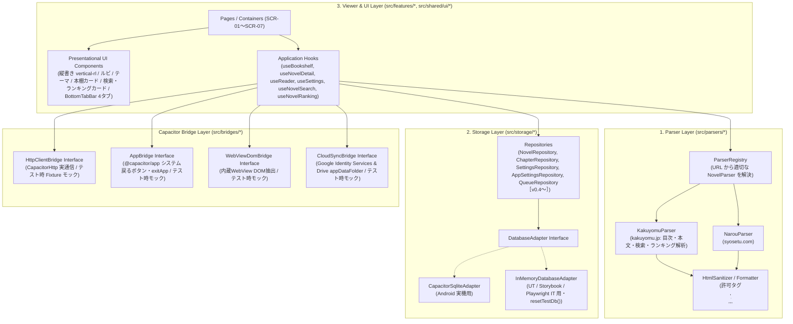

# 3層アーキテクチャと共通インターフェース契約（App 全体正本）

## 1. アーキテクチャ全体像と3層分離原則

AI による TDD 実装の確実性と保守性を最大化するため、Capacitor ネイティブ依存（HTTP 通信・SQLite・WebView ブリッジ）を薄いアダプター層に隔離し、アプリケーション全体を以下の3層（＋ Bridge 抽象層）に明確に分離します。



---

## 2. 標準ディレクトリ構成とアセット管理規約

### 2.1 リポジトリ全体ツリー

```text
Yommy/
├── assets/                            # 【マスターアセット】高解像度マスター画像（assets/icon.png 1024×1024）
├── public/                            # 【Web 静的アセット】favicon.ico, icon-192.png, icon-512.png, apple-touch-icon.png
├── android/                           # 【Android プロジェクト】Capacitor ネイティブコード＆リソース
│   ├── debug.keystore                 # 【固定署名鍵】開発・検証用一貫デバッグキーストア（Issue #78）
│   └── app/src/main/res/              # mipmap-* (ic_launcher*), values/ic_launcher_background.xml
├── scripts/                           # 【ビルド・補助スクリプト】generate-icons.mjs 等
└── src/                               # 【アプリケーションソースコード】
    ├── App.tsx                        # ルートコンポーネント（テーマ適用・ルーター配置・OS戻るボタン連携）
    ├── App.stories.tsx
    ├── App.test.tsx
    ├── app/                           # アプリケーション共通設定・DI Provider
    │   ├── router.tsx                 # 画面ルーティング定義（SCR-01〜SCR-07）
    │   ├── router.stories.tsx
    │   ├── router.test.tsx
    │   ├── ServiceProvider.tsx        # Storage / HttpBridge / AppBridge / ParserRegistry の Context DI（実機・テスト差し替え点）
    │   ├── ServiceProvider.stories.tsx
    │   └── ServiceProvider.test.tsx
    ├── bridges/                       # 【Capacitor Bridge 抽象層】
    │   ├── app/                       # 【AppBridge】システム戻るボタン・アプリ終了制御（Issue #78）
    │   │   ├── types.ts               # AppBridge, BackButtonEvent, BackButtonListener 定義
    │   │   ├── capacitorAppBridge.ts  # @capacitor/app 実装
    │   │   └── mockAppBridge.ts       # UT / Storybook / IT 用モック実装（triggerBackButton）
    │   ├── cloud-sync/                # 【CloudSyncBridge】Google Drive appDataFolder クラウド同期（Issue #120）
    │   │   ├── types.ts               # CloudSyncBridge, SyncAuthState, SyncFileResult 定義
    │   │   ├── capacitorCloudSyncBridge.ts # Android ネイティブ Capacitor プラグイン実装
    │   │   └── mockCloudSyncBridge.ts # UT / Storybook / IT 用インメモリ同期モック
    │   ├── http/
    │   │   ├── types.ts               # HttpClientBridge インターフェース定義
    │   │   ├── capacitorHttpClient.ts # CapacitorHttp 実装（CORS回避・User-Agent・タイムアウト制御）
    │   │   └── mockHttpClient.ts      # UT / Storybook / IT 用フィクスチャ応答クライアント
    │   └── webview/
    │       ├── types.ts               # WebViewDomBridge インターフェース定義（v0.4〜）
    │       └── webviewDomBridge.ts    # 内蔵WebView DOMキャプチャ実装
    ├── features/                      # 【機能別モジュール群】
    │   ├── bookshelf/                 # 本棚画面（SCR-01）
    │   ├── novel-detail/              # 作品詳細・目次画面（SCR-02）
    │   ├── reader/                    # 小説リーダー画面（SCR-03）
    │   ├── search/                    # 検索画面（SCR-06）
    │   ├── ranking/                   # ランキング画面（SCR-07）
    │   ├── settings/                  # 設定画面（SCR-05）
    │   └── cloud-sync/                # クラウド同期（Google Drive appDataFolder・SyncEngine）（Issue #120）
    │       ├── types.ts               # YommySyncState, SyncNovelData 等の同期データ型定義
    │       └── services/              # スキーマ検証・競合マージ・デバウンス同期エンジン
    ├── parsers/                       # 【1. Parser Layer（スクレイピング・DOM解析層）】
    │   ├── types.ts                   # NovelParser, ParsedNovelMetadata, ParsedChapterContent, ParsedSearchResult, ParsedRankingResult 等の型契約
    │   ├── parserRegistry.ts          # URL から対応サイト（kakuyomu / narou 等）を判定・ディスパッチ
    │   ├── sanitizer.ts               # 小説本文 HTML サニタイズ＆正規化（XSS防止・ルビ/傍点保持）
    │   ├── kakuyomu/                  # カクヨム用パーサーとローカル HTML フィクスチャ
    │   │   ├── KakuyomuParser.ts
    │   │   ├── KakuyomuParser.test.ts
    │   │   └── __fixtures__/
    │   └── narou/                     # 小説家になろう用パーサーとローカル HTML フィクスチャ（v0.4〜）
    │       ├── NarouParser.ts
    │       ├── NarouParser.test.ts
    │       └── __fixtures__/
    ├── storage/                       # 【2. Storage Layer（ローカルDB・キャッシュ管理層）】
    │   ├── types.ts                   # エンティティ型および各 Repository インターフェース契約
    │   ├── schema.ts                  # SQLite テーブル DDL および初期行定義（実機・インメモリ共有）
    │   ├── schema.test.ts
    │   ├── adapter/
    │   │   ├── types.ts               # DatabaseAdapter インターフェース
    │   │   ├── capacitorSqlite.ts     # @capacitor-community/sqlite アダプター実装
    │   │   └── inMemoryDb.ts          # テスト・Web開発用インメモリDB実装（resetTestDb() 提供）
    │   └── repositories/
    │       ├── novelRepository.ts     # novels テーブル操作
    │       ├── chapterRepository.ts   # chapters テーブル操作（本文キャッシュ保存・削除・容量集計）
    │       ├── settingsRepository.ts  # reader_settings 操作
    │       ├── appSettingsRepository.ts # app_settings 操作（ソート順等永続化）
    │       └── queueRepository.ts     # download_queue テーブル操作（v0.4〜）
    ├── features/                      # 【3. Viewer & UI Layer（画面・機能別モジュール）】
    │   ├── bookshelf/                 # SCR-01: 本棚一覧（空状態での検索/ランキング誘導）
    │   ├── novel-detail/              # SCR-02: 作品詳細・目次一覧・取得操作
    │   ├── reader/                    # SCR-03: 小説リーダー（全画面100dvh・最下部タッチオーバーレイ・ページめくり・ジェスチャー操作・ルビ・しおり保存）
    │   ├── webview-import/            # SCR-04: 内蔵ブラウザ表示・DOMインポート（v0.4〜）
    │   ├── settings/                  # SCR-05: 設定画面（組版・テーマ設定・サンプル文章プレビュー、v0.2〜）
    │   ├── search/                    # SCR-06: 検索画面（カクヨム作品検索・カードから本棚追加・SCR-02遷移、v0.3〜）
    │   └── ranking/                   # SCR-07: ランキング画面（期間/ジャンル別ランキング・カードから本棚追加・SCR-02遷移、v0.3〜）
    └── shared/                        # 複数機能で共有する汎用 UI コンポーネント・ユーティリティ
        ├── constants/                 # キャッシュ・レートリミット等の共有定数（cache.ts）
        ├── utils/                     # キャッシュ判定等の共有ユーティリティ（cache.ts）
        ├── ui/                        # BottomTabBar, Header, Button, Modal, Toast, Badge 等
        └── lib/                       # URL正規化、バイトサイズ整形、日時フォーマット等
├── docs/                              # 【ドキュメント正本（OKF）】
└── test/                              # 【統合・結合テスト】Playwright 実ブラウザ IT シナリオ
```

---

## 3. 各層の基底インターフェース契約（TypeScript 型定義正本）

### 3.1 Http / Bridge Layer 契約（`src/bridges/http/types.ts`）

```ts
export interface HttpRequestOptions {
  url: string;
  headers?: Record<string, string>;
  timeoutMs?: number;
  signal?: AbortSignal;
}

export interface HttpResponse {
  status: number;
  url: string; // リダイレクト後の最終URL
  html: string;
  headers: Record<string, string>;
}

export interface HttpClientBridge {
  /**
   * 指定URLからHTMLテキストを取得する。
   * Android実機では CapacitorHttp を用いてCORSを回避し、テスト環境ではローカルFixtureを返す。
   */
  getHtml(options: HttpRequestOptions): Promise<HttpResponse>;
}
```

### 3.2 App / Native Bridge 契約（`src/bridges/app/types.ts`）

```ts
export interface BackButtonEvent {
  canGoBack: boolean;
}

export type BackButtonListener = (
  event: BackButtonEvent,
) => void | Promise<void>;

export interface AppBridge {
  /**
   * システム戻るボタン（またはテスト環境でのバックキー押下）のリスナーを登録する。
   * @returns リスナー解除関数
   */
  addBackButtonListener(listener: BackButtonListener): () => void;

  /**
   * アプリケーションを終了する。
   * Android 実機では @capacitor/app の App.exitApp() を実行し、モック環境では呼出フラグを記録する。
   */
  exitApp(): Promise<void>;
}
```

### 3.3 Parser Layer 契約（`src/parsers/types.ts`）

```ts
/** 対応サイト識別子 */
export type NovelSiteType = "kakuyomu" | "narou" | "generic";

/** 目次内の1エピソード情報 */
export interface ParsedTocItem {
  chapterIndex: number; // 1始まりの連番
  remoteChapterId: string; // サイト固有のエピソード識別子（カクヨムepisodeId、なろう話数等）
  partTitle: string | null; // 章・部見出し（存在しない場合は null）
  title: string; // サブタイトル（各話タイトル）
  url: string; // エピソード本文ページの正規化URL
  publishedAt: string | null; // 公開・更新日時文字列（取得可能な場合）
}

/** 作品トップ（目次）ページから抽出される作品メタデータと目次リスト */
export interface ParsedNovelIndex {
  siteType: NovelSiteType;
  remoteWorkId: string; // サイト固有の作品識別子（例: カクヨム workId, なろう ncode）
  canonicalUrl: string; // 正規化された作品トップURL
  title: string; // 作品タイトル
  author: string; // 著者名
  synopsis: string; // あらすじテキスト
  chapters: ParsedTocItem[]; // エピソード目次一覧
  nextTocPageUrl: string | null; // 目次が複数ページに分かれる場合の次ページURL（なろう等）
}

/** 各話ページから抽出される本文データ */
export interface ParsedChapterContent {
  remoteChapterId: string;
  title: string; // サブタイトル
  bodyHtml: string; // サニタイズ済み本文HTML（<p>, <br>, <ruby>, <rb>, <rt>, <rp>, <em> のみ許容）
  byteSize: number; // UTF-8 バイトサイズ
  prevChapterUrl: string | null;
  nextChapterUrl: string | null;
}

/** 検索・ランキング共通オプションおよび型 */
export type NovelSearchOrder =
  "weekly_ranking" | "popular" | "last_episode_published_at" | "published_at";
export type NovelSerialStatus = "all" | "running" | "completed";

export interface NovelSearchOptions {
  order?: NovelSearchOrder;
  serialStatus?: NovelSerialStatus;
  genre?: string;
  page?: number;
}

export type NovelRankingPeriod = "daily" | "weekly" | "monthly" | "entire";

export interface NovelRankingOptions {
  period?: NovelRankingPeriod;
  genre?: string;
  page?: number;
}

export interface NovelSearchResultItem {
  remoteWorkId: string;
  title: string;
  author: string;
  synopsis: string;
  genre: string;
  genreLabel: string;
  serialStatus: "running" | "completed";
  serialStatusLabel: string;
  episodeCount: number;
  characterCount: number;
  tags: string[];
  reviewPoints: number;
  lastEpisodePublishedAt: string | null;
  workUrl: string;
}

export interface NovelRankingResultItem extends NovelSearchResultItem {
  rank: number; // 順位（1始まり）
}

export interface ParsedSearchResult {
  items: NovelSearchResultItem[];
  pageInfo: {
    currentPage: number;
    hasNextPage: boolean;
    totalCount?: number;
  };
}

export interface ParsedRankingResult {
  items: NovelRankingResultItem[];
  pageInfo: {
    currentPage: number;
    hasNextPage: boolean;
  };
}

/** サイト別パーサーの共通インターフェース（Strategyパターン） */
export interface NovelParser {
  readonly siteType: NovelSiteType;

  /** 指定されたURLがこのパーサーの対象サイトかどうかを判定する */
  canParse(url: string): boolean;

  /** エピソードURL等から作品トップURLへ正規化する */
  normalizeWorkUrl(url: string): string;

  /** 作品トップHTMLから作品情報と目次一覧を抽出する（純粋関数・通信なし） */
  parseNovelIndex(html: string, pageUrl: string): ParsedNovelIndex;

  /** 各話HTMLから整形・サニタイズ済み本文HTMLを抽出する（純粋関数・通信なし） */
  parseChapterContent(html: string, pageUrl: string): ParsedChapterContent;

  /** 検索クエリ・オプションに応じた検索 URL を生成する（任意実装） */
  buildSearchUrl?(query: string, options?: NovelSearchOptions): string;

  /** 検索結果 HTML から作品一覧をパースする（任意実装・純粋関数） */
  searchNovels?(html: string, pageUrl: string): ParsedSearchResult;

  /** ランキング条件に応じたランキング URL を生成する（任意実装） */
  buildRankingUrl?(options?: NovelRankingOptions): string;

  /** ランキング結果 HTML から順位付き作品一覧をパースする（任意実装・純粋関数） */
  getRanking?(html: string, pageUrl: string): ParsedRankingResult;
}
```

---

### 3.4 Storage Layer 契約（`src/storage/types.ts`）

DB テーブル構造の詳細は [docs/specs/db-schema.md](db-schema.md) を正本とし、アプリケーション層は以下の Repository インターフェースを介してのみデータにアクセスします。

```ts
export type BookshelfSortOrder =
  "unread_first" | "last_read" | "latest_published" | "created_at" | "title";

export interface DeletedNovelRecord {
  id: string;
  deletedAt: number;
}

export interface NovelRepository {
  listNovels(sortOrder?: BookshelfSortOrder): Promise<NovelSummary[]>;
  getNovelById(novelId: string): Promise<NovelRecord | null>;
  upsertNovelWithToc(
    index: ParsedNovelIndex,
    fetchedAt: string,
  ): Promise<NovelRecord>;
  updateBookmark(
    novelId: string,
    chapterIndex: number,
    scrollProgress: number,
  ): Promise<void>;
  deleteNovel(novelId: string): Promise<void>;
  clearNewUpdate(novelId: string): Promise<void>;
  updateLastCheckedAt(novelId: string, checkedAt: string): Promise<void>;
  getDeletedNovels?(): Promise<DeletedNovelRecord[]>;
  purgeDeletedNovels?(idList: string[]): Promise<void>;
}

export interface AppSettingsRepository {
  getSetting(key: string): Promise<string | null>;
  setSetting(key: string, value: string): Promise<void>;
  getCloudSyncLastSyncedAt?(): Promise<number | null>;
  setCloudSyncLastSyncedAt?(timestamp: number | null): Promise<void>;
  getCloudSyncAccountEmail?(): Promise<string | null>;
  setCloudSyncAccountEmail?(email: string | null): Promise<void>;
}

export interface ChapterRepository {
  listChaptersByNovelId(novelId: string): Promise<ChapterSummary[]>;
  getChapter(
    novelId: string,
    chapterIndex: number,
  ): Promise<ChapterRecord | null>;
  saveChapterBody(
    novelId: string,
    chapterIndex: number,
    content: ParsedChapterContent,
    downloadedAt: string,
  ): Promise<void>;
  markChapterRead(
    novelId: string,
    chapterIndex: number,
    isRead: boolean,
  ): Promise<void>;
  deleteCachedBodies(
    novelId: string,
    options?: { onlyRead?: boolean },
  ): Promise<number>;
}

export type ReaderPagingMode = "auto" | "paged" | "scroll";

export interface ReaderSettings {
  writingMode: WritingMode;
  theme: ReaderTheme;
  fontFamily: ReaderFontFamily;
  fontSizePx: number;
  lineHeight: number;
  pageMarginPx: number;
  enableTapPaging: boolean;
  enableVolumeKeyPaging: boolean;
  pagingMode: ReaderPagingMode;
  updatedAt: string;
}

export interface SettingsRepository {
  getReaderSettings(): Promise<ReaderSettings>;
  updateReaderSettings(patch: Partial<ReaderSettings>): Promise<ReaderSettings>;
  getCloudSyncLastSyncedAt?(): Promise<number | null>;
  setCloudSyncLastSyncedAt?(timestamp: number | null): Promise<void>;
  getCloudSyncAccountEmail?(): Promise<string | null>;
  setCloudSyncAccountEmail?(email: string | null): Promise<void>;
}
```

### 3.5 Application Router 契約（`src/app/router.tsx`）

外部ルーティングライブラリへの依存を持たず、History API（`window.history.pushState` / `popstate` / `replaceState`）と React Context による軽量ルーターで画面遷移（[docs/specs/screen-transitions.md](screen-transitions.md)）を管理します。

```ts
export type AppRoute =
  | { name: "bookshelf"; path: "/" }
  | { name: "search"; path: "/search" }
  | { name: "ranking"; path: "/ranking" }
  | { name: "settings"; path: "/settings" }
  | { name: "novel-detail"; path: string; novelId: string }
  | { name: "reader"; path: string; novelId: string; chapterIndex: number };

export interface NavigateToReaderOptions {
  replace?: boolean;
  fromBookshelfResume?: boolean;
}

export interface RouterContextValue {
  currentPath: string;
  previousPath?: string;
  novelOrigin: string | null;
  route: AppRoute;
  navigate: (path: string) => void;
  navigateToBookshelf: () => void;
  navigateToSearch: () => void;
  navigateToRanking: () => void;
  navigateToNovelDetail: (novelId: string, origin?: string) => void;
  navigateToReader: (
    novelId: string,
    chapterIndex: number,
    options?: NavigateToReaderOptions,
  ) => void;
  navigateToSettings: () => void;
  back: () => void;
}
```

- `novelId`（例: `"kakuyomu:16817330658027210412"`）を URL パスに含める際は `encodeURIComponent` でエンコードし、ルート解決（`matchRoute`）時に `decodeURIComponent` でデコードする。
- `RouterProvider` は `initialPath?: string` プロパティを受け取り、Vitest 単体テストや Storybook において任意のルート状態を決定論的に再現できる。
- `navigate` は同一パスへの遷移呼び出し時（例: `/settings` での「設定」タブ再タップ、`/search` での「検索」タブ再タップ）は履歴追加（`pushState`）および `previousPath` の上書きを行わず no-op とする。
- **OS バックキー（@capacitor/app の AppBridge 経由およびブラウザ戻る操作）の論理階層遷移制御**:
  - ブラウザ履歴順に依存せず、常に論理階層順（**各話View `SCR-03` → 目次 `SCR-02` → 直前の遷移元（本棚 `SCR-01`、検索 `SCR-06`、ランキング `SCR-07`）**、**設定 `SCR-05` → 直前画面（リーダー `SCR-03`、作品詳細 `SCR-02`、または本棚 `SCR-01`）**、**検索 `SCR-06` / ランキング `SCR-07` → 本棚 `SCR-01`**）で戻るよう制御する。
  - 本棚の「続きから読む」から各話Viewへ直行した場合も、ルーターが履歴スタックに目次（`/novels/:novelId`）を介在させることで、バックキー 1 回で確実に目次画面へ戻る。
  - リーダー画面内の前後話連続遷移（第1話 → 第2話）では `history.replaceState` を適用し、履歴の肥大化を防ぎつつバックキー 1 回で目次へ復帰できるようにする。
  - リーダー離脱時には最新の閲覧話数・スクロール進捗率を SQLite へ自動保存（`flushBookmark`）する。
  - 作品詳細・目次画面（`SCR-02`）からのバックキー操作時は、直前の呼び出し元画面（本棚 `SCR-01`、検索 `SCR-06`、またはランキング `SCR-07`）へ戻る（`TR-07`、直前履歴が存在しない場合は本棚 `/` へ復帰）。
  - 設定画面（`SCR-05`）で OS バックキーを実行したとき、直前の画面（リーダー `SCR-03`、作品詳細 `SCR-02`）またはホームの本棚画面（`SCR-01`）へ復帰する。検索画面（`SCR-06`）、ランキング画面（`SCR-07`）ではホームの本棚画面（`/`）へ復帰する（`TR-12`）。
  - 本棚画面（`SCR-01: /`）でバックボタンが押された際は、2秒以内の連続2回押下で `AppBridge.exitApp()` を呼び出してアプリを終了し、1回目押下時は画面下部に「もう一度バックボタンを押すと終了します」の一時確認トースト（`role="status"`、2秒後に自動消去）を表示する（`TR-13`）。

### 3.6 キャッシュ鮮度・先読み・一括キャッシュ制御ポリシー（v0.3 新設）

読書体験の快適化（待ち時間ゼロ）と外部小説サーバーへの負荷低減（503 IP BAN 防止）を両立するため、共通定数モジュール（`src/shared/constants/cache.ts`）に以下の定数を定義し、制御ポリシーを適用します。

```ts
/** キャッシュの有効期間（7日間） */
export const CACHE_TTL_MS = 7 * 24 * 60 * 60 * 1000;
/** 既存キャッシュが存在する場合の再取得短タイムアウト（3秒） */
export const SHORT_TIMEOUT_MS = 3000;
/** 未キャッシュ話等の初回取得標準タイムアウト（10秒） */
export const STANDARD_TIMEOUT_MS = 10000;
/** 先読みおよび一括キャッシュのリクエスト間隔ウェイト（1.5秒） */
export const PREFETCH_INTERVAL_MS = 1500;
/** 読書中の自動先読み対象話数（5話先まで） */
export const PREFETCH_COUNT = 5;
```

1. **キャッシュ鮮度判定（TTL 7日間）**:
   - `chapters.downloaded_at` が現在時刻から `CACHE_TTL_MS`（7日）以内の場合、キャッシュを「有効（Fresh）」とみなし、通信を行わず即座に SQLite の本文を描画する。
   - 先読みおよび一括キャッシュにおいても、有効なキャッシュを持つ話数はスキップされる。
2. **読書中 5 話自動先読み（`useReader`）**:
   - 第 $N$ 話の本文読み込み完了後、バックグラウンドで $N+1 \sim \min(N+5, \text{totalChapters})$ のエピソードを昇順で順次取得・SQLite 保存する。
   - 対象サーバーの過負荷防止（第 $N$ 話取得直後の連続リクエスト抑止）のため、最初の先読み（第 $N+1$ 話）リクエスト開始前に `PREFETCH_INTERVAL_MS`（1.5秒）の初期インターバルを空け、以降も 1話の取得完了ごとに 1.5秒のウェイトを空けて直列実行する。
   - 処理全体を `AbortController` で制御し、ユーザーが `goToChapter` で別エピソードへ移動した際やリーダー画面を離脱した際は、直ちに直前の処理をキャンセルしてリソースを解放する。
3. **作品詳細での未取得話一括キャッシュ（`useNovelDetail`）**:
   - 作品詳細ヘッダーの「未取得話を一括キャッシュ」操作（`TR-18`）により、未キャッシュエピソード（および TTL 7日経過した古いキャッシュ）を `PREFETCH_INTERVAL_MS`（1.5秒）間隔で順次直列取得する。
   - 1話取得成功ごとに SQLite へ保存し、ヘッダーの取得済み話数（`cachedChapters`）および各話リストのキャッシュバッジをリアルタイムに更新する。
   - ユーザー手動中断（「中断」ボタン）および画面アンマウント時は `AbortController` により安全に処理を停止する（取得済み話数は維持される）。
4. **7日経過キャッシュの短タイムアウトフォールバック**:
   - 取得から 7日以上経過したキャッシュは、閲覧時・先読み時・一括キャッシュ時に `SHORT_TIMEOUT_MS`（3秒）で再取得を試みる。
   - 3秒以内に取得成功した場合は新本文で DB および画面を更新する。
   - タイムアウト・オフライン・通信エラー等で失敗した場合は、**即座に既存の `bodyHtml` を使用してフォールバック表示** し（一括キャッシュ時は既存キャッシュを維持して次話へ進行）、エラー画面を表示せず読書を継続させる。

### 3.7 クラウド同期（Google Drive appDataFolder）および同期エンジンアーキテクチャ（v0.4 新設）

複数端末間での本棚登録作品・しおり位置・既読状態の同期、および機種変更時の引き継ぎを実現するため、Google Drive のアプリ専用領域（`appDataFolder`）に単一 JSON（`yommy-sync-state.json`）を保存・同期するアーキテクチャを導入します（Issue #120）。

#### 1. `CloudSyncBridge` インターフェース契約（`src/bridges/cloud-sync/types.ts`）

```ts
export type CloudSyncAuthState =
  | { status: "unlinked" }
  | { status: "authenticating" }
  | { status: "connected"; email?: string }
  | { status: "error"; message: string };

export interface CloudSyncBridge {
  /** 現在の Google 認証状態を取得する */
  getAuthState(): Promise<CloudSyncAuthState>;
  /** Google アカウント連携（認可フロー実行） */
  signIn(): Promise<CloudSyncAuthState>;
  /** 連携解除（OS トークン破棄および Google サーバーへの Revoke 実行） */
  signOut(): Promise<void>;
  /** appDataFolder から yommy-sync-state.json を取得する（存在しない場合は null） */
  pullFile(): Promise<string | null>;
  /** appDataFolder へ yommy-sync-state.json をアップロード・保存する */
  pushFile(content: string): Promise<void>;
}
```

#### 2. 同期エンジン（`SyncEngine`）の競合マージとゼロトラスト検証

- **ゼロトラスト検証**:
  - 受信した JSON に対し、通信前に厳格なランタイムスキーマ検証（`version === 1`、必須フィールド、数値範囲、プロトタイプ汚染防止）を実行する。
  - 作品 ID（`id`）が `${siteType}:${remoteWorkId}` と厳密に一致することを検証する。
  - `deletedNovels` のキーが空文字（`""`）や空白文字でないことを検証し、`novels` と `deletedNovels` の双方に同一キーが存在する場合は、本棚現存作品を優先し `deletedNovels` から安全に除外する。
  - 未登録作品の自動目次取得（`upsertNovelWithToc`）前に、`canonicalUrl` を既存の `parseNovelUrl`（`https://kakuyomu.jp/works/<id>` ホワイトリスト検証）にかけ、不正な URL や未知ドメインへのリクエスト（SSRF）を遮断する。さらに `canonicalUrl` から抽出した `siteType` / `workId` とリモート作品データの整合性を検証し、正規化 URL で通信を行う。
- **競合解決（マージ）ルール**:
  - 新規作品の自動目次補完: リモートにのみ存在する作品は `canonicalUrl` から目次を自動取得してローカル DB に登録し、リモートのしおり話数・既読状態を即時反映する。
  - 作品削除の伝播（Tombstone）と再登録保護: `deletedNovels` の削除日時がローカル作品の登録/更新日時より新しければローカル DB からカスケード削除する。ただし、リモートの `novels` に同一作品 ID が存在し `updatedAt >= deletedAt` である場合は、リモート再登録作品と判定してローカル削除伝播をスキップする。ローカルで削除された作品も `deleted_novels` テーブルに Tombstone を記録し次回 Push 時に結合する。本棚現存作品の ID は Push 時の `deletedNovels` から除外し、`pushCurrentState` および `pullAndMerge` 完了時にローカルの古い Tombstone をパージ（`purgeDeletedNovels`）する。
  - しおり話数のマージ: 同一作品が両端末にある場合、`lastReadAt` が新しい方の `bookmarkChapterIndex` を採用する（話数変更時はスクロール率を `0.0` にリセット、同一話数の場合は端末ローカルのスクロール率を維持）。
  - 既読状態のマージ: 両端末の既読エピソード ID の和集合（Union）を採用する。
- **自動同期トリガーと排他・デバウンス制御**:
  - 自動 Pull: アプリ起動時、およびバックグラウンド復帰時（休止から5分以上経過）。未送信ローカル変更がある場合はマージ後に自動 Push。
  - 自動 Push: 本棚作品追加・削除、およびリーダー話数遷移・既読更新時に 2〜3秒（2500ms）デバウンス付き非同期実行。
  - 多重並行実行防止（排他制御・Single-flight）: `SyncEngine` 内部に排他制御機構（`isSyncing` フラグおよび FIFO キュー排他制御）を導入し、`pullAndMerge`、`pushCurrentState`、`sync` が同時に重なって実行されないよう安全にガードする。`sync()` が実行中に重複して呼び出された場合、実行中の Promise を再利用して単一実行に合流（Single-flight）させる。`scheduleDebouncedPush()` では生成した Promise に内部で `.catch(() => {})` を登録し、未処理例外（`UnhandledPromiseRejection`）を防止する。

#### 3. ネイティブ Google Identity Services と 5 層セキュリティ設計

1. **クライアント設定の非公開化**: クライアント ID 等はコードにハードコードせず、GitHub Secrets（`VITE_GOOGLE_CLIENT_ID`）および `.env.local` から注入する。
2. **非公開 Keystore 管理**: 公開 `android/debug.keystore` の SHA-1 は GCP に登録せず、GitHub Secrets で保護された非公開 Keystore の SHA-1 のみを登録して偽造 APK のなりすましを防ぐ。
3. **ネイティブ `AuthorizationClient` 認証**: サードパーティプラグインに依存せず、社内 Capacitor プラグイン経由で Android 公式 `Identity.getAuthorizationClient` を呼び出し、`client_secret` 排除・WebView 内トークン保存ゼロ（OS 側で短寿命アクセストークンを都度取得）とする。
4. **最小権限スコープ（`drive.appdata` 限定）と即時 Revoke**: スコープを `drive.appdata` に限定し、連携解除時は OS トークン破棄＋Google サーバー即時 Revoke を実行。遠隔での認可解除（`401 Unauthorized`）検知時も自動で未連携状態へ安全にフォールバックする。
5. **SSRF / インジェクション防御**: スキーマ検証と `parseNovelUrl` ホワイトリスト検証を通過したデータのみを処理する。

---

## 4. テスト環境での DI（依存性注入）と決定論的初期化

- `src/app/ServiceProvider.tsx` を介して `HttpClientBridge`、`AppBridge`、`CloudSyncBridge`、各 `Repository`（および基底の `DatabaseAdapter`）を React Context 経由で提供する。
- **Android / iOS ネイティブ実行時**: `Capacitor.isNativePlatform()` によりネイティブ環境を自動検知し、`CapacitorHttpClient`、`CapacitorAppBridge`、`CapacitorCloudSyncBridge`、および `createDefaultNativeSqliteAdapter`（`CapacitorSqliteAdapter` ＋ `src/storage/schema.ts` の DDL 初期化）を注入する。
- **Web ブラウザ / Dev 実行時**: `createInMemoryDb`（`sql.js`）および `localStorage` への Base64 バイナリバックアップ（`yommy_sqlite_db_backup`）によるハイブリッド永続化を提供し、`createDefaultMockHttpClient`、`MockAppBridge`、および `MockCloudSyncBridge` を使用する。
- **UT（Vitest）/ Storybook / Playwright IT 実行時**: `MockHttpClient` ＋ `MockAppBridge` ＋ `MockCloudSyncBridge` ＋ `InMemoryDatabaseAdapter` を注入し、各テストの開始前に `resetTestDb()` を呼び出して 100% 決定論的な状態で検証する。
- **Worktree 運用・環境変数非依存設計**: すべてのテスト（Vitest, Storybook VRT, Playwright IT）およびビルドは、`.env.local` の有無に関わらず 100% 決定論的に PASS する設計（`ServiceProvider` による DI モック分離と安全なフォールバック）を必須とし、テスト実行時に環境変数未定義によるスキップや挙動のブレを生じさせない。

---

## 5. Android ビルド署名およびバージョン管理規約

Android Debug APK の継続的な検証と上書きインストール（`INSTALL_FAILED_UPDATE_INCOMPATIBLE` の抑止）を保証するため、以下のビルド署名・バージョン採番規約を適用します。

### 5.1 Debug 署名キーストアの固定化（`android/debug.keystore`）

- リポジトリ内 `android/debug.keystore` に開発・検証用共通デバッグキーストアを配置する。
- `android/app/build.gradle` において `signingConfigs.debug` に上記キーストア（Alias: `androiddebugkey`、Password: `android`）を明示指定し、CI ランナー上でのランダムキーストア自動生成を防止する。

### 5.2 `versionCode` / `versionName` の動的注入

- `android/app/build.gradle` の `defaultConfig` において、CI 環境変数（`BUILD_NUMBER`）および Gradle プロパティ（`versionCode` / `versionName`）から動的にバージョンを解決する。
- GitHub Actions（`.github/workflows/build-android.yml`）では `BUILD_NUMBER: ${{ github.run_number }}` を注入し、ビルドごとに `versionCode` を単調増加させる。
- ローカルビルド時はフォールバック値（`versionCode 1`、`versionName "0.3.0"`）を採用し、開発作業の利便性を損なわない構成とする。

### 5.3 Google OAuth 用署名鍵の秘密管理と SHA-1 なりすまし防止

- 公開 `android/debug.keystore` の SHA-1 は GCP に登録しない（第三者による偽造 APK の OAuth なりすまし防止）。
- GitHub Secrets（`ANDROID_KEYSTORE_BASE64` 等）に保管した非公開 Keystore の SHA-1 とパッケージ名（`com.yommy.app`）のみを GCP の Android OAuth クライアントに登録し、CI APK ビルド時に署名する。Secrets 未設定のローカル/PR 環境のみ `android/debug.keystore` へフォールバックする。
