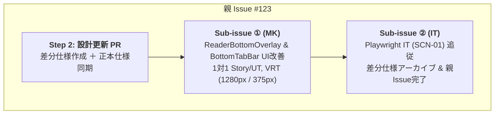

# 差分仕様書：リーダー下部オーバーレイ（ReaderBottomOverlay）のUI改善（Issue #123）

本ドキュメントは、Issue #123「`[v0.4] リーダー下部オーバーレイ（ReaderBottomOverlay）のUI改善（✕閉じるボタン廃止・スマホでのタブ改行解消）`」に対する差分仕様、影響する App 全体正本の一覧、UT/VRT/IT テスト計画、および実装 Sub-issue 分割計画を定義する設計書です。

---

## 1. 変更の背景・目的（Why）

- **現状の課題**:
  - リーダー画面（`SCR-03`）の下部オーバーレイ（`ReaderBottomOverlay`）右上に小さな「✕」閉じるボタンが配置されているが、タップターゲットが極めて小さく（約20px程度）モバイル端末の実機操作で非常に押しづらい。また、本文エリアタップによる自動非表示が既に存在するため、機能として冗長になっている。
  - スマートフォン（360px〜390px程度）の狭い画面幅において、下部4タブの「ランキング」などのテキストが横幅不足により不自然に折り返され（改行され）てしまい、UI の整然さや視認性が損なわれている（`ReaderBottomOverlay` および共通 `BottomTabBar`）。
- **改善目的**:
  - `ReaderBottomOverlay` から「✕」閉じるボタン（`data-testid="reader-bottom-overlay-close"`）および `onClose` プロパティを廃止し、本文エリアタップによる自動非表示へ一本化してスッキリした UI を実現する。
  - タブのボタンスタイルをモバイル標準の「上アイコン・下テキスト（縦並び `flex-col sm:flex-row` ＋ `whitespace-nowrap`、`text-xs sm:text-sm`）」へ最適化し、スマートフォン表示でタブテキストが改行されないようにする。

---

## 2. 変更仕様の詳細（What）

### 2.1 閉じるボタン（✕）の廃止と本文タップ非表示への一本化

1. **`ReaderBottomOverlayProps` からのプロパティ削除**:
   - `onClose?: () => void;` を削除する。
2. **`ReaderBottomOverlay` コンポーネントからの閉じるボタン削除**:
   - 右上に配置されていたボタン（`data-testid="reader-bottom-overlay-close"`）を完全に撤去する。
3. **`ReaderPage` コンポーネントの調整**:
   - `ReaderPage.tsx` から `handleClose` コールバックおよび `ReaderBottomOverlay` への `onClose` 属性受け渡しを削除する。
   - オーバーレイ外（本文エリア）のクリック（`handleMainClick`）、本文スクロール（`handleScroll`）、前話/次話遷移（`handlePrevChapter` / `handleNextChapter`）による既存の自動非表示挙動はそのまま維持する。

### 2.2 スマホ画面でのタブテキスト改行解消（レスポンシブ縦並び化）

1. **タブボタンスタイルのレスポンシブ最適化**:
   - `ReaderBottomOverlay.tsx` および `src/shared/ui/BottomTabBar.tsx` のタブボタン要素に以下のスタイルを適用する。
     - モバイル（既定）: `flex-col items-center justify-center gap-0.5 py-1.5 px-1 text-xs whitespace-nowrap`
     - タブレット/デスクトップ（`sm:` 以上）: `sm:flex-row sm:gap-2 sm:py-3 sm:px-4 sm:text-sm`
   - これにより、幅 375px（モバイル）では上段にアイコン（📚/🔍/🏆/⚙️）、下段にラベルテキスト（本棚/検索/ランキング/設定）が折り返されることなく 1 行（`whitespace-nowrap`）で美しく描画される。
   - タブレットやデスクトップ（`sm:` 以上、幅 640px〜）では従来の横並び（アイコン横にテキスト）を保ち、広い横幅を活用する。

---

## 3. App 全体正本への影響と更新内容

| 対象ドキュメント                     | 種別         | 更新内容                                                                                                                                                                                                                                       |
| :----------------------------------- | :----------- | :--------------------------------------------------------------------------------------------------------------------------------------------------------------------------------------------------------------------------------------------- |
| `docs/specs/features/reader-view.md` | App 全体正本 | ・`ReaderBottomOverlayProps` から `onClose` を削除 ・§3.3 セマンティック属性から `reader-bottom-overlay-close` を削除 ・タブスタイルのレスポンシブ縦並び仕様（`flex-col sm:flex-row` ＋ `whitespace-nowrap`）を明記 ・`AC-RD-10` 整合 |
| `docs/specs/screen-transitions.md`   | App 全体正本 | ・画面遷移の変更なし（`TR-xx` は不変、コンポーネント内UI改修のみ）                                                                                                                                                                             |

---

## 4. テスト計画

### 4.1 単体テスト（Unit Tests）

- `src/features/reader/components/ReaderBottomOverlay.test.tsx`:
  - 閉じるボタン（`reader-bottom-overlay-close`）に関するテストケースを削除。
  - 各タブの `whitespace-nowrap` およびボタンスタイルクラスの検証を追加。
- `src/features/reader/components/ReaderBottomOverlay.stories.tsx`:
  - `onClose: fn()` のモック指定を削除。
- `src/features/reader/components/ReaderPage.test.tsx`:
  - `reader-bottom-overlay-close` をクリックして閉じるテストケースを削除し、本文エリアクリックで閉じる既存テストケースで非表示挙動が担保されていることを確認。
- `src/shared/ui/BottomTabBar.test.tsx`:
  - タブの `whitespace-nowrap` およびボタンスタイルクラスの検証を追加。

### 4.2 Visual Regression Tests (VRT)

- `npm run test:vrt:update` および `npm run test:vrt` を実行：
  - 1280px（デスクトップ）および 375px（モバイル）において、`ReaderBottomOverlay` および `BottomTabBar` のスナップショットを更新・検証。
  - 375px において「ランキング」が改行されず、上下縦並びで綺麗にレンダリングされていることを確認。

### 4.3 結合テスト（Playwright IT）

- `test/it/scenarios/scn01-poc-vertical-reader.spec.ts`:
  - 行 271〜276 の `reader-bottom-overlay-close` クリック検証を、本文エリアタップによるオーバーレイ自動非表示検証に更新。

---

## 5. 実装 Sub-issue 分割計画

小規模な UI 改善であるため、以下の 2 つの Sub-issue に分割して直列進行する。

### Sub-issue ① (MK): `ReaderBottomOverlay` & `BottomTabBar` UI改善と単体・VRTテスト

- **作業範囲**:
  - `ReaderBottomOverlay.tsx`: 閉じるボタン削除、`onClose` 削除、タブボタンスタイル改修（`flex-col sm:flex-row` ＋ `whitespace-nowrap`）
  - `ReaderPage.tsx`: `handleClose` 削除、`onClose` 連携削除
  - `BottomTabBar.tsx`: タブボタンスタイル改修（`flex-col sm:flex-row` ＋ `whitespace-nowrap`）
  - 単体テスト・Storybook 更新（`ReaderBottomOverlay.test.tsx`, `ReaderBottomOverlay.stories.tsx`, `ReaderPage.test.tsx`, `BottomTabBar.test.tsx`）
  - VRT スナップショット更新・検証（1280px / 375px）

### Sub-issue ② (IT): Playwright IT 追従、全体回帰検証、および差分仕様アーカイブ

- **作業範囲**:
  - `test/it/scenarios/scn01-poc-vertical-reader.spec.ts`: 閉じるボタン操作から本文タップ操作への更新
  - 全 IT シナリオ回帰確認
  - 差分仕様書 `docs/specs/changes/issue-123-reader-bottom-overlay-ui-improvement.md` を `docs/specs/changes/archive/` へ移動
  - 親 Issue #123 の完了（`Closes #123`）

---

## 6. 申し送り事項（Handover）

現時点で特記事項なし（`HO-xx` の追加なし）。
