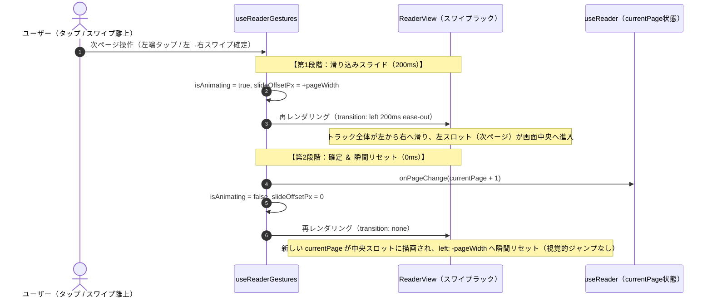

# 差分仕様書：リーダーのページ送り水平スライドアニメーション実装（Issue #201）

本ドキュメントは、Issue #201「`[v0.6] リーダーのページ送り水平スライドアニメーション実装（タップ＆スワイプ完了時の視覚的スライド遷移）`」に対する差分仕様、影響する App 全体正本の一覧、UT/VRT/IT テスト計画、および実装 Sub-issue 分割計画を定義する設計書です。

---

## 1. 変更の背景・目的（Why）

実機およびブラウザ環境でリーダー画面（`SCR-03`）の縦書きページめくり（実効 `paged`）を使用すると、ページ送り時にアニメーションがなく一瞬で切り替わるため、「次のページへ進んだのか、前のページへ戻ったのか」が視覚的に把握しづらく混乱が生じる。

コードベース（`ReaderView.tsx` および `useReaderGestures.ts`）を調査した結果、3スロット水平スワイプラック（`[左: 次ページ, 中央: 現在ページ, 右: 前ページ]`）において以下の 2 点が原因で水平スライドアニメーションが発生していないことが判明した：

1. **左右端タップ時**: `slideOffsetPx` が `0` のまま `onPageChange(currentPage ± 1)` が即座に呼ばれるため、トラックの `left` 座標が一切変化せず、中央スロットの中身だけが **0ms で瞬間置換** されている。
2. **スワイプ離上（完了）時**: `handlePointerUp` で `onPageChange(currentPage ± 1)` と `setSlideOffsetPx(0)` を同一フレームで同時実行しているため、「残りの画面幅分（`±pageWidth` まで）滑り切るアニメーション」が走る前にスロットの中身が入れ替わり、瞬間移動したように見えている。

これらを解消し、右綴じ書籍のメンタルモデルに即した自然で滑らかな 2 段階水平スライドアニメーションを実現する。

### Issue #203（ハードウェア音量キー対応）との明確な境界分離

- **本 Issue（#201）の責務**:
  - 画面左右端 20% タップおよび水平スワイプ離上（完了時）における **2 段階水平スライドアニメーション機構**（`slideOffsetPx = ±pageWidth` への 200ms ease-out 遷移 → 完了時 `onPageChange` 確定 ＆ `slideOffsetPx = 0` 即時リセット、高速連打時の即時確定）の実装。
  - 対象: `useReaderGestures.ts`, `ReaderView.tsx`, `ReaderPage.tsx` および関連 UT/Storybook/VRT/IT。
  - **ハードウェア音量キー関連のコード（キーリスナー、Android ネイティブ層の音量バー抑止、設定画面のトグル UI 等）は一切実装しない（スコープ外）**。
- **後続 Issue（#203）の責務**:
  - 設定画面（`SCR-05`）における「音量キーでページ送り」ON/OFF トグル UI（`enableVolumeKeyPaging`）の追加と SQLite 永続化。
  - Android ネイティブ層（`MainActivity` / Capacitor プラグイン）における音量キー捕捉（OS 音量バー抑止）と Web 側へのキーイベント通知。
  - リーダー画面（`SCR-03`）での音量キーイベント購読、および Issue #201 で作られた水平スライド機構への連携。

---

## 2. 要求仕様と設計合意事項（What）

### 2.1 2段階水平スライド遷移機構（タップ・スワイプ完了共通）

右綴じ縦書き 3 スロット水平スワイプラック `[左: 次ページ(currentPage + 1), 中央: 現在ページ(currentPage), 右: 前ページ(currentPage - 1)]` において、以下の 2 段階アニメーション制御を導入する。

#### 1. スライド方向と変位計算

- **次ページへ進むとき（左端 20% タップ ／ 左→右スワイプ離上完了 `dx > 0`）**:
  - `slideOffsetPx = +pageWidth`（すなわちトラックの `left = 0px`）へ向け、`200ms ease-out` で水平スライドアニメーションさせる。
  - 左スロットの「次ページ（`currentPage + 1`）」が画面中央へ滑り込む。
  - アニメーション完了時（200ms 後）に `onPageChange(currentPage + 1)` を呼び出してページ番号を確定させると同時に、**トランジションなし（`transition: none`）で `slideOffsetPx = 0`（`left = -pageWidth`）へリセット** する。
  - 新たな `currentPage`（旧 `currentPage + 1`）が中央スロットに描画されるため、視覚的なジャンプや巻き戻りなくスムーズに読書を継続できる。
- **前ページへ戻るとき（右端 20% タップ ／ 右→左スワイプ離上完了 `dx < 0`）**:
  - `slideOffsetPx = -pageWidth`（すなわちトラックの `left = -2 * pageWidth`）へ向け、`200ms ease-out` で水平スライドアニメーションさせる。
  - 右スロットの「前ページ（`currentPage - 1`）」が画面中央へ滑り込む。
  - アニメーション完了時（200ms 後）に `onPageChange(currentPage - 1)` を呼び出してページ番号を確定させると同時に、**トランジションなし（`transition: none`）で `slideOffsetPx = 0`（`left = -pageWidth`）へリセット** する。
- **スナップバック復帰（移動量 30% 未満かつ低速フリック時）**:
  - ドラッグ離上位置から `slideOffsetPx = 0`（`left = -pageWidth`）へ向け、`200ms ease-out` でスナップバック復帰させる。
  - ページ番号変更（`onPageChange`）は行わず、アニメーション完了後に `isAnimating = false` とする。

#### 2. 高速連打（アニメーション実行中の再操作）への対応

- 200ms のスライドアニメーション実行中（`isAnimating === true` かつ `pendingTargetPageRef.current !== null`）に、ユーザーが続けてタップまたはスワイプ操作を開始した場合：
  1. 進行中のアニメーション完了タイマー（`animationTimerRef`）を直ちに `clearTimeout` で破棄する。
  2. 直前の保留中ページ移動（`pendingTargetPage`）を直ちに `onPageChange(pendingTargetPage)` で即時確定させる。
  3. 保留状態をクリアし、新たな操作（新たなスライドアニメーション開始、または新たなドラッグ追従）を遅滞なく即座に開始する。
- これにより、読者がページをパラパラと連続タップした際にタップ入力が無視されたり取りこぼされたりするストレスを完全に防止する。

#### 3. トランジション有効/無効の切り替え制御（`ReaderView`）

`calculateSwipeTrackStyle(pageWidth, slideOffsetPx, isAnimating)` における CSS `transition` プロパティの制御ルールを以下のように整理する：

- **アニメーション中（`isAnimating === true`）**:
  - `transition: "left 200ms ease-out"`
  - タップ開始時（`0` → `±pageWidth`）およびスワイプ離上時（`dx` → `±pageWidth` または `dx` → `0`）に適用され、滑らかなスライドを実現する。
- **非アニメーション時（`isAnimating === false`）**:
  - `transition: "none"`
  - ドラッグ中の指追従（ダイレクトマニピュレーション）時、およびアニメーション完了時の `slideOffsetPx = ±pageWidth` から `slideOffsetPx = 0` への瞬間リセット時に適用され、逆戻りアニメーションや遅延を完全に排除する。

---

## 3. 影響する App 全体正本ドキュメント

| 正本ファイルパス                       |       状態        | 主な更新内容                                                                                                       |
| :------------------------------------- | :---------------: | :----------------------------------------------------------------------------------------------------------------- |
| `docs/specs/requirements.md`           | `Approved (#201)` | 要件 `SYS-REQ-11` にタップおよびスワイプ離上時の 2段階水平スライドアニメーション、高速連打時の即時確定仕様を明記。 |
| `docs/specs/screen-transitions.md`     | `Approved (#201)` | `SCR-03` 小説リーダー画面の縦書きページめくり概要に、タップ・スワイプ完了時の視覚的スライド遷移を追記。            |
| `docs/specs/features/reader-view.md`   | `Approved (#201)` | セクション 3.4（`ReaderView`）、3.5（`ReaderPage`）、6（受入条件 `AC-RD-16`, `AC-RD-17`）を本仕様に合わせて更新。  |
| `docs/quality/bug-and-handover-log.md` | `Approved (#201)` | 申し送り事項 `HO-26`（Android 実機での水平スライドアニメーション滑らかさ・高速連打検証）を登録。                   |

---

## 4. 受入条件（Acceptance Criteria: `AC-RD-xx` 拡張）

- **`AC-RD-17a`（タップ送り水平スライドアニメーション）**:
  - 縦書きページめくりモードにおいて、画面左端 20% タップ時に `slideOffsetPx = +pageWidth`（`left: 0px`）への 200ms ease-out 水平スライドアニメーションを経て次ページへ進み、画面右端 20% タップ時に `slideOffsetPx = -pageWidth`（`left: -2 * pageWidth`）への水平スライドアニメーションを経て前ページへ戻ること。完了時に `slideOffsetPx = 0` へ視覚的ジャンプなくリセットされること。
- **`AC-RD-17b`（スワイプ離上水平スライドアニメーション）**:
  - 水平スワイプによるページめくり確定時（移動量 30% 以上またはフリック速度条件達成時）、ドラッグ離上位置から `±pageWidth` まで滑らかにスライド完了した後に `currentPage` が更新され、瞬間置換や逆戻りジャンプが発生しないこと。
- **`AC-RD-17c`（高速連打・連続操作の即時確定）**:
  - スライドアニメーション実行中に連続タップ（連打）または新たなドラッグが行われた場合、進行中のページ遷移が即座に確定して次の操作が開始され、入力の取りこぼしが発生しないこと。
- **`AC-RD-17d`（全テスト・VRT 整合性）**:
  - 1280px / 375px の Storybook VRT、Vitest 単体テスト（C0/C1/Functions 100%）、および Playwright システム結合テスト（`SCN-01`）がすべて PASS すること。

---

## 5. 実装 Sub-issue 分割計画（推奨 1 PR = 200〜400 行）

本 Issue の実装およびテストは、以下の 3 つの Sub-issue に分割して直列進行する。

| Sub-issue                 | 区分  | タイトル・作業範囲                                                                                                                                                                                                                                                                                                                                                                                                                                 |    推定規模    |       進捗ステータス       |
| :------------------------ | :---: | :------------------------------------------------------------------------------------------------------------------------------------------------------------------------------------------------------------------------------------------------------------------------------------------------------------------------------------------------------------------------------------------------------------------------------------------------- | :------------: | :------------------------: |
| **Sub-issue ①** (#205) | `MK1` | **`useReaderGestures` の水平スライドアニメーション・連打即時確定ロジックの TDD 実装**（#205） ・タップ・スワイプ完了時 2段階水平スライドアニメーションロジック実装 ・スライドアニメーション中（`isAnimating === true`）の高速連打・再操作における即時確定（`pendingTargetPage`）制御 ・`useReaderGestures.test.ts` での単体テスト（C0/C1/Functions 100%） ・※音量キー対応は Issue #203 のため本 Sub-issue では対象外                   | 約 200〜300 行 | 完了（PR #211 マージ済み） |
| **Sub-issue ②** (#206) | `MK2` | **`ReaderView` / `ReaderPage` のスライドトランジション連携・Storybook・VRT 更新**（#206） ・`ReaderView.tsx` の `calculateSwipeTrackStyle` における `isAnimating` 連動トランジション制御 ・`ReaderPage.tsx` のイベント伝播・配線整合 ・`ReaderView.stories.tsx` / `ReaderPage.stories.tsx` のアニメーション状態検証ストーリー確認・追加 ・Storybook VRT（1280px / 375px）更新・検証 ・コンポーネント単体テスト C0/C1/Functions 100% | 約 150〜250 行 | 完了（PR #212 マージ済み） |
| **Sub-issue ③** (#207) | `IT`  | **Playwright `SCN-01` 水平スライドアニメーション結合検証と差分仕様アーカイブ**（#207） ・Playwright システム結合テスト（`SCN-01`）のアニメーション追従確認・全 IT（`SCN-01`〜`SCN-05`）回帰検証 PASS ・申し送り事項 `HO-26` の登録・整理 ・差分仕様書 `docs/specs/changes/issue-201-*.md` の `archive/` 移動およびフロントマターの `Completed (Archived)` 更新 ・親 Issue #201 のクローズ（`Closes #201`）                             | 約 100〜200 行 | 完了（PR #213 マージ済み） |

---

## 6. 申し送り事項（Handover Items: `HO-xx`）

|     ID      | 起票元 Issue / PR | 申し送り事項の内容                                                                                                      | 解決先（対象 Issue / 成果物）          |       完了ゲート        |  状態  |
| :---------: | :---------------: | :---------------------------------------------------------------------------------------------------------------------- | :------------------------------------- | :---------------------: | :----: |
| **`HO-26`** |    Issue #201     | リーダー縦書きページめくりにおける Android 実機での水平スライドアニメーションの滑らかさおよび高速連続タップ時の挙動検証 | Milestone `v0.6` 実機検証 / Issue #204 | Milestone `v0.6` 完了前 | `Open` |
