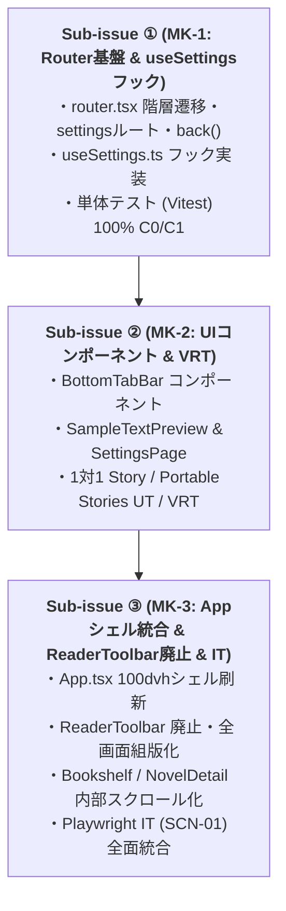

# 差分仕様書：100dvh全画面シェル・下部タブバー・設定画面（SCR-05）新設・OSバックキー階層遷移（Issue #50）

本ドキュメントは、Issue #50「`[v0.2] 100dvh全画面シェル・下部タブバー（本棚/設定）・設定画面（SCR-05）新設・OSバックキー階層遷移の実装`」に対する差分仕様、影響する App 全体正本の一覧、UT/VRT/IT テスト計画、および実装 Sub-issue 分割計画を定義する設計書です。

---

## 1. 変更の背景・目的（Why）

- **現状の課題（v0.1 のレイアウト・UX 課題）**:
  - `src/App.tsx` に常時上部の「Yommy」ヘッダーと外側パディング（`p-6 max-w-4xl`）が存在し、さらに各画面（`BookshelfPage`, `NovelDetailPage`, `ReaderPage`）にも `min-h-screen` と余白が二重に設定されていたため、可読領域が狭まり、画面全体（ウィンドウ自体）がスクロールしてしまう違和感が生じていた。
  - リーダー画面（`SCR-03`）上部に組版設定ツールバー（`ReaderToolbar`）が常時表示されていたため、小説本文の表示領域が圧迫されていた。
  - 画面内に配置された個別「戻る」ボタンに依存しており、Android OS のハードウェア/ジェスチャーバックキーやブラウザの「戻る」操作を行った際に、意図しない履歴順で画面が戻ってしまう問題があった（例: 本棚の「続きから読む」で第2話へ直行した後、バックキーを押すと本棚へ戻ってしまい目次を挟めない、等）。
- **改善目的**:
  - アプリ全体の共通シェルを **`100dvh` 固定・外側余白ゼロ** に刷新し、ウィンドウ自体のスクロールを完全に排除する。
  - 画面最下部に常時固定表示される下部タブバー（`BottomTabBar`：「本棚」「設定」）を新設する。
  - `ReaderToolbar` を廃止し、組版設定（縦横切替、4カラーテーマ、文字サイズ、行間）を独立した **設定画面（`SCR-05`: `/settings`）** へ移設するとともに、ルビ・傍点を含むリアルタイムな **サンプル文章プレビュー枠** を提供する。
  - ブラウザ履歴順に依存せず、常に論理階層順（**各話View `SCR-03` → 目次 `SCR-02` → 本棚 `SCR-01`**、**設定 `SCR-05` → 直前画面**）で遷移する **OS バックキー階層遷移基盤** を実装する。

---

## 2. 仕様・設計の差分（What Changes）

### 2.1 アプリ共通シェル（`src/App.tsx`）の刷新

- **上部ヘッダー・外側パディングの廃止**:
  - `App.tsx` 内の `<header className="bg-emerald-700 ...">`（Yommy タイトルヘッダー）および `<main className="p-6 max-w-4xl ...">` を廃止する。
- **全画面コンテナの統一**:
  - ルートコンテナを `h-dvh w-full overflow-hidden flex flex-col bg-slate-50 dark:bg-slate-900 text-slate-900 dark:text-slate-100` に設定する。
  - 各画面（`SCR-01`, `SCR-02`, `SCR-03`, `SCR-05`）のルート要素から `min-h-screen` を除去し、`h-full flex flex-col overflow-hidden` に統一する。
  - 本棚画面（`SCR-01`）および目次画面（`SCR-02`）は「上部ヘッダー固定 ＋ コンテンツ内部縦スクロール（`flex-1 min-h-0 overflow-y-auto`）＋ 下部タブ固定」のレイアウトに整える。

### 2.2 下部タブバー（`BottomTabBar`）の新設

- **配置とタブ構成**:
  - `src/shared/ui/BottomTabBar.tsx` を新設し、画面最下部に固定表示する（`h-14 border-t bg-white dark:bg-slate-900`）。
  - **タブ 1:「本棚」**（アイコン ＋ ラベル「本棚」、`data-testid="tab-bookshelf"`、遷移先: `/`）
  - **タブ 2:「設定」**（アイコン ＋ ラベル「設定」、`data-testid="tab-settings"`、遷移先: `/settings`）
- **表示対象画面とアクティブ判定ルール**:
  - **表示対象**: 本棚画面（`SCR-01`）、作品詳細・目次画面（`SCR-02`）、設定画面（`SCR-05`）で常時固定表示する。
    - ※リーダー画面（`SCR-03`）では本文全画面化のため非表示とし、Issue #52 にて画面最下部タッチによるオーバーレイ表示へ統合する。
  - **アクティブタブの判定**:
    - ルートが `bookshelf`（`/`）、`novel-detail`（`/novels/:novelId`）、`reader`（`/novels/:novelId/chapters/:chapterIndex`）のときは、論理所属タブとして **「本棚」タブをアクティブ表示**（`aria-selected="true"`）とする。
    - ルートが `settings`（`/settings`）のときは **「設定」タブをアクティブ表示**（`aria-selected="true"`）とする。
  - **タップ遷移挙動**:
    - 「本棚」タブをタップしたときは、現在の画面が `SCR-02` / `SCR-03` / `SCR-05` のいずれであっても、常に本棚トップ（`/` `SCR-01`）へ遷移する。
    - 「設定」タブをタップしたときは、`/settings`（`SCR-05`）へ遷移する。

### 2.3 設定画面（`SCR-05`: `/settings`）の新設と `ReaderToolbar` の廃止・移設

- **設定画面の新設**:
  - ルート `/settings` に対応する `SettingsContainer` および `SettingsPage` を `src/features/settings/` に新設する（正本仕様書: `docs/specs/features/settings.md`）。
  - 状態管理フック `useSettings` を作成し、`SettingsRepository`（`reader_settings` テーブル）から現在の設定を取得・更新する。
- **組版設定 4 項目の完全移設**:
  1. 組み方向切替（縦書き `vertical-rl` / 横書き `horizontal-tb`）
  2. 4カラーテーマ切替（ライト、セピア、ダーク、ブラック）
  3. 文字サイズステッパー（`12〜32px`、`±2px` 刻み、上下限 disabled）
  4. 行間ステッパー（`1.4〜2.4`、`±0.2` 刻み、上下限 disabled）
- **リーダー画面（`SCR-03`）の `ReaderToolbar` 廃止**:
  - `ReaderPage.tsx` から `ReaderToolbar` の描画を除去する。
  - 本文表示領域を全画面化し、前後話ナビゲーション（`ReaderChapterNav`）のみを下部に残す（Issue #52 でオーバーレイ化予定）。
  - リーダー画面内の設定値（組み方向、テーマ、文字サイズ、行間）は、マウント時および表示時に `SettingsRepository` の最新値を自動適用する。

### 2.4 サンプル文章プレビュー枠（`SampleTextPreview`）

- 設定画面内に `SampleTextPreview` コンポーネントを配置する。
- ルビ（`<ruby>`）および傍点（`<em class="bouten">`）を含む固定サンプル小説文を描画する：
  ```html
  <p>
    吾輩は<ruby>猫<rp>（</rp><rt>ねこ</rt><rp>）</rp></ruby
    >である。名前はまだ無い。
  </p>
  <p>
    どこで生れたかとんと<em class="bouten">見当</em
    >がつかぬ。何でも薄暗いじめじめした所でニャーニャー泣いていた事だけは記憶している。
  </p>
  ```
- 設定画面での 4 項目（組み方向・テーマ・文字サイズ・行間）の変更が、プレビュー枠の内側に即時反映される。
- 設定画面自体の外枠・ヘッダー・タブバーは標準 UI テーマを維持し、プレビュー枠内のみに小説組版テーマ（黒背景やセピアなど）を局所適用する。

### 2.5 OS バックキー（およびブラウザ戻る操作）の論理階層遷移制御（`src/app/router.tsx`）

- **論理階層の定義**:
  - **各話View（`SCR-03`: `/novels/:novelId/chapters/:chapterIndex`）** の論理親:
    - **作品詳細・目次（`SCR-02`: `/novels/:novelId`）**
  - **作品詳細・目次（`SCR-02`: `/novels/:novelId`）** の論理親:
    - **本棚画面（`SCR-01`: `/`）**
  - **設定画面（`SCR-05`: `/settings`）** の論理親:
    - **設定を開く直前の画面（直前パス `previousPath`、省略時は `/`）**
  - **本棚画面（`SCR-01`: `/`）**:
    - ルート（論理親なし、OS バックキーでアプリ終了/ブラウザ履歴末尾）
- **History スタックとバックキーの制御方式**:
  1. **本棚の「続きから読む」から各話Viewへ直接遷移した場合**:
     - 直行時、ルーターは History スタックに目次画面（`/novels/:novelId`）を介在させてから各話Viewへ遷移する（または論理親スタックを管理する）。
     - これにより、OS バックキーを 1 回押した際に、直接本棚へ飛ぶのではなく、必ずその作品の目次画面（`SCR-02`）へ遷移する。
  2. **リーダー画面内での前後話連続遷移（第1話 → 第2話 → 第3話 ...）**:
     - 話数変更時の遷移には `history.replaceState` を適用する。
     - これにより、何話読み進めても History スタック上の「各話View」のエントリは 1 つに保たれ、OS バックキー 1 回で直ちに目次画面（`SCR-02`）へ戻ることができる。
  3. **リーダー画面離脱時のしおり自動保存**:
     - OS バックキー（またはブラウザ戻る）でリーダー画面から目次画面へ戻る際、`ReaderContainer` のアンマウント/遷移クリーンアップ処理により、最新の閲覧話数（`chapterIndex`）とスクロール進捗率（`scrollProgress`）を確実に SQLite / ローカル DB へフラッシュ（`flushBookmark`）保存する。
  4. **設定画面（`SCR-05`）からの戻り**:
     - 設定画面遷移時に直前パス（`previousPath`）を保持し、OS バックキー押下時に直前の画面（本棚・目次・各話View）へ戻る。
  5. **ルーター提供メソッドの拡張**:
     - `RouterContextValue` に `back: () => void` および `navigateToSettings: () => void` を追加する。

---

## 3. 影響する全体正本ファイル一覧

| 正本ファイルパス                      | OKF type                 | 主な差分・更新内容                                                                                                                                                                                                                                    |
| :------------------------------------ | :----------------------- | :---------------------------------------------------------------------------------------------------------------------------------------------------------------------------------------------------------------------------------------------------- |
| `docs/specs/requirements.md`          | `spec-requirements`      | `SYS-REQ-16`（全画面シェル・下部タブ・論理階層遷移）を新設。`SYS-REQ-09, 10` の関連画面・受入条件に設定画面を紐付け。Milestone ロードマップを再編（`v0.2` UI/UX刷新, `v0.3` なろう＆キュー, `v0.4` WebView＆容量管理）。                              |
| `docs/specs/screen-transitions.md`    | `spec-screen-transition` | `SCR-05` のルートを `/settings`・名称を「設定画面」に更新。`TR-01`（下部タブ切替）、`TR-01b`（本棚タブ直接遷移）、`TR-06`（OSバックキーによる目次復帰）、`TR-07`（目次から本棚復帰）、`TR-12`（設定から直前画面復帰）を明記し、Mermaid 遷移図を更新。 |
| `docs/specs/architecture.md`          | `spec-architecture`      | 100dvh 全画面シェル構造、下部タブバー（`BottomTabBar`）、`src/features/settings/` のディレクトリ構成、および `src/app/router.tsx` の論理階層遷移制御仕様（`AppRoute` への `settings` 追加、`back()` 提供）を明記。                                    |
| `docs/specs/features/settings.md`     | `spec-feature`           | **新規策定**。`SCR-05`（ルート `/settings`）の設定画面正本仕様。Presentational/Container 構成、`SampleTextPreview` 契約、`useSettings` フック契約、受入条件 `AC-ST-01`〜`AC-ST-06` を定義。                                                           |
| `docs/specs/features/reader-view.md`  | `spec-feature`           | `ReaderToolbar` の廃止、組版設定4項目の `SCR-05` への移設、OS バックキー（`TR-06`）による目次復帰としおり自動保存（`AC-RD-08`）、100dvh 全画面表示（`AC-RD-09`）への適合を反映。                                                                      |
| `docs/specs/features/bookshelf.md`    | `spec-feature`           | 100dvh 全画面シェル適合（ヘッダー固定＋カード一覧内部スクロール＋下部タブ固定）、下部タブバー連携を反映。                                                                                                                                             |
| `docs/specs/features/novel-detail.md` | `spec-feature`           | 100dvh 全画面シェル適合（ヘッダー固定＋エピソード一覧内部スクロール＋下部タブ固定）、下部タブバー連携（「本棚」アクティブ表示）、OS バックキーによる本棚復帰（`TR-07`）を反映。                                                                       |
| `docs/index.md`                       | (Index)                  | §1 ドキュメント全体ツリーに `docs/specs/features/settings.md` および本差分仕様書を追記。                                                                                                                                                              |

---

## 4. テスト計画（UT / VRT / IT の検証観点）

### 4.1 単体テスト（UT）の検証観点

- **`src/app/router.test.tsx`**:
  - `/settings` パスが `{ name: "settings", path: "/settings" }` に正しくマッチすること。
  - `navigateToSettings()` による画面遷移が動作すること。
  - OS バックキー（`popstate` / `back()`）実行時、論理階層順（各話View → 目次 → 本棚、設定 → 直前画面）で遷移すること。
  - 本棚の「続きから読む」から各話Viewへ直行した場合、バックキー1回で該当作品の目次へ遷移すること。
  - 各話間の連続遷移（1話→2話）後にバックキー1回で目次へ遷移すること。
- **`src/features/settings/hooks/useSettings.test.ts`**:
  - マウント時に `settingsRepository.getReaderSettings()` から設定値が復元されること。
  - `toggleWritingMode`, `changeTheme`, `changeFontSize`, `changeLineHeight` が State を即時更新し、`settingsRepository` へ永続化すること。
  - 文字サイズ（`12〜32`）、行間（`1.4〜2.4`）が正常にクランプされること。
- **`src/shared/ui/BottomTabBar.test.tsx`**（Portable Stories）:
  - 「本棚」「設定」の各タブが描画され、現在のアクティブタブに応じたアクセシビリティ属性（`aria-selected="true"`）が付与されること。
  - 各タブのクリック時に対応するコールバック（`onSelectBookshelf`, `onSelectSettings`）が発火すること。
- **`src/features/settings/components/SampleTextPreview.test.tsx`**（Portable Stories）:
  - ルビ（`<ruby>`）および傍点（`<em class="bouten">`）を含む固定文章がサニタイズ描画されること。
  - 渡された `writingMode`, `theme`, `fontSizePx`, `lineHeight` に対応するセマンティック属性およびスタイルが反映されること。
- **`src/features/settings/components/SettingsPage.test.tsx`**（Portable Stories）:
  - 組み方向切替、4カラーテーマ選択、文字サイズ・行間ステッパーが正しく動作し、上下限値でボタンが `disabled` になること。
- **`src/features/settings/components/SettingsContainer.test.tsx`**:
  - `ServiceProvider` 経由で `SettingsRepository` と接続され、設定の読み込みと変更が正しく `SettingsPage` へ伝搬すること。
- **`src/features/reader/components/ReaderPage.test.tsx` / `ReaderContainer.test.tsx`**:
  - `ReaderToolbar` が非描画となっていること。
  - アンマウント時またはバック遷移時に `flushBookmark` が呼び出されること。
- **`src/App.test.tsx`**:
  - 上部 Yommy ヘッダーが存在せず、全画面コンテナおよび `BottomTabBar` が描画されること。
  - `/settings` パスで `SettingsContainer` が描画され、「設定」タブがアクティブ表示となること。

### 4.2 Visual Regression Testing（VRT: 1280px / 375px）の検証観点

- `BottomTabBar`:
  - 「本棚」アクティブ状態および「設定」アクティブ状態の 1280px / 375px スナップショット。
- `SampleTextPreview`:
  - 縦書き（`vertical-rl`）および横書き（`horizontal-tb`）、各カラーテーマ（Light, Sepia, Dark, Black）での組版・ルビ・傍点描画スナップショット。
- `SettingsPage`:
  - デフォルト表示（縦書き・ライト）、横書き・セピア表示、文字サイズ・行間上限/下限表示の 1280px / 375px スナップショット。
- `BookshelfPage` / `NovelDetailPage` / `ReaderPage`:
  - 全画面シェル化・内部スクロール化に伴うレイアウト調整後の 1280px / 375px スナップショット更新。

### 4.3 結合テスト（Playwright IT: `SCN-01` 統合シナリオ）の検証観点

- 本棚画面（`SCR-01`）での全画面表示確認（ウィンドウ全体のスクロールバーなし）。
- 下部タブ「設定」タップによる `/settings`（`SCR-05`）への遷移とタブアクティブ表示確認。
- 設定画面での組版設定変更（縦書き→横書き、テーマ変更、文字サイズ・行間拡大）とサンプル文章プレビュー枠への即時反映確認。
- ブラウザ戻る（`page.goBack()`）による本棚画面への復帰確認（`TR-12`）。
- 本棚から作品詳細・目次画面（`SCR-02`）への遷移と、下部タブ「本棚」のアクティブ維持確認。
- 目次画面から第1話リーダー画面（`SCR-03`）への遷移と、設定画面で変更した組版設定（横書き・テーマ・文字サイズ・行間）がリーダー本文へ適用されていることの確認。
- 「次の話へ」で第2話へ遷移した後、ブラウザ戻る（`page.goBack()`）を 1 回実行した際、第1話へ戻るのではなく **作品詳細・目次画面（`SCR-02`）へ復帰すること** の確認（論理階層遷移）。
- 目次画面への復帰時に第2話のしおり・進捗率が正しく保存・表示されていることの確認。
- 目次画面でブラウザ戻る（`page.goBack()`）を実行した際、**本棚画面（`SCR-01`）へ復帰すること** の確認。
- どこからでも下部タブ「本棚」をタップした際、本棚トップ（`/`）へ直行することの確認。

---

## 5. 実装 Sub-issue 分割計画

本要望（Issue #50）の実装は、責務境界とレビュー容易性（1 PR = 200〜400行目安）を保つため、以下の **3 つの Sub-issue** に分割して順次（直列）進めます。



### Sub-issue ① (MK-1): ルーティング基盤・OS バックキー論理階層制御・`useSettings` フックの実装

- **目的・作業範囲**:
  - `src/app/router.tsx` に `/settings` ルートおよび `navigateToSettings`, `back` メソッドを追加。
  - OS バックキー（`popstate` / `back`）による論理階層遷移制御（各話View → 目次 → 本棚、設定 → 直前画面）を実装。
  - 本棚「続きから読む」直行時の階層整流化、および各話遷移時の `replaceState` 制御を実装。
  - `src/features/settings/hooks/useSettings.ts` を実装し、`SettingsRepository` との連携・クランプ処理をテスト。
  - 対象ファイルの単体テスト（`router.test.tsx`, `useSettings.test.ts`）を作成し、C0/C1/Functions 100% を達成。
- **PR 形式**: `Refs #50`（完了後 `Closes #Sub-issue-1`）

### Sub-issue ② (MK-2): 下部タブバー（`BottomTabBar`）および設定画面 UI コンポーネント群の実装と VRT

- **目的・作業範囲**:
  - `src/shared/ui/BottomTabBar.tsx` を実装（「本棚」「設定」2タブ、アクティブ判定、`role="tablist"`）。
  - `src/features/settings/components/SampleTextPreview.tsx` を実装（ルビ・傍点を含むサンプル文描画、リアルタイム組版反映）。
  - `src/features/settings/components/SettingsPage.tsx` を実装（組版設定4項目ステッパー/トグルとプレビュー枠のレイアウト統合）。
  - 各コンポーネントに 1対1 `*.stories.tsx`、Portable Stories 単体テスト（`*.test.tsx`）、および VRT スナップショット（1280px / 375px）を作成・検証。
- **PR 形式**: `Refs #50`（完了後 `Closes #Sub-issue-2`）

### Sub-issue ③ (MK-3): App 共通シェル刷新・全画面統合・`ReaderToolbar` 廃止・結合テスト（IT）の完遂

- **目的・作業範囲**:
  - `src/App.tsx` を刷新し、上部 Yommy ヘッダー・外側パディングを廃止して `100dvh` 全画面コンテナ ＋ `BottomTabBar` 常時固定レイアウトへ移行。
  - `src/features/settings/components/SettingsContainer.tsx` を実装し、`/settings` ルートへ統合。
  - `src/features/reader/` から `ReaderToolbar` を廃止し、リーダー画面を全画面化。アンマウント/バックキー時のしおり自動保存を保証。
  - `BookshelfPage` および `NovelDetailPage` を全画面シェル適合（ヘッダー固定＋内部縦スクロール＋下部タブ固定）に更新。
  - Playwright IT シナリオ（`SCN-01`）を最新仕様（全画面シェル・下部タブ・設定画面変更・サンプル文プレビュー・リーダー即時反映・OS バックキー論理階層遷移）に合わせて更新し、100% PASS を達成。
  - 申し送り事項（`HO-13`）を解決（`Resolved`）に更新し、本差分仕様書を `docs/specs/changes/archive/` へ移動。
- **PR 形式**: `Closes #50`（最終完了 PR）

---

## 6. 申し送り事項（Handover Items）

本要望の設計に伴い、以下の申し送り事項を [docs/quality/bug-and-handover-log.md](../../../quality/bug-and-handover-log.md) へ登録します。

|   ID    | 起票元 Issue / PR | 申し送り事項の内容                                                                                                                                                                 | 解決先（対象 Issue / 成果物）        |     完了ゲート      |  状態  |
| :-----: | :---------------: | :--------------------------------------------------------------------------------------------------------------------------------------------------------------------------------- | :----------------------------------- | :-----------------: | :----: |
| `HO-13` |   #50 (設計 PR)   | 100dvh 全画面シェル・下部タブバー・設定画面（`SCR-05`）・OS バックキー論理階層遷移の実ブラウザ結合テスト（`SCN-01` 更新）および Android 実機での全画面スクロール・下部タブ挙動確認 | Issue #50 Sub-issue ③ (MK-3 / IT PR) | Issue #50 PR マージ | `Open` |
