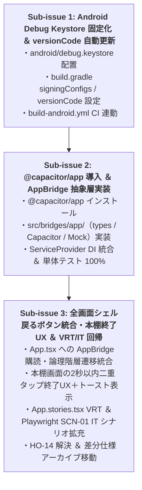

# 差分仕様書：Android APK上書きインストール修正（署名鍵固定・versionCode更新）と実機システム戻るボタン論理階層遷移対応（Issue #78）

本ドキュメントは、Issue #78「`[v0.3] Android APK上書きインストール修正（署名鍵固定・versionCode更新）と実機システム戻るボタン論理階層遷移対応 (HO-14)`」に対する差分仕様、影響する App 全体正本の一覧、UT/VRT/IT テスト計画、および実装 Sub-issue 分割計画を定義する設計書です。

---

## 1. 変更の背景・目的（Why）

- **APK上書きインストールの不具合**:
  - GitHub Actions（`.github/workflows/build-android.yml`）でビルドした Debug APK を Android 実機へ更新インストール（上書きアップデート）しようとすると `INSTALL_FAILED_UPDATE_INCOMPATIBLE` エラーが発生し、既存アプリを一度アンインストール（DB や設定の喪失を伴う）しないとインストールできない問題が発生していた。
  - 原因は、エフェメラルな CI ランナー環境で毎回新規のランダムな `~/.android/debug.keystore` が自動生成されていたこと（署名証明書の不一致）、および `android/app/build.gradle` 内の `versionCode 1` が固定値であったことにある。
- **Android 実機システム戻るボタンの挙動（申し送り事項 `HO-14`）**:
  - Milestone `v0.2` の実機検証（Issue #53）において、Android OS のシステム戻るボタン（ジェスチャーナビゲーション / 3ボタンナビゲーションバー）操作時に Web 標準の `popstate` イベントだけでは捕捉されず、Capacitor アプリが直ちに終了してしまう現象が確認され、申し送り事項 `HO-14` として登録されていた。
- **改善目的**:
  - 開発・検証用の一貫した `debug.keystore` をリポジトリに配備し、CI ビルドごとに `versionCode` を単調増加させることで、アンインストール不要なシームレスな APK 上書きインストールを確立する。
  - 公式 `@capacitor/app` プラグインを導入し、`src/bridges/app/` 抽象層を介して Android 実機のシステム戻るボタンイベントを捕捉する。ルーターの論理階層順（**各話View `SCR-03` → 目次 `SCR-02` → 本棚 `SCR-01`**、**設定 `SCR-05` → 直前画面**）での遷移およびリーダー離脱時のしおり即時保存（`flushBookmark`）を確実に実行し、最上位の本棚画面（`/`）では 2 秒以内の連続 2 回押下で終了する UX を提供する。

---

## 2. 仕様・設計の差分（What Changes）

### 2.1 Android Debug Keystore 固定化と `versionCode` 自動インクリメント

- **固定 Debug Keystore の配備**:
  - リポジトリの `android/debug.keystore` に決定論的な開発・検証用 Keystore を配置する。
    - キーストアパス: `android/debug.keystore`
    - ストアパスワード: `android`
    - キーエイリアス: `androiddebugkey`
    - キーパスワード: `android`
- **`android/app/build.gradle` の署名構成**:
  - `signingConfigs` ブロックに `debug` 設定を明示し、`file('../debug.keystore')` を指定する。
  - `buildTypes.debug` に `signingConfig signingConfigs.debug` を適用する。
- **`versionCode` / `versionName` の動的注入**:
  - `defaultConfig` 内で以下のように環境変数および Gradle プロパティから解決する：
    ```groovy
    def appVersionCode = Integer.parseInt(System.getenv("BUILD_NUMBER") ?: (project.findProperty("versionCode") ?: "1"))
    def appVersionName = System.getenv("BUILD_NAME") ?: (project.findProperty("versionName") ?: "0.3.0")

    defaultConfig {
        applicationId "com.yommy.app"
        minSdkVersion rootProject.ext.minSdkVersion
        targetSdkVersion rootProject.ext.targetSdkVersion
        versionCode appVersionCode
        versionName appVersionName
        ...
    }
    ```
- **CI ワークフロー（`.github/workflows/build-android.yml`）の更新**:
  - Gradle ビルドステップの環境変数に `BUILD_NUMBER: ${{ github.run_number }}` を注入し、ビルドごとに `versionCode` が単調増加することを保証する。

### 2.2 `@capacitor/app` 導入と `AppBridge` 抽象層（`src/bridges/app/`）

- **パッケージ導入**:
  - `@capacitor/app`（`^8.1.2`）を `dependencies` に追加する。
- **`AppBridge` インターフェース定義（`src/bridges/app/types.ts`）**:
  ```ts
  export interface BackButtonEvent {
    canGoBack: boolean;
  }

  export type BackButtonListener = (
    event: BackButtonEvent,
  ) => void | Promise<void>;

  export interface AppBridge {
    /**
     * Android 実機のシステム戻るボタン（またはテストでの疑似バックキー押下）のリスナーを登録する。
     * @returns リスナー解除関数
     */
    addBackButtonListener(listener: BackButtonListener): () => void;

    /**
     * アプリケーションを終了する。
     * Android 実機では @capacitor/app の App.exitApp() を実行し、モック環境では呼出フラグを記録する。
     */
    exitApp(): Promise<void>;
  }
  ```
- **Capacitor 実装（`src/bridges/app/capacitorAppBridge.ts`）**:
  - `@capacitor/app` の `App.addListener('backButton', listener)` および `App.exitApp()` をラップする。
- **テスト用モック実装（`src/bridges/app/mockAppBridge.ts`）**:
  - 単体テスト（Vitest）、Storybook、および Playwright IT で利用する決定論的モック。
  - `triggerBackButton(canGoBack?: boolean): void` メソッドを提供し、実機バックキー押下イベントをプログラムから安全に再現する。
  - `exitAppCalled: boolean` プロパティおよび `reset()` メソッドを保持する。

### 2.3 `ServiceProvider` への `AppBridge` DI 統合

- **`ServiceContextValue` の拡張**:
  - `src/app/ServiceProvider.tsx` の `ServiceContextValue` に `appBridge: AppBridge` を追加する。
  - `useServices().appBridge` により、コンポーネントツリー内のどこからでも Bridge にアクセス可能とする。
- **自動環境判別**:
  - `Capacitor.isNativePlatform()` が `true` の場合は `CapacitorAppBridge`、`false`（Webブラウザ・テスト・Storybook）の場合は `MockAppBridge` をデフォルトインスタンスとして生成・提供する。
  - `ServiceProviderProps.services.appBridge` を通じた外部インジェクションをサポートし、テストコードからモックインスタンスを自在に渡せるようにする。

### 2.4 アプリ全画面シェル（`src/App.tsx`）での戻るボタン連携と終了 UX

- **`AppContent` でのバックボタンリスナー登録**:
  - `AppContent` 内で `useServices().appBridge.addBackButtonListener` を購読する。
- **論理階層遷移のハンドリング**:
  - **各話リーダー画面（`SCR-03`）**:
    - `router.back()` を呼び出し、目次画面（`SCR-02`）へ遷移する。
    - ※`ReaderContainer` の既存アンマウントフックにより、最新の閲覧話数としおり進捗率が SQLite に自動即時保存（`flushBookmark`）される。
  - **作品詳細・目次画面（`SCR-02`）**:
    - `router.back()` を呼び出し、本棚画面（`SCR-01`）へ遷移する。
  - **設定画面（`SCR-05`）**:
    - `router.back()` を呼び出し、直前の画面（`previousPath`、未指定時は `/`）へ復帰する。
  - **本棚画面（`SCR-01: /`）の 2 段階終了 UX（`TR-13`）**:
    - 本棚画面でバックボタンが押された際、前回の押下時刻との差分を検証する。
    - **1 回目（または 2 秒以上経過後）の押下**:
      - アプリを終了せず、最終押下タイムスタンプを記録する。
      - 画面下部に一時的な確認トースト（`role="status"`、テキスト「もう一度バックボタンを押すと終了します」）を表示する。
      - トーストは 2 秒後に自動消滅する。
    - **2 秒以内の 2 回目押下**:
      - `appBridge.exitApp()` を呼び出し、アプリを安全に終了する。

---

## 3. 受入条件一覧（Acceptance Criteria）

### 3.1 Android ビルド・署名・バージョン管理（`AC-APK-xx`）

| 受入条件 ID     | 項目                     | 検証内容・合否判定基準                                                                                                                                                                                                   | 対応要件 ID  |
| :-------------- | :----------------------- | :----------------------------------------------------------------------------------------------------------------------------------------------------------------------------------------------------------------------- | :----------- |
| **`AC-APK-01`** | Debug 署名鍵の固定化     | `android/debug.keystore` が配備され、`build.gradle` で明示指定されることで、再ビルドした APK 間で署名証明書フィンガープリントが一致し、上書きインストール（`INSTALL_FAILED_UPDATE_INCOMPATIBLE` 回避）が可能であること。 | `SYS-REQ-16` |
| **`AC-APK-02`** | `versionCode` の自動更新 | GitHub Actions ビルド時に `github.run_number`（ローカル時はフォールバック `1`）が `versionCode` に設定され、ビルドごとに単調増加すること。                                                                               | `SYS-REQ-16` |

### 3.2 システム戻るボタン・階層遷移・終了 UX（`AC-AB-xx`）

| 受入条件 ID    | 項目                       | 検証内容・合止判定基準                                                                                                                                           | 対応要件 ID      |
| :------------- | :------------------------- | :--------------------------------------------------------------------------------------------------------------------------------------------------------------- | :--------------- |
| **`AC-AB-01`** | Bridge 抽象層の隔離        | `AppBridge`（`CapacitorAppBridge` / `MockAppBridge`）が整備され、Web/Vitest/Storybook 環境では Capacitor ネイティブ例外を一切発生させずにモック動作すること。    | `SYS-REQ-16`     |
| **`AC-AB-02`** | リーダー画面からの階層復帰 | `SCR-03` でバックボタン押下時、しおり（`flushBookmark`）が即時保存され、目次画面（`SCR-02`）へ復帰すること（`TR-06`）。                                          | `SYS-REQ-12, 16` |
| **`AC-AB-03`** | 目次画面からの階層復帰     | `SCR-02` でバックボタン押下時、本棚画面（`SCR-01`）へ復帰すること（`TR-07`）。                                                                                   | `SYS-REQ-01, 16` |
| **`AC-AB-04`** | 設定画面からの直前復帰     | `SCR-05` でバックボタン押下時、直前に開いていた画面へ正確に復帰すること（`TR-12`）。                                                                             | `SYS-REQ-16`     |
| **`AC-AB-05`** | 本棚での終了確認トースト   | `SCR-01`（`/`）でバックボタン 1 回目押下時、アプリは終了せず「もう一度バックボタンを押すと終了します」のトーストが表示され、2秒後に自動消滅すること（`TR-13`）。 | `SYS-REQ-16`     |
| **`AC-AB-06`** | 本棚での二重押下アプリ終了 | `SCR-01`（`/`）でトースト表示中（2秒以内）に再度バックボタンを押下したとき、`appBridge.exitApp()` が呼び出されること（`TR-13`）。                                | `SYS-REQ-16`     |

---

## 4. 影響を受ける App 全体正本ドキュメント一覧

同一 PR 内で以下の App 全体正本を同時更新します：

1. **`docs/specs/screen-transitions.md`**:
   - `SCR-01` の説明に 2 秒以内連続 2 回押下によるアプリ終了 UX を追記。
   - 画面遷移図（Mermaid）に `SCR-01 -.->|"TR-13: OS バックキー (2秒以内2回押下で終了)"| EXIT["アプリ終了 (exitApp)"]` を追加。
   - 画面遷移一覧に `TR-13`（本棚画面での OS バックキー終了遷移）を新設し、`TR-06`, `TR-07`, `TR-12` に `AppBridge` 連携を明記。
2. **`docs/specs/architecture.md`**:
   - リポジトリツリーに `android/debug.keystore` および `src/bridges/app/` を追加。
   - 3層アーキテクチャ図および第 3 節に `AppBridge` 契約（`src/bridges/app/types.ts`）を追加。
   - 第 4 節（DI）に `AppBridge` のネイティブ/モック切り替え規約を追加。
   - 第 5 節に Android Debug Keystore 固定化と `versionCode` 連動規約を追記。
3. **`docs/specs/requirements.md`**:
   - `SYS-REQ-16` の関連画面/遷移に `TR-13` を追加。
4. **`docs/index.md`**:
   - `docs/specs/changes/` に本差分仕様書 `issue-78-apk-signing-and-back-button.md` を追加。

---

## 5. テスト計画（UT / VRT / IT）

### 5.1 単体テスト（Vitest: C0/C1/Functions 100%）

- `src/bridges/app/capacitorAppBridge.test.ts`:
  - `CapacitorAppBridge` の `addBackButtonListener` が `@capacitor/app` の `App.addListener` を呼び出し、返却された関数でリスナーが解除されること。
  - `exitApp` が `@capacitor/app` の `App.exitApp` を呼び出すこと。
- `src/bridges/app/mockAppBridge.test.ts`:
  - `MockAppBridge` のリスナー登録・解除、`triggerBackButton` によるイベント発火、`exitApp` 呼出記録、`reset` の動作を網羅。
- `src/app/ServiceProvider.test.tsx`:
  - ネイティブ環境および Web 環境における `appBridge` の初期インスタンス注入を検証。
  - 外部からカスタム `appBridge` を渡した際の上書き注入を検証。
- `src/App.test.tsx`:
  - `MockAppBridge` を介して、各画面でのバックボタン押下時の論理階層遷移（`SCR-03` → `SCR-02` → `SCR-01`、`SCR-05` → 直前画面）を検証。
  - リーダー画面からのバックボタン離脱時に `flushBookmark` が実行されることを検証。
  - 本棚画面での 1 回目押下時に確認トーストが表示され、アプリが終了しないことを検証。
  - 本棚画面での 2 秒以内 2 回目押下時に `exitApp` が呼び出されることを検証。
  - 2 秒以上経過後の再押下では再度トーストが表示され、終了しないことを検証。

### 5.2 ビジュアル回帰テスト（Storybook VRT: 1280px / 375px）

- `App.stories.tsx`:
  - 本棚画面において終了確認トーストが表示されている状態のストーリーを追加し、1280px および 375px でのレイアウト・視覚崩れがないことを VRT で保証。

### 5.3 実ブラウザ結合テスト（Playwright IT）

- `test/it/scenarios/scn01-poc-vertical-reader.spec.ts`:
  - `MockAppBridge.triggerBackButton` をシミュレートし、実ブラウザ上での全画面シェル・論理階層遷移（リーダー → 目次 → 本棚）および本棚終了確認トーストの表示・2秒後自動消滅を一貫して検証。

---

## 6. 実装 Sub-issue 分割計画（MK / IT）

本要望は以下の 3 つの Sub-issue に段階的に分割して TDD 実装を進めます（各 PR 200〜400行目安）。



### Sub-issue 1: Android Debug Keystore 固定化 ＆ versionCode 自動更新

- **種別**: `build / ci`
- **作業範囲**:
  - `android/debug.keystore` の作成・配置。
  - `android/app/build.gradle` への `signingConfigs.debug` および動的 `versionCode` / `versionName` 構成。
  - `.github/workflows/build-android.yml` への `BUILD_NUMBER: ${{ github.run_number }}` 注入。
- **完了条件**:
  - ローカルおよび CI で `./gradlew assembleDebug` が正常にビルドできること。
  - `versionCode` が CI ランナーの `github.run_number` と連動してインクリメントされること。

### Sub-issue 2: `@capacitor/app` 導入 ＆ `AppBridge` 抽象層実装

- **種別**: `feat / bridge`
- **作業範囲**:
  - `package.json` への `@capacitor/app` 追加と `npm install`。
  - `src/bridges/app/types.ts`、`capacitorAppBridge.ts`、`mockAppBridge.ts` の TDD 実装。
  - `src/app/ServiceProvider.tsx` への `appBridge` DI 統合と単体テスト（C0/C1 100%）。
- **完了条件**:
  - `CapacitorAppBridge` / `MockAppBridge` の単体テスト全件 PASS（C0/C1 100%）。
  - `ServiceProvider` 単体テスト全件 PASS。

### Sub-issue 3: 全画面シェル戻るボタン統合・本棚終了UX ＆ VRT/IT 回帰（親 Issue 完了）

- **種別**: `feat / viewer` + `test / it`
- **作業範囲**:
  - `src/App.tsx` 内での `appBridge.addBackButtonListener` 購読、論理階層遷移（`router.back()`）、本棚画面での 2 段階終了 UX（確認トースト表示・2秒後自動消去・2秒以内再押下で `exitApp()`）の実装。
  - `src/App.test.tsx` の TDD 単体テスト拡充（C0/C1 100%）。
  - `src/App.stories.tsx` にトースト表示ストーリーを追加し、VRT（1280px / 375px）を更新・検証。
  - `test/it/scenarios/scn01-poc-vertical-reader.spec.ts` でのバックキー操作・トースト自動消滅 IT 検証。
  - `docs/quality/bug-and-handover-log.md` の `HO-14` を `Resolved` に更新。
  - 本差分仕様書を `docs/specs/changes/archive/` へ移動。
- **完了条件**:
  - 静的検査・UT（C0/C1 100%）・VRT・IT すべて PASS。
  - `HO-14` が `Resolved` となり、親 Issue #78 を完了（`Closes #78`）。

---

## 7. 後続タスクへの申し送り事項（Handover Items: `HO-xx`）

本設計において、後続の MK / IT 実装および実機検証へ申し送る事項は以下の通りです：

|   ID    | 申し送り事項の内容                                                                                                                                                                                                                                                        | 解決先（対象 Issue / 成果物）                   | 完了ゲート                |           状態           |
| :-----: | :------------------------------------------------------------------------------------------------------------------------------------------------------------------------------------------------------------------------------------------------------------------------ | :---------------------------------------------- | :------------------------ | :----------------------: |
| `HO-14` | Android OS システム戻るボタン（ジェスチャー / ソフトナビゲーション）操作時にアプリが終了せず論理階層順（各話View → 目次 → 本棚、設定 → 直前画面）で戻るよう、`@capacitor/app` プラグイン導入・App Bridge 抽象層の整備・本棚画面での終了 UX（2秒以内二重タップ終了）の実装 | Issue #78（Sub-issue 3 / 最終 PR）              | CI/IT PASS および実機確認 | `Open` (本 Issue で解決) |
| `HO-15` | Android 実機での APK 上書きインストール実証（GitHub Actions 生成 APK を実機へアンインストールなしで上書きアップデートできることの検証）                                                                                                                                   | Issue #78（Sub-issue 1 マージ後の実機動作確認） | 実機インストール確認      |          `Open`          |
