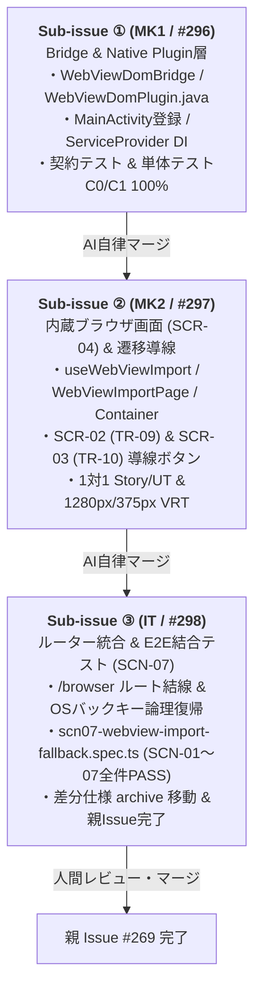

# 差分仕様書：内蔵ブラウザ画面（SCR-04）と WebView 表示中 DOM 手動インポート・フォールバック遷移（Issue #269）

## 1. 変更の背景・目的（Why）

- Yommy は `CapacitorHttp` および `HttpClientBridge` を用いたバックグラウンド HTTP 通信によりカクヨムおよび小説家になろうの HTML を取得しているが、対象サイトの DOM 構造変更、Cloudflare 等の Bot 対策認証画面、または年齢確認・ログイン必須ページに直面した際、通常の HTTP リクエストでは自動取得が遮断され、読書が中断される課題が存在する。
- `docs/specs/requirements.md`（§3.3 `SYS-REQ-13`, `SYS-REQ-14`）および `docs/specs/screen-transitions.md`（`SCR-04`, `TR-09`〜`TR-11`）では、このフォールバック手段として「内蔵ブラウザ（WebView）表示 ＆ 表示中 DOM 手動インポート画面（`SCR-04`）」が当初より計画されている。
- 本 Issue（#269）では、新規外部 npm パッケージを追加せず、カスタムネイティブプラグイン `WebViewDomPlugin.java` ＋ Bridge 抽象層 `WebViewDomBridge` を新設し、内蔵ブラウザ画面（`SCR-04: /browser`）と各画面からのフォールバック遷移導線（`TR-09`, `TR-10`）、および DOM インポート完了後遷移（`TR-11`）を実装することで、**Yommy の全 7 画面（`SCR-01`〜`SCR-07`）および全システム要件（`SYS-REQ-01`〜`20`）をコンプリート** する。

### スコープ境界（In Scope / Out of Scope）

- **対象スコープ（In Scope）**:
  - Bridge & Native Plugin 層: `WebViewDomBridge` インターフェース、`CapacitorWebViewDomBridge`、`MockWebViewDomBridge`（`src/bridges/webview/`）、`WebViewDomPlugin.java`（全画面 `Dialog` ＋ `android.webkit.WebView` ＋ `evaluateJavascript`、危険スキーム遮断）、`MainActivity.java` 登録、`ServiceProvider` DI 統合、および `scripts/android-build-config.test.ts` 契約検証。
  - Feature Layer（`SCR-04`）: `useWebViewImport` フック、`WebViewImportPage`、`WebViewImportContainer`（`src/features/webview-import/`）の新設。100dvh 全画面シェル、URL バー、ブラウザ起動ボタン、DOM インポートボタン、非対応 URL 警告。
  - Feature Layer 遷移導線（`SCR-02` / `SCR-03`）:
    - `SCR-02`: `NovelDetailHeader` への「内蔵ブラウザで開く」ボタン（`data-testid="open-webview-button"`, `TR-09`）追加。
    - `SCR-03`: `ReaderPage` のエラー表示（`data-testid="reader-error"`）への「内蔵ブラウザで開いて取り込む」ボタン（`data-testid="reader-open-webview-button"`, `TR-10`）追加。
  - ルーター・全体結合: `src/app/router.tsx` / `src/App.tsx` における `/browser` ルート登録、`browserOrigin` 保持と「← 戻る」/ OS バックキーによる直前画面論理復帰（`TR-12`）、DOM インポート完了後自動遷移（`TR-11`）。
  - E2E 結合テスト: Playwright `SCN-07`（`test/it/scenarios/scn07-webview-import-fallback.spec.ts`）の新設。
- **対象外スコープ（Out of Scope）**:
  - 汎用 Web ブラウザとしてのマルチタブ、履歴一覧、ブックマーク機能（小説ページのフォールバック閲覧と DOM キャプチャ取り込みに特化）。
  - カクヨム・なろう以外の非対応サイトの汎用スクレイピング（`canParse === false` なサイトは取り込み対象外として安全に拒否）。

---

## 2. 仕様・設計の差分（What Changes）

### 2.1 影響する App 全体正本ファイル一覧

| 対象正本ファイル                        | 変更概要                                                                                                                                                                                                                                              |
| :-------------------------------------- | :---------------------------------------------------------------------------------------------------------------------------------------------------------------------------------------------------------------------------------------------------- |
| `docs/specs/features/webview-import.md` | **【新規作成】** 内蔵ブラウザ画面（`SCR-04`）の UI 構成、`useWebViewImport` フック、DOM インポート保存パイプライン、受入条件（`AC-WV-01`〜`AC-WV-08`）の正本仕様。                                                                                    |
| `docs/specs/requirements.md`            | `SYS-REQ-13`, `SYS-REQ-14` のステータスを更新し、受入条件 ID（`AC-WV-01`〜`08`, `AC-ND-26`, `AC-RD-29`）および Milestone `v0.9` 実装スコープを反映。                                                                                                  |
| `docs/specs/architecture.md`            | §1 レイヤードアーキテクチャ図、§2.1 ディレクトリ構成に `src/bridges/webview/` および `src/features/webview-import/` を追加。§3.13（`WebViewDomBridge`）および §3.14（`webview-import`）を新設。§4 `ServiceProvider` DI に `webViewDomBridge` を追加。 |
| `docs/specs/screen-transitions.md`      | `SCR-04` の導入時期を `v0.9 (#269)` に更新。Mermaid 状態遷移図および一覧に `TR-09`, `TR-10`, `TR-11`, `TR-12` の詳細仕様を反映。結合テスト一覧に `SCN-07` を追加。                                                                                    |
| `docs/specs/features/novel-detail.md`   | `NovelDetailHeader` に「内蔵ブラウザで開く」ボタン（`data-testid="open-webview-button"`, `TR-09`）を追加し、受入条件 `AC-ND-26` を新設。                                                                                                              |
| `docs/specs/features/reader-view.md`    | `ReaderPage` エラー画面に「内蔵ブラウザで開いて取り込む」ボタン（`data-testid="reader-open-webview-button"`, `TR-10`）を追加し、受入条件 `AC-RD-29` を新設。                                                                                          |
| `docs/index.md`                         | ドキュメントマップに `features/webview-import.md` および本差分仕様ファイルを追加。                                                                                                                                                                    |
| `docs/quality/bug-and-handover-log.md`  | 申し送り事項一覧に `HO-35`（内蔵ブラウザ画面の実機検証、完了ゲート: `Milestone v0.9 完了前`）を追加。                                                                                                                                                 |

---

### 2.2 Bridge & Native Plugin 層契約（`src/bridges/webview/`）

#### 1. TypeScript インターフェース契約（`src/bridges/webview/types.ts`）

```ts
export interface CapturedDomResult {
  html: string;
  url: string;
  title: string;
}

export interface OpenWebViewOptions {
  url: string;
  title?: string;
}

export interface WebViewDomBridge {
  /**
   * ネイティブ WebView ダイアログまたは内蔵ブラウザを開く。
   */
  open(options: OpenWebViewOptions): Promise<void>;

  /**
   * 開いている WebView を閉じる。
   */
  close(): Promise<void>;

  /**
   * 現在表示中のページの DOM (outerHTML), 最終 URL, タイトルをキャプチャする。
   */
  captureDom(): Promise<CapturedDomResult>;

  /**
   * 指定 URL が http: または https: の安全なスキームか検証する。
   */
  canHandle(url: string): boolean;
}
```

#### 2. Android ネイティブプラグイン仕様（`android/.../WebViewDomPlugin.java`）

- **プラグインアノテーション**: `@CapacitorPlugin(name = "WebViewDom")`
- **UI 構成**: 全画面 `Dialog` 上に `android.webkit.WebView` と上部操作バー（URL 表示、戻る/進む/リロード、キャプチャ確定ボタン、閉じるボタン）を展開。
- **DOM 抽出方式**:
  ```java
  webView.evaluateJavascript("(function(){return document.documentElement.outerHTML;})()", value -> {
      // JSON エスケープを解除して HTML 文字列を取得
  });
  ```
- **セキュリティガード**:
  - `WebViewClient.shouldOverrideUrlLoading`: `http:` および `https:` のみロードを許可し、`javascript:`, `data:`, `file:`, `intent:` 等の危険スキームは即時遮断（`return true`）。
- **ライフサイクル**: `handleOnDestroy()` およびダイアログ破棄時に `webView.destroy()` を実行してメモリリークを防止。

#### 3. テスト用モック実装（`MockWebViewDomBridge`）

- `setMockPage(result: CapturedDomResult)` メソッドを提供し、Storybook や Vitest UT、Playwright IT で決定論的な HTML・URL・タイトルを返却可能にする。
- デフォルトではダミーのカクヨム作品ページ（またはなろうページ）の HTML を保持する。

---

### 2.3 Feature Layer（`SCR-04`）契約（`src/features/webview-import/`）

- **`useWebViewImport`**:
  - パラメータ: `initialUrl`, `initialNovelId`, `initialChapterIndex`
  - URL バリデーション（`canHandle`）とパーサー判定（`parserRegistry.getParser(url)` / `canParse(url)`）
  - DOM インポート実行（`importCurrentDom`）:
    - `parseNovelIndex` による作品目次解析 ＆ `novelRepository.upsertNovelWithToc` 保存（なろう短編は本文も同時保存）。
    - `parseChapterContent` による各話本文解析 ＆ `chapterRepository.saveChapterBody` 保存（未登録作品時は目次自動補完を試行）。
- **`WebViewImportPage`**:
  - 100dvh 全画面シェル、上部固定 URL バー（`browser-url-input`）、戻るボタン（`browser-back-button`）、操作ボタン（`open-native-browser-button`, `import-dom-button`）、非対応 URL 警告トースト（`browser-unsupported-warning`）、下部 4 タブバー（`BottomTabBar`）。
- **`WebViewImportContainer`**:
  - `useWebViewImport` とルーター（`router.navigate`）、`ServiceProvider` を接続。

---

### 2.4 画面遷移導線と OS バックキー復帰仕様

1. **`TR-09`（`SCR-02` → `SCR-04`）**:
   - `NovelDetailHeader` のアクションバーに「内蔵ブラウザで開く」ボタン（`data-testid="open-webview-button"`）を配置。
   - 押下時に `/browser?url=${encodeURIComponent(novel.canonicalUrl)}&novelId=${encodeURIComponent(novel.id)}` へ遷移。
2. **`TR-10`（`SCR-03` → `SCR-04`）**:
   - `ReaderPage` のエラー表示（`data-testid="reader-error"`）内に「内蔵ブラウザで開いて取り込む」ボタン（`data-testid="reader-open-webview-button"`）を配置。
   - 押下時に `/browser?url=${encodeURIComponent(chapter.url)}&novelId=${encodeURIComponent(novel.id)}&chapterIndex=${chapter.chapterIndex}` へフォールバック遷移。
3. **`TR-11`（`SCR-04` → `SCR-02` または `SCR-03`）**:
   - 目次インポート完了時: `/novels/:novelId` へ自動遷移。
   - 各話本文インポート完了時: `/novels/:novelId/chapters/:chapterIndex` へ直接遷移し読書再開。
4. **`TR-12`（`SCR-04` → 直前画面論理復帰）**:
   - ヘッダーの「← 戻る」ボタン（`data-testid="browser-back-button"`）または Android OS バックキー操作時、直前の遷移元（`browserOrigin`: `SCR-02` または `SCR-03`、未指定時は本棚 `/`）へ論理階層復帰。

---

### 2.5 新規・更新受入条件一覧

- **内蔵ブラウザ画面（`SCR-04`）**: `AC-WV-01`〜`AC-WV-08`（詳細は [docs/specs/features/webview-import.md §7](../features/webview-import.md#7-受入条件一覧acceptance-criteria-ac-wv-xx) を参照）
- **作品詳細画面（`SCR-02`）**: `AC-ND-26`（作品詳細ヘッダーからの「内蔵ブラウザで開く」導線 `TR-09`）
- **小説リーダー画面（`SCR-03`）**: `AC-RD-29`（リーダー本文取得エラー時の「内蔵ブラウザで開いて取り込む」導線 `TR-10`）

---

## 3. テスト計画（UT / VRT / IT の検証観点）

### 3.1 単体テスト（Unit Tests / Vitest）

- **Bridge Layer (`src/bridges/webview/`)**:
  - `canHandle`: `http://`, `https://` で `true`、`javascript:`, `data:`, `file:`, 空文字等で `false` を返却。
  - `CapacitorWebViewDomBridge`: ネイティブプラグイン呼び出しおよびエラーハンドリング検証。
  - `MockWebViewDomBridge`: デフォルト値、カスタム値設定、キャプチャ呼び出しの決定論的動作検証。
  - `scripts/android-build-config.test.ts`: `WebViewDomPlugin.java` の構文および `MainActivity.java` への登録契約検証。
- **UI / Hook Layer (`src/features/webview-import/`)**:
  - `useWebViewImport.test.ts`:
    - 初期 URL ロードと危険スキーム遮断。
    - 目次 URL 時の `parseNovelIndex` → `upsertNovelWithToc` 実行と遷移コールバック。
    - 本文 URL 時の `parseChapterContent` → `saveChapterBody` 実行と遷移コールバック。
    - なろう短編時の本文同時保存。
    - 未登録作品エピソード取り込み時の目次自動補完・失敗時案内。
    - 非対応 URL でのインポート拒否と警告メッセージ。
  - `WebViewImportPage.test.tsx`:
    - Portable Stories による 1対1 レンダリング検証（入力バー、戻るボタン、各種ボタン活性/非活性、案内トースト、エラーアラート）。
  - `WebViewImportContainer.test.tsx`:
    - ルーター・DI 統合と遷移発火検証。
- **既存画面遷移導線 UT**:
  - `NovelDetailHeader.test.tsx`: 「内蔵ブラウザで開く」ボタンの描画とクリックイベント発火（`AC-ND-26`）。
  - `ReaderPage.test.tsx`: エラー発生時の「内蔵ブラウザで開いて取り込む」ボタン描画とフォールバック遷移発火（`AC-RD-29`）。

### 3.2 ビジュアルリグレッションテスト（VRT / Storybook 1280px & 375px）

- `WebViewImportPage.stories.tsx`:
  - `Default`（通常表示）
  - `UnsupportedUrl`（非対応 URL 警告表示）
  - `Loading`（読み込み中スピナー）
  - `WithError`（エラー表示）
  - `WithNotice`（完了通知表示）
- `NovelDetailHeader.stories.tsx`: 「内蔵ブラウザで開く」ボタン追加状態のスナップショット更新。
- `ReaderPage.stories.tsx`: エラー画面内のフォールバックボタン追加状態のスナップショット更新。

### 3.3 Playwright システム結合テスト（`SCN-07`）

- 新規作成: `test/it/scenarios/scn07-webview-import-fallback.spec.ts`
  - シナリオ 1: 作品詳細（`SCR-02`）→「内蔵ブラウザで開く」（`TR-09`）→ `SCR-04` で目次 DOM インポート → `SCR-02` 自動遷移（`TR-11`）と目次一覧反映。
  - シナリオ 2: 小説リーダー（`SCR-03`）で未キャッシュ話の通信エラー →「内蔵ブラウザで開いて取り込む」（`TR-10`）→ `SCR-04` で本文 DOM インポート → `SCR-03` 直接遷移（`TR-11`）と本文縦書き描画・読書再開。
  - シナリオ 3: 非対応 URL 表示時の警告表示と OS バックキーによる直前画面論理復帰（`TR-12`）。

---

## 4. 実装 Sub-issue 分割計画

本要望は 1 PR あたり 200〜400 行の適正粒度を維持するため、以下の 3 つの Sub-issue に直列分割して進行します。



1. **Sub-issue ① (MK1 / #296)**: `[v0.9][#269-MK1] Bridge・Native層（WebViewDomBridge / WebViewDomPlugin.java）の実装とServiceProvider DI統合`
   - 作業範囲: `src/bridges/webview/`（`types.ts`, `capacitorWebViewDomBridge.ts`, `mockWebViewDomBridge.ts`, `index.ts`）、`android/app/src/main/java/com/yommy/app/WebViewDomPlugin.java`、`MainActivity.java` 登録、`src/app/ServiceProvider.tsx` DI 統合、1対1 単体テスト（C0/C1/Functions 100%）、および `scripts/android-build-config.test.ts` 契約テスト。
   - マージ区分: AI 自律マージ（Gate 1〜6 通過後）。
2. **Sub-issue ② (MK2 / #297)**: `[v0.9][#269-MK2] 内蔵ブラウザ画面（SCR-04）UI/Hook実装と作品詳細（SCR-02）・リーダー（SCR-03）遷移導線（TR-09/TR-10）およびVRT更新`
   - 作業範囲: `src/features/webview-import/`（`types.ts`, `useWebViewImport.ts`, `WebViewImportPage.tsx`, `WebViewImportContainer.tsx`）の新設、`NovelDetailHeader` への「内蔵ブラウザで開く」ボタン（`TR-09`）追加、`ReaderPage` エラー画面への「内蔵ブラウザで開いて取り込む」ボタン（`TR-10`）追加、1対1 Story/UT（C0/C1 100%）、および 1280px/375px VRT スナップショット更新。
   - マージ区分: AI 自律マージ（Gate 1〜6 通過後）。
3. **Sub-issue ③ (IT / #298)**: `[v0.9][#269-IT] ルーター統合（/browser, TR-09〜11）とWebView DOMインポートE2E結合テスト（SCN-07）新設・差分仕様アーカイブ`
   - 作業範囲: `src/app/router.tsx` / `src/App.tsx` の `/browser` ルーティング結線・`browserOrigin` 復帰、Playwright 実ブラウザ結合テスト `SCN-07`（`test/it/scenarios/scn07-webview-import-fallback.spec.ts`）新設と全シナリオ（`SCN-01`〜`SCN-07`）100% PASS 確認、および差分仕様ファイルの `docs/specs/changes/archive/` への移動。
   - マージ区分: 人間レビュー・マージ（親 Issue #269 完了）。

---

## 5. 申し送り事項（Handover Items: `HO-xx`）・実機検証計画

### 5.1 Android 実機検証タイミング判断

- [docs/guidelines/workflow.md §2.2](../../guidelines/workflow.md#22-android-実機検証の実施判断基準と試験項目表フォーマット) の判断基準に基づき、本要望の実機検証タイミングを判定：
  - **判定結果**: **B. Milestone 最終レビュー後に一括で実機検証を実施（完了ゲート: `Milestone v0.9 完了前`）**
  - **判断理由**: 本要望は Android ネイティブプラグイン（`WebViewDomPlugin.java`）を新設するものの、DOM キャプチャロジック（`evaluateJavascript`）および UI / ルーター統合は Playwright IT（`SCN-07`）および Vitest 単体テストで決定論的に 100% 検証可能である。また先行する永続キュー（Issue #268 / `HO-34`）とともに Milestone `v0.9` の一括実機検証（Issue #270）にて、実機 WebView 操作とキャッシュ保存の連携を一筆書きで検証する方が効率的かつ網羅的であるため。

### 5.2 申し送り事項（`HO-35`）の登録

- [docs/quality/bug-and-handover-log.md](../../quality/bug-and-handover-log.md) に以下の申し送り事項を登録する：
  - **ID**: `HO-35`
  - **起票元**: Issue `#269`
  - **内容**: Android 実機（`android.webkit.WebView` ＋ `evaluateJavascript` ＋ `WebViewDomPlugin.java`）における全画面内蔵ブラウザダイアログの表示、Web ページ閲覧・Cloudflare/ログイン操作、DOM キャプチャ取り込み（作品目次 vs 各話本文の自動判別・DB保存）、および作品詳細（`TR-09`）・リーダー（`TR-10`）・完了後遷移（`TR-11`）・OS バックキー論理復帰の実機確認
  - **解決先**: Milestone `v0.9` 完了承認 Issue #270（Step 2-2 実機検証）
  - **完了ゲート**: `Milestone v0.9 完了前`
  - **状態**: `Open`
