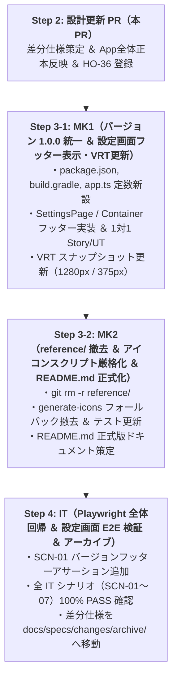

# 差分仕様書：v1.0 リリース整備（バージョン 1.0.0 統一・設定画面バージョン表示・reference/ 撤去・README.md 整備）（Issue #304）

## 1. 変更の背景・目的（Why）

- **背景**:
  - `Milestone v0.9`（#268 永続ダウンロードキュー、#269 内蔵ブラウザ ＆ DOM 手動インポート）の完了をもって、Yommy において当初計画されていた全 7 画面（`SCR-01`〜`SCR-07`）および全システム機能要件（`SYS-REQ-01`〜`SYS-REQ-20`）がすべて実装完了となった。
  - プロダクトは次なる `Milestone v1.0`（リリース整備 ＆ システム全体横断品質監査）に進むが、開発初期から以下の課題・残存物・不統一が存在していた：
    1. **バージョン表記の不統一**: `package.json` が `"0.1.0"`、`android/app/build.gradle` のデフォルト `versionName` が `"0.3.0"` となっており、プロダクトの到達フェーズと乖離している。
    2. **設定画面でのバージョン不可視**: 稼働中のビルドバージョンを Android 実機やアプリ画面上から直接確認する手段が存在しない。
    3. **初期一時ディレクトリ `reference/` の残存**: プロジェクト立ち上げ時の参考資料（旧設計メモ・プレイブック等）がルート直下に残存しており、`docs/index.md` §1 NOTE の「引き継ぎ後に削除する」規約が未消化のままとなっていた。
    4. **`README.md` の未整備**: リポジトリルートの `README.md` が 2 行のみの仮状態であり、オープンソースプロジェクトとしての概要・機能・ビルド・ドキュメント体系（OKF）の案内が提供されていない。
- **目的**:
  - バージョン表記を `"1.0.0"` に統一し、設定画面（`SCR-05`）フッターに稼働中バージョンを表示する。
  - `reference/` ディレクトリを完全撤去し、アプリアイコン生成スクリプト（`scripts/generate-icons.mjs`）のマスター画像（`assets/icon.png`）を唯一の正本として厳格化する。
  - `README.md` を包括的なオープンソース標準ドキュメントとして刷新し、ロードマップ（`docs/specs/requirements.md`）に `Milestone v1.0` を反映することで、システム全体横断品質監査（Issue #305）および v1.0.0 正式リリースへ向けた盤石な基盤を完成させる。

### スコープ境界（In Scope / Out of Scope）

- **対象スコープ（In Scope）**:
  1. バージョンメタデータの `1.0.0` 統一: `package.json`（`version: "1.0.0"`）、`android/app/build.gradle`（デフォルト `versionName: "1.0.0"`）、および `scripts/android-build-config.test.ts` の同期更新。
  2. 定数管理モジュールの新設: `src/shared/constants/app.ts`（`APP_NAME = "Yommy"`, `APP_VERSION = "1.0.0"`）の新設と、`package.json` の `version` との完全同期を機械検証する単体テスト `src/shared/constants/app.test.ts` の整備。
  3. 設定画面（`SCR-05`）でのアプリバージョン表示: `SettingsPage.tsx` の最下部（`StorageCacheSection` 直下）に控えめなフッター（`<footer data-testid="settings-version-footer">`、テキスト `Yommy v1.0.0`）を追加し、`SettingsContainer.tsx` から定数を Props 注入。1対1 Story/UT の更新および Storybook VRT（1280px / 375px）スナップショットの更新。受入条件 `AC-ST-20` の新設。
  4. 初期一時ディレクトリ `reference/` の完全撤去: `git rm -r reference/` の実行、`docs/index.md` §1 NOTE の除去、および `scripts/generate-icons.mjs` / `scripts/generate-icons.test.ts` 内の `reference/image.png` フォールバック処理の完全撤去。
  5. `README.md` の v1.0 正式ドキュメント化: アプリアイコン（`assets/icon.png`）、バッジ、概要、主要機能（全7画面・カクヨム/なろう対応・縦書き/ルビ組版・永続DLキュー・Google Drive同期・内蔵WebView等）、3層アーキテクチャ、DevContainer環境セットアップ/テスト（UT/VRT/IT/Androidビルド）コマンド、OKF設計書目次（`docs/index.md`）、ライセンスを網羅した包括的ドキュメントの策定。
  6. ロードマップ更新: `docs/specs/requirements.md` §4 ロードマップ（Mermaid 図および一覧表）への `Milestone v1.0`（リリース整備 ＆ システム全体横断品質監査）の追記。
  7. E2E 結合テスト連携: Playwright `SCN-01` において、`/settings` ルートにおけるバージョン表示フッターの表示アサーションを追加。
- **対象外スコープ（Out of Scope）**:
  - 新規小説サイト対応や大型新機能の追加（全要件は `v0.9` までで完遂済み）。
  - Capacitor `App.getInfo()` によるネイティブ層からの動的バージョン取得（Web/Storybook/テスト環境での非同期性・モック依存を排除し、定数管理方式を採用）。

---

## 2. 仕様・設計の差分（What Changes）

### 2.1 影響する App 全体正本ファイル一覧

| 対象正本ファイル                       | 変更概要                                                                                                                                                                                                                   |
| :------------------------------------- | :------------------------------------------------------------------------------------------------------------------------------------------------------------------------------------------------------------------------- |
| `docs/specs/features/settings.md`      | `SettingsPage` および `SettingsContainer` のコンポーネント契約に `appName`, `appVersion` を追加。画面最下部にバージョン表示フッター（`data-testid="settings-version-footer"`）を配置する仕様と受入条件 `AC-ST-20` を新設。 |
| `docs/specs/requirements.md`           | §4 ミニリリース Milestone ロードマップの Mermaid 図および一覧表に `Milestone v1.0`（リリース整備 ＆ システム全体横断品質監査）を追記。                                                                                     |
| `docs/index.md`                        | 差分仕様一覧に本ファイルを追加し、§1 NOTE（`reference/` ディレクトリに関する一時注記）を除去。                                                                                                                             |
| `docs/quality/bug-and-handover-log.md` | 申し送り事項一覧に `HO-36`（Android 実機での設定画面バージョン表示および全画面スモーク確認、完了ゲート: `Milestone v1.0 完了前` / Issue #305）を追加。                                                                     |

---

### 2.2 バージョン情報アーキテクチャ（定数管理方式）

#### 1. フロントエンド定数モジュール（`src/shared/constants/app.ts`）

アプリ名およびバージョン文字列を一元管理する定数ファイルを新設します。

```ts
/**
 * アプリケーション基本メタデータ定数定義
 * (docs/specs/features/settings.md §2, docs/specs/changes/issue-304-v1-release-readiness.md)
 */

/**
 * アプリケーション表示名称
 */
export const APP_NAME = "Yommy";

/**
 * アプリケーションセマンティックバージョン（1.0.0）
 */
export const APP_VERSION = "1.0.0";
```

#### 2. バージョン整合性検証テスト（`src/shared/constants/app.test.ts`）

`package.json` の `version` と `src/shared/constants/app.ts` の `APP_VERSION` の乖離を防止するため、厳格な単体テストを配置します。

```ts
import { describe, it, expect } from "vitest";
import packageJson from "../../../package.json";
import { APP_NAME, APP_VERSION } from "./app";

describe("app constants", () => {
  it("APP_NAME が 'Yommy' であること", () => {
    expect(APP_NAME).toBe("Yommy");
  });

  it("APP_VERSION が package.json の version と完全一致すること", () => {
    expect(APP_VERSION).toBe(packageJson.version);
    expect(APP_VERSION).toBe("1.0.0");
  });
});
```

#### 3. Android ビルド設定同期（`android/app/build.gradle` ＆ `scripts/android-build-config.test.ts`）

- `android/app/build.gradle`:
  ```groovy
  def appVersionName = System.getenv("BUILD_NAME") ?: (project.findProperty("versionName") ?: "1.0.0")
  ```
- `scripts/android-build-config.test.ts`:
  デフォルト解決期待値を `"0.3.0"` から `"1.0.0"` へ更新。

---

### 2.3 設定画面（SCR-05）フッター UI 設計

#### 1. コンポーネント契約（Presentational: `SettingsPageProps`）

`src/features/settings/components/SettingsPage.tsx` の Props インターフェースを以下のように拡張します：

```ts
export interface SettingsPageProps {
  // ... 既存の組版・同期・キャッシュ関連 Props ...

  /** アプリケーション表示名（省略時: APP_NAME = "Yommy"） */
  appName?: string;
  /** アプリケーションバージョン（省略時: APP_VERSION = "1.0.0"） */
  appVersion?: string;
}
```

#### 2. JSX 配置およびスタイリング

`SettingsPage.tsx` の `StorageCacheSection` の直下（最下部）に、控えめなセンター寄せフッター要素を追加します：

```tsx
<footer
  data-testid="settings-version-footer"
  className="mt-8 mb-6 text-center text-xs text-slate-500 dark:text-slate-400"
>
  {appName} v{appVersion}
</footer>
```

- **視覚的階層**: 設定項目のカード群を圧迫せず、画面最下部でユーザーやテスターがビルドバージョンを確認できる控えめなフォントサイズ（`text-xs`）と配色（`text-slate-500 dark:text-slate-400`）。
- **Container 連携**: `SettingsContainer.tsx` から `appName={APP_NAME}` および `appVersion={APP_VERSION}` を注入（または Props 省略時のデフォルト引数として適用）。
- **Storybook / VRT**: `SettingsPage.stories.tsx` および `SettingsContainer.stories.tsx` にて `1280px`（PC）/ `375px`（モバイル）スナップショットを更新。

---

### 2.4 reference/ 撤去とアセット生成スクリプト厳格化

#### 1. 初期一時ディレクトリの完全削除

- `reference/` ディレクトリ直下の全ファイル（`Web小説リーダー_要件定義・開発パターン検討.md`, `Web小説リーダー_開発計画.md`, `ai-dev-playbook-package/`, `image.png`）を `git rm -r reference/` によりリポジトリから完全撤去。
- `docs/index.md` §1 NOTE の「初期立ち上げ時の一時参考資料置き場」注記を削除。

#### 2. アプリアイコン生成スクリプト（`scripts/generate-icons.mjs`）の厳格化

- `scripts/generate-icons.mjs` 内に存在していた `reference/image.png` への旧フォールバック条件分岐を撤去。
- 正本マスターアセット `assets/icon.png`（`AC-ICON-01`）のみを参照し、見つからない場合は直ちにエラーを投げる決定論的仕様に一本化。
- `scripts/generate-icons.test.ts` 内の `reference/image.png` フォールバックテストケースを撤去し、マスター画像実在性および生成パイプラインの正常性テストを維持。

---

### 2.5 README.md 正式版構成設計

包括的なオープンソース標準構成として、以下の見出し構造で `README.md` を全面的に刷新します：

1. **ヘッダー**: アプリアイコン画像（``）、プロジェクト名（Yommy）、キャッチコピー、主要バッジ（CI、Node.js 24、React 19、TypeScript、Capacitor 8、ライセンス）。
2. **概要（About Yommy）**: 日本語縦書き・ルビ組版に特化した、Web 小説（カクヨム・小説家になろう）対応のオープンソース Android リーダーアプリ。
3. **主要機能一覧（Key Features）**:
   - 全 7 画面（本棚・作品詳細/目次・リーダー・内蔵ブラウザ・設定・検索・ランキング）
   - カクヨム・小説家になろうマルチサイト対応（探索・目次・短編・複数ページ目次・傍点正規化）
   - 日本語縦書き組版（`vertical-rl`、Kindle様式ページめくり、ルビ・傍点描画、フォント5種、余白カスタマイズ、ハードウェア音量キー送り）
   - オフライン読書 ＆ 永続ダウンロードキュー（読書中先読み、一括キャッシュ、中断再開、再試行）
   - Google Drive クラウド同期（appDataFolder による本棚・しおり・お気に入り双方向同期）
   - 内蔵 WebView 手動 DOM インポート（Bot対策・DOM変更時の確実なフォールバック）
4. **技術スタック（Tech Stack）**: React 19, TypeScript, Vite, Tailwind CSS, Capacitor 8, SQLite (`@capacitor-community/sqlite`), Vitest, Storybook, Playwright。
5. **開発環境・クイックスタート（Getting Started）**:
   - DevContainer 環境要件
   - 依存関係インストール（`npm install`）
   - 開発サーバー起動（`npm run dev`）
   - 静的検査・フォーマット（`npm run typecheck`, `npm run lint`, `npm run format:check`）
   - テスト実行（`npm run test:unit`, `npm run test:coverage`, `npm run test:vrt`, `npm run test:it`）
   - Android APK ビルド手順
6. **ドキュメント体系（Documentation / OKF）**: Single Source of Truth（SSOT）としての `docs/index.md` への誘導。
7. **ライセンス（License）**: Apache License 2.0。

---

### 2.6 ロードマップ更新（`docs/specs/requirements.md`）

`docs/specs/requirements.md` §4 に `Milestone v1.0` を追加します：

- Mermaid ロードマップ図に `M10`（Milestone v1.0）を追加。
- Milestone 一覧表に `Milestone v1.0（リリース整備 ＆ システム全体横断品質監査）` を追記。

---

## 3. 受入条件（Acceptance Criteria）

| AC ID                      | 対象機能                                              | 検証条件                                                                                                                                                                                                                                             | 関連要件 / 正本仕様                                   |
| :------------------------- | :---------------------------------------------------- | :--------------------------------------------------------------------------------------------------------------------------------------------------------------------------------------------------------------------------------------------------- | :---------------------------------------------------- |
| **`AC-ST-20`**             | 設定画面フッターでのアプリバージョン表示（v1.0 #304） | 設定画面（`SCR-05: /settings`）の最下部（ストレージ・キャッシュ管理セクション下）にフッター領域（`data-testid="settings-version-footer"`）が配置され、アプリ名とバージョン表記（`Yommy v1.0.0`）がセンター寄せ・控えめな文字サイズで表示されること。 | `SYS-REQ-16` / `docs/specs/features/settings.md`      |
| **`AC-APK-02`**（更新）    | Android ビルド versionName 1.0.0 統一                 | `package.json` の `version` が `"1.0.0"` であり、`android/app/build.gradle` のデフォルト `versionName` が `"1.0.0"` に解決されること。CI 環境変数 `BUILD_NAME` による上書き指定も引き続き正常に動作すること。                                        | `SYS-REQ-15` / `scripts/android-build-config.test.ts` |
| **`AC-ICON-01`**（厳格化） | マスター画像正本化と旧フォールバック撤去              | `reference/` ディレクトリが完全に削除され、`scripts/generate-icons.mjs` がマスター画像 `assets/icon.png` のみを参照して各種解像度アイコンを決定論的に生成すること。旧 `reference/image.png` への依存が一切存在しないこと。                           | `SYS-REQ-15` / `scripts/generate-icons.test.ts`       |

---

## 4. テスト計画（Test Plan）

### 4.1 単体テスト（Unit Tests / Vitest TDD）

1. **`src/shared/constants/app.test.ts`**:
   - `APP_NAME` が `"Yommy"` であること。
   - `APP_VERSION` が `package.json` の `version` と完全に一致し `"1.0.0"` であること。
2. **`src/features/settings/components/SettingsPage.test.tsx`**:
   - `SettingsPage` 最下部に `data-testid="settings-version-footer"` がレンダリングされること。
   - デフォルト表示で `"Yommy v1.0.0"` が含まれること。
   - Props でカスタム `appName="TestApp"`, `appVersion="2.0.0"` を渡した場合に `"TestApp v2.0.0"` が正しく表示されること。
3. **`src/features/settings/components/SettingsContainer.test.tsx`**:
   - `SettingsContainer` が描画された際、フッターに `"Yommy v1.0.0"` が表示されること。
4. **`scripts/android-build-config.test.ts`**:
   - `build.gradle` 内のデフォルト `versionName` が `"1.0.0"` にマッチすること。
5. **`scripts/generate-icons.test.ts`**:
   - `assets/icon.png` からのアイコン生成が正常終了すること（旧フォールバックテストの撤去）。

### 4.2 Storybook ＆ VRT（Visual Regression Testing）

1. **`SettingsPage.stories.tsx` ＆ `SettingsContainer.stories.tsx`**:
   - フッターバージョン表示を含む状態のストーリーを更新。
   - `npm run test:vrt:update` により `1280px`（PC）および `375px`（モバイル）のスナップショットを更新し、`npm run test:vrt` が差分ゼロで 100% PASS することを確認。

### 4.3 システム結合テスト（Playwright IT）

1. **`test/it/scenarios/scn01-poc-vertical-reader.spec.ts`**:
   - 設定画面（`/settings`）への遷移ステップにおいて、`settings-version-footer` が表示され、テキスト `Yommy v1.0.0` を含んでいることをアサーション検証。
   - `npm run test:it`（全シナリオ `SCN-01`〜`SCN-07`）が 100% PASS することを確認。

---

## 5. 申し送り事項（Handover Items: `HO-xx`）・実機検証計画

### Android 実機検証の実施タイミング判断

- **判定**: **`B. Milestone 最終レビュー後に一括で実機検証を実施（完了ゲート: Milestone v1.0 完了前 / Issue #305 Step 2）`**
- **理由**:
  1. 本 Issue #304 で追加されるバージョン表示はフッターテキストの追加であり、1対1 Story/UT、VRT（1280px / 375px）、および Playwright 実ブラウザ IT により 100% 決定論的に動作・レイアウトが検証可能である。
  2. 後続の `Milestone v1.0` 完了承認 Issue #305 において、全 7 画面スモーク確認および v1.0 受け入れ確認を包括した「Android 実機総括検証」がすでに計画されており、#304 完了直前に個別の実機検証を挟むよりも、#305 Step 2 にて一括検証する方が開発プロセスとして効率的かつ確実である。

### 申し送り一覧

|     ID      | 起票元 Issue | 申し送り事項の内容                                                                                   | 解決先（対象 Issue / 成果物）          |       完了ゲート        |  状態  |
| :---------: | :----------: | :--------------------------------------------------------------------------------------------------- | :------------------------------------- | :---------------------: | :----: |
| **`HO-36`** |  Issue #304  | Android 実機における設定画面フッターのアプリバージョン表示（`Yommy v1.0.0`）および全画面スモーク確認 | Milestone `v1.0` 実機検証 / Issue #305 | Milestone `v1.0` 完了前 | `Open` |

---

## 6. Sub-issue 分割計画（Sub-issue Breakdown）

本要望は 2 つの実装 Sub-issue（MK）と 1 つの結合テスト Sub-issue（IT）に分割して直列進行します：



### 1. Sub-issue 1: MK1（バージョン 1.0.0 統一 ＆ 設定画面フッター表示・VRT更新）

- **作業範囲**:
  - `package.json` の `version` を `"1.0.0"` に更新。
  - `android/app/build.gradle` のデフォルト `versionName` を `"1.0.0"` に更新。
  - `scripts/android-build-config.test.ts` を更新。
  - `src/shared/constants/app.ts` および `src/shared/constants/app.test.ts` を新設（C0/C1 100%）。
  - `src/features/settings/components/SettingsPage.tsx` / `SettingsContainer.tsx` にフッターバージョン表示を追加。
  - `SettingsPage.test.tsx` / `SettingsContainer.test.tsx` / `SettingsPage.stories.tsx` / `SettingsContainer.stories.tsx` を更新。
  - `npm run test:vrt:update` により VRT スナップショット（1280px / 375px）を更新。
- **完了条件**: Gate 1〜6 完遂、AI 自律マージ（`Closes #MK1`）。

### 2. Sub-issue 2: MK2（reference/ 撤去 ＆ アイコンスクリプト厳格化 ＆ README.md 正式化）

- **作業範囲**:
  - `reference/` ディレクトリを完全削除。
  - `scripts/generate-icons.mjs` および `scripts/generate-icons.test.ts` のフォールバック処理を撤去し、`assets/icon.png` 必須化。
  - `README.md` を包括的オープンソース標準ドキュメントとして刷新。
- **完了条件**: Gate 1〜6 完遂、AI 自律マージ（`Closes #MK2`）。

### 3. Sub-issue 3: IT（Playwright 全体回帰 ＆ 設定画面 E2E 検証 ＆ 差分仕様アーカイブ）

- **作業範囲**:
  - `test/it/scenarios/scn01-poc-vertical-reader.spec.ts` に設定画面バージョン表示アサーションを追加。
  - `npm run test:it`（全シナリオ `SCN-01`〜`SCN-07`）100% PASS を確認。
  - 差分仕様 `docs/specs/changes/issue-304-v1-release-readiness.md` を `status: "Completed (Archived)"` に更新し、`docs/specs/changes/archive/` へ移動。
  - 親 Issue #304 をクローズする最終 PR（`Closes #304`, `Closes #IT`）を作成。
- **完了条件**: Gate 1〜6 完遂、人間による最終確認・マージ。
