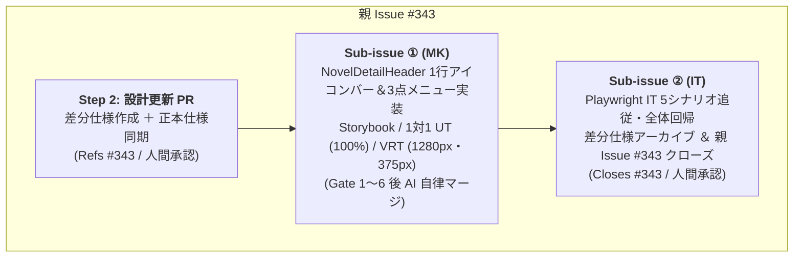

# 差分仕様書：作品詳細ヘッダー（SCR-02）の管理アクションバー整理（Issue #343）

本ドキュメントは、Issue #343「`[v1.1] 作品詳細ヘッダー（SCR-02）の管理アクションバー整理（お気に入り・更新のアイコン化と3点メニュー集約）`」に対する差分仕様、影響する App 全体正本の一覧、UT/VRT/IT テスト計画、実装 Sub-issue 分割計画、および Android 実機検証計画を定義する設計書です。

---

## 1. 変更の背景・目的（Why）

- **モバイル画面でのヘッダー圧迫感・視認性低下の解消**:
  現在、作品詳細・目次画面（`SCR-02`）の `NovelDetailHeader` 上部には、「☆ お気に入り」「未取得話を一括キャッシュ」「目次を更新」「本文キャッシュ整理」「内蔵ブラウザで開く」「作品を削除」の計 6 つのテキスト付きボタンが `flex-wrap` で横並び配置されている。モバイル画面幅（375px）ではこれらが 2〜3 行に折り返して作品タイトルの上に大きく張り出し、画面上部の圧迫感とタイトル視認性の低下を招いている。
- **本棚画面（`SCR-01`）との UI 統一と操作頻度の最適化**:
  日常的にワンタップで使うアクション（「お気に入り」「目次更新」）を本棚画面（`BookshelfPage` / `NovelCard`）と同様にアイコン化して常時 1 行に収め、利用頻度が限られる残りの 4 つの管理アクションを 3 点リーダーメニュー（`⋮`）のドロップダウンリストへ集約することで、タイトル上部の領域をすっきり整理する。
- **一括キャッシュ中の即時視認・中断導線の維持**:
  一括キャッシュ実行中（`isBatchCaching === true`）はメニューを開かなくても進行状況と中断操作ができるよう、ヘッダーの管理アクションバー内（アイコン群の左側）に進捗テキスト（`batch-cache-progress`）と「中断」ボタン（`batch-cache-cancel-button`）を直接表示する。

---

## 2. 仕様・設計の差分（What Changes）

### 2.1 `NovelDetailHeader` の管理アクションバー（常時 1 行アイコンバー）整理

作品タイトルの 1 段上に、右寄せのコンパクトな 1 行レイアウト（`flex items-center justify-end gap-1.5 sm:gap-2 flex-nowrap`）で以下を配置する。

1. **一括キャッシュ実行中の進捗・中断表示（`isBatchCaching === true` 時のみアイコン群の左側に表示）**:
   - **進捗テキスト（`data-testid="batch-cache-progress"`）**:
     - `batchCacheProgress` に応じて `キャッシュ中 (${current}/${total})...`（失敗件数 `failedCacheCount > 0` 時は `キャッシュ中 (${current}/${total}) [失敗 ${failedCacheCount}話]...` でアンバー強調）を表示する。
     - 375px 幅でもアイコン群を折り返さずに 1 行へ収めるため `min-w-0 truncate` を適用する。
   - **中断ボタン（`data-testid="batch-cache-cancel-button"`）**:
     - ラベル `中断`（`shrink-0`）。クリック時に `onCancelBatchCache()` を呼び出す。
2. **お気に入りトグルボタン（`data-testid="detail-favorite-toggle-button"`）**:
   - テキスト（「お気に入り」）を廃止し、アイコンのみ表示とする（`novel.isFavorite === true` 時は `★`・アンバー色強調、`false` 時は `☆`・スレート色枠）。
   - セマンティック属性：`aria-label="お気に入り"`、`aria-pressed={Boolean(novel.isFavorite)}` を維持する。
   - レイアウト安定性（`R2-19` 踏襲）：ON/OFF 双方で常時 1px `border` と固定サイズクラス（例: `w-8 h-8` 相当＋`shrink-0`）を維持し、状態切替時のレイアウトちらつきを防止する。
   - 活性制御：`isRefreshing === true || isBatchCaching === true` の間は `disabled`。
3. **目次更新ボタン（`data-testid="refresh-toc-button"`）**:
   - テキスト（「目次を更新」「更新中...」）を廃止し、`🔄` アイコンのみ表示する（`isRefreshing === true` の間はアイコン要素に `animate-spin` クラスを付与）。
   - セマンティック属性：`aria-label="目次を更新"`。
   - 活性制御：`isRefreshing === true || isBatchCaching === true` の間は `disabled`、`shrink-0`。
4. **3 点メニューボタン（`data-testid="novel-detail-menu-button"`、新設）**:
   - `⋮` アイコンボタンを配置する（`shrink-0`）。
   - セマンティック属性：
     - `aria-label="作品メニュー"`
     - `aria-haspopup="menu"`
     - `aria-expanded={isMenuOpen}`
     - `aria-controls={isMenuOpen ? menuId : undefined}`（`useId()` により一意 ID を生成し、展開時のみ `aria-controls` を付与して折りたたみ時のダングリング参照を防止する）
   - 活性制御：`isRefreshing === true || isBatchCaching === true` の間は `disabled`（かつ `isRefreshing` または `isBatchCaching` が `true` に遷移した場合は開いていたメニューを自動的に閉じる）。

### 2.2 3 点ドロップダウンメニュー（`role="menu"`）と 4 アクション格納

`novel-detail-menu-button` タップ（クリック）で `isMenuOpen` をトグルし、`isMenuOpen && !isRefreshing && !isBatchCaching` のときにトリガーボタン直下右寄せ（`relative` コンテナ内 `absolute right-0 top-full mt-1 z-20`）へメニューリスト（`id={menuId}`, `role="menu"`, `aria-label="作品操作メニュー"`, `data-testid="novel-detail-menu"`）を描画する。

| 順序 | 要素 / `data-testid`               | `role`      | 表示ラベル・スタイル                                                                                                                                                                                                                                                                                     | 活性条件（`disabled`）                                           | クリック時動作                                           |
| :--: | :--------------------------------- | :---------- | :------------------------------------------------------------------------------------------------------------------------------------------------------------------------------------------------------------------------------------------------------------------------------------------------------- | :--------------------------------------------------------------- | :------------------------------------------------------- |
|  1   | `data-testid="batch-cache-button"` | `menuitem`  | ・0話時: `未取得話を一括キャッシュ` ・全話有効キャッシュ時: `全話キャッシュ済み` ・`pendingCacheCount > 0`: `キャッシュを再開（残り${pendingCacheCount + failedCacheCount}話）` ・`failedCacheCount > 0`: `失敗した話を再試行（${failedCacheCount}話）` ・その他: `未取得話を一括キャッシュ` | `novel.totalChapters === 0` / `isAllCached` / `isRefreshing`     | メニューを閉じて `onStartBatchCache()` を呼び出す        |
|  2   | `open-clear-cache-dialog-button`   | `menuitem`  | `本文キャッシュ整理`                                                                                                                                                                                                                                                                                     | `novel.cachedChapters === 0` / `isRefreshing` / `isBatchCaching` | メニューを閉じて `onOpenClearCacheDialog?.()` を呼び出す |
|  3   | `open-webview-button`              | `menuitem`  | `内蔵ブラウザで開く`                                                                                                                                                                                                                                                                                     | `isRefreshing` / `isBatchCaching`                                | メニューを閉じて `onOpenWebView?.()` を呼び出す          |
|  -   | 区切り線                           | `separator` | 誤操作防止用の水平線（`border-t`）                                                                                                                                                                                                                                                                       | -                                                                | -                                                        |
|  4   | `open-delete-dialog-button`        | `menuitem`  | `作品を削除`（赤文字 `text-red-600 dark:text-red-400` 警告スタイル）                                                                                                                                                                                                                                     | `isRefreshing` / `isBatchCaching`                                | メニューを閉じて `onOpenDeleteDialog()` を呼び出す       |

- **メニューの自動クローズ仕様**:
  1. **メニュー項目選択時**: いずれかの項目がクリックされた際、即座に `isMenuOpen = false` としてメニューを閉じた上で対象コールバックを発火する。
  2. **メニュー外クリック（タップ）時**: `isMenuOpen === true` の間、`document` の `mousedown`（または `pointerdown`）イベントを監視し、メニューコンテナ（トリガーボタンおよび `role="menu"` を含む領域）外の要素がクリックされた場合に `isMenuOpen = false` とする。
  3. **`Escape` キー押下時**: `isMenuOpen === true` の間、`document` の `keydown` イベントで `e.key === "Escape"` を検知して `isMenuOpen = false` とし、トリガーボタン（`novel-detail-menu-button`）へフォーカスを戻す（`isMenuOpen` 閉鎖時のみ動作し、確認ダイアログ側の `Escape` 処理とは競合しない）。
  4. **通信開始時ガード**: `isRefreshing === true` または `isBatchCaching === true` となった場合も開いていたメニューは閉じる（描画条件 `!isRefreshing && !isBatchCaching` および状態リセット）。

### 2.3 受入条件（`AC-ND-xx`）の更新・新設

- **既存受入条件の更新**:
  - `AC-ND-05`, `AC-ND-06`, `AC-ND-11`, `AC-ND-13`, `AC-ND-21`, `AC-ND-23`, `AC-ND-24`, `AC-ND-25`, `AC-ND-26` について、お気に入り・目次更新のアイコンバー操作化および 4 つの管理アクションの 3 点メニュー（`novel-detail-menu-button`）経由アクセスに整合させる。
- **新規受入条件の追加**:
  - **`AC-ND-27`（作品詳細ヘッダーの 1 行アイコンバー配置・3 点メニュー開閉制御）**:
    作品詳細ヘッダー（`NovelDetailHeader`）のタイトル 1 段上に、お気に入りトグル（`detail-favorite-toggle-button`: `★`/`☆` のみ）・目次更新（`refresh-toc-button`: `🔄` のみ、更新中 `animate-spin`）・3 点メニュー（`novel-detail-menu-button`: `⋮`、`aria-haspopup="menu"`、`aria-expanded`）の 3 アイコンボタンが 375px 幅でも折り返さず 1 行右寄せで配置されること。3 点メニュータップで `role="menu"` が展開し、4 アクション（一括キャッシュ、本文キャッシュ整理、内蔵ブラウザで開く、区切り線＋赤文字の作品を削除）にアクセスでき、項目選択・メニュー外クリック・`Escape` キー押下で閉じること。また `isBatchCaching === true` 中はメニュー外（アイコン群の左側）に `batch-cache-progress` と `batch-cache-cancel-button` が表示されること。

### 2.4 スコープ外（変更しない事項）

- `useNovelDetail`、`NovelDetailPageProps`、`NovelDetailHeaderProps` のコールバック・状態型契約（インターフェース変更なし）。
- SQLite DB スキーマおよび画面遷移（`TR-xx`）の遷移先仕様。
- `DeleteConfirmDialog` および `ClearCacheConfirmDialog` のモーダル UI・動作仕様。

---

## 3. 影響を受ける App 全体正本一覧

| 正本ファイルパス                       | 更新内容概要                                                                                                                                                          |
| :------------------------------------- | :-------------------------------------------------------------------------------------------------------------------------------------------------------------------- |
| `docs/specs/features/novel-detail.md`  | `status: "Review (#343)"`。§1 画面遷移要約・§3.1 `NovelDetailHeader` 表示/属性/メニュー開閉ルール・§5 `AC-ND-05, 06, 11, 13, 21, 23〜26` 更新および `AC-ND-27` 新設。 |
| `docs/specs/requirements.md`           | `status: "Review (#343)"`。§3.1 関連 `AC` 列への `AC-ND-27` 追記、§4 ミニ Milestone ロードマップ（`v1.1`）の追記。                                                    |
| `docs/specs/screen-transitions.md`     | `status: "Review (#343)"`。§1 `SCR-02` 概要、§3 `TR-09, TR-18, TR-19` の 3 点メニュー経由トリガー記述、§4 `SCN-xx` 対応 `AC` 列への `AC-ND-27` 追記。                 |
| `docs/quality/bug-and-handover-log.md` | 実機確認申し送り事項 **`HO-37`**（完了ゲート: `Milestone v1.1 完了前`）を登録。                                                                                       |
| `docs/index.md`                        | `docs/specs/changes/` ツリーに本差分仕様ファイルを登録。                                                                                                              |

---

## 4. テスト計画（UT / VRT / IT の検証観点）

### 4.1 単体テスト（Vitest / Portable Stories）

- **`src/features/novel-detail/components/NovelDetailHeader.stories.tsx` & `NovelDetailHeader.test.tsx`**:
  - デフォルト状態（メニュー閉じ状態）で、アイコンバー 3 ボタン（`detail-favorite-toggle-button` が `"☆"` / `"★"`、固定 `border`、`aria-label="お気に入り"`、`aria-pressed`；`refresh-toc-button` が `"🔄"`、`aria-label="目次を更新"`；`novel-detail-menu-button` が `"⋮"`、`aria-label="作品メニュー"`、`aria-haspopup="menu"`、`aria-expanded="false"`、`aria-controls` 未付与）が描画され、4 つの格納アクションは初期描画時に DOM 上非表示（`queryByRole("menu")` が `null`）であること。
  - `Refreshing` 状態で `refresh-toc-button` 内アイコンに `animate-spin` が付与され、3 つのアイコンボタンが `disabled` となること。
  - `MenuOpen` / `MenuOpenAllCached` / `MenuOpenRetryFailed` 等の Story（`play` で `novel-detail-menu-button` クリック）および操作テストにより以下を検証（C0/C1/Functions 100%）：
    - `novel-detail-menu-button` クリックでメニュー展開（`aria-expanded="true"`、`aria-controls` 付与、`role="menu"` 表示）、再クリックで閉じること。
    - 4 項目（`batch-cache-button` 各状態ラベル、`open-clear-cache-dialog-button` の `cachedChapters === 0` 時 `disabled`、`open-webview-button`、`role="separator"` 後の赤文字 `open-delete-dialog-button`）の描画・活性制御、およびクリック時にメニューが閉じて各コールバックが 1 回呼ばれること。
    - メニュー外領域クリック（`mousedown` / `pointerdown`）でメニューが閉じること（メニュー内部非ボタン領域クリックでは閉じない/項目クリックで閉じる分岐含む）。
    - `Escape` キー押下でメニューが閉じて `novel-detail-menu-button` へフォーカスが戻ること（メニュー閉じ状態での他キー・`Escape` 押下時は影響しないこと）。
    - `isBatchCaching === true` 中に `batch-cache-progress` と `batch-cache-cancel-button` がアイコンバー内左側に表示され、3 つのアイコンボタンが `disabled` であること（またメニューが開いた状態で `isRefreshing` / `isBatchCaching` が `true` に変化した際に閉じること）。
- **`src/features/novel-detail/components/NovelDetailPage.test.tsx` & `NovelDetailContainer.test.tsx`**:
  - 親子分離原則に基づき、`NovelDetailHeader` への Props・コールバック配線テストおよび既存 Story 検証（`Refreshing`, `ResumePending`, `RetryFailed`, `AllCached` 等）を新ヘッダー UI（アイコン表示およびメニュー展開後のアサーションまたはモック検証）へ適合させる。

### 4.2 Visual Regression Tests（Storybook VRT: 1280px / 375px）

- `npm run test:vrt:update` および `npm run test:vrt` を実行し、1280px（デスクトップ）および 375px（モバイル）の双方で以下を確認する：
  - 375px モバイル幅において、ヘッダー上部の管理アクションバーが折り返さず 1 行に収まり、タイトル位置・視認性が改善されていること。
  - `BatchCaching` / `BatchCachingWithFailures` の 375px 幅において、進捗テキスト＋中断ボタン＋3 アイコンが 1 行でレイアウト崩れを起こさないこと。
  - 新設する `MenuOpen` ストーリーにおいて、3 点ドロップダウンメニューが 1280px / 375px の双方で右端見切れ・クリッピングなく正しくオーバーレイ描画されること。

### 4.3 Playwright システム結合テスト（`SCN-01`, `SCN-03`, `SCN-04`, `SCN-05`, `SCN-07`）

- **`test/it/scenarios/scn01-poc-vertical-reader.spec.ts`（`SCN-01`）**:
  - `refresh-toc-button` のアイコンボタン化に整合（`aria-label="目次を更新"` 等）、作品削除時の `novel-detail-menu-button` クリック → `open-delete-dialog-button` クリック手順へ更新。
- **`test/it/scenarios/scn03-bookshelf-update-and-sort.spec.ts`（`SCN-03`）**:
  - `detail-favorite-toggle-button` のテキスト検証をアイコンのみ（`"☆"` / `"★"`）および `aria-pressed` へ更新。
- **`test/it/scenarios/scn04-prefetch-and-cache.spec.ts`（`SCN-04`）**:
  - 一括キャッシュ開始・再開・再試行・本文キャッシュ整理の前に `novel-detail-menu-button` クリックによるメニュー展開ステップを追加。
  - 完了後に「全話キャッシュ済み」や「失敗した話を再試行（1話）」「本文キャッシュ整理」の活性状態を検証する箇所で、3 点メニューを展開して状態を確認するステップへ更新（また `isBatchCaching === true` 中にメニューボタンが `disabled` で、中断ボタンがバー内に直接表示されることも検証）。
- **`test/it/scenarios/scn05-cloud-sync.spec.ts`（`SCN-05`）**:
  - `detail-favorite-toggle-button` のテキスト検証を `"★"` へ更新、作品削除前に `novel-detail-menu-button` を開いて `open-delete-dialog-button` をクリックする手順へ更新。
- **`test/it/scenarios/scn07-webview-import-fallback.spec.ts`（`SCN-07`）**:
  - `open-webview-button` 押下前に `novel-detail-menu-button` を開く手順へ更新。

---

## 5. 実装 Sub-issue 分割計画

小規模な単一コンポーネント中心の UI 整理であるため、以下の 2 つの Sub-issue に分割して直列進行する。

1. **Sub-issue ①（MK）**: `NovelDetailHeader` の 1 行アイコンバー＆3 点ドロップダウンメニュー実装、Storybook（`MenuOpen` 等追加）・単体テスト（`NovelDetailHeader.test.tsx`, `NovelDetailPage.test.tsx`, `NovelDetailContainer.test.tsx`、C0/C1/Functions 100%）、および VRT スナップショット更新（1280px / 375px）。（Gate 1〜6 完遂後、AI 自律マージ）
2. **Sub-issue ②（IT）**: Playwright IT（`SCN-01`, `SCN-03`, `SCN-04`, `SCN-05`, `SCN-07`）の追従更新と全シナリオ回帰 PASS、差分仕様書の `docs/specs/changes/archive/` 移動、`Closes #343`（および `Closes #Sub-issue②`）での完了 PR 作成。（Gate 1〜6 完遂後、人間レビュー・マージ）

---

## 6. 申し送り事項（Handover Items: `HO-xx`）・実機検証計画

- **Android 実機検証の実施タイミング判断（`docs/guidelines/workflow.md §2.2`）**:
  - **判定**: **B. Milestone 最終レビュー後に一括で実機検証を実施（完了ゲート: `Milestone v1.1 完了前` / Issue #345）**
  - **理由**:
    1. Android ネイティブ層（Java / Capacitor Plugin / WebView ブリッジ / OS 権限）の新設・変更を伴わない。
    2. 物理タッチジェスチャー・スワイプ・ハードウェアキーや実機固有レイアウト計算ロジックの新設・変更を伴わない（標準的な React ボタン・ドロップダウンメニュー UI 整理）。
    3. 実機確認項目は 1 行ヘッダー表示と 3 点メニュー開閉・タップの軽微なスモーク確認（1 項目）に留まり、UT（C0/C1 100%）・Storybook VRT（375px / 1280px）・Playwright IT（5 シナリオ）で網羅的に担保できるため。
- **登録する申し送り事項**:
  - **`HO-37`**: Android 実機（狭幅画面含む）における作品詳細ヘッダー（`SCR-02`）の 1 行アイコンバー（`☆` / `🔄` / `⋮`）視認性・レイアウト崩れなし、および 3 点メニュー開閉・4 アクション起動・メニュー外タップ閉鎖の実機スモーク確認（完了ゲート: `Milestone v1.1 完了前` / Issue #345）。
