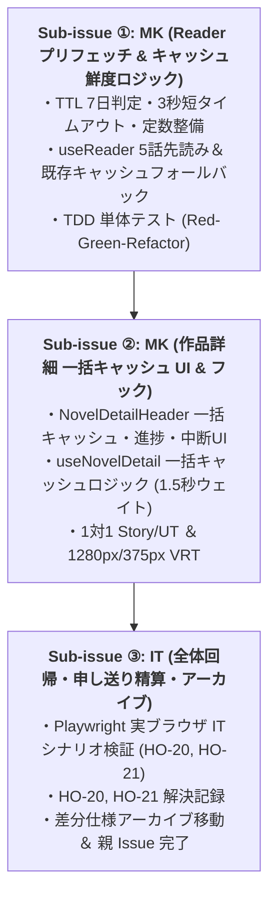

# 差分仕様書：読書中の5話先読み・未取得話一括キャッシュとキャッシュ更新ルール（Issue #81）

本ドキュメントは、Issue #81「`[v0.3] 読書中の5話先読み（プリフェッチ）・未取得話一括キャッシュとキャッシュ更新ルール（TTL 7日間・短タイムアウト）の実装`」に対する差分仕様、影響する App 全体正本の一覧、UT/VRT/IT テスト計画、および実装 Sub-issue 分割計画を定義する設計書です。

---

## 1. 変更の背景・目的（Why）

- **現状の課題（v0.2 までの運用課題）**:
  - 各話を開いた瞬間に未キャッシュ話をオンデマンド取得していたため、次の話へ移動するたびに通信待ち時間（ロードインジケーター表示）が発生していた。
  - 一度取得したキャッシュの更新ルール（いつまで再通信を行わずに即時表示するか、古いキャッシュをいつ再取得するか）が未定義であり、オフライン時や通信不安定時のフォールバック方針も未整理であった。
- **改善目的**:
  - **待ち時間ゼロの快適な読書体験（自動バックグラウンド先読み）**:
    - リーダー画面（`SCR-03`）で現在読んでいる話を開いた際、ユーザーの読書進行を先回りして 5 話先までバックグラウンドで自動取得・SQLite キャッシュし、次話遷移時の通信待ちを排除する。
  - **作品詳細での一括取得（未取得話一括キャッシュ）**:
    - 作品詳細画面（`SCR-02`）のヘッダーに「未取得話を一括キャッシュ」アクションを設け、電波の届かないオフライン環境（地下鉄や飛行機等）に入る前にまとめてダウンロードできるようにする。
  - **確実なレートリミット制御（503 IP BAN 防止）**:
    - カクヨム等の外部小説サーバーに過度な負荷をかけないよう、先読み・一括キャッシュともに **1.5秒間隔** のウェイトを設けて直列取得し、画面離脱・話数移動時には `AbortController` で安全に中断する。
  - **キャッシュ鮮度管理（TTL 7日間 ＋ 短タイムアウトフォールバック）**:
    - 取得から **7日以内** のキャッシュは通信ゼロで即時表示する。
    - 7日経過したキャッシュは最新話への更新を試みるが、**既存キャッシュがある場合は HTTP タイムアウトを 3秒（短タイムアウト）に設定** し、オフラインや通信不安定時でも待たせることなく既存キャッシュ表示へ即時フォールバックさせる。

---

## 2. 要求仕様と設計合意事項（What）

### 2.1 読書中の自動バックグラウンド先読み（5話先まで）

1. **先読みトリガーと対象話数の決定**:
   - リーダー画面（`SCR-03`）で現在読んでいる話（第 $N$ 話）の本文読み込み完了時（初回表示時、および `goToChapter` による前後話遷移時）に自動開始する。
   - 先読み対象は **$N+1 \sim \min(N+5, \text{totalChapters})$** の最大 5 話とする。
   - 先読み順序は昇順（$N+1 \to N+2 \to \dots \to N+5$）とする。
2. **キャッシュ判定とスキップルール（TTL 7日間）**:
   - 各対象話について、SQLite（`chapters`）内に `body_html IS NOT NULL` かつ `downloaded_at` が現在時刻から 7日以内（$7 \times 24 \times 60 \times 60 \times 1000$ ms）のレコードが存在する場合、通信を行わず即座にスキップする。
3. **レートリミット制御（1.5秒ウェイトと開始前インターバル）**:
   - 第 $N$ 話自体の本文読み込み完了（初回表示または次話遷移完了）後、最初の先読み（第 $N+1$ 話）リクエストを開始する前に **1.5秒（1500ms）** の初期インターバルを設ける（第 $N$ 話自体が未キャッシュまたは 7日経過でネットワーク通信された直後の連続リクエストによるサーバー過負荷を防ぐ）。
   - 取得が必要な話数（未キャッシュまたは 7日経過）が存在する場合、以降も 1話の取得完了ごとに **1.5秒（1500ms）** のウェイト間隔を空けて直列実行する。
4. **中断・キャンセル制御（`AbortController`）**:
   - 先読み処理は `AbortController` のシグナル（`signal`）により制御する。
   - 以下のイベント発生時に即座に `abort()` を呼び出し、進行中の通信およびウェイトタイマーを停止する：
     - ユーザーが別の話（第 $M$ 話）へ移動した時（`goToChapter` 実行時）: 直前の先読みをキャンセルし、新話数 $M$ を起点とする 5 話先読みを新たに開始する。
     - リーダー画面から離脱した時（コンポーネントのアンマウント、OS バックキー `TR-06`、下部タブ `TR-01` 等）: 先読みを安全に停止・リソース解放する。
5. **エラー透過性（読書体験の非阻害）**:
   - 先読み中の個別エピソード取得失敗（ネットワークエラー、タイムアウト、パース例外等）が発生しても、リーダー画面にエラー画面（`reader-error`）を表示せず、現在閲覧中の読書体験を阻害しない。

### 2.2 作品詳細画面での「未取得話を一括キャッシュ」

1. **ヘッダーアクション・UI 要素**:
   - 作品詳細ヘッダー（`NovelDetailHeader`）の管理アクションバーに「未取得話を一括キャッシュ」ボタン（`data-testid="batch-cache-button"`）を設置する。
   - 対象作品にエピソードが存在し（`chapters.length > 0`）かつ全話が有効キャッシュ済み（`novel.cachedChapters === novel.totalChapters` かつ全話 7日以内）の場合、ボタンを `disabled` 化しラベルを「全話キャッシュ済み」とする。
   - 作品総話数が 0 話（`novel.totalChapters === 0` または `chapters.length === 0`）の場合、`isAllCached = false` となりボタンを `disabled`（「未取得話を一括キャッシュ」）とする。
2. **実行中の進捗表示と操作ロック**:
   - ボタン押下により一括キャッシュ処理を開始（`isBatchCaching === true`）する。
   - 実行中は進行状況表示（`data-testid="batch-cache-progress"`、例: `キャッシュ中 (3/15)...`）を表示する。
   - 整合性保護のため、実行中は読書開始ボタン（`detail-read-first-button`, `detail-resume-button`）、目次更新ボタン、作品削除ボタン、および各話リストの行タップ操作（`onSelectEpisode`）をすべて `disabled` / 無効化する。
3. **手動中断（キャンセル）制御**:
   - 実行中は「中断」ボタン（`data-testid="batch-cache-cancel-button"`）を表示し、ユーザーが任意のタイミングで処理を停止できるようにする。
   - 画面離脱時（アンマウント時）にも `AbortController` により自動で安全に中断する。
   - 中断時までに取得・保存されたエピソードは SQLite 内に維持され、次回以降の取得ではスキップ対象となる。
4. **レートリミットとリアルタイム画面反映**:
   - 先読みと同様に、1話ごとに **1.5秒（1500ms）** のウェイト間隔を空けて直列実行する。
   - 1話の取得・保存（`saveChapterBody`）が成功するごとに、ヘッダーの取得済み話数（`cachedChapters`）および各話リスト（`EpisodeList`）のキャッシュバッジ（`data-testid="episode-cached-badge"`）を即座に更新する。
5. **完了・中断通知**:
   - 正常完了時はインライン通知（`data-testid="novel-detail-notice"`）に「全話のキャッシュを取得しました」（または「N話のキャッシュを取得しました」）を表示する。
   - 途中でエラー中断した場合はインラインエラー（`data-testid="novel-detail-error"`）に「第X話の取得に失敗したためキャッシュを中断しました」等のメッセージを表示する。

### 2.3 キャッシュ更新・鮮度管理ルール（TTL 7日間 ＋ 短タイムアウトフォールバック）

1. **主要定数（共通モジュール: `src/shared/constants/cache.ts`）**:
   - `CACHE_TTL_MS = 7 * 24 * 60 * 60 * 1000`（7日間 = 604,800,000 ms）
   - `SHORT_TIMEOUT_MS = 3000`（既存キャッシュ存在時の短タイムアウト = 3秒）
   - `STANDARD_TIMEOUT_MS = 10000`（未キャッシュ話等の標準タイムアウト = 10秒）
   - `PREFETCH_INTERVAL_MS = 1500`（先読み・一括キャッシュのレートリミットウェイト = 1.5秒）
   - `PREFETCH_COUNT = 5`（読書中の自動先読み話数 = 5話）
2. **TTL 7日以内のキャッシュ（Fresh Cache）**:
   - `now - downloaded_at < CACHE_TTL_MS` の場合、キャッシュを有効と判定する。
   - リーダー表示時はネットワーク通信を一切行わず、SQLite の本文 HTML を即時表示する。
   - 先読みおよび一括キャッシュでもスキップ対象とする。
3. **7日経過後の古いキャッシュ（Stale Cache）と短タイムアウトフォールバック**:
   - `now - downloaded_at >= CACHE_TTL_MS` かつ `body_html IS NOT NULL` の場合：
     - リーダー閲覧時（`useReader`）:
       - 既存キャッシュを破棄せず、HTTP 通信タイムアウトを **3秒（3000ms）** に設定して最新本文の再取得を試みる。
       - 3秒以内に取得が成功した場合は、新しい本文と現在時刻の `downloaded_at` で DB を更新し、新内容を描画する。
       - 3秒を超過（タイムアウト）した、または通信エラー（オフライン・5xxエラー等）が発生した場合は、**即座に既存キャッシュ本文（`bodyHtml`）を表示へフォールバック** させる。エラー画面は表示せず、ユーザーの読書をブロックしない。
     - 先読みおよび一括キャッシュ時:
       - 同様に 3秒短タイムアウトで取得を試み、失敗時は既存キャッシュをそのまま維持する。
4. **未キャッシュ話（No Cache）**:
   - `body_html IS NULL` の場合：
     - 標準タイムアウト（10秒）で取得を試みる。
     - 取得成功時は DB に保存して描画する。失敗時はフォールバック対象が存在しないため、リーダー画面にエラー（`reader-error`）を表示する。

---

## 3. 影響する App 全体正本と差分仕様詳細

### 3.1 全体要件定義書（`docs/specs/requirements.md`）

- `SYS-REQ-02`（本文取得・先読み・オフライン閲覧）の関連画面 / 遷移列に `TR-18` を、受入条件 ID 欄に `AC-RD-12`, `AC-RD-13`, `AC-ND-11`〜`13` を追記。
- `SYS-REQ-03`（レートリミット・バックグラウンド取得）の関連画面 / 遷移列に `TR-05, TR-06, TR-18` を、受入条件 ID 欄に `AC-RD-12`, `AC-ND-11`, `AC-ND-12` を追記。
- `SYS-REQ-05`（キャッシュ管理・容量整理）に作品詳細での一括キャッシュ（`AC-ND-11`〜`13`）を反映。
- フロントマター `status: "Review (#81)"` および `related_specs` に本差分仕様を追加。

### 3.2 共通アーキテクチャ定義書（`docs/specs/architecture.md`）

- キャッシュ鮮度・更新ポリシー（TTL 7日間、短タイムアウト 3秒、レートリミット 1.5秒、5話先読み）の定数および設計規律を追記（共通モジュール配置先: `src/shared/constants/cache.ts`）。
- 第 $N$ 話本文ロード完了後、初回の先読み（第 $N+1$ 話）リクエスト前にも 1.5秒（1500ms）の初期インターバルを設ける規律を明記。
- `useReader` フック契約にバックグラウンド先読みおよび短タイムアウトフォールバックの責務を明記。
- `useNovelDetail` フック契約に一括キャッシュ（`isBatchCaching`, `batchCacheProgress`, `isAllCached`, `startBatchCache`, `cancelBatchCache`）を追加。

### 3.3 ローカル DB スキーマ定義書（`docs/specs/db-schema.md`）

- `chapters` テーブルの `downloaded_at` カラムの運用規則（TTL 7日判定基準日時、再取得成功時の更新、およびフォールバック制御）を明記。

### 3.4 画面一覧・画面遷移マップ（`docs/specs/screen-transitions.md`）

- `SCR-02`（作品詳細・目次画面）の役割に「未取得話を一括キャッシュ」を追加。
- `SCR-03`（小説リーダー画面）の役割に「読書中5話自動先読み」および「キャッシュTTL 7日間・短タイムアウトフォールバック」を追加。
- 画面遷移 `TR-18`（未取得話の一括キャッシュ：`SCR-02` → `SCR-02`、1.5秒ウェイト順次取得・進捗・手動中断）を新設。
- 画面遷移 `TR-05`, `TR-06` の対応要件 ID に `SYS-REQ-03` を追記して双方向トレーサビリティを整合。
- Mermaid 状態遷移図を `TR-01`〜`TR-18` に拡張。

### 3.5 機能別仕様書：作品詳細・目次画面（`docs/specs/features/novel-detail.md`）

- `NovelDetailHeaderProps` に一括キャッシュ関連 Props を追加：
  - `isBatchCaching?: boolean;`
  - `batchCacheProgress?: { current: number; total: number } | null;`
  - `onStartBatchCache?: () => void;`
  - `onCancelBatchCache?: () => void;`
  - `isAllCached?: boolean;`
- `useNovelDetail` フック戻り値に一括キャッシュ状態・操作を追加：
  - `isBatchCaching: boolean;`
  - `batchCacheProgress: { current: number; total: number } | null;`
  - `isAllCached: boolean;`
  - `startBatchCache: () => Promise<void>;`
  - `cancelBatchCache: () => void;`
- 新規受入条件を追加：
  - `AC-ND-11`: 未取得話の一括キャッシュ実行と進捗表示（レートリミット 1.5秒間隔、各話取得ごとの即時反映）
  - `AC-ND-12`: 一括キャッシュの中断（手動キャンセルおよび画面離脱時の中断安全性の保証）
  - `AC-ND-13`: 全話取得済み時のボタン状態制御（エピソードが存在し全話キャッシュ済み時の disabled 表示、総話数 0 話時の disabled 境界値制御）

### 3.6 機能別仕様書：小説リーダー画面（`docs/specs/features/reader-view.md`）

- `useReader` のエピソード読み込み処理を拡張：
  - 読書中の 5 話自動先読み（1.5秒間隔直列実行、`AbortController` による話数移動・アンマウント時の中断）
  - TTL 7日間チェック（7日以内は通信スキップ）
  - 7日経過キャッシュの 3秒短タイムアウト再取得と既存キャッシュフォールバック
- 新規受入条件を追加：
  - `AC-RD-12`: 読書中の 5 話自動先読み（1.5秒レートリミット、SQLite 直列キャッシュ、話数移動/離脱時の AbortController キャンセル）
  - `AC-RD-13`: キャッシュ鮮度管理（TTL 7日間通信スキップ、7日経過後の 3秒短タイムアウト再取得と既存キャッシュフォールバック）

---

## 4. テスト計画

### 4.1 単体テスト（Unit Tests: Vitest）

- **Storage / Hook ロジック（`useReader.test.ts`）**:
  - 第 $N$ 話表示完了時に、$N+1 \sim N+5$ 話が 1.5秒間隔で順次バックグラウンド取得・DB保存されること。
  - すでに 7日以内のキャッシュが存在する話数は先読み通信がスキップされること。
  - 先読み中に `goToChapter` で別話へ遷移した際、進行中の先読みが中断され、新話数から再開始されること。
  - コンポーネントアンマウント時に先読みが中断され、不要な通信・State 更新が発生しないこと。
  - 7日経過したキャッシュが存在する場合、3秒タイムアウトで再取得を試み、タイムアウト・通信エラー時に既存キャッシュが正常に表示されること（フォールバック）。
  - 未キャッシュ話（初回取得）の通信失敗時は通常通りエラーが通知されること。
- **UI コンポーネント / フック（`useNovelDetail.test.ts`, `NovelDetailHeader.test.tsx`, `NovelDetailPage.test.tsx`）**:
  - 全話キャッシュ済みのとき「全話キャッシュ済み」ボタンが disabled 表示されること。
  - 未取得話があるとき「未取得話を一括キャッシュ」ボタンが有効表示されること。
  - ボタン押下で 1.5秒間隔の直列取得が開始され、進捗（X/Y）が表示されること。
  - 1話取得完了ごとに取得済み話数・バッジがリアルタイム更新されること。
  - 「中断」ボタン押下、またはアンマウント時に処理が即時停止し、取得済み話数が保持されること。
  - 全話完了時に通知メッセージが表示されること。

### 4.2 ビジュアル回帰テスト（VRT: Playwright / Storybook）

- `NovelDetailHeader.stories.tsx`:
  - 通常状態（未取得話あり）
  - 一括キャッシュ実行中（進捗表示 ＋ 中断ボタン）
  - 全話キャッシュ済み状態（disabled）
- 1280px（デスクトップ）および 375px（モバイル）の双方でスナップショットを検証。

### 4.3 結合テスト（Integration Tests: Playwright 実ブラウザ）

- `SCN-01` / `SCN-02`:
  - リーダー画面で第1話を表示後、自動先読みにより第2話〜第5話が SQLite に保存され、第2話へ遷移した際にロード待機なく即時表示されること（`HO-20`）。
  - 作品詳細画面で「未取得話を一括キャッシュ」を実行し、各話リストのバッジが順次「取得済み」へ切り替わること（`HO-21`）。
  - オフライン環境（またはモック通信遮断）下で 7日経過キャッシュを開いた際、3秒後に既存キャッシュで読書画面が表示されること（`HO-21`）。

---

## 5. 後続 MK / IT Sub-issue 分割案（直列推進）

推奨粒度（1 PR = 200〜400行）に基づき、以下の 3 つの Sub-issue に分割して直列に推進します。

1. **Sub-issue ①: MK（読書中5話自動先読みロジックとキャッシュ鮮度・フォールバック機能の実装）**:
   - キャッシュ鮮度定数（`CACHE_TTL_MS`, `SHORT_TIMEOUT_MS`, `STANDARD_TIMEOUT_MS`, `PREFETCH_INTERVAL_MS`, `PREFETCH_COUNT`）の定義
   - `useReader` への 5話自動先読み（1.5秒レートリミット、`AbortController` 話数移動/離脱制御）の実装
   - 7日経過キャッシュの 3秒短タイムアウト再取得と既存キャッシュフォールバック処理の実装
   - `useReader.test.ts` TDD（Red-Green-Refactor コミット）
2. **Sub-issue ②: MK（作品詳細での未取得話一括キャッシュ UI およびフック機能の実装）**:
   - `NovelDetailHeader` への「未取得話を一括キャッシュ」ボタン、進捗表示、中断ボタンの追加
   - `useNovelDetail` への一括キャッシュ処理（1.5秒レートリミット、リアルタイム画面反映、手動/アンマウント中断）の実装
   - `NovelDetailHeader.stories.tsx` / `NovelDetailPage.stories.tsx` の Story 追加
   - Portable Stories 単体テストおよび 1280px / 375px VRT 更新
3. **Sub-issue ③: IT（実ブラウザ結合テスト拡充・申し送り精算・差分仕様アーカイブ）**:
   - Playwright 実ブラウザ結合テスト（先読み即時表示、一括キャッシュ、短タイムアウトフォールバック）の追加・全件 PASS 確認
   - 申し送り事項 `HO-20`, `HO-21` の精算（`Resolved`）
   - 差分仕様書の `Completed (Archived)` 更新および `docs/specs/changes/archive/` への `git mv` 移動
   - 親 Issue #81 の同期クローズ（`Closes #81`）

---

## 6. 申し送り事項（Handover Items）

本差分仕様の策定に伴い、以下の申し送り事項を [docs/quality/bug-and-handover-log.md](../../quality/bug-and-handover-log.md) に登録します。

|   ID    | 内容                                                                                                                                                                               | 解決先（対象 Issue / 成果物） | 完了ゲート          | 状態   |
| :-----: | :--------------------------------------------------------------------------------------------------------------------------------------------------------------------------------- | :---------------------------- | :------------------ | :----- |
| `HO-20` | 読書中の5話自動先読み（1.5秒レートリミット、SQLite 直列キャッシュ、話数移動/離脱時の AbortController キャンセル）に関する Playwright 実ブラウザ IT シナリオ検証                    | Issue #81 Sub-issue ③ (IT PR) | Issue #81 PR マージ | `Open` |
| `HO-21` | 作品詳細での未取得話一括キャッシュ（1.5秒レートリミット・進捗表示・手動中断）およびキャッシュ TTL 7日間/短タイムアウトフォールバックに関する Playwright 実ブラウザ IT シナリオ検証 | Issue #81 Sub-issue ③ (IT PR) | Issue #81 PR マージ | `Open` |
