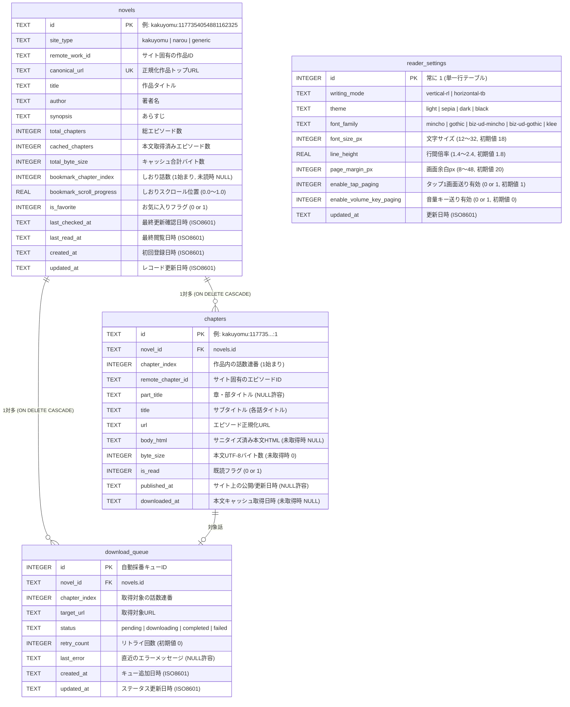

# ローカル DB スキーマ定義（App 全体正本）

## 1. 概要・設計方針

数千話規模の連載 Web 小説の目次・本文 HTML キャッシュ・しおり位置・ダウンロードキューを高速かつオフラインで扱うため、SQLite（Android 実機では `@capacitor-community/sqlite`、テスト・Web 環境では同一スキーマ契約に従うインメモリ DB）を採用します。

- **文字コード**: UTF-8
- **日時フォーマット**: ISO 8601 UTC 文字列（例: `2026-10-25T07:30:00.000Z`）
- **真偽値（Boolean）**: SQLite の仕様に合わせ `INTEGER`（`0` = false, `1` = true）で保持する。
- **外部キー制約**: `PRAGMA foreign_keys = ON;` を有効化し、作品（`novels`）削除時に関連エピソード（`chapters`）およびキュー（`download_queue`）を `ON DELETE CASCADE` で自動削除する。

---

## 2. ER 図（テーブル関連図）



---

## 3. 各テーブル詳細定義（DDL 正本）

### 3.1 `novels` テーブル（登録作品・しおり・集計キャッシュ）

作品のメタデータ、現在のしおり位置、および本棚画面（`SCR-01`）を高速描画するためのエピソード数・キャッシュ容量集計値を保持します。

```sql
CREATE TABLE IF NOT EXISTS novels (
  id TEXT PRIMARY KEY,                              -- "{site_type}:{remote_work_id}"
  site_type TEXT NOT NULL,                          -- 'kakuyomu' | 'narou' | 'generic'
  remote_work_id TEXT NOT NULL,                     -- カクヨムworkId / なろうncode 等
  canonical_url TEXT NOT NULL UNIQUE,               -- 正規化された作品トップURL
  title TEXT NOT NULL,                              -- 作品タイトル
  author TEXT NOT NULL DEFAULT '',                  -- 著者名
  synopsis TEXT NOT NULL DEFAULT '',                -- あらすじ
  total_chapters INTEGER NOT NULL DEFAULT 0,        -- 総話数
  cached_chapters INTEGER NOT NULL DEFAULT 0,       -- 本文取得済み話数
  total_byte_size INTEGER NOT NULL DEFAULT 0,       -- キャッシュ済み本文の合計サイズ(Byte)
  bookmark_chapter_index INTEGER,                   -- しおり位置の話数連番 (1始まり、未設定は NULL)
  bookmark_scroll_progress REAL NOT NULL DEFAULT 0, -- しおり位置のスクロール率 (0.0 〜 1.0)
  is_favorite INTEGER NOT NULL DEFAULT 0,           -- お気に入り (0 or 1)
  last_checked_at TEXT,                             -- 最終更新確認日時 (ISO 8601)
  last_read_at TEXT,                                -- 最終閲覧日時 (ISO 8601)
  created_at TEXT NOT NULL,                         -- 登録日時 (ISO 8601)
  updated_at TEXT NOT NULL                          -- 更新日時 (ISO 8601)
);

CREATE INDEX IF NOT EXISTS idx_novels_last_read_at ON novels(last_read_at DESC);
```

### 3.2 `chapters` テーブル（各話目次・本文 HTML キャッシュ）

目次取得時は `body_html = NULL`, `byte_size = 0` でレコードを作成し、本文ダウンロード完了時にサニタイズ済み HTML と `byte_size`, `downloaded_at` を保存します。各話の一意性は `(novel_id, remote_chapter_id)` で保証されるため、連載途中でエピソードが挿入・削除されて `chapter_index` がずれた場合でも、本文キャッシュが別話へ誤って引き継がれることなく安全に維持されます。キャッシュ削除時は目次情報を残したまま `body_html = NULL`, `byte_size = 0`, `downloaded_at = NULL` に更新します（既読フラグ `is_read` は維持）。

```sql
CREATE TABLE IF NOT EXISTS chapters (
  id TEXT PRIMARY KEY,                              -- "{novel_id}:{remote_chapter_id}"
  novel_id TEXT NOT NULL,                           -- novels.id
  chapter_index INTEGER NOT NULL,                   -- 1始まりの話数連番
  remote_chapter_id TEXT NOT NULL,                  -- サイト固有のエピソードID
  part_title TEXT,                                  -- 章・部タイトル（ない場合は NULL）
  title TEXT NOT NULL,                              -- サブタイトル（各話タイトル）
  url TEXT NOT NULL,                                -- エピソードURL
  body_html TEXT,                                   -- サニタイズ済み本文HTML（未取得時は NULL）
  byte_size INTEGER NOT NULL DEFAULT 0,             -- UTF-8 バイトサイズ（未取得時は 0）
  is_read INTEGER NOT NULL DEFAULT 0,               -- 既読フラグ (0 or 1)
  published_at TEXT,                                -- 公開・更新日時
  downloaded_at TEXT,                               -- 本文キャッシュ取得日時（未取得時は NULL）
  FOREIGN KEY (novel_id) REFERENCES novels(id) ON DELETE CASCADE,
  UNIQUE (novel_id, remote_chapter_id)
);

CREATE INDEX IF NOT EXISTS idx_chapters_novel_index ON chapters(novel_id, chapter_index ASC);
```

### 3.3 `download_queue` テーブル（バックグラウンド DL キュー：`v0.2`〜）

複数話一括取得時のレートリミット制御（1.5秒ウェイト）と中断・再開・リトライを管理します。

```sql
CREATE TABLE IF NOT EXISTS download_queue (
  id INTEGER PRIMARY KEY AUTOINCREMENT,
  novel_id TEXT NOT NULL,
  chapter_index INTEGER NOT NULL,
  target_url TEXT NOT NULL,
  status TEXT NOT NULL DEFAULT 'pending',           -- 'pending' | 'downloading' | 'completed' | 'failed'
  retry_count INTEGER NOT NULL DEFAULT 0,
  last_error TEXT,
  created_at TEXT NOT NULL,
  updated_at TEXT NOT NULL,
  FOREIGN KEY (novel_id) REFERENCES novels(id) ON DELETE CASCADE,
  UNIQUE (novel_id, chapter_index)
);

CREATE INDEX IF NOT EXISTS idx_download_queue_status ON download_queue(status, id ASC);
```

### 3.4 `reader_settings` テーブル（リーダー表示・操作設定）

アプリ全体のリーダー組版・テーマ設定を保持する単一行（`id = 1`）テーブルです。スキーマ初期化（`initializeDatabaseSchema`）時に自動的に初期行（`id = 1`）が挿入され、常に安全に読み出し・更新が可能です。

```sql
CREATE TABLE IF NOT EXISTS reader_settings (
  id INTEGER PRIMARY KEY CHECK (id = 1),
  writing_mode TEXT NOT NULL DEFAULT 'vertical-rl', -- 'vertical-rl' | 'horizontal-tb'
  theme TEXT NOT NULL DEFAULT 'light',              -- 'light' | 'sepia' | 'dark' | 'black'
  font_family TEXT NOT NULL DEFAULT 'biz-ud-mincho',-- 'mincho' | 'gothic' | 'biz-ud-mincho' | 'biz-ud-gothic' | 'klee'
  font_size_px INTEGER NOT NULL DEFAULT 18,         -- 12 〜 32
  line_height REAL NOT NULL DEFAULT 1.8,            -- 1.4 〜 2.4
  page_margin_px INTEGER NOT NULL DEFAULT 20,       -- 8 〜 48
  enable_tap_paging INTEGER NOT NULL DEFAULT 1,     -- 0 or 1
  enable_volume_key_paging INTEGER NOT NULL DEFAULT 0, -- 0 or 1
  updated_at TEXT NOT NULL
);

INSERT OR IGNORE INTO reader_settings (
  id, writing_mode, theme, font_family, font_size_px, line_height, page_margin_px, enable_tap_paging, enable_volume_key_paging, updated_at
) VALUES (
  1, 'vertical-rl', 'light', 'biz-ud-mincho', 18, 1.8, 20, 1, 0, '2026-01-01T00:00:00.000Z'
);
```
