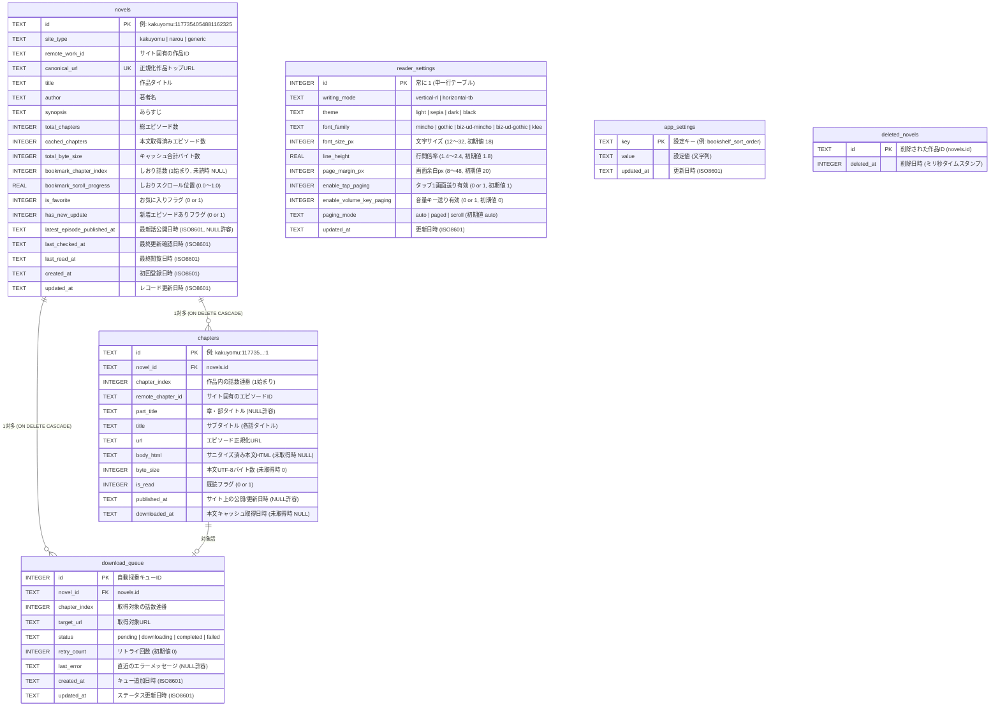

# ローカル DB スキーマ定義（App 全体正本）

## 1. 概要・設計方針

数千話規模の連載 Web 小説の目次・本文 HTML キャッシュ・しおり位置・ダウンロードキューを高速かつオフラインで扱うため、SQLite（Android 実機では `@capacitor-community/sqlite`、テスト・Web 環境では同一スキーマ契約に従うインメモリ DB）を採用します。

- **文字コード**: UTF-8
- **日時フォーマット**: ISO 8601 UTC 文字列（例: `2026-10-25T07:30:00.000Z`）
- **真偽値（Boolean）**: SQLite の仕様に合わせ `INTEGER`（`0` = false, `1` = true）で保持する。
- **外部キー制約**: `PRAGMA foreign_keys = ON;` を有効化し、作品（`novels`）削除時に関連エピソード（`chapters`）およびキュー（`download_queue`）を `ON DELETE CASCADE` で自動削除する。

---

## 2. ER 図（テーブル関連図）



---

## 3. 各テーブル詳細定義（DDL 正本）

### 3.1 `novels` テーブル（登録作品・しおり・集計キャッシュ）

作品のメタデータ、現在のしおり位置、および本棚画面（`SCR-01`）を高速描画するためのエピソード数・キャッシュ容量集計値を保持します。

- **`has_new_update`**: 目次更新（自動更新チェックまたは手動更新）時に話数増加・新規エピソード追加が検知された場合に `1`（NEWバッジ表示）が記録され、作品閲覧時（`SCR-02` または `SCR-03` 表示時）に `0` へ解除されます。
- **`latest_episode_published_at`**: `upsertNovelWithToc` 実行時に `index.chapters` 内の各エピソードのうち有効な `publishedAt` の最大値（最新公開/更新日時）を算出し、ISO 8601 UTC 文字列（例: `2026-01-01T20:00:00.000Z`）に正規化して保持します（サイトごとのタイムゾーン表記揺れによる文字列ソート誤差を防止）。全エピソード未設定時は `NULL` となります。本カラムにより、ソート順「作品更新日順（`latest_published`）」において `chapters` テーブルとの結合なしで高速にソートクエリを実行可能です。

```sql
CREATE TABLE IF NOT EXISTS novels (
  id TEXT PRIMARY KEY,                              -- "{site_type}:{remote_work_id}"
  site_type TEXT NOT NULL,                          -- 'kakuyomu' | 'narou' | 'generic'
  remote_work_id TEXT NOT NULL,                     -- カクヨムworkId / なろうncode 等
  canonical_url TEXT NOT NULL UNIQUE,               -- 正規化された作品トップURL
  title TEXT NOT NULL,                              -- 作品タイトル
  author TEXT NOT NULL DEFAULT '',                  -- 著者名
  synopsis TEXT NOT NULL DEFAULT '',                -- あらすじ
  total_chapters INTEGER NOT NULL DEFAULT 0,        -- 総話数
  cached_chapters INTEGER NOT NULL DEFAULT 0,       -- 本文取得済み話数
  total_byte_size INTEGER NOT NULL DEFAULT 0,       -- キャッシュ済み本文の合計サイズ(Byte)
  bookmark_chapter_index INTEGER,                   -- しおり位置の話数連番 (1始まり、未設定は NULL)
  bookmark_scroll_progress REAL NOT NULL DEFAULT 0, -- しおり位置のスクロール率 (0.0 〜 1.0)
  is_favorite INTEGER NOT NULL DEFAULT 0,           -- お気に入り (0 or 1)
  has_new_update INTEGER NOT NULL DEFAULT 0,        -- 新着エピソードありフラグ (0 or 1)
  latest_episode_published_at TEXT,                 -- 最新話公開/更新日時 (ISO 8601)
  last_checked_at TEXT,                             -- 最終更新確認日時 (ISO 8601)
  last_read_at TEXT,                                -- 最終閲覧日時 (ISO 8601)
  created_at TEXT NOT NULL,                         -- 登録日時 (ISO 8601)
  updated_at TEXT NOT NULL                          -- 更新日時 (ISO 8601)
);

CREATE INDEX IF NOT EXISTS idx_novels_last_read_at ON novels(last_read_at DESC);
CREATE INDEX IF NOT EXISTS idx_novels_has_new_update ON novels(has_new_update DESC);
CREATE INDEX IF NOT EXISTS idx_novels_latest_published ON novels(latest_episode_published_at DESC);
CREATE INDEX IF NOT EXISTS idx_novels_created_at ON novels(created_at DESC);
CREATE INDEX IF NOT EXISTS idx_novels_title ON novels(title COLLATE NOCASE ASC);
```

### 3.2 `chapters` テーブル（各話目次・本文 HTML キャッシュ）

目次取得時は `body_html = NULL`, `byte_size = 0` でレコードを作成し、本文ダウンロード完了時にサニタイズ済み HTML と `byte_size`, `downloaded_at` を保存します。各話の一意性は `(novel_id, remote_chapter_id)` で保証されるため、連載途中でエピソードが挿入・削除されて `chapter_index` がずれた場合でも、本文キャッシュが別話へ誤って引き継がれることなく安全に維持されます。キャッシュ削除時は目次情報を残したまま `body_html = NULL`, `byte_size = 0`, `downloaded_at = NULL` に更新します（既読フラグ `is_read` は維持）。

なお、`downloaded_at` はキャッシュ鮮度管理（TTL 7日間判定：`now - downloaded_at < 7 days` での通信スキップ、7日経過後の 3秒短タイムアウト再取得と既存キャッシュフォールバック）の判定基準日時として利用されます（`v0.3` Issue #81）。

```sql
CREATE TABLE IF NOT EXISTS chapters (
  id TEXT PRIMARY KEY,                              -- "{novel_id}:{remote_chapter_id}"
  novel_id TEXT NOT NULL,                           -- novels.id
  chapter_index INTEGER NOT NULL,                   -- 1始まりの話数連番
  remote_chapter_id TEXT NOT NULL,                  -- サイト固有のエピソードID
  part_title TEXT,                                  -- 章・部タイトル（ない場合は NULL）
  title TEXT NOT NULL,                              -- サブタイトル（各話タイトル）
  url TEXT NOT NULL,                                -- エピソードURL
  body_html TEXT,                                   -- サニタイズ済み本文HTML（未取得時は NULL）
  byte_size INTEGER NOT NULL DEFAULT 0,             -- UTF-8 バイトサイズ（未取得時は 0）
  is_read INTEGER NOT NULL DEFAULT 0,               -- 既読フラグ (0 or 1)
  published_at TEXT,                                -- 公開・更新日時
  downloaded_at TEXT,                               -- 本文キャッシュ取得日時（未取得時は NULL）
  FOREIGN KEY (novel_id) REFERENCES novels(id) ON DELETE CASCADE,
  UNIQUE (novel_id, remote_chapter_id)
);

CREATE INDEX IF NOT EXISTS idx_chapters_novel_index ON chapters(novel_id, chapter_index ASC);
```

### 3.3 `download_queue` テーブル（バックグラウンド DL キュー：`v0.3`〜）

複数話一括取得時のレートリミット制御（1.5秒ウェイト）と中断・再開・リトライを管理します。

```sql
CREATE TABLE IF NOT EXISTS download_queue (
  id INTEGER PRIMARY KEY AUTOINCREMENT,
  novel_id TEXT NOT NULL,
  chapter_index INTEGER NOT NULL,
  target_url TEXT NOT NULL,
  status TEXT NOT NULL DEFAULT 'pending',           -- 'pending' | 'downloading' | 'completed' | 'failed'
  retry_count INTEGER NOT NULL DEFAULT 0,
  last_error TEXT,
  created_at TEXT NOT NULL,
  updated_at TEXT NOT NULL,
  FOREIGN KEY (novel_id) REFERENCES novels(id) ON DELETE CASCADE,
  UNIQUE (novel_id, chapter_index)
);

CREATE INDEX IF NOT EXISTS idx_download_queue_status ON download_queue(status, id ASC);
```

### 3.4 `reader_settings` テーブル（リーダー表示・操作設定）

アプリ全体のリーダー組版・テーマ設定を保持する単一行（`id = 1`）テーブルです。スキーマ初期化（`initializeDatabaseSchema`）時に自動的に初期行（`id = 1`）が挿入され、常に安全に読み出し・更新が可能です。

```sql
CREATE TABLE IF NOT EXISTS reader_settings (
  id INTEGER PRIMARY KEY CHECK (id = 1),
  writing_mode TEXT NOT NULL DEFAULT 'vertical-rl', -- 'vertical-rl' | 'horizontal-tb'
  theme TEXT NOT NULL DEFAULT 'light',              -- 'light' | 'sepia' | 'dark' | 'black'
  font_family TEXT NOT NULL DEFAULT 'biz-ud-mincho',-- 'mincho' | 'gothic' | 'biz-ud-mincho' | 'biz-ud-gothic' | 'klee'
  font_size_px INTEGER NOT NULL DEFAULT 18,         -- 12 〜 32
  line_height REAL NOT NULL DEFAULT 1.8,            -- 1.4 〜 2.4
  page_margin_px INTEGER NOT NULL DEFAULT 20,       -- 8 〜 48
  enable_tap_paging INTEGER NOT NULL DEFAULT 1,     -- 0 or 1
  enable_volume_key_paging INTEGER NOT NULL DEFAULT 0, -- 0 or 1
  paging_mode TEXT NOT NULL DEFAULT 'auto' CHECK (paging_mode IN ('auto', 'paged', 'scroll')), -- 'auto' | 'paged' | 'scroll' (v0.4 Issue #122)
  updated_at TEXT NOT NULL
);

INSERT OR IGNORE INTO reader_settings (
  id, writing_mode, theme, font_family, font_size_px, line_height, page_margin_px, enable_tap_paging, enable_volume_key_paging, paging_mode, updated_at
) VALUES (
  1, 'vertical-rl', 'light', 'biz-ud-mincho', 18, 1.8, 20, 1, 0, 'auto', '2026-01-01T00:00:00.000Z'
);
```

### 3.5 `app_settings` テーブル（汎用アプリケーション設定・本棚ソート順）

本棚のソート順や各種アプリ全体状態をキー・バリュー形式で柔軟に永続化する設定テーブルです。スキーマ初期化時に本棚デフォルトソート順（`bookshelf_sort_order = 'unread_first'`）が登録されます。

```sql
CREATE TABLE IF NOT EXISTS app_settings (
  key TEXT PRIMARY KEY,                             -- 設定識別子キー
  value TEXT NOT NULL,                              -- 設定値文字列
  updated_at TEXT NOT NULL                          -- 更新日時 (ISO 8601)
);

INSERT OR IGNORE INTO app_settings (
  key, value, updated_at
) VALUES (
  'bookshelf_sort_order', 'unread_first', '2026-01-01T00:00:00.000Z'
);
```

#### 本棚ソート順キー仕様（`key: 'bookshelf_sort_order'`）

| 値 (`value`)       | ソート種別                           | 並び順（SQL `ORDER BY` 契約）                                                                                                                 |
| :----------------- | :----------------------------------- | :-------------------------------------------------------------------------------------------------------------------------------------------- |
| `unread_first`     | 更新あり優先＋最近読んだ順（既定値） | `novels.has_new_update DESC, CASE WHEN novels.last_read_at IS NOT NULL THEN 0 ELSE 1 END, novels.last_read_at DESC, novels.created_at DESC`   |
| `last_read`        | 最近読んだ順                         | `CASE WHEN novels.last_read_at IS NOT NULL THEN 0 ELSE 1 END, novels.last_read_at DESC, novels.created_at DESC`                               |
| `latest_published` | 作品更新日順                         | `CASE WHEN novels.latest_episode_published_at IS NOT NULL THEN 0 ELSE 1 END, novels.latest_episode_published_at DESC, novels.updated_at DESC` |
| `created_at`       | 登録日順                             | `novels.created_at DESC`                                                                                                                      |
| `title`            | タイトル順                           | `novels.title COLLATE NOCASE ASC`                                                                                                             |

#### クラウド同期設定キー仕様（v0.4 新設: Issue #120）

| キー名 (`key`)              | 設定値の意味                                         | 例 / 初期状態                              |
| :-------------------------- | :--------------------------------------------------- | :----------------------------------------- |
| `cloud_sync_last_synced_at` | 最終同期完了日時（ミリ秒タイムスタンプ文字列）       | `'1730376000000'`（未同期 NULL/未登録）    |
| `cloud_sync_account_email`  | 連携中の Google アカウントのメールアドレス（表示用） | `'user@example.com'`（未連携 NULL/未登録） |

---

### 3.6 `deleted_novels` テーブル（削除済み作品の Tombstone 追跡：v0.4〜）

複数端末間でのクラウド同期（Google Drive `appDataFolder`、Issue #120）において、端末 A で削除された作品が端末 B で再度復活してしまう現象を防止するため、ローカルで削除された作品 ID と削除日時（`deleted_at`）を Tombstone として記録・保持するテーブルです。

- **記録契機**: `novelRepository.deleteNovel(novelId)` 呼び出し時に、該当 ID と現在時刻（ミリ秒タイムスタンプ `Date.now()`）を本テーブルへ `INSERT OR REPLACE` します。
- **同期同期連携**: 次回 Push 時に、本テーブルの全レコードをリモートの `yommy-sync-state.json` 内 `deletedNovels` マップへ結合します。Pull 時には、リモート `deletedNovels` の削除日時がローカル作品の登録/更新日時より新しい場合にローカル作品をカスケード削除し、本テーブルにも反映します。

```sql
CREATE TABLE IF NOT EXISTS deleted_novels (
  id TEXT PRIMARY KEY,                             -- 削除された作品ID (novels.id)
  deleted_at INTEGER NOT NULL                      -- 削除日時 (ミリ秒タイムスタンプ)
);

CREATE INDEX IF NOT EXISTS idx_deleted_novels_deleted_at ON deleted_novels(deleted_at DESC);
```

---

### 3.7 スキーママイグレーション方針（v0.2 / v0.3 からの移行）

既存データベース（v0.3 以前）に対して `initializeDatabaseSchema` が呼び出された場合：

1. `PRAGMA table_info(novels)` を参照し、`has_new_update` および `latest_episode_published_at` カラムが存在しない場合に `ALTER TABLE novels ADD COLUMN ...` を実行して既存データを保持したままカラムを追加します。
2. `PRAGMA table_info(reader_settings)` を参照し、`paging_mode` カラムが存在しない場合に `ALTER TABLE reader_settings ADD COLUMN paging_mode TEXT NOT NULL DEFAULT 'auto' CHECK (paging_mode IN ('auto', 'paged', 'scroll'));` を実行して既存設定を維持したまま追加します（`v0.4` Issue #122）。
3. `CREATE TABLE IF NOT EXISTS app_settings` および `CREATE TABLE IF NOT EXISTS deleted_novels` を実行し、新規テーブルおよびインデックスを追加作成します。

これにより、v0.2 / v0.3 からのバージョンアップ時でも既存の作品データ・キャッシュ・しおり位置を完全に維持したまま安全にスキーマ移行が完了します。
