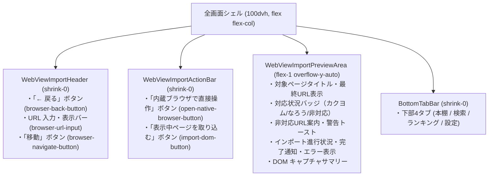
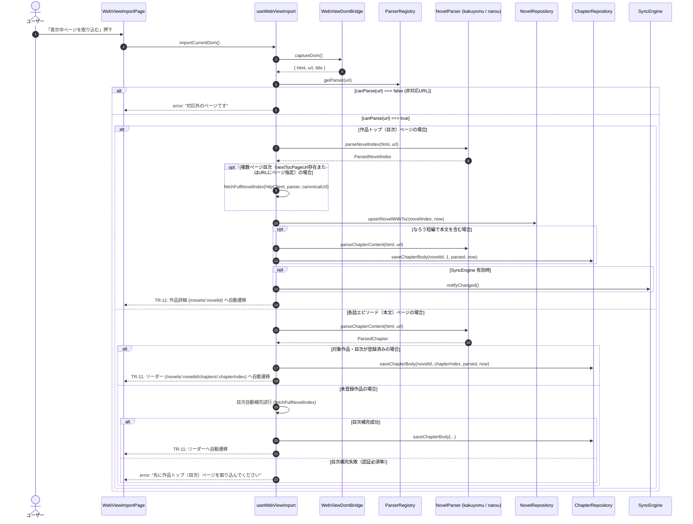

# 内蔵ブラウザ・DOMインポート画面仕様書（SCR-04）

本ドキュメントは、対象小説サイトの DOM 構造変更時、Cloudflare 等の Bot 対策認証時、またはログイン必須ページに直面した際、人間が内蔵 WebView で直接ページを開いて閲覧・認証操作を行い、表示中の DOM（HTML 文字列・最終 URL）を手動でキャプチャしてローカルキャッシュ DB（SQLite）へ取り込み、読書を再開する **内蔵ブラウザ・DOMインポート画面（`SCR-04`: ルート `/browser?url=...`）** の正本（Single Source of Truth）です。

---

## 1. 概要・スコープ

- **対象画面**: 内蔵ブラウザ・DOMインポート画面（`SCR-04`、ルートパス `/browser`、クエリパラメータ `url`, `novelId`, `chapterIndex`）
- **対応要件**:
  - `SYS-REQ-13`（アプリ内ブラウザ表示：対象サイトの DOM 構造変更時や Cloudflare 等の Bot 対策時・ログイン必須ページに対応するため、該当 URL を内蔵 WebView で直接開いて閲覧・認証操作できる）
  - `SYS-REQ-14`（WebView 表示中 DOM インポート：内蔵 WebView で人間がページを開いた状態で、表示中の DOM をキャプチャして Parser Layer へ渡し、作品目次または各話本文をローカルキャッシュ DB へ保存して閲覧を即座に再開できる）
  - `SYS-REQ-16`（全画面シェル・下部タブ・論理階層遷移：100dvh 全画面シェル内配置、固定操作バー＋プレビュー/ステータス領域、下部 4 タブバー連携、OS バックキー論理階層復帰）
  - `SYS-REQ-20`（下部 4 タブナビゲーションおよび直前画面［`SCR-02` / `SCR-03` / 本棚 `/`］への論理復帰）
- **関連画面遷移**:
  - `TR-01`（下部タブバーによる 4 画面「本棚 `/`」「検索 `/search`」「ランキング `/ranking`」「設定 `/settings`」相互切替）
  - `TR-01b`（下部タブバーの「本棚」タブタップによる本棚画面 `SCR-01` `/` へのダイレクト遷移）
  - `TR-09`（作品詳細画面 `SCR-02` の3点メニュー内の「内蔵ブラウザで開く」ボタン押下による `SCR-04` への遷移）
  - `TR-10`（小説リーダー画面 `SCR-03` の本文取得エラー画面「内蔵ブラウザで開いて取り込む」ボタン押下による `SCR-04` へのフォールバック遷移）
  - `TR-11`（`SCR-04` での DOM インポート完了後、保存対象に応じた作品詳細画面 `SCR-02` または小説リーダー画面 `SCR-03` への遷移）
  - `TR-12`（ヘッダーの「← 戻る」ボタンまたは Android OS バックキー操作による直前の遷移元［`SCR-02` / `SCR-03`、未指定時は本棚 `/`］への論理復帰）

---

## 2. 画面レイアウトと UI コンポーネント構成

`SCR-04` は 100dvh 全画面シェル（`h-full flex flex-col overflow-hidden`）内に配置され、上部 URL 操作バー、主要アクションバー、中央プレビュー/ステータス表示領域、および画面下部の共通 4 タブバー（`BottomTabBar`）で構成されます。



### 2.1 コンポーネントツリーと Props / TestID 規約

1. **`WebViewImportContainer` (`src/features/webview-import/components/WebViewImportContainer.tsx`)**:
   - ルータークエリ（`url`, `novelId`, `chapterIndex`）および遷移履歴コンテキスト（`browserOrigin`）を受け取り、`ServiceProvider` から注入された `webViewDomBridge`, `novelRepository`, `chapterRepository`, `parserRegistry`, `syncEngine` を `useWebViewImport` へ接続する。
   - インポート成功時（`onImportSuccess`）に `TR-11`（作品詳細 `/novels/:novelId` またはリーダー `/novels/:novelId/chapters/:chapterIndex`）へルーティングする。
   - 「← 戻る」押下時（`onBack`）に `TR-12`（直前画面または本棚 `/`）へルーティングする。

| プロパティ名      | 型                                      | 必須/任意 | 説明                                                            |
| :---------------- | :-------------------------------------- | :-------: | :-------------------------------------------------------------- |
| `initialUrl`      | `string`                                |   任意    | 初期表示対象の Web 小説 URL（クエリ `url` 経由）                |
| `novelId`         | `string`                                |   任意    | 関連付けられた作品 ID（クエリ `novelId` 経由）                  |
| `chapterIndex`    | `number`                                |   任意    | 関連付けられたエピソード話数番号（クエリ `chapterIndex` 経由）  |
| `activeTab`       | `BottomTab`                             |   任意    | 下部 4 タブバーのアクティブタブ（デフォルト: `"bookshelf"`）    |
| `onBack`          | `() => void`                            |   任意    | 戻るボタン押下時のカスタムハンドラ（省略時は `router.back()`）  |
| `onImportSuccess` | `(result: ImportSuccessResult) => void` |   任意    | インポート成功時のカスタムハンドラ（省略時は `TR-11` 自動遷移） |

2. **`WebViewImportPage` (`src/features/webview-import/components/WebViewImportPage.tsx`)**:
   - `WebViewImportContainer` からステート・コールバックを受け取って UI を描画するプレゼンテーショナルコンポーネント。

| プロパティ名          | 型                            | 必須/任意 | 説明                                                             |
| :-------------------- | :---------------------------- | :-------: | :--------------------------------------------------------------- |
| `url`                 | `string`                      |   必須    | URL 入力バーの表示値                                             |
| `pageTitle`           | `string`                      |   必須    | 読み込み中・表示中ページのタイトル                               |
| `currentCapturedUrl`  | `string`                      |   必須    | 最終キャプチャ完了 URL                                           |
| `canImport`           | `boolean`                     |   必須    | 取り込み可能判定（パーサー適合 URL かつ `isChapter` または目次） |
| `isLoading`           | `boolean`                     |   必須    | 読み込み中ローディング状態                                       |
| `isImporting`         | `boolean`                     |   必須    | DOM インポート処理中状態                                         |
| `notice`              | `string \| null`              |   必須    | 成功通知メッセージ（表示なし時は `null`）                        |
| `error`               | `string \| null`              |   必須    | エラーメッセージ（表示なし時は `null`）                          |
| `activeTab`           | `BottomTab`                   |   任意    | 下部タブバーのアクティブタブ                                     |
| `onUrlChange`         | `(url: string) => void`       |   必須    | URL 入力テキストボックスの入力変更ハンドラ                       |
| `onNavigateUrl`       | `() => void \| Promise<void>` |   必須    | 「移動」ボタン押下ハンドラ                                       |
| `onOpenNativeBrowser` | `() => void \| Promise<void>` |   必須    | 「内蔵ブラウザで直接操作」ボタン押下ハンドラ                     |
| `onImportCurrentDom`  | `() => void \| Promise<void>` |   必須    | 「表示中ページを取り込む」ボタン押下ハンドラ                     |
| `onBack`              | `() => void`                  |   必須    | ヘッダーの「← 戻る」ボタン押下ハンドラ                           |
| `onSelectBookshelf`   | `() => void`                  |   任意    | 下部タブ 本棚 選択ハンドラ                                       |
| `onSelectSearch`      | `() => void`                  |   任意    | 下部タブ 検索 選択ハンドラ                                       |
| `onSelectRanking`     | `() => void`                  |   任意    | 下部タブ ランキング 選択ハンドラ                                 |
| `onSelectSettings`    | `() => void`                  |   任意    | 下部タブ 設定 選択ハンドラ                                       |

- **主要要素と `data-testid`**:
  - `data-testid="webview-import-page"`: 画面全体のルートコンテナ（`role="main"`）。
  - `data-testid="browser-back-button"`: ヘッダー左端の「← 戻る」ボタン（`aria-label="戻る"`）。
  - `data-testid="browser-url-input"`: URL 表示および手動入力テキストボックス（`input type="url"`）。
  - `data-testid="browser-navigate-button"`: URL 移動ボタン（「移動」）。
  - `data-testid="open-native-browser-button"`: Android ネイティブ WebView ダイアログ起動ボタン（「内蔵ブラウザで直接操作」）。
  - `data-testid="import-dom-button"`: DOM インポート実行確定ボタン（「表示中ページを取り込む」）。
  - `data-testid="browser-preview-area"`: ページ情報・DOM 抽出ステータス表示領域。
  - `data-testid="browser-target-title"`: 読み込み中・表示中ページのタイトル。
  - `data-testid="browser-target-url"`: 最終遷移先 URL 表示。
  - `data-testid="browser-unsupported-warning"`: 対応外 URL（カクヨム・なろう以外の一般サイトやログイン・検索画面等）表示時の警告トースト（`role="alert"`）。
  - `data-testid="browser-loading"`: ページ読み込み中・DOM キャプチャ中のローディングスピナー。
  - `data-testid="browser-notice"`: インポート成功・保存完了インライン通知（`role="status"`）。
  - `data-testid="browser-error"`: インポート失敗・パース失敗・不正 URL エラーアラート（`role="alert"`）。

---

## 3. フック仕様（`useWebViewImport`）

`src/features/webview-import/hooks/useWebViewImport.ts` は、内蔵ブラウザ画面の状態管理、URL バリデーション、DOM キャプチャ、およびローカル DB 保存パイプラインを統括します。

### 3.1 フックシグネチャと引数・戻り値型

```ts
export interface UseWebViewImportOptions {
  initialUrl?: string;
  initialNovelId?: string;
  initialChapterIndex?: number;
  webViewDomBridge: WebViewDomBridge;
  novelRepository: NovelRepository;
  chapterRepository: ChapterRepository;
  parserRegistry: ParserRegistry;
  httpClient?: HttpClientBridge;
  syncEngine?: SyncEngine | null;
  fetchFullNovelIndex?: typeof fetchFullNovelIndex;
  onImportComplete?: (result: ImportSuccessResult) => void;
  onNavigateBack?: () => void;
}

export type ImportSuccessResult =
  | { type: "novel"; novelId: string }
  | { type: "chapter"; novelId: string; chapterIndex: number };

export interface UseWebViewImportReturn {
  url: string;
  setUrl: (url: string) => void;
  pageTitle: string;
  currentCapturedUrl: string;
  canImport: boolean;
  isLoading: boolean;
  isImporting: boolean;
  notice: string | null;
  error: string | null;
  loadUrl: (targetUrl?: string) => Promise<boolean>;
  openNativeBrowser: () => Promise<void>;
  importCurrentDom: () => Promise<ImportSuccessResult | null>;
  goBack: () => void;
}
```

### 3.2 内蔵ブラウザ Bridge 契約（`WebViewDomBridge`）

`src/bridges/webview/types.ts` において定義されるネイティブ内蔵ブラウザ DOM キャプチャ Bridge インターフェース契約：

```ts
export interface OpenWebViewOptions {
  url: string;
  title?: string;
}

export interface CapturedDomResult {
  html: string;
  url: string;
  title: string;
}

export interface WebViewDomBridge {
  open(options: OpenWebViewOptions): Promise<void>;
  close(): Promise<void>;
  captureDom(): Promise<CapturedDomResult>;
  /** 指定 URL が https: の安全なスキームか検証する。 */
  canHandle(url: string): boolean;
  addDomCapturedListener?(
    listener: (result: CapturedDomResult) => void,
  ): () => void;
}
```

---

## 4. DOM インポート保存パイプライン

ユーザーが「表示中ページを取り込む（DOM インポート）」を実行した際、以下のステップで解析と DB 保存を安全に実行します。



### 4.1 ページ種別（目次 vs 本文）の自動判別基準

1. **カクヨム (`kakuyomu`)**:
   - 作品トップ（目次）URL: `https://kakuyomu.jp/works/{workId}`
   - 各話エピソード URL: `https://kakuyomu.jp/works/{workId}/episodes/{episodeId}`
2. **小説家になろう (`narou`)**:
   - 作品トップ（目次）URL: `https://ncode.syosetu.com/{ncode}/`（短編および複数ページ連載目次含む）
   - 各話エピソード URL: `https://ncode.syosetu.com/{ncode}/{chapterNumber}/`

### 4.2 なろう短編の特殊ハンドリング

なろう短編作品（1話完結）は作品トップ目次ページ内にそのまま本文が含まれます。目次として `parseNovelIndex` を実行した際、`novelIndex.siteType === "narou" && novelIndex.chapters.length === 1` かつ（第1話 URL が作品 URL と同一、または HTML 本文中に `id="novel_honbun"` / `class="p-novel__body"` 等のなろう本文ブロックが存在する）場合は、同一 HTML から `parseChapterContent` を実行して `chapterRepository.saveChapterBody` を同時に呼び出し、本文まで一括保存します。

### 4.3 複数ページ目次の全話自動取得ハンドリング（R1-01）

小説家になろう等の連載作品で目次が複数ページ（100話超、`novelIndex.nextTocPageUrl !== null` またはキャプチャ URL に `?p=2` 等のページ番号を含む場合）に分かれている場合、表示中 1 ページ目のみを保存すると話数欠落・DB 不整合が生じるため、`fetchFullNovelIndex` を介して全エピソード目次を取得した上で `upsertNovelWithToc` を実行します。`httpClient` 未渡下時または取得失敗時はエラー（『複数ページ目次の取得にはネットワーク接続が必要です』または『複数ページ目次の取得に失敗しました』）を通知して処理を中断し、不完全なデータ保存を防止します。

### 4.4 DOM インポート保存後の `download_queue` ＆ `CacheScheduler` 重複抑止同期（`v1.2` Issue #344）

対象作品のバックグラウンド一括キャッシュが待機・進行している状態で DOM インポートにより本文（各話ページまたはなろう短編トップ）が保存された場合、既に取得済みとなった話数がスケジューラの再取得対象として重複リクエストされることを防ぐため、以下を実行します。

1. `queueRepository` が利用可能な場合、`await queueRepository.deleteByNovelAndChapters(novelId, [chapterIndex])` を呼び出して保存済み話のキュー行を削除する。
2. `ServiceProvider` より `cacheScheduler` が注入されている場合、`await cacheScheduler.syncNovelProgress(novelId)`（または進捗再同期）を呼び出し、実行中・待機中タスクの進捗およびメモリキューから該当話を安全にスキップ・同期する。

---

## 5. セキュリティ境界と URL バリデーション規約

悪意あるスクリプトインジェクションや不正ファイルアクセスを防止するため、以下の 2 段階のセキュリティガードを強制します。

1. **WebView 閲覧許可範囲（スキームバリデーション）**:
   - `https:` スキームの URL のみ読み込み・遷移を許可する（平文 `http:` は Android cleartextTraffic 制限およびセキュリティ境界の観点から遮断）。
   - 平文 `http:`, `javascript:`, `data:`, `file:`, `intent:`, `content:` 等の危険・平文スキームは即座に遮断し、`error = "安全でない URL スキームは開けません"` を表示する。
2. **DOM インポート許可範囲（パーサー適合検査）**:
   - `ParserRegistry` に登録されたパーサー（カクヨム `kakuyomu` / 小説家になろう `narou`）の `canParse(url) === true` となる作品目次・各話 URL のみ取り込み可能とする。
   - 非対応 URL（ログイン画面、検索・ランキング画面、一般 Web サイト等）表示時は、`canImport = false` として取り込みボタンを disabled 化（または警告トーストを表示）し、不正な DB 保存を防止する。

---

## 6. 画面遷移仕様（`TR-09`, `TR-10`, `TR-11`, `TR-12`）

|   遷移 ID   |         遷移元          |             遷移先             | トリガー条件と挙動                                                                                                                                                                                                                                                                                                  |
| :---------: | :---------------------: | :----------------------------: | :------------------------------------------------------------------------------------------------------------------------------------------------------------------------------------------------------------------------------------------------------------------------------------------------------------------ |
| **`TR-09`** |   `SCR-02` (作品詳細)   |    `SCR-04` (内蔵ブラウザ)     | 作品詳細ヘッダーの3点メニュー（`novel-detail-menu-button`）内の「内蔵ブラウザで開く」ボタン（`data-testid="open-webview-button"`）を押下したとき、メニューを閉じて作品 URL（`novel.canonicalUrl`）と `novelId` をパラメータとして `/browser?url=...&novelId=...` へ遷移する。                                       |
| **`TR-10`** | `SCR-03` (小説リーダー) |    `SCR-04` (内蔵ブラウザ)     | リーダー画面で本文取得エラー（`reader-error`）が発生した際、エラー表示内の「内蔵ブラウザで開いて取り込む」ボタン（`data-testid="reader-open-webview-button"`）を押下したとき、該当話 URL と `novelId`, `chapterIndex` をパラメータとして `/browser?url=...&novelId=...&chapterIndex=...` へフォールバック遷移する。 |
| **`TR-11`** | `SCR-04` (内蔵ブラウザ) |    `SCR-02` または `SCR-03`    | 表示中ページの DOM インポートが完了した際、目次取り込み時は作品詳細（`SCR-02`: `/novels/:novelId`）、各話本文取り込み時は小説リーダー（`SCR-03`: `/novels/:novelId/chapters/:chapterIndex`）へ自動遷移し読書を再開する。                                                                                            |
| **`TR-12`** | `SCR-04` (内蔵ブラウザ) | 直前の遷移元画面または本棚 `/` | ヘッダー左端の「← 戻る」ボタン（`data-testid="browser-back-button"`）または Android OS バックキーを押下したとき、直前の呼び出し元（`browserOrigin`: `SCR-02` または `SCR-03`、未指定時は本棚 `/`）へ論理階層復帰する。                                                                                              |

---

## 7. 受入条件一覧（Acceptance Criteria: `AC-WV-xx`）

| AC ID          | 対象機能                                 | 検証条件                                                                                                                                                                                                                                                                                                                                                                                                                | 関連要件 / 遷移            |
| :------------- | :--------------------------------------- | :---------------------------------------------------------------------------------------------------------------------------------------------------------------------------------------------------------------------------------------------------------------------------------------------------------------------------------------------------------------------------------------------------------------------- | :------------------------- |
| **`AC-WV-01`** | 全画面レイアウト・シェル表示             | `SCR-04`（`/browser`）が 100dvh 全画面シェル内に配置され、固定ヘッダー（URL バー・戻るボタン）、固定アクションバー（ブラウザ操作ボタン・取り込みボタン）、中央スクロールプレビュー領域、および下部共通 4 タブバー（`BottomTabBar`）が描画されること。                                                                                                                                                                   | `SYS-REQ-13, 16`           |
| **`AC-WV-02`** | URL 入力と危険スキーム遮断               | URL 入力バー（`browser-url-input`）に URL を入力して「移動」を押下した際、`https:` 以外の危険・平文スキーム（平文 `http:`、`javascript:`, `data:`, `file:`, `intent:` 等）が即座に遮断され、エラーメッセージが表示されること。                                                                                                                                                                                          | `SYS-REQ-13`               |
| **`AC-WV-03`** | ネイティブ WebView ダイアログ起動        | Android ネイティブ環境において「内蔵ブラウザで直接操作」（`open-native-browser-button`）を押下した際、`WebViewDomBridge.open()` が呼び出され、全画面ネイティブダイアログ上で対象 URL が表示されること（Web 環境ではモックプレビューが維持されること）。                                                                                                                                                                 | `SYS-REQ-13`               |
| **`AC-WV-04`** | 対応サイト判定と非対応 URL 警告          | 表示中 URL がカクヨム・小説家になろうのパーサー対応 URL（`canParse === true`）である場合は「表示中ページを取り込む」ボタンが活性化し、非対応 URL の場合は警告トースト（`browser-unsupported-warning`）が表示され取り込みボタンが disabled 化されること。                                                                                                                                                                | `SYS-REQ-14`               |
| **`AC-WV-05`** | 作品トップ（目次）DOM インポート保存     | カクヨムまたはなろうの作品トップページ表示中に「表示中ページを取り込む」を押下すると、DOM がキャプチャされて `parseNovelIndex` で解析され、複数ページ目次の場合は `fetchFullNovelIndex` で全話取得した上で `upsertNovelWithToc` で SQLite に保存され、完了後に作品詳細画面（`SCR-02`）へ自動遷移すること（`TR-11`）。なろう短編の場合は本文も同時保存され、キューおよび `CacheScheduler` 進捗が重複抑止同期されること。 | `SYS-REQ-14` / `TR-11`     |
| **`AC-WV-06`** | 各話エピソード（本文）DOM インポート保存 | 未キャッシュ話のエピソードページ表示中に「表示中ページを取り込む」を押下すると、DOM がキャプチャされて `parseChapterContent` で解析され、`saveChapterBody` で SQLite に保存された上で `download_queue` 除去および `CacheScheduler` 進捗同期が行われ、完了後に該当話の小説リーダー画面（`SCR-03`）へ直接遷移して本文が描画されること（`TR-11`）。                                                                        | `SYS-REQ-14` / `TR-11`     |
| **`AC-WV-07`** | 未登録作品の本文インポート時ガード       | ローカル DB に未登録の作品のエピソードページで DOM インポートを実行した際、目次の自動補完を試行し、補完不能な場合は「先に作品トップ（目次）ページを取り込んでください」の案内と作品トップ URL 誘導が表示され、不正な孤立データが保存されないこと。                                                                                                                                                                      | `SYS-REQ-14`               |
| **`AC-WV-08`** | 直前画面への論理階層復帰                 | ヘッダーの「← 戻る」ボタン（`browser-back-button`）または Android OS バックキーを押下した際、パラメータまたは履歴コンテキストに応じた直前画面（`SCR-02` / `SCR-03`、未指定時は本棚 `/`）へ正確に復帰できること（`TR-12`）。                                                                                                                                                                                             | `SYS-REQ-16, 20` / `TR-12` |

---

## 8. Playwright システム結合テスト（E2E シナリオ連携）

内蔵ブラウザ画面（`SCR-04`）に関連する E2E 動作は、`test/it/scenarios/scn07-webview-import-fallback.spec.ts`（新規採番 `SCN-07`）により継続回帰検証されます：

- **`SCN-07`（WebView フォールバックと DOM 手動インポート・閲覧再開シナリオ）**:
  1. 作品詳細（`SCR-02`）から「内蔵ブラウザで開く」（`TR-09`）→ `SCR-04` で作品目次 DOM インポート → `SCR-02` へ遷移（`TR-11`）し、エピソード一覧が更新されていることを検証。
  2. リーダー画面（`SCR-03`）で通信エラー発生（未キャッシュ話の取得失敗）→ エラー表示内の「内蔵ブラウザで開いて取り込む」（`TR-10`）→ `SCR-04` で本文 DOM インポート → `SCR-03` へ直接遷移（`TR-11`）し、縦書き本文・ルビが即座に描画されて読書を再開できることを検証。
  3. 非対応 URL 表示時の案内トースト、および「← 戻る」ボタン押下による直前画面論理復帰（`TR-12`）を検証。
