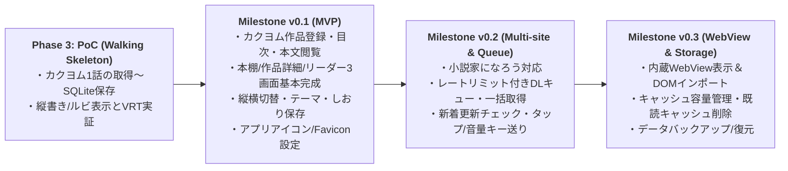

# 全体要件定義・機能一覧・ロードマップ（App 全体正本）

## 1. プロジェクト概要・目的

**Yommy** は、複数の Web 小説サイト（カクヨム、小説家になろう等）の作品を取得して端末内のローカル DB（SQLite）にキャッシュし、オフライン環境でも縦書き・ルビ・傍点・カラーテーマ等の小説特化組版で快適に読書できる Android 向け Web 小説リーダーアプリケーションです。

### 1.1 ターゲット環境・技術方針

- **対象プラットフォーム**: Android（Capacitor によるハイブリッドネイティブアプリ）および開発・テスト用 Web ブラウザ環境
- **フレームワーク・言語**: React + TypeScript + Vite + Tailwind CSS + Capacitor（`@capacitor/core`, `@capacitor-community/sqlite`）
- **オフラインファースト**: 取得済みの目次・本文データはすべて端末内 SQLite に保存し、圏外・機内モードでも閲覧・しおり保存が可能であること。

---

## 2. 対応小説サイト方針とフォールバック戦略

|     優先度      | 対象サイト / 方式                                               | ドメイン・対象                                                 |    対応フェーズ / Milestone    | 解析・取得方針                                                                                                                                               |
| :-------------: | :-------------------------------------------------------------- | :------------------------------------------------------------- | :----------------------------: | :----------------------------------------------------------------------------------------------------------------------------------------------------------- |
| **1（最優先）** | **カクヨム**                                                    | `kakuyomu.jp`                                                  | **Phase 3 (PoC) / `v0.1 MVP`** | `KakuyomuParser` により作品情報・章/エピソード一覧・本文（`<ruby>`・傍点含む）を抽出。                                                                       |
|      **2**      | **小説家になろう（一般）**                                      | `ncode.syosetu.com`                                            |           **`v0.2`**           | `NarouParser` により連載・短編の作品情報・目次（複数ページ目次対応）・本文を抽出。                                                                           |
|      **3**      | **内蔵ブラウザ（WebView）手動インポート ＆ フォールバック表示** | 全サイト共通（Cloudflare等のBot対策・ログイン必須・DOM変更時） |           **`v0.3`**           | バックグラウンド通信（`CapacitorHttp`）で取得できないページは、内蔵 WebView（`SCR-04`）で人間が開き、表示中 DOM から直接本文をキャプチャして DB へ取り込む。 |

---

## 3. システム機能要件一覧（`SYS-REQ-xx`）

### 3.1 スクレイピング・ローカルキャッシュ・キュー管理

|    要件 ID     | カテゴリ                     | 要件概要                                                                                                                                                                                                | 関連画面 / 遷移                                         | 受入条件 ID                                                   |     優先度     |
| :------------: | :--------------------------- | :------------------------------------------------------------------------------------------------------------------------------------------------------------------------------------------------------ | :------------------------------------------------------ | :------------------------------------------------------------ | :------------: |
| **SYS-REQ-01** | 作品登録・目次取得           | 小説の作品トップ URL（またはエピソード URL）を入力し、タイトル・著者・あらすじ・全エピソード目次を取得してローカル DB に登録できる。                                                                    | `SCR-01`, `SCR-02` / `TR-02`, `TR-07`                   | `AC-01`〜`03`, `AC-BS-01`〜`05`, `AC-ND-01`, `02`, `05`, `07` |     `v0.1`     |
| **SYS-REQ-02** | 本文取得・オフライン閲覧     | 指定したエピソード（単話・選択範囲・未取得全話）の本文 HTML を取得してローカル DB に保存し、オフライン環境で閲覧できる。                                                                                | `SCR-02`, `SCR-03` / `TR-03`, `TR-04`, `TR-05`, `TR-06` | `AC-04`, `06`, `AC-BS-06`, `AC-ND-02`〜`04`, `AC-RD-01`       |     `v0.1`     |
| **SYS-REQ-03** | レートリミット・DLキュー制御 | 複数話の一括取得時は対象サーバーへの負荷や 503 IP BAN を防ぐため、リクエスト間隔のウェイト制御（例: 1.5秒間隔）を伴うバックグラウンドキューで順次取得し、一時停止・再開・キャンセル・リトライができる。 | `SCR-05` / `TR-08`                                      | -                                                             |     `v0.2`     |
| **SYS-REQ-04** | 更新チェック（差分取得）     | 登録済み作品（お気に入り等）の目次を再取得し、新規追加されたエピソードや改稿されたエピソードを検知して差分ダウンロードできる。                                                                          | `SCR-01`, `SCR-02`                                      | `AC-ND-05`                                                    | `v0.1`〜`v0.2` |
| **SYS-REQ-05** | キャッシュ管理・容量整理     | 作品ごと・アプリ全体のキャッシュデータ容量（Byte/MB）を確認でき、既読エピソードの本文キャッシュ削除・作品単位のキャッシュクリア・作品削除が行える。                                                     | `SCR-02`, `SCR-05` / `TR-07`                            | `AC-ND-06`                                                    | `v0.1`〜`v0.3` |
| **SYS-REQ-06** | バックアップ・復元           | 本棚の登録作品・しおり・既読状態・設定データを JSON 等の形式でエクスポート／インポートできる。                                                                                                          | `SCR-05`                                                | -                                                             |     `v0.3`     |

### 3.2 小説特化リーダー・組版・操作体験

|    要件 ID     | カテゴリ                       | 要件概要                                                                                                                                                                              | 関連画面 / 遷移                                                   | 受入条件 ID                                          |              優先度              |
| :------------: | :----------------------------- | :------------------------------------------------------------------------------------------------------------------------------------------------------------------------------------ | :---------------------------------------------------------------- | :--------------------------------------------------- | :------------------------------: |
| **SYS-REQ-07** | ルビ・傍点の正確な描画         | 本文中の `<ruby>`（`<rb>`, `<rt>`, `<rp>`）および傍点表現を、サニタイズ（XSS 防止）しつつ組版崩れなくレンダリングする。                                                               | `SCR-03`                                                          | `AC-04`, `05`, `AC-RD-02`                            |              `v0.1`              |
| **SYS-REQ-08** | 縦書き / 横書き切り替え        | CSS `writing-mode: vertical-rl`（縦書き）と `horizontal-tb`（横書き）をシームレスに切り替えられる。                                                                                   | `SCR-03`                                                          | `AC-RD-03`                                           |              `v0.1`              |
| **SYS-REQ-09** | フォント・サイズ・余白設定     | フォント種別（明朝体 / ゴシック体 / UDフォント / 教科書体等）、文字サイズ、行間、画面余白をカスタマイズし永続化できる。                                                               | `SCR-03`                                                          | `AC-RD-05`                                           |          `v0.1`〜`v0.2`          |
| **SYS-REQ-10** | カラーテーマ切り替え           | 白背景（Light）、セピア（Sepia）、ダーク（Dark）、有機EL向け純黒（AMOLED Black）の4テーマを切り替えられる。                                                                           | `SCR-03`                                                          | `AC-RD-04`                                           |              `v0.1`              |
| **SYS-REQ-11** | スクロール ＆ 1画面送り操作    | 連続スクロール（縦書き時は右→左の横スクロール、横書き時は上→下の縦スクロール）に加え、画面左右タップや音量キー操作による1画面分のジャンプ送り、および前話・次話への連続遷移ができる。 | `SCR-03` / `TR-05`                                                | `AC-06`, `AC-RD-06`                                  | `v0.1`（基本） `v0.2`（拡張） |
| **SYS-REQ-12** | しおり・スクロール位置自動保存 | 作品ごとに「現在読んでいるエピソード」と「本文内のスクロール進捗率（0.0〜1.0）」を自動保存し、再開時に同じ位置から読書を再開できる。また既読フラグを自動更新する。                    | `SCR-01`, `SCR-02`, `SCR-03` / `TR-03`, `TR-04`, `TR-05`, `TR-06` | `AC-BS-04`, `06`, `AC-ND-02`, `03`, `AC-RD-07`, `08` |              `v0.1`              |

### 3.3 ブラウザ連携（WebView フォールバック）

|    要件 ID     | カテゴリ                      | 要件概要                                                                                                                                 | 関連画面 / 遷移             | 優先度 |
| :------------: | :---------------------------- | :--------------------------------------------------------------------------------------------------------------------------------------- | :-------------------------- | :----: |
| **SYS-REQ-13** | アプリ内ブラウザ表示          | 対象サイトの DOM 構造変更時やログイン必須ページに対応するため、該当 URL を内蔵 WebView（または外部ブラウザ連携）で直接開いて閲覧できる。 | `SCR-04` / `TR-09`, `TR-10` | `v0.3` |
| **SYS-REQ-14** | WebView 表示中 DOM インポート | 内蔵 WebView で人間がページを開いた状態で、表示中の DOM をキャプチャして Parser Layer へ渡し、ローカルキャッシュ DB へ保存できる。       | `SCR-04` / `TR-11`          | `v0.3` |

### 3.4 アプリブランディング・アイコン要件

|    要件 ID     | カテゴリ                       | 要件概要                                                                                                                                                                                           | 関連画面 / 遷移 |    受入条件 ID     | 優先度 |
| :------------: | :----------------------------- | :------------------------------------------------------------------------------------------------------------------------------------------------------------------------------------------------- | :-------------- | :----------------: | :----: |
| **SYS-REQ-15** | アプリアイコン・ブランディング | 紫の魔導書・彼岸花モチーフに基づくアプリアイコンを Android（Adaptive Icon / レガシー）および Web（Favicon / PWA / Apple Touch Icon）へ反映し、マスター画像および決定論的生成スクリプトを管理する。 | -               | `AC-ICON-01`〜`04` | `v0.1` |

---

## 4. ミニリリース Milestone ロードマップ

Phase 3（PoC）で最小骨格を実証した後、Phase 4 以降は 3〜5 個の要望 Issue を束ねた以下のミニリリース Milestone 単位で段階的に機能を完成させます。

| フェーズ / Milestone                                      | ゴールと対象画面・スコープ                                                                                                                                                                                     | 主な対象要件 ID                                              |
| :-------------------------------------------------------- | :------------------------------------------------------------------------------------------------------------------------------------------------------------------------------------------------------------- | :----------------------------------------------------------- |
| **Phase 3: PoC** （Walking Skeleton）                  | Vite + React + Capacitor + SQLite + CI/VRT 基盤構築。カクヨム HTML の取得・`KakuyomuParser` 抽出・SQLite 保存・縦書き/ルビ描画の最小縦貫通（1画面ミニマム構成）と AI レビューゲート実証。                      | `SYS-REQ-01`, `02`, `07`, `08`（最小縦貫通）                 |
| **Milestone `v0.1`** （カクヨム MVP）                  | 本棚画面（`SCR-01`）・作品詳細/目次画面（`SCR-02`）・小説リーダー画面（`SCR-03`）の基本完成。カクヨム作品の URL 登録、各話取得、縦書き/横書き・4テーマ・文字サイズ設定、しおり・既読管理、アプリアイコン設定。 | `SYS-REQ-01`, `02`, `07`, `08`, `09`, `10`, `11`, `12`, `15` |
| **Milestone `v0.2`** （なろう対応 ＆ DLキュー）        | 小説家になろう（`NarouParser`）の追加対応。バックグラウンド DL キュー画面（`SCR-05`）とレートリミット制御（1.5秒ウェイト）、複数話一括取得、新着差分チェック、1画面タップ/音量キー送り。                       | `SYS-REQ-03`, `04`, `09`, `11`                               |
| **Milestone `v0.3`** （WebView連携 ＆ キャッシュ管理） | 内蔵ブラウザ画面（`SCR-04`）と表示中 DOM インポート機能。キャッシュ容量可視化・既読キャッシュ一括削除（`SCR-05`）、データのエクスポート/インポート。                                                           | `SYS-REQ-05`, `06`, `13`, `14`                               |
