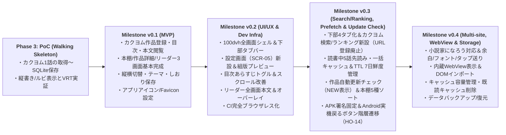

# 全体要件定義・機能一覧・ロードマップ（App 全体正本）

## 1. プロジェクト概要・目的

**Yommy** は、複数の Web 小説サイト（カクヨム、小説家になろう等）の作品をアプリ内で検索・ランキングから探索して端末内のローカル DB（SQLite）にキャッシュし、オフライン環境でも縦書き・ルビ・傍点・カラーテーマ等の小説特化組版で快適に読書できる Android 向け Web 小説リーダーアプリケーションです。

### 1.1 ターゲット環境・技術方針

- **対象プラットフォーム**: Android（Capacitor によるハイブリッドネイティブアプリ）および開発・テスト用 Web ブラウザ環境
- **フレームワーク・言語**: React + TypeScript + Vite + Tailwind CSS + Capacitor（`@capacitor/core`, `@capacitor-community/sqlite`）
- **オフラインファースト**: 取得済みの目次・本文データはすべて端末内 SQLite に保存し、圏外・機内モードでも閲覧・しおり保存が可能であること。

---

## 2. 対応小説サイト方針とフォールバック戦略

|     優先度      | 対象サイト / 方式                                               | ドメイン・対象                                                 |       対応フェーズ / Milestone       | 解析・取得方針                                                                                                                                               |
| :-------------: | :-------------------------------------------------------------- | :------------------------------------------------------------- | :----------------------------------: | :----------------------------------------------------------------------------------------------------------------------------------------------------------- |
| **1（最優先）** | **カクヨム**                                                    | `kakuyomu.jp`                                                  | **Phase 3 (PoC) / `v0.1` 〜 `v0.3`** | `KakuyomuParser` により作品情報・章/エピソード一覧・本文（`<ruby>`・傍点含む）および検索結果・ランキング一覧（`v0.3`）を抽出。                               |
|      **2**      | **小説家になろう（一般）**                                      | `ncode.syosetu.com`                                            |             **`v0.4`〜**             | `NarouParser` により連載・短編の作品情報・目次（複数ページ目次対応）・本文・検索/ランキングを抽出（`v0.3` で構築するサイト選択 UI に統合）。                 |
|      **3**      | **内蔵ブラウザ（WebView）手動インポート ＆ フォールバック表示** | 全サイト共通（Cloudflare等のBot対策・ログイン必須・DOM変更時） |             **`v0.4`〜**             | バックグラウンド通信（`CapacitorHttp`）で取得できないページは、内蔵 WebView（`SCR-04`）で人間が開き、表示中 DOM から直接本文をキャプチャして DB へ取り込む。 |

---

## 3. システム機能要件一覧（`SYS-REQ-xx`）

### 3.1 スクレイピング・ローカルキャッシュ・キュー管理

|    要件 ID     | カテゴリ                             | 要件概要                                                                                                                                                                                                                                                                                                                                    | 関連画面 / 遷移                                                             | 受入条件 ID                                                                                                         |     優先度     |
| :------------: | :----------------------------------- | :------------------------------------------------------------------------------------------------------------------------------------------------------------------------------------------------------------------------------------------------------------------------------------------------------------------------------------------ | :-------------------------------------------------------------------------- | :------------------------------------------------------------------------------------------------------------------ | :------------: |
| **SYS-REQ-01** | 作品登録・検索・ランキング・目次取得 | 検索画面（`SCR-06`）またはランキング画面（`SCR-07`）から作品を探索し、作品カードの「＋ 本棚に追加」ボタンまたは未登録カードのタップにより、タイトル・著者・あらすじ・全エピソード目次を取得してローカル DB に登録できる（`v0.3` Issue #79 にて URL 直接登録を廃止し、アプリ内の検索画面・ランキング画面からのワンタップ作品登録に一本化）。 | `SCR-01`, `SCR-02`, `SCR-06`, `SCR-07` / `TR-02`, `TR-07`, `TR-14`, `TR-15` | `AC-01`〜`03`, `07`, `AC-BS-01`, `04`, `05`, `AC-ND-01`, `02`, `05`, `07`, `08`, `AC-SE-06`, `07`, `AC-RK-06`, `07` | `v0.1`〜`v0.3` |
| **SYS-REQ-02** | 本文取得・先読み・オフライン閲覧     | 指定したエピソードの本文 HTML を取得してローカル DB に保存し、オフライン環境で閲覧できる（`v0.3` Issue #81 にて読書中の5話先読み・未取得話一括キャッシュ、およびキャッシュ TTL 7日間＋短タイムアウトによる既存キャッシュフォールバックを追加）。                                                                                            | `SCR-01`, `SCR-02`, `SCR-03` / `TR-03`, `TR-04`, `TR-05`, `TR-06`, `TR-18`  | `AC-04`, `06`, `AC-BS-06`, `AC-ND-02`〜`04`, `AC-RD-01`, `AC-RD-12`, `13`, `AC-ND-11`〜`13`                         | `v0.1`〜`v0.3` |
| **SYS-REQ-03** | レートリミット・バックグラウンド取得 | 読書中の自動先読み（5話先まで）や作品詳細での未取得話一括キャッシュ時は、対象サーバーへの負荷や 503 IP BAN を防ぐため、リクエスト間隔のウェイト制御（1.5秒間隔）を伴うバックグラウンド処理で順次取得し、画面遷移・離脱時の適切な中断・切り替えができる（`v0.3` Issue #81）。                                                                | `SCR-02`, `SCR-03` / `TR-05`, `TR-06`, `TR-18`                              | `AC-RD-12`, `AC-ND-11`, `AC-ND-12`                                                                                  |     `v0.3`     |
| **SYS-REQ-04** | 更新チェック（差分取得）・ソート     | 登録済み作品の目次を再取得し、新規追加されたエピソードを検知して差分取得できる（`v0.3` Issue #80 にて本棚表示時の1時間経過作品バックグラウンド自動更新チェック、「NEW（更新あり）」表示・閲覧時解除、およびデフォルト「更新あり優先＋最近読んだ順」を含む本棚5種ソートを追加）。                                                            | `SCR-01`, `SCR-02`, `SCR-03` / `TR-02`, `TR-03`, `TR-16`, `TR-17`           | `AC-BS-08`〜`11`, `AC-ND-05`, `AC-ND-10`, `AC-RD-11`                                                                | `v0.1`〜`v0.3` |
| **SYS-REQ-05** | キャッシュ管理・容量整理             | 作品ごと・アプリ全体のキャッシュデータ容量（Byte/MB）を確認でき、既読エピソードの本文キャッシュ削除・作品単位のキャッシュクリア・作品削除が行える。また作品詳細画面（`SCR-02`）から未取得話の一括キャッシュ取得が行える（`v0.3` Issue #81）。                                                                                               | `SCR-02`, `SCR-05` / `TR-01`, `TR-07`, `TR-18`                              | `AC-ND-06`, `AC-ND-11`〜`13`                                                                                        | `v0.1`〜`v0.4` |
| **SYS-REQ-06** | クラウド同期・バックアップ           | ユーザー自身の Google Drive アプリ専用領域（`appDataFolder`）を活用し、本棚の登録作品・しおり話数・既読状態・削除情報を単一 JSON（`yommy-sync-state.json`）としてセキュアかつ自動的に双方向クラウド同期・マージできる（手動 JSON エクスポート/インポートを本機能へ統合）。                                                                  | `SCR-05` / `TR-01`                                                          | `AC-ST-08`〜`12`                                                                                                    |     `v0.4`     |

### 3.2 小説特化リーダー・組版・操作体験

|    要件 ID     | カテゴリ                       | 要件概要                                                                                                                                                                                                                                                                          | 関連画面 / 遷移                                                   | 受入条件 ID                                                |                                 優先度                                  |
| :------------: | :----------------------------- | :-------------------------------------------------------------------------------------------------------------------------------------------------------------------------------------------------------------------------------------------------------------------------------- | :---------------------------------------------------------------- | :--------------------------------------------------------- | :---------------------------------------------------------------------: |
| **SYS-REQ-07** | ルビ・傍点の正確な描画         | 本文中の `<ruby>`（`<rb>`, `<rt>`, `<rp>`）および傍点表現を、サニタイズ（XSS 防止）しつつ組版崩れなくレンダリングする。                                                                                                                                                           | `SCR-03`, `SCR-05`                                                | `AC-04`, `05`, `AC-RD-02`, `AC-ST-02`                      |                                 `v0.1`                                  |
| **SYS-REQ-08** | 縦書き / 横書き切り替え        | CSS `writing-mode: vertical-rl`（縦書き）と `horizontal-tb`（横書き）をシームレスに切り替えられる。                                                                                                                                                                               | `SCR-03`, `SCR-05` / `TR-01`                                      | `AC-RD-03`, `AC-RD-09`, `AC-ST-02`, `AC-ST-03`, `AC-ST-07` |                                 `v0.1`                                  |
| **SYS-REQ-09** | フォント・サイズ・余白設定     | フォント種別（明朝体 / ゴシック体 / UDフォント / 教科書体等）、文字サイズ、行間、画面余白をカスタマイズし永続化できる。                                                                                                                                                           | `SCR-03`, `SCR-05` / `TR-01`                                      | `AC-RD-05`, `AC-ST-02`, `AC-ST-05`, `AC-ST-07`             |                             `v0.1`〜`v0.4`                              |
| **SYS-REQ-10** | カラーテーマ切り替え           | 白背景（Light）、セピア（Sepia）、ダーク（Dark）、有機EL向け純黒（AMOLED Black）の4テーマを切り替えられる。                                                                                                                                                                       | `SCR-03`, `SCR-05` / `TR-01`                                      | `AC-RD-04`, `AC-ST-02`, `AC-ST-04`, `AC-ST-07`             |                                 `v0.1`                                  |
| **SYS-REQ-11** | スクロール ＆ 1画面送り操作    | 全画面連続スクロール（100dvh、縦書き時は右→左の横スクロール、横書き時は上→下の縦スクロール）、画面最下部タッチによる下部オーバーレイ（前後話ナビ＋4タブ）開閉・自動非表示、および前話・次話への連続遷移ができる（画面左右タップや音量キー操作による1画面ジャンプ送りは `v0.4`）。 | `SCR-03` / `TR-05`                                                | `AC-06`, `AC-RD-06`, `AC-RD-09`, `AC-RD-10`                | `v0.1`（基本） `v0.2`（全画面・オーバーレイ） `v0.4`（1画面送り） |
| **SYS-REQ-12** | しおり・スクロール位置自動保存 | 作品ごとに「現在読んでいるエピソード」と「本文内のスクロール進捗率（0.0〜1.0）」を自動保存し、再開時に同じ位置から読書を再開できる。また下部オーバーレイのタブ遷移時やOSバックキー復帰時に即時保存（`flushBookmark`）し、既読フラグを自動更新する。                               | `SCR-01`, `SCR-02`, `SCR-03` / `TR-03`, `TR-04`, `TR-05`, `TR-06` | `AC-BS-04`, `06`, `AC-ND-02`, `03`, `08`, `AC-RD-07`, `08` |                                 `v0.1`                                  |

### 3.3 ブラウザ連携（WebView フォールバック）

|    要件 ID     | カテゴリ                      | 要件概要                                                                                                                                 | 関連画面 / 遷移             | 受入条件 ID | 優先度 |
| :------------: | :---------------------------- | :--------------------------------------------------------------------------------------------------------------------------------------- | :-------------------------- | :---------: | :----: |
| **SYS-REQ-13** | アプリ内ブラウザ表示          | 対象サイトの DOM 構造変更時やログイン必須ページに対応するため、該当 URL を内蔵 WebView（または外部ブラウザ連携）で直接開いて閲覧できる。 | `SCR-04` / `TR-09`, `TR-10` |      -      | `v0.4` |
| **SYS-REQ-14** | WebView 表示中 DOM インポート | 内蔵 WebView で人間がページを開いた状態で、表示中の DOM をキャプチャして Parser Layer へ渡し、ローカルキャッシュ DB へ保存できる。       | `SCR-04` / `TR-11`          |      -      | `v0.4` |

### 3.4 アプリブランディング・アイコン要件

|    要件 ID     | カテゴリ                       | 要件概要                                                                                                                                                                                           | 関連画面 / 遷移 |    受入条件 ID     | 優先度 |
| :------------: | :----------------------------- | :------------------------------------------------------------------------------------------------------------------------------------------------------------------------------------------------- | :-------------- | :----------------: | :----: |
| **SYS-REQ-15** | アプリアイコン・ブランディング | 紫の魔導書・彼岸花モチーフに基づくアプリアイコンを Android（Adaptive Icon / レガシー）および Web（Favicon / PWA / Apple Touch Icon）へ反映し、マスター画像および決定論的生成スクリプトを管理する。 | -               | `AC-ICON-01`〜`04` | `v0.1` |

### 3.5 アプリ共通シェル・ナビゲーション・階層制御要件

|    要件 ID     | カテゴリ                                     | 要件概要                                                                                                                                                                                                                                                                                                                                                                                                                  | 関連画面 / 遷移                                                                                                    | 受入条件 ID                                                            |     優先度     |
| :------------: | :------------------------------------------- | :------------------------------------------------------------------------------------------------------------------------------------------------------------------------------------------------------------------------------------------------------------------------------------------------------------------------------------------------------------------------------------------------------------------------ | :----------------------------------------------------------------------------------------------------------------- | :--------------------------------------------------------------------- | :------------: |
| **SYS-REQ-16** | 全画面シェル・下部タブ・OSバックキー階層遷移 | アプリ共通シェルを 100dvh 固定・外側余白ゼロに統一し、画面最下部に「本棚」「設定」の2タブバー（`BottomTabBar`、`v0.3` Issue #79 にて「本棚 / 検索 / ランキング / 設定」の4タブへ拡張）を常時固定表示する。また OS バックキー（ブラウザ戻る操作、および `v0.3` Issue #78 での Android 実機 `@capacitor/app` システム戻るボタン `HO-14`）において、常に論理階層順で遷移させ、リーダー離脱時にしおり・進捗率を自動保存する。 | `SCR-01`, `SCR-02`, `SCR-03`, `SCR-05`, `SCR-06`, `SCR-07` / `TR-01`, `TR-01b`, `TR-06`, `TR-07`, `TR-12`, `TR-13` | `AC-ST-01`, `06`, `AC-BS-07`, `AC-ND-07`, `AC-ND-09`, `AC-RD-08`, `09` | `v0.2`〜`v0.3` |

### 3.6 作品探索・検索・ランキング要件（v0.3 新設）

|    要件 ID     | カテゴリ                                   | 要件概要                                                                                                                                                                                                                                                                                                                                                                       | 関連画面 / 遷移                                                                                  | 受入条件 ID                                                                        | 優先度 |
| :------------: | :----------------------------------------- | :----------------------------------------------------------------------------------------------------------------------------------------------------------------------------------------------------------------------------------------------------------------------------------------------------------------------------------------------------------------------------- | :----------------------------------------------------------------------------------------------- | :--------------------------------------------------------------------------------- | :----: |
| **SYS-REQ-17** | カクヨム作品検索機能                       | キーワード入力、4種の並び順（週間ランキング順、累計ランキング順、更新順、新作順）、連載状態フィルタ（すべて/連載中/完結済）、およびジャンルフィルタ（すべて＋12ジャンル）を指定して作品を検索でき、20件ごとの次ページ読み込みが行える。                                                                                                                                        | `SCR-06` / `TR-01`, `TR-12`, `TR-14`                                                             | `AC-08`, `09`, `AC-SE-01`〜`05`, `08`                                              | `v0.3` |
| **SYS-REQ-18** | カクヨムランキング機能                     | 集計期間（日間/週間/月間/累計）× ジャンル（総合＋主要12ジャンル）を切り替えてランキング上位作品（長編標準）を取得でき、1〜3位の強調表示および順位バッジとともに一覧表示できる。                                                                                                                                                                                                | `SCR-07` / `TR-01`, `TR-12`, `TR-14`                                                             | `AC-10`, `11`, `AC-RK-01`〜`05`                                                    | `v0.3` |
| **SYS-REQ-19** | 探索一覧からの作品即時登録・遷移           | 検索・ランキング一覧の各作品カードにおいて、「＋ 本棚に追加」ボタン押下により画面遷移せずその場で目次取得・DB保存（`upsertNovelWithToc`）を完了させて「✓ 登録済み」へ切り替えることができる。また未登録カード本体タップ時は自動追加完了後に、登録済みカードタップ時は直接に作品詳細・目次画面（`SCR-02`）へ遷移できる。                                                        | `SCR-06`, `SCR-07`, `SCR-02` / `TR-14`                                                           | `AC-SE-06`, `07`, `AC-RK-06`, `07`                                                 | `v0.3` |
| **SYS-REQ-20** | 下部4タブバー・リーダーオーバーレイ4タブ化 | 下部タブバー（`BottomTabBar`）およびリーダー下部オーバーレイ（`ReaderBottomOverlay`）を「本棚（`/`）」「検索（`/search`）」「ランキング（`/ranking`）」「設定（`/settings`）」の4タブ構成に拡張し、OS バックキー操作において検索・ランキングからは本棚へ、設定からは直前画面（リーダー/作品詳細/本棚）へ、作品詳細からは直前の遷移元（本棚/検索/ランキング）へ論理復帰できる。 | `SCR-01`, `SCR-02`, `SCR-03`, `SCR-05`, `SCR-06`, `SCR-07` / `TR-01`, `TR-01b`, `TR-07`, `TR-12` | `AC-BS-07`, `AC-ND-07`, `AC-ND-09`, `AC-RD-08`, `AC-SE-01`, `AC-RK-01`, `AC-ST-01` | `v0.3` |

---

## 4. ミニリリース Milestone ロードマップ

| フェーズ / Milestone                                                  | ゴールと対象画面・スコープ                                                                                                                                                                                                                                                                                                                                                                  | 主な対象要件 ID                                                                                              |
| :-------------------------------------------------------------------- | :------------------------------------------------------------------------------------------------------------------------------------------------------------------------------------------------------------------------------------------------------------------------------------------------------------------------------------------------------------------------------------------ | :----------------------------------------------------------------------------------------------------------- |
| **Phase 3: PoC** （Walking Skeleton）                              | Vite + React + Capacitor + SQLite + CI/VRT 基盤構築。カクヨム HTML の取得・`KakuyomuParser` 抽出・SQLite 保存・縦書き/ルビ描画の最小縦貫通（1画面ミニマム構成）と AI レビューゲート実証。                                                                                                                                                                                                   | `SYS-REQ-01`, `02`, `07`, `08`（最小縦貫通）                                                                 |
| **Milestone `v0.1`** （カクヨム MVP）                              | 本棚画面（`SCR-01`）・作品詳細/目次画面（`SCR-02`）・小説リーダー画面（`SCR-03`）の基本完成。カクヨム作品の URL 登録、各話取得、縦書き/横書き・4テーマ・文字サイズ設定、しおり・既読管理、アプリアイコン設定。                                                                                                                                                                              | `SYS-REQ-01`, `02`, `04（一部）`, `05（一部）`, `07`, `08`, `09`, `10`, `11`, `12`, `15`                     |
| **Milestone `v0.2`** （UI/UX 刷新 ＆ 開発基盤整備）                | 100dvh 全画面シェル化・ウィンドウスクロール排除、下部タブバー（`BottomTabBar`）新設、設定画面（`SCR-05: /settings`）新設・組版設定移設・サンプル文章プレビュー、OS バックキー論理階層遷移、目次あらすじトグル、リーダー全画面オーバーレイ、CI完全ブラウザレス化。                                                                                                                           | `SYS-REQ-07`, `08`, `09`, `10`, `11（オーバーレイ）`, `16`                                                   |
| **Milestone `v0.3`** （検索/ランキング・先読み・更新チェック）     | 下部バー/オーバーレイの4タブ化（本棚 / 検索 / ランキング / 設定）、カクヨム検索・ランキング画面新設と URL 登録廃止（検索/ランキングからの登録に一本化、#79）。読書中の5話先読み・未取得話一括キャッシュと TTL 7日間（＋短タイムアウト既存キャッシュフォールバック、#81）。本棚自動更新チェック（NEW表示）・5種ソート（#80）、APK上書き署名固定＆Android実機戻るボタン対応（`HO-14`、#78）。 | `SYS-REQ-01（検索/ランキング）`, `02（先読み/TTL）`, `03`, `04`, `16（4タブ/HO-14）`, `17`, `18`, `19`, `20` |
| **Milestone `v0.4`** （なろう対応・WebView連携 ＆ キャッシュ管理） | 小説家になろう（`NarouParser`）の追加対応、余白/フォント種別設定、1画面タップ/音量キー送り。内蔵ブラウザ画面（`SCR-04`）と表示中 DOM インポート機能、全体および作品別キャッシュ容量可視化・既読キャッシュ一括削除、データのエクスポート/インポート。                                                                                                                                        | `SYS-REQ-05`, `06`, `09（拡張）`, `11（拡張）`, `13`, `14`                                                   |
