# 全体要件定義・機能一覧・ロードマップ（App 全体正本）

## 1. プロジェクト概要・目的

**Yommy** は、複数の Web 小説サイト（カクヨム、小説家になろう等）の作品をアプリ内で検索・ランキングから探索して端末内のローカル DB（SQLite）にキャッシュし、オフライン環境でも縦書き・ルビ・傍点・カラーテーマ等の小説特化組版で快適に読書できる Android 向け Web 小説リーダーアプリケーションです。

### 1.1 ターゲット環境・技術方針

- **対象プラットフォーム**: Android（Capacitor によるハイブリッドネイティブアプリ）および開発・テスト用 Web ブラウザ環境
- **フレームワーク・言語**: React + TypeScript + Vite + Tailwind CSS + Capacitor（`@capacitor/core`, `@capacitor-community/sqlite`）
- **オフラインファースト**: 取得済みの目次・本文データはすべて端末内 SQLite に保存し、圏外・機内モードでも閲覧・しおり保存が可能であること。

---

## 2. 対応小説サイト方針とフォールバック戦略

|     優先度      | 対象サイト / 方式                                               | ドメイン・対象                                                 |       対応フェーズ / Milestone       | 解析・取得方針                                                                                                                                                                                                                                                                   |
| :-------------: | :-------------------------------------------------------------- | :------------------------------------------------------------- | :----------------------------------: | :------------------------------------------------------------------------------------------------------------------------------------------------------------------------------------------------------------------------------------------------------------------------------- |
| **1（最優先）** | **カクヨム**                                                    | `kakuyomu.jp`                                                  | **Phase 3 (PoC) / `v0.1` 〜 `v0.3`** | `KakuyomuParser` により作品情報・章/エピソード一覧・本文（`<ruby>`・傍点含む）および検索結果・ランキング一覧（`v0.3`）を抽出。                                                                                                                                                   |
|      **2**      | **小説家になろう（一般）**                                      | `ncode.syosetu.com` `api.syosetu.com`                       |             **`v0.7`〜**             | `NarouParser` により連載・短編の作品情報・目次（100話超の複数ページ目次連続取得対応）・本文（前書き・本編・後書き結合、ルビ・傍点正規化）およびクラウド同期（#239）、ならびに公式「なろう小説 API（`api.syosetu.com/novelapi/api/`）」による検索・ランキング抽出（#240）に対応。 |
|      **3**      | **内蔵ブラウザ（WebView）手動インポート ＆ フォールバック表示** | 全サイト共通（Cloudflare等のBot対策・ログイン必須・DOM変更時） |             **`v0.9`〜**             | バックグラウンド通信（`CapacitorHttp`）で取得できないページは、内蔵 WebView（`SCR-04`）で人間が開き、表示中 DOM から直接本文をキャプチャして DB へ取り込む。                                                                                                                     |

---

## 3. システム機能要件一覧（`SYS-REQ-xx`）

### 3.1 スクレイピング・ローカルキャッシュ・キュー管理

|    要件 ID     | カテゴリ                                     | 要件概要                                                                                                                                                                                                                                                                                                                                                                                                                                                                                                                                                                                                                                                                                                                                                                                                       | 関連画面 / 遷移                                                             | 受入条件 ID                                                                                                                                                   |                                                                         優先度                                                                         |
| :------------: | :------------------------------------------- | :------------------------------------------------------------------------------------------------------------------------------------------------------------------------------------------------------------------------------------------------------------------------------------------------------------------------------------------------------------------------------------------------------------------------------------------------------------------------------------------------------------------------------------------------------------------------------------------------------------------------------------------------------------------------------------------------------------------------------------------------------------------------------------------------------------- | :-------------------------------------------------------------------------- | :------------------------------------------------------------------------------------------------------------------------------------------------------------ | :----------------------------------------------------------------------------------------------------------------------------------------------------: |
| **SYS-REQ-01** | 作品登録・検索・ランキング・目次取得         | 検索画面（`SCR-06`）またはランキング画面（`SCR-07`）から作品を探索し、作品カードの「＋ 本棚に追加」ボタンまたは未登録カードのタップにより、タイトル・著者・あらすじ・全エピソード目次を取得してローカル DB に登録できる（`v0.3` Issue #79 にて URL 直接登録を廃止し、アプリ内の検索画面・ランキング画面からのワンタップ作品登録に一本化。`v0.7` Issue #239 にて小説家になろう［連載・短編擬似1話］および100話超の複数ページ目次連続取得に対応）。                                                                                                                                                                                                                                                                                                                                                              | `SCR-01`, `SCR-02`, `SCR-06`, `SCR-07` / `TR-02`, `TR-07`, `TR-14`, `TR-15` | `AC-01`〜`03`, `07`, `AC-NR-01`〜`05`, `10`, `AC-BS-01`, `04`, `05`, `AC-ND-01`, `02`, `05`, `07`, `08`, `27`, `AC-SE-06`, `07`, `AC-RK-06`, `07`, `AC-AB-03` |                  `v0.1`〜`v0.3` `v0.7`（なろう・複数ページ目次対応 #239） `v1.1`（詳細ヘッダーアイコン＆3点メニュー整理 #343）                   |
| **SYS-REQ-02** | 本文取得・先読み・オフライン閲覧             | 指定したエピソードの本文 HTML を取得してローカル DB に保存し、オフライン環境で閲覧できる（`v0.3` Issue #81 にて読書中の5話先読み・未取得話一括キャッシュ、およびキャッシュ TTL 7日間＋短タイムアウトによる既存キャッシュフォールバックを追加。`v0.7` Issue #239 にてなろうの前書き・本編・後書き結合抽出および短編本文抽出に対応。`v0.7` Issue #238 にて未キャッシュ話遷移時ローディング表示［`AC-RD-28`］を追加。`v0.9` Issue #268 にて永続ダウンロードキュー `download_queue` による一括キャッシュ中断再開・失敗話再試行を追加）。                                                                                                                                                                                                                                                                           | `SCR-01`, `SCR-02`, `SCR-03` / `TR-03`, `TR-04`, `TR-05`, `TR-06`, `TR-18`  | `AC-04`, `06`, `AC-NR-05`, `06`, `09`, `AC-BS-06`, `AC-ND-02`〜`04`, `AC-RD-01`, `AC-RD-12`, `13`, `AC-RD-28`, `AC-ND-11`〜`13`, `24`, `25`                   |         `v0.1`〜`v0.3` `v0.7`（なろう本文対応 #239、未キャッシュ話ローディング #238） `v0.9`（永続DLキュー再開・再試行 #268 / `HO-34`）          |
| **SYS-REQ-03** | レートリミット・バックグラウンド取得         | 読書中の自動先読み（5話先まで）や作品詳細での未取得話一括キャッシュ時は、対象サーバーへの負荷や 503 IP BAN を防ぐため、リクエスト間隔のウェイト制御（1.5秒間隔）を伴うバックグラウンド処理で順次取得し、画面遷移・離脱時の適切な中断・切り替えができる（`v0.3` Issue #81。`v0.7` Issue #239 にて複数ページ目次取得 `fetchFullNovelIndex` の 500ms 間隔・最大100ページ制御を追加。`v0.9` Issue #268 にて `QueueRepository` による永続キュー管理・途中エラー時のスキップ継続・中断再開・再試行統合を追加）。                                                                                                                                                                                                                                                                                                     | `SCR-02`, `SCR-03` / `TR-05`, `TR-06`, `TR-18`                              | `AC-RD-12`, `AC-ND-11`, `AC-ND-12`, `AC-ND-24`, `AC-ND-25`                                                                                                    |              `v0.3` `v0.7`（複数ページ目次 500ms 間隔制御 #239） `v0.9`（永続ダウンロードキュー・中断再開・再試行 #268 / `HO-34`）               |
| **SYS-REQ-04** | 更新チェック（差分取得）・ソート・お気に入り | 登録済み作品の目次を再取得（`v0.7` Issue #239 にて `fetchFullNovelIndex` による複数ページ目次連続再取得に対応）し、新規追加されたエピソードを検知して差分取得できる（`v0.3` Issue #80 にて本棚表示時の1時間経過作品バックグラウンド自動更新チェック、「NEW（更新あり）」表示・閲覧時解除、およびデフォルト「更新あり優先＋最近読んだ順」を含む本棚5種ソートを追加。`v0.8` Issue #266 にて本棚カード・作品詳細ヘッダー双方でのお気に入り［★］トグル登録/解除、本棚「★ お気に入り」フィルタ切替と永続化［`app_settings.bookshelf_favorite_only`］、お気に入り0件時の専用空状態、およびお気に入りフィルタON時の手動更新チェック対象限定を追加。`v1.1` Issue #343 にて作品詳細ヘッダーのお気に入り・目次更新を1行アイコンボタンへ統一）。                                                                          | `SCR-01`, `SCR-02`, `SCR-03` / `TR-02`, `TR-03`, `TR-16`, `TR-17`           | `AC-NR-04`, `AC-BS-08`〜`11`, `14`, `15`, `AC-ND-05`, `10`, `23`, `27`, `AC-RD-11`                                                                            |      `v0.1`〜`v0.3` `v0.7`（複数ページ目次更新 #239） `v0.8`（お気に入り登録・本棚フィルタ #266 / `HO-32`） `v1.1`（アイコン統一 #343）       |
| **SYS-REQ-05** | キャッシュ管理・容量整理                     | 作品詳細画面（`SCR-02`）からの未取得話一括キャッシュ取得（`v0.3` Issue #81 / `v0.9` Issue #268 にて永続キュー再開・再試行・完了時キュー整理を追加）および確認ダイアログ付き作品削除時のキャッシュ破棄、ならびに作品詳細画面および設定画面（`SCR-05`）におけるキャッシュデータ容量可視化（`B`/`KB`/`MB`）、作品単位およびアプリ全体の本文キャッシュ削除（既読話のみ／全話、目次・既読状態・しおりは保持、対応 `download_queue` レコード自動整理）（`v0.5` Issue #170 / `v0.9` Issue #268）。                                                                                                                                                                                                                                                                                                                    | `SCR-02`, `SCR-05` / `TR-07`, `TR-18`, `TR-19`, `TR-20`                     | `AC-ND-06`, `AC-ND-11`〜`13`, `AC-ND-20`〜`22`, `24`, `25`, `27`, `AC-ST-14`〜`16`                                                                            |      `v0.1`〜`v0.3`（作品削除・一括キャッシュ） `v0.5`（既読/全話本文削除・容量可視化） `v0.9`（永続DLキュー・キャッシュ削除連動整理 #268）      |
| **SYS-REQ-06** | クラウド同期・バックアップ                   | ユーザー自身の Google Drive アプリ専用領域（`appDataFolder`）を活用し、本棚の登録作品・お気に入り状態（`isFavorite`）・しおり話数・既読状態・削除情報を単一 JSON（`yommy-sync-state.json`）としてセキュアかつ自動的に双方向クラウド同期・マージできる（設定画面での手動連携・即時同期・連携解除と、読書進行・お気に入り変更・作品追加/削除時の自動 Push、ならびに既存作品の Pull 時 `updatedAt` 比較による `isFavorite` 双方向 LWW マージ［`v0.8` Issue #266］。`v0.7` Issue #239 にてカクヨム・小説家になろうのマルチサイト URL ホワイトリスト検証および複数ページ目次自動補完に対応）。さらに `v1.1` Issue #342 にて、全画面での画面ロック・バックグラウンド 5 分以上休止後復帰時の自動 Pull（作品詳細の自動最新化、およびリーダー表示中しおり話数競合時のモーダル確認ダイアログ・誤操作ガード）に対応する。 | `SCR-01`, `SCR-02`, `SCR-03`, `SCR-05`                                      | `AC-BS-13`, `14`, `AC-ND-06`, `23`, `28`, `AC-RD-14`, `30`〜`34`, `AC-ST-08`〜`12`                                                                            | `v0.4` `v0.7`（なろう同期対応 #239） `v0.8`（お気に入り双方向 LWW 同期 #266 / `HO-32`） `v1.1`（全画面復帰自動Pull・競合確認 #342 / `HO-38`） |

### 3.2 小説特化リーダー・組版・操作体験

|    要件 ID     | カテゴリ                                                    | 要件概要                                                                                                                                                                                                                                                                                                                                                                                                                                                                                                                                                                                                                                                                                                                                                                                                                                                                                                                                                                                                                                                                                                                                                                                                                                               | 関連画面 / 遷移                                                   | 受入条件 ID                                                                                                                                                                           |                                                                                                                                                                                                        優先度                                                                                                                                                                                                        |
| :------------: | :---------------------------------------------------------- | :----------------------------------------------------------------------------------------------------------------------------------------------------------------------------------------------------------------------------------------------------------------------------------------------------------------------------------------------------------------------------------------------------------------------------------------------------------------------------------------------------------------------------------------------------------------------------------------------------------------------------------------------------------------------------------------------------------------------------------------------------------------------------------------------------------------------------------------------------------------------------------------------------------------------------------------------------------------------------------------------------------------------------------------------------------------------------------------------------------------------------------------------------------------------------------------------------------------------------------------------------- | :---------------------------------------------------------------- | :------------------------------------------------------------------------------------------------------------------------------------------------------------------------------------ | :------------------------------------------------------------------------------------------------------------------------------------------------------------------------------------------------------------------------------------------------------------------------------------------------------------------------------------------------------------------------------------------------------------------: |
| **SYS-REQ-07** | ルビ・傍点の正確な描画                                      | 本文中の `<ruby>`（`<rb>`, `<rt>`, `<rp>`）および傍点表現（カクヨム `<em class="emphasisDots">`・なろう傍点 `<ruby>` の `<em class="bouten">` 正規化を含む、Issue #239）を、サニタイズ（XSS 防止）しつつ組版崩れなくレンダリングする。                                                                                                                                                                                                                                                                                                                                                                                                                                                                                                                                                                                                                                                                                                                                                                                                                                                                                                                                                                                                                 | `SCR-03`, `SCR-05`                                                | `AC-04`, `05`, `AC-NR-07`, `08`, `AC-RD-02`, `AC-ST-02`                                                                                                                               |                                                                                                                                                                                      `v0.1` `v0.7`（なろう傍点正規化 #239）                                                                                                                                                                                       |
| **SYS-REQ-08** | 縦書き / 横書き切り替え                                     | CSS `writing-mode: vertical-rl`（縦書き）と `horizontal-tb`（横書き）をシームレスに切り替えられる。                                                                                                                                                                                                                                                                                                                                                                                                                                                                                                                                                                                                                                                                                                                                                                                                                                                                                                                                                                                                                                                                                                                                                    | `SCR-03`, `SCR-05`                                                | `AC-RD-03`, `AC-RD-09`, `AC-ST-02`, `AC-ST-03`, `AC-ST-07`                                                                                                                            |                                                                                                                                                                                                        `v0.1`                                                                                                                                                                                                        |
| **SYS-REQ-09** | フォント・サイズ・余白設定                                  | フォント種別（UD明朝 / 明朝体 / UDゴシック / ゴシック体 / 教科書体 Klee の5種）、文字サイズ（`12〜32px`、`2px` 刻み）、行間（`1.4〜2.4`、`0.2` 刻み）、画面余白（`8〜48px`、`4px` 刻みステッパー）をカスタマイズ・永続化し、設定画面（`SCR-05`）のサンプルプレビュー枠（`SampleTextPreview`）およびリーダー画面（`SCR-03`）の組版（縦書きCSSマルチカラム段幅・段高・`columnGap`計算）へリアルタイムに動的反映できる。                                                                                                                                                                                                                                                                                                                                                                                                                                                                                                                                                                                                                                                                                                                                                                                                                                  | `SCR-03`, `SCR-05`                                                | `AC-RD-05`, `AC-RD-21`, `AC-ST-02`, `AC-ST-05`, `AC-ST-07`, `AC-ST-17`, `AC-ST-18`                                                                                                    |                                                                                                                                                         `v0.1`〜`v0.3`（文字サイズ/行間） `v0.5`（フォント種別5種/画面余白UIおよびリーダー組版動的反映）                                                                                                                                                          |
| **SYS-REQ-10** | カラーテーマ切り替え                                        | 白背景（Light）、セピア（Sepia）、ダーク（Dark）、有機EL向け純黒（AMOLED Black）の4テーマを切り替えられる。                                                                                                                                                                                                                                                                                                                                                                                                                                                                                                                                                                                                                                                                                                                                                                                                                                                                                                                                                                                                                                                                                                                                            | `SCR-03`, `SCR-05`                                                | `AC-RD-04`, `AC-ST-02`, `AC-ST-04`, `AC-ST-07`                                                                                                                                        |                                                                                                                                                                                                        `v0.1`                                                                                                                                                                                                        |
| **SYS-REQ-11** | ページめくり表示（タップ/スワイプ送り）とスクロール表示切替 | 全画面表示（100dvh）において、縦書き時はページめくり表示（本文への縦書きCSSマルチカラム組版と右綴じ書籍に即した紙の本と同じ左から右スワイプ次ページ進行・なめらかな2段階水平スライドアニメーション［タップ＆スワイプ離上共通、高速連打即時確定］・ページインジケーター表示・Kindle様式のリアルタイム指追従スワイプ［touch-action制御・30%規定値判定・スナップバック］・画面左右端約20%タップ）を提供し、エピソード境界ではラバーバンドドラッグ離上または端2段階タップ（誤遷移防止）によるシームレス遷移ができる。また画面中央タップまたは最下部タッチ連動の上下オーバーレイ（ReaderTopOverlay: 作品名・サブタイトル1行固定省略・目次導線 / ReaderBottomOverlay: RTLページシークバー・前後話ナビ・4タブ）を展開でき、縦書き時は右→左（RTL）ページシークバーによりオーバーレイを開いたまま任意ページへ移動できる。横書き時は常に連続スクロール固定とし、連続スクロール時は本文先頭「前の話へ」・末尾「次の話へ」ボタン、および端での2段階スワイプ（案内ヒント表示）により前後話へ遷移できる。さらにハードウェア音量キー（音量［ー］次へ／音量［＋］前へ）によるページめくり・約85%スクロール送り、エピソード端2段階遷移、オーバーレイ自動非表示、および設定画面（SCR-05）でのON/OFFトグル切替（初期値OFF、リーダー表示中のみOS音量バー抑止）を提供する。 | `SCR-03`, `SCR-05` / `TR-05`                                      | `AC-06`, `AC-NR-09`, `AC-RD-06`, `AC-RD-09`, `AC-RD-10`, `AC-RD-15`〜`20`, `AC-RD-21`, `AC-RD-22`, `AC-RD-23`, `AC-RD-25`, `AC-RD-26`, `AC-RD-27`, `AC-RD-28`, `AC-ST-13`, `AC-ST-19` | `v0.1`（基本） `v0.2`（全画面・オーバーレイ） `v0.4`（ページめくり/スクロール切替・Kindle様式操作） `v0.5`（縦書きマルチカラム・右綴じ水平スライド・左から右次ページ進行・touch-action制御・横書きスクロール固定・本文先頭/末尾ボタン・端2段階タップ） `v0.6`（タップ＆スワイプ離上2段階水平スライドアニメーション #201、上下連動オーバーレイ＆RTLページシークバー #202、ハードウェア音量キー対応 #203） |
| **SYS-REQ-12** | しおり・スクロール位置自動保存                              | 作品ごとに「現在読んでいるエピソード」と「本文内のスクロール進捗率（0.0〜1.0）」を自動保存（300ms デバウンス）し、再開時に同じ位置から読書を再開できる。画面ロック・バックグラウンド移行時（`visibilityState === "hidden"`）に未保存の進捗変更がある場合は即時保存する一方、未保存変更がない状態での下部オーバーレイタブ遷移・上部オーバーレイ「← 目次」ボタン押下・OS バックキー復帰・アンマウント時は `flushBookmark` による不要な `updateBookmark`（`last_read_at` 上書き）および `notifyChanged` を行わず他端末の最新しおりを保護し、変更がある場合のみ即時保存し、既読フラグを自動更新する（`v1.1` Issue #342）。                                                                                                                                                                                                                                                                                                                                                                                                                                                                                                                                                                                                                                 | `SCR-01`, `SCR-02`, `SCR-03` / `TR-03`, `TR-04`, `TR-05`, `TR-06` | `AC-BS-04`, `06`, `AC-ND-02`, `03`, `08`, `28`, `AC-RD-07`, `08`, `20`, `24`, `30`〜`34`, `AC-AB-02`                                                                                  |                                                                                                                                                     `v0.1`（基本） `v0.6`（目次導線即時保存 #202） `v1.1`（未操作離脱保護・ロック即時保存 #342 / `HO-38`）                                                                                                                                                     |

### 3.3 ブラウザ連携（WebView フォールバック）

|    要件 ID     | カテゴリ                      | 要件概要                                                                                                                                                                                | 関連画面 / 遷移             |                     受入条件 ID                      |    優先度     |
| :------------: | :---------------------------- | :-------------------------------------------------------------------------------------------------------------------------------------------------------------------------------------- | :-------------------------- | :--------------------------------------------------: | :-----------: |
| **SYS-REQ-13** | アプリ内ブラウザ表示          | 対象サイトの DOM 構造変更時や Cloudflare 等の Bot 対策時・ログイン必須ページに対応するため、該当 URL を内蔵 WebView で直接開いて閲覧・認証操作できる。                                  | `SCR-04` / `TR-09`, `TR-10` | `AC-WV-01`〜`04`, `AC-ND-26`, `AC-ND-27`, `AC-RD-29` | `v0.9 (#269)` |
| **SYS-REQ-14** | WebView 表示中 DOM インポート | 内蔵 WebView で人間がページを開いた状態で、表示中の DOM をキャプチャして Parser Layer へ渡し、作品目次または各話本文をローカルキャッシュ DB（SQLite）へ保存して閲覧を即座に再開できる。 | `SCR-04` / `TR-11`          |                   `AC-WV-04`〜`07`                   | `v0.9 (#269)` |

### 3.4 アプリブランディング・アイコン要件

|    要件 ID     | カテゴリ                       | 要件概要                                                                                                                                                                                           | 関連画面 / 遷移 |    受入条件 ID     | 優先度 |
| :------------: | :----------------------------- | :------------------------------------------------------------------------------------------------------------------------------------------------------------------------------------------------- | :-------------- | :----------------: | :----: |
| **SYS-REQ-15** | アプリアイコン・ブランディング | 紫の魔導書・彼岸花モチーフに基づくアプリアイコンを Android（Adaptive Icon / レガシー）および Web（Favicon / PWA / Apple Touch Icon）へ反映し、マスター画像および決定論的生成スクリプトを管理する。 | -               | `AC-ICON-01`〜`04` | `v0.1` |

#### アプリアイコン受入条件一覧（`AC-ICON-xx`）

|   受入条件 ID    | 項目                       | 内容                                                                                                                                                                 | 対応要件 ID  |
| :--------------: | :------------------------- | :------------------------------------------------------------------------------------------------------------------------------------------------------------------- | :----------: |
| **`AC-ICON-01`** | マスター正本配置           | `assets/icon.png`（1024×1024）がマスター画像として配置され、`scripts/generate-icons.mjs` がマスター画像のみを参照して決定論的にアイコンアセットを生成すること。      | `SYS-REQ-15` |
| **`AC-ICON-02`** | Android アプリアイコン反映 | 各 DPI（mdpi〜xxxhdpi）の `ic_launcher.png`, `ic_launcher_round.png`, `ic_launcher_foreground.png` が生成され、Adaptive Icon 背景色 `#0D0E26` が設定されていること。 | `SYS-REQ-15` |
| **`AC-ICON-03`** | Web Favicon 反映           | `public/favicon.ico`, `icon-192.png`, `apple-touch-icon.png` が配置され、`index.html` から正しくリンク参照されていること。                                           | `SYS-REQ-15` |
| **`AC-ICON-04`** | 再現可能スクリプト         | `npm run generate:icons` を実行することで、全アイコンアセットがローカルで差分なく再生成できること。                                                                  | `SYS-REQ-15` |

### 3.5 アプリ共通シェル・ナビゲーション・階層制御要件

|    要件 ID     | カテゴリ                                     | 要件概要                                                                                                                                                                                                                                                                                                                                                                                                                                                                                                                                                                                                                                   | 関連画面 / 遷移                                                                                                                                                 | 受入条件 ID                                                                                                                                                                     |                                            優先度                                            |
| :------------: | :------------------------------------------- | :----------------------------------------------------------------------------------------------------------------------------------------------------------------------------------------------------------------------------------------------------------------------------------------------------------------------------------------------------------------------------------------------------------------------------------------------------------------------------------------------------------------------------------------------------------------------------------------------------------------------------------------- | :-------------------------------------------------------------------------------------------------------------------------------------------------------------- | :------------------------------------------------------------------------------------------------------------------------------------------------------------------------------ | :------------------------------------------------------------------------------------------: |
| **SYS-REQ-16** | 全画面シェル・下部タブ・OSバックキー階層遷移 | アプリ共通シェルを 100dvh 固定・外側余白ゼロに統一し、画面最下部に「本棚」「設定」の2タブバー（`BottomTabBar`、`v0.3` Issue #79 にて「本棚 / 検索 / ランキング / 設定」の4タブへ拡張）を常時固定表示する。また OS バックキー（ブラウザ戻る操作、および `v0.3` Issue #78 での Android 実機 `@capacitor/app` システム戻るボタン `HO-14`）およびリーダー上部オーバーレイの「← 目次」ボタン（`TR-06`、`v0.6` Issue #202）において、常に論理階層順で遷移させ、リーダー離脱時にしおり・進捗率を自動保存（`v1.1` Issue #342 にて未操作離脱時 `flushBookmark` 保護およびしおり競合確認モーダル表示中の OS バックキー・背景タップ抑止を追加）する。 | `SCR-01`, `SCR-02`, `SCR-03`, `SCR-05`, `SCR-06`, `SCR-07` / `TR-01`, `TR-01b`, `TR-02`, `TR-03`, `TR-05`, `TR-06`, `TR-07`, `TR-12`, `TR-13`, `TR-16`, `TR-17` | `AC-ST-01`, `06`, `20`, `AC-BS-07`, `12`, `AC-ND-07`, `AC-ND-09`, `27`, `AC-RD-08`, `09`, `24`, `32`, `AC-WV-01`, `08`, `AC-AB-01`〜`06`, `AC-APK-01`〜`03`, `AC-AUTH-01`, `02` | `v0.2`〜`v0.3`（基本） `v0.6`（上部目次復帰 #202） `v1.1`（競合モーダル戻る抑止 #342） |

#### システム戻るボタン・階層遷移・終了 UX 受入条件一覧（`AC-AB-xx`）

|  受入条件 ID   | 項目                       | 内容                                                                                                                                                                                                                                                                                                             |   対応要件 ID    |
| :------------: | :------------------------- | :--------------------------------------------------------------------------------------------------------------------------------------------------------------------------------------------------------------------------------------------------------------------------------------------------------------- | :--------------: |
| **`AC-AB-01`** | Bridge 抽象層の隔離        | `AppBridge`（`CapacitorAppBridge` / `MockAppBridge`）が整備され、Web/Vitest/Storybook 環境では Capacitor ネイティブ例外を一切発生させずにモック動作すること。                                                                                                                                                    |   `SYS-REQ-16`   |
| **`AC-AB-02`** | リーダー画面からの階層復帰 | `SCR-03` でバックボタン押下時、未保存のしおり進捗変更があれば `flushBookmark` で即時保存し（未操作時は `last_read_at` を上書きせず）、目次画面（`SCR-02`）へ復帰すること（`TR-06`）。なおクラウド同期しおり競合確認モーダル表示中は OS バックボタンを抑止し、意図しない画面離脱を防ぐこと（`v1.1` Issue #342）。 | `SYS-REQ-12, 16` |
| **`AC-AB-03`** | 目次画面からの階層復帰     | `SCR-02` でバックボタン押下時、本棚画面（`SCR-01`）へ復帰すること（`TR-07`）。                                                                                                                                                                                                                                   | `SYS-REQ-01, 16` |
| **`AC-AB-04`** | 設定画面からの直前復帰     | `SCR-05` でバックボタン押下時、直前に開いていた画面へ正確に復帰すること（`TR-12`）。                                                                                                                                                                                                                             |   `SYS-REQ-16`   |
| **`AC-AB-05`** | 本棚での終了確認トースト   | `SCR-01`（`/`）でバックボタン 1 回目押下時、アプリは終了せず「もう一度バックボタンを押すと終了します」のトーストが表示され、2秒後に自動消滅すること（`TR-13`）。                                                                                                                                                 |   `SYS-REQ-16`   |
| **`AC-AB-06`** | 本棚での二重押下アプリ終了 | `SCR-01`（`/`）でトースト表示中（2秒以内）に再度バックボタンを押下したとき、`appBridge.exitApp()` が呼び出されること（`TR-13`）。                                                                                                                                                                                |   `SYS-REQ-16`   |

#### Android ビルド・署名・バージョン管理受入条件一覧（`AC-APK-xx`）

|   受入条件 ID   | 項目                        | 内容                                                                                                                                                                                                                     | 対応要件 ID  |
| :-------------: | :-------------------------- | :----------------------------------------------------------------------------------------------------------------------------------------------------------------------------------------------------------------------- | :----------: |
| **`AC-APK-01`** | Debug 署名鍵の固定化        | `android/debug.keystore` が配備され、`build.gradle` で明示指定されることで、再ビルドした APK 間で署名証明書フィンガープリントが一致し、上書きインストール（`INSTALL_FAILED_UPDATE_INCOMPATIBLE` 回避）が可能であること。 | `SYS-REQ-16` |
| **`AC-APK-02`** | バージョン管理・単調増加    | `package.json` の `version`（`1.0.0`）に基づき `versionName` が解決され、GitHub Actions ビルド時に `github.run_number`（または `BUILD_NUMBER`）により `versionCode` がビルドごとに単調増加すること。                     | `SYS-REQ-16` |
| **`AC-APK-03`** | CI 署名・キーストア保護構成 | CI 署名設定として `ANDROID_KEYSTORE_BASE64` が存在する場合のデコードと未設定時フォールバック構成が含まれること。                                                                                                         | `SYS-REQ-16` |

#### Android ネイティブ認可・認証契約受入条件一覧（`AC-AUTH-xx`）

|   受入条件 ID    | 項目                                             | 内容                                                                                                                                      | 対応要件 ID  |
| :--------------: | :----------------------------------------------- | :---------------------------------------------------------------------------------------------------------------------------------------- | :----------: |
| **`AC-AUTH-01`** | Google Play Services Auth 依存定義               | `android/app/build.gradle` の dependencies に Google Play Services Auth が定義されていること。                                            | `SYS-REQ-16` |
| **`AC-AUTH-02`** | Android ネイティブ Google 認証プラグイン認可契約 | `CloudSyncPlugin.java` が ActivityResultContracts、IntentSender、認可キャッシュ破棄、multipart/related アップロード等の契約を満たすこと。 | `SYS-REQ-16` |

### 3.6 作品探索・検索・ランキング要件（v0.3 新設 / v0.7 マルチサイト対応拡張）

|    要件 ID     | カテゴリ                                   | 要件概要                                                                                                                                                                                                                                                                                                                                                                                                                                                                                                                                                                                                                                                                                                                               | 関連画面 / 遷移                                                                                                    | 受入条件 ID                                                                                    |                                                                優先度                                                                 |
| :------------: | :----------------------------------------- | :------------------------------------------------------------------------------------------------------------------------------------------------------------------------------------------------------------------------------------------------------------------------------------------------------------------------------------------------------------------------------------------------------------------------------------------------------------------------------------------------------------------------------------------------------------------------------------------------------------------------------------------------------------------------------------------------------------------------------------- | :----------------------------------------------------------------------------------------------------------------- | :--------------------------------------------------------------------------------------------- | :-----------------------------------------------------------------------------------------------------------------------------------: |
| **SYS-REQ-17** | マルチサイト作品検索機能                   | 対象サイト選択ピル（カクヨム / 小説家になろう）、キーワード入力、除外キーワード指定（インライン展開・適用中強調表示、カクヨム `q` `-語` 結合 / なろう `notword`）、4種の並び順（週間ランキング順、累計ランキング順、更新順、新作順）、連載状態・作品種別フィルタ（すべて/連載中/完結済/短編の4択：カクヨムは `completed` を `serial_status=completed`、`short` を `serial_status=completed` ＋ `total_character_count_range=-20000`、なろうは省略/`type=r`/`type=er`/`type=t`）、およびサイト別複数ジャンル（OR）フィルタ（カクヨム12種カンマ連結 / なろう公式小ジャンル21種ハイフン連結）を指定して作品を検索でき、20件ごとの次ページ読み込みおよびサイト切替時の除外キーワード・連載状態保持・ジャンルリセット・自動再検索が行える。 | `SCR-06`                                                                                                           | `AC-08`, `09`, `AC-NR-11`, `12`, `AC-SE-01`〜`05`, `08`〜`11`                                  | `v0.3`（カクヨム） `v0.7`（なろう・サイト切替対応 #238, #240） `v0.8`（除外語・複数ジャンル #264 / `HO-31`、短編フィルタ #265） |
| **SYS-REQ-18** | マルチサイトランキング機能                 | 対象サイト選択ピル（カクヨム / 小説家になろう）、集計期間（日間/週間/月間/累計）× 作品種別（すべて / 長編・連載［デフォルト］/ 短編：カクヨム `work_variation` の `all`/`long`/`short`、なろう `type` 省略/`re`/`t`）× サイト別ジャンル（総合＋カクヨム主要12種 / なろう公式小ジャンル21種）を切り替えてランキング上位作品を取得でき、1〜3位の強調表示および順位バッジ・期間ポイントとともに一覧表示できる。                                                                                                                                                                                                                                                                                                                           | `SCR-07`                                                                                                           | `AC-10`, `11`, `AC-NR-13`, `14`, `AC-RK-01`〜`05`, `08`〜`10`                                  |               `v0.3`（カクヨム） `v0.7`（なろう・サイト切替対応 #238, #240） `v0.8`（作品種別フィルタ切替 #265）                |
| **SYS-REQ-19** | 探索一覧からの作品即時登録・遷移           | 検索・ランキング一覧の各作品カードにおいて、「＋ 本棚に追加」ボタン押下により画面遷移せずその場で目次取得（複数ページ目次連続取得含む）・DB保存（`upsertNovelWithToc`）を完了させて「✓ 登録済み」へ切り替えることができる。またサイト切替時に選択サイトの登録済み作品セット（`registeredWorkIds`）へ連動更新され、未登録カード本体タップ時は自動追加完了後に、登録済みカードタップ時は直接に作品詳細・目次画面（`SCR-02`）へ遷移できる。                                                                                                                                                                                                                                                                                               | `SCR-06`, `SCR-07`, `SCR-02` / `TR-14`                                                                             | `AC-SE-06`, `07`, `10`, `AC-RK-06`, `07`, `09`                                                 |                                         `v0.3` `v0.7`（なろう・サイト切替連動 #239, #240）                                         |
| **SYS-REQ-20** | 下部4タブバー・リーダーオーバーレイ4タブ化 | 下部タブバー（`BottomTabBar`）およびリーダー下部オーバーレイ（`ReaderBottomOverlay`）を「本棚（`/`）」「検索（`/search`）」「ランキング（`/ranking`）」「設定（`/settings`）」の4タブ構成に拡張し、OS バックキー操作において検索・ランキングからは本棚へ、設定からは直前画面（リーダー/作品詳細/本棚）へ、作品詳細からは直前の遷移元（本棚/検索/ランキング）へ論理復帰できる。                                                                                                                                                                                                                                                                                                                                                         | `SCR-01`, `SCR-02`, `SCR-03`, `SCR-05`, `SCR-06`, `SCR-07` / `TR-01`, `TR-01b`, `TR-07`, `TR-12`, `TR-14`, `TR-15` | `AC-BS-07`, `AC-ND-07`, `AC-ND-09`, `AC-RD-08`, `AC-SE-01`, `AC-RK-01`, `AC-ST-01`, `AC-WV-08` |                                 `v0.3`（4タブ化） `v0.4`（オーバーレイUI改善 #123・設定復帰 #124）                                 |

---

## 4. ミニリリース Milestone ロードマップ

```mermaid
flowchart LR
    PoC["<b>Phase 3: PoC (Walking Skeleton)</b><br>・カクヨム1話の取得〜SQLite保存<br>・縦書き/ルビ表示とVRT実証"]
    M1["<b>Milestone v0.1 (MVP)</b><br>・カクヨム作品登録・目次・本文閲覧<br>・本棚/作品詳細/リーダー3画面基本完成<br>・縦横切替・テーマ・しおり保存<br>・アプリアイコン/Favicon設定"]
    M2["<b>Milestone v0.2 (UI/UX & Dev Infra)</b><br>・100dvh全画面シェル＆下部タブバー<br>・設定画面（SCR-05）新設＆組版プレビュー<br>・目次あらすじトグル＆スクロール改善<br>・リーダー全画面本文＆オーバーレイ<br>・CI完全ブラウザレス化"]
    M3["<b>Milestone v0.3 (Search/Ranking, Prefetch & Update Check)</b><br>・下部4タブ化＆カクヨム検索/ランキング新設（URL登録廃止）<br>・読書中5話先読み・一括キャッシュ＆TTL 7日鮮度管理<br>・作品自動更新チェック（NEW表示）＆本棚5種ソート<br>・APK署名固定＆Android実機戻るボタン階層遷移（HO-14）"]
    M4["<b>Milestone v0.4 (Cloud Sync & Reader UX)</b><br>・Google Driveクラウド同期（#120）<br>・リーダーページめくり＆Kindleスワイプ（#122）<br>・リーダーオーバーレイUI改善（#123）<br>・設定画面OSバックキー復帰改善（#124）"]
    M5["<b>Milestone v0.5 (Reader Pagination Refinement & UX Expansion)</b><br>・リーダーページめくり・スクロール抜本改修（#168）<br>・フォント種別＆余白カスタマイズ（#169）<br>・キャッシュ容量可視化＆既読削除（#170）<br>・実機申し送り完了精算（#171）"]
    M6["<b>Milestone v0.6 (Reader Animation, Overlay & Hardware Key UX)</b><br>・水平スライドアニメーション（#201）<br>・上下連動オーバーレイ＆RTLシークバー（#202）<br>・音量キーページ送り（#203）"]
    M7["<b>Milestone v0.7 (Narou Site Support & Web Access Loading UX)</b><br>・Webアクセス時ローディング明示（#238）<br>・なろう目次/本文/複数ページ目次/同期（#239）<br>・なろう検索/ランキング＆サイト切替（#240）"]
    M8["<b>Milestone v0.8 (Search & Bookshelf Refinement)</b><br>・高度検索フィルタ（#264 / HO-31）<br>・作品種別フィルタ切替（#265）<br>・お気に入り登録＆フィルタ＆同期（#266 / HO-32）"]
    M9["<b>Milestone v0.9 (Persistent Queue & WebView Import)</b><br>・永続DLキュー＆一括キャッシュ再開/再試行（#268 / HO-34）<br>・内蔵WebView＆DOMインポート（#269 / HO-35）"]
    M10["<b>Milestone v1.0 (Release Preparation & Quality Audit)</b><br>・バージョン1.0.0統一＆設定画面バージョン表示（#304）<br>・reference/撤去＆README.md正式化（#304）<br>・4領域ゼロベース全体横断監査＆実機総括検証（#305）"]
    M11["<b>Milestone v1.1 (Cloud Sync Bookmark Protection & Detail Header UX)</b><br>・全画面復帰自動Pull＆しおり競合確認・未操作上書き防止（#342 / HO-38）<br>・作品詳細ヘッダー1行アイコン＆3点メニュー整理（#343 / HO-37）"]

    PoC --> M1 --> M2 --> M3 --> M4 --> M5 --> M6 --> M7 --> M8 --> M9 --> M10 --> M11
```

| フェーズ / Milestone                                                         | ゴールと対象画面・スコープ                                                                                                                                                                                                                                                                                                                                                                                                                                                                                                                                                                          | 主な対象要件 ID                                                                                                                                                                                        |
| :--------------------------------------------------------------------------- | :-------------------------------------------------------------------------------------------------------------------------------------------------------------------------------------------------------------------------------------------------------------------------------------------------------------------------------------------------------------------------------------------------------------------------------------------------------------------------------------------------------------------------------------------------------------------------------------------------- | :----------------------------------------------------------------------------------------------------------------------------------------------------------------------------------------------------- |
| **Phase 3: PoC** （Walking Skeleton）                                     | Vite + React + Capacitor + SQLite + CI/VRT 基盤構築。カクヨム HTML の取得・`KakuyomuParser` 抽出・SQLite 保存・縦書き/ルビ描画の最小縦貫通（1画面ミニマム構成）と AI レビューゲート実証。                                                                                                                                                                                                                                                                                                                                                                                                           | `SYS-REQ-01`, `02`, `07`, `08`（最小縦貫通）                                                                                                                                                           |
| **Milestone `v0.1`** （カクヨム MVP）                                     | 本棚画面（`SCR-01`）・作品詳細/目次画面（`SCR-02`）・小説リーダー画面（`SCR-03`）の基本完成。カクヨム作品の URL 登録、各話取得、縦書き/横書き・4テーマ・文字サイズ設定、しおり・既読管理、アプリアイコン設定。                                                                                                                                                                                                                                                                                                                                                                                      | `SYS-REQ-01`, `02`, `04（一部）`, `05（一部）`, `07`, `08`, `09`, `10`, `11`, `12`, `15`                                                                                                               |
| **Milestone `v0.2`** （UI/UX 刷新 ＆ 開発基盤整備）                       | 100dvh 全画面シェル化・ウィンドウスクロール排除、下部タブバー（`BottomTabBar`）新設、設定画面（`SCR-05: /settings`）新設・組版設定移設・サンプル文章プレビュー、OS バックキー論理階層遷移、目次あらすじトグル、リーダー全画面オーバーレイ、CI完全ブラウザレス化。                                                                                                                                                                                                                                                                                                                                   | `SYS-REQ-07`, `08`, `09`, `10`, `11（オーバーレイ）`, `16`                                                                                                                                             |
| **Milestone `v0.3`** （検索/ランキング・先読み・更新チェック）            | 下部バー/オーバーレイの4タブ化（本棚 / 検索 / ランキング / 設定）、カクヨム検索・ランキング画面新設と URL 登録廃止（検索/ランキングからの登録に一本化、#79）。読書中の5話先読み・未取得話一括キャッシュと TTL 7日間（＋短タイムアウト既存キャッシュフォールバック、#81）。本棚自動更新チェック（NEW表示）・5種ソート（#80）、APK上書き署名固定＆Android実機戻るボタン対応（`HO-14`、#78）。                                                                                                                                                                                                         | `SYS-REQ-01（検索/ランキング）`, `02（先読み/TTL）`, `03`, `04`, `16（4タブ/HO-14）`, `17`, `18`, `19`, `20`                                                                                           |
| **Milestone `v0.4`** （クラウド同期 ＆ リーダー UX 刷新）                 | Google Drive クラウド同期（Issue #120）、リーダーのページめくり表示（タップ/Kindle様式スワイプ送り・スナップバック・エピソード端シームレス遷移）と連続スクロール切替（Issue #122）、リーダー下部オーバーレイUI改善（Issue #123）、設定画面からのOSバックキー直前画面復帰（Issue #124）。                                                                                                                                                                                                                                                                                                            | `SYS-REQ-06`, `11（拡張）`, `12（拡張）`, `20（拡張）`                                                                                                                                                 |
| **Milestone `v0.5`** （Reader Pagination Refinement & UX Expansion）      | リーダーページ送り・スクロール実機不具合抜本改修（縦書き1ページマルチカラム組版・touch-action制御・横書きスクロール固定・前後話ボタン・端2段階タップ、Issue #168）、フォント種別（5種）＆画面余白（8〜48px）のカスタマイズUIおよびリーダー組版反映（Issue #169）、作品別・全体のキャッシュ容量可視化と既読/全話本文キャッシュ削除（Issue #170）、実機確認済み申し送り（HO-15, HO-22）の完了精算（#171）。                                                                                                                                                                                           | `SYS-REQ-05（拡張）`, `09（拡張）`, `11（改修）`                                                                                                                                                       |
| **Milestone `v0.6`** （Reader Animation, Overlay & Hardware Key UX）      | リーダー水平スライドアニメーション（#201）、リーダー上下連動オーバーレイ＆RTLページシークバー（#202）、ハードウェア音量キーによるページ送り（#203）、および中間PRのAI自律マージ運用（#209）の実装と実機UX検証・完了精算（`HO-26`〜`HO-28`、#204）。                                                                                                                                                                                                                                                                                                                                                 | `SYS-REQ-11（拡張）`, `12（拡張）`, `16（拡張）`                                                                                                                                                       |
| **Milestone `v0.7`** （Narou Site Support & Web Access Loading UX）       | Webアクセス発生時のローディング表示明示と操作重複抑止（#238）、小説家になろう（`NarouParser`）の作品情報・複数ページ目次連続取得・短編・本文・傍点正規化・クラウド同期対応（#239）、なろう検索・ランキング（なろう小説API JSON）および探索画面サイト切替 `SiteSelector`・サイト別ジャンル連動（#240）、全体横断レビュー是正（#259, #261）および実機検証完了精算（`HO-29`, `HO-30`、#241）。詳細: [v0.7 レポート](../quality/reports/v0.7-narou-site-support-and-loading-ux.md)。                                                                                                                    | `SYS-REQ-01`〜`04（なろう・複数ページ目次拡張）`, `06（なろう同期拡張）`, `07（なろう傍点正規化）`, `11（未キャッシュ話遷移時ローディング明示 #238）`, `17`〜`19（なろう検索/ランキング・サイト切替）` |
| **Milestone `v0.8`** （探索フィルタ高度化 ＆ 本棚お気に入り管理）         | 高度検索フィルタ（除外キーワード・複数ジャンルピル、#264 / `HO-31`）、ランキング・検索の作品種別（すべて/短編/連載中/完結済、カクヨム短編検索 `total_character_count_range=-20000` 複合指定含む）フィルタ切替（#265）、作品のお気に入り（★）登録・クラウド同期双方向 LWW 連携と本棚お気に入りフィルタ機能（#266 / `HO-32`）、全体横断レビュー Round 1/2 是正（#288, #290）および実機検証完了精算（`HO-31`〜`HO-33`、#267）。詳細: [v0.8 レポート](../quality/reports/v0.8-discovery-filter-and-bookshelf-favorite-ux.md)。                                                                          | `SYS-REQ-04（拡張）`, `06（拡張）`, `17（拡張）`, `18（拡張）`                                                                                                                                         |
| **Milestone `v0.9`** （永続キュー ＆ WebView インポート）                 | 永続ダウンロードキュー（`QueueRepository` / `download_queue`）の実装と一括キャッシュ中断再開・失敗話スキップ継続・再試行統合（#268 / `HO-34`）、および内蔵ブラウザ画面（`SCR-04`）と表示中 DOM インポート機能・フォールバック遷移（#269 / `HO-35`）。Yommy 全 7 画面（`SCR-01`〜`SCR-07`）および全システム要件（`SYS-REQ-01`〜`20`）のコンプリート。詳細: [v0.9 レポート](../quality/reports/v0.9-persistent-queue-and-webview-fallback.md)。                                                                                                                                                       | `SYS-REQ-02（拡張）`, `03（拡張）`, `05（拡張）`, `13`, `14`                                                                                                                                           |
| **Milestone `v1.0`** （リリース整備 ＆ システム全体横断品質監査）         | バージョンメタデータ（`package.json`, `build.gradle`）の `1.0.0` 統一、設定画面（`SCR-05`）フッターでのアプリバージョン表示（`Yommy v1.0.0`）、初期立ち上げ一時ディレクトリ `reference/` の完全撤去、アイコン生成スクリプト厳格化、および `README.md` の正式版ドキュメント化（#304）。システム全体 4 領域（Parser/Bridge/Security, Storage/Sync, UI/Pagination/State, E2E/Architecture）ゼロベース横断品質監査、全画面実機総括検証、および Phase 3 PoC からの全期間品質分析レポート（Kaizen）・v1.0 最終承認（#305）。詳細: [v1.0 レポート](../quality/reports/v1.0-full-system-quality-audit.md)。 | `SYS-REQ-15（アイコン生成厳格化）`, `SYS-REQ-16（設定画面バージョン表示 #304）`                                                                                                                        |
| **Milestone `v1.1`** （クラウド同期しおり保護 ＆ 作品詳細ヘッダーUX改善） | 複数端末利用時における画面ロック・バックグラウンド 5 分以上休止後復帰時の全画面自動 Pull（`useBackgroundAutoPull`）、作品詳細（`SCR-02`）自動最新化、リーダー（`SCR-03`）しおり競合確認モーダルダイアログ（OS バックキー・背景タップ抑止）、および未操作離脱時 `flushBookmark` 不要上書き防止・画面ロック時即時フラッシュ（#342 / `HO-38`）。また作品詳細・目次画面（`SCR-02`）ヘッダーの管理アクションバー整理（お気に入り・目次更新の1行アイコン化と4アクションの3点メニュー集約、#343 / `HO-37`）。                                                                                              | `SYS-REQ-01`, `04`, `05`, `06（拡張）`, `12（拡張）`, `13`, `16（拡張）`                                                                                                                               |
