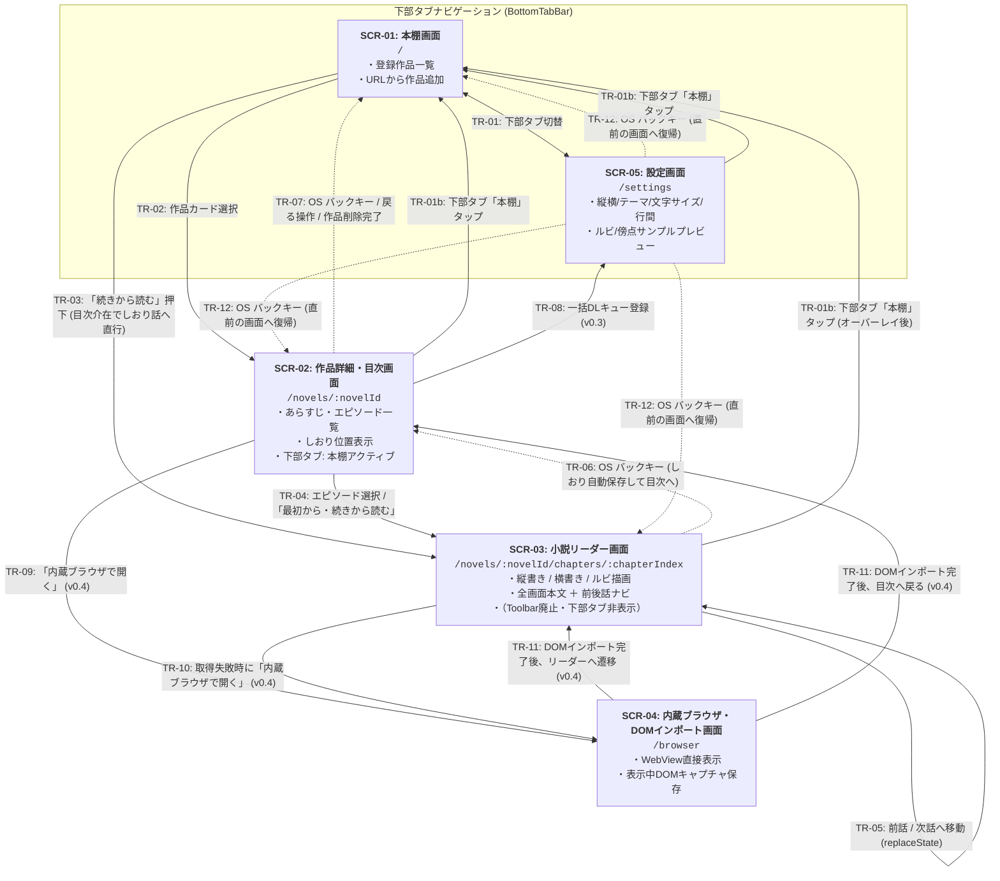

# 全体画面一覧・画面遷移の骨格（App 全体正本）

## 1. 主要画面一覧（`SCR-01` 〜 `SCR-05`）

Yommy は以下の 5 画面で構成されます。ルーティング基盤（`src/app/router.tsx`）により URL パスと各画面をマッピングし、画面最下部の下部タブバー（`BottomTabBar`）からはメインの「本棚（`SCR-01`）」と「設定（`SCR-05`）」を切り替え、作品を選択すると「作品詳細・目次（`SCR-02`）」→「小説リーダー（`SCR-03`）」へとドリルダウンします。

|   画面 ID    | 画面名称                                                  | ルートパス                                |            導入時期             | 主な役割・機能概要                                                                                                                                                                                                                                                                                                                                                                                                                                                                                        | 個別仕様書                              | 対応要件 ID                      |
| :----------: | :-------------------------------------------------------- | :---------------------------------------- | :-----------------------------: | :-------------------------------------------------------------------------------------------------------------------------------------------------------------------------------------------------------------------------------------------------------------------------------------------------------------------------------------------------------------------------------------------------------------------------------------------------------------------------------------------------------- | :-------------------------------------- | :------------------------------- |
| **`SCR-01`** | **本棚画面** (Bookshelf)                               | `/`                                       |           `v0.1 MVP`            | ・登録済み作品カード一覧（タイトル、著者、全話数・取得済み話数、しおり位置） ・「URLから作品を追加」ダイアログ（作品トップ・目次取得＆本棚即時反映） ・「続きから読む」ワンタップ起動（目次を介在させてリーダーへ直行） ・ヘッダー固定＋カード一覧内部スクロール＋下部タブ固定（`100dvh` シェル適合） ・お気に入りフィルタ・新着一括チェック（`v0.3`）                                                                                                                                        | `docs/specs/features/bookshelf.md`      | `SYS-REQ-01, 02, 12, 16`         |
| **`SCR-02`** | **作品詳細・目次画面** (Novel Detail & TOC)            | `/novels/:novelId`                        |           `v0.1 MVP`            | ・作品情報・あらすじ表示（トグル化は `Issue #51`）、目次更新（再取得・差分話数通知） ・章見出し＋エピソード一覧（キャッシュ済みバッジ・既読状態・しおりマーク） ・エピソード選択 / 「最初から・続きから読む」によるリーダー遷移（未キャッシュ時はオンデマンド取得） ・ヘッダー固定＋目次一覧内部スクロール＋下部タブ固定（`100dvh` シェル適合） ・作品削除（`v0.1`）/ 一括DLキュー（`v0.3`）/ 作品単位キャッシュ削除（`v0.4`）                                                                | `docs/specs/features/novel-detail.md`   | `SYS-REQ-01, 02, 04, 05, 12, 16` |
| **`SCR-03`** | **小説リーダー画面** (Novel Reader)                    | `/novels/:novelId/chapters/:chapterIndex` | `v0.1 MVP` (PoCで最小縦貫通) | ・本文組版描画（縦書き `vertical-rl` / 横書き `horizontal-tb`、`<ruby>`・傍点描画） ・組版設定（4テーマ・文字サイズ・行間）は設定画面（`SCR-05`）の最新値を自動適用（`ReaderToolbar` 廃止） ・連続スクロール ＆ 前後話ナビゲーションバー（`ReaderChapterNav`、下部オーバーレイ化は `Issue #52`）による前話/次話連続移動 ・既読状態（`is_read`）およびしおり話数・スクロール進捗率（`0.0〜1.0`）の自動保存・復元 ・OS バックキー操作時にしおりを自動保存して目次画面（`SCR-02`）へ論理階層復帰 | `docs/specs/features/reader-view.md`    | `SYS-REQ-02, 07〜12, 16`         |
| **`SCR-04`** | **内蔵ブラウザ・DOMインポート画面** (WebView Fallback) | `/browser?url=...`                        |             `v0.4`              | ・対象小説ページを内蔵 WebView で直接表示（Cloudflare回避・ログイン対応） ・「表示中ページをキャッシュに取り込む（DOMインポート）」アクションボタン ・取り込み完了後に作品詳細（`SCR-02`）またはリーダー（`SCR-03`）へ遷移                                                                                                                                                                                                                                                                          | `docs/specs/features/webview-import.md` | `SYS-REQ-13, 14`                 |
| **`SCR-05`** | **設定画面** (Settings)                                | `/settings`                               |             `v0.2`              | ・組版・表示設定（縦書き/横書き、4カラーテーマ、文字サイズ `12〜32px`、行間 `1.4〜2.4`）の一括カスタマイズと永続化 ・ルビ（`<ruby>`）・傍点（`<em class="bouten">`）を含む固定サンプル小説文のリアルタイムプレビュー枠 ・下部タブバー（「設定」アクティブ表示）および OS バックキー（直前画面復帰）連携 ・DLキュー進捗/操作（`v0.3`）、キャッシュ容量整理・データバックアップ（`v0.4`）                                                                                                          | `docs/specs/features/settings.md`       | `SYS-REQ-08, 09, 10, 16`         |

---

## 2. 画面遷移図（State & Transition Map）

---

## 3. 画面遷移一覧（`TR-01` 〜 `TR-12`）

|   遷移 ID    |             遷移元             |                    遷移先                    | トリガー条件・ガード・遷移時の振る舞い                                                                                                                                                                                                                                                                                                                  | 対応要件 ID              |
| :----------: | :----------------------------: | :------------------------------------------: | :------------------------------------------------------------------------------------------------------------------------------------------------------------------------------------------------------------------------------------------------------------------------------------------------------------------------------------------------------ | :----------------------- |
| **`TR-01`**  |            `SCR-01`            |                   `SCR-05`                   | 画面最下部の下部タブバー（`BottomTabBar`）の「設定」タブをタップしたとき、設定画面（`/settings`）へ遷移し、「設定」タブをアクティブ表示とする。                                                                                                                                                                                                         | `SYS-REQ-16`             |
| **`TR-01b`** | `SCR-02` / `SCR-03` / `SCR-05` |                   `SCR-01`                   | 下部タブバー（`BottomTabBar`）の「本棚」タブをタップしたとき、現在画面の階層や履歴に関わらず常に本棚トップ（`/`）へ直行する。                                                                                                                                                                                                                           | `SYS-REQ-16`             |
| **`TR-02`**  |            `SCR-01`            |                   `SCR-02`                   | 本棚の作品カード本体をタップしたときに該当作品の詳細・目次画面（`/novels/:novelId`）へ遷移する（「URLから作品を追加」で目次取得・DB保存が完了したときはダイアログを閉じて本棚一覧へ即時反映する）。なお下部タブバーの論理所属タブは「本棚」のアクティブ表示を維持する。                                                                                 | `SYS-REQ-01, 16`         |
| **`TR-03`**  |            `SCR-01`            |                   `SCR-03`                   | 作品カードの「続きから読む」ボタンをタップしたとき、論理階層の親である目次画面（`/novels/:novelId`）を履歴スタックに介在させた上で、`bookmark_chapter_index`（未設定時は第1話）のリーダー画面（`/novels/:novelId/chapters/:chapterIndex`）へ直接遷移し、未キャッシュ時は本文をオンデマンド取得して表示する。                                            | `SYS-REQ-02, 12, 16`     |
| **`TR-04`**  |            `SCR-02`            |                   `SCR-03`                   | 目次リストのエピソードをタップしたとき、または「最初から読む／続きから読む」ボタンをタップしたときにリーダー画面（`/novels/:novelId/chapters/:chapterIndex`）へ遷移し、未キャッシュ時はリーダー画面側で本文をオンデマンド取得して表示する。                                                                                                             | `SYS-REQ-02, 12`         |
| **`TR-05`**  |            `SCR-03`            |                   `SCR-03`                   | 前後話ナビゲーションバー（`ReaderChapterNav`）の「前の話へ」「次の話へ」操作により、同一作品の前後エピソード（`chapterIndex ± 1`）へ遷移する。履歴肥大化を防ぎ論理階層を保つため `history.replaceState` を適用する。未キャッシュ話はオンデマンド取得し、表示完了時および次話遷移時に `is_read = 1` と新エピソードへのしおり位置（先頭 `0`）を更新する。 | `SYS-REQ-02, 11, 12, 16` |
| **`TR-06`**  |            `SCR-03`            |                   `SCR-02`                   | OS バックキー（およびブラウザ戻る操作）を実行したとき、現在のエピソード番号とスクロール進捗率（`bookmark_scroll_progress`）を自動保存（`flushBookmark`）し、直ちにその作品の目次画面（`/novels/:novelId`）へ戻る（本棚からの直行や話数連続遷移後であっても、常に 1 回のバックキーで目次へ復帰する）。                                                   | `SYS-REQ-02, 12, 16`     |
| **`TR-07`**  |            `SCR-02`            |                   `SCR-01`                   | 作品詳細ヘッダーの「本棚へ戻る」ボタン、OS バックキー（ブラウザ戻る操作）、または作品削除確認ダイアログでの削除実行完了時に本棚画面（`/`）へ戻る。                                                                                                                                                                                                      | `SYS-REQ-01, 05, 16`     |
| **`TR-08`**  |            `SCR-02`            |                   `SCR-05`                   | 未取得エピソードの一括ダウンロード登録時、通知トーストまたはヘッダーのキューアイコンから DL キュー管理画面へ遷移する（`v0.3`）。                                                                                                                                                                                                                        | `SYS-REQ-03`             |
| **`TR-09`**  |            `SCR-02`            |                   `SCR-04`                   | 作品詳細メニューの「内蔵ブラウザで開く（手動インポート）」を選択したとき、作品 URL を指定して内蔵ブラウザ画面を開く（`v0.4`）。                                                                                                                                                                                                                         | `SYS-REQ-13`             |
| **`TR-10`**  |            `SCR-03`            |                   `SCR-04`                   | バックグラウンド通信での本文取得がエラーとなった際、エラー画面の「内蔵ブラウザで開いて取り込む」ボタンから該当話 URL で内蔵ブラウザ画面へ遷移する（`v0.4`）。                                                                                                                                                                                           | `SYS-REQ-13`             |
| **`TR-11`**  |            `SCR-04`            |             `SCR-03` / `SCR-02`              | 内蔵ブラウザ画面で「表示中の本文を取り込む」を実行し、DOM 抽出と DB 保存が成功した際に、そのままリーダー画面（`SCR-03`）または作品詳細画面（`SCR-02`）へ遷移する（`v0.4`）。                                                                                                                                                                            | `SYS-REQ-14`             |
| **`TR-12`**  |            `SCR-05`            | 直前の画面（`SCR-01` / `SCR-02` / `SCR-03`） | 設定画面（`/settings`）で OS バックキー（ブラウザ戻る操作）を実行したとき、設定を開く直前の画面へ復帰する（直前履歴が存在しない場合は本棚 `/` へ遷移）。                                                                                                                                                                                                | `SYS-REQ-16`             |
