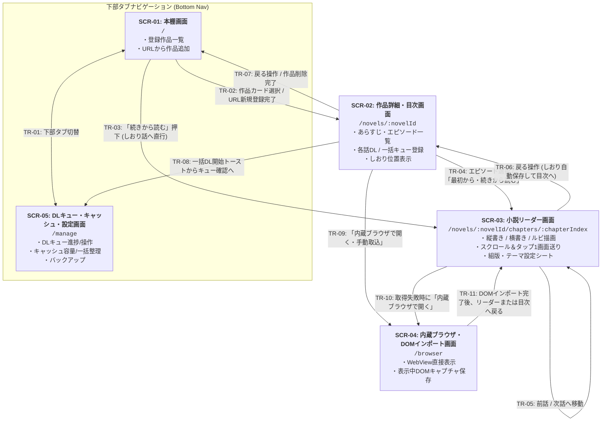

# 全体画面一覧・画面遷移の骨格（App 全体正本）

## 1. 主要画面一覧（`SCR-01` 〜 `SCR-05`）

Yommy は以下の 5 画面で構成されます。下部ナビゲーション（Bottom Navigation）からはメインの「本棚（`SCR-01`）」と「DLキュー・キャッシュ・設定（`SCR-05`）」を切り替え、作品を選択すると「作品詳細・目次（`SCR-02`）」→「小説リーダー（`SCR-03`）」へとドリルダウンします。

|   画面 ID    | 画面名称                                                              | ルートパス                                |            導入時期             | 主な役割・機能概要                                                                                                                                                                                                                                                                                                                                                               | 個別仕様書（Phase 4で詳細化）           |
| :----------: | :-------------------------------------------------------------------- | :---------------------------------------- | :-----------------------------: | :------------------------------------------------------------------------------------------------------------------------------------------------------------------------------------------------------------------------------------------------------------------------------------------------------------------------------------------------------------------------------- | :-------------------------------------- |
| **`SCR-01`** | **本棚画面** (Bookshelf)                                           | `/`                                       |  `v0.1 MVP` (PoCで最小骨格)  | ・登録済み作品カード一覧（タイトル、著者、既読/取得済み話数、しおり位置） ・「URLから作品を追加」ダイアログ ・「続きから読む」ワンタップ起動 ・お気に入りフィルタ・新着一括チェック（`v0.2`）                                                                                                                                                                           | `docs/specs/features/bookshelf.md`      |
| **`SCR-02`** | **作品詳細・目次画面** (Novel Detail & TOC)                        | `/novels/:novelId`                        |           `v0.1 MVP`            | ・作品情報・あらすじ表示、目次更新（差分チェック） ・章見出し＋エピソード一覧（キャッシュ済みバッジ・既読状態・しおりマーク） ・単話取得 / 未取得一括DLキュー登録（`v0.2`） ・作品単位のキャッシュ削除・作品削除                                                                                                                                                        | `docs/specs/features/novel-detail.md`   |
| **`SCR-03`** | **小説リーダー画面** (Novel Reader)                                | `/novels/:novelId/chapters/:chapterIndex` | `v0.1 MVP` (PoCで最小縦貫通) | ・本文描画（縦書き `vertical-rl` / 横書き `horizontal-tb`、`<ruby>`・傍点描画） ・連続スクロール ＆ 左右タップ/音量キーによる1画面分ジャンプ送り ・中央タップで上下オーバーレイメニュー＆組版設定シート（フォント、文字サイズ、行間、4テーマ切替）表示 ・スクロール進捗の自動しおり保存、前話/次話への連続移動（未キャッシュ時はオンデマンド取得または内蔵WebView案内） | `docs/specs/features/reader.md`         |
| **`SCR-04`** | **内蔵ブラウザ・DOMインポート画面** (WebView Fallback)             | `/browser?url=...`                        |             `v0.3`              | ・対象小説ページを内蔵 WebView で直接表示（Cloudflare回避・ログイン対応） ・「表示中ページをキャッシュに取り込む（DOMインポート）」アクションボタン ・取り込み完了後に作品詳細（`SCR-02`）またはリーダー（`SCR-03`）へ遷移                                                                                                                                                 | `docs/specs/features/webview-import.md` |
| **`SCR-05`** | **DLキュー・キャッシュ管理・設定画面** (Queue, Storage & Settings) | `/manage`                                 |         `v0.2`〜`v0.3`          | ・バックグラウンド DL キューの進捗・一時停止/再開/失敗リトライ操作（`v0.2`） ・全体および作品別キャッシュ使用量（MB）の可視化、既読キャッシュ一括削除（`v0.3`） ・デフォルト組版設定、データバックアップ（エクスポート/インポート）（`v0.3`）                                                                                                                              | `docs/specs/features/queue-settings.md` |

---

## 2. 画面遷移図（State & Transition Map）

---

## 3. 画面遷移一覧（`TR-01` 〜 `TR-11`）

|   遷移 ID   |  遷移元  |       遷移先        | トリガー条件・ガード・遷移時の振る舞い                                                                                                                                                                   |
| :---------: | :------: | :-----------------: | :------------------------------------------------------------------------------------------------------------------------------------------------------------------------------------------------------- |
| **`TR-01`** | `SCR-01` |      `SCR-05`       | 下部ナビゲーションタブ（「本棚」⇄「管理・設定」）のタップにより相互に遷移する。                                                                                                                          |
| **`TR-02`** | `SCR-01` |      `SCR-02`       | 本棚の作品カードをタップしたとき、または「URLから作品を追加」で目次取得・DB保存が完了したときに該当作品の詳細・目次画面へ遷移する。                                                                      |
| **`TR-03`** | `SCR-01` |      `SCR-03`       | 作品カードの「続きから読む」ボタンをタップしたとき、`bookmark_chapter_index`（未設定時は第1話）のリーダー画面へ直接遷移する。                                                                            |
| **`TR-04`** | `SCR-02` |      `SCR-03`       | 目次リストのエピソードをタップしたとき（未キャッシュ時はその場で本文取得を実行してから表示）、または「最初から読む／続きから読む」ボタンをタップしたときにリーダー画面へ遷移する。                       |
| **`TR-05`** | `SCR-03` |      `SCR-03`       | 本文末尾（または先頭）の「次の話へ（前の話へ）」操作により、同一作品の前後エピソード（`chapterIndex ± 1`）へ遷移する。遷移時に完了話の `is_read = 1` と新エピソードへのしおり位置を更新する。            |
| **`TR-06`** | `SCR-03` |      `SCR-02`       | リーダーのオーバーレイヘッダーの「目次へ戻る」ボタン（または端末戻る操作）により、現在のスクロール進捗率（`bookmark_scroll_progress`）を自動保存して作品詳細・目次画面へ戻る。                           |
| **`TR-07`** | `SCR-02` |      `SCR-01`       | 作品詳細ヘッダーの「本棚へ戻る」ボタン、または作品削除確認ダイアログでの削除実行完了時に本棚画面へ戻る。                                                                                                 |
| **`TR-08`** | `SCR-02` |      `SCR-05`       | 未取得エピソードの一括ダウンロード登録時、通知トーストまたはヘッダーのキューアイコンから DL キュー管理画面へ遷移する。                                                                                   |
| **`TR-09`** | `SCR-02` |      `SCR-04`       | 作品詳細メニューの「内蔵ブラウザで開く（手動インポート）」を選択したとき、作品 URL を指定して内蔵ブラウザ画面を開く（`v0.3`）。                                                                          |
| **`TR-10`** | `SCR-03` |      `SCR-04`       | バックグラウンド通信での本文取得がエラー（403 Bot対策・ログイン必須・パース失敗等）となった際、エラー画面の「内蔵ブラウザで開いて取り込む」ボタンから該当話 URL で内蔵ブラウザ画面へ遷移する（`v0.3`）。 |
| **`TR-11`** | `SCR-04` | `SCR-03` / `SCR-02` | 内蔵ブラウザ画面で「表示中の本文を取り込む」を実行し、DOM 抽出と DB 保存が成功した際に、そのままリーダー画面（`SCR-03`）または作品詳細画面（`SCR-02`）へ遷移する（`v0.3`）。                             |
