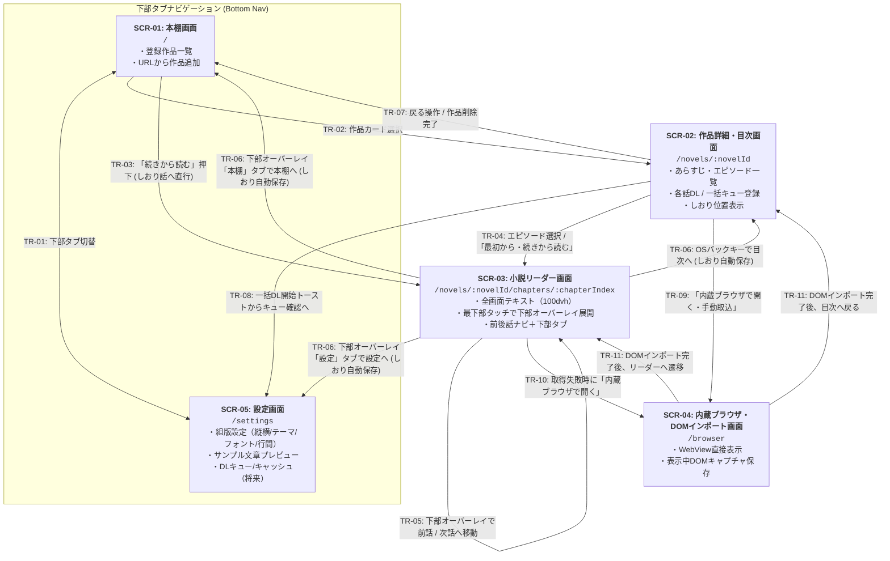

# 全体画面一覧・画面遷移の骨格（App 全体正本）

## 1. 主要画面一覧（`SCR-01` 〜 `SCR-05`）

Yommy は以下の 5 画面で構成されます。ルーティング基盤（`src/app/router.tsx`）により URL パスと各画面をマッピングし、下部ナビゲーション（Bottom Navigation）からはメインの「本棚（`SCR-01`）」と「設定（`SCR-05`）」を切り替え、作品を選択すると「作品詳細・目次（`SCR-02`）」→「小説リーダー（`SCR-03`）」へとドリルダウンします。

|   画面 ID    | 画面名称                                                  | ルートパス                                |            導入時期            | 主な役割・機能概要                                                                                                                                                                                                                                                                                                                                                                                                                                                                                 | 個別仕様書                              | 対応要件 ID                  |
| :----------: | :-------------------------------------------------------- | :---------------------------------------- | :----------------------------: | :------------------------------------------------------------------------------------------------------------------------------------------------------------------------------------------------------------------------------------------------------------------------------------------------------------------------------------------------------------------------------------------------------------------------------------------------------------------------------------------------- | :-------------------------------------- | :--------------------------- |
| **`SCR-01`** | **本棚画面** (Bookshelf)                               | `/`                                       |           `v0.1 MVP`           | ・登録済み作品カード一覧（タイトル、著者、全話数・取得済み話数、しおり位置） ・「URLから作品を追加」ダイアログ（作品トップ・目次取得＆本棚即時反映） ・「続きから読む」ワンタップ起動 ・お気に入りフィルタ・新着一括チェック（`v0.2`）                                                                                                                                                                                                                                                    | `docs/specs/features/bookshelf.md`      | `SYS-REQ-01, 02, 12`         |
| **`SCR-02`** | **作品詳細・目次画面** (Novel Detail & TOC)            | `/novels/:novelId`                        |           `v0.1 MVP`           | ・作品情報・あらすじ表示、目次更新（再取得・差分話数通知） ・章見出し＋エピソード一覧（キャッシュ済みバッジ・既読状態・しおりマーク） ・エピソード選択 / 「最初から・続きから読む」によるリーダー遷移（未キャッシュ時はオンデマンド取得） ・未取得一括DLキュー登録（`v0.2`）、作品削除（`v0.1`）/ 作品単位キャッシュ削除（`v0.3`）                                                                                                                                                        | `docs/specs/features/novel-detail.md`   | `SYS-REQ-01, 02, 04, 05, 12` |
| **`SCR-03`** | **小説リーダー画面** (Novel Reader)                    | `/novels/:novelId/chapters/:chapterIndex` | `v0.1 MVP` (v0.2で全画面化) | ・全画面本文描画（100dvh、縦書き `vertical-rl` / 横書き `horizontal-tb`、`<ruby>`・傍点描画） ・画面最下部ゾーンタッチによる下部オーバーレイ（`ReaderBottomOverlay`：前後話ナビ ＋ 下部タブ）のスライドイン展開・自動非表示 ・前後話ナビによる前話/次話への連続移動（未キャッシュ時はオンデマンド取得、1画面タップ/音量キー送りは `v0.3`） ・既読状態（`is_read`）およびしおり話数・スクロール進捗率（`0.0〜1.0`）の自動保存・復元（OSバックキー・下部タブ遷移時の `flushBookmark` 含む） | `docs/specs/features/reader-view.md`    | `SYS-REQ-02, 07〜12`         |
| **`SCR-04`** | **内蔵ブラウザ・DOMインポート画面** (WebView Fallback) | `/browser?url=...`                        |             `v0.3`             | ・対象小説ページを内蔵 WebView で直接表示（Cloudflare回避・ログイン対応） ・「表示中ページをキャッシュに取り込む（DOMインポート）」アクションボタン ・取り込み完了後に作品詳細（`SCR-02`）またはリーダー（`SCR-03`）へ遷移                                                                                                                                                                                                                                                                   | `docs/specs/features/webview-import.md` | `SYS-REQ-13, 14`             |
| **`SCR-05`** | **設定画面** (Settings)                                | `/settings`                               |         `v0.2`〜`v0.3`         | ・組版設定（文字サイズ・行間・4テーマ・縦横切替）のカスタマイズとサンプル文章プレビュー枠（`v0.2`） ・DLキュー進捗管理・キャッシュ容量整理・データバックアップ（`v0.3`）                                                                                                                                                                                                                                                                                                                        | `docs/specs/features/settings.md`       | `SYS-REQ-03, 05, 06, 09, 10` |

---

## 2. 画面遷移図（State & Transition Map）

---

## 3. 画面遷移一覧（`TR-01` 〜 `TR-11`）

|   遷移 ID   |  遷移元  |             遷移先             | トリガー条件・ガード・遷移時の振る舞い                                                                                                                                                                                                                                                                                                                        | 対応要件 ID          |
| :---------: | :------: | :----------------------------: | :------------------------------------------------------------------------------------------------------------------------------------------------------------------------------------------------------------------------------------------------------------------------------------------------------------------------------------------------------------ | :------------------- |
| **`TR-01`** | `SCR-01` |            `SCR-05`            | 下部ナビゲーションタブ（「本棚」⇄「設定」）のタップにより相互に遷移する（`v0.2`〜`v0.3`）。                                                                                                                                                                                                                                                                   | `SYS-REQ-03, 05`     |
| **`TR-02`** | `SCR-01` |            `SCR-02`            | 本棚の作品カード本体をタップしたときに該当作品の詳細・目次画面（`/novels/:novelId`）へ遷移する（なお、「URLから作品を追加」で目次取得・DB保存が完了したときはダイアログを閉じて本棚一覧へ即時反映する）。                                                                                                                                                     | `SYS-REQ-01`         |
| **`TR-03`** | `SCR-01` |            `SCR-03`            | 作品カードの「続きから読む」ボタンをタップしたとき、`bookmark_chapter_index`（未設定時は第1話）のリーダー画面（`/novels/:novelId/chapters/:chapterIndex`）へ直接遷移し、未キャッシュ時は本文をオンデマンド取得して表示する。                                                                                                                                  | `SYS-REQ-02, 12`     |
| **`TR-04`** | `SCR-02` |            `SCR-03`            | 目次リストのエピソードをタップしたとき、または「最初から読む／続きから読む」ボタンをタップしたときにリーダー画面（`/novels/:novelId/chapters/:chapterIndex`）へ遷移し、未キャッシュ時はリーダー画面側で本文をオンデマンド取得して表示する。                                                                                                                   | `SYS-REQ-02, 12`     |
| **`TR-05`** | `SCR-03` |            `SCR-03`            | 下部オーバーレイ（`ReaderBottomOverlay`）の「前の話へ」「次の話へ」操作により、同一作品の前後エピソード（`chapterIndex ± 1`）へ遷移する（第1話では前話無効、最終話では次話無効）。未キャッシュ話はオンデマンド取得し、表示完了時および次話遷移時に `is_read = 1` と新エピソードへのしおり位置（先頭 `0`）を更新する。遷移後はオーバーレイが自動非表示となる。 | `SYS-REQ-02, 11, 12` |
| **`TR-06`** | `SCR-03` | `SCR-02` / `SCR-01` / `SCR-05` | OS バックキー（ブラウザ戻る操作）により現在のスクロール進捗率を保存（`flushBookmark`）して目次画面（`/novels/:novelId`）へ戻る、または下部オーバーレイの「本棚」タブによりしおり保存して本棚画面（`/`）へ遷移する、もしくは「設定」タブによりしおり保存して設定画面（`/settings`）へ遷移する。                                                                | `SYS-REQ-02, 12`     |
| **`TR-07`** | `SCR-02` |            `SCR-01`            | 作品詳細ヘッダーの「本棚へ戻る」ボタン、または作品削除確認ダイアログでの削除実行完了時に本棚画面へ戻る。                                                                                                                                                                                                                                                      | `SYS-REQ-01, 05`     |
| **`TR-08`** | `SCR-02` |            `SCR-05`            | 未取得エピソードの一括ダウンロード登録時、通知トーストまたはヘッダーのキューアイコンから DL キュー管理画面へ遷移する。                                                                                                                                                                                                                                        | `SYS-REQ-03`         |
| **`TR-09`** | `SCR-02` |            `SCR-04`            | 作品詳細メニューの「内蔵ブラウザで開く（手動インポート）」を選択したとき、作品 URL を指定して内蔵ブラウザ画面を開く（`v0.3`）。                                                                                                                                                                                                                               | `SYS-REQ-13`         |
| **`TR-10`** | `SCR-03` |            `SCR-04`            | バックグラウンド通信での本文取得がエラー（403 Bot対策・ログイン必須・パース失敗等）となった際、エラー画面の「内蔵ブラウザで開いて取り込む」ボタンから該当話 URL で内蔵ブラウザ画面へ遷移する（`v0.3`）。                                                                                                                                                      | `SYS-REQ-13`         |
| **`TR-11`** | `SCR-04` |      `SCR-03` / `SCR-02`       | 内蔵ブラウザ画面で「表示中の本文を取り込む」を実行し、DOM 抽出と DB 保存が成功した際に、そのままリーダー画面（`SCR-03`）または作品詳細画面（`SCR-02`）へ遷移する（`v0.3`）。                                                                                                                                                                                  | `SYS-REQ-14`         |
