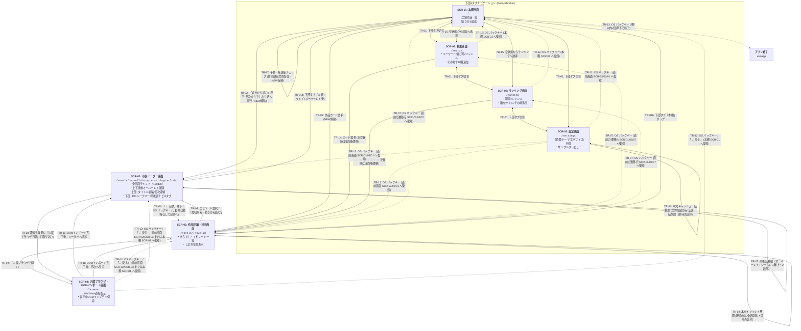

# 全体画面一覧・画面遷移の骨格（App 全体正本）

## 1. 主要画面一覧（`SCR-01` 〜 `SCR-07`）

Yommy は以下の 7 画面で構成されます。ルーティング基盤（`src/app/router.tsx`）により URL パスと各画面をマッピングし、画面最下部の下部タブバー（`BottomTabBar`）からは「本棚（`SCR-01`）」「検索（`SCR-06`）」「ランキング（`SCR-07`）」「設定（`SCR-05`）」の 4 タブを切り替え、作品を選択すると「作品詳細・目次（`SCR-02`）」→「小説リーダー（`SCR-03`）」へとドリルダウンします。

|   画面 ID    | 画面名称                                                  | ルートパス                                |                                                                                                                                        導入時期                                                                                                                                        | 主な役割・機能概要                                                                                                                                                                                                                                                                                                                                                                                                                                                                                                                                                                                                                                                                                                                                                                                                                                                                                                                                                                                                                                                                                                                                                                                                                                                                                                                                                                                                                                                                                                                                                                                                                                                                                                                                                                                                          | 個別仕様書                              | 対応要件 ID                                      |
| :----------: | :-------------------------------------------------------- | :---------------------------------------- | :------------------------------------------------------------------------------------------------------------------------------------------------------------------------------------------------------------------------------------------------------------------------------------: | :-------------------------------------------------------------------------------------------------------------------------------------------------------------------------------------------------------------------------------------------------------------------------------------------------------------------------------------------------------------------------------------------------------------------------------------------------------------------------------------------------------------------------------------------------------------------------------------------------------------------------------------------------------------------------------------------------------------------------------------------------------------------------------------------------------------------------------------------------------------------------------------------------------------------------------------------------------------------------------------------------------------------------------------------------------------------------------------------------------------------------------------------------------------------------------------------------------------------------------------------------------------------------------------------------------------------------------------------------------------------------------------------------------------------------------------------------------------------------------------------------------------------------------------------------------------------------------------------------------------------------------------------------------------------------------------------------------------------------------------------------------------------------------------------------------------------------- | :-------------------------------------- | :----------------------------------------------- |
| **`SCR-01`** | **本棚画面** (Bookshelf)                               | `/`                                       |                                                                                                                                       `v0.1 MVP`                                                                                                                                       | ・登録済み作品カード一覧（タイトル、著者、全話数・取得済み話数、しおり位置、お気に入り［★］トグルボタン `v0.8` Issue #266） ・「続きから読む」ワンタップ起動（目次を介在させてリーダーへ直行） ・ヘッダー固定＋カード一覧内部スクロール＋下部4タブ固定（`100dvh` シェル適合） ・空状態からの検索・ランキング誘導（URL直接入力は `v0.3` で廃止）、およびお気に入りフィルタ0件時の専用空状態・解除導線（`v0.8` Issue #266） ・自動更新チェック（NEW表示・閲覧時解除）・本棚5種ソート切替/永続化（`v0.3`）・「★ お気に入り」フィルタ切替/永続化と手動更新チェック対象連動（`v0.8` Issue #266） ・OS バックキー操作時の2秒以内連続2回押下によるアプリ終了UX（`TR-13`, `v0.3`）                                                                                                                                                                                                                                                                                                                                                                                                                                                                                                                                                                                                                                                                                                                                                                                                                                                                                                                                                                                                                                                                                                                                   | `docs/specs/features/bookshelf.md`      | `SYS-REQ-01, 02, 04, 06, 12, 16, 20`             |
| **`SCR-02`** | **作品詳細・目次画面** (Novel Detail & TOC)            | `/novels/:novelId`                        |                                                                                                                                       `v0.1 MVP`                                                                                                                                       | ・作品情報・お気に入り（★）トグルボタン（`v0.8` Issue #266）・あらすじ表示（トグル化は `Issue #51`）、目次更新（再取得・差分話数通知） ・永続ダウンロードキュー（`download_queue`）連動の未取得話一括キャッシュ・中断再開（`キャッシュを再開（残りN話）`）・失敗話スキップ継続と再試行（`失敗した話を再試行（N話）`、`v0.3` / `v0.9` Issue #268） ・章見出し＋エピソード一覧（キャッシュ済みバッジ・取得失敗バッジ・既読状態・しおりマーク） ・キャッシュ容量可視化および本文キャッシュ整理（既読話のみ／全話の本文キャッシュ削除・キュー整理、目次・既読・しおり保持、容量即時再計算、`v0.5` Issue #170 / `v0.9` Issue #268） ・エピソード選択 / 「最初から・続きから読む」によるリーダー遷移 ・ヘッダー固定＋目次一覧内部スクロール＋下部タブ固定（`100dvh` シェル適合） ・OS バックキー操作時に直前の遷移元（本棚/検索/ランキング）へ論理復帰                                                                                                                                                                                                                                                                                                                                                                                                                                                                                                                                                                                                                                                                                                                                                                                                                                                                                                                                                          | `docs/specs/features/novel-detail.md`   | `SYS-REQ-01, 02, 03, 04, 05, 06, 12, 16, 19, 20` |
| **`SCR-03`** | **小説リーダー画面** (Novel Reader)                    | `/novels/:novelId/chapters/:chapterIndex` | `v0.1 MVP` (v0.2で全画面化) (v0.4でページめくり・Kindle様式操作) (v0.5でマルチカラム組版・touch-action制御・横書きスクロール固定・フォント種別＆余白組版反映) (v0.6で2段階水平スライドアニメーション・上下連動オーバーレイ・RTLページシークバー・ハードウェア音量キー操作) | ・全画面本文組版描画（100dvh、縦書き `vertical-rl` / 横書き `horizontal-tb`、`<ruby>`・傍点描画） ・フォント種別（5種）および画面余白（8〜48px）の動的組版反映（`v0.5` Issue #169） ・縦書き時: CSSマルチカラム1ページ組版（文字・ルビ・傍点途切れ防止、画面余白に応じた段幅・段高・`columnGap`計算）、なめらかな2段階水平スライドアニメーション（タップ＆スワイプ離上＆音量キー共通、高速連打即時確定）、ページインジケーター表示（`v0.4` Issue #122、`v0.5` Issue #168、`v0.6` Issue #201, #203） ・Kindle様式の直感的操作（`touch-action: none` 制御による実機スワイプ確実化、リアルタイム指追従スワイプ・30%規定値スナップバック・左右端タップ・中央タップまたは最下部タッチでの上下連動オーバーレイ開閉） ・ハードウェア音量キー操作（音量［ー］次へ／音量［＋］前へによるページめくり・約85%スクロール送り、エピソード端2段階遷移、オーバーレイ自動非表示、`v0.6` Issue #203） ・上部オーバーレイ（`ReaderTopOverlay`: 作品名・サブタイトル1行固定省略表示、目次復帰「← 目次」導線、`v0.6` Issue #202） ・下部オーバーレイ（`ReaderBottomOverlay`: 縦書き時 RTL ページシークバー、前後話ナビ、4タブ、`v0.6` Issue #202） ・エピソード端でのシームレス前後話遷移（ページめくり時のラバーバンドドラッグ離上遷移および端ページ2段階タップ/音量キー遷移、連続スクロール時の本文先頭「前の話へ」・末尾「次の話へ」ボタンおよび端部到達後2段階スワイプ/音量キー遷移） ・横書き時: 連続スクロール固定 ・読書中5話自動先読み（1.5秒ウェイト順次取得・話数移動/離脱時AbortControllerキャンセル、`v0.3`） ・キャッシュTTL 7日間＋7日経過後の3秒短タイムアウト再取得と既存キャッシュフォールバック（`v0.3`） ・しおり・スクロール進捗率の自動保存・復元 ・OS バックキー操作または上部オーバーレイ「← 目次」押下時にしおりを自動保存（`flushBookmark`）して目次画面（`SCR-02`）へ論理階層復帰 | `docs/specs/features/reader-view.md`    | `SYS-REQ-02, 03, 04, 06, 07〜12, 16, 20`         |
| **`SCR-04`** | **内蔵ブラウザ・DOMインポート画面** (WebView Fallback) | `/browser?url=...`                        |                                                                                                                                     `v0.9 (#269)`                                                                                                                                      | ・対象小説ページを内蔵 WebView で直接表示（Cloudflare回避・ログイン対応） ・「表示中ページをキャッシュに取り込む（DOMインポート）」アクションボタン ・取り込み完了後に作品詳細（`SCR-02`）またはリーダー（`SCR-03`）へ遷移                                                                                                                                                                                                                                                                                                                                                                                                                                                                                                                                                                                                                                                                                                                                                                                                                                                                                                                                                                                                                                                                                                                                                                                                                                                                                                                                                                                                                                                                                                                                                                                            | `docs/specs/features/webview-import.md` | `SYS-REQ-13, 14`                                 |
| **`SCR-05`** | **設定画面** (Settings)                                | `/settings`                               |                                                                                                                                         `v0.2`                                                                                                                                         | ・組版・表示設定（縦横切替、4カラーテーマ、文字サイズ `12〜32px`、行間 `1.4〜2.4`、フォント種別5種選択ドロップダウン、画面余白 `8〜48px` 4px刻みステッパー、ページ送り設定「ページめくり［縦書き時］」「連続スクロール」2択切替、横書き時は disabled 化・スクロール固定注記表示、音量キーによるページ送り ON/OFF トグル `enableVolumeKeyPaging`、`AC-ST-13`〜`19`）の一括カスタマイズと永続化（`v0.4` Issue #122、`v0.5` Issue #168, #169、`v0.6` Issue #203） ・ルビ・傍点を含むサンプル小説文のリアルタイムプレビュー枠（フォント種別・余白即時反映） ・Google Drive クラウド同期（アカウント連携・解除、最終同期日時表示、今すぐ同期、`v0.4` Issue #120） ・ストレージ・キャッシュ管理（全体キャッシュ話数・合計容量表示、既読話のみ／全話の一括本文キャッシュ削除、即時再計算、`v0.5` Issue #170） ・下部4タブバー（「設定」アクティブ表示）および OS バックキー（直前画面/本棚ホーム復帰）連携                                                                                                                                                                                                                                                                                                                                                                                                                                                                                                                                                                                                                                                                                                                                                                                                                                                                                                             | `docs/specs/features/settings.md`       | `SYS-REQ-05, 06, 07, 08, 09, 10, 11, 16, 20`     |
| **`SCR-06`** | **検索画面** (Novel Search)                            | `/search`                                 |                                                                                                    `v0.3` (v0.7でなろうサイト切替対応) (v0.8で除外語・複数ジャンル・短編対応)                                                                                                    | ・対象サイト選択ピル（カクヨム / 小説家になろう、`SiteSelector`） ・キーワード入力、除外キーワード指定（インライン展開・適用中強調表示、Issue #264）、並び順4種（週間/累計/更新/新作）、連載状態・作品種別4種（すべて/連載中/完結済/短編、Issue #265）、サイト別複数ジャンル（OR）選択フィルタ（カクヨム12種 / なろう公式小ジャンル21種） ・サイト切替時の除外キーワード・連載状態保持・ジャンル自動リセット・自動再検索（検索済み時）・登録済み状態連動 ・検索結果作品カード一覧（「＋ 本棚に追加」ボタン、登録済みバッジ、次ページ取得） ・未登録カードタップ時の自動追加＆目次遷移、登録済みカードタップ時の目次遷移                                                                                                                                                                                                                                                                                                                                                                                                                                                                                                                                                                                                                                                                                                                                                                                                                                                                                                                                                                                                                                                                                                                                                                                         | `docs/specs/features/search.md`         | `SYS-REQ-17, 19, 20`                             |
| **`SCR-07`** | **ランキング画面** (Novel Ranking)                     | `/ranking`                                |                                                                                                           `v0.3` (v0.7でなろうサイト切替対応) (v0.8で作品種別切替対応)                                                                                                           | ・対象サイト選択ピル（カクヨム / 小説家になろう、`SiteSelector`） ・集計期間（日間/週間/月間/累計）× 作品種別（すべて / 長編・連載［デフォルト］/ 短編、Issue #265）× サイト別ジャンル（総合＋カクヨム主要12種 / なろう公式小ジャンル21種）切替 ・サイト切替時の期間・作品種別保持・ジャンル自動リセット・即時自動再取得・登録済み状態連動 ・順位バッジ強調表示（1〜3位メダル調バッジ、4位以降番号バッジ） ・作品カード一覧（「＋ 本棚に追加」ボタン、登録済みバッジ、目次遷移）                                                                                                                                                                                                                                                                                                                                                                                                                                                                                                                                                                                                                                                                                                                                                                                                                                                                                                                                                                                                                                                                                                                                                                                                                                                                                                                                | `docs/specs/features/ranking.md`        | `SYS-REQ-18, 19, 20`                             |

---

## 2. 画面遷移図（State & Transition Map）

---

## 3. 画面遷移一覧（`TR-01` 〜 `TR-20`）

|   遷移 ID    |                             遷移元                              |                            遷移先                             | トリガー条件・ガード・遷移時の振る舞い                                                                                                                                                                                                                                                                                                                                                                                                                                                                                                                                                                                                                                                                                           | 対応要件 ID                  |
| :----------: | :-------------------------------------------------------------: | :-----------------------------------------------------------: | :------------------------------------------------------------------------------------------------------------------------------------------------------------------------------------------------------------------------------------------------------------------------------------------------------------------------------------------------------------------------------------------------------------------------------------------------------------------------------------------------------------------------------------------------------------------------------------------------------------------------------------------------------------------------------------------------------------------------------- | :--------------------------- |
| **`TR-01`**  | `SCR-01` / `SCR-02` / `SCR-03` / `SCR-05` / `SCR-06` / `SCR-07` |           `SCR-01` / `SCR-05` / `SCR-06` / `SCR-07`           | 画面最下部の下部タブバー（`BottomTabBar`）の各タブ（「本棚」「検索」「ランキング」「設定」）をタップしたとき、対応するルートへ遷移し、該当タブをアクティブ表示とする。なお直前の画面パスはルーターの履歴コンテキストに保持される（同一タブの再タップは no-op となり履歴重複を防止する）。                                                                                                                                                                                                                                                                                                                                                                                                                                        | `SYS-REQ-16, 20`             |
| **`TR-01b`** |                             全画面                              |                           `SCR-01`                            | 下部タブバー（`BottomTabBar`）の「本棚」タブをタップしたとき、現在画面の階層や履歴に関わらず常に本棚トップ（`/`）へ直行する。                                                                                                                                                                                                                                                                                                                                                                                                                                                                                                                                                                                                    | `SYS-REQ-16, 20`             |
| **`TR-02`**  |                            `SCR-01`                             |                           `SCR-02`                            | 本棚の作品カード本体をタップしたときに該当作品の詳細・目次画面（`/novels/:novelId`）へ遷移する。対象作品に「NEW」バッジが付与されていた場合は `has_new_update` を 0 に解除する。なお下部タブバーの論理所属タブは「本棚」のアクティブ表示を維持する。                                                                                                                                                                                                                                                                                                                                                                                                                                                                             | `SYS-REQ-01, 04, 16`         |
| **`TR-03`**  |                            `SCR-01`                             |                           `SCR-03`                            | 作品カードの「続きから読む」ボタンをタップしたとき、論理階層の親である目次画面（`/novels/:novelId`）を履歴スタックに介在させた上で、`bookmark_chapter_index`（未設定時は第1話）のリーダー画面（`/novels/:novelId/chapters/:chapterIndex`）へ直接遷移し、未キャッシュ時は本文をオンデマンド取得して表示する。対象作品に「NEW」バッジが付与されていた場合は `has_new_update` を 0 に解除する。                                                                                                                                                                                                                                                                                                                                     | `SYS-REQ-02, 04, 12, 16`     |
| **`TR-04`**  |                            `SCR-02`                             |                           `SCR-03`                            | 目次リストのエピソードをタップしたとき、または「最初から読む／続きから読む」ボタンをタップしたときにリーダー画面（`/novels/:novelId/chapters/:chapterIndex`）へ遷移し、未キャッシュ時はリーダー画面側で本文をオンデマンド取得して表示する。                                                                                                                                                                                                                                                                                                                                                                                                                                                                                      | `SYS-REQ-02, 12`             |
| **`TR-05`**  |                            `SCR-03`                             |                           `SCR-03`                            | 下部オーバーレイ（`ReaderBottomOverlay`）の「前の話へ」「次の話へ」操作、エピソード境界でのシームレス遷移（ページめくり時の端ページからのラバーバンドドラッグ離上、または端ページ左右20%での2段階タップ［ヒント表示後2.5秒以内再タップ］、連続スクロール時の本文先頭「前の話へ」・末尾「次の話へ」ボタン押下、または端部到達後2段階スワイプ操作、ハードウェア音量キー［音量［ー］/［＋］］による端2段階操作）により、同一作品の前後エピソード（`chapterIndex ± 1`）へ遷移する。履歴肥大化を防ぎ論理階層を保つため `history.replaceState` を適用する。未キャッシュ話はオンデマンド取得し、表示完了時および次話遷移時に `is_read = 1` と新エピソードへのしおり位置（先頭 `0`）を更新する。遷移後はオーバーレイが自動非表示となる。 | `SYS-REQ-02, 03, 11, 12, 16` |
| **`TR-06`**  |                            `SCR-03`                             |                           `SCR-02`                            | OS バックキー（`@capacitor/app` の `AppBridge` 経由、およびブラウザ戻る操作）またはリーダー上部オーバーレイの「← 目次」ボタン（`reader-top-back-to-toc`）を押下したとき、現在のエピソード番号とスクロール進捗率（`bookmark_scroll_progress`）を自動保存（`flushBookmark`）し、直ちにその作品の目次画面（`/novels/:novelId`）へ戻る（本棚からの直行や話数連続遷移後であっても、常に 1 回の操作で目次へ復帰する。下部オーバーレイのタブタップ時は `TR-01` または `TR-01b` が適用されしおり保存後に遷移する）。                                                                                                                                                                                                                     | `SYS-REQ-02, 03, 12, 16`     |
| **`TR-07`**  |                            `SCR-02`                             |        直前の遷移元（`SCR-01` / `SCR-06` / `SCR-07`）         | 作品削除確認ダイアログでの削除実行完了、OS バックキー（`AppBridge` 経由またはブラウザ戻る操作）、または作品未検出画面（`novel-detail-not-found`）の「戻る」ボタン押下時に、直前の呼び出し元画面（本棚 `/`、検索 `/search`、またはランキング `/ranking`）へ戻る（直前履歴が存在しない場合は本棚 `/` へ復帰。なお下部タブバー「本棚」タップ時は `TR-01b` が適用される）。                                                                                                                                                                                                                                                                                                                                                          | `SYS-REQ-01, 05, 16, 20`     |
| **`TR-08`**  |                                -                                |                               -                               | （廃止：Milestone `v0.3` Issue #81 にて `SCR-02` 内での未取得話一括キャッシュおよび `SCR-03` での読書中5話先読みに統合し、専用キュー画面への遷移は不要化）                                                                                                                                                                                                                                                                                                                                                                                                                                                                                                                                                                       | -                            |
| **`TR-09`**  |                            `SCR-02`                             |                           `SCR-04`                            | 作品詳細ヘッダーのアクションバーで「内蔵ブラウザで開く」ボタン（`data-testid="open-webview-button"`）を押下したとき、作品 URL（`novel.canonicalUrl`）と `novelId` をパラメータとして内蔵ブラウザ画面（`/browser?url=...&novelId=...`）を開く（`v0.9` Issue #269）。                                                                                                                                                                                                                                                                                                                                                                                                                                                              | `SYS-REQ-13`                 |
| **`TR-10`**  |                            `SCR-03`                             |                           `SCR-04`                            | バックグラウンド通信での本文取得がエラーとなった際、エラー画面（`data-testid="reader-error"`）内の「内蔵ブラウザで開いて取り込む」ボタン（`data-testid="reader-open-webview-button"`）を押下したとき、該当話 URL と `novelId`, `chapterIndex` をパラメータとして内蔵ブラウザ画面（`/browser?url=...&novelId=...&chapterIndex=...`）へフォールバック遷移する（`v0.9` Issue #269）。なお、エピソード遷移（前話・次話・指定話移動）において本文取得が失敗した場合も、エラー画面およびフォールバック遷移のパラメータには目標話数の `chapterIndex` および対象話 URL が保持される（`R1-27`）。                                                                                                                                         | `SYS-REQ-13`                 |
| **`TR-11`**  |                            `SCR-04`                             |                      `SCR-03` / `SCR-02`                      | 内蔵ブラウザ画面で「表示中ページを取り込む（DOM インポート）」を実行し、DOM 抽出と DB 保存が成功した際に、目次取り込み時は作品詳細画面（`SCR-02`: `/novels/:novelId`）、各話本文取り込み時は小説リーダー画面（`SCR-03`: `/novels/:novelId/chapters/:chapterIndex`）へ自動遷移し読書を再開する（`v0.9` Issue #269）。                                                                                                                                                                                                                                                                                                                                                                                                             | `SYS-REQ-14`                 |
| **`TR-12`**  |            `SCR-04` / `SCR-05` / `SCR-06` / `SCR-07`            | 直前の遷移元（`SCR-03` / `SCR-02` / `SCR-01`）または `SCR-01` | 設定画面（`SCR-05`: `/settings`）または内蔵ブラウザ画面（`SCR-04`: `/browser`）で OS バックキー（`AppBridge` 経由またはブラウザ戻る操作、`SCR-04` のヘッダー「← 戻る」ボタン）を実行したとき、直前の画面がリーダー画面（`SCR-03`: `/novels/:novelId/chapters/:chapterIndex`）または作品詳細画面（`SCR-02`: `/novels/:novelId`）であればその直前画面へ復帰し、下部タブ（本棚・検索・ランキング）からの直接遷移や初期遷移時はホームである本棚画面（`SCR-01`: `/`）へ復帰する。検索画面（`SCR-06`: `/search`）およびランキング画面（`SCR-07`: `/ranking`）で OS バックキーを実行したときは、従来通りホームである本棚画面（`/`）へ復帰する。                                                                                         | `SYS-REQ-16, 20`             |
| **`TR-13`**  |                            `SCR-01`                             |                     アプリ終了 (exitApp)                      | 本棚画面（`SCR-01`: `/`）で Android OS バックキー（`AppBridge` 経由）を押下したとき、直前の押下から2秒以内であれば `AppBridge.exitApp()` を呼び出してアプリを終了する。1回目の押下（または前回の押下から2秒以上経過している場合）はアプリを終了せず、画面下部に「もう一度バックボタンを押すと終了します」という一時的な確認トースト（`role="status"`、2秒後に自動消去）を表示する（Webブラウザ実行時は no-op）。なお、トースト表示中にタブ切り替えや他画面へ遷移した場合はトーストを即時破棄する。                                                                                                                                                                                                                               | `SYS-REQ-16`                 |
| **`TR-14`**  |                       `SCR-06` / `SCR-07`                       |                           `SCR-02`                            | 検索・ランキング一覧の作品カード本体をタップしたとき、該当作品の詳細・目次画面（`/novels/:novelId`）へ遷移する。未登録作品の場合は自動で「本棚に追加」の目次取得・DB保存を完了させた上で遷移する。                                                                                                                                                                                                                                                                                                                                                                                                                                                                                                                               | `SYS-REQ-01, 19, 20`         |
| **`TR-15`**  |                            `SCR-01`                             |                      `SCR-06` / `SCR-07`                      | 本棚の空状態（`BookshelfEmptyState`）において、「小説を検索する」ボタン（`empty-search-button`）または「ランキングを見る」ボタン（`empty-ranking-button`）を押下したとき、それぞれ検索画面（`/search`）またはランキング画面（`/ranking`）へ遷移する。                                                                                                                                                                                                                                                                                                                                                                                                                                                                            | `SYS-REQ-01, 20`             |
| **`TR-16`**  |                            `SCR-01`                             |                           `SCR-01`                            | 本棚ヘッダーのソートセレクター（`bookshelf-sort-select`）またはお気に入りフィルタボタン（`bookshelf-favorite-filter-button`、またはお気に入り0件空状態の解除ボタン `empty-clear-favorite-filter-button`）を操作したとき、画面遷移を伴わず作品カード一覧を即座に再ソート（5種：更新あり優先/最近読んだ順/作品更新日順/登録日順/タイトル順）またはお気に入り作品に絞り込み・解除し、選択結果を DB（`app_settings` の `bookshelf_sort_order` / `bookshelf_favorite_only`）に即時永続化する。                                                                                                                                                                                                                                        | `SYS-REQ-04, 16`             |
| **`TR-17`**  |                            `SCR-01`                             |                           `SCR-01`                            | 本棚ヘッダーの更新ボタン（`bookshelf-refresh-button`）を押下したとき、お気に入りフィルタ ON 時は表示中のお気に入り作品のみ、OFF 時は全登録作品を対象にバックグラウンド順次目次再取得（1秒ウェイト）を開始し、ボタンを disabled 化して進行状況（`bookshelf-refresh-progress`）を表示する。新着話が検知された作品には NEW バッジを付与し、ソート順・フィルタ状態に応じて一覧を再描画する。                                                                                                                                                                                                                                                                                                                                         | `SYS-REQ-04, 16`             |
| **`TR-18`**  |                            `SCR-02`                             |                           `SCR-02`                            | 作品詳細ヘッダーの「未取得話を一括キャッシュ」（または中断後の「キャッシュを再開（残りN話）」、失敗後の「失敗した話を再試行（N話）」）ボタン（`batch-cache-button`）を押下したとき、対象エピソードを `download_queue` へ登録し、バックグラウンド順次本文取得（1.5秒ウェイト）を開始し、進行状況（`batch-cache-progress`）と「中断」ボタンを表示する。各話取得完了ごとに取得済み話数・キャッシュ状態を即時更新し、途中話エラー時は `'failed'` として記録して残りの話の取得を継続する。全話成功完了時はキューを自動削除して完了通知を表示し、失敗話がある場合は `取得失敗` バッジと再試行ボタンを表示する。手動中断時や画面離脱時は未完了話を `'pending'` として保持し安全に処理を停止する。                                       | `SYS-REQ-02, 03, 05`         |
| **`TR-19`**  |                            `SCR-02`                             |                           `SCR-02`                            | 作品詳細ヘッダーの「本文キャッシュ整理」ボタン（`open-clear-cache-dialog-button`）を押下して確認ダイアログを開き、「既読話の本文キャッシュのみ削除」または「すべての本文キャッシュを削除」を確定したとき、目次・既読状態・しおり位置を保持したまま該当エピソードの本文キャッシュおよび対応する `download_queue` レコードを破棄し、取得済み話数・キャッシュ容量を即時再計算して目次一覧のバッジおよび完了通知（`novel-detail-notice`）を更新する（`novel.cachedChapters === 0` または処理中はボタン非活性）。                                                                                                                                                                                                                     | `SYS-REQ-05`                 |
| **`TR-20`**  |                            `SCR-05`                             |                           `SCR-05`                            | 設定画面の「ストレージ・キャッシュ管理」セクション（`storage-cache-section`）の一括削除起動ボタン（`open-global-clear-cache-dialog-button`）を押下して確認ダイアログを開き、「既読話の本文キャッシュのみ削除」または「すべての本文キャッシュを削除」を確定したとき、全登録作品の対象エピソード本文キャッシュおよび対応する `download_queue` レコードを一括破棄し、全体キャッシュ話数・合計容量表示を即時再計算して更新し完了通知（`storage-cache-notice`）を表示する（合計キャッシュ話数が 0 または処理中はボタン非活性）。                                                                                                                                                                                                      | `SYS-REQ-05`                 |

---

## 4. Playwright システム結合テスト（E2E シナリオ `SCN-01` 〜 `SCN-07`）マッピング

各画面（`SCR-xx`）・画面遷移（`TR-xx`）・受入条件（`AC-xx`）のシステム横断的な結合動作は、`test/it/scenarios/` 配下の以下の Playwright 実ブラウザテストシナリオによって一意採番・継続回帰検証されます。

| シナリオ ID  | テストファイルパス                                          | 対象画面 (`SCR-xx`)                    | 対象画面遷移 (`TR-xx`)                                                                    | 主な検証内容・対象受入条件 (`AC-xx`)                                                                                                                                                                                                                                                                                                                                                                                                                                                           |
| :----------: | :---------------------------------------------------------- | :------------------------------------- | :---------------------------------------------------------------------------------------- | :--------------------------------------------------------------------------------------------------------------------------------------------------------------------------------------------------------------------------------------------------------------------------------------------------------------------------------------------------------------------------------------------------------------------------------------------------------------------------------------------- |
| **`SCN-01`** | `test/it/scenarios/scn01-poc-vertical-reader.spec.ts`       | `SCR-01`, `SCR-02`, `SCR-03`, `SCR-05` | `TR-01`, `TR-01b`, `TR-02`, `TR-03`, `TR-04`, `TR-05`, `TR-06`, `TR-07`, `TR-12`, `TR-13` | 作品登録〜目次表示・更新〜リーダー全画面縦書きマルチカラム組版・2段階水平スライドアニメーション・30%スナップバック・上下連動オーバーレイ＆RTLシークバー・端2段階遷移（ページめくり/連続スクロール）・フォント/余白反映・未キャッシュ話遷移ローディング表示・しおり保存復元・作品削除・本棚での OS バックキー2回押下終了トースト（`AC-BS-01`, `04`〜`07`, `12`, `AC-ND-01`〜`09`, `AC-RD-01`〜`25`, `28`, `AC-ST-01`〜`07`, `13`, `17`, `18`, `20`）                                            |
| **`SCN-02`** | `test/it/scenarios/scn02-search-ranking-discovery.spec.ts`  | `SCR-01`, `SCR-02`, `SCR-06`, `SCR-07` | `TR-01`, `TR-01b`, `TR-07`, `TR-12`, `TR-14`, `TR-15`                                     | 本棚空状態からの検索・ランキング誘導、カクヨム・小説家になろうのサイト切替（`SiteSelector`・サイト別ジャンルピル連動）、作品検索（除外キーワード・連載/短編・複数ジャンルフィルタ・次ページ）・ランキング（期間×作品種別×ジャンル・順位バッジ・期間ポイント）、その場での本棚追加、カードタップによる目次遷移と探索元への OS バックキー論理復帰（`AC-BS-01`, `AC-NR-01`〜`04`, `06`, `07`, `11`〜`14`, `AC-SE-01`〜`11`, `AC-RK-01`〜`10`, `AC-ND-07`, `09`）                                  |
| **`SCN-03`** | `test/it/scenarios/scn03-bookshelf-update-and-sort.spec.ts` | `SCR-01`, `SCR-02`, `SCR-03`           | `TR-02`, `TR-03`, `TR-16`, `TR-17`                                                        | 本棚表示時の自動/手動一括更新チェック、新着検知による「NEW」バッジ表示と作品詳細/リーダー閲覧時の自動解除、本棚5種ソート切替と永続化、本棚カード・作品詳細ヘッダーでのお気に入り（★）トグル登録/解除と画面間連動、本棚「★ お気に入り」フィルタ切替・永続化・お気に入り0件空状態＆解除導線・フィルタON時の手動更新チェック対象限定（`AC-BS-08`〜`11`, `14`, `15`, `AC-ND-10`, `23`, `AC-RD-11`）                                                                                                |
| **`SCN-04`** | `test/it/scenarios/scn04-prefetch-and-cache.spec.ts`        | `SCR-02`, `SCR-03`, `SCR-05`           | `TR-04`, `TR-05`, `TR-18`, `TR-19`, `TR-20`                                               | 作品詳細での永続ダウンロードキュー（`download_queue`）を用いた未取得話一括キャッシュ（進捗・中断と再開 `キャッシュを再開`・途中話エラー時のスキップ継続と `取得失敗` バッジおよび `失敗した話を再試行`・容量表示）と本文キャッシュ削除（既読のみ/全話・キュー整理）、設定画面での全体ストレージキャッシュ一括削除、リーダー読書中の5話自動先読みと TTL 7日間超過時の短タイムアウト既存キャッシュフォールバック（`AC-ND-11`〜`13`, `20`〜`22`, `24`, `25`, `AC-RD-12`, `13`, `AC-ST-14`〜`16`） |
| **`SCN-05`** | `test/it/scenarios/scn05-cloud-sync.spec.ts`                | `SCR-01`, `SCR-02`, `SCR-03`, `SCR-05` | `TR-01`, `TR-02`, `TR-04`, `TR-05`, `TR-07`                                               | 設定画面での Google アカウント連携・手動即時同期・連携解除、起動時自動 Pull によるリモート作品・お気に入り（新規作品復元および既存作品 `updatedAt` 比較による LWW マージ）・しおり・既読のローカル反映、読書進行・お気に入り変更・作品追加/削除（Tombstone）時のデバウンス自動 Push、なろう複数ページ目次の自動補完 Pull と既読・しおり復元・読書遷移（`AC-BS-13`, `14`, `AC-ND-06`, `23`, `AC-RD-14`, `AC-ST-08`〜`12`, `AC-NR-04`〜`07`, `SYS-REQ-02, 06, 12`）                              |
| **`SCN-06`** | `test/it/scenarios/scn06-volume-key-paging.spec.ts`         | `SCR-03`, `SCR-05`                     | `TR-01`, `TR-05`, `TR-12`                                                                 | 設定画面での「音量キーでページ送り」ON/OFF トグル切替と永続化、リーダー画面での音量［ー］/［＋］による縦書きページめくり（2段階水平スライド）・連続スクロール送り、ページめくり＆連続スクロール双方でのエピソード端2段階前後話遷移、オーバーレイ展開中の自動非表示、設定OFF時の無反応確認（`AC-ST-19`, `AC-RD-26`, `AC-RD-27`）                                                                                                                                                                |
| **`SCN-07`** | `test/it/scenarios/scn07-webview-import-fallback.spec.ts`   | `SCR-02`, `SCR-03`, `SCR-04`           | `TR-09`, `TR-10`, `TR-11`, `TR-12`                                                        | 作品詳細からの「内蔵ブラウザで開く」（`TR-09`）による目次 DOM インポートと目次反映（`TR-11`）、リーダー本文取得失敗時の「内蔵ブラウザで開いて取り込む」（`TR-10`）による各話本文 DOM インポートと読書再開（`TR-11`）、非対応 URL 警告表示、および「← 戻る」/ OS バックキーによる直前画面論理復帰（`TR-12`）（`AC-WV-01`〜`08`, `AC-ND-26`, `AC-RD-29`）                                                                                                                                        |
