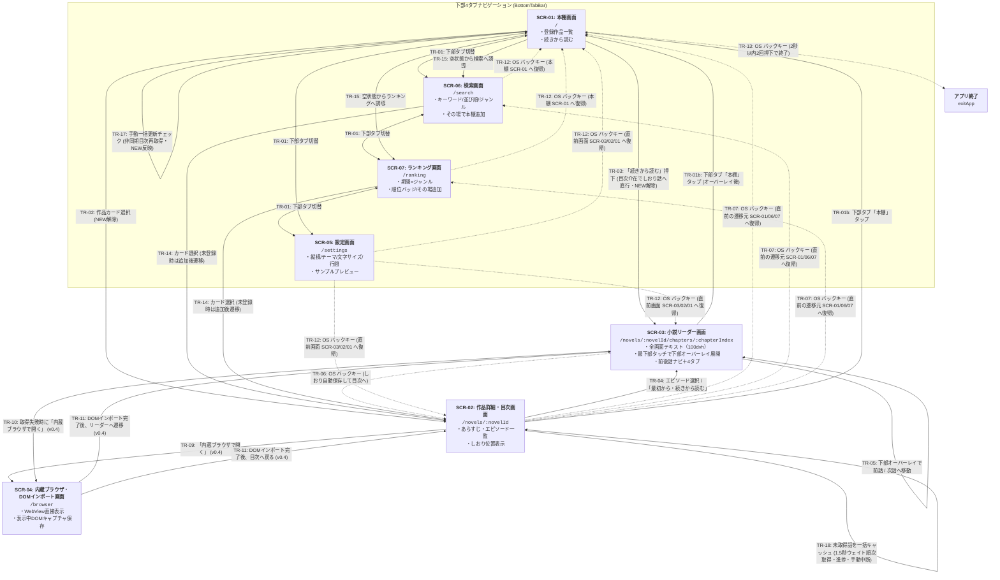

# 全体画面一覧・画面遷移の骨格（App 全体正本）

## 1. 主要画面一覧（`SCR-01` 〜 `SCR-07`）

Yommy は以下の 7 画面で構成されます。ルーティング基盤（`src/app/router.tsx`）により URL パスと各画面をマッピングし、画面最下部の下部タブバー（`BottomTabBar`）からは「本棚（`SCR-01`）」「検索（`SCR-06`）」「ランキング（`SCR-07`）」「設定（`SCR-05`）」の 4 タブを切り替え、作品を選択すると「作品詳細・目次（`SCR-02`）」→「小説リーダー（`SCR-03`）」へとドリルダウンします。

|   画面 ID    | 画面名称                                                  | ルートパス                                |                                導入時期                                | 主な役割・機能概要                                                                                                                                                                                                                                                                                                                                                                                                                                                                                                                                                                                                                                                                                                                                                                                                                                                                                                                                                                                                 | 個別仕様書                              | 対応要件 ID                                  |
| :----------: | :-------------------------------------------------------- | :---------------------------------------- | :--------------------------------------------------------------------: | :----------------------------------------------------------------------------------------------------------------------------------------------------------------------------------------------------------------------------------------------------------------------------------------------------------------------------------------------------------------------------------------------------------------------------------------------------------------------------------------------------------------------------------------------------------------------------------------------------------------------------------------------------------------------------------------------------------------------------------------------------------------------------------------------------------------------------------------------------------------------------------------------------------------------------------------------------------------------------------------------------------------- | :-------------------------------------- | :------------------------------------------- |
| **`SCR-01`** | **本棚画面** (Bookshelf)                               | `/`                                       |                               `v0.1 MVP`                               | ・登録済み作品カード一覧（タイトル、著者、全話数・取得済み話数、しおり位置） ・「続きから読む」ワンタップ起動（目次を介在させてリーダーへ直行） ・ヘッダー固定＋カード一覧内部スクロール＋下部4タブ固定（`100dvh` シェル適合） ・空状態からの検索・ランキング誘導（URL直接入力は `v0.3` で廃止） ・自動更新チェック（NEW表示・閲覧時解除）・本棚5種ソート切替/永続化（`v0.3`） ・OS バックキー操作時の2秒以内連続2回押下によるアプリ終了UX（`TR-13`, `v0.3`）                                                                                                                                                                                                                                                                                                                                                                                                                                                                                                                                       | `docs/specs/features/bookshelf.md`      | `SYS-REQ-01, 02, 04, 12, 16, 20`             |
| **`SCR-02`** | **作品詳細・目次画面** (Novel Detail & TOC)            | `/novels/:novelId`                        |                               `v0.1 MVP`                               | ・作品情報・あらすじ表示（トグル化は `Issue #51`）、目次更新（再取得・差分話数通知） ・未取得話を一括キャッシュ（1.5秒レートリミット順次取得・進捗表示・手動中断、`v0.3`） ・章見出し＋エピソード一覧（キャッシュ済みバッジ・既読状態・しおりマーク） ・エピソード選択 / 「最初から・続きから読む」によるリーダー遷移 ・ヘッダー固定＋目次一覧内部スクロール＋下部タブ固定（`100dvh` シェル適合） ・OS バックキー操作時に直前の遷移元（本棚/検索/ランキング）へ論理復帰                                                                                                                                                                                                                                                                                                                                                                                                                                                                                                                             | `docs/specs/features/novel-detail.md`   | `SYS-REQ-01, 02, 03, 04, 05, 12, 16, 19, 20` |
| **`SCR-03`** | **小説リーダー画面** (Novel Reader)                    | `/novels/:novelId/chapters/:chapterIndex` | `v0.1 MVP` (v0.2で全画面化) (v0.4でページめくり・Kindle様式操作) | ・全画面本文組版描画（100dvh、縦書き `vertical-rl` / 横書き `horizontal-tb`、`<ruby>`・傍点描画） ・ページ送りモード（自動/ページめくり/スクロール）切替、1ページ組版（行途切れ防止）、なめらかな横スライドアニメーション、ページインジケーター表示（`v0.4` Issue #122） ・Kindle様式の直感的操作（リアルタイム指追従スワイプ・30%規定値スナップバック・左右端タップ・中央タップでのオーバーレイ開閉） ・エピソード端でのシームレス前後話遷移（ページめくり時のラバーバンド抵抗感とドラッグ離上遷移、スクロール時の2段階操作遷移） ・読書中5話自動先読み（1.5秒ウェイト順次取得・話数移動/離脱時AbortControllerキャンセル、`v0.3`） ・キャッシュTTL 7日間＋7日経過後の3秒短タイムアウト再取得と既存キャッシュフォールバック（`v0.3`） ・画面最下部タッチによる下部オーバーレイ（`ReaderBottomOverlay`：前後話ナビ ＋ 4タブ）のスライドイン展開 ・しおり・スクロール進捗率の自動保存・復元 ・OS バックキー操作時にしおりを自動保存（`flushBookmark`）して目次画面（`SCR-02`）へ論理階層復帰 | `docs/specs/features/reader-view.md`    | `SYS-REQ-02, 03, 04, 07〜12, 16, 20`         |
| **`SCR-04`** | **内蔵ブラウザ・DOMインポート画面** (WebView Fallback) | `/browser?url=...`                        |                                 `v0.4`                                 | ・対象小説ページを内蔵 WebView で直接表示（Cloudflare回避・ログイン対応） ・「表示中ページをキャッシュに取り込む（DOMインポート）」アクションボタン ・取り込み完了後に作品詳細（`SCR-02`）またはリーダー（`SCR-03`）へ遷移                                                                                                                                                                                                                                                                                                                                                                                                                                                                                                                                                                                                                                                                                                                                                                                   | `docs/specs/features/webview-import.md` | `SYS-REQ-13, 14`                             |
| **`SCR-05`** | **設定画面** (Settings)                                | `/settings`                               |                                 `v0.2`                                 | ・組版・表示設定（縦横切替、4カラーテーマ、文字サイズ `12〜32px`、行間 `1.4〜2.4`）の一括カスタマイズと永続化 ・ルビ・傍点を含むサンプル小説文のリアルタイムプレビュー枠 ・Google Drive クラウド同期（アカウント連携・解除、最終同期日時表示、今すぐ同期、`v0.4` Issue #120） ・下部4タブバー（「設定」アクティブ表示）および OS バックキー（直前画面/本棚ホーム復帰）連携 ・キャッシュ容量整理（`v0.4`）                                                                                                                                                                                                                                                                                                                                                                                                                                                                                                                                                                                              | `docs/specs/features/settings.md`       | `SYS-REQ-06, 08, 09, 10, 16, 20`             |
| **`SCR-06`** | **検索画面** (Novel Search)                            | `/search`                                 |                                 `v0.3`                                 | ・対象サイト選択ピル（カクヨム、将来なろう追加） ・キーワード入力、並び順4種（週間/累計/更新/新作）、連載状態、ジャンルフィルタ ・検索結果作品カード一覧（「＋ 本棚に追加」ボタン、登録済みバッジ、次ページ取得） ・未登録カードタップ時の自動追加＆目次遷移、登録済みカードタップ時の目次遷移                                                                                                                                                                                                                                                                                                                                                                                                                                                                                                                                                                                                                                                                                                            | `docs/specs/features/search.md`         | `SYS-REQ-17, 19, 20`                         |
| **`SCR-07`** | **ランキング画面** (Novel Ranking)                     | `/ranking`                                |                                 `v0.3`                                 | ・対象サイト選択ピル（カクヨム） ・集計期間（日間/週間/月間/累計）× ジャンル（総合＋主要12ジャンル）切替 ・順位バッジ強調表示（1〜3位メダル調バッジ、4位以降番号バッジ） ・作品カード一覧（「＋ 本棚に追加」ボタン、登録済みバッジ、目次遷移）                                                                                                                                                                                                                                                                                                                                                                                                                                                                                                                                                                                                                                                                                                                                                            | `docs/specs/features/ranking.md`        | `SYS-REQ-18, 19, 20`                         |

---

## 2. 画面遷移図（State & Transition Map）

---

## 3. 画面遷移一覧（`TR-01` 〜 `TR-18`）

|   遷移 ID    |                             遷移元                              |                            遷移先                             | トリガー条件・ガード・遷移時の振る舞い                                                                                                                                                                                                                                                                                                                                                                                                                                                                                                                | 対応要件 ID                  |
| :----------: | :-------------------------------------------------------------: | :-----------------------------------------------------------: | :---------------------------------------------------------------------------------------------------------------------------------------------------------------------------------------------------------------------------------------------------------------------------------------------------------------------------------------------------------------------------------------------------------------------------------------------------------------------------------------------------------------------------------------------------- | :--------------------------- |
| **`TR-01`**  | `SCR-01` / `SCR-02` / `SCR-03` / `SCR-05` / `SCR-06` / `SCR-07` |           `SCR-01` / `SCR-05` / `SCR-06` / `SCR-07`           | 画面最下部の下部タブバー（`BottomTabBar`）の各タブ（「本棚」「検索」「ランキング」「設定」）をタップしたとき、対応するルートへ遷移し、該当タブをアクティブ表示とする。なお直前の画面パスはルーターの履歴コンテキストに保持される（同一タブの再タップは no-op となり履歴重複を防止する）。                                                                                                                                                                                                                                                             | `SYS-REQ-16, 20`             |
| **`TR-01b`** |                             全画面                              |                           `SCR-01`                            | 下部タブバー（`BottomTabBar`）の「本棚」タブをタップしたとき、現在画面の階層や履歴に関わらず常に本棚トップ（`/`）へ直行する。                                                                                                                                                                                                                                                                                                                                                                                                                         | `SYS-REQ-16, 20`             |
| **`TR-02`**  |                            `SCR-01`                             |                           `SCR-02`                            | 本棚の作品カード本体をタップしたときに該当作品の詳細・目次画面（`/novels/:novelId`）へ遷移する。対象作品に「NEW」バッジが付与されていた場合は `has_new_update` を 0 に解除する。なお下部タブバーの論理所属タブは「本棚」のアクティブ表示を維持する。                                                                                                                                                                                                                                                                                                  | `SYS-REQ-01, 04, 16`         |
| **`TR-03`**  |                            `SCR-01`                             |                           `SCR-03`                            | 作品カードの「続きから読む」ボタンをタップしたとき、論理階層の親である目次画面（`/novels/:novelId`）を履歴スタックに介在させた上で、`bookmark_chapter_index`（未設定時は第1話）のリーダー画面（`/novels/:novelId/chapters/:chapterIndex`）へ直接遷移し、未キャッシュ時は本文をオンデマンド取得して表示する。対象作品に「NEW」バッジが付与されていた場合は `has_new_update` を 0 に解除する。                                                                                                                                                          | `SYS-REQ-02, 04, 12, 16`     |
| **`TR-04`**  |                            `SCR-02`                             |                           `SCR-03`                            | 目次リストのエピソードをタップしたとき、または「最初から読む／続きから読む」ボタンをタップしたときにリーダー画面（`/novels/:novelId/chapters/:chapterIndex`）へ遷移し、未キャッシュ時はリーダー画面側で本文をオンデマンド取得して表示する。                                                                                                                                                                                                                                                                                                           | `SYS-REQ-02, 12`             |
| **`TR-05`**  |                            `SCR-03`                             |                           `SCR-03`                            | 下部オーバーレイ（`ReaderBottomOverlay`）の「前の話へ」「次の話へ」操作、またはエピソード境界でのシームレス遷移（ページめくり時の端ページからのラバーバンドドラッグ離上、連続スクロール時の端部到達後2段階スクロール操作）により、同一作品の前後エピソード（`chapterIndex ± 1`）へ遷移する。履歴肥大化を防ぎ論理階層を保つため `history.replaceState` を適用する。未キャッシュ話はオンデマンド取得し、表示完了時および次話遷移時に `is_read = 1` と新エピソードへのしおり位置（先頭 `0`）を更新する。遷移後はオーバーレイが自動非表示となる。         | `SYS-REQ-02, 03, 11, 12, 16` |
| **`TR-06`**  |                            `SCR-03`                             |                           `SCR-02`                            | OS バックキー（`@capacitor/app` の `AppBridge` 経由、およびブラウザ戻る操作）を実行したとき、現在のエピソード番号とスクロール進捗率（`bookmark_scroll_progress`）を自動保存（`flushBookmark`）し、直ちにその作品の目次画面（`/novels/:novelId`）へ戻る（本棚からの直行や話数連続遷移後であっても、常に 1 回のバックキーで目次へ復帰する。下部オーバーレイのタブタップ時は `TR-01` または `TR-01b` が適用されしおり保存後に遷移する）。                                                                                                                | `SYS-REQ-02, 03, 12, 16`     |
| **`TR-07`**  |                            `SCR-02`                             |        直前の遷移元（`SCR-01` / `SCR-06` / `SCR-07`）         | 作品削除確認ダイアログでの削除実行完了、OS バックキー（`AppBridge` 経由またはブラウザ戻る操作）、または作品未検出画面（`novel-detail-not-found`）の「戻る」ボタン押下時に、直前の呼び出し元画面（本棚 `/`、検索 `/search`、またはランキング `/ranking`）へ戻る（直前履歴が存在しない場合は本棚 `/` へ復帰。なお下部タブバー「本棚」タップ時は `TR-01b` が適用される）。                                                                                                                                                                               | `SYS-REQ-01, 05, 16, 20`     |
| **`TR-08`**  |                                -                                |                               -                               | （廃止：Milestone `v0.3` Issue #81 にて `SCR-02` 内での未取得話一括キャッシュおよび `SCR-03` での読書中5話先読みに統合し、専用キュー画面への遷移は不要化）                                                                                                                                                                                                                                                                                                                                                                                            | -                            |
| **`TR-09`**  |                            `SCR-02`                             |                           `SCR-04`                            | 作品詳細メニューの「内蔵ブラウザで開く（手動インポート）」を選択したとき、作品 URL を指定して内蔵ブラウザ画面を開く（`v0.4`）。                                                                                                                                                                                                                                                                                                                                                                                                                       | `SYS-REQ-13`                 |
| **`TR-10`**  |                            `SCR-03`                             |                           `SCR-04`                            | バックグラウンド通信での本文取得がエラーとなった際、エラー画面の「内蔵ブラウザで開いて取り込む」ボタンから該当話 URL で内蔵ブラウザ画面へ遷移する（`v0.4`）。                                                                                                                                                                                                                                                                                                                                                                                         | `SYS-REQ-13`                 |
| **`TR-11`**  |                            `SCR-04`                             |                      `SCR-03` / `SCR-02`                      | 内蔵ブラウザ画面で「表示中の本文を取り込む」を実行し、DOM 抽出と DB 保存が成功した際に、そのままリーダー画面（`SCR-03`）または作品詳細画面（`SCR-02`）へ遷移する（`v0.4`）。                                                                                                                                                                                                                                                                                                                                                                          | `SYS-REQ-14`                 |
| **`TR-12`**  |                 `SCR-05` / `SCR-06` / `SCR-07`                  | 直前の遷移元（`SCR-03` / `SCR-02` / `SCR-01`）または `SCR-01` | 設定画面（`SCR-05`: `/settings`）で OS バックキー（`AppBridge` 経由またはブラウザ戻る操作）を実行したとき、直前の画面がリーダー画面（`SCR-03`: `/novels/:novelId/chapters/:chapterIndex`）または作品詳細画面（`SCR-02`: `/novels/:novelId`）であればその直前画面へ復帰し、下部タブ（本棚・検索・ランキング）からの直接遷移や初期遷移時はホームである本棚画面（`SCR-01`: `/`）へ復帰する。検索画面（`SCR-06`: `/search`）およびランキング画面（`SCR-07`: `/ranking`）で OS バックキーを実行したときは、従来通りホームである本棚画面（`/`）へ復帰する。 | `SYS-REQ-16, 20`             |
| **`TR-13`**  |                            `SCR-01`                             |                     アプリ終了 (exitApp)                      | 本棚画面（`SCR-01`: `/`）で Android OS バックキー（`AppBridge` 経由）を押下したとき、直前の押下から2秒以内であれば `AppBridge.exitApp()` を呼び出してアプリを終了する。1回目の押下（または前回の押下から2秒以上経過している場合）はアプリを終了せず、画面下部に「もう一度バックボタンを押すと終了します」という一時的な確認トースト（`role="status"`、2秒後に自動消去）を表示する（Webブラウザ実行時は no-op）。                                                                                                                                      | `SYS-REQ-16`                 |
| **`TR-14`**  |                       `SCR-06` / `SCR-07`                       |                           `SCR-02`                            | 検索・ランキング一覧の作品カード本体をタップしたとき、該当作品の詳細・目次画面（`/novels/:novelId`）へ遷移する。未登録作品の場合は自動で「本棚に追加」の目次取得・DB保存を完了させた上で遷移する。                                                                                                                                                                                                                                                                                                                                                    | `SYS-REQ-19, 20`             |
| **`TR-15`**  |                            `SCR-01`                             |                      `SCR-06` / `SCR-07`                      | 本棚の空状態（`BookshelfEmptyState`）において、「小説を検索する」ボタン（`empty-search-button`）または「ランキングを見る」ボタン（`empty-ranking-button`）を押下したとき、それぞれ検索画面（`/search`）またはランキング画面（`/ranking`）へ遷移する。                                                                                                                                                                                                                                                                                                 | `SYS-REQ-01, 20`             |
| **`TR-16`**  |                            `SCR-01`                             |                           `SCR-01`                            | 本棚ヘッダーのソートセレクター（`bookshelf-sort-select`）を操作したとき、画面遷移を伴わず作品カード一覧を即座に再ソート（5種：更新あり優先/最近読んだ順/作品更新日順/登録日順/タイトル順）し、選択結果を DB（`app_settings`）に即時永続化する。                                                                                                                                                                                                                                                                                                       | `SYS-REQ-04, 16`             |
| **`TR-17`**  |                            `SCR-01`                             |                           `SCR-01`                            | 本棚ヘッダーの更新ボタン（`bookshelf-refresh-button`）を押下したとき、全登録作品を対象にバックグラウンド順次目次再取得（1秒ウェイト）を開始し、ボタンを disabled 化して進行状況（`bookshelf-refresh-progress`）を表示する。新着話が検知された作品には NEW バッジを付与し、ソート順に応じて一覧を再描画する。                                                                                                                                                                                                                                          | `SYS-REQ-04, 16`             |
| **`TR-18`**  |                            `SCR-02`                             |                           `SCR-02`                            | 作品詳細ヘッダーの「未取得話を一括キャッシュ」ボタン（`batch-cache-button`）を押下したとき、未キャッシュ（または TTL 7日超過）のエピソードを対象に、バックグラウンド順次本文取得（1.5秒ウェイト）を開始し、ボタンを disabled 化（または「中断」ボタン表示）して進行状況（`batch-cache-progress`）を表示する。各話取得完了ごとに取得済み話数・キャッシュ状態を即時更新し、完了時に通知を表示する。手動中断時や画面離脱時には安全に処理を停止する。                                                                                                     | `SYS-REQ-02, 03, 05`         |
