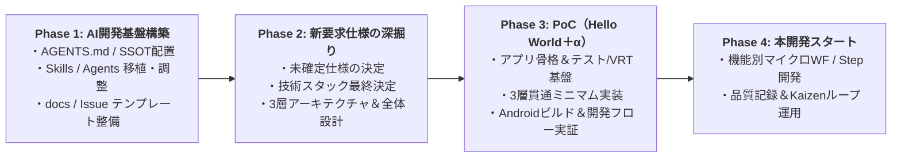

# Web小説リーダーアプリ（Yommy）開発計画書（初期案）

## 1. 背景と現在地

- **プロジェクト刷新・引き継ぎ**:
  - 旧構成のドキュメント・設定をリセットし、別プロジェクト（`react-practice-notes`）で実証されたAI駆動開発プレイブック（`reference/ai-dev-playbook-package/`）と新要求仕様（`reference/Web小説リーダー_要件定義・開発パターン検討.md`）を引き継ぎ。
- **DevContainer 環境構築完了**:
  - `.devcontainer/` にて Node.js 24、GitHub CLI、GitHub Copilot CLI、Playwright、SQLite3、および小説組版・VRT（視覚的回帰テスト）用の日本語フォント一式（Noto CJK、IPAex、BIZ UD明朝/ゴシック、Klee）を導入済み。

---

## 2. 全体進行計画（4フェーズ）

### Phase 1: AI駆動開発のワークフロー・必要なスキル・サブエージェントの用意
開発に着手する前に、AIエージェント（Google Antigravity / GitHub Copilot）を統制するルール（SSOT）・スキル・サブエージェントを整備する。

1. **AI設定のSSOT構築**
   - `AGENTS.md`（プロジェクト全体の憲法・常時ロード）
   - `.agents/skills.json`（Google Antigravity 用スキルマッピング）
   - `.github/copilot-instructions.md`（GitHub Copilot 用ブリッジ定義）
2. **サブエージェント（`.github/agents/`）の用意**
   - `pr-reviewer.agent.md`（アンカリングを防ぎ仕様正本と突き合わせる独立PRレビュアー）
   - `phase-final-reviewer.agent.md`（フェーズ・マイルストーン完了時の横断レビュアー）
3. **専門スキル（`.github/skills/`）の移植とYommy向け最適化**
   - 共通基盤スキル：`git-workflow`、`retrospective`、`repo-config-management`、`hook-ci-guidance`、`phase-final-review`
   - タスク・工程管理スキル：`waterfall-github-task-management`（または Issue 駆動マイクロ・ウォーターフォール運用スキル）
   - 実装・単体テストスキル（`c-ut-workflow` のYommy適応）：
     - **Parser Layer**: サンプルHTMLフィクスチャを用いたスクレイピング・DOM解析のTDD
     - **Storage Layer**: SQLite（ローカルキャッシュDB）のデータ操作テスト
     - **Viewer & UI Layer**: 1対1 Story/UT原則、親子分離原則、縦書き・ルビ表示を含む Storybook VRT
4. **ドキュメント規約・品質管理テンプレートの初期配置**
   - `docs/README.md`（設計書ライフサイクル、局所的再承認ルール）
   - `docs/review-comment-format.md`（`[P0]`〜`[P3]` ＋ 4要素レビュー基準）
   - `docs/quality/bug-and-handover-log.md`（バグ記録票・原因5分類 `L/S/D/B/A`・申し送り管理）
   - `.github/ISSUE_TEMPLATE/`（要望・タスク起票用テンプレート）

---

### Phase 2: 新要求仕様の深掘りとアーキテクチャ・初期設計の策定
開発準備完了後、`reference/Web小説リーダー_要件定義・開発パターン検討.md` をベースに新要求仕様を深掘りし、設計書正本（`docs/`）へ落とし込む。

1. **新要求仕様・スコープの深掘り**
   - **対象サイトと取得仕様**: 対応サイト（小説家になろう、カクヨム、ハーメルン等）の優先順位、年齢確認（R18）やログイン必須ページ、Cloudflare対策時のWebViewフォールバック境界
   - **小説特化型ビューワー仕様**: 縦書き/横書き切替、ルビ・傍点レンダリング、ページめくり方式 vs スクロール方式、フォント・テーマ設定、しおり・読書位置保存
   - **キャッシュ・キュー管理仕様**: レートリミット制御（ウェイト間隔）、バックグラウンド取得キュー、差分更新チェック、容量管理・バックアップ仕様
2. **技術スタック・3層モジュール設計の確定**
   - **推奨構成**: React (TypeScript / Vite) + Capacitor（または React Native + WebView）の最終決定
   - **3層分離アーキテクチャ**:
     1. `Parser Layer`（サイト別Strategyアダプター）
     2. `Storage Layer`（SQLite：`novels`, `chapters`, `download_queue` 等）
     3. `Viewer & WebView Bridge Layer`（組版ビューワー ＆ 内蔵ブラウザDOM抽出ブリッジ）
3. **開発ロードマップ（Step分割 / Feature分割）の策定**

---

### Phase 3: Androidアプリの動作確認とアーキテクチャ・開発フローの実証（PoC）
本格開発に入る前に、「Hello Worldに毛が生えたレベル」の最小縦貫通スライス（Walking Skeleton）を実装し、アーキテクチャとAI駆動開発フローの両面を実証する。

1. **プロジェクト骨格・テスト基盤のセットアップ**
   - アプリ本体（Vite + React + TypeScript + Capacitor 等）の初期化
   - 静的解析（TypeScript / ESLint / Prettier）、Vitest、Storybook、Playwright（VRT / IT）、GitHub Actions CI の構築
2. **ミニマム縦貫通実装（3層＋AIワークフロー実証）**
   - **Parser**: サンプルHTML（ルビ・傍点を含む短い小説テキスト）からタイトル・本文を抽出する最小パーサーをTDDで作成
   - **Storage**: 抽出したデータをローカルDBへ保存・読み出し
   - **Viewer**: 保存データを「縦書き・ルビ付き」で画面表示し、Storybook VRT で日本語フォント組版のスナップショット検証を実施
   - **AI開発フロー検証**: 「設計 → TDD実装（サブエージェント委託） → VRT/IT → 独立AIレビュー（`pr-reviewer`） → Task Completion Gate（7条件）」を一通り回してワークフローの引っかかりを解消
3. **Androidアプリとしてのビルド・実機/エミュレータ動作確認**
   - Androidプロジェクト生成・ビルド手順の確立と、Android上でのWebView表示・SQLite動作・ブリッジ連携の確認

---

### Phase 4: 本開発スタート
- Phase 3 の実証で得られた知見・課題を `AGENTS.md` および各 `SKILL.md` にフィードバック（Kaizen）する。
- 確定したロードマップに従い、各機能の開発サイクル（設計 → MK/TDD → IT → 品質記録・改善）を本格稼働させる。
- 引き継ぎ完了後、不要となった `reference/` 配下の移行元アーカイブを整理する。

---

## 3. 今後の深掘り検討テーマ（チェックリスト）

- [ ] **1. 開発プロセスの粒度設定**
  - **案A（Issue駆動マイクロ・ウォーターフォール）**: 機能（Feature Issue）単位で「設計更新（Living Docs）→ MK（TDD/VRT）→ IT → 品質記録」を小刻みに回す方式
  - **案B（Step分割ウォーターフォール）**: Step 1（MVP）、Step 2… とマイルストーンを切り、Step単位で ED → ID → C・UT → IT → PT の工程承認を回す方式
- [ ] **2. ベース技術スタックの最終決定**
  - パターンA（React + Vite + TypeScript + Capacitor）で進めるか、パターンB（React Native Expo + WebView）とするか
- [ ] **3. Androidビルド・実機デバッグ環境の役割分担**
  - ホストOS側（Android Studio / `adb`）でビルド・実機転送を行うか、DevContainer内にJava / Android SDK CLIを導入してコンテナ内でAPKビルドまで完結させるか
- [ ] **4. 新要求仕様の詳細ヒアリング（Phase 2）**
  - 旧設計からの変更点、新たに追加したい機能要求、MVP（最初のリリース）に含めるスコープの決定
