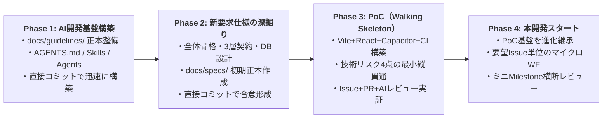

# Web小説リーダーアプリ（Yommy）開発計画書

## 1. 背景と現在地

- **プロジェクト刷新・引き継ぎ**:
  - 旧構成のドキュメント・設定をリセットし、別プロジェクト（`react-practice-notes`）で実証されたAI駆動開発プレイブック（`reference/ai-dev-playbook-package/`）と新要求仕様（`reference/Web小説リーダー_要件定義・開発パターン検討.md`）をベースに完全新規で策定する（直前コミット `HEAD~1` の旧設計書やサンプルは参照しない）。
- **DevContainer 環境構築完了**:
  - `.devcontainer/` にて Node.js 24、GitHub CLI、GitHub Copilot CLI、Playwright、SQLite3、および小説組版・VRT（視覚的回帰テスト）用の日本語フォント一式（Noto CJK、IPAex、BIZ UD明朝/ゴシック、Klee）を導入済み。

---

## 2. 全体進行計画と運用モデル（4フェーズ）



### 全体合意事項（Phase 1〜4 深掘り結果）

1. **開発プロセスの型（ハイブリッド型）**:
   - **開発準備期間（Phase 1〜3）**:
     - Phase 1（AI開発基盤）および Phase 2（新要求仕様の深掘り・全体骨格設計）は、対話しながら直接コミットでスピーディに固める。
     - Phase 3（PoC）から、整備した「GitHub Issue ＋ PR ＋ 独立AIレビュー（`pr-reviewer`）＋ Task Completion Gate（7条件）」のワークフローを実地検証する。
   - **本開発期間（Phase 4以降）**:
     - 要望（親Issue）ごとに **「設計更新（Living Docs） → MK（TDD実装・UT・VRT） → IT（Playwright全体回帰）」** を小刻みに回す **Issue駆動マイクロ・ウォーターフォール** で進行する。
2. **マイルストーン（節目）と品質改善ループの扱い**:
   - Phase 4 以降は、直近の要望（親Issue）を3〜5件程度束ねた **「ミニリリース Milestone（`v0.1`, `v0.2` 等）」** を設定する。
   - 各 Milestone 内の要望 Issue が完了した節目に、**全体横断レビュー（`phase-final-review`）** と **品質分析レポート作成（DRE計測・バグ傾向分析・`SKILL.md` / ガイドライン改善）** を実施する。
3. **人間・AI共通ルール（`docs/guidelines/`）とAIスキル（`.github/skills/`）の責務分離**:
   - テスト規律・開発フロー・レビュー基準など **「人間も意識すべきルール」はスキル内に閉じ込めず、`docs/guidelines/` 配下にリポジトリの正本ドキュメントとして明記** する。
   - `.github/skills/` の各スキルは `docs/guidelines/` を参照し、AI固有の実行手順・サブエージェント委託（オーケストレーション）手順のみを記述する（二重管理の防止）。
4. **ベース技術スタックとDevContainer/ホストOSの役割分担**:
   - **技術スタック**: **React (TypeScript / Vite) ＋ Capacitor**（パターンA）を採用。
   - **環境分担**: Webビルド・自動テスト（Vitest / Storybook VRT / Playwright IT）・`npx cap sync` までは DevContainer 内で実行し、Android APK ビルドおよび実機/エミュレータでの動作確認はホストOS（Android Studio / `adb`）または GitHub Actions 上で行う（コンテナの軽量性を維持）。

---

## 3. 各フェーズの詳細計画

### Phase 1: AI駆動開発のワークフロー・必要なスキル・サブエージェントの用意

`package.json` に依存しないドキュメント正本・AI設定・スキル・サブエージェント・GitHubテンプレート一式を構築する（`.githooks/` や `.github/workflows/` は Phase 3 で作成）。

#### 1.1 リポジトリドキュメント構成（`docs/`）の構築
人間とAIの双方が参照する Single Source of Truth（SSOT）として、以下の3本柱（`guidelines` / `specs` / `quality`）を構築する。

```text
docs/
├── README.md                          # ドキュメント全体マップ・ディレクトリ規約
├── guidelines/                        # 【人間・AI共通の開発規約・基準の正本】
│   ├── workflow.md                    # 開発プロセス標準（マイクロWF、ステータス管理、Task Completion Gate 7条件、ミニMilestone運用）
│   ├── testing.md                     # テスト・実装規律の正本（TDD、3層責務境界、1対1 Story/UT、親子分離、縦書きVRT、C0/C1 100%、バグ記録・原因D設計同期）
│   └── review-comment-format.md       # レビューコメント記述基準（[P0]〜[P3] ＋ 4要素フォーマット、横断レビュー集約形式）
├── specs/                             # 【製品仕様・設計（App全体正本 ＋ 差分仕様の2層管理）】※Phase 2以降で作成・更新
│   ├── features/.gitkeep              # [App全体正本] 画面・機能別の現在仕様書
│   ├── parsers/.gitkeep               # [App全体正本] 小説サイト別の現在パーサー仕様書
│   └── changes/                       # [差分仕様] 要望Issueごとの設計差分・テスト計画・Sub-issue分割
│       └── archive/.gitkeep           # 完了した要望Issueの差分仕様アーカイブ（親Issue完了時に移動）
└── quality/                           # 【品質分析・バグ記録・申し送り管理】
    ├── bug-and-handover-log.md        # バグ記録票（製品/支援分離、原因5分類 L/S/D/B/A）＆ 申し送り事項（HO-xx）追跡シート
    └── reports/                       # ミニリリース Milestone ごとの品質分析・改善（Kaizen）レポート格納先
        └── .gitkeep
```

#### 1.2 `docs/guidelines/testing.md` に定義するYommy向け3層テスト＆SSOT規律
前プロジェクトの「OpenAPI＋MSW」に代わり、Yommy（React + Vite + Capacitor）のアーキテクチャに合わせた以下の3層テスト規律を定義する。

1. **Parser Layer（スクレイピング・DOM解析層）**:
   - **SSOT**: `NovelParser` 型契約 ＋ 各小説サイトのサンプルHTMLフィクスチャ（`__fixtures__/*.html`）＋ サイト別スクレイピング仕様書。
   - **TDD**: 実通信を行わず、ローカルHTMLフィクスチャを入力としてタイトル・目次・ルビ/傍点付き本文HTMLを抽出する純粋な単体テストをVitestで100%網羅する。
2. **Storage Layer（ローカルDB・キャッシュ管理層）**:
   - **SSOT**: `docs/specs/db-schema.md`（`novels`, `chapters`, `download_queue` 等）＋ Storage Repository インターフェース。
   - **テスト独立性**: Capacitor SQLite プラグインを直接叩かずアダプター層で抽象化し、UT / Storybook / Playwright IT ではテスト用インメモリDB（各テスト前に `resetTestDb()` で初期化）を用いて決定論的に検証する。
3. **Viewer & Bridge Layer（表示・ブラウザ連携・UIコンポーネント層）**:
   - **Capacitor Bridge分離**: ネイティブHTTP通信（`CapacitorHttp`）や内蔵WebView DOM抽出ブリッジは薄いインターフェースとして分離し、テスト環境ではモック注入可能にする。
   - **UI単体テスト & VRT**: 全 `*.tsx` に対する `*.stories.tsx` / `*.test.tsx`（Portable Stories `composeStories`）の **1対1対応原則**、**親子コンポーネント分離原則**、**C0/C1/Functions 100% カバレッジ**、および Storybook を対象とした **日本語フォント・縦書き/ルビを含む VRT（1280px / 375px）一本化** を徹底する。

#### 1.3 AI設定（SSOT）・スキル・サブエージェントの配置

```text
/
├── AGENTS.md                                              # プロジェクト全体のAI憲法（docs/guidelines/ への参照とオーケストレーション原則）
├── .agents/
│   └── skills.json                                        # Google Antigravity 用スキルマッピング（.github/skills を参照）
└── .github/
    ├── copilot-instructions.md                            # GitHub Copilot 用ブリッジ定義（AGENTS.md を参照）
    ├── ISSUE_TEMPLATE/
    │   └── feature_request.md                             # 要望（親Issue）起票テンプレート（AI進行チェックリスト付き）
    ├── pull_request_template.md                           # PRテンプレート（バグ記録・申し送りミニテーブル付き）
    ├── retrospective/
    │   └── .gitkeep                                       # 振り返り一時ハンドオフ用ディレクトリ
    ├── agents/
    │   ├── pr-reviewer.agent.md                           # 独立PRレビュアー（docs/specs/ と docs/guidelines/ に照らして検証）
    │   └── phase-final-reviewer.agent.md                  # 節目（ミニMilestone等）の全体横断レビュアー
    └── skills/
        ├── iterative-github-task-management/SKILL.md      # 要望Issue細分化・設計PR→MK→IT進行・ミニMilestone横断レビュー手順
        ├── c-ut-workflow/SKILL.md                         # docs/guidelines/testing.md 準拠のTDD実装・サブエージェント(self)直列委託手順
        ├── phase-final-review/SKILL.md                    # アンカリング防止型・横断レビュー＆品質分析オーケストレーション手順
        ├── git-workflow/SKILL.md                          # ブランチ・日本語Conventional Commits・PR・Task Completion Gate手順
        ├── retrospective/SKILL.md                         # トラブル・手戻り発生時のセッション振り返り＆スキル改善手順
        ├── repo-config-management/SKILL.md                # AI設定・DevContainer・Git Hooksの構成管理手順
        ├── hook-ci-guidance/SKILL.md                      # HookとCIの責務分担判断ガイド（Phase 3以降で活用）
        ├── tdd/SKILL.md                                   # 汎用TDD基本サイクル定義
        ├── sdd/SKILL.md                                   # 汎用仕様駆動開発（SDD）定義
        └── ponytail/                                      # YAGNI・最小実装補助スキル（LICENSE + SKILL.md）
```

---

### Phase 2: 新要求仕様の深掘りと全体骨格設計の策定

`reference/Web小説リーダー_要件定義・開発パターン検討.md` と新規ヒアリングをもとに、**システム全体の骨格仕様とロードマップまで** を `docs/specs/` に策定する（各画面・各サイトの個別詳細設計 `features/*.md`, `parsers/*.md` は Phase 4 の各要望 Issue 着手時にジャストインタイムで詳細化する）。

1. **全体要件定義と機能一覧（`docs/specs/requirements.md`）**
   - ターゲット環境、対応サイト方針、リーダー体験（縦書き/横書き・ルビ/傍点・テーマ・操作系）、キャッシュ・キュー管理、WebViewフォールバック方針の整理
   - ミニリリース Milestone（`v0.1 MVP`, `v0.2`...）のロードマップ定義
2. **3層アーキテクチャと共通インターフェース契約（`docs/specs/architecture.md`）**
   - `Http / Bridge Layer`、`Parser Layer`、`Storage Layer`、`UI / Viewer Layer` のディレクトリ構成と基底インターフェース定義
3. **DBスキーマ骨格（`docs/specs/db-schema.md`）**
   - SQLite の主要テーブル（`novels`, `chapters`, `download_queue`, 設定等）の初期スキーマ定義
4. **全体画面一覧・画面遷移の骨格（`docs/specs/screen-transitions.md`）**
   - 主要画面（`SCR-xx`）と画面遷移（`TR-xx`）の全体マップ

---

### Phase 3: Androidアプリの動作確認とアーキテクチャ・開発フローの実証（PoC / Walking Skeleton）

本開発へそのまま進化継承できる **Walking Skeleton（動く最小骨格）** を構築し、技術リスク4点とAI駆動開発フロー（Issue＋PR＋独立レビュー）を一気通貫で実証する。

1. **Step 3-1: プロジェクト骨格・ツールチェーン・CI/Hook の構築**
   - Vite + React + TypeScript + Capacitor + Tailwind CSS の初期化
   - Vitest（カバレッジ C0/C1 100% 検証）、Storybook（Portable Stories）、Playwright（VRT / IT）の導入
   - `.githooks/` および `.github/workflows/`（CI / VRT / IT）の構築
2. **Step 3-2: 技術リスク4点の最小縦貫通実装（AIワークフロー実証）**
   - **実証する技術要素（1画面ミニマム構成）**:
     1. **CORS回避通信**: `CapacitorHttp` アダプターによる外部HTML（またはテスト時フィクスチャ）取得
     2. **Parser抽出**: 取得HTMLからタイトル・ルビ/傍点付き本文HTMLを抽出（Vitest TDD）
     3. **SQLite保存**: Storage アダプター経由でローカルDBへ保存・読み出し（インメモリDBテスト＆実機SQLite）
     4. **縦書き・ルビ表示**: 取得した本文を CSS `writing-mode: vertical-rl` ＋ `<ruby>` で描画し、Storybook VRT（1280px/375px・日本語フォント）でスナップショット検証
   - **実証するAI開発フロー**:
     - Issue起票 → サブエージェント（`self`）へのTDD直列委託 → PR作成 → GitHub Actions PASS → `pr-reviewer` による独立レビュー＆スレッド収束 → 人間マージ（Task Completion Gate 7条件の完遂）
3. **Step 3-3: Androidビルド・実機/エミュレータ動作確認と振り返り**
   - DevContainer で `npm run build && npx cap sync android` を実行し、ホストOS（Android Studio）または GitHub Actions で APK をビルドして実機/エミュレータ上で上記4点が動作することを確認。
   - Phase 3 完了時に `phase-final-review` と振り返り（Kaizen）を実施し、ツールチェーンと3層基底インターフェースを Phase 4 へ引き継ぐ。

---

### Phase 4: 本開発スタート

- Phase 3 で構築したプロジェクト骨格・CI・3層基底インターフェース（Http / Parser / Storage）を土台としてそのまま継承し、PoC用の仮画面を正式な画面へと進化させる。
- ミニリリース Milestone（`v0.1`〜）ごとに要望（親Issue）を立て、「個別機能設計（`docs/specs/features/*.md` 更新）→ MK PR（TDD/VRT）→ IT PR（`SCN-xx` 全体回帰）」のマイクロ・ウォーターフォールで開発を進める。
- 各ミニリリース Milestone 完了時に全体横断レビューと品質分析（DRE計測・スキル改善）を実施する。
- 引き継ぎ完了後、`reference/` ディレクトリを整理・削除する。
