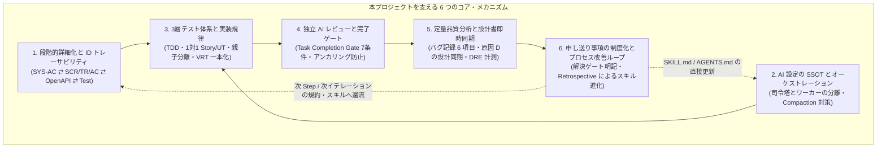

# AI駆動開発プレイブック ＆ 他プロジェクト適応手引き

本ドキュメント群は、`react-practice-notes` リポジトリにおいて実践・検証された **「AIエージェント（Google Antigravity / GitHub Copilot）を活用した高信頼ソフトウェア開発手法」** の仕組みを体系化した説明書であり、そこで得られた知見を **現代主流のイテレーティブ／アジャイル型開発（Issue駆動の細かいサイクル）へ適応するための実践手引き** です。

---

## 1. エグゼクティブサマリー：なぜこのプロジェクトはうまく回ったのか？

AIコーディングエージェントは高い実装速度を持つ一方で、長大なタスクや複雑な仕様に直面すると「勝手な仕様の捏造（ハルシネーション）」「コンテキスト枯渇による手順抜け」「テストの形骸化」「設計書とコードの乖離（ドキュメント腐敗）」を引き起こしやすいという弱点があります。

本プロジェクトでは、あえて **段階的ウォーターフォール開発（Step分割 × RD → ED → ID → C・UT → IT → PT）** を実験場として採用し、AIの弱点を構造的に抑え込む **6つのコア・メカニズム** を確立しました。

### 実証された定量的成果（Step 2 → Step 3 の進化）
- **単体テスト規模と網羅性**: 799 ケース（Step 2）→ **1,566 ケース（Step 3）** へ倍増しつつ、**C0（命令）/ C1（分岐）/ Functions 100.0% カバレッジ** を完全達成。
- **VRT（視覚的回帰テスト）**: 全 45 コンポーネント（419 スナップショット、PC/モバイル2系統）を Storybook 上で自動検証し、UI 崩れをゼロ化。
- **製品バグ密度の激減**: Step 2 のバグ傾向分析（設計誤認 `D` が 66.7%）から「1対1 Story/Test 規約」「設計同期ルール」を導入した結果、テストケースあたりの製品コードバグ密度が **0.0288 → 0.0115（約 60% 減少）** に改善。
- **欠陥除去率（DRE）**: 単体テスト段階で製品コード欠陥のほぼ 100% を除去し、IT（結合テスト）・PT（総合テスト）での製品コード手戻りを最小化。

> [!IMPORTANT]
> **ウォーターフォールからイテレーティブ（アジャイル）への転換の核心**
> 本プロジェクトの真の価値は「重厚長大なウォーターフォール」にあるのではなく、**「粒度の段階的ブレイクダウン」「完了ゲート」「テストの責務分離」「品質計測とフィードバックループ」** にあります。
> 他プロジェクトへ適応する際は、この順序（要望 → 外部設計 → 詳細設計 → 実装（MK）→ テスト）を維持したまま、**バッチサイズを「システム全体（数週間）」から「1つの Feature / Issue 単位（数時間〜数日）」へと極小化（マイクロ・ウォーターフォール化）** することで、スピードと品質を高い次元で両立できます。

---

## 2. ドキュメント構成（全6冊＋インデックス）

全体を見通しやすくするため、テーマ別に以下の6つのファイルに分割して構成しています。目的に応じて各ファイルを参照してください。

| ファイル名 | タイトル・主な内容 | おすすめの読者・利用シーン |
| :--- | :--- | :--- |
| **[01-waterfall-process-and-refinement.md](./01-waterfall-process-and-refinement.md)** | **第1部：段階的詳細化とワークフロー設計** ・要望から Step → RD → ED → ID → C・UT → IT → PT への細分化プロセス ・一貫した ID 体系と2段階トレーサビリティマトリクス ・成果物ステータス管理（`Draft`/`Review`/`Approved`）と局所的再承認ルール | ・要件や要望をどうやって漏れなく設計・実装に落とし込むか知りたいとき ・設計書とコードの乖離（陳腐化）を防ぐ仕組みを知りたいとき |
| **[02-ai-orchestration-and-governance.md](./02-ai-orchestration-and-governance.md)** | **第2部：AI設定のSSOTとマルチエージェント・ガバナンス** ・`AGENTS.md` / `SKILL.md` / `agent.md` による複数 AI ツールの SSOT 構成 ・メインエージェント（司令塔）とサブエージェント（実装・レビュー）の役割分担 ・Task Completion Gate（7つの完了条件）と構造化レビュー（`[P0]`〜`[P3]`） ・アンカリングを防止する工程完了横断レビュー（Phase Final Review） | ・AIエージェントが途中で手順を忘れたり暴走するのを防ぎたいとき ・AI同士のコードレビューや完了判定を厳格化するルールを作りたいとき |
| **[03-engineering-and-testing-practices.md](./03-engineering-and-testing-practices.md)** | **第3部：各工程の技術プラクティス（TDD・画面テスト・モック戦略）** ・TDD（Red-Green-Refactor コミット規約）と C0/C1 100% カバレッジ ・全 `.tsx` への 1対1 Story/UT 原則、親子コンポーネント分離原則 ・Portable Stories（`composeStories`）と VRT の UT 一本化 ・OpenAPI 正本準拠の MSW モックと、過去機能を包含進化させる実ブラウザ IT | ・フロントエンドの単体テスト、Storybook、VRT、E2E/IT の具体的な書き方と責務分界を知りたいとき ・テストの保守コストを下げつつ網羅率を100%にする手法を知りたいとき |
| **[04-quality-analysis-and-kaizen-loop.md](./04-quality-analysis-and-kaizen-loop.md)** | **第4部：品質分析・申し送り事項・継続的改善（Kaizen）ループ** ・開発リズムを止めない「バグ記録票（スリム化必須6項目）」と原因5分類 ・製品コードと支援成果物の厳格分離、原因 `D`（設計誤認）の設計書即時同期 ・DRE（欠陥除去率）計測と、Step 1 → 2 → 3 の実際の改善ストーリー ・申し送り事項（Handover Items）のゲート管理と Retrospective スキル | ・バグ傾向から開発プロセスや AI のスキル（`SKILL.md`）を継続的に改善する仕組みを作りたいとき ・次工程や次フェーズへの申し送りが放置されるのを防ぎたいとき |
| **[05-iterative-adaptation-guide.md](./05-iterative-adaptation-guide.md)** | **第5部：他プロジェクト（イテレーティブ／Issue駆動開発）への適応手引き** ・ウォーターフォールから「マイクロ・ウォーターフォール（Issue駆動）」への変換マップ ・人間が要望 Issue を起票 → AI がタスク分解 → 小単位で ED→ID→MK→Test を回す実践フロー ・スプリント／カンバンでの軽量品質分析と継続的改善サイクルの回し方 | **【最重要】** 今回の知見を次の実プロジェクト（アジャイル／イテレーティブ型）へ導入・設計するとき |
| **[06-starter-templates-and-checklists.md](./06-starter-templates-and-checklists.md)** | **第6部：他プロジェクト導入用スターターテンプレート＆チェックリスト集** ・そのままコピーして使える要望 Issue テンプレート、AI 細分化プロンプト ・軽量 Feature Spec（ED+ID統合版）テンプレート、バグ記録＆申し送りテンプレート ・新規リポジトリ立ち上げ時の導入チェックリスト | ・新規プロジェクトを立ち上げる際に、設定やテンプレートをすぐ手元に用意したいとき |

---

## 3. 本プロジェクトで「特に効果が高かったプラクティス」早見表

ユーザー様ご自身の着眼点（段階的詳細化、品質分析・申し送り・改善、TDD・画面テスト形式）に加え、リポジトリ調査から抽出された隠れた重要プラクティスを含む全体一覧です。

| カテゴリ | プラクティス名 | 解決する課題 | 参照先 |
| :--- | :--- | :--- | :--- |
| **計画・設計** | **要望からの段階的ブレイクダウン** | いきなりコードを書いて仕様漏れや手戻りが多発するのを防ぐ | [第1部](./01-waterfall-process-and-refinement.md) / [第5部](./05-iterative-adaptation-guide.md) |
| **計画・設計** | **OpenAPI 正本（SSOT）駆動** | フロントエンド・モック・バックエンド間の型やエラー仕様のズレをなくす | [第1部](./01-waterfall-process-and-refinement.md) / [第3部](./03-engineering-and-testing-practices.md) |
| **計画・設計** | **局所的再承認（Local Re-approval）** | 実装中に見つかった設計の不備を、プロセスを止めずに設計書へ即座に反映する | [第1部](./01-waterfall-process-and-refinement.md) |
| **AI 統制** | **オーケストレーターとワーカーの分離** | メインAIのコンテキスト溢れ（Compaction）による記憶喪失・手順飛ばしを防ぐ | [第2部](./02-ai-orchestration-and-governance.md) |
| **AI 統制** | **Task Completion Gate（7条件）** | AIの「PRを作ったから完了です（テスト落ち・未レビュー）」という早合点を防ぐ | [第2部](./02-ai-orchestration-and-governance.md) |
| **AI 統制** | **アンカリング防止型・独立AIレビュー** | 実装したAI自身の思い込みを引きずらず、第三者視点で仕様齟齬を摘出する | [第2部](./02-ai-orchestration-and-governance.md) |
| **実装・テスト** | **1対1 Story/UT ＆ 親子分離原則** | 巨大なページテストに依存せず、全UI部品の分岐と見た目を100%保証する | [第3部](./03-engineering-and-testing-practices.md) |
| **実装・テスト** | **Portable Stories ＋ VRT の UT 一本化** | Storybook と単体テストの二重実装をなくし、Playwright E2E から不安定な VRT を剥がす | [第3部](./03-engineering-and-testing-practices.md) |
| **実装・テスト** | **過去機能を包含進化させる IT（`SCN-01`〜）** | 機能追加のたびに過去の結合テストが壊れて放置される「テストの形骸化」を防ぐ | [第3部](./03-engineering-and-testing-practices.md) |
| **品質・改善** | **製品/支援分離型バグ記録（必須6項目）** | テストコードの試行錯誤と製品バグを分け、真の品質傾向（L/S/D/B/A）を可視化する | [第4部](./04-quality-analysis-and-kaizen-loop.md) |
| **品質・改善** | **原因 `D`（設計誤認）の設計書同期義務** | 「コードだけ直して設計書が古いまま」になるドキュメント腐敗を100%防ぐ | [第4部](./04-quality-analysis-and-kaizen-loop.md) |
| **品質・改善** | **解決ゲート付き申し送り事項管理** | 「あとでやる」「次工程で確認する」が忘れ去られるのを防ぎ、確実に回収する | [第4部](./04-quality-analysis-and-kaizen-loop.md) |
