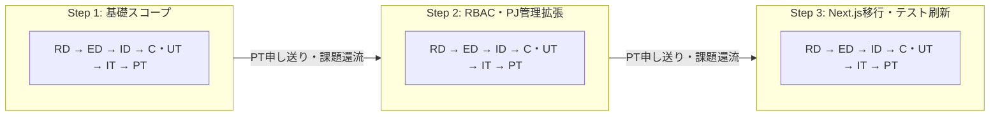
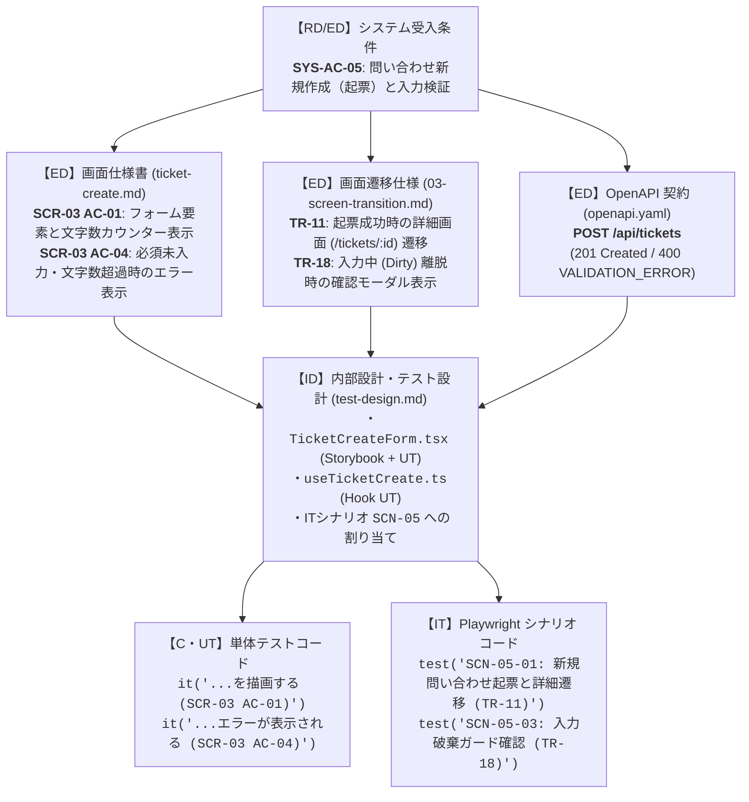
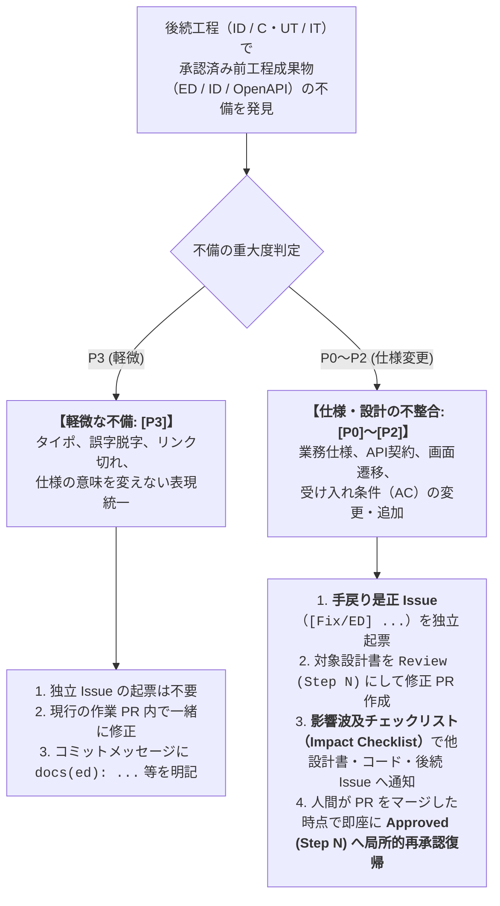

# 第1部：段階的詳細化とワークフロー設計

> [← 00-index.md（全体目次）へ戻る](./00-index.md) | [第2部：AI設定のSSOTとガバナンス へ進む →](./02-ai-orchestration-and-governance.md)

本ドキュメントでは、本プロジェクトの最大の強みの一つである **「抽象的な要望から、実装・テストすべき具体的な作業内容を段階的に細分化していく仕組み」** と、**「設計書と実装の整合性を維持するライフサイクル管理」** を解説します。

---

## 1. なぜ「段階的詳細化」が AI 開発で決定的に重要なのか？

AI エージェントに「〇〇機能を作って」と抽象的な要望のままコードを書かせると、以下のような問題が頻発します：
- **仕様の勝手な補完（ハルシネーション）**: エラー時の挙動、権限境界、文字数制限などを AI が忖度して勝手に決め打ちする。
- **手戻りの連鎖**: UI を作った後に API の型や状態管理の矛盾に気づき、テストごと書き直しになる。
- **レビューの困難化**: 「何をもって良しとするか（正解の基準）」が明文化されていないため、人間も AI レビュアーもコードの正否を判定できない。

本プロジェクトでは、**「前の段階で合意した粒度を正本（SSOT）として、次の段階で1段階だけ具体化する」** というウォーターフォールの特性を活かし、AI の推論ジャンプ（飛躍）を防止しています。

---

## 2. Step 分割と 6 工程（RD → ED → ID → C・UT → IT → PT）の構造

本プロジェクトでは、システム全体の成長を **「Step」** で区切り、各 Step の中で 6 つの工程を順番に回しています。



### 各工程で「何をどこまで決めるか」の境界定義

| 工程 | 役割と決定する粒度 | 主な成果物（実例パス） | 次工程へ渡す「確定事項（アンカー）」 |
| :--- | :--- | :--- | :--- |
| **1. RD**<br>（要件定義） | **Why / What（大枠）**<br>・背景・目的、対象ロール<br>・今回やるスコープ／やらないスコープ<br>・システム受け入れ条件の定義 | `docs/rd/step3.md` | ・システム受け入れ条件 ID（`SYS-AC-01`〜`17`）<br>・スコープ境界 |
| **2. ED**<br>（外部設計） | **What（利用者視点の仕様・契約）**<br>・画面一覧・URLルート構成<br>・画面間遷移とガード条件<br>・各画面のレイアウト・表示項目・操作仕様<br>・REST API 契約（リクエスト/レスポンス/エラー） | `docs/ed/01-system-overview.md`<br>`docs/ed/02-screen-list.md`<br>`docs/ed/03-screen-transition.md`<br>`docs/ed/screens/*.md`<br>`docs/ed/api/openapi.yaml` | ・画面 ID（`SCR-AUTH`, `SCR-00`〜`04`）<br>・画面遷移 ID（`TR-01`〜`TR-22`）<br>・画面別受け入れ条件（`SCR-03 AC-01`〜）<br>・OpenAPI スキーマ（SSOT） |
| **3. ID**<br>（内部設計） | **How（実装構造・テスト設計）**<br>・コンポーネントツリーと Server/Client 境界<br>・状態管理（Context / Hooks / URLクエリ同期）<br>・API クライアント・非同期競合制御（Abort）<br>・UT / IT / PT の3層テスト責務割り当て | `docs/id/01-frontend-architecture.md`<br>`docs/id/state-management.md`<br>`docs/id/api-client.md`<br>`docs/id/screens/*.md`<br>`docs/id/test-design.md` | ・具体的なファイルパス・コンポーネント名<br>・Props / State / Hook インターフェース<br>・各コンポーネントで書くべき Story と UT 観点 |
| **4. C・UT**<br>（実装・単体） | **Code & Unit Verify**<br>・TDD（Red-Green-Refactor）による実装<br>・Storybook CSFv3 ＋ 単体テスト ＋ VRT | `src/**/*.tsx`<br>`src/**/*.stories.tsx`<br>`src/**/*.test.tsx`<br>`docs/c-ut/evidence/ut-bug-record.md` | ・C0/C1 100% カバレッジ達成済みのモジュール群<br>・VRT PASS 済みの UI カタログ<br>・単体環境では検証できない「IT への申し送り」 |
| **5. IT**<br>（結合テスト） | **Integration Verify**<br>・Playwright 実ブラウザによる画面間連携検証<br>・過去 Step 機能を包含した回帰テスト | `docs/it/test-scenario.md`<br>`test/it/scenarios/scn*.spec.ts`<br>`docs/it/evidence/it-bug-record.md` | ・`SCN-01`〜`07` 全件 PASS の証跡・トレース<br>・本番コンテナ環境で確認すべき「PT への申し送り」 |
| **6. PT**<br>（総合・受入） | **System & Non-Functional Verify**<br>・本番ビルドコンテナ ＋ 別コンテナ API での受入<br>・Lighthouse / a11y / バンドルサイズ計測 | `docs/pt/test-plan.md`<br>`docs/pt/evidence/*`<br>`docs/pt/quality/stepN.md` | ・全 `SYS-AC` の合否判定<br>・次期 Step へのアーキテクチャ改善提言 |

---

## 3. 一貫した ID 体系と「2段階トレーサビリティマトリクス」

要望が細分化されていく過程で「元の要件がどこに行ったか分からなくなる（テスト漏れ）」を防ぐため、すべての要件・仕様・テストに **一意の識別子（ID）** を付与し、2段階のマトリクスで追跡しています。

### 3.1 ID の連鎖構造（実例：問い合わせ起票機能）



### 3.2 2段階のトレーサビリティマトリクス
1. **第1段階（ED：`docs/ed/01-system-overview.md`）**:
   - **「要件（`SYS-AC`）が、どの画面（`SCR` / `AC`）とどの API（`openapi.yaml`）で実現されるか」** を対応付けます。
2. **第2段階（ID：`docs/id/test-design.md`）**:
   - **「その仕様を、UT・IT・PT のどのテスト層でどう検証するか」** を対応付けます。
   - さらに、UT や IT のテストコードの `it("... (SCR-03 AC-01)")` や `test("SCN-03-05: ...")` のタイトルに直接 ID を埋め込むことで、**コード検索（`rg "SCR-03"`）一発で設計書からテストコードまで辿れる** ようになっています。

---

## 4. 成果物のステータス管理と「ベースライン維持」の工夫

AI に設計書を扱わせる際、「どのドキュメントが確定版（正本）で、どのドキュメントが作業中か」を明確に識別させるため、すべての設計書の冒頭（OpenAPI は `x-design-metadata`）にステータステーブルを設けています。

```markdown
| 項目 | 内容 |
| :--- | :--- |
| 状態 | `Review (Step 3)` |
| 更新日 | `2026-10-24` |
| 関連する ED/ID 項目 | `docs/ed/screens/ticket-list.md#受け入れ条件` |
```

### 3つのステータスと運用ルール
1. **`Draft (Step N)`**: 当該 Step で新規作成・ドラフト執筆中の状態。
2. **`Review (Step N)`**: 個別タスク PR を提出し、工程内レビュー・検証を行っている状態。
   - **重要ルール**: 個別タスク PR がマージされても、状態は **`Review (Step N)` のまま維持** します（個別 PR で勝手に `Approved` にしない）。
3. **`Approved (Step N)`**: その工程の全タスクが完了し、工程承認 Issue で **人間が最終承認した段階** で、対象工程の全成果物を一括で `Approved (Step N)` に昇格します。

> [!TIP]
> **Step 間のベースライン維持ルール（一括 Draft 戻しの禁止）**
> 新しい Step（例：Step 3）が始まった際、前 Step で承認された設計書を最初に一括で `Draft (Step 3)` に書き換えることはしません。**改修に着手するまでは `Approved (Step 2)` のまま維持**します。
> これにより、「前 Step で承認された信頼できる仕様であること」と「Step 3 の改修がまだ入っていないこと」がひと目で区別でき、作業漏れを確実に防げます。

---

## 5. 手戻り是正フローと「局所的再承認（Local Re-approval）」

どれほど丁寧に設計しても、後続工程（ID や C・UT、IT）を進める中で「前工程の設計書の矛盾や考慮漏れ」は必ず見つかります。
従来のウォーターフォールが嫌われる最大の理由は「前工程への手戻り手続きが重すぎて、結局ドキュメントを直さずにコードだけ直す（設計書の形骸化）」ことにあります。

本プロジェクトでは、手戻りの重さに応じて2段階のルートを用意し、**「軽快に正本を直しつつ、ガバナンスも維持する」** 仕組みを導入しています。



### この仕組みのメリット
- **工程承認 Issue をやり直さなくてよい（局所的再承認）**:
  承認済みドキュメントの修正 PR を人間がレビュー・マージした時点で、その修正は局所的に再承認されたものとみなし、即座に `Approved (Step N)` へ戻します。
- **影響波及の抜け漏れ防止（Impact Checklist）**:
  手戻り是正 PR では「①上位・同階層設計書への波及」「②後続設計書への波及」「③既存コード・テストへの波及」をチェックリストで確認し、関連する未着手・進行中 Issue のコメント欄に「〇〇の仕様が変更されたので反映してください」と申し送りを残すことを義務付けています。

---

> **次のドキュメント**: [第2部：AI設定のSSOTとマルチエージェント・ガバナンス](./02-ai-orchestration-and-governance.md) では、これらのワークフローを AI エージェントに破綻なく遂行させるための設定構造（SSOT）、サブエージェント分割、完了ゲート（7条件）を解説します。
