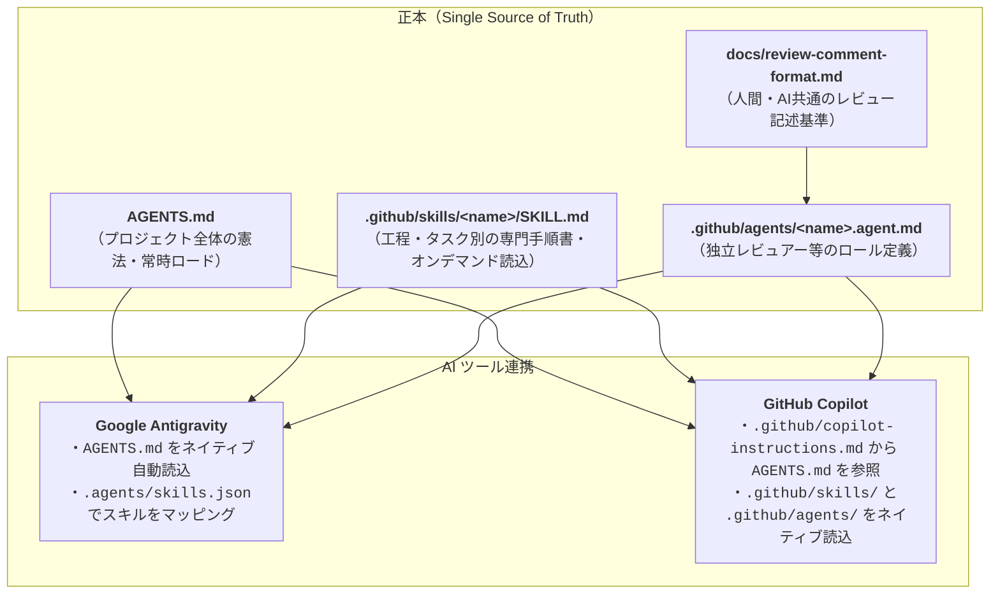
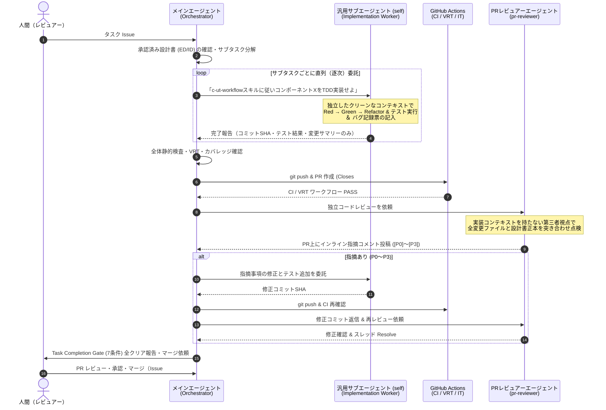
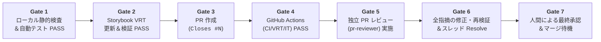

# 第2部：AI設定のSSOTとマルチエージェント・ガバナンス

> [← 第1部：段階的詳細化とワークフロー設計](./01-waterfall-process-and-refinement.md) | [00-index.md（全体目次）](./00-index.md) | [第3部：各工程の技術プラクティス へ進む →](./03-engineering-and-testing-practices.md)

本ドキュメントでは、ユーザー様のメモには明示されていなかったものの、本プロジェクトの安定稼働を裏側で支えている **「AI設定のSSOTアーキテクチャ」「コンテキスト枯渇を防ぐマルチエージェント・オーケストレーション」「Task Completion Gate（7つの完了条件）」「独立AIレビュー体制」** を解説します。

---

## 1. AI 設定の SSOT（Single Source of Truth）アーキテクチャ

チーム開発や複数ツールの併用環境（Google Antigravity と GitHub Copilot Chat 等）では、ツールごとに別々のルールファイルを書くとすぐに記述が乖離し、メンテナンス不能になります。
本プロジェクトでは、**「正本（SSOT）を1箇所に定め、各ツールから参照・マッピングする」** 階層型アーキテクチャを採用しています。



### 常時ロード（Rules）とオンデマンド（Skills）の分離メリット
すべての詳細な手順を `AGENTS.md` 1ファイルに詰め込むと、毎回の会話でコンテキストウィンドウを大量に消費し、無関係なルールに AI が惑わされます。
- **`AGENTS.md`（常時ロード）**: 全工程共通の原則、完了ゲート（7条件）、オーケストレーション方針など「絶対に守るべき骨格」のみを記述。
- **`.github/skills/<name>/SKILL.md`（必要時のみロード）**:
  - `waterfall-github-task-management`: Issue/Milestone 起票や工程承認を行うときだけ読む。
  - `c-ut-workflow`: 実装・単体テストを行うときだけ読む。
  - `phase-final-review`: 工程完了時の横断レビューを行うときだけ読む。
  - `git-workflow`: コミット規約やブランチ・Worktree 操作を行うときだけ読む。
  - `retrospective`: トラブル発生時の振り返りを行うときだけ読む。

---

## 2. コンテキスト枯渇を防ぐマルチエージェント・オーケストレーション

1つの AI セッションで「設計書の読み込み → 複数コンポーネントの TDD 実装 → テスト修正 → VRT 更新 → PR 作成 → レビュー修正」をすべて実行させると、途中で **コンテキスト圧縮（Compaction）** が発生し、初期の指示や完了条件を忘却して品質が急激に劣化します。

これを防ぐため、本プロジェクトでは **「メインエージェント＝司令塔（Orchestrator）」「サブエージェント＝実行部隊（Worker / Reviewer）」** と役割を厳格に分離しています。



### オーケストレーションの 3 原則
1. **専用コーディングエージェントを濫造しない（`self` ＋ Skill 指定）**:
   実装ワーカーには専用の `.agent.md` を作らず、汎用サブエージェント（`self`）に対して「`.github/skills/c-ut-workflow/SKILL.md` を読んで TDD で実装せよ」と指示します。これにより設定ファイルの重複を防ぎます。
2. **直列（逐次）委託を基本とする**:
   同一ワークスペースで複数サブエージェントに並列でコード編集やテストを実行させると、Git の `index.lock` 競合や VRT のポート競合、テストの相互干渉が起きます。そのため、実装ワーカーは直列パイプラインで呼び出します（読み取り専用の調査やレビューのみ並列化可）。
3. **Compaction Recovery Protocol（コンテキスト圧縮からの回復規律）**:
   万が一メインセッションでコンテキスト圧縮が発生した場合、自動生成された要約の「Next Steps」を鵜呑みにせず、必ず下記の **Task Completion Gate（7条件）** を最初から再点検することを義務付けています。

---

## 3. Task Completion Gate（7つの完了条件）と人間中心のガバナンス

AI エージェントにありがちな「コードを書いて PR を作った時点で『完了しました！』と報告してしまう（実は CI が落ちている、VRT を更新していない、レビューをしていない）」という暴走を防ぐため、**7つの完了ゲート** を定義しています。



### ガバナンス上の重要ルール：AI が絶対にやってはいけないこと
- **Issue の直接クローズ禁止**: `gh issue close` コマンド等で AI が直接 Issue を閉じることは厳禁です。必ず PR に `Closes #N` を設定し、**「人間が PR を承認してマージした瞬間に Issue が連動して閉じる」** ことで、人間の承認をシステム的に担保します。
- **PR の自己承認・マージ禁止**: AI は PR の Approve や Merge を行いません。
- **ステータス `Approved` への勝手な昇格禁止**: 個別 PR では必ず `Review` 状態にとどめ、人間の工程承認を経て初めて `Approved` に変更します。

---

## 4. 構造化レビュー仕様と独立 PR レビューエージェント

AI レビュアー（および人間）のコメント品質を揃えるため、`docs/review-comment-format.md` でレビューフォーマットを標準化しています。

### 4.1 重要度（Severity）4段階と必須 4 要素
感想や好みの指摘を排除し、必ず **「どこが（Location）」「何が問題で（Problem）」「どの承認済み仕様・契約に反しどんな悪影響があるか（Impact）」「どう直すべきか（Recommendation）」** の4要素で記述します。

```markdown
### [P1] 一般ユーザーが他プロジェクトのチケット詳細を取得できてしまう

- **Location**: `src/mocks/handlers/tickets.ts:42-55`
- **Problem**: `GET /api/tickets/:id` ハンドラーにおいて、ログインユーザーの所属プロジェクト（`projectIds`）と対象チケットの `projectId` の照合が行われておらず、常に HTTP 200 で返却されている。
- **Impact**: `docs/ed/screens/ticket-detail.md#アクセス制御`（所属外プロジェクトは 404 Not Found として存在を隠蔽する仕様）および `SYS-AC-02`（RBAC・プロジェクト分離）に違反し、情報漏洩につながる。
- **Recommendation**: リクエストユーザーのロールが `user` の場合、`!user.projectIds.includes(ticket.projectId)` であれば 404 レスポンス（`NOT_FOUND`）を返却するよう修正してください。また、`openapi.yaml` の 404 説明文にも同条件を明記してください。
```

### 4.2 独立 PR レビュアー（`pr-reviewer`）の点検アルゴリズム
- **差分（diff）だけでなくファイル全体を精読**: 変更行だけを見ると、ファイル内の別箇所に残っている古い Step の記述や型との矛盾を見落とすため、変更されたファイル全体を読み込みます。
- **スレッド収束プロトコル**:
  1. レビュアーが PR 上の該当行にインラインコメントを投稿。
  2. 実装側が修正コミットを積み、各スレッドに修正コミット SHA と対応内容を返信。
  3. レビュアーが最新コミットの差分を再検証し、解消を確認したスレッドのみを自ら `Resolve conversation` する。

---

## 5. アンカリングを防止する「工程完了横断レビュー（Phase Final Review）」

個別 PR ごとのレビューだけでは、「画面 A と画面 B でエラー文言が微妙に違う」「ED と ID とテスト設計書の間で AC の数が合わない」といった **成果物横断の不整合** がすり抜けることがあります。
そのため、各工程の最後に「工程承認 Issue（親 Issue）」上で **全体横断レビュー（Phase Final Review）** を実施します。

### 5.1 なぜ「アンカリング防止」が必要か？
オーケストレーターが「たぶん〇〇のファイルが怪しいと思うから見て」とサブエージェントに伝えてしまうと、サブエージェントはそこばかりを見て他の重大な欠陥を見落とします（確証バイアス／アンカリング効果）。

そのため、`phase-final-review` スキルでは以下のルールを徹底しています：
1. **読み取り専用サブエージェントを観点別に並列起動**:
   - 例：Subagent A（ED/OpenAPI と ID の契約整合性）、Subagent B（画面遷移 TR と権限境界）、Subagent C（テスト網羅性とバグ記録の整合性）。
2. **先入観の排除（中立プロンプト）**:
   - サブエージェントに渡すのは「対象コミット SHA」「承認済み正本パス」「担当する検証観点」のみとし、疑わしい箇所のヒントは一切渡しません。
3. **ラウンド採番（`R1-01`, `R2-01`）による追跡**:
   - 指摘事項には `R1-01` のようにラウンド番号を付与し、親 Issue に集約コメントとして投稿します。

### 5.2 テスト工程における「品質分析レポート作成前」の横断レビュー実施
C・UT、IT、PT の各テスト工程では、**必ず「品質分析レポートを作成する前」に Round 1 の全体横断レビューを実施** します。
なぜなら、横断レビューで発見された実装漏れやテスト不備もすべて「その工程で摘出されたバグ」としてバグ記録票に算入しなければ、正確なバグ密度や欠陥除去率（DRE）が計算できないためです。

---

> **次のドキュメント**: [第3部：各工程の技術プラクティス（TDD・画面テスト・モック戦略）](./03-engineering-and-testing-practices.md) では、ユーザー様が高く評価された TDD の進め方、Storybook / Portable Stories / VRT / Playwright IT の具体的な設計とコードパターンを解説します。
