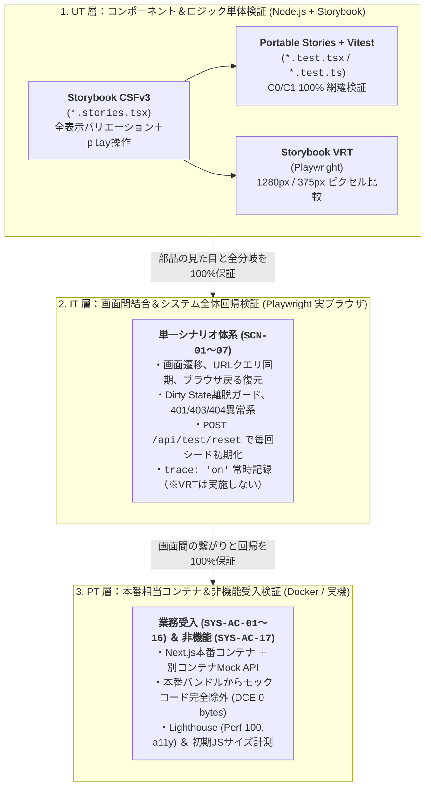
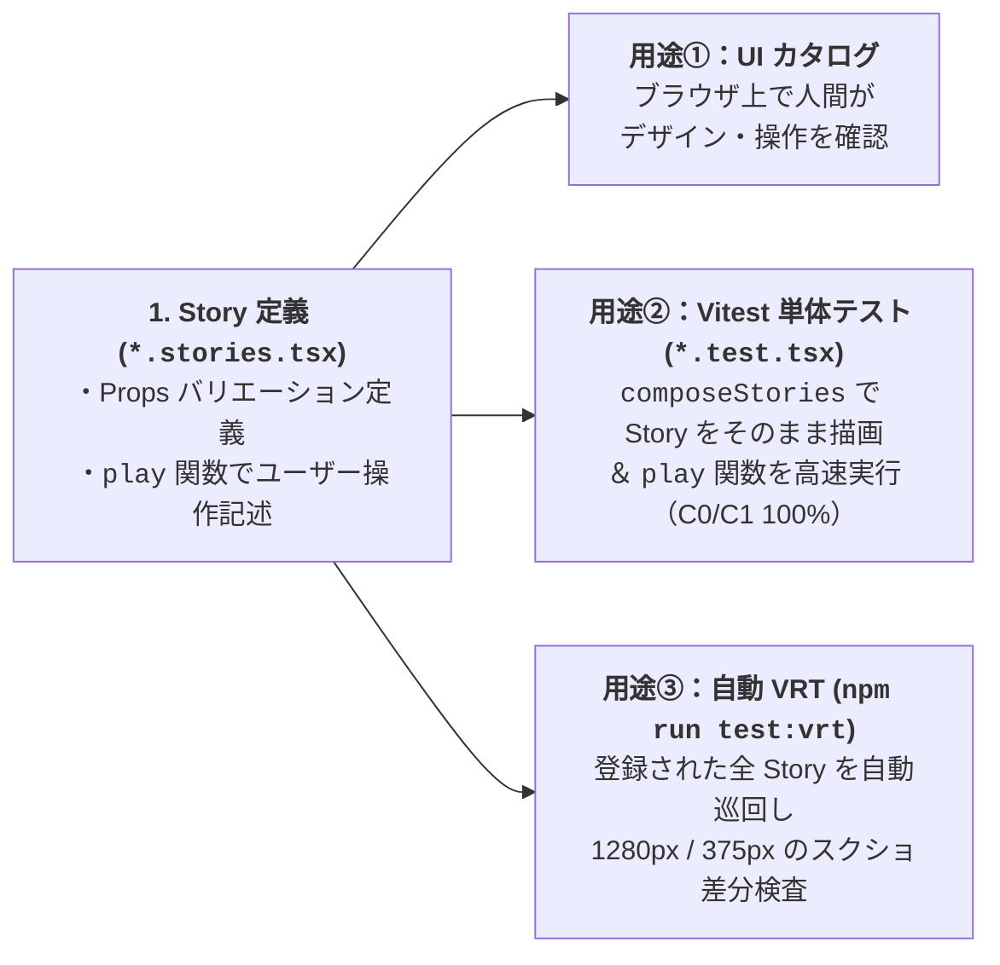

# 第3部：各工程の技術プラクティス（TDD・画面テスト・モック戦略）

> [← 第2部：AI設定のSSOTとガバナンス](./02-ai-orchestration-and-governance.md) | [00-index.md（全体目次）](./00-index.md) | [第4部：品質分析・申し送り・改善ループ へ進む →](./04-quality-analysis-and-kaizen-loop.md)

本ドキュメントでは、ユーザー様が「各工程の進め方（TDDや画面のテストの形式）などは非常によくできている」と評価された **実装・テストのエンジニアリング標準** を、具体的なコードパターンとともに解説します。

---

## 1. 3層テスト体系（UT / IT / PT）の責務分界マトリクス

フロントエンド開発でよくある失敗は、「単体テストと E2E テストで同じような画面操作を重複して書き、E2E が重くて不安定（Flaky）になる」ことです。
本プロジェクトでは、**UT・IT・PT の3層の役割と境界（何をやり、何をやらないか）** を明確に切り分けています。



| 観点 | UT（単体テスト） | IT（結合テスト） | PT（総合・受入テスト） |
| :--- | :--- | :--- | :--- |
| **主目的** | 関数・Hook・単一コンポーネントの **全分岐網羅と見た目保証** | 複数画面を跨ぐ **ルーティング・状態連携・システム回帰保証** | **本番ビルド成果物** の業務受入と非機能（性能・a11y）保証 |
| **実行環境** | Vitest (`happy-dom`) ＋ Storybook | Playwright Test（実 Chromium） | 本番ビルドコンテナ ＋ 別コンテナ API |
| **API 通信** | インプロセス MSW (`setupServer`) | ブラウザ Service Worker MSW / Next.js | 実 HTTP 通信（コンテナ間通信） |
| **VRT（視覚比較）** | **実施する（UT に完全一本化）** | **実施しない**（遷移と振る舞いに集中） | 目視およびエビデンススクショ取得 |

---

## 2. C・UT 工程の 4 大実装ルール

### 2.1 コミット履歴で証明する TDD（Red-Green-Refactor）
AI に「TDD で書いて」と指示するだけでは、実装とテストを同時に書いて 1 コミットにまとめがちです。本プロジェクトでは **コミット単位を Red / Green / Refactor に分ける規約** により、本当にテストファーストで進めたかを客観的に追跡可能にしています。

1. **Red コミット**: `test: 問い合わせ一覧取得フックの単体テストを追加（Red）`
   - まだ実装がない（またはスタブの）状態でテストを書き、**意図した理由でテストが失敗する（Red）** ことを確認してコミット。
2. **Green コミット**: `feat: 問い合わせ一覧取得フックの初期表示を実装（Green）`
   - テストを通す最小限の実装を行い、テストが PASS することを確認してコミット。
3. **Refactor コミット**: `refactor: 問い合わせ一覧取得フックのエラーハンドリングを整理`
   - テストが PASS し続けることを確認しながら、重複排除や型整理を実施。

### 2.2 例外なしの「1対1 対応原則（Co-location）」
プロダクションコードと同じディレクトリ（Co-location）に、1対1 でテストと Story を配置します。**機械的監査テスト（`component-1to1-audit`）** により、1ファイルでも欠けると CI が失敗します。

```text
src/features/tickets/components/
├── TicketCreateForm.tsx          # 1. コンポーネント本体
├── TicketCreateForm.stories.tsx  # 2. 必須：全表示パターン + play関数
└── TicketCreateForm.test.tsx     # 3. 必須：composeStories実行 + 境界値・キーボード等補完
```
- **すべての `*.tsx`**: 必ず同階層に `*.stories.tsx` と `*.test.tsx` を持つ。
- **すべての `*.ts`（Hook・API・Util）**: 必ず同階層に `*.test.ts` を持つ（純粋な型定義のみのファイルを除く）。

### 2.3 親子コンポーネント分離原則（相乗りテストの禁止）
大規模な React アプリでテストが破綻する最大の原因は、「親（Page）のテストの中で、子（Table や Modal）の細かい表示パターンまで全部テストしようとして、テストファイルが数千行に肥大化する」ことです。

本プロジェクトでは **「親子の責務分離」** を徹底しています：
- **親コンポーネント（例：`TicketListPage.tsx`）のテスト責務**:
  - フックの呼び出し、Loading / Error / Ready の大枠レイアウト切り替え、子コンポーネントへの Props 受け渡しのみを検証。
- **子コンポーネント（例：`TicketTable.tsx`）のテスト責務**:
  - 通常表示、0件（Empty）表示、長文省略、ソートボタン押下時のコールバック発火などは、**すべて子自身の `TicketTable.stories.tsx` / `TicketTable.test.tsx` で独立して検証** し、親のテストでは繰り返さない。

### 2.4 C0 / C1 / Functions 100% カバレッジの機械的強制
「カバレッジ 80% 以上」のような曖昧な基準では、AI は面倒な異常系やエッジケースのテストをサボります。
本プロジェクトでは **`npm run test:coverage` の閾値を C0（行）・C1（分岐）・Functions すべて 100%** に設定しています。これにより、未テストの `if/else` や三項演算子が 1 つでも残っていると Gate 1 で自動的にブロックされます。

---

## 3. 画面単体テストの黄金パターン（Storybook CSFv3 ＋ Portable Stories ＋ VRT）

「Storybook も書いて、Vitest の単体テストも書いて、VRT も用意する」と聞くと二度手間・三度手間に思えますが、本プロジェクトでは **Portable Stories（`composeStories`）** を核に据えることで、**1回書いた Story を3つの用途に使い回す** 非常に効率的な仕組みを構築しています。



### 実装コード例：Story と Test の連携

````carousel
```typescript
// 【スライド1】TicketCreateForm.stories.tsx（Storybook CSFv3 + play関数）
import type { Meta, StoryObj } from "@storybook/react-vite";
import { expect, userEvent, within } from "storybook/test";
import { TicketCreateForm } from "./TicketCreateForm";

const meta = {
  title: "Features/Tickets/TicketCreateForm",
  component: TicketCreateForm,
} satisfies Meta<typeof TicketCreateForm>;
export default meta;
type Story = StoryObj<typeof meta>;

// 表示パターン1: バリデーションエラー表示状態
export const WithErrors: Story = {
  name: "バリデーションエラー表示",
  args: {
    draft: { projectId: "PRJ-01", title: "", body: "", category: "bug", priority: "medium" },
    errors: { title: "タイトルを入力してください" },
    // ...
  },
};

// 表示パターン2: インタラクティブな入力・送信操作（play関数）
export const Interactive: Story = {
  name: "インタラクション（入力・送信操作）",
  play: async ({ canvasElement, args }) => {
    const canvas = within(canvasElement);
    const titleInput = canvas.getByRole("textbox", { name: "件名" });
    await userEvent.type(titleInput, "ログイン画面のレイアウト崩れ");
    expect(canvas.getByText("14 / 100")).toBeInTheDocument();

    await userEvent.click(canvas.getByRole("button", { name: "起票する" }));
    expect(args.onSubmit).toHaveBeenCalledTimes(1);
  },
};
```
<!-- slide -->
```typescript
// 【スライド2】TicketCreateForm.test.tsx（Portable Storiesによる再利用）
import { composeStories } from "@storybook/react-vite";
import { render, screen } from "@testing-library/react";
import { describe, expect, it } from "vitest";
import * as stories from "./TicketCreateForm.stories";

// Story をテスト用コンポーネントとして一括変換
const { WithErrors, Interactive } = composeStories(stories);

describe("TicketCreateForm", () => {
  it("WithErrors ストーリーでエラーメッセージが表示される (SCR-03 AC-04)", () => {
    // 面倒な Props 準備なしでそのまま描画できる！
    render(<WithErrors />);
    expect(screen.getByText("タイトルを入力してください")).toBeInTheDocument();
  });

  it("Interactive ストーリーの play 関数を実行して入力と送信を検証する", async () => {
    const { container } = render(<Interactive />);
    // Story に書いた play 関数を Vitest 上でそのまま実行！
    await Interactive.play?.({ canvasElement: container });
    expect(Interactive.args?.onSubmit).toHaveBeenCalledTimes(1);
  });
});
```
````

### VRT（視覚的回帰テスト）の工夫
- **UT（Storybook）への完全一本化**:
  ページ遷移を伴う IT（Playwright E2E）で VRT を行うと、通信タイミングの微妙なズレで画像差分が頻発します。そのため VRT は **状態が完全に固定された Storybook の各 Story に対してのみ実行** します。
- **DevContainer と CI のフォント完全一致**:
  ローカル（Mac/Windows）と GitHub Actions（Ubuntu）でフォントレンダリングが異なると VRT が失敗するため、DevContainer 内に `fonts-dejavu-core` を導入し、ローカルと CI で 1 ピクセルの狂いもなく同じ画像が生成される環境を構築しています。

---

## 4. OpenAPI 正本駆動の MSW モック戦略

フロントエンドのテストで「モックでテストは通ったのに、実際の API と繋いだらプロパティ名が違っていた」という事態を防ぐため、以下のルールを徹底しています。

1. **`docs/ed/api/openapi.yaml` が唯一の正本（SSOT）**:
   - OpenAPI スキーマから型定義（`openapi.generated.ts`）を自動生成し、API クライアントも MSW ハンドラーもすべてこの生成型を参照します。
2. **テスト専用シードリセット API（`POST /api/test/reset`）**:
   - インメモリのモック DB を初期シード状態に瞬時に戻すエンドポイントを用意。
   - UT では `afterEach` で `resetMockDb()` を同期呼び出しし、IT（実ブラウザ）では各テストの `beforeEach` で `POST /api/test/reset` を叩くことで、**テスト間のデータ汚染（前のテストで作ったチケットが次のテストの件数を狂わせる等）を 100% 防止** しています。

---

## 5. システム全体の回帰を保証する結合テスト（IT：`SCN-01`〜）

機能追加を繰り返すプロジェクトで最も危険なのは、「Step 1 で作ったテストが Step 2 の認証追加で動かなくなり、別フォルダに隔離されたり `test.skip` されて放置されること」です。

本プロジェクトの IT 工程では、**「過去 Step のシナリオの包含・進化（Evolution）」** を絶対ルールとしています。

### IT シナリオ設計の 3 大原則
1. **単一シナリオ体系（`SCN-01`〜`SCN-07`）の維持**:
   - `step1-test.spec.ts`、`step2-test.spec.ts` のように過去のテストを別ファイルに分けることを禁止。
   - 新しい Step で認証や RBAC、共通レイアウトが追加されたら、既存の `SCN-01`〜 のシナリオ自体を最新仕様に合わせてアップデートし、**常にシステム全体の最新仕様を表す単一のテストスイートが 100% PASS する状態** を保ちます。
2. **`test.step` による日本語の業務ステップ構造化**:
   - Playwright の各テストケース内で `await test.step("1. 一般ユーザーでログインする", ...)` のように業務手順を日本語で構造化します。これにより、設計書（`docs/it/test-scenario.md`）の手順とテストコードが完全に 1対1 で対応します。
3. **常時トレース記録（`trace: "on"`）**:
   - リトライ時だけでなく、常時 Playwright の Trace（DOM スナップショット、ネットワーク通信ログ、コンソールログ）を記録し、エビデンスとしての再現性を保証しています。

---

> **次のドキュメント**: [第4部：品質分析・申し送り事項・継続的改善（Kaizen）ループ](./04-quality-analysis-and-kaizen-loop.md) では、ユーザー様が特に高く評価された「バグ記録票・品質分析レポート」「申し送り事項の明確化」「バグ傾向からの開発プロセス改善サイクル」を実データとともに詳しく解説します。
