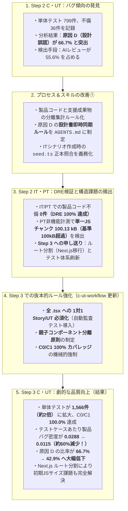
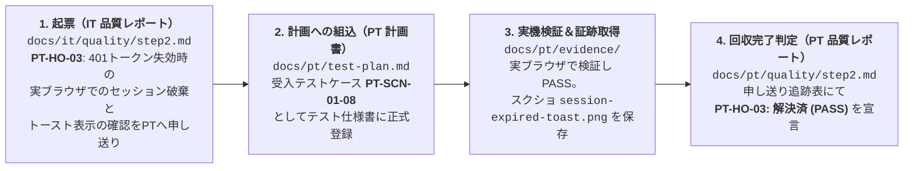

# 第4部：品質分析・申し送り事項・継続的改善（Kaizen）ループ

> [← 第3部：各工程の技術プラクティス](./03-engineering-and-testing-practices.md) | [00-index.md（全体目次）](./00-index.md) | [第5部：他プロジェクトへの適応手引き へ進む →](./05-iterative-adaptation-guide.md)

本ドキュメントでは、ユーザー様が「工程の品質分析、申し送り事項の明確化がよかった。また、バグの傾向から進め方の改善もされていたので、開発サイクルに取り込んで継続的な改善ができそう」と評価された **品質計測・設計同期・申し送り・プロセス改善のフィードバックループ** を実例とともに詳しく解説します。

---

## 1. 開発リズムを止めない「バグ記録票（スリム化必須6項目）」

AI 開発では、TDD の過程や AI コードレビューの中で多くの不備が見つかり、その場で素早く修正されます。しかし、その場で直して終わりにすると **「なぜそのバグが起きたのか（設計書の曖昧さなのか、非同期処理の罠なのか）」という知見が完全に揮発** してしまいます。

本プロジェクトでは、Step 2 での実験（当初11項目）を経て、AI ワーカーが開発テンポを一切落とさずに記録できる **「スリム化必須6項目」** のバグ記録票（`docs/<phase>/evidence/*-bug-record.md`）を確立しました。

### 1.1 バグ記録票の 6 項目フォーマットと記入実例

| No. | 検出手段 | 成果物区分 | 対象箇所 | 原因分類 | 不備の概要と是正内容（コード修正 / 設計同期コミット） |
| :-: | :--- | :--- | :--- | :---: | :--- |
| **1** | `AIレビュー` | **製品コード** | `src/shared/layout/DirtyGuardModal.tsx` | **D** | Step 2 既存実装の確認メッセージが Step 3 承認済み ID（`state-management.md` §5.5）の指定文言と不一致。上位設計書を正本とし、既定文言を設計仕様に厳格一致するよう是正（コミット `6497e10`）。 |
| **2** | `IT自動テスト` | **テスト・モック等支援成果物** | `src/mocks/handlers/tickets.ts` `docs/ed/api/openapi.yaml` | **D** | 一般ユーザーが他プロジェクトのチケット詳細にアクセスした際、MSW ハンドラーに所属判定がなく 200 が返却されていた。**OpenAPI 仕様書（`openapi.yaml`）** の 404 条件に所属外アクセス時の隠蔽仕様を同期明記し、ハンドラーを是正（PR #256）。 |
| **3** | `自動検証（Vitest）` | **製品コード** | `src/features/tickets/hooks/useTicketList.ts` | **A** | 検索条件の連続変更時に古いリクエストのレスポンスが後から着弾して上書きする競合不備。`AbortController` による前回リクエスト中断処理を追加（コミット `a1b2c3d`）。 |

### 1.2 バグ記録を機能させる「3つの鉄則」

#### 鉄則①：「製品コード」と「支援成果物」の厳格分離
AI がテストコードやモック、Storybook を書く際の試行錯誤（セレクタの書き間違いやモックデータの不足など）を製品バグと混ぜてしまうと、バグ密度が異常に高く見え、真の製品品質が分からなくなります。
そのため、**`製品コード`（`src/` 配下の本番コード）** と **`テスト・モック等支援成果物`** を明確に分けて集計し、バグ密度や欠陥除去率（DRE）はまず製品コード単体で厳密に評価します。

#### 鉄則②：原因分類コード（5分類）による傾向の可視化
すべての不備を以下の 5 つの原因コードのいずれかに分類します：
- **`L` (Logic)**: 条件分岐ミス、真偽値反転、計算誤り。
- **`S` (State)**: React State 更新漏れ、Context 不整合、URL クエリ同期ミス。
- **`D` (Design)**: **設計・仕様誤認**（OpenAPI 契約や ED/ID の見落とし、仕様書の記述揺れ）。
- **`B` (Boundary)**: **境界値未考慮**（`null`/`undefined`、0件空配列、文字数上限、サロゲートペア絵文字）。
- **`A` (Async)**: **非同期制御不備**（Promise 未待機、`AbortController` 連携漏れ、Race Condition）。

#### 鉄則③：原因 `D`（設計・仕様誤認）における「設計書即時同期」の絶対義務
> [!CAUTION]
> **コードだけ直して設計書を放置することの禁止**
> 原因が `D`（設計・仕様の問題）である場合、コードだけを修正してテストを通すことは厳禁です。必ず **関連する設計書（ED / ID / `openapi.yaml`）も同時に修正（または正本との一致を確認）し、バグ記録票に「コード修正コミット」と「設計書修正コミット」の両方をセットで記録** します。これがドキュメントの陳腐化を 100% 防ぐ安全装置になっています。

---

## 2. 品質分析レポートと DRE（欠陥除去率）による工程評価

各工程（C・UT、IT、PT）の終了時には、バグ記録票を集計して **品質分析レポート（`docs/<phase>/quality/stepN.md`）** を作成します。

### 計測する主要メトリクス
1. **バグ密度**:
   - コード規模あたり：$\frac{\text{製品コード不備件数}}{\text{製品コード KLoC}}$
   - テストケースあたり：$\frac{\text{製品コード不備件数}}{\text{総テストケース数}}$
2. **工程別 DRE（Defect Removal Efficiency：欠陥除去率）**:
   前工程までにどれだけ欠陥を摘出できたか（後工程にバグを流出させなかったか）を測る指標です。
   $$\text{DRE (UT)} = \frac{\text{UT検出不備}}{\text{UT検出不備} + \text{IT検出不備}} \times 100\% \quad (\text{目標: } 85\% \text{ 以上})$$
   $$\text{Total-DRE} = \frac{\text{UT不備} + \text{IT不備}}{\text{UT不備} + \text{IT不備} + \text{PT不備}} \times 100\% \quad (\text{目標: } 95\% \text{ 以上})$$

---

## 3. 実録：バグ傾向から開発プロセスが改善されたストーリー（Step 1 → 2 → 3）

このプロジェクトで実際にどのように品質分析から課題が見つかり、次工程や次 Step のルール（`SKILL.md`）が改善され、結果としてバグが減ったのか——その実データを時系列で示します。

### この改善サイクルから得られる重要な教訓
- **「気をつけます」ではなく「仕組み（Skill / 自動テスト）」を変える**:
  Step 2 で設計誤認（`D`）やテスト漏れが見つかった際、「次は注意して実装する」で終わらせず、**「`.tsx` と `.stories.tsx` の 1対1 存在チェックを自動テスト化する」「カバレッジ閾値を 100% に引き上げる」「原因 D は設計書コミットを併記させる」** という機械的・構造的なルール（`.github/skills/c-ut-workflow/SKILL.md`）に落とし込んだからこそ、Step 3 でバグ密度 60% 削減という明確な成果が出ました。

---

## 4. 放置ゼロを実現する「次工程への申し送り事項（Handover Items）」の設計

開発中、「この挙動は JSDOM（単体テスト環境）では再現できないから、後の実ブラウザ結合テスト（IT）で確認しよう」「このパフォーマンス最適化は次のフェーズでやろう」という場面が必ず出てきます。
通常のプロジェクトではこれが口頭や PR コメントに埋もれて忘れ去られますが、本プロジェクトでは **「解決先成果物」と「完了ゲート（いつまでに解決しないと次に進めないか）」を明記したテーブル** で管理しています。

### 4.1 申し送りテーブルの記述形式（実例：`docs/ed/01-system-overview.md`）

| ID | 申し送り・検討事項 | 解決先成果物 / 担当 Issue | 解決時期・完了ゲート | 現工程承認時の扱い |
| :-: | :--- | :--- | :--- | :--- |
| **HO-01** | 別コンテナ Mock API へのプロキシ方式およびデータ保持の内部設計 | `docs/id/01-frontend-architecture.md` | **ID 工程完了ゲート** （C・UT 開始条件） | **非ブロッカー**: ED では `/api` 契約を確定済み。内部方式を ID へ申し送る。 |
| **HO-02** | Playwright 実ブラウザ IT におけるシードデータ初期化・同期方式 | `docs/id/test-design.md` | **ID テスト設計完了ゲート** （IT 開始条件） | **非ブロッカー**: テスト前データリセット手順を ID へ申し送る。 |

### 4.2 申し送りが次工程で確実に消化されるトレーサビリティ（実例：IT → PT）

このように、**「前工程の品質レポートの『申し送りセクション』」が「次工程の計画書の『インプット』」になり、「次工程の品質レポートで『回収完了（PASS）』を報告する」** というリレーが制度化されています。

---

## 5. トラブルを資産に変える「セッション振り返り（Retrospective）」スキル

工程単位の品質分析に加え、日々の AI セッションで手戻りや認識齟齬が起きた際には `.github/skills/retrospective/SKILL.md` を用いて即座にプロセスを修正します。

### 5.1 ノイズを防ぐ「切り分け基準」
すべての些細なエラーで振り返りを行うと開発が止まってしまいます。
- **振り返り不要（スキップ）**: Lint エラーや型エラー、既存テストの失敗など、**既存のチェック機構が正常に働いてその場で直せたもの**。
- **振り返り必須**:
  1. ユーザーから方針違反や認識ズレを指摘されてやり直したとき。
  2. 同じ調査や修正を何度もループして大きく手戻りしたとき。
  3. 既存のチェック機構（Hook や CI、スキル定義）をすり抜ける問題が見つかったとき。

### 5.2 全文ログを保存せず「ルール正本を直接更新する」原則
振り返りの結果を誰も読まない「反省文フォルダ」に溜め込むことは禁止しています。
原因を特定したら、**問題を所有するファイル（`AGENTS.md`、該当する `SKILL.md`、CI スクリプト、Lint ルール）を直接編集してコミット** します。これにより、次のセッションからは同じミスが構造的に起きなくなります。
また、汎用テンプレート（`dev-template`）由来の問題であれば、`.github/retrospective/TEMPLATE_RETROSPECTIVE_HANDOFF.md` を生成して親テンプレートへ安全に還流させる仕組みも備えています。

---

> **次のドキュメント**: [第5部：他プロジェクト（イテレーティブ／Issue駆動開発）への適応手引き](./05-iterative-adaptation-guide.md) では、いよいよ本プロジェクトの知見を「人が Issue に要望を書き、AI が細分化して 外部設計→詳細設計→MK→テスト を小単位で高速に回す」現代的な開発スタイルへ適応させる具体的方法を解説します。
