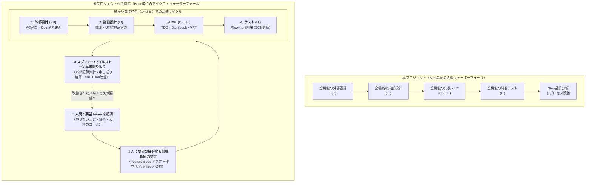
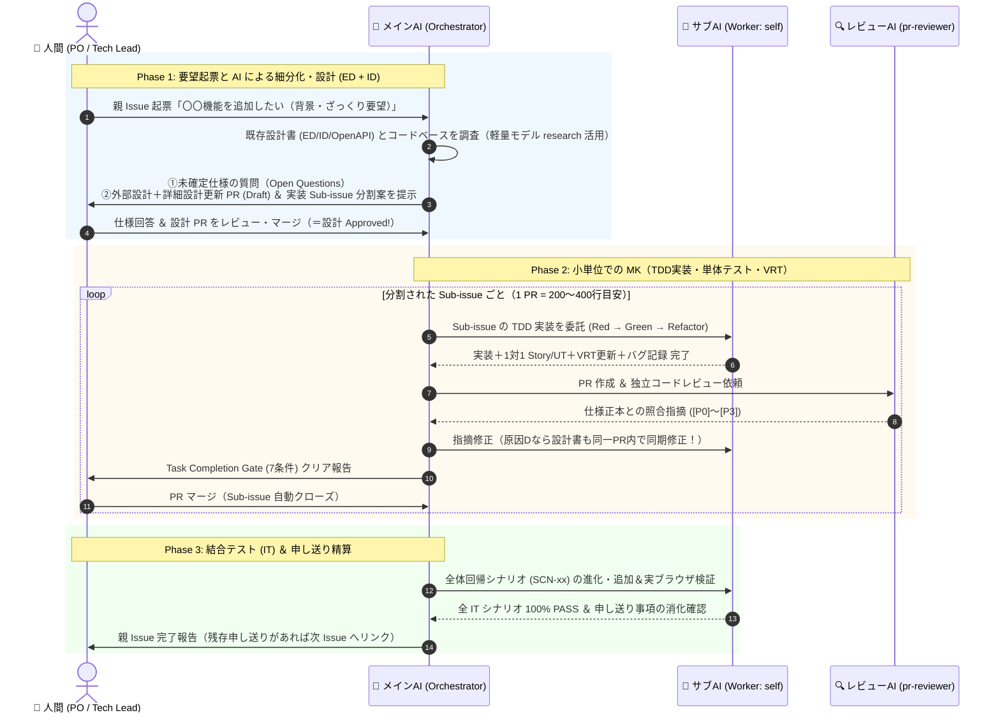
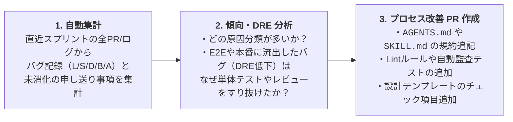

# 第5部：他プロジェクト（イテレーティブ／Issue駆動開発）への適応手引き

> [← 第4部：品質分析・申し送り・改善ループ](./04-quality-analysis-and-kaizen-loop.md) | [00-index.md（全体目次）](./00-index.md) | [第6部：スターターテンプレート＆チェックリスト集 へ進む →](./06-starter-templates-and-checklists.md)

本ドキュメントでは、ユーザー様が目指す **「他プロジェクトでは、要望を Issue に人が記載 → AI で細分化 → 外部設計 → 詳細設計 → MK（実装） → テスト といった流れを細かい単位で行いたい。また、品質分析や申し送り、バグ傾向からの継続的改善も開発サイクルに取り込みたい」** という構想を実現するための具体的な適応設計（マイクロ・ウォーターフォール／Issue駆動イテレーティブ開発モデル）を提案します。

---

## 1. パラダイム変換：「システム全体のウォーターフォール」から「機能単位のマイクロ・ウォーターフォール」へ

本プロジェクト（`react-practice-notes`）と、一般的な実務プロジェクト（アジャイル／イテレーティブ開発）の違いは「工程の順序」ではなく **「1回あたりに流すバッチサイズ（粒度）」** にあります。

- **本プロジェクト（学習・検証用ウォーターフォール）**:
  全画面（6画面）の外部設計を全部終えてから、全画面の内部設計を行い、全画面を実装する（バッチサイズ＝Step全体）。
- **他プロジェクトで目指す姿（Issue駆動マイクロ・ウォーターフォール）**:
  **1つの要望（Feature / User Story）ごと** に、AI が「外部設計（仕様・API契約）→ 詳細設計（コンポーネント・テスト設計）→ MK（TDD実装・単体テスト）→ テスト（実ブラウザ結合回帰）」のミニ・パイプラインを数時間〜数日で高速に回し切る。



---

## 2. ウォーターフォール資産の「イテレーティブ変換マップ」

本プロジェクトのどの仕組みを「そのまま維持」し、どこを「軽量化・統合」すべきかの対応表です。

| 本プロジェクトの仕組み | 他プロジェクト（イテレーティブ型）での適応形態 | 変更のポイント |
| :--- | :--- | :--- |
| **RD / ED / ID の3階層ドキュメント** | **1つの「Feature Spec（機能設計書）」または「正本ドキュメントの差分更新」に統合** | 新規画面や機能ごとに重厚な3冊を作るのではなく、1枚の設計 PR で「①外部仕様（AC・OpenAPI差分）＋②内部設計（コンポーネント分割・テスト観点）」をまとめて合意する。 |
| **工程承認 Issue（ED承認、ID承認…）** | **親 Issue（要望）上の「設計承認チェックポイント」＋ Sub-issue PR** | 工程ごとの巨大な承認会議を廃止。「設計 PR（ED+ID）を人間がマージしたら承認完了（`Approved`）」とし、即座に MK（実装）PR へ進む。 |
| **Task Completion Gate（7条件）** | **そのまま維持（100% 必須）** | PR ごとに「静的検査・UT・VRT・CI・独立AIレビュー（`pr-reviewer`）・スレッド解決・人間マージ」を課すゲートは、イテレーティブ開発でこそ最大の防波堤になる。 |
| **TDD・1対1 Story/UT・親子分離・VRT** | **そのまま維持（MK フェーズの標準スキル）** | `.github/skills/c-ut-workflow/SKILL.md` をそのまま移植。UI 変更時は Storybook と VRT を必須とする。 |
| **IT のシステム全体回帰（`SCN-01`〜）** | **MK と同一 PR（または直後の IT PR）で既存 `SCN` シナリオを更新・追加** | テストを別フェーズとして数週間後に回すのではなく、機能を作ったらその場で既存 E2E シナリオに組み込み、常時 `test/it/` 100% PASS を維持する。 |
| **バグ記録票（必須6項目・原因 `D` 同期）** | **PR 本文（または `docs/quality/bug-log.md`）への追記方式に軽量化** | 各 PR で AI レビューやテストで摘出された不備を数行記録し、原因 `D` なら同じ PR 内で設計書も同時修正する。 |
| **工程品質分析レポート** | **スプリント／マイルストーン単位（1〜2週間に1回、または5〜10 Issueごと）の定期品質レトロスペクティブ** | 毎回重厚なレポートを書くのではなく、一定数の Issue が完了した節目に AI がバグ記録を集計し、傾向分析と `SKILL.md` の改善 PR を出す。 |

---

## 3. 実践ワークフロー：人が要望を書いてからリリースまでの 5 ステップ

他プロジェクトで実際に人間と AI がどのようにパス回しをするか、具体的な 5 ステップを示します。



### 各ステップの具体的な回し方とコツ

#### Step 1：人間が「要望 Issue」を書く（粗い粒度で OK）
人間は最初から完璧な仕様書を書く必要はありません。以下の3点だけを Issue に書きます：
1. **背景・目的（Why）**: なぜこの機能が必要か。
2. **やりたいこと（What）**: 誰がどう操作したらどうなるか（箇条書きレベル）。
3. **制約・気になっていること**: 既存機能への影響や、迷っている点。

#### Step 2：AI が「調査・質問」し、「外部設計（ED）＋詳細設計（ID）」を固める
メインエージェント（Orchestrator）が要望 Issue を読み、まず軽量な `research` サブエージェントを使って既存の設計書（`docs/`）とコードを調査します。
- **勝手に決め打ちせず質問する**: 要望に書かれていないエッジケース（403権限エラー時の挙動、文字数上限、未保存離脱時の扱いなど）があれば、AI が選択肢付きで人間に質問します。
- **ED（外部設計）と ID（詳細設計）を 1 つの「設計 PR」で固める**:
  規模が小さい要望（1〜2画面の改修）であれば、ED と ID を別々の PR に分ける必要はありません。以下の4点を更新する **「設計・計画 PR」** を作成します：
  1. **受け入れ条件（`AC-xx`）と画面遷移（`TR-xx`）の定義・追記**（外部設計）
  2. **OpenAPI（`openapi.yaml`）のエンドポイント・型定義の更新**（外部設計）
  3. **変更対象コンポーネント・Hook・State の一覧と、UT/IT のテスト観点の定義**（詳細設計）
  4. **次工程（MK・テスト）への申し送り事項と、実装 Sub-issue の分割リスト**

> [!TIP]
> **どのくらいの粒度で Sub-issue（MK 単位）に分割すべきか？**
> AI ワーカーが1回の委託でコンテキスト枯渇を起こさず、かつ人間が 5〜10 分で PR レビューできる黄金の粒度は以下の通りです：
> - **Sub-issue ①**: OpenAPI 型生成 ＋ MSW モックハンドラー ＋ API クライアント / カスタムフックの実装（ロジック層 MK）
> - **Sub-issue ②**: 子コンポーネント群の実装 ＋ Storybook ＋ Portable Stories UT ＋ VRT（UI 部品層 MK）
> - **Sub-issue ③**: ページ結合 ＋ ルーティング ＋ Playwright 実ブラウザ IT シナリオ更新（画面結合・IT 層）
> （※ごく小さな修正であれば ①〜③ を 1 つの PR で完結させても構いません）

#### Step 3：MK（実装・単体テスト）を TDD で回す
設計 PR がマージされたら、各 Sub-issue についてワーカーサブエージェント（`self`）を起動し、第3部で解説した **`c-ut-workflow`（TDD Red-Green-Refactor、1対1 Story/UT、親子分離、C0/C1 100%、VRT）** を実行させます。
- 実装中に「設計書の通りだと動かない／仕様が足りない（原因分類 `D`）」と気づいた場合は、**コードだけ直して進めるのではなく、同じ PR 内で設計書（または OpenAPI）も同時に修正（局所的再承認）** させます。

#### Step 4：テスト（IT 回帰検証）と Task Completion Gate（7条件）
UI や画面遷移が絡む変更では、必ず Playwright の実ブラウザ結合テスト（`SCN-xx`）を実行・更新します。
- 過去の機能シナリオを壊していないか（`npm run test:it` 全件 PASS）を確認。
- 独立レビューエージェント（`pr-reviewer`）を起動し、最初に合意した `AC-xx` と `openapi.yaml` に完全準拠しているかを厳格にチェックさせ、全指摘スレッドを収束させてから人間に PR を渡します。

---

## 4. イテレーティブ開発への「品質分析・申し送り・改善サイクル」の組み込み方

ウォーターフォールのように「1ヶ月間の実装が終わってから品質分析レポートを書く」のではなく、イテレーティブ開発のリズムに合わせて **「PR ごとのマイクロ記録」と「節目ごとの定期 Kaizen」** の2階建てで運用します。

### 4.1 【日常（PR ごと）】PR テンプレートへの「バグ記録 ＆ 申し送り」の組み込み
専用のバグ記録ファイルを毎回別管理するのが重ければ、**各 PR の本文（または単一の `docs/quality/bug-and-handover-log.md`）に以下の2つのミニテーブルを必ず記載するルール** にします。

```markdown
### 1. 本 PR での不備記録（TDD Red / AI レビュー / CI で検出・是正した事項）
| 検出手段 | 区分 (製品/支援) | 対象箇所 | 原因 (L/S/D/B/A) | 概要と是正内容（原因Dの場合は設計同期コミット） |
| :--- | :--- | :--- | :---: | :--- |
| pr-reviewer | 製品コード | `UserForm.tsx` | B | 名前入力欄で空白文字のみの入力がすり抜ける不備。`.trim()` 判定を追加 (`a1b2c3d`) |

### 2. 次タスク・後続 PR への申し送り事項（Handover Items）
| ID | 申し送り事項 | 解決先 Issue / PR | 完了ゲート |
| :-: | :--- | :--- | :--- |
| HO-12 | モバイル幅でのトースト重なり確認 | Issue #45 (ITシナリオ追加) | 親 Issue #42 クローズ前 |
```

**これだけで得られる効果**：
- 実装ワーカーとレビュアーが「原因 `D` なら設計書も直さなければ」と毎回意識できる。
- 「この PR ではやらないけれど後続の Sub-issue #45 でやるべきこと（申し送り）」が明確に言語化され、親 Issue を閉じる前のチェックゲートとして機能する。

### 4.2 【節目（スプリント末 / マイルストーン末）】AI による定期品質分析とスキル進化
5〜10 個の要望 Issue（または 1〜2 週間のスプリント）が完了したタイミングで、品質振り返りタスク（30分程度）を実行します。



#### イテレーティブ改善の具体例
- **傾向例①：「原因 `A`（非同期競合・連打による二重送信）のバグが PR レビューで3回連続で指摘された」**
  - **改善アクション**: `c-ut-workflow/SKILL.md` と詳細設計テンプレートに「非同期送信ボタンには必ず `isSubmitting` による活性制御と二重送信防止 UT ケースを含めること」を追記する。
- **傾向例②：「原因 `D`（API のエラーレスポンス形式の誤認）が多い」**
  - **改善アクション**: 手書きの型定義を禁止し、`openapi.yaml` からの型自動生成チェックを pre-push フックや CI に組み込む。

---

## 5. ドキュメントが「負債（ゴミ）」にならないためのディレクトリ設計

イテレーティブ開発で「要望ごとに外部設計書・詳細設計書を作る」と、半年後には `docs/issue-1.md`, `docs/issue-2.md` ... と何百もの過去ログが増殖し、AI がどれを読めば現在の仕様なのか分からなくなります。

本プロジェクトの成功要因に倣い、**「現在のシステム仕様を表す正本（Living Documentation）」と「タスクごとの作業記録」を分ける構成** を強く推奨します。

```text
docs/
├── README.md                  # ドキュメント規約、ステータス管理、手戻りルール
├── review-comment-format.md   # レビュー記述仕様（[P0]〜[P3]）
├── specs/                     # 【正本：常に最新の仕様を保つ Living Docs】
│   ├── api/openapi.yaml       # REST API 契約の唯一の正本
│   ├── architecture.md        # 全体アーキテクチャ、状態管理、テスト設計方針
│   ├── screen-transitions.md  # 画面一覧・遷移（SCR-xx, TR-xx）
│   └── features/              # 画面・機能別の仕様書（外部設計＋内部設計の統合版）
│       ├── auth.md
│       ├── ticket-list.md     # ← 要望Issueで機能改修する際は、別ファイルを作らずここを更新する！
│       └── ticket-detail.md
└── quality/                   # 【品質・改善の記録】
    ├── bug-and-handover.md    # バグ記録票＆申し送り事項の追跡シート
    └── sprint-reports/        # スプリント／マイルストーンごとの品質分析＆改善レポート
        ├── 2026-10-sprint1.md
        └── 2026-11-sprint2.md
```

> [!IMPORTANT]
> **イテレーティブ開発でのドキュメント鉄則：「チケット別ファイル」ではなく「機能別正本ファイル」を更新する**
> 要望 Issue #50 で「チケット一覧に CSV エクスポートボタンを追加する」場合、`docs/issue-50-csv.md` という使い捨ての設計書を作るのではなく、**既存の `docs/specs/features/ticket-list.md` に CSV エクスポートの受け入れ条件（`AC`）とコンポーネント設計を追記更新** します。
> これにより、半年後も 1 年後も、`docs/specs/` を見れば常にシステム全体の最新仕様（Single Source of Truth）が 100% 把握できる状態が維持されます。

---

> **次のドキュメント**: [第6部：他プロジェクト導入用スターターテンプレート＆チェックリスト集](./06-starter-templates-and-checklists.md) では、明日から別プロジェクトにコピー＆ペーストしてそのまま使える「要望 Issue テンプレート」「AI 細分化プロンプト」「軽量 Feature Spec（外部設計＋詳細設計）テンプレート」「バグ記録・申し送りシート」を提供します。
