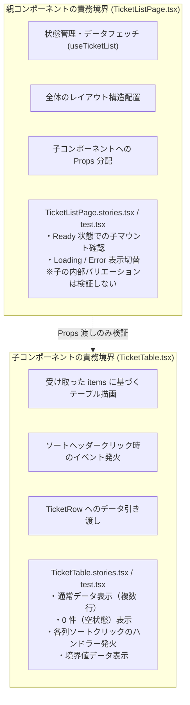

# C・UT 作業標準（TDD・UT/IT 境界・モック活用）

このスキルは、ウォーターフォール開発における C・UT（Coding・Unit Testing）工程の標準作業フローおよび品質基準を定めます。

要件および内部設計の正本は `docs/ed/` および `docs/id/` 配下の承認済み設計書（特に [docs/id/test-design.md](../../../docs/id/test-design.md)）であり、API 契約は [docs/ed/api/openapi.yaml](../../../docs/ed/api/openapi.yaml) に準拠します。issue やスキル内で独自の API 仕様や未定義の機能を勝手に確定しないでください。

---

## 1. 基本方針と前提条件

1. **設計書承認の確認**: C・UT に着手する前に、対象機能の内部設計（ID）ドキュメントおよび [docs/id/test-design.md](../../../docs/id/test-design.md) が `Approved (Step 3)` になっていることを確認します。未承認の状態で実装を開始してはなりません。
2. **設計準拠（SSOT 遵守）**: コンポーネント構成、状態管理、API 呼び出し、エラーハンドリングは承認済み ID 設計書を忠実に再現します。未解決の要件や設計の曖昧さを発見した場合は、仮定で埋めずに未解決事項として記録・エスカレーションします。
3. **テストファースト（TDD）**: 機能実装は単体テストを先に作成する TDD サイクル（Red → Green → Refactor）で行います。
4. **テスト配置の統一（Co-location）**: テストコードおよび Storybook ファイルはテスト対象ファイルと同階層に配置します。
5. **例外なしの 1 対 1 対応原則**: 全 `*.tsx` ファイルに対する `*.stories.tsx` 必須作成、および同階層 `*.test.tsx` での Portable Stories（`composeStories`）全件実行 ＋ 内部ロジック補完を徹底します。
6. **親子コンポーネント分離原則**: 親コンポーネントのテストで子コンポーネントのバリエーションを兼ねることを禁止し、子の表示バリエーション・境界値は子の Story/UT に完全委譲します。
7. **C0 / C1 100% 網羅原則**: ステートメント（C0）および分岐（C1）カバレッジ 100% を原則とします。
8. **VRT の UT（Storybook）への完全一本化**: 視覚的回帰テスト（VRT）は Storybook を対象に 1280px / 375px で実施し、結合テスト（IT）では VRT を行いません。
9. **設計不備（原因分類 D）の即時同期義務**: 実装・テスト中に設計・仕様不備（原因分類 `D`）を確認した場合、コードのみを修正して終わらせることは禁止とし、必ず ED/ID/OpenAPI 設計書を即座に是正して双方のコミットを記録します。

---

## 2. TDD（テスト駆動開発）の進め方

[.github/skills/tdd/SKILL.md](../tdd/SKILL.md) の基本サイクルを継承し、本リポジトリの C・UT 工程では以下の手順で進めます。

```text
[設計確認] docs/id/test-design.md の観点・ケースを確認
   ↓
 [Red]   テストコードを作成し、期待どおり失敗することを確認
         ⇒ 【コミット】test: 〇〇の単体テストを追加（Red）
   ↓
[Green]  テストを通す最小限の実装コードを作成
         ⇒ 【コミット】feat: 〇〇を実装（Green）
   ↓
[Refactor] 動作を維持したままコード品質・型安全性を向上
         ⇒ 【コミット】refactor: 〇〇の処理を整理（Refactor）
   ↓
 [検証]  型検査・Lint・Format・単体テスト・カバレッジの確認
```

### 2.1 各ステップの手順

> [!NOTE] 作業内不備の記録と品質分析（リポジトリ標準）
> C・UT 工程では、AI が Red・Green・Refactor、自動検証、AIレビュー等の作業中に確認した不備を検出工程・成果物区分ごとに記録し、バグ密度を計測します（§10 参照）。通常の Red（未実装機能に対する意図的な失敗）は除外し、既存成果物の不備を Red で確認した場合は一件として記録します。製品コードとテスト・モック等支援成果物を区別し、[docs/c-ut/evidence/ut-bug-record.md](../../../docs/c-ut/evidence/ut-bug-record.md) に記録してください。

1. **テスト観点・ケースの特定**:
   - [docs/id/test-design.md](../../../docs/id/test-design.md) の第3章「テスト観点と主要テストケース」、第4章「テストデータ」、および第8章「テストファイル・Storybook ファイルの配置方針と全対象ファイル一覧」から、今回実装・検証するケースを抽出します。
2. **Red（テスト作成と失敗確認）**:
   - テスト対象ファイルと同一ディレクトリに `.test.ts` または `.test.tsx`（および `.stories.tsx`）を作成します。
   - `describe`, `it`, `expect` を使って検証ロジックを記述します。
   - **テスト名（`it` ブロック）の日本語記述規約**:
     - テスト内容は「〜すること」「〜する」等の自然な日本語で明瞭に記述します（例: `it("フォーム要素および文字数カウンターを正しく描画する (SCR-03 AC-01)", ...)`）。
     - 画面受け入れ条件や仕様番号と紐づくケースには、末尾に `(SCR-02 AC-06)` 等の識別子を付与してトレーサビリティを確保します。
   - 対象テスト（`npx vitest run <対象テスト>` または `npm run test:unit`）を実行し、**実装がないために期待した理由で失敗することを確認**します（構文エラーや環境不備での失敗でないこと）。`npm test` は IT も含む集約コマンドのため、C・UT の Red 確認には使用しません。
3. **Green（最小限の実装）**:
   - テストをパスさせるために必要な最小限の実装コードを書きます。
   - 仕様外の投機的な機能追加や不要な抽象化は行いません（YAGNI 原則）。
   - 対象テストまたは `npm run test:unit` を実行し、Green（全パス）になることを確認します。
   - ※ Green で確認した不備も記録対象ですが、Green に限定しません。検出工程・成果物区分・重複判定は §10 に従います。
4. **Refactor（リファクタリング）**:
   - テストがすべて通っている状態を維持しながら、可読性の向上、重複の排除、命名の改善、型定義の厳密化を行います。
   - 対象テストまたは `npm run test:unit` を再実行し、デグレが発生していないことを確認します。
5. **検証**:
   - `npm run test:unit`（全単体テスト）
   - `npm run test:coverage`（全対象ファイル C0/C1 100% カバレッジ）
   - `node --test "test/**/*.js"`（リポジトリテスト）
   - `npm run typecheck`（型チェック）
   - `npm run lint`（ESLint）
   - `npm run format:check`（Prettier 書式チェック）
   - `npm run test:vrt`（Storybook VRT: UI ストーリー追加・変更時）

### 2.2 各 STEP でのコミット規約（TDD 証跡の記録）

TDD のプロセス（テストファースト）が遵守されたことを Git 履歴から客観的に検証（Audit）可能にし、レビュー性を高めるため、**各 STEP（Red / Green / Refactor）ごとに細かくコミットを刻む運用**を原則とします。

| STEP         | Conventional Commits 例                                        | コミット時点の状態                                   | 検証内容                                           |
| :----------- | :------------------------------------------------------------- | :--------------------------------------------------- | :------------------------------------------------- |
| **Red**      | `test: 問い合わせ一覧取得フックの単体テストを追加（Red）`      | テストコードのみ追加（対象実装は未作成または空関数） | 対象 UT で**期待通りの理由でテストが失敗する**こと |
| **Green**    | `feat: 問い合わせ一覧取得フックの初期表示を実装（Green）`      | テストを通す最小限の実装コードを追加                 | 対象 UT で**テストがパスする**こと                 |
| **Refactor** | `refactor: 問い合わせ一覧取得フックのエラーハンドリングを整理` | 振る舞いを変えずにリファクタリングを実施             | 対象 UT で**テストがパスし続けている**こと         |

- **効果**: レビュアーがコミット単位で差分を追うことで、テスト意図・実装コード・リファクタ内容を明確に分離してレビューできます。また、リファクタ中に不具合が生じた場合も即座に Green の状態へ復帰できます。

### 2.3 Green / Refactor 段階でテスト不備に気付いた場合の対処フロー

実装中やリファクタリング中に、テストの抜け漏れや不備に気付いた場合の原則は、**「テストコードとプロダクションコードを同時にいじって帳尻を合わせない」**ことです。不備の内容に応じて以下のいずれかで対処します。

#### パターン A: テストケースの考慮漏れ・抜けに気付いた場合（ケース追加）

1. **現在の作業を完了または退避**: 着手中の Green / Refactor を完了させてコミットするか、`git stash` で一時退避します。
2. **新たな Red を作成**: 気づいたケースを新規テストとして追加し、失敗することを確認して `test: ...（Red）` をコミットします。
3. **Green → Refactor のサイクルを回す**: 実装を加えて Green にし、必要に応じて Refactor します。

#### パターン B: 既存テスト自体の期待値やモックが誤っていた場合（テスト修正）

1. **Red（意図した失敗）に戻す**: テストの期待値やモックを承認済み設計（SSOT）に合わせて修正し、意図通りテストが失敗することを確認して `fix(test): 〇〇テストの期待値をOpenAPI仕様に修正（Red）` とコミットします。
2. **実装を修正して Green にする**: 正しい期待値を満たすように実装コードを修正し、`fix: ...（Green）` とコミットします。

#### パターン C: Refactor 段階でテストが壊れた場合（脆いテストの解消）

1. **実装のバグかテストの問題かを切り分け**:
   - 公開された振る舞い・入出力が壊れた場合は、実装側のバグであるため実装を修正します（テストがセーフティネットとして機能した正常な状態）。
   - 一方で、振る舞いは同一であるにもかかわらず、内部プライベートメソッドの呼び出し回数や非公開ステートなど**「実装詳細に依存していたために壊れた（脆いテスト: Brittle Test）」**場合は、テスト設計を内部詳細依存から**ユーザー視点の入力と結果（Observable State・振る舞い）を検証するテスト**へと改善（リファクタ）します。

---

## 3. 単体テスト（UT）と統合テスト（IT）の責務境界

[docs/id/test-design.md](../../../docs/id/test-design.md) 第1章および第7章に基づき、C・UT 工程（UT）で検証すべき範囲と、後続の IT / PT 工程に委ねる範囲を作業標準として明確化します。

### 3.1 3層テスト体系の責務マトリクス

| 区分                 | UT（単体テスト）                                                           | IT（結合テスト）                                                                   | PT（総合テスト）                                                                |
| :------------------- | :------------------------------------------------------------------------- | :--------------------------------------------------------------------------------- | :------------------------------------------------------------------------------ |
| **実行環境**         | Node.js（`happy-dom` / `jsdom`）＋ Storybook 10                            | Chromium 実ブラウザ（Playwright Test）                                             | Docker コンテナ環境（Next.js 画面コンテナ ＋ Mock API コンテナ）                |
| **モック・API**      | MSW `setupServer`（Node.js インプロセス）                                  | ローカル開発サーバー（Next.js）＋ MSW Browser Worker（または Mock API）            | 別コンテナ Mock API サーバー（Node.js HTTP Server ＋ `@mswjs/http-middleware`） |
| **テスト粒度**       | モジュール、フック、コンポーネント、Thin Wrapper Page                      | 画面内の複数操作フロー、画面間遷移、URL クエリ同期、Dirty ガード                   | エンドツーエンド業務受入シナリオ（SYS-AC-01〜16）、非機能検証（SYS-AC-17）      |
| **ビジュアル (VRT)** | **実施（UT に一本化）**: Storybook 全 Story を対象に 1280px / 375px で実施 | **不実施**: 画面遷移・ふるまい検証に特化し、VRT は行わない                         | **目視確認**: 1280px / 375px での最終レイアウト・アニメーション証跡取得         |
| **エビデンス**       | Vitest カバレッジレポート（C0/C1 100%）、VRT スナップショット差分なし      | `docs/it/evidence/it-test-result.md`（サマリー表）、CI Artifact（HTML / トレース） | `docs/pt/evidence/` 配下の操作証跡、Lighthouse レポート、バンドルサイズ計測証跡 |
| **データ初期化**     | テストケース単位で `resetMockDb()` 同期呼出                                | 各テスト前に `POST /api/test/reset` 発行（決定論的初期化）                         | コンテナ起動時初期化（初期シードデータ状態）                                    |

### 3.2 詳細な検証責務境界

| 対象レイヤー / 検証項目                                 | UT  | IT  | 理由・作業方針                                                                                                      |
| :------------------------------------------------------ | :-: | :-: | :------------------------------------------------------------------------------------------------------------------ |
| **汎用ユーティリティ・関数** (`src/shared/lib/`)        | ✅  |  —  | 純粋関数としての入出力・境界値・サロゲートペア文字数等を網羅検証する。                                              |
| **API クライアント** (`src/shared/api/`, `api/`)        | ✅  |  —  | MSW `setupServer` を併用し、リクエスト構築・`cache: "no-store"`・エラー型変換・AbortSignal を検証する。             |
| **カスタムフック** (`src/features/*/hooks/`, `hooks/`)  | ✅  |  —  | 状態遷移、非同期制御、入力バリデーション、二重送信防止、Race Condition 防止、AbortError 透過を網羅検証する。        |
| **UI コンポーネント単体** (`components/`, `ui/`)        | ✅  |  —  | Props 駆動描画、イベント発火、アクセシビリティ（role/aria）を検証する（Storybook ＋ `composeStories`）。            |
| **Thin Wrapper Page・Layout** (`src/app/**`)            | ✅  |  —  | パラメータ受領、`<Suspense>` 境界、Feature マウント、認可ガード（TR-16/17 文言検証）、共通 404 復帰を単体検証する。 |
| **MSW モック定義** (`src/mocks/`)                       | ✅  |  —  | OpenAPI 契約準拠、フィルタリング・ソート・ページネーション、データストア CRUD・整合性、リセット API を検証する。    |
| **別コンテナ Mock API サーバー** (`server/mock-api.ts`) | ✅  |  —  | Node.js HTTP サーバー起動、リセットエンドポイント、未定義 404 応答を単体テストで検証する。                          |
| **画面間のルーティング遷移フロー**                      |  —  | ✅  | Next.js App Router による実ルーター遷移、画面間連携は IT で実ブラウザを用いて検証する。                             |
| **URL クエリパラメータ同期・ブラウザ履歴連携**          |  —  | ✅  | ブラウザ履歴（`useSearchParams` / 履歴スタック）との結合は IT で検証する（フック単体のロジックは UT）。             |
| **複数画面をまたぐ業務シナリオ**                        |  —  | ✅  | 一覧→詳細→更新→一覧反映などの画面間データ同期シナリオは IT で検証する。                                             |
| **ブラウザ上の MSW 動作（Service Worker 経由）**        |  —  | ✅  | UT は Node.js 環境の `setupServer` を使用。ブラウザ環境の `setupWorker` は IT/PT で検証する。                       |
| **SYS-AC-16（別コンテナ Mock API 接続）**               |  —  |  —  | Next.js 画面コンテナと Mock API コンテナのネットワーク導通および通信ログ観測は **PT の専任検証**。                  |
| **SYS-AC-17（非機能品質検証）**                         |  —  |  —  | 本番ビルド初期ロード JS < 100.0 kB、Lighthouse 90点以上、a11y、レスポンシブは **PT の専任検証**。                   |

---

## 4. テストファイル・Storybook ファイル配置規約（Co-location & 1対1 対応）

テストファイルおよび Storybook ファイルは、対象コードの保守性とレビュー性を高めるため**テスト対象ファイルと同階層（Co-location）**に配置します。

### 4.1 命名規約

- TypeScript ファイル: `<対象ファイル名>.test.ts`
- React コンポーネントファイル: `<対象ファイル名>.test.tsx`
- Storybook ストーリーファイル: `<対象コンポーネント名>.stories.tsx`

### 4.2 例外なしの 1 対 1 対応マトリクス

`docs/rd/step3.md` §3.2 および `docs/id/test-design.md` §2.1, §8.2 に基づき、プロダクションコード全ファイルとテスト・ストーリーファイルを 1 対 1 で完全に同期させます。

| 対象ソースファイル種別                                                     | 必須作成ファイル                | 補完ファイル                                       | 作成・網羅ルール                                                                                                                                                                                                                                                                                                                                 |
| :------------------------------------------------------------------------- | :------------------------------ | :------------------------------------------------- | :----------------------------------------------------------------------------------------------------------------------------------------------------------------------------------------------------------------------------------------------------------------------------------------------------------------------------------------------- |
| **全 `*.tsx` ファイル**<br>（Page, Layout, Feature, 共有 UI, MSWProvider） | **`*.stories.tsx`**<br>（必須） | **`*.test.tsx`**<br>（Story 実行 ＋ ロジック補完） | 1. 対象コンポーネントの Props 分岐・表示バリエーション・基本操作（`play` 関数）を漏れなく `.stories.tsx` に Story として上げる。<br>2. `.test.tsx` では `composeStories` を用いて全 Story の描画・`play` 関数を実行する。<br>3. **Story だけではカバーしきれない内部ロジック分岐**がある場合は、`.test.tsx` 内の Vitest テストケースで補完する。 |
| **全 `*.ts` ファイル**<br>（Hooks, API, 関数, Store, Mock Server 等）      | **`*.test.ts`**<br>（必須）     | —                                                  | 関数の入出力、カスタムフックの状態遷移、非同期制御、エラー分岐を `.test.ts`（フック等で DOM/Provider が必要な場合は `.test.tsx`）で漏れなく網羅する。                                                                                                                                                                                            |

### 4.3 ディレクトリ構造例

```text
src/
├── app/
│   ├── layout.tsx
│   ├── layout.stories.tsx
│   ├── layout.test.tsx
│   ├── not-found.tsx
│   ├── not-found.stories.tsx
│   ├── not-found.test.tsx
│   ├── MSWProvider.tsx
│   ├── MSWProvider.stories.tsx
│   ├── MSWProvider.test.tsx
│   ├── (authenticated)/
│   │   ├── layout.tsx
│   │   ├── layout.stories.tsx
│   │   ├── layout.test.tsx
│   │   ├── dashboard/
│   │   │   ├── page.tsx
│   │   │   ├── page.stories.tsx
│   │   │   └── page.test.tsx
│   │   └── tickets/
│   │       ├── page.tsx
│   │       ├── page.stories.tsx
│   │       ├── page.test.tsx
│   │       └── [id]/
│   │           ├── page.tsx
│   │           ├── page.stories.tsx
│   │           └── page.test.tsx
├── features/
│   └── tickets/
│       ├── api/
│       │   ├── ticketApi.ts
│       │   └── ticketApi.test.ts
│       ├── hooks/
│       │   ├── useTicketList.ts
│       │   └── useTicketList.test.ts
│       └── components/
│           ├── TicketTable.tsx
│           ├── TicketTable.stories.tsx
│           ├── TicketTable.test.tsx
│           ├── TicketRow.tsx
│           ├── TicketRow.stories.tsx
│           └── TicketRow.test.tsx
├── shared/
│   ├── api/
│   │   ├── client.ts
│   │   ├── client.test.ts
│   │   ├── errors.ts
│   │   └── errors.test.ts
│   ├── ui/
│   │   ├── Button.tsx
│   │   ├── Button.stories.tsx
│   │   └── Button.test.tsx
│   └── lib/
│       ├── dateUtils.ts
│       └── dateUtils.test.ts
├── mocks/
│   ├── handlers/
│   │   ├── tickets.ts
│   │   └── tickets.test.ts
│   └── db/
│       ├── store.ts
│       └── store.test.ts
└── server/
    ├── mock-api.ts
    └── mock-api.test.ts
```

---

## 5. MSW モック活用ルール & 別コンテナ Mock API サーバー

### 5.1 OpenAPI 契約（SSOT）への準拠

- モックレスポンスのデータ構造、型、HTTP ステータスコード、エラーコードはすべて [docs/ed/api/openapi.yaml](../../../docs/ed/api/openapi.yaml) に準拠します。
- 独自のエラー形式や未定義のプロパティをモックに含めてはなりません。
- 自動生成された型定義（`src/shared/api/openapi.generated.ts`）を活用し、手動定義との乖離を防止します。

### 5.2 Node.js テスト環境での運用

- UT 環境（Vitest / Node.js）では `msw/node` の `setupServer` を使用します。
- 共通ハンドラー（`src/mocks/handlers/`）をテストでも再利用し、テスト固有の異常系（500 エラー、404 エラーなど）をテストする場合のみ `server.use(...)` でハンドラーを一時的にオーバーライドします。

### 5.3 テスト間の状態独立性

- テスト間でデータが漏洩しないよう、各テストの前後で以下を徹底します（`src/test/setup.ts` 等で設定）:
  ```ts
  import { server } from "../mocks/server";
  import { resetMockDb } from "../mocks/db/store";

  beforeAll(() => server.listen());
  afterEach(() => {
    server.resetHandlers(); // 一時ハンドラーのリセット
    resetMockDb(); // データストアのリセット
  });
  afterAll(() => server.close());
  ```

### 5.4 テスト専用シードリセット API（`POST /api/test/reset`）

- 後続 Playwright IT でのテスト前決定論的シード初期化に備え、MSW ハンドラーおよび別コンテナ Mock API サーバーに `POST /api/test/reset` ハンドラーを実装・単体テストします。

---

## 6. Storybook と Portable Stories（UI 単体テスト連携 & Next.js Navigation モック）

UI コンポーネントの状態バリエーション（Props パターン、ローディング、エラー表示等）は、Storybook（Component Story Format: CSFv3）でカタログとして定義し、Vitest の JSDOM 環境から **Portable Stories（`composeStories`）** を用いてテストに直接再利用します。
これにより、Storybook と `.test.tsx` の間でのテスト用 UI 状態の二重管理（DRY 違反）を解消し、コンポーネントカタログと単体テストを強固に同期させます。

### 6.1 ストーリー作成規約

1. **配置と命名**:
   - 対象コンポーネントと同階層に `<Component>.stories.tsx` を配置します。
2. **型定義**:
   - `satisfies Meta<typeof Component>` を使用してメタデータを定義します。
   - `type Story = StoryObj<typeof Component>;` と定義し、コンポーネント本来の Props 型を維持します。
3. **アクション・イベントハンドラ**:
   - `args` のコールバックには `storybook/test` の `fn()` を設定します。Storybook UI 上でアクションログが記録され、Vitest 内でもスパイとして検証可能です。
4. **インタラクションテスト（play 関数）**:
   - クリックや入力などの対話操作を検証する場合、Story に `play` 関数を定義します。
   - `storybook/test` の `within`, `userEvent`, `expect` を使用して記述します。
5. **表示名（`name`）と説明文（JSDoc）の日本語記述規約**:
   - **エクスポート変数名**: TypeScript 識別子として `export const Default: Story = ...`、`export const Filled: Story = ...` のように PascalCase の英語名を維持します（Portable Stories や VRT スナップショット名との整合性を保つため）。
   - **サイドバー表示名（`name` プロパティ）**: Storybook のサイドバーツリーの見通しを保つため、`name: "初期状態（未入力）"` や `name: "入力済み"` のように簡潔な日本語の見出しを設定します。
   - **詳細説明文（JSDoc コメント）**: 各ストーリーおよび Meta の直前に JSDoc コメント（`/** ... */`）を記述します。Storybook Docs（Autodocs）画面上に自然な日本語の詳細説明文が自動抽出・表示されます。

### 6.2 Next.js App Router 環境における `parameters.nextNavigation` 統合モック規約

`docs/id/tech-verification.md` §2.1 および `docs/id/test-design.md` §2.3 に準拠し、Storybook および Vitest での Next.js App Router モック（`useRouter`, `usePathname`, `useSearchParams`, `useParams`, `notFound`）には **方式 1-C（`parameters.nextNavigation`）** を使用します。

1. **Storybook CSF `parameters.nextNavigation` 仕様**:
   - Story ごとにルーティング状態をパラメータとして定義します。
   ```tsx
   export const FilteredPage: Story = {
     name: "フィルター適用状態",
     parameters: {
       nextNavigation: {
         pathname: "/tickets",
         query: { status: "in_progress", page: "2" },
         params: { id: "1" },
       },
     },
   };
   ```
2. **`useSearchParams` の仕様準拠**:
   - Next.js の `ReadonlyURLSearchParams` 互換インスタンスを生成し、`get()`, `getAll()`, `has()`, `toString()` を完全再現します。
3. **`useRouter` / `notFound` のスパイ・呼び出し追跡**:
   - `router.push`, `router.replace`, `notFound()` を `vi.fn()` / `fn()` として公開し、インタラクションテストや `play` 関数で遷移先 URL や呼び出し有無を厳密にアサーションします。

### 6.3 親子コンポーネント間の独立性ルール（親子分離原則・省略禁止）

コンポーネントのテストにおいて、「親コンポーネントのテストで子コンポーネントのバリエーションを兼ねる」といったテストの省略・相乗りを厳格に禁止します。



1. **親コンポーネントの検証範囲**:
   - 親コンポーネント（例: `TicketListPage`）の Story / テストでは、「親自身が所有する状態管理（フック呼び出し）」、「状態ごとのレイアウト・コンポーネント切り替え（Loading / Error / Ready）」、および「子コンポーネントへの Props 受け渡し」のみを検証します。
2. **子コンポーネントの検証範囲**:
   - 子コンポーネント（例: `TicketTable`, `TicketListFilterForm`, `Pagination`）固有の表示バリエーション（空データ、境界値データ、バリデーションエラー、ボタン活性/非活性、イベント発火）は、**必ず子自身の `.stories.tsx` および `.test.tsx` で独立して網羅** します。
3. **レビュー性の担保**:
   - 人間レビュアーが「対象の `.tsx`」と「同階層の `.stories.tsx`（＋`.test.tsx`）」の 2 つを並べるだけで、当該コンポーネントの仕様・分岐網羅性を 1 対 1 で即座に確認できる構成を維持します。

### 6.4 単体テストでの再利用手順（Portable Stories ＋ ロジック補完）

1. **全 Story の描画・play 関数の全件実行**:
   - テストファイルで `composeStories` を使用して全 Story を React コンポーネントに変換し、描画および `play` 関数を実行します。
2. **Story でカバーしきれない内部ロジックの Vitest 補完**:
   - 細かなイベント分岐（例: `AdminManagementTabs.tsx` のキーボード操作 `ArrowRight` / `ArrowLeft` / `Home` / `End` / 無関係キー押下時の `default` 早期リターン等）
   - Unmount 時のクリーンアップ処理、AbortSignal による中断、複雑なコールバック引数の組み合わせ検証など。

```tsx
import { render, screen } from "@testing-library/react";
import { composeStories } from "@storybook/react";
import * as stories from "./FeedbackView.stories";

const { Success, Interactive } = composeStories(stories);

describe("FeedbackView (Portable Stories)", () => {
  it("成功時のフィードバックメッセージを正しく描画する", () => {
    render(<Success />);
    expect(screen.getByRole("status")).toHaveTextContent("更新完了");
  });

  it("play 関数を実行してインタラクションを検証できる", async () => {
    const { container } = render(<Interactive />);
    await Interactive.play?.({ canvasElement: container });
    expect(Interactive.args?.onClose).toHaveBeenCalledTimes(1);
  });
});
```

### 6.5 VRT（視覚的回帰テスト）の UT 一本化

- **VRT は UT（Storybook）に一本化**: 全 `.tsx` の表示バリエーションが Storybook CSF として網羅されるため、VRT（`npm run test:vrt`）は Storybook を対象として 1280px / 375px の 2 系統で実行します。結合テスト（IT）では VRT を実施しません。
- 新規 Story の作成時や既存コンポーネントのデザイン変更時は、`npm run test:vrt:update` でスナップショット画像を更新し、差分がないことを確認します。

---

## 7. カバレッジ方針と受け入れ基準（C0 / C1 100% 原則）

[docs/id/test-design.md](../../../docs/id/test-design.md) 第5章に従い、Step 3 では **C0（命令/行）・C1（分岐）・Functions 100% カバレッジ** を必須原則とします。

### 7.1 受け入れ基準

| 指標                        | 目標基準 | 対象ファイル範囲                                     | 判定方法                                                         |
| :-------------------------- | :------: | :--------------------------------------------------- | :--------------------------------------------------------------- |
| **C0（命令/行カバレッジ）** | **100%** | `src/` 配下の全 `.ts` / `.tsx`、`server/mock-api.ts` | Vitest Coverage（`v8`）レポートによる機械的判定                  |
| **C1（分岐カバレッジ）**    | **100%** | `src/` 配下の全 `.ts` / `.tsx`、`server/mock-api.ts` | 条件分岐（`if`, `switch`, 三項演算子, nullish 合体）の全パス網羅 |
| **関数カバレッジ**          | **100%** | 同上                                                 | 全定義関数の実行確認                                             |

- 計測コマンド: `npm run test:coverage`

### 7.2 許容される除外理由の厳格化

100% 未達を許容するケースは、以下の「実行不可能なコード」に限定し、勝手な除外コメント（`/* v8 ignore next */`）の乱用を禁止します。

1. **型定義専用ファイル**: `types.ts`、`**/*.d.ts` 等の純粋な型定義ファイル（実行可能 JavaScript を一切含まないもの）。
2. **Storybook ストーリーファイル**: カタログ定義であり、テスト実行自体は `.test.tsx` で担保されるため（カバレッジ対象外）。
3. **TypeScript コンパイラによる到達不能コード**: TypeScript の型チェックで網羅されている `switch-case` の `default: const _exhaustiveCheck: never = ...` 等（やむを得ず除外する場合は理由を明記）。

---

## 8. コマンド標準

| コマンド                     | 用途                                                              |
| :--------------------------- | :---------------------------------------------------------------- |
| `npm test`                   | 全テスト実行（Vitest 単体テスト + IT + Node.js リポジトリテスト） |
| `npm run test:unit`          | Vitest 単体テストのみ実行（開発中の迅速な確認）                   |
| `npm run test:it`            | Playwright IT 実行（IT 工程開始後に実行・PR ゲート化）            |
| `npm run test:coverage`      | カバレッジ計測レポート出力（C0/C1 100% 検証）                     |
| `npm run storybook`          | Storybook 開発サーバー起動（ローカルポート 6006）                 |
| `npm run build-storybook`    | Storybook 静的サイトのビルド（`storybook-static/`）               |
| `npm run typecheck`          | TypeScript 型検査                                                 |
| `npm run lint`               | ESLint コード検証                                                 |
| `npm run format:check`       | Prettier コードフォーマット検査                                   |
| `npm run format`             | Prettier コードフォーマット自動整形                               |
| `npm run test:vrt`           | Storybook をビルドし全 Story の VRT を実行（1280px / 375px）      |
| `npm run test:vrt:update`    | 全 Story の VRT スナップショット画像を更新                        |
| `node --test "test/**/*.js"` | Node.js 標準リポジトリテスト実行                                  |

---

## 9. オーケストレーションとサブエージェント委託（コンテキスト保護）

C・UT 工程は編集ファイル数やテスト実行ログが多く、メインセッション（親エージェント）のコンテキストウィンドウが枯渇しやすく、コンパクション（コンテキスト圧縮）による手順脱落のリスクが高まります。これを防ぐため、以下の委託モデルを活用します。

### 9.1 オーケストレーターとワーカースレッドの役割分担

- **メインエージェント（オーケストレーター）**:
  - 要件定義（RD）・内部設計（ID）・テスト設計（`docs/id/test-design.md`）の確認
  - 実装対象コンポーネント・機能のタスク分割（作業計画の立案）
  - 汎用サブエージェント（`self`）への TDD 実装作業の委託と成果（コミットSHA・完了サマリー）の集約
  - プッシュ・PR 作成、GitHub Actions（CI/VRT）の監視
  - [PR reviewer agent](../../agents/pr-reviewer.agent.md) への独立レビュー依頼と指摘集約
- **汎用サブエージェント（ワーカースレッド: `self`）**:
  - 本スキル（`c-ut-workflow`）を読み、担当する機能・コンポーネントの TDD サイクル（Red → Green → Refactor）の実行
  - 単体テストの実行・検証と細やかなコミットの記録
  - PR レビュー指摘事項の是正および検証テストの追加

### 9.2 委託単位のベストプラクティス

1. **機能・コンポーネント単位で一塊にする**:
   - 1 つのモジュール/画面要素単位で一塊にして委託します。
2. **専用エージェント定義は増やさない**:
   - 汎用エージェント（`self`）に対して「`.github/skills/c-ut-workflow/SKILL.md` に従ってコンポーネント X の TDD サイクルを実施せよ」とプロンプトで明確に指示することで、SSOT の維持と構成管理コストの最小化を両立します。
3. **直列（逐次）委託の原則**:
   - テスト干渉、Git ロック競合、VRT ポート競合を回避するため、直列パイプラインで委託します。

### 9.3 タスク完了ゲート（Task Completion Gate）の厳守

実装・テスト作業を完了した後は、PR を作成しただけで終了報告を行わず、[AGENTS.md](../../../AGENTS.md) に規定された **タスク完了ゲート（静的検査・テスト PASS → VRT PASS → PR `Closes #N` 作成 → CI/VRT PASS → 独立レビュー → スレッド解決 → 人間承認待ち）** を最後まで完遂してください。

---

## 10. 品質分析・不備記録標準（バグ密度計測と設計同期）

C・UT 工程では、AI 作業中（TDD Red・Green・Refactor、自動検証、AI レビュー）に確認された不備を記録し、客観的な品質メトリクス（バグ密度・原因分類・検出工程）を集計・分析します。

### 10.1 基本ルール

1. **製品コードと支援成果物の分離**:
   - **製品コード**: 実行時アプリケーションコード（`src/` 配下。テスト・Storybook・モックを除く）。バグ密度の分子として集計。
   - **支援成果物**: 単体テスト、MSW ハンドラー、Storybook、設定等。別集計とし、製品コードのバグ密度の分子には含めない。
2. **記録対象と除外基準**:
   - 通常の Red step（未実装機能に対する意図的な失敗）や軽微なタイポ・書式調整は除外。
   - 既存成果物の仕様違反、契約違反、再現可能な誤動作、レビュー指摘により確定した不備を 1 件として記録。同一原因の連鎖的失敗は 1 件に集約。
3. **原因分類コード（5分類）**:
   - `L` (Logic: ロジック誤り)
   - `S` (State: 状態遷移誤り)
   - `D` (Design: 設計・仕様誤認、OpenAPI/ID契約不一致)
   - `B` (Boundary: 境界値・エッジケース未考慮)
   - `A` (Async: 非同期競合・AbortController未連携)

### 10.2 原因分類 `D`（設計・仕様不備）検出時における設計同期義務

> [!IMPORTANT] コードのみ修正の禁止と設計書即時同期ルール
> [AGENTS.md](../../../AGENTS.md) §4 および [docs/id/test-design.md](../../../docs/id/test-design.md) §9.1.2 に基づき、原因分類 `D`（設計・仕様不備、OpenAPI/ID 契約不一致）が検出された場合、**コードのみを修正することは厳格に禁止**されています。
>
> 1. **設計書の即時同期**: 対応する設計書（`docs/ed/`, `docs/id/`, `docs/ed/api/openapi.yaml`）を即座に是正します。
> 2. **双方のコミット記録**: [docs/c-ut/evidence/ut-bug-record.md](../../../docs/c-ut/evidence/ut-bug-record.md) に、**コード修正コミット/PR と設計書修正コミット/PR の双方を漏れなく記録**します。
> 3. **波及影響分析**: 上位および関連成果物への影響波及を確認し、必要に応じて関連 Issue へ通知します。

### 10.3 スリム化した記録フォーマット（標準形式）

タスク進行中は以下の必須 6 項目で [docs/c-ut/evidence/ut-bug-record.md](../../../docs/c-ut/evidence/ut-bug-record.md) に記録します。

| No. | 検出手段                | 成果物区分  | 対象箇所     | 原因分類 | 不備の概要と是正内容（コード/設計同期コミット）                                             |
| :-: | :---------------------- | :---------: | :----------- | :------: | :------------------------------------------------------------------------------------------ |
|  1  | AIレビュー / TDD Red 等 | 製品 / 支援 | `ファイル名` | D / S 等 | 事象、根本原因、修正内容・コミット（原因分類 D の場合は設計書同期コミット含む）を簡潔に記載 |

### 10.4 工程完了時の品質分析レポート作成

C・UT 工程完了承認時（#239）において、以下のメトリクスを算出し、`docs/c-ut/quality/step3.md` に品質分析レポートとして記録します。

- 製品コードの KLoC あたりバグ密度: $\frac{\text{製品コード不備件数}}{\text{LoC} / 1000}$（目安: 1.0〜5.0 件/KLoC）
- 単体テストケースあたりバグ密度: $\frac{\text{製品コード不備件数}}{\text{単体テスト総ケース数}}$
- 原因分類別・検出工程別内訳の考察と、後続 IT 工程への重点検証申し送り
