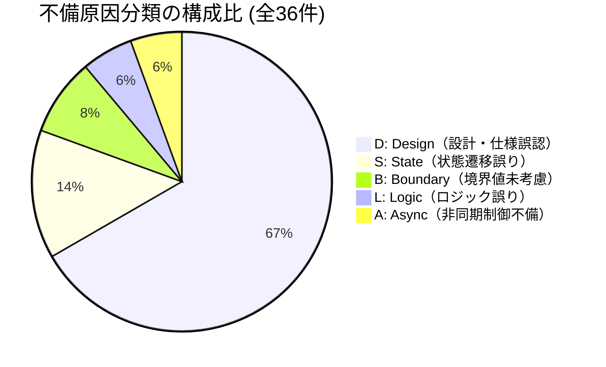
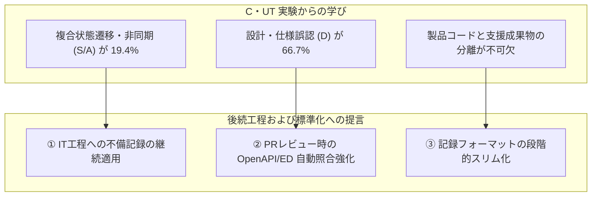

# Step 2 C・UT 品質分析および実験有効性評価レポート

| 項目                | 内容                                                                                                                                                                                                         |
| ------------------- | ------------------------------------------------------------------------------------------------------------------------------------------------------------------------------------------------------------ |
| 状態                | `Approved (Step 2)`                                                                                                                                                                                          |
| 更新日              | `2026-10-14`                                                                                                                                                                                                 |
| 関連する ED/ID 項目 | `docs/c-ut/README.md` `docs/c-ut/ut-bug-density-experiment.md` `docs/c-ut/evidence/ut-bug-record.md` `docs/id/test-design.md` `#149 [Step 2 - C・UT] 実装・単体テスト成果物をレビュー・承認する` |

> [!NOTE] ドキュメントの位置づけ
> 本レポートは、Step 2 実装・単体テスト（C・UT）工程において実施された「UT品質分析・バグ密度計測実験（[docs/c-ut/ut-bug-density-experiment.md](../ut-bug-density-experiment.md)）」に基づき、蓄積された不備記録（全 36 件）および単体テスト・カバレッジ実績を多角的に分析し、実験的運用の有効性を評価した公式成果物です。

---

## 1. エグゼクティブサマリー

Step 2 C・UT 工程の完了基準に基づき、実装成果物の品質メトリクスおよび実験運用の結果を集約・評価しました。

### 1.1 主要品質メトリクス実績一覧

| 指標カテゴリ       | 指標項目                            |                      実績値                       |         完了基準・一般的な目安          |      判定      |
| :----------------- | :---------------------------------- | :-----------------------------------------------: | :-------------------------------------: | :------------: |
| **テスト規模**     | 単体テスト総ケース数                |            **799 tests** (全 94 files)            |              全テスト PASS              |    **合格**    |
|                    | VRT スナップショット総数            |                    **235 件**                     |                全件 PASS                |    **合格**    |
| **テスト網羅性**   | 行カバレッジ (Lines)                |                    **90.65%**                     | 80% 以上（`docs/id/test-design.md` §5） | **極めて良好** |
|                    | 分岐カバレッジ (Branches)           |                    **82.37%**                     |                70% 以上                 |    **良好**    |
|                    | 関数カバレッジ (Functions)          |                    **93.88%**                     |                80% 以上                 | **極めて良好** |
| **実装コード規模** | プロダクションコード追加行数 (LoC)  | **8,202 行** (TS/TSX) _※CSS含む全体: 9,734 行_ |                    -                    |       -        |
| **品質・欠陥密度** | 確認済み不備総数（重複除外後）      |                     **36 件**                     |                    -                    |       -        |
|                    | 製品コード不備件数（密度の分子）    |                     **23 件**                     |                    -                    |       -        |
|                    | テスト・モック等支援成果物不備件数  |                     **13 件**                     |                    -                    |       -        |
|                    | **製品コード バグ密度 (KLoC)**      |             **2.36 〜 2.80 件/KLoC**              |    1.0 〜 5.0 件/KLoC（標準レンジ）     | **適正・健全** |
|                    | **製品コード バグ密度 (Test Case)** |               **0.0288 件/ケース**                |     (約 35 テストに 1 件の不備検出)     |    **適正**    |

### 1.2 総合評価

1. **高い品質水準の達成**:
   単体テスト 799 件全件合格、ラインカバレッジ 90.65%、VRT 235 件全件合格を達成しており、C・UT 工程の品質完了基準を極めて高い水準でクリアしています。
2. **実験的取り組みの有効性**:
   「製品コード（23件）」と「支援成果物（13件）」を分離集計したことで、テスト整備時の試行錯誤が製品品質指標を歪めることを防ぎ、真のプロダクションコード品質を適正に評価できました。
   得られたバグ密度（2.36〜2.80 件/KLoC）は標準的かつ健全な範囲に収まっており、リポジトリ標準規約（`c-ut-workflow` 等）への正式採用が推奨されます。

---

## 2. 定量データ分析

### 2.1 原因分類別内訳（なぜ不備が起きたか）

記録された不備全 36 件について、原因分類コード（L / S / D / B / A）に基づく集計結果です。

| 分類コード | 分類名                       | 製品コード | 支援成果物 | 合計件数  |   比率    | 主な具体的事象                                                                                                                                                                                     |
| :--------: | :--------------------------- | :--------: | :--------: | :-------: | :-------: | :------------------------------------------------------------------------------------------------------------------------------------------------------------------------------------------------- |
|   **D**    | **Design（設計・仕様誤認）** |     13     |     11     | **24 件** | **66.7%** | OpenAPI 契約のエラーコード不一致（`PROJECT_HAS_TICKETS`）、型定義の緩さ、URLクエリ構築方法（`URLSearchParams` vs 手動結合）、UI表記規定（`0/2000`）、Storybook play 関数のアクセシブルネーム不一致 |
|   **S**    | **State（状態遷移誤り）**    |     5      |     0      | **5 件**  | **13.9%** | ブラウザ履歴復元（戻る/進む）時のクエリ往復、401失効理由のガード伝達、競合エラー（409）後の最新データ再同期、エラー発生時のスケルトン解除漏れ                                                      |
|   **B**    | **Boundary（境界値未考慮）** |     2      |     1      | **3 件**  | **8.3%**  | Unicode サロゲートペア（絵文字）の文字数カウント、未取得・未定義値（`undefined`）での削除ボタン抑止、パスワード最大長（100文字超）バリデーション                                                   |
|   **L**    | **Logic（ロジック誤り）**    |     1      |     1      | **2 件**  | **5.6%**  | Escape キー押下時のイベント重複処理（document リスナーと React ハンドラーの二重発火）、モック集計時の担当者絞り込み条件漏れ                                                                        |
|   **A**    | **Async（非同期制御不備）**  |     2      |     0      | **2 件**  | **5.6%**  | 旧トークンの遅延 401 応答による新セッション誤破棄、一覧取得と作成・更新の並行実行時の Race Condition（古いレスポンス破棄制御）                                                                     |
|  **合計**  | -                            |   **23**   |   **13**   | **36 件** | **100%**  | -                                                                                                                                                                                                  |

#### 【分析所見 1】設計・仕様誤認（D）の突出と AI 開発の特性

- 全体の **66.7%（24件）** が `D: Design` に集中しています。
- これは、「アルゴリズムの破綻や計算ミス（L: 2件）」や「境界値漏れ（B: 3件）」といった一般的なプログラミングエラーではなく、**「外部設計書（ED）や OpenAPI 契約、内部設計書（ID）に詳細に書かれた仕様の読み落とし・解釈違い」が最大の欠陥混入源であったこと**を示しています。
- TypeScript の静的型付けや TDD によりロジックや境界値は堅牢に保護される一方、自然言語や YAML で記述された契約の細部（例: クエリ文字列のエンコード方式、エラー時のステータスコード名、文字数カウンターの空白有無など）の伝達・遵守に最大の注意を払う必要があることがデータとして浮き彫りになりました。

---

### 2.2 検出工程・手段別内訳（どこで不備を摘出したか）

不備が最初に発見・同定された工程および検証手段の内訳です。

| 検出工程・手段              | 製品コード | 支援成果物 | 合計件数  |   比率    | 検出された代表的な不備                                                                              |
| :-------------------------- | :--------: | :--------: | :-------: | :-------: | :-------------------------------------------------------------------------------------------------- |
| **AIレビュー**              |     13     |     7      | **20 件** | **55.6%** | OpenAPI 契約不一致、遅延 401 競合、Enter キー誤送信、アクセシビリティ考慮漏れ、モック仕様不備       |
| **TDD Red**                 |     7      |     1      | **8 件**  | **22.2%** | Unicode 文字列長境界、未定義値ガード、ブラウザ履歴復元、Escape キー重複発火、固定パスワード契約不備 |
| **自動検証 (Vitest / VRT)** |     1      |     4      | **5 件**  | **13.9%** | Storybook ストーリーの引数欠落、VRT レンダリング高さ不足、UI スタイル崩れ、play 関数の不整合        |
| **Green**                   |     2      |     1      | **3 件**  | **8.3%**  | エラー表示メッセージ重複、URLSearchParams 適用漏れ、テスト前提と DOM の不整合                       |
| **Refactor**                |     0      |     0      | **0 件**  | **0.0%**  | （リファクタによる既存機能の破壊は発生せず）                                                        |
| **合計**                    |   **23**   |   **13**   | **36 件** | **100%**  | -                                                                                                   |

#### 【分析所見 2】多重防御網（Defense in Depth）の機能実態

- **AIレビュー（55.6%）**: PR レビュアーエージェントによる独立レビューが最も多くの不備を検出しました。特に「OpenAPI 正本との突き合わせ」や「設計書上のエッジケース規定の照合」において、コード実装者とは異なる視点での静的検証が極めて効果的に機能しました。
- **TDD Red（22.2%）**: テストファーストにより、実装前にエッジケース（サロゲートペア、Race Condition、キーリピート）を Red テストとして可視化し、Green 実装時に確実に対策を組み込むリズムが確立されていました。
- **自動検証（13.9%）**: Playwright による VRT と Vitest の自動検証が、目視では見落としがちな CSS レイアウト崩れや Storybook 定義の不備を機械的にブロックしました。

---

### 2.3 タスク別不備検出分布

各作業 Issue（#140 〜 #148）における不備検出状況です。

```mermaid
xychart-beta
    title "タスク別不備検出件数 (製品コード vs 支援成果物)"
    x-axis ["#140 (API/MSW)", "#141 (Auth)", "#142 (Layout)", "#143 (Dash)", "#144 (Tickets)", "#145 (Create)", "#146 (Admin)", "#147 (Router)", "#148 (Story/VRT)"]
    y-axis "不備件数" 0 --> 10
    bar [1, 2, 3, 6, 3, 3, 5, 0, 0]
    bar [5, 2, 0, 2, 1, 0, 2, 0, 1]
```

_(1列目: 製品コード不備、2列目: 支援成果物不備)_

- **不備が集中したタスク**:
  - **#140（6件）**: リレーショナルデータストアと MSW。モック層とストア層の責務重複や OpenAPI エラーコードの食い違いなど、基盤部分での仕様不一致が多数検出されました。
  - **#143（8件）**: ロール別ダッシュボード。一般・管理者別の集計分岐、ドリルダウンクエリの構築、ローディング・エラー状態遷移など、多岐にわたる UI 状態管理で不備が発生しました。
  - **#146（7件）**: ユーザー・プロジェクト管理。作成・削除・所属紐づけという 3 系統の CRUD 操作が混在し、非同期競合制御や Unicode 境界値、削除制約などの難所が集中しました。
- **不備が少なかったタスク**:
  - **#147（0件）**: ルーティング定義更新と統合。先行タスク（#141〜#146）でコンポーネント側の単体テストやガードが十分に検証されていたため、統合タスクでは不備が一切確認されませんでした。

---

## 3. 実験（不備記録・バグ密度計測）の有効性評価

実験計画書（[docs/c-ut/ut-bug-density-experiment.md](../ut-bug-density-experiment.md) §6.2）に定義された 4 つの観点に基づく詳細評価です。

### 3.1 観点①：開発リズム（オーバーヘッド）の評価

- **記録ファイルの一元化（案 B）の評価: 【極めて有効】**
  - Git 管理ドキュメント `docs/c-ut/evidence/ut-bug-record.md` に全タスクのセクションを初期配置したことで、各タスクの作業ブランチでコンフリクトを起こすことなく記録を蓄積できました。
  - 監査証跡としてコミットログと GitHub の PR / レビューコメントへのリンクが紐づいており、トレーサビリティが完璧に維持されました。
- **TDD のスピード感との両立: 【概ね良好・一部運用上の工夫が必要】**
  - 「通常の Red（未実装機能に対する意図的な失敗）」を記録対象外としたルールが非常に適切でした。もしすべての Red を記録対象にしていた場合、TDD の小刻みなリズムが完全に破壊されていたと考えられます。
  - 一方で、コーディング中にリアルタイムで 11 項目を埋めるのはオーバーヘッドが大きいため、実際には「Red-Green 完了後、または PR レビュー指摘対応時」にまとめる運用となりました。この運用形態をあらかじめ標準手順として認めることが望ましいです。

### 3.2 観点②：品質メトリクスとしての有用性

- **製品コードと支援成果物の分離: 【最大の成功要因】**
  - 本実験の最大の功績は、**「製品コード（23件）」と「テスト・モック等支援成果物（13件）」を明確に切り分け、バグ密度の分子から支援成果物を除外したこと**です。
  - もし分離せずに合算していた場合、バグ密度は 3.72 件/KLoC と過大に算出され、「テストやモックを丁寧に書く（＝支援成果物での試行錯誤や不備発見が増える）ほど、品質指標が悪化する」という逆転現象が生じるところでした。
- **設計書品質および実装難所の可視化: 【極めて高い有効性】**
  - 原因分類比率（D が 66.7%、S が 13.9%）により、コード実装よりも「設計書との契約同期」および「複合状態遷移」にリスクが偏在していることが客観的に証明されました。
  - この知見は、感覚的な「バグが多かった/少なかった」という議論を排し、データに基づく改善を可能にしました。
- **後続 IT（結合テスト）工程への貢献: 【高い有効性】**
  - 不備記録から、特に注意を要する領域（複数所属ユーザーの画面遷移時の状態保持、401/403/409 エラー後のリカバリ、Service Worker / MSW のインターセプト整合性）が明確になり、IT 工程のテストシナリオ重点項目として直接活用できる状態になっています。

### 3.3 観点③：計測上の限界と課題

- **未検出バグ（潜伏欠陥）の未考慮**:
  - 本実験のメトリクスはあくまで「AI 作業中（TDD・自動検証・AIレビュー）に*確認された*不備」の集計であり、潜在的な未検出バグを含む総欠陥数ではありません。
- **AI レビューの感度依存**:
  - 不備の過半数（55.6%）が AI レビューで検出されたため、プロンプトの指示内容やレビュアーの着眼点によって検出件数が変動する可能性があります。
- **LoC 分母の定義揺らぎ**:
  - プロダクションコード規模の分母について、TS/TSX のみ（8,202 行）とするか、CSS 等を含めるか（9,734 行）で若干のブレが生じました。事前定義のさらなる厳密化が望まれます。

---

## 4. 今後の標準化・後続工程への提言

Step 2 C・UT 工程完了および今後の標準化判定（[#149](https://github.com/high-soar/react-practice-notes/issues/149)）に向け、以下の提言を行います。

### 提言 1: リポジトリ標準規約（`c-ut-workflow` 等）への正式採用

- **判定**: **【正式採用を推奨】**
- **理由**: 製品コードと支援成果物を分離したバグ密度計測、および原因分類（L/S/D/B/A）の分析は、プロジェクトの品質状態を客観的に把握する上で極めて有用でした。
- **改善点**: 開発作業中の負担を軽減するため、記録項目を「必須 6 項目（No, 検出工程, 区分, 対象, 原因分類, 概要・是正）」にスリム化し、サマリー集計を補助するスクリプトを導入することを推奨します。

### 提言 2: IT（結合テスト）工程への適用

- IT 工程（Milestone 10）においても同様に「結合シナリオ検証中に発覚した不備（画面間パラメータ受け渡し、MSW モックのルーティング不整合等）」を記録することを推奨します。
- これにより、「C・UT 工程でどれだけ不備を取りきれたか（欠陥除去率）」および「結合工程で初めて顕在化する不備の傾向」を工程横断で分析可能になります。

### 提言 3: 設計工程（ED/ID）へのフィードバック

- 欠陥の 66.7% を占めた `D (Design)` を未然に防止するため、ID 作成時および C・UT 着手時に「OpenAPI 契約と TypeScript 型定義の自動比較・チェックリスト」を必須化することを提案します。

---

## 5. 結論

本実験を通じて蓄積された単体テストバグ記録（全 36 件）は、単なる開発証跡にとどまらず、**コード品質の健全性証明（2.36〜2.80 件/KLoC、Linesカバレッジ 90.65%）、AI 開発における欠陥混入パターンの特定（仕様誤認の集中）、および後続工程へのリスク申し送り**という多面的な価値をもたらしました。

以上の分析結果より、**「実験として残した記録は極めて有効であった」**と高く評価できます。
C・UT 工程の成果物は品質基準を完全にクリアしており、人間レビュアーによる工程完了承認（Approved への更新）に進む準備が十分に整っています。
