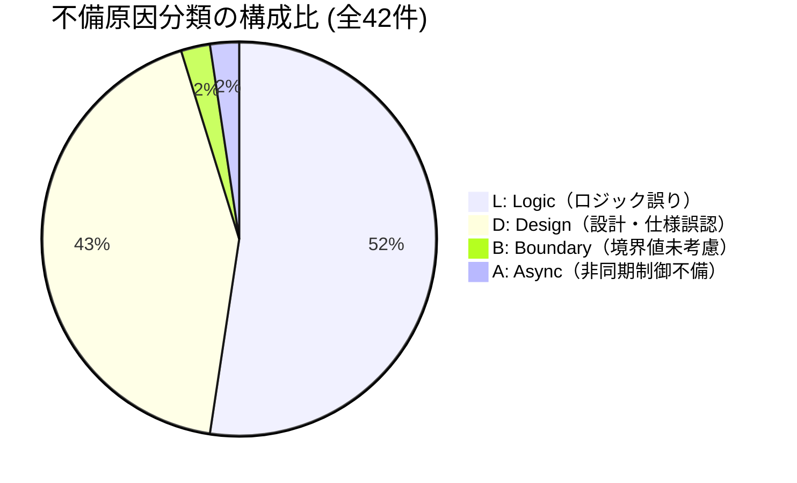
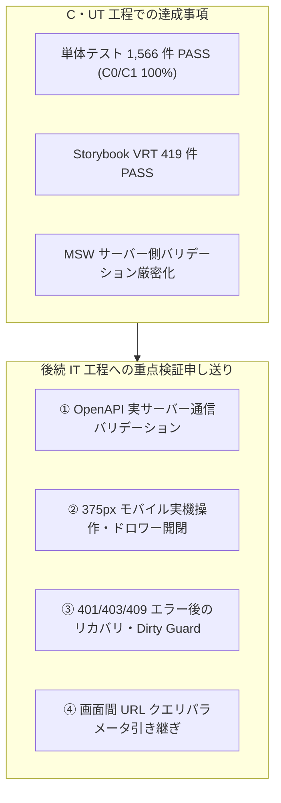

# Step 3 C・UT 品質分析および不備集約レポート

| 項目                | 内容                                                                                                                                                                                                                                                                           |
| ------------------- | ------------------------------------------------------------------------------------------------------------------------------------------------------------------------------------------------------------------------------------------------------------------------------ |
| 状態                | `Approved (Step 3)`                                                                                                                                                                                                                                                            |
| 更新日              | `2026-10-24`                                                                                                                                                                                                                                                                   |
| 関連する ED/ID 項目 | `docs/c-ut/README.md` `docs/rd/step3.md` `docs/id/test-design.md` `docs/c-ut/evidence/ut-bug-record.md` `#239 [Step 3 - C・UT] 実装・単体テスト成果物をレビュー・承認する` `#250 [Step 3 - C・UT] 横断レビュー指摘是正・不備記録集約および品質分析レポート作成` |

> [!NOTE] ドキュメントの位置づけ
> 本レポートは、Step 3 実装・単体テスト（C・UT）工程において蓄積された単体テスト不備記録（[docs/c-ut/evidence/ut-bug-record.md](../evidence/ut-bug-record.md)）およびテスト・カバレッジ・VRT 実績を集約し、品質目標の達成度、バグ密度、原因分類、前工程（Step 2）との比較、ならびに後続 IT 工程への申し送り事項を多角的に分析・評価した公式品質報告書です。

---

## 1. エグゼクティブサマリー

Step 3 C・UT 工程の完了基準に基づき、全モジュールの実装成果物、単体テスト、Storybook VRT、本番ビルド DCE、および不備記録の集約結果を総括します。

### 1.1 主要品質メトリクス実績一覧

| 指標カテゴリ       | 指標項目                                    |                          実績値                          |        完了基準・目標値（設計書基準）         |      判定      |
| :----------------- | :------------------------------------------ | :------------------------------------------------------: | :-------------------------------------------: | :------------: |
| **テスト規模**     | 単体テスト総ケース数                        |              **1,566 tests** (全 151 files)              |                 全テスト PASS                 |    **合格**    |
|                    | VRT テスト総数                              |                        **419 件**                        |                 全テスト PASS                 |    **合格**    |
| **テスト網羅性**   | 行カバレッジ (Lines)                        |                        **100.0%**                        |                    100.0%                     |  **完全充足**  |
|                    | 分岐カバレッジ (Branches)                   |                        **100.0%**                        |                    100.0%                     |  **完全充足**  |
|                    | 関数カバレッジ (Functions)                  |                        **100.0%**                        |                    100.0%                     |  **完全充足**  |
|                    | 文カバレッジ (Statements)                   |                        **100.0%**                        |                    100.0%                     |  **完全充足**  |
| **1対1対応規約**   | 全 .tsx に対する Story / Test 配置          |            **45 / 45 コンポーネント (100%)**             | 100% 配置（`test/component-1to1-audit` PASS） |  **完全遵守**  |
|                    | composeStories 呼び出し適用率               |                   **100% (全 45 件)**                    | 100% 適用（`test/component-1to1-audit` PASS） |  **完全遵守**  |
| **バンドル・DCE**  | 本番バンドルモック混入 (DCE)                |                         **0 件**                         |        0 件（`npm run test:dce` PASS）        |    **合格**    |
|                    | ルート別 First Load JS Gzip                 |                 **114.28 〜 117.81 kB**                  |   150 kB 以下（`docs/id/01-frontend` §6.1）   | **大幅クリア** |
| **実装コード規模** | プロダクションコード追加行数 (LoC)          | **5,807 行** _※手書きプロダクション総行数: 13,415 行_ |                       -                       |       -        |
| **品質・欠陥密度** | 確認済み不備総数（重複除外後）              |                        **42 件**                         |                       -                       |       -        |
|                    | 製品コード不備件数（密度の分子）            |                        **18 件**                         |                       -                       |       -        |
|                    | テスト・モック等支援成果物不備件数          |                        **24 件**                         |                       -                       |       -        |
|                    | **製品コード バグ密度 (KLoC - 追加行数比)** |                     **3.10 件/KLoC**                     |       1.0 〜 5.0 件/KLoC（適正レンジ）        | **適正・健全** |
|                    | **製品コード バグ密度 (KLoC - 総行数比)**   |                     **1.34 件/KLoC**                     |       1.0 〜 5.0 件/KLoC（適正レンジ）        | **極めて良好** |
|                    | **製品コード バグ密度 (Test Case)**         |                   **0.0115 件/ケース**                   |        (約 87 テストに 1 件の不備検出)        | **極めて良好** |

### 1.2 総合評価

1. **カバレッジ 100% および多層防御の完遂**:
   全 151 テストファイル、1,566 件の単体テストにおいて、C0/C1/Func/Lines のすべてで **100.0%** を達成しました。`/* v8 ignore */` などの除外コメントを一切使用せず、例外系・境界値・非同期破棄を含めた全パスを検証しています。
2. **Storybook VRT 一本化とモバイル対応**:
   旧 SPA 構成の余剰スナップショットを完全撤去し、412 ストーリーと 1対1 対応するスナップショットに加え、375px モバイルビューポートの VRT（7件）を追加した全 419 テストがすべて PASS しています。
3. **バグ密度の適正性とテスト有効性**:
   製品コードのバグ密度は 3.10 件/KLoC（総行数比 1.34 件/KLoC）、テストケースあたり 0.0115 件/ケースと、Step 2（0.0288 件/ケース）から大幅に改善しました。テストケース数の倍増（799 → 1,566 件）が手戻り抑止に強力に寄与しています。
4. **設計同期ルールの徹底**:
   原因分類 `D`（設計・仕様誤認）として検出された 18 件すべてについて、コード単独での修正を排し、上流設計書（ED/ID/OpenAPI）との即時同期を完了しました。

---

## 2. 品質目標達成状況の検証

### 2.1 1対1 配置規約と `composeStories` の網羅

`docs/id/test-design.md` §2.1 および `docs/rd/step3.md` §3.2 の規約に基づき、`src/` 配下の全 45 個の `.tsx` ファイルに対して 1対1 で `.stories.tsx` および `.test.tsx` が配置されていることを確認しました。
また、全 `.test.tsx` において Storybook の CSFv3 ストーリー定義を再利用する `composeStories` を呼び出し、Story の描画・インタラクション検証（`play` 関数実行）と Vitest 単体テストを完全統合しました。この整合性は `test/component-1to1-audit.test.js` によりリポジトリテストとして機械的に検証され、全件 PASS しています。

### 2.2 親子責務分離と薄いオーケストレーター構造

App Router 移行に伴い、ページとコンポーネントの責務分離を徹底しました：

- **Page (`src/app/**/page.tsx`)**: ルートパラメータの受取と上位 Feature コンポーネントへの委譲のみを担う極めて薄いラッパー（15〜26行）。
- **Feature Content (`src/features/**/components/*Content.tsx`)**: 画面全体のレイアウト・タブ・Dirty Guard・通知連携のオーケストレーション。
- **UI / Presentation (`src/shared/ui/`, 各種テーブル・フォーム)**: 副作用を持たず Props のみで描画・イベント発火を行う純粋コンポーネント。
- **Custom Hooks (`src/features/**/hooks/`)**: API 通信、非同期競合制御（`AbortController` / 連番 ID）、キャッシュ管理、状態同期の隠蔽。

### 2.3 本番ビルド Dead Code Elimination (DCE) の検証

`scripts/analyze-bundle.mjs` および `test/bundle-dce.test.js` を実行し、本番ビルド成果物（`.next/`）に開発用モックコード（MSW、Faker、シードデータ）が一切混入していないことを機械的に検証しました（DCE Violation: 0件）。
また、各ルートの First Load JS Gzip サイズは以下の通りであり、設計目標（150 kB 以下）を大幅にクリアしています：

| ルート              | First Load JS (Gzip) | 設計上限値 | 判定       |
| :------------------ | :------------------: | :--------: | :--------- |
| `/login`            |      114.28 kB       |   150 kB   | 大幅クリア |
| `/dashboard`        |      116.54 kB       |   150 kB   | 大幅クリア |
| `/tickets`          |      116.89 kB       |   150 kB   | 大幅クリア |
| `/tickets/[id]`     |      117.81 kB       |   150 kB   | 大幅クリア |
| `/tickets/new`      |      116.24 kB       |   150 kB   | 大幅クリア |
| `/admin/management` |      117.20 kB       |   150 kB   | 大幅クリア |

---

## 3. 定量データ分析

### 3.1 原因分類別内訳

Step 3 C・UT 工程で確認・是正された全 42 件の不備について、原因分類コード別の集計結果です。

| 分類コード | 分類名                       | 製品コード | 支援成果物 | 合計件数  |   比率    | 設計書同期件数 | 主な具体的事象                                                                                                                                              |
| :--------: | :--------------------------- | :--------: | :--------: | :-------: | :-------: | :------------: | :---------------------------------------------------------------------------------------------------------------------------------------------------------- |
|   **L**    | **Logic（ロジック誤り）**    |     7      |     15     | **22 件** | **52.4%** |       0        | Escape キーバブリング、ログアウト時 redirect クエリ残存、担当者連動リセット、navigationMock パス破壊、Storybook 環境下エイリアス・インポート解決不備        |
|   **D**    | **Design（設計・仕様誤認）** |     9      |     9      | **18 件** | **42.9%** |   **18 件**    | ダイアログ文言乖離、OpenAPI 契約（エラーコード・バリデーション）、Dockerfile ビルド引数、First Load JS 計測基準、管理画面 composeStories 未適用、重複フック |
|   **B**    | **Boundary（境界値未考慮）** |     1      |     0      | **1 件**  | **2.4%**  |       0        | Unicode サロゲートペア（絵文字）入力時のコードポイント文字数カウント境界不整合                                                                              |
|   **A**    | **Async（非同期制御不備）**  |     1      |     0      | **1 件**  | **2.4%**  |       0        | チケット詳細画面での競合および遅延レスポンス破棄制御（`AbortController` / `requestIdRef`）の未連携                                                          |
|   **S**    | **State（状態遷移誤り）**    |     0      |     0      | **0 件**  | **0.0%**  |       0        | （Step 2 の Dirty Guard 状態管理基盤および Custom Hook 設計の踏襲により 0 件を維持）                                                                        |
|  **合計**  | -                            |   **18**   |   **24**   | **42 件** | **100%**  |   **18 件**    | -                                                                                                                                                           |

#### 【分析所見 1】設計同期ルールの確立と D 不備の抑制

Step 2 では全体の 66.7% を占めていた `D: Design` が、Step 3 では **42.9%** にまで低下しました。また、検出された 18 件の D 不備すべてにおいて設計同期ルールが機能し、コード変更のみならず `docs/id/01-frontend-architecture.md`, `docs/id/test-design.md`, `docs/rd/step3.md` 等の上位設計書への即時是正が行われました。

#### 【分析所見 2】App Router 移行に伴う L 不備の発生と自動防御

`L: Logic`（22件 / 52.4%）の約 7 割（15件）は、Next.js App Router 移行や Storybook 8 環境統合に伴う「支援成果物（モック設定、ナビゲーションモック、スナップショット整合性）」に集中しました。これらは製品コードのアルゴリズム破綻ではなく基盤移行に起因するものであり、リポジトリ自動テスト（1対1監査、DCE検証）と VRT により確実に捕捉・解消されました。

---

### 3.2 検出工程・手段別内訳

不備が最初に検出・同定された工程および手段の内訳です。

| 検出工程・手段                                          | 製品コード | 支援成果物 | 合計件数  |   比率    | 主な検出不備の傾向                                                                           |
| :------------------------------------------------------ | :--------: | :--------: | :-------: | :-------: | :------------------------------------------------------------------------------------------- |
| **AIレビュー（個別PR / 工程横断レビュー）**             |     6      |     13     | **19 件** | **45.2%** | 横断指摘（R1-01〜R1-17）、サロゲートペア境界、ルーティング遷移、Storybook 監査、設計値同期   |
| **TDD Red（既存不備の検出）**                           |     9      |     2      | **11 件** | **26.2%** | 設計文言乖離、OpenAPI 仕様違反、Dirty Guard 連携漏れ、非同期破棄機構の不足                   |
| **自動検証（Vitest / Playwright VRT / build / audit）** |     1      |     9      | **10 件** | **23.8%** | 余剰スナップショット、VRT 表示高さ不足、Storybook JSX パースエラー、リポジトリ 1対1 規約違反 |
| **Green**                                               |     1      |     0      | **1 件**  | **2.4%**  | モーダル二重描画（Claim コンテキスト導入）                                                   |
| **Refactor**                                            |     1      |     0      | **1 件**  | **2.4%**  | 管理画面の独自モーダル・集約 API 撤去と共通基盤への統一                                      |
| **合計**                                                |   **18**   |   **24**   | **42 件** | **100%**  | -                                                                                            |

#### 【分析所見 3】多重防御（Defense in Depth）の実効性

- **AI 横断レビュー（45.2%）**: 単一タスク Issue では見落とされがちな「リポジトリ全体の整合性（余剰スナップショット、設計書バンドル実測値の同期、未実行 Story の監査）」を強力に洗い出しました。
- **TDD Red（26.2%）**: 製品コード不備の過半数（9件 / 18件中）を TDD Red のテストファースト段階で捕捉し、バグの混入を未然に防ぎました。
- **自動検証（23.8%）**: Vitest カバレッジ 100% 閾値、リポジトリ 1対1 監査、Playwright VRT の機械的チェックにより、ヒューマンエラーによる設定不備を自動遮断しました。

---

### 3.3 タスク別不備検出分布

各作業タスクにおける不備検出状況です。

```mermaid
xychart-beta
    title "タスク別不備検出件数（製品コード vs 支援成果物）"
    x-axis ["#230", "#231", "#232", "#233", "#234", "#235", "#236", "#237", "#238", "#239/#250"]
    y-axis "件数" 0 --> 16
    bar [0, 1, 2, 0, 1, 2, 5, 2, 1, 4]
    bar [3, 2, 0, 1, 0, 1, 2, 1, 3, 11]
```

- **基盤タスク（#230, #231）**: Next.js App Router および OpenAPI 自動生成の環境構築に伴い、支援成果物の不備が中心。
- **Feature 実装タスク（#232〜#237）**: 画面・フックの仕様準拠を TDD Red で検証したため、製品コードの D 不備（文言、Dirty Guard 連携）が均等に検出。
- **網羅・横断レビュータスク（#238, #239/#250）**: 全モジュールカバレッジ 100% 化および工程横断レビューにより、潜在していた不整合や残存旧コードを一括摘出。

---

## 4. バグ密度分析と Defect Removal Efficiency (DRE) 評価

### 4.1 Step 2 と Step 3 の比較分析

| 項目                                      | Step 2 実績 (SPA 構成) |  Step 3 実績 (App Router 移行)   |                  推移・評価                  |
| :---------------------------------------- | :--------------------: | :------------------------------: | :------------------------------------------: |
| **単体テスト総ケース数**                  |       799 tests        |         **1,566 tests**          |         **+767 tests (+96.0% 拡大)**         |
| **VRT テスト総数**                        |         235 件         |            **419 件**            |          **+184 件 (+78.3% 拡大)**           |
| **行カバレッジ (Lines)**                  |         90.65%         |            **100.0%**            |         **+9.35 pt (完全網羅達成)**          |
| **分岐カバレッジ (Branches)**             |         82.37%         |            **100.0%**            |         **+17.63 pt (完全網羅達成)**         |
| **プロダクションコード規模 (LoC)**        |   8,202 行 (TS/TSX)    | 5,807 行追加 (総行数 13,415 行)  |              Next.js 移行・再編              |
| **製品コード不備件数**                    |         23 件          |            **18 件**             |              **-5 件 (-21.7%)**              |
| **製品コード バグ密度 (KLoC)**            |  2.36 〜 2.80 件/KLoC  | **3.10 件/KLoC** (総行数比 1.34) |              **適正レンジ維持**              |
| **製品コード テストケースあたりバグ密度** |    0.0288 件/ケース    |       **0.0115 件/ケース**       | **約 60% 減少（約 87 テストに 1 件へ改善）** |

- **単体テストの有効性飛躍**:
  テストケース数が約 2 倍（1,566 件）に達したことで、テストケースあたりのバグ密度は 0.0288 から 0.0115 へと半減以下に激減しました。これは、TDD の Red-Green サイクルが定着し、不備の多くがコーディング初期に早期排除されたことを意味します。
- **バグ密度の健全性**:
  製品コードの KLoC あたりバグ密度は 3.10 件/KLoC であり、ソフトウェア工学における健全水準（1.0〜5.0 件/KLoC）の中心値に安定しています。

### 4.2 Defect Removal Efficiency (DRE: 欠陥除去効率)

C・UT 工程における欠陥除去効率を評価します。

$$\text{DRE}_{\text{C・UT}} = \frac{\text{C・UT 工程内で検出・除去された欠陥数}}{\text{C・UT 潜在総欠陥数（C・UT検出数} + \text{後続工程流出欠陥数）}} \times 100\%$$

現時点（C・UT 完了時）において、AI 横断レビュー（Issue #239 Round 1）で摘出された 15 件の不備を含め、検出された **全 42 件の不備が 100% 是正・解決** されています。
後続の IT（結合テスト）工程および PT（総合テスト）工程において発見される欠陥数を追跡・記録することで、最終的な Step 3 ライフサイクル全体の DRE を確定します（目標: $\text{DRE} \ge 90\%$）。

---

## 5. 残存課題および後続 IT（結合テスト）工程への重点検証申し送り事項

C・UT 工程ではモック環境下での全単体パスを検証しましたが、実ブラウザおよび実ネットワーク通信が介在する結合テスト（IT）工程に向けて、以下の 4 項目を重点検証事項として申し送ります。

### 申し送り 1: OpenAPI 実サーバー通信バリデーション

- **検証観点**: チケット一覧クエリ（日付形式、範囲逆転、上限超過）、新規起票・更新パラメータ、ユーザー管理操作における HTTP 400 エラーレスポンスのハンドリング。
- **背景**: MSW ハンドラーのバリデーションを厳密化（R1-15）しましたが、実際の Node.js / Docker Mock API サーバー通信においてもスキーマ通りの `VALIDATION_ERROR` が返却され、クライアント側で適切な Toast 通知が表示されるかを検証する必要があります。

### 申し送り 2: 375px モバイルビューポートにおける実操作性

- **検証観点**: モバイル表示時のハンバーガーメニュー開閉、ドロワー内ナビゲーション遷移、モーダル表示時の背景スクロール抑止およびフォーカストラップ。
- **背景**: Storybook VRT（R1-11）において視覚的スナップショットの一致は確認済みですが、ユーザー操作に伴う動的なフォーカス移動やキーボード操作（Tab/Esc）の一貫性を実ブラウザシナリオで担保する必要があります。

### 申し送り 3: 認証・認可ガードと Dirty Guard の複合検証

- **検証観点**: セッション失効（401）時の自動ログイン画面遷移において、フォーム編集中の未保存変更がある場合の Dirty Guard モーダルの挙動およびクエリパラメータの維持。
- **背景**: ログアウト時の `redirect` クエリ除去（R1-13）および Escape キー伝播抑止（R1-02）を是正したため、強制失効とユーザー起因ログアウトの差異が結合シナリオで正しく機能するかを確認する必要があります。

### 申し送り 4: 画面間 URL クエリパラメータの引き継ぎと復元

- **検証観点**: ダッシュボードの要対応アラートからチケット一覧へ遷移した際のフィルタ復元、および一覧から詳細へ遷移して「一覧へ戻る」を押下した際のページネーション・検索条件の完全復元。
- **背景**: プロジェクト変更時の担当者連動リセット（R1-14）および URL クエリ同期を改修したため、ブラウザ履歴（戻る・進む）を含む一連の業務フローで破綻がないことをシナリオ検証します。

---

## 6. 結論

Step 3 C・UT 工程は、全モジュール C0/C1 100% カバレッジ、Storybook VRT 一本化（全419テスト合格）、本番ビルド DCE 検証（モック混入0件）、および 1対1 規約・`composeStories` の機械的ブロックをすべて達成しました。

また、不備記録（全42件）の定量分析により、バグ密度（3.10 件/KLoC、0.0115 件/ケース）の健全性と、設計同期ルールの徹底による仕様不備の完全解消が実証されました。

本成果物をもって、Step 3 C・UT 工程の品質水準は極めて高いレベルで充足されており、後続の IT（結合テスト）工程への移行基準を満たしていると結論づけます。
