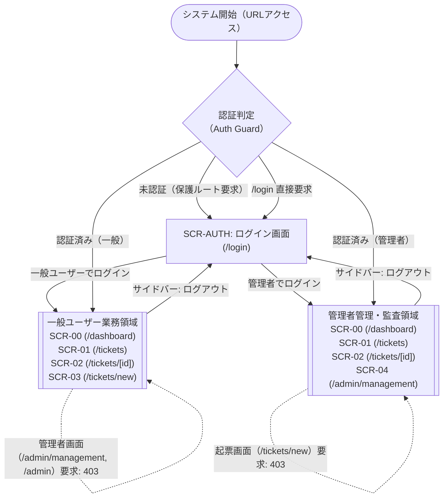
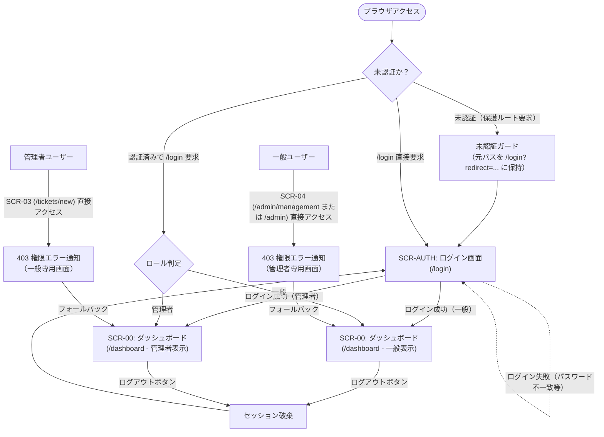
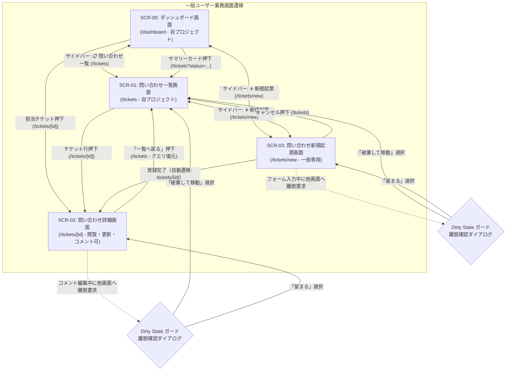
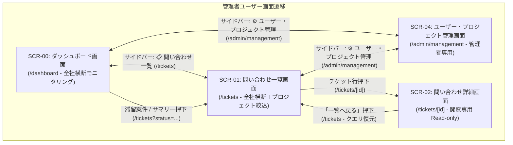
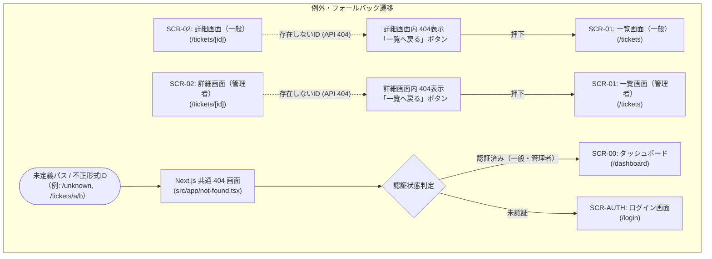

# 画面遷移

| 項目                | 内容                                                                                                                                                                                                                                                                                                                                                                                                               |
| ------------------- | ------------------------------------------------------------------------------------------------------------------------------------------------------------------------------------------------------------------------------------------------------------------------------------------------------------------------------------------------------------------------------------------------------------------ |
| 状態                | `Approved (Step 3)`                                                                                                                                                                                                                                                                                                                                                                                                |
| 更新日              | `2026-10-17`                                                                                                                                                                                                                                                                                                                                                                                                       |
| 関連する ED/ID 項目 | `docs/rd/step3.md#21-ルーティングとコンポーネント移行方針` `docs/rd/step3.md#23-対象外とする機能将来課題として維持` `docs/ed/01-system-overview.md#2-対象利用者とロール定義` `docs/ed/01-system-overview.md#3-対象範囲` `docs/ed/01-system-overview.md#5-システム全体の受け入れ条件` `docs/ed/02-screen-list.md#2-画面一覧` `docs/ed/02-screen-list.md#4-共通ナビゲーション仕様開閉式サイドバー` |

このドキュメントでは、[docs/ed/02-screen-list.md](02-screen-list.md) で定義した Next.js (App Router) 構成における全 6 画面（SCR-AUTH, SCR-00, SCR-01, SCR-02, SCR-03, SCR-04）および共通 404（`not-found.tsx`）間の利用者の操作と画面遷移ルール、認証ガード（Auth Guard）、ロール別認可ガード（Role Guard / 403 フォールバック）、共通ナビゲーション（開閉式サイドバー）、画面離脱防止（Dirty State ガード）、URL クエリ同期とブラウザ履歴復元、404 エラーの切り分け、および未確定事項を整理します。

画面数の増加に伴う認知負荷を低減するため、画面遷移図および遷移一覧表は「全体ハイレベル」と「関心事・ロール別詳細（認証/一般業務/管理者管理/例外系）」の多層構造で整理します。

---

## 1. 画面遷移の全体概要

本システムは、ログイン認証（SCR-AUTH `/login`）を起点とし、認証されたロール（一般ユーザー / 管理者ユーザー）に応じて適切なポータル（SCR-00 ダッシュボード `/dashboard`）および開閉式サイドバーメニューへ誘導します。

### 1.1 全体ハイレベル画面遷移図

システム全体の骨格となる「未認証アクセス」「認証境界」「一般ユーザー領域」「管理者ユーザー領域」の相互関係を示すハイレベル遷移図です。Next.js App Router の URL ルートパスを併記します。

---

### 1.2 認証・認可 & ガード遷移図

ログイン認証、未認証リダイレクト（元 URL 保持）、認証済みユーザーのログイン画面スキップ、およびロール認可ガード（403 Forbidden フォールバック）の遷移フローです。

---

### 1.3 一般ユーザー業務画面遷移図

一般ユーザー（業務運用担当者）が日常的に行う「ダッシュボード確認」「一覧検索」「詳細閲覧・更新・コメント」「新規起票」、および「編集中離脱防止（Dirty State ガード）」の遷移フローです。

---

### 1.4 管理者ユーザー管理画面遷移図

管理者ユーザー（システム管理者・監査担当者）が行う「全社モニタリング」「プロジェクト横断閲覧・監査」「ユーザー・プロジェクト管理」の遷移フローです。

---

### 1.5 共通例外・フォールバック遷移図

存在しないチケット ID へのアクセス時（詳細画面内 404）およびルーティング定義外パスへのアクセス時（Next.js 共通 404）のフォールバック遷移フローです。

---

## 2. 画面遷移一覧（遷移表）

Next.js (App Router) 構成における全画面遷移ルール（TR-01 〜 TR-22）を関心事・カテゴリ別に分類して定義します。

### 2.1 認証・セッションおよび共通アクセス制御遷移

| No.       | 遷移元画面             | トリガー操作 / イベント                 | 遷移先画面                     | 想定パス / パラメータ                                | 遷移条件 / 前提                                | 遷移時の振る舞い                                                                                                                     |
| :-------- | :--------------------- | :-------------------------------------- | :----------------------------- | :--------------------------------------------------- | :--------------------------------------------- | :----------------------------------------------------------------------------------------------------------------------------------- |
| **TR-01** | 初期アクセス / 外部    | ルート URL（`/`）へアクセス             | SCR-AUTH: ログイン画面         | `/` → `/login`                                       | 未認証状態であること                           | 未認証ガード（Auth Guard）により `/login` へリダイレクトする。                                                                       |
| **TR-02** | 初期アクセス / 外部    | ルート URL（`/`）へアクセス             | SCR-00: ダッシュボード画面     | `/` → `/dashboard`                                   | ログイン済みセッションが存在すること           | 認証済みロール（一般/管理者）に応じた SCR-00 ダッシュボード（`/dashboard`）へリダイレクト・表示する。                                |
| **TR-03** | SCR-AUTH: ログイン画面 | 「ログイン」ボタン押下                  | SCR-00（または直前の要求画面） | `/login` → `/dashboard` または `?redirect=` 指定パス | ユーザー名・パスワードが正しく認証成功すること | 認証セッションを確立し、ロールを判定。保持されていたリダイレクト先（`?redirect=`）があればそこへ、なければ `/dashboard` へ遷移する。 |
| **TR-04** | SCR-AUTH: ログイン画面 | 「ログイン」ボタン押下                  | SCR-AUTH（同一画面）           | `/login`                                             | ユーザー名またはパスワードに誤りがあること     | 画面遷移せず、入力欄近傍に認証エラーメッセージを表示する。入力内容は維持する。                                                       |
| **TR-05** | 保護された全画面       | サイドバー下部「ログアウト」ボタン押下  | SCR-AUTH: ログイン画面         | `/login`                                             | なし（Dirty State がある場合は破棄確認後）     | 認証セッションおよびユーザー情報を破棄し、ログイン画面（`/login`）へ遷移する。                                                       |
| **TR-06** | 初期アクセス / 外部    | 保護画面（`/tickets` 等）へ直接アクセス | SCR-AUTH: ログイン画面         | `/login?redirect=<要求パス>`                         | 未認証状態であること                           | 要求された URL パス（およびクエリ）をクエリパラメータに保持し、未認証ガードにより SCR-AUTH（`/login`）へリダイレクトする。           |
| **TR-07** | 初期アクセス / 外部    | ログイン画面（`/login`）へ直接アクセス  | SCR-00: ダッシュボード画面     | `/login` → `/dashboard`                              | 既に認証済みであること                         | ログイン済みであるため、ログイン画面をスキップして SCR-00 ダッシュボード（`/dashboard`）へ自動リダイレクトする。                     |

---

### 2.2 一般ユーザー業務画面遷移

| No.       | 遷移元画面                     | トリガー操作 / イベント                    | 遷移先画面                                 | 想定パス / パラメータ                          | 遷移条件 / 前提                                                    | 遷移時の振る舞い                                                                                                |
| :-------- | :----------------------------- | :----------------------------------------- | :----------------------------------------- | :--------------------------------------------- | :----------------------------------------------------------------- | :-------------------------------------------------------------------------------------------------------------- |
| **TR-08** | 保護された全画面（一般）       | サイドバーメニュー項目（📊 / 📋 / ➕）押下 | 選択された画面（SCR-00 / SCR-01 / SCR-03） | `/dashboard`, `/tickets`, `/tickets/new`       | 一般ユーザーロールであること（Dirty State がある場合は破棄確認後） | Next.js App Router のクライアントサイドナビゲーション（`next/navigation`）により即時遷移する。                  |
| **TR-10** | SCR-00: ダッシュボード（一般） | 自分宛て担当チケット一覧の行/タイトル押下  | SCR-02: 問い合わせ詳細画面                 | `/tickets/[id]`（`[id]`: チケット ID）         | 担当チケットが存在すること                                         | 選択したチケット ID を動的ルートパスに付与して SCR-02 詳細画面（`/tickets/[id]`）へ遷移する。                   |
| **TR-11** | SCR-00: ダッシュボード（一般） | サマリーカードの押下                       | SCR-01: 問い合わせ一覧画面                 | `/tickets?status=<ステータス>&projectId=<ID>`  | 該当する集計項目が存在すること                                     | クリックした条件を URL クエリパラメータに反映し、自プロジェクト条件で絞り込まれた状態で SCR-01 一覧へ遷移する。 |
| **TR-12** | SCR-01: 問い合わせ一覧画面     | チケット一覧行またはタイトルリンクを押下   | SCR-02: 問い合わせ詳細画面                 | `/tickets/[id]`（`[id]`: 選択したチケット ID） | 一覧にチケットが表示されていること                                 | 選択したチケット ID を動的ルートパスに付与して SCR-02 詳細画面へ遷移する。                                      |
| **TR-13** | SCR-02: 問い合わせ詳細画面     | 「一覧へ戻る」ボタンを押下                 | SCR-01: 問い合わせ一覧画面                 | `/tickets`（直前クエリ保持）                   | なし（Dirty State: コメント編集中は破棄確認後）                    | 問い合わせ一覧画面へ遷移する。直前の絞り込み条件（ステータス・担当者・プロジェクト等）の URL クエリを復元する。 |
| **TR-14** | SCR-03: 問い合わせ新規起票画面 | 「起票」ボタン押下（登録成功）             | SCR-02: 問い合わせ詳細画面                 | `/tickets/[id]`（`[id]`: 新規作成チケット ID） | 入力バリデーション成功および API 登録成功                          | Dirty State をクリアし、新規作成されたチケットの詳細画面（`/tickets/[id]`）へ自動遷移する。トースト表示。       |
| **TR-15** | SCR-03: 問い合わせ新規起票画面 | 「キャンセル」ボタンを押下                 | SCR-01: 問い合わせ一覧画面                 | `/tickets`                                     | なし（Dirty State: 入力内容がある場合は破棄確認後）                | 編集内容を破棄し、一覧画面（`/tickets`）へ遷移する。                                                            |

---

### 2.3 管理者ユーザー管理画面遷移

| No.        | 遷移元画面                       | トリガー操作 / イベント                    | 遷移先画面                                 | 想定パス / パラメータ                                                                                                                                                                                                                                                                                       | 遷移条件 / 前提                                                                    | 遷移時の振る舞い                                                                                                            |
| :--------- | :------------------------------- | :----------------------------------------- | :----------------------------------------- | :---------------------------------------------------------------------------------------------------------------------------------------------------------------------------------------------------------------------------------------------------------------------------------------------------------- | :--------------------------------------------------------------------------------- | :-------------------------------------------------------------------------------------------------------------------------- |
| **TR-09**  | 保護された全画面（管理者）       | サイドバーメニュー項目（📊 / 📋 / ⚙️）押下 | 選択された画面（SCR-00 / SCR-01 / SCR-04） | `/dashboard`, `/tickets`, `/admin/management`                                                                                                                                                                                                                                                               | 管理者ユーザーロールであること（※Dirty State: 所属紐づけ編集中の場合は破棄確認後） | Next.js App Router のクライアントサイドナビゲーションにより即時遷移する。                                                   |
| **TR-11M** | SCR-00: ダッシュボード（管理者） | サマリーカード / 滞留アラートの押下        | SCR-01: 問い合わせ一覧画面                 | `/tickets`（全社総件数） `/tickets?status=<ステータス>` `/tickets?projectId=<ID>[&status=...]` `/tickets?assignee=unassigned`（未割り当て） `/tickets?stale=true`（滞留案件） （※詳細: [dashboard.md](screens/dashboard.md#52-問い合わせ一覧画面scr-01へのドリルダウン遷移連携仕様) 表 5.2） | 該当する集計項目が存在すること                                                     | クリックした条件を URL クエリパラメータに反映し、全社横断で絞り込まれた状態で SCR-01 一覧へ遷移する。                       |
| **TR-12M** | SCR-01: 問い合わせ一覧画面       | チケット一覧行またはタイトルリンクを押下   | SCR-02: 問い合わせ詳細画面                 | `/tickets/[id]`（`[id]`: 選択したチケット ID）                                                                                                                                                                                                                                                              | 一覧にチケットが表示されていること                                                 | 選択したチケット ID を動的ルートパスに付与して SCR-02 詳細画面へ遷移する。管理者は閲覧専用（Read-only）モードで表示される。 |
| **TR-13M** | SCR-02: 問い合わせ詳細画面       | 「一覧へ戻る」ボタンを押下                 | SCR-01: 問い合わせ一覧画面                 | `/tickets`（直前クエリ保持）                                                                                                                                                                                                                                                                                | なし                                                                               | 問い合わせ一覧画面へ遷移する。直前の全社絞り込み条件の URL クエリを復元する。                                               |

※`/admin` への直接ブラウザアクセス時は、Next.js App Router のリダイレクト仕様に基づき `/admin/management` へ自動リダイレクトされます（3.6 節参照）。

---

### 2.4 認可ガード・Dirty State・例外系遷移

| No.       | 遷移元画面                | トリガー操作 / イベント                                              | 遷移先画面                 | 想定パス / パラメータ                 | 遷移条件 / 前提                                                  | 遷移時の振る舞い                                                                                                                                                                                     |
| :-------- | :------------------------ | :------------------------------------------------------------------- | :------------------------- | :------------------------------------ | :--------------------------------------------------------------- | :--------------------------------------------------------------------------------------------------------------------------------------------------------------------------------------------------- |
| **TR-16** | 初期アクセス / 一般画面   | 管理者画面（`/admin/management` または `/admin`）へ直接 URL アクセス | SCR-00: ダッシュボード画面 | `/dashboard`                          | ログイン中ユーザーが一般ロールであること                         | ロール認可ガード（Role Guard）によりアクセスを遮断。403 権限エラー通知（「管理者権限が必要です（403 Forbidden）」）を表示し、`/dashboard` へフォールバックリダイレクトする。                         |
| **TR-17** | 初期アクセス / 管理者画面 | 起票画面（`/tickets/new`）へ直接 URL アクセス                        | SCR-00: ダッシュボード画面 | `/dashboard`                          | ログイン中ユーザーが管理者ロールであること                       | ロール認可ガード（Role Guard）によりアクセスを遮断。403 権限エラー通知（「管理者ロールでは新規起票機能は利用できません（403 Forbidden）」）を表示し、`/dashboard` へフォールバックリダイレクトする。 |
| **TR-18** | 保護された全画面          | ブラウザの「戻る」「進む」操作                                       | 直前 / 直後の履歴画面      | ブラウザ履歴依存                      | ブラウザ履歴が存在すること（Dirty State がある場合は破棄確認後） | ブラウザ標準の履歴移動を行う。Next.js App Router 環境において URL クエリパラメータと画面状態が正確に同期・復元される。未保存変更時は離脱防止ダイアログ表示。                                         |
| **TR-19** | 初期アクセス / SCR-01     | 存在しないチケット ID へアクセス                                     | SCR-02（エラー状態）       | `/tickets/[id]`（存在しない ID）      | API から 404 レスポンス                                          | 共通 404 ではなく SCR-02 詳細画面へ遷移し、画面内で「指定された問い合わせは見つかりませんでした」と表示。「一覧へ戻る」（`/tickets`）導線を提供する。                                                |
| **TR-20** | 初期アクセス / 外部       | 未定義パスまたは不正形式チケット ID へのアクセス                     | 共通 404 画面              | `src/app/not-found.tsx`（未定義パス） | ルーティング定義外のパスまたは不正形式パスであること             | Next.js 共通の 404 Not Found 画面（`not-found.tsx`）を表示し、ポータル復帰導線（認証済みなら `/dashboard`、未認証なら `/login`）を提供する。                                                         |

---

### 2.5 共通ナビゲーション（UI 状態切り替え）

| No.       | 対象画面                       | トリガー操作 / イベント                   | 画面状態変化                | 想定パス     | 条件 / 前提                                | 振る舞い                                                                                                               |
| :-------- | :----------------------------- | :---------------------------------------- | :-------------------------- | :----------- | :----------------------------------------- | :--------------------------------------------------------------------------------------------------------------------- |
| **TR-21** | 保護された全画面               | サイドバー右上開閉ボタン（`←` / `→`）押下 | 同一画面（UI 状態切り替え） | パス変更なし | サイドバーが表示されていること             | 画面遷移は発生せず、同一画面内でサイドバー幅をトグル（展開 ↔ 折りたたみ）。状態を `localStorage` に即時永続化する。    |
| **TR-22** | 保護された全画面（モバイル幅） | ハンバーガーボタン / バックドロップ押下   | 同一画面（UI 状態切り替え） | パス変更なし | 画面幅がモバイルブレークポイントであること | 画面遷移は発生せず、オーバーレイドロワーの表示・非表示をトグルする。メニュー項目押下時は遷移と同時にドロワーを閉じる。 |

---

## 3. 各画面の入口・出口と受け渡しデータ

### 3.1 SCR-AUTH: ログイン画面

- **入口**:
  - 未認証時のルートアクセス（`/`）または保護ルートからの未認証リダイレクト（TR-01, TR-06）
  - ログアウト操作（TR-05）
  - `/login` への直接ブラウザアクセス
- **出口**:
  - 認証成功による SCR-00（`/dashboard`）またはリダイレクト元（`?redirect=`）への遷移（TR-03）
  - （認証済み時の直接アクセスによる `/dashboard` への自動スキップリダイレクト: TR-07）
- **受け渡しデータ**:
  - 入口時: リダイレクト元パス情報（URL クエリ `?redirect=` 等）
  - 出口時: 確立された認証ユーザー情報（ユーザー ID、表示名、ロール、所属プロジェクト一覧）およびセッショントークン

### 3.2 SCR-00: ダッシュボード画面

- **入口**:
  - ログイン成功時の初期画面（TR-03）
  - 認証済みユーザーのルート URL（`/`）アクセス（TR-02）
  - 認証済みユーザーの `/login` 直接アクセス（TR-07）
  - サイドバー「📊 ダッシュボード」メニュー押下（`/dashboard`、TR-08, TR-09）
  - 403 権限エラー発生時のフォールバックリダイレクト（TR-16, TR-17）
  - 共通 404 画面からのポータル復帰リンク押下（TR-20）
- **出口**:
  - サイドバーによる各画面への遷移（`/tickets`, `/tickets/new`, `/admin/management`）
  - 担当チケットリンク押下による SCR-02（`/tickets/[id]`）への遷移（TR-10）
  - サマリーカード / 滞留案件リンク押下による SCR-01（`/tickets?status=...&projectId=...`）へのドリルダウン遷移（TR-11, TR-11M）
  - ログアウトによる SCR-AUTH（`/login`）への遷移（TR-05）
- **受け渡しデータ**:
  - SCR-02 遷移時: 選択したチケット ID（動的ルートパラメータ `[id]`）
  - SCR-01 遷移時: 絞り込み条件（URL クエリパラメータ `status`, `projectId`）

### 3.3 SCR-01: 問い合わせ一覧画面

- **入口**:
  - サイドバー「📋 問い合わせ一覧」メニュー押下（`/tickets`、TR-08, TR-09）
  - SCR-00 からのサマリー・案件ドリルダウン（`/tickets?status=...&projectId=...`、TR-11, TR-11M）
  - SCR-02 からの「一覧へ戻る」押下（直前クエリ保持復元、TR-13, TR-13M）
  - SCR-03 からのキャンセル操作（TR-15）または登録完了時遷移（TR-14）
  - `/tickets` への直接アクセス（認証済み）
  - SCR-02 内 404 エラー表示からの「一覧へ戻る」押下（TR-19）
- **出口**:
  - チケット行・タイトル押下による SCR-02（`/tickets/[id]`）への遷移（TR-12, TR-12M）
  - サイドバーによる他画面への遷移（`/dashboard`, `/tickets/new`, `/admin/management`）
  - ログアウト（TR-05）
- **受け渡しデータ**:
  - SCR-02 遷移時: 選択されたチケットの ID（動的ルートパラメータ `[id]`）
  - 入口時: URL クエリパラメータによる初期フィルター指定（`status`, `assignee`, `projectId`, `q`, `stale`, `from`, `to`, `page`, `limit`, `sort`, `order`）

### 3.4 SCR-02: 問い合わせ詳細画面

- **入口**:
  - SCR-01 からの行・タイトルクリック（TR-12, TR-12M）
  - SCR-00 からの担当チケットクイッククリック（TR-10）
  - SCR-03 からの起票完了自動遷移（TR-14）
  - `/tickets/[id]` への直接ブラウザアクセス（認証済み）
- **出口**:
  - 「一覧へ戻る」ボタン押下による SCR-01（`/tickets`）への遷移（TR-13, TR-13M）
  - サイドバーによる他画面への遷移（TR-08, TR-09）
  - ログアウト（TR-05）
- **受け渡しデータ**:
  - 入口時: 動的ルートパラメータ `[id]`（チケット識別子）
  - SCR-01 戻り時: 直前の絞り込みクエリパラメータの維持・復元

### 3.5 SCR-03: 問い合わせ新規起票画面

- **入口**:
  - サイドバー「➕ 新規起票」メニュー押下（一般ユーザーのみ、TR-08）
  - `/tickets/new` への直接アクセス（一般ユーザー認証済み）
- **出口**:
  - 起票登録完了による SCR-02（`/tickets/[id]`）への自動遷移（TR-14）
  - 「キャンセル」ボタン押下による SCR-01（`/tickets`）への遷移（TR-15）
  - サイドバーによる他画面への遷移（TR-08）
  - ログアウト（TR-05）
- **受け渡しデータ**:
  - SCR-02 遷移時: 新規作成 API から返却された新規チケット ID（動的ルートパラメータ `[id]`）

### 3.6 SCR-04: ユーザー・プロジェクト管理画面

- **入口**:
  - サイドバー「⚙️ ユーザー・プロジェクト管理」メニュー押下（管理者ユーザーのみ、TR-09）
  - `/admin/management` への直接アクセス（管理者ユーザー認証済み）
  - `/admin` へのアクセスからの自動リダイレクト（TR-09 補足 / 2.3 節注記）
- **出口**:
  - サイドバーによる他画面への遷移（`/dashboard`, `/tickets`）
  - ログアウト（TR-05）
- **受け渡しデータ**:
  - なし（管理データは API 経由で取得・更新）

### 3.7 共通 404 画面（not-found.tsx）

- **入口**:
  - ルーティング定義外の未定義パスへのアクセス（TR-20）
  - 不正な形式のチケット ID パス（例: `/tickets/foo/bar`）へのアクセス（TR-20）
- **出口**:
  - ポータル復帰ボタン押下によるダッシュボード（`/dashboard`、認証時）またはログイン画面（`/login`、未認証時）への遷移
- **受け渡しデータ**:
  - なし

---

## 4. 遷移制約および例外・業務上の振る舞い

### 4.1 認証ガード（Auth Guard）とセッション復帰

1. **未ログインアクセスの遮断**:
   - アプリケーション起動時および Next.js ルーティング解決時にセッション（ログイン状態）を評価します。
   - 保護されたルート（`/`, `/dashboard`, `/tickets`, `/tickets/[id]`, `/tickets/new`, `/admin/management`, `/admin`）へ未認証でアクセスした場合、直ちにナビゲーションを中断し、SCR-AUTH（`/login`）へリダイレクトします。
2. **リクエスト先 URL の保持とログイン後自動復帰**:
   - 未認証リダイレクト時、利用者が要求していたパスおよびクエリ（例: `/tickets/12?page=2`）を URL クエリパラメータ（例: `/login?redirect=%2Ftickets%2F12%3Fpage%3D2`）にエンコードして保持します。
   - ログイン成功時、保持されていたリダイレクト先が存在すればその画面へ遷移し、存在しない場合は既定のダッシュボード（`/dashboard`）へ遷移します。
   - ※オープンリダイレクト脆弱性を防止するため、リダイレクト先は同一オリジンの相対パス（`/` から始まり `//` を含まない形式）のみを許可します。
3. **認証済みユーザーのログイン画面スキップ**:
   - 既にログイン状態にあるユーザーが `/login` にアクセスした場合は、SCR-00（`/dashboard`）へ即時リダイレクトします。

### 4.2 ロール別認可ガード（Role Guard）と 403 フォールバック

業務上の職務分掌・責務分離（SoD）に基づき、ロールごとの権限外画面へのアクセスは厳格にブロックします。

1. **一般ユーザーによる SCR-04（管理画面）へのアクセス**:
   - 一般ユーザーが `/admin/management` または `/admin` へ直接アクセスした場合、Role Guard によりアクセスを拒否します。
   - 独立したエラー画面で利用者を孤立させず、安全なポータル画面である SCR-00（`/dashboard`）へフォールバックリダイレクトを行い、「管理者権限が必要です（403 Forbidden）」という通知メッセージ（トースト表示または画面上部アラート）を表示します。
2. **管理者ユーザーによる SCR-03（新規起票画面）へのアクセス**:
   - 管理者ユーザーは業務プロジェクトに所属しないため起票操作を行いません。管理者ユーザーが `/tickets/new` へ直接アクセスした場合、同様に Role Guard によりアクセスを拒否します。
   - SCR-00（`/dashboard`）へフォールバックリダイレクトを行い、「管理者ロールでは新規起票機能は利用できません（403 Forbidden）」という通知メッセージを表示します。

### 4.3 画面離脱防止（Dirty State ガード）

利用者が入力した重要データを誤操作によって失うことを防ぐため、未保存データが存在する状態で他画面へ移動しようとした場合に離脱警告を実施します。

1. **対象画面および Dirty 判定条件**:
   - **SCR-03（新規起票画面 `/tickets/new`）**: タイトル、本文、プロジェクト、担当者のいずれかにユーザーによる入力・変更があり、登録が完了していない状態。
   - **SCR-02（問い合わせ詳細画面 `/tickets/[id]`）**: コメント入力テキストエリアに 1 文字以上のテキストが入力されており、投稿が完了していない状態。
   - **SCR-04（管理画面 `/admin/management` の所属紐づけ管理タブ）**: 対象ユーザーの所属プロジェクトチェックボックスが変更され、保存（`PUT /users/{id}/projects`）されていない状態（対象ユーザー切り替え、管理タブ切り替え、画面外遷移時）。
2. **ガード対象の遷移契機**:
   - サイドバーメニューリンク（📊, 📋, ➕, ⚙️）の押下
   - 「一覧へ戻る」ボタン、キャンセルボタンの押下
   - サイドバー下部「ログアウト」ボタンの押下
   - ブラウザの「戻る」「進む」ボタン押下（TR-18）
   - ページの再読み込み（F5 / Ctrl+R）またはタブ/ウィンドウを閉じる操作（ブラウザ `beforeunload` イベント）
3. **ガードの振る舞い**:
   - 遷移を直ちに実行せず一時中断し、離脱確認ダイアログを表示します。
   - **ダイアログ表示内容**: 「編集中の内容が破棄されます。この画面を離れてもよろしいですか？」
   - **選択肢**:
     - **「破棄して移動（OK）」**: 未保存の入力を破棄し、目的の画面への遷移を実行します。
     - **「留まる（キャンセル）」**: 画面遷移を完全に中止し、現在の画面で入力を継続できるようにフォーカスを復帰します。
4. **ガード解除条件**:
   - SCR-03 で「起票」ボタンを押下し登録が正常完了した際、SCR-02 でコメント投稿が正常完了した際、および SCR-04 で所属紐づけの「紐づけ設定を保存」ボタン押下による保存正常完了時または「変更をリセット」ボタン押下時には、Dirty State を即時クリアしてガードを発動させずに画面更新・遷移を実行します。

### 4.4 開閉式サイドバーナビゲーションおよび開閉トグルの振る舞い

1. **画面内 UI 状態トグル（画面遷移なし）**:
   - サイドバー右上の開閉ボタン（`←` / `→`）の押下は、画面遷移（パス変更）を一切発生させず、コンポーネントツリー内の状態（展開 ↔ 折りたたみ）のみを即時切り替えます。
   - メインコンテンツの幅がアニメーションを伴って自動的に拡大/縮小します。
2. **開閉状態の永続化**:
   - 開閉トグル時に `localStorage`（キー: `sidebar_collapsed`）へ boolean 値を即時記録します。
   - 保護された全画面において、画面遷移時やページリロード時にも `localStorage` を参照して前回の開閉状態を維持・復元します。
3. **モバイルオーバーレイドロワーの制御**:
   - スマートフォン等の狭小幅（375px 等）ではサイドバーが初期状態で画面外に格納されます。
   - ヘッダーのハンバーガーボタンで展開した際、メニュー項目をクリックして画面遷移が発生すると、ドロワーは自動的に閉じます。
   - 半透明バックドロップのタップ時は画面遷移を行わずにドロワーのみを閉じます。

### 4.5 404 エラーの切り分けと業務継続性（詳細画面内 404 vs 共通 404）

利用者の迷子や業務停止を防ぐため、存在しないチケットデータと未定義パスを明確に切り分けて処理します。

1. **存在しないチケットへの遷移（詳細画面内 404: `/tickets/[id]`）**:
   - 有効な動的ルート形式であるが、指定された ID（例: `/tickets/9999`）のチケットデータがモック API / DB 上に存在しない場合、ルーティングレベルで共通 404 へ飛ばすのではなく、SCR-02（詳細画面）へ遷移させます。
   - SCR-02 内部で API の 404 レスポンスを検知し、「指定された問い合わせは見つかりませんでした」というエラーコンポーネントを表示します。
   - 画面中央および上部に「問い合わせ一覧へ戻る」ボタンを明示的に配置し、一覧画面（`/tickets`）へ安全に復帰できるようにします。
2. **未定義パスアクセス時のフォールバック（Next.js 共通 404: `src/app/not-found.tsx`）**:
   - アプリケーションで定義されていないパス（例: `/unknown`, `/settings`, `/tickets/foo/bar` 等）や不正形式のパスへのアクセス時は、Next.js 共通の 404 Not Found 画面（`not-found.tsx`）を表示します。
   - ポータル復帰導線（認証済みなら `/dashboard`、未認証なら `/login`）を提供し、システムへの安全な復帰を保証します。

### 4.6 Next.js App Router 環境における URL クエリ同期とブラウザ履歴復元

Next.js App Router への移行に伴い、URL パラメータの同期およびブラウザ履歴制御を `next/navigation` を通じて一元的に管理します。

1. **一覧画面の URL クエリ双方向同期**:
   - SCR-01（問い合わせ一覧画面）における検索条件（ステータス、担当者、プロジェクト、タイトルキーワード、起票日範囲）、表示件数、ソート列・順序、ページ番号を URL クエリパラメータと双方向に完全同期します。
   - ユーザーがフィルターを変更した際は `router.push` または `router.replace` により URL を即時更新し、ブラウザのブックマークや URL 直アクセス時にも指定条件が完全再現されるようにします。
2. **詳細画面からの復帰時（TR-13, TR-13M）におけるクエリ保持**:
   - SCR-02 詳細画面から「一覧へ戻る」ボタンを押下した際、直前の絞り込みクエリパラメータ（例: `/tickets?status=in_progress&page=2`）を保持して復元し、一覧のスクロール位置や検索状態を失わせません。
3. **ブラウザの「戻る」「進む」操作（TR-18）と状態復元**:
   - ブラウザの戻る/進む操作が行われた際、Next.js App Router が URL パスおよびクエリパラメータの変更を検知し、該当する画面コンポーネントの状態（フォーム入力値、一覧表示データ等）が自動的に最新 URL に応じて再描画・復元されます。
   - 未保存データ（Dirty State）が存在する場合は、履歴移動を一時停止して離脱確認ダイアログを表示します。

### 4.7 データ登録・更新完了後の振る舞い

1. **SCR-03（新規起票完了: TR-14）**:
   - チケット登録 API 成功時、新しく発行されたチケット ID を用いて SCR-02 問い合わせ詳細画面（`/tickets/[id]`）へ自動遷移します。完了トーストを表示します。
2. **SCR-02（ステータス/担当者更新・コメント投稿完了）**:
   - 更新およびコメント投稿の成功時、画面遷移は行わず、SCR-02 画面内に留まり最新データ（更新後のステータス、新規コメント）を再描画・反映します。完了トーストを表示します。
3. **SCR-04（管理データ登録・更新・削除完了）**:
   - プロジェクト追加・削除、ユーザー追加・削除、所属紐づけ更新の成功時、画面遷移は行わず SCR-04 画面内に留まり、最新のマスターデータ一覧を再取得して表示を更新します。完了トーストを表示します。

---

## 5. 確認事項・未確定事項

画面遷移仕様の確定にあたり、後続の内部設計（ID）に向けて具体化すべき事項を記録します。

1. **Next.js App Router における Auth Guard / Role Guard の実装レイヤー**:
   - 本設計書では未認証リダイレクト（`/login?redirect=...`）および権限外アクセス遮断（403 フォールバック → `/dashboard`）の外部仕様を確定。
   - ※Next.js App Router におけるガードの具体的な配置（`middleware.ts` によるサーバーエッジレベル制御と Client Component 内の保護レイアウト / Context ガードの組み合わせ設計）は ID（`docs/id/01-frontend-architecture.md`）で確定する。
2. **403 権限エラー発生時の UX 表示方式**:
   - `/dashboard` へのフォールバックリダイレクト時に利用者に提示するエラー通知（トースト通知ライブラリ vs 共通バナーアラート）の実装設計を ID で確定する。
3. **Next.js App Router 環境下での Dirty State ガード実装方式**:
   - App Router におけるクライアントサイドルーティング遷移のインターセプト手法（カスタムルーティングラッパーまたはナビゲーションイベント監視フック）およびブラウザ `beforeunload` との統合設計を ID で確定する。
4. **URL クエリパラメータ同期とブラウザ履歴復元のヘルパー設計**:
   - `next/navigation`（`useRouter`, `usePathname`, `useSearchParams`）を活用したクエリ同期カスタムフック（`useTicketQueryParams` 等）の内部設計を ID で確定する。
5. **将来課題として維持する事項**:
   - 管理者操作（プロジェクト削除、ロール変更）の監査ログ永続化、チケット物理削除、コメント編集・削除、MFA・ブルートフォース対策、しきい値カスタマイズ、添付ファイル管理。
