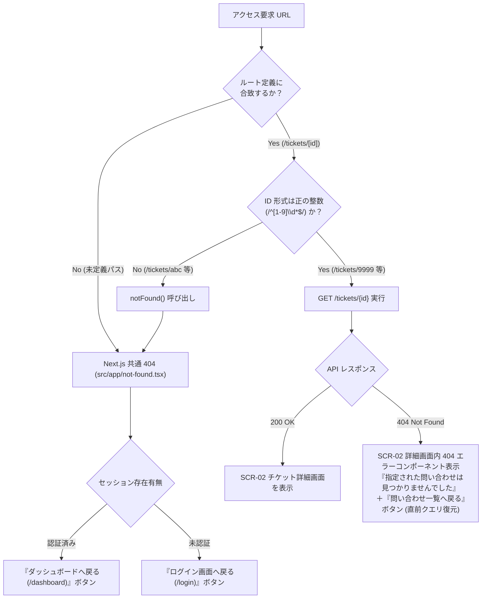
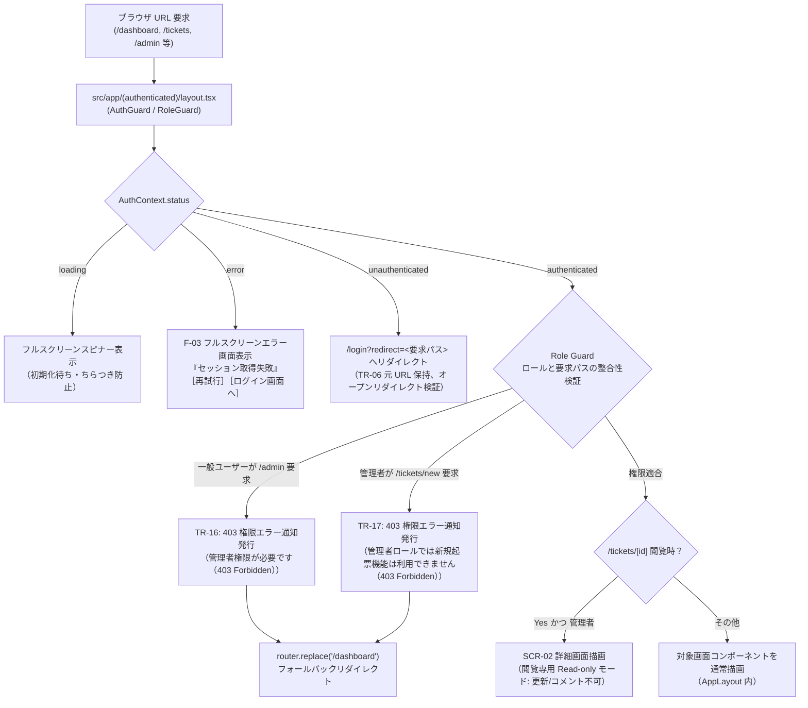
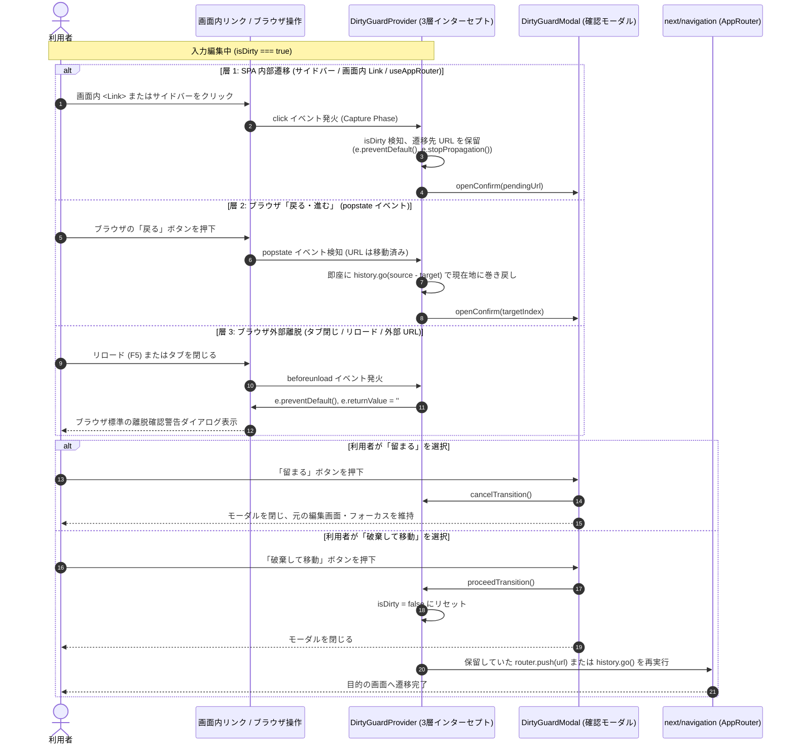
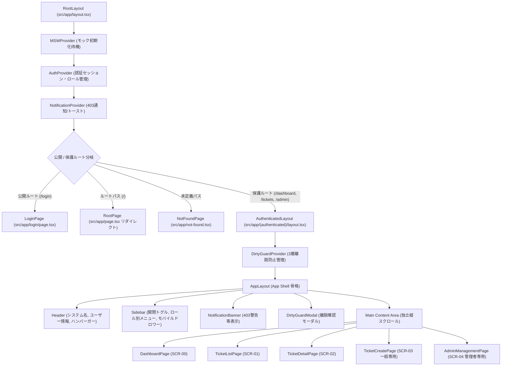
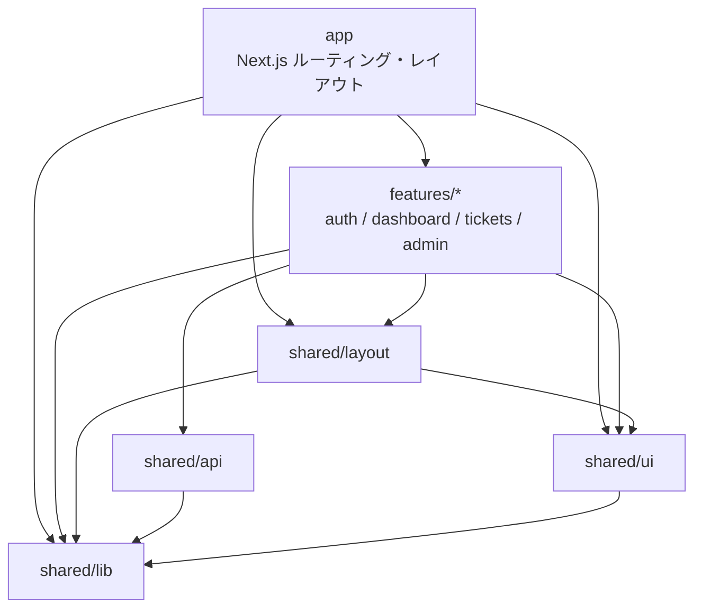
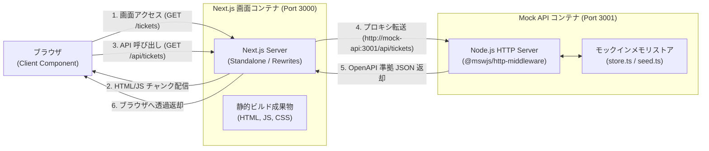

# フロントエンド構成設計

| 項目                | 内容                                                                                                                                                                                                                                                                                                                                                                                                                                                                                                                                                                                                                                                                                                                                                                                                                                                                                                                                                                                                                                                                                                                                                                                              |
| ------------------- | ------------------------------------------------------------------------------------------------------------------------------------------------------------------------------------------------------------------------------------------------------------------------------------------------------------------------------------------------------------------------------------------------------------------------------------------------------------------------------------------------------------------------------------------------------------------------------------------------------------------------------------------------------------------------------------------------------------------------------------------------------------------------------------------------------------------------------------------------------------------------------------------------------------------------------------------------------------------------------------------------------------------------------------------------------------------------------------------------------------------------------------------------------------------------------------------------- |
| 状態                | `Approved (Step 3)`                                                                                                                                                                                                                                                                                                                                                                                                                                                                                                                                                                                                                                                                                                                                                                                                                                                                                                                                                                                                                                                                                                                                                                               |
| 更新日              | `2026-10-18`                                                                                                                                                                                                                                                                                                                                                                                                                                                                                                                                                                                                                                                                                                                                                                                                                                                                                                                                                                                                                                                                                                                                                                                      |     |
| 関連する ED/ID 項目 | `docs/rd/step3.md#2-nextjs-移行およびコンテナ提供方針`<br>`docs/rd/step3.md#3-ut--it--pt-の切り分けとテスト規約の詳細`<br>`docs/ed/01-system-overview.md#51-システム受け入れ条件一覧`<br>`docs/ed/01-system-overview.md#61-合意済み業務技術ルール`<br>`docs/ed/01-system-overview.md#62-未確定事項後続確認事項`<br>`docs/ed/02-screen-list.md#2-画面一覧`<br>`docs/ed/02-screen-list.md#4-共通ナビゲーション仕様開閉式サイドバー`<br>`docs/ed/02-screen-list.md#7-確認事項未確定事項`<br>`docs/ed/03-screen-transition.md#1-画面遷移の全体概要`<br>`docs/ed/03-screen-transition.md#2-画面遷移一覧遷移表`<br>`docs/ed/03-screen-transition.md#4-遷移制約および例外業務上の振る舞い`<br>`docs/ed/03-screen-transition.md#5-確認事項未確定事項`<br>`docs/id/tech-verification.md#1-検証の背景と目的`<br>`docs/id/tech-verification.md#6-後続工程申し送り事項一覧と解決ゲート`<br>`docs/id/tech-verification.md#7-結論採用アーキテクチャ総括`<br>`docs/ed/screens/login.md`<br>`docs/ed/screens/dashboard.md`<br>`docs/ed/screens/ticket-list.md`<br>`docs/ed/screens/ticket-detail.md`<br>`docs/ed/screens/ticket-create.md`<br>`docs/ed/screens/admin-management.md`<br>`docs/ed/api/openapi.yaml` |

このドキュメントでは、Step 3 要件定義書（`docs/rd/step3.md`）、承認済み外部設計（ED）成果物、および先行技術検証報告書（Issue #208, `docs/id/tech-verification.md`）に基づき、Next.js 15+ (App Router) によるフロントエンドアーキテクチャ、全画面ファイルベースルーティング、認証・認可ガード（Auth Guard / Role Guard）、画面離脱防止（Dirty State ガード）、開閉式サイドバーおよび共通レイアウト構成、コンポーネントツリー、責務境界と依存方向、別コンテナ Mock API 接続および本番 DCE（Dead Code Elimination）アーキテクチャを確定します。

---

## 1. 設計の前提

1. **実装技術スタック**:
   - **Next.js 15+ (App Router) + React 19 + TypeScript 5.x** を基本技術スタックとして採用する。
   - 従来の Vite + 自前 SPA ルーター（`src/app/AppRouter.tsx`, `src/app/routes.ts`）を廃止し、Next.js App Router によるファイルベースルーティング（`src/app/**/page.tsx`, `layout.tsx`, `not-found.tsx`）へ全面移行する。
   - 画面遷移および URL クエリ操作はブラウザ History API 直接操作から `next/navigation`（`useRouter`, `usePathname`, `useSearchParams`, `useParams`）へ一本化する。
2. **API 契約（SSOT）と 2 層モック提供アーキテクチャ**:
   - 本プロジェクトでは実バックエンド開発を行わず、API 契約の唯一の正本（SSOT: Single Source of Truth）は `docs/ed/api/openapi.yaml` とする。
   - 開発・テスト・検証フェーズに応じた 2 層のモック提供アーキテクチャを採用する:
     - **開発環境・単体テスト（UT）・結合テスト（IT）**: `src/mocks/` の MSW（Mock Service Worker）モック（クライアント Service Worker および Node.js MSW）を利用。
     - **リリース相当環境・総合テスト（PT）・接続検証**: 画面を Next.js スタンドアロンコンテナとして提供し、OpenAPI 契約と既存のモック DB 資産（`src/mocks/db/store.ts`, `seed.ts`）を 100% 共有・再利用する **別コンテナ Mock API サーバー**（Node.js / Express + `@mswjs/http-middleware`）へ `/api` 経路（Next.js Rewrites プロキシ）で接続する。
3. **対象スコープ**:
   - Step 3 で定義された全 6 画面、共通ルート制御、および共通レイアウトを対象とする:
     1. SCR-AUTH: ログイン画面（`/login`）
     2. SCR-00: ダッシュボード画面（`/dashboard`）
     3. SCR-01: 問い合わせ一覧画面（`/tickets`）
     4. SCR-02: 問い合わせ詳細画面（`/tickets/[id]`）
     5. SCR-03: 問い合わせ新規起票画面（`/tickets/new`）
     6. SCR-04: ユーザー・プロジェクト管理画面（`/admin/management`）
     7. ルートパス（`/`）リダイレクト処理（未認証時 `/login`、認証済み時 `/dashboard`）
     8. `/admin` リダイレクト処理（`/admin` → `/admin/management`）
     9. 共通 404 Not Found 画面（`src/app/not-found.tsx`）
     10. 共通レイアウト（開閉式サイドバー、共通ヘッダー、Dirty State ガード、通知バナー）
4. **先行技術検証（PoC）の完全準拠**:
   - 技術検証報告書（`docs/id/tech-verification.md`）において実証・合意された以下のコア方式に厳格に準拠する:
     - `parameters.nextNavigation` を介した Storybook + Vitest 統一モック Decorator（方式 1-C）
     - Capture 相 Event Delegation ＋ History Index Revert/Replay ＋ `beforeunload` による 3 層 Dirty State ガード
     - `@mswjs/http-middleware` による既存ハンドラーの完全再利用と Next.js Rewrites プロキシ接続
     - `MSWProvider` による初回描画前の Service Worker 起動待機制御
     - 本番クリーンビルド時のモック除外（DCE: 0 bytes）と Route-based Code Splitting による初期ロード JavaScript バンドルサイズ 100.0 kB 未満（`SYS-AC-17`）の達成
     - Playwright 実ブラウザ IT における `POST /api/test/reset` による決定論的シード同期

---

## 2. 実装構成方針（ディレクトリ構造と Client Components 境界）

### 2.1 ディレクトリ構造

`docs/README.md` および技術検証結果に基づき、Next.js App Router ファイルベースルーティング（`src/app/`）、機能単位モジュール（`src/features/`）、共有基盤（`src/shared/`）、およびモック資産（`src/mocks/`）を明確に分離した構成を採用する。

```text
src/
├── app/                                 # Next.js App Router 基盤層
│   ├── (authenticated)/                 # 認証保護ルートグループ（Auth Guard / Role Guard 適用）
│   │   ├── layout.tsx                   # 保護画面共通レイアウト（Auth/Role ガード、AppLayout、DirtyGuard）
│   │   ├── layout.stories.tsx           # 保護レイアウト Story（一般 / 管理者 / Loading）
│   │   ├── layout.test.tsx              # 保護レイアウト単体テスト（composeStories 実行）
│   │   ├── dashboard/
│   │   │   ├── page.tsx                 # SCR-00 ダッシュボード Page（薄いラッパー）
│   │   │   ├── page.stories.tsx         # ダッシュボード Page Story
│   │   │   └── page.test.tsx            # ダッシュボード Page 単体テスト
│   │   ├── tickets/
│   │   │   ├── page.tsx                 # SCR-01 問い合わせ一覧 Page（薄いラッパー）
│   │   │   ├── page.stories.tsx         # 一覧 Page Story
│   │   │   ├── page.test.tsx            # 一覧 Page 単体テスト
│   │   │   ├── new/
│   │   │   │   ├── page.tsx             # SCR-03 問い合わせ新規起票 Page（薄いラッパー）
│   │   │   │   ├── page.stories.tsx     # 新規起票 Page Story
│   │   │   │   └── page.test.tsx        # 新規起票 Page 単体テスト
│   │   │   └── [id]/
│   │   │       ├── page.tsx             # SCR-02 問い合わせ詳細 Page（薄いラッパー、動的 ID）
│   │   │       ├── page.stories.tsx     # 詳細 Page Story
│   │   │       └── page.test.tsx        # 詳細 Page 単体テスト
│   │   └── admin/
│   │       └── management/
│   │           ├── page.tsx             # SCR-04 管理者管理 Page（薄いラッパー）
│   │           ├── page.stories.tsx     # 管理者管理 Page Story
│   │           └── page.test.tsx        # 管理者管理 Page 単体テスト
│   ├── login/
│   │   ├── page.tsx                     # SCR-AUTH ログイン Page（薄いラッパー）
│   │   ├── page.stories.tsx             # ログイン Page Story
│   │   └── page.test.tsx                # ログイン Page 単体テスト
│   ├── page.tsx                         # ルートパス（/）リダイレクト Page（未認証: /login、認証済: /dashboard）
│   ├── page.stories.tsx                 # ルート Page Story
│   ├── page.test.tsx                    # ルート Page 単体テスト
│   ├── layout.tsx                       # Root Layout（HTML 骨格、MSWProvider、グローバル CSS）
│   ├── layout.stories.tsx               # Root Layout Story
│   ├── layout.test.tsx                  # Root Layout 単体テスト
│   ├── not-found.tsx                    # 共通 404 Not Found Page（未定義パス、非数値 ID）
│   ├── not-found.stories.tsx            # 共通 404 Story（認証済み / 未認証）
│   ├── not-found.test.tsx               # 共通 404 単体テスト
│   └── globals.css                      # アプリケーション共通グローバル CSS（Storybook と同一参照）
├── features/                            # ドメイン業務機能層（"use client"）
│   ├── auth/                            # 認証機能（SCR-AUTH）
│   │   ├── api/                         # ログイン・セッション検証 API（authApi.ts）
│   │   ├── components/                  # LoginForm, MockAccountList 等
│   │   ├── context/                     # AuthContext, AuthProvider, useAuth
│   │   └── model/                       # 認証セッション型、CurrentUser 型
│   ├── dashboard/                       # ダッシュボード機能（SCR-00）
│   │   ├── api/                         # サマリー集計取得 API（dashboardApi.ts）
│   │   ├── components/                  # SummaryCards, AssignedTicketList, StaleTicketAlert
│   │   ├── hooks/                       # useDashboardSummary
│   │   └── model/                       # ダッシュボード集計モデル型
│   ├── tickets/                         # チケット機能（SCR-01, SCR-02, SCR-03）
│   │   ├── api/                         # チケット CRUD・コメント・担当者 API（ticketApi.ts）
│   │   ├── components/                  # TicketTable, FilterForm, DetailView, CommentList, CreateForm
│   │   ├── hooks/                       # useTicketList, useTicketDetail, useTicketCreate, useTicketQueryParams
│   │   └── model/                       # チケットエンティティ型、検索クエリ型、入力検証スキーマ
│   └── admin/                           # 管理者機能（SCR-04）
│       ├── api/                         # プロジェクト・ユーザー・所属紐づけ API（adminApi.ts）
│       ├── components/                  # ProjectTab, UserTab, AffiliationTab, ConfirmModal
│       ├── hooks/                       # useAdminProjects, useAdminUsers, useAdminAffiliations
│       └── model/                       # マスタ管理型、入力検証スキーマ
├── shared/                              # 共有要素層
│   ├── api/                             # HTTP クライアント基盤、OpenAPI 契約型、プロキシ接続設定
│   ├── layout/                          # AppLayout, Header, Sidebar, SidebarContext, useSidebar
│   ├── ui/                              # 共通 UI（Button, Input, Select, Badge, Spinner, Modal, Toast 等）
│   └── lib/                             # 汎用関数（dateUtils, stringUtils, DirtyGuardContext, useDirtyGuard）
├── mocks/                               # モック資産（開発・UT・IT・PT 共有）
│   ├── db/                              # インメモリストア（store.ts）、初期シードデータ（seed.ts）
│   ├── handlers/                        # OpenAPI 契約準拠 MSW リクエストハンドラー
│   └── browser.ts                       # クライアントサイド MSW 起動ワーカー
└── server/                              # 別コンテナ Mock API サーバー
    └── mock-api.ts                      # Node.js HTTP サーバー（@mswjs/http-middleware 適用エントリポイント）
```

### 2.2 Client Components（`"use client"`）境界と「薄いラッパーパターン」

1. **Client Components 境界の設計思想**:
   - 本システムでは、実バックエンドが存在せず OpenAPI 契約に基づくモック通信を前提とし、フォーム入力、URL クエリ双方向同期、開閉式サイドバー、および 3 層 Dirty State ガードなどの豊富なクライアント状態管理を必要とする。
   - 既存の React 状態管理資産（`useState`, `useEffect`, `useContext`）を最大限保護・再利用し、Storybook CSF および Vitest（`composeStories`）との親和性を担保するため、画面・UI コンポーネントは **`"use client"`（Client Component）** として構成する。
2. **薄いラッパーパターン（Thin Wrapper Pattern）**:
   - `src/app/**/page.tsx` は、業務ロジックや直接の状態管理を持たず、Next.js ルーティングパラメータ（`params`, `searchParams`）を受領して対応する Feature コンポーネントへ引き渡す「薄いラッパー（Thin Wrapper）」に徹する。
   - これにより、Next.js のフレームワーク依存コードと業務ドメインロジックが疎結合に保たれ、単体テスト・Storybook 作成・リグレッション検証が極めて容易となる。

```tsx
// src/app/(authenticated)/tickets/[id]/page.tsx （薄いラッパーの設計例）
"use client";

import type { FC } from "react";
import { useParams, notFound } from "next/navigation";
import { TicketDetailPage } from "@/features/tickets/components/TicketDetailPage";

const Page: FC = () => {
  const params = useParams();
  const rawId = Array.isArray(params.id) ? params.id[0] : params.id;

  // 非正整数の不正な ID 形式（例: /tickets/abc）は共通 404 へ委譲
  if (!rawId || !/^[1-9]\d*$/.test(rawId)) {
    notFound();
  }

  const ticketId = Number(rawId);
  return <TicketDetailPage ticketId={ticketId} />;
};

export default Page;
```

### 2.3 全 `.tsx` に対する `.stories.tsx` 必須作成規約

`docs/rd/step3.md` §3.2 の要求に基づき、テスト作成ルールの単純化および人間レビューの容易性を最優先とし、以下の規約を厳格に適用する:

1. **例外なしの 1 対 1 対応**:
   - `page.tsx`、`layout.tsx`、`not-found.tsx` を含む **すべての `.tsx` ファイルと同階層に、同名の `.stories.tsx` を例外なく必ず作成する**。
2. **`.test.tsx` での Story 実行とロジック補完**:
   - 各コンポーネントの Props 分岐、状態バリエーション（Loading / Empty / Error / ロール別等）、および主要インタラクション（`play` 関数）を `.stories.tsx` に網羅する。
   - 同階層の `.test.tsx` では `@storybook/react` の `composeStories` を用いて全 Story の描画・操作を自動実行し、Story 単体で表現しきれない細かな内部ロジック分岐（キーボード操作の特殊キー、Unmount クリーンアップ等）を Vitest テストケースで補完する。
3. **親子コンポーネント独立性原則（親子分離）**:
   - 「親コンポーネントのテストで子コンポーネントのバリエーションを兼ねる」といった効率化のためのテスト省略を禁止する。
   - 親コンポーネント（例: `TicketListPage`）は自身の状態管理・Props 分配・レイアウト責務のみを検証し、子コンポーネント（例: `TicketTable`）の境界値や表示バリエーションは子自身の `.stories.tsx` / `.test.tsx` で検証する。
4. **C0/C1 100% カバレッジ規約**:
   - 全コンポーネントおよびユーティリティにおいて、C0（命令/行カバレッジ）100% および C1（分岐カバレッジ）100% を原則として達成する。

### 2.4 グローバル CSS の一元管理

- `src/app/globals.css` をスタイルの一意の正本（SSOT）とし、Root Layout（`src/app/layout.tsx`）および Storybook プレビュー設定（`.storybook/preview.ts`）の両方から同一の CSS ファイルを直接インポートする。
- これにより、開発環境、本番ビルド環境、および Storybook VRT（Visual Regression Testing）の間でフォント、リセットスタイル、CSS 変数、およびレイアウト寸法の完全な描画一致を恒久的に保証する。

---

## 3. ルーティングアーキテクチャ設計

### 3.1 全ルート定義一覧

Step 3 における全ルート定義、想定 URL パス、ファイル配置先、画面 ID、対象ロール、適用レイアウト、およびアクセス制御・フォールバックポリシーを以下のように定義する。

| ルート識別子       | 想定 URL パス                   | ファイル配置先                                      | 画面 ID  | 対象ロール     | 適用レイアウト                      | アクセス制御・フォールバック仕様                                                                                                                                      |
| :----------------- | :------------------------------ | :-------------------------------------------------- | :------- | :------------- | :---------------------------------- | :-------------------------------------------------------------------------------------------------------------------------------------------------------------------- |
| `login`            | `/login`                        | `src/app/login/page.tsx`                            | SCR-AUTH | 未認証         | `AuthLayout`（サイドバーなし）      | 認証済みユーザーのアクセス時は `/dashboard` へ即時リダイレクト（TR-07 ログインスキップ）。クエリ `?redirect=` を受領して認証成功時に復帰。                            |
| `root`             | `/`                             | `src/app/page.tsx`                                  | SCR-00   | 一般 / 管理者  | なし（即時リダイレクト）            | 未認証時は `/login` へ即時 `router.replace`（TR-01）。認証済み時は `/dashboard` へ即時 `router.replace`（TR-02）。                                                    |
| `dashboard`        | `/dashboard`                    | `src/app/(authenticated)/dashboard/page.tsx`        | SCR-00   | 一般 / 管理者  | `AppLayout`（サイドバーあり）       | 未認証時は `/login?redirect=%2Fdashboard` へリダイレクト（TR-06）。一般: 自プロジェクト集計、管理者: 全社横断集計。                                                   |
| `tickets`          | `/tickets`                      | `src/app/(authenticated)/tickets/page.tsx`          | SCR-01   | 一般 / 管理者  | `AppLayout`（サイドバーあり）       | 未認証時は `/login?redirect=%2Ftickets` へリダイレクト。検索クエリ（ステータス、担当者、プロジェクト等）と URL 双方向同期。                                           |
| `ticket-detail`    | `/tickets/[id]`                 | `src/app/(authenticated)/tickets/[id]/page.tsx`     | SCR-02   | 一般 / 管理者  | `AppLayout`（サイドバーあり）       | 未認証時は `/login?redirect=...`。動的パラメータ `[id]` 検証。非数値 ID は `notFound()`。一般: 操作可能、管理者: 閲覧専用（Read-only）。                              |
| `ticket-create`    | `/tickets/new`                  | `src/app/(authenticated)/tickets/new/page.tsx`      | SCR-03   | **一般専用**   | `AppLayout`（サイドバーあり）       | 未認証時は `/login?redirect=...`。**管理者は Role Guard で 403 遮断 → `/dashboard` へフォールバック ＋ 403 警告通知（TR-17）**。                                      |
| `admin`            | `/admin`                        | `next.config.mjs` redirects に一元化                | SCR-04   | **管理者専用** | なし（即時リダイレクト）            | `/admin/management` へ 307 即時リダイレクト（`admin/route.ts` は作成せず設定で一元化）。未認証時は最終的に `/login` へ、一般は 403 で `/dashboard` へフォールバック。 |
| `admin-management` | `/admin/management`             | `src/app/(authenticated)/admin/management/page.tsx` | SCR-04   | **管理者専用** | `AppLayout`（サイドバーあり）       | 未認証時は `/login?redirect=...`。**一般は Role Guard で 403 遮断 → `/dashboard` へフォールバック ＋ 403 警告通知（TR-16）**。                                        |
| `not-found`        | 未定義パス（`/foo` 等）/ 非数値 | `src/app/not-found.tsx`                             | -        | -              | 独立 404 ビュー（共通ヘッダーあり） | 定義外パスまたは `notFound()` 呼出時に表示。認証状態を動的評価し、認証済みなら `/dashboard`、未認証なら `/login` へ安全な復帰リンクを提供。                           |

### 3.2 ルートパス（`/`）リダイレクト設計

- `src/app/page.tsx` は視覚的なコンテンツを持たず、クライアント側マウント時に `AuthContext` の認証セッション状態を評価する。
- `status === "authenticated"` の場合: `router.replace("/dashboard")` によりダッシュボード画面へ即座に移動する。
- `status === "unauthenticated"` の場合: `router.replace("/login")` によりログイン画面へ即座に移動する。
- `status === "loading"` の場合: 画面ちらつきを防止するため、最小限のフルスクリーンスピナーを描画して判定完了を待機する。

### 3.3 `/admin` → `/admin/management` リダイレクト設計

- `docs/ed/02-screen-list.md` §7.2 および `docs/ed/screens/admin-management.md` §10.6 に基づき、`/admin` への直接ブラウザアクセスを正規化された `/admin/management` へリダイレクトする。
- **実装方式**:
  - `next.config.mjs` の `redirects()` 設定を採用し、ルーティング評価の最上流で高速に 307（一時的リダイレクト）を発行する。
  ```javascript
  // next.config.mjs
  const nextConfig = {
    async redirects() {
      return [
        {
          source: "/admin",
          destination: "/admin/management",
          permanent: false,
        },
      ];
    },
  };
  export default nextConfig;
  ```
  - これにより、ブラウザのアドレスバーは即座に `/admin/management` に更新され、後続の Auth Guard / Role Guard パイプラインが単一の正規化パスに対して正確に適用される。

### 3.4 共通 404（`not-found.tsx`）と詳細画面内 404（`/tickets/[id]`）の明確な切り分け

利用者の業務迷子を防止し、適切な復帰導線を提供するため、存在しないリソース（チケット）と未定義パスを明確に切り分けて設計する（`docs/ed/02-screen-list.md` §7.2, `docs/ed/03-screen-transition.md` §4.5）。



1. **共通 404 Not Found（`src/app/not-found.tsx`）**:
   - **発動条件**:
     - アプリケーションで定義されていないパス（例: `/unknown`, `/settings`, `/tickets/foo/bar`）への直接アクセス。
     - チケット詳細画面において ID が正の整数でない場合（例: `/tickets/abc`, `/tickets/-1`）に `notFound()` が明示的に呼び出された場合。
   - **レイアウトと復帰導線**:
     - 独立した 404 ビューとして描画するが、ブランドヘッダー（システム名）を配置して孤立感を排除する。
     - クライアント側で `useAuth` フックにより認証状態を動的に評価する:
       - 認証済みセッションが存在する場合: 「ダッシュボードへ戻る」ボタン（`/dashboard` へのリンク）を表示。
       - 未認証の場合: 「ログイン画面へ」ボタン（`/login` へのリンク）を表示。
2. **詳細画面内 404（`/tickets/[id]`）**:
   - **発動条件**:
     - 正当な数値形式の ID（例: `/tickets/9999`）であるが、バックエンド（モック DB）上に該当チケットが存在せず、チケット取得 API が HTTP 404 を返却した場合。
   - **画面表示と業務継続性**:
     - ルーティングレベルで共通 404 画面へ飛ばすのではなく、SCR-02 詳細画面のコンテキスト（`AppLayout` 内）を維持してマウントする。
     - 画面中央に「指定された問い合わせは見つかりませんでした」という警告メッセージを表示する。
     - 「問い合わせ一覧へ戻る」ボタンを配置し、押下時に直前の検索・絞り込みクエリパラメータ（ステータス、担当者、プロジェクト、ページ番号等）を保持した状態で SCR-01（`/tickets`）へ安全に復帰できるようにする（TR-19）。

---

## 4. 認証・認可ガードアーキテクチャ（Auth Guard / Role Guard）

### 4.0 ガード配置方針と middleware.ts 不採用の決定根拠

- 承認済み ED（`docs/ed/03-screen-transition.md` §5.1）の申し送りに基づき、ガードの実装レイヤーを確定する。本システムでは **`middleware.ts` は採用せず、全認証・認可ガードを保護レイアウト `src/app/(authenticated)/layout.tsx` 内の Client Guard（`AuthGuard` / `RoleGuard`）に一元化する**。
- **不採用の根拠**: 本システムの認証トークンはブラウザの `localStorage`（キー: `authToken`）に保存され、起動時に `GET /auth/me` を呼び出して最新ロールとセッション状態を復元する設計である。Next.js の `middleware.ts`（Edge ランタイム）からはクライアントの `localStorage` に一切アクセスできず、Cookie 認証を用いない本構成ではサーバー側での認証・ロール判定が成立しないためである。
- **対象パスと責務の確定**:
  - 公開ルート: `/login`, `/`, `/not-found`（ガード対象外。`/login` への認証済み直接アクセスは TR-07 により `/dashboard` へ即時 `router.replace`）。
  - 保護ルート（`(authenticated)/layout.tsx` 配下）: `/dashboard`, `/tickets`, `/tickets/[id]`, `/tickets/new`, `/admin/management`。
  - 未認証時: `status === "unauthenticated"` を検知し、要求元パスをエンコードして `/login?redirect=...` へ `router.replace`（TR-01, TR-06）。
  - セッション通信エラー時: `status === "error"` を検知し、トークンを破棄せず F-03 フルスクリーンエラー画面を表示。
  - 権限不足時: ロール不整合を検知し、確定文言で 403 警告通知を発行して `/dashboard` へフォールバック（TR-16, TR-17）。

### 4.1 ガード処理フロー全体像（Mermaid）

Next.js App Router 環境において、すべての保護ルート（`src/app/(authenticated)/layout.tsx`）は、子画面のレンダリング前に「認証セッション判定」および「ロール認可判定」を連続して実行するパイプラインを通過する。



### 4.2 Auth Guard（未認証ガード）の設計

1. **セッション初期化待ちとローディング表示**:
   - アプリ起動時、`AuthContext` は `localStorage` からトークンを読み取り、`GET /auth/me` により最新のセッション状態とユーザーロール（`general` / `admin`）を取得・検証する。
   - 復元検証中（`status === "loading"`）は、保護画面および `/login` 画面のいずれでも不要なリダイレクトちらつき（FOUC）を完全に抑止するため、フルスクリーンのローディングスピナーを描画する。
2. **セッション復元失敗時の状態遷移とエラー画面（F-03）**:
   - `GET /auth/me` が 500 サーバーエラー、通信障害、または OpenAPI 契約外の不正ロールを返却した場合、`status = "error"` に遷移し、トークンは即時消去せず保持する。
   - `status === "error"` 時は、無期限ローディングによる画面フリーズを防ぐため、以下のフルスクリーンエラー画面を描画する:
     - メッセージ: 「セッション情報の取得に失敗しました。ネットワーク状況を確認し、再度お試しください。」
     - アクションボタン:
       - `[再試行]`: `AuthContext.refreshUser()` を呼び出してセッション再検証を実行。
       - `[ログイン画面へ]`: `AuthContext.logout()` を呼び出してトークンを消去し、`/login` へ遷移。
   - `GET /auth/me` が 401 Unauthorized（トークン失効・無効）を返却した場合は、ストレージの認証情報を即座に破棄し、`status = "unauthenticated"` へ遷移してログイン画面へリダイレクトする。
3. **未ログインアクセスの遮断と元 URL の退避（TR-06）**:
   - 保護画面へのアクセス時に `status === "unauthenticated"` である場合、直ちに遷移を中断する。
   - アクセスが試みられた pathname と searchParams を URL エンコードし、クエリパラメータ `?redirect=` に付与して `/login` へリダイレクトする（例: `/tickets/12?status=open` → `/login?redirect=%2Ftickets%2F12%3Fstatus%3Dopen`）。
4. **オープンリダイレクト脆弱性対策（SSOT 検証）**:
   - 外部悪意サイトへの不正転送を確実に防止するため、共通検証関数 `validateRedirectUrl(url: string): string` を設ける。
   - 単一の `/` で始まり `//` で始まらない相対パスのみを許可し、バックスラッシュ（`\`）および制御文字を拒否する。`new URL(url, location.origin)` で解決した URL の origin が現在の origin と厳格に一致することを確認する。
   - 絶対 URL（`http:`, `https:` 等）、プロトコル相対パス（`//evil.com`）、および解析不能値は無効と判定し、安全なフォールバック先 `/dashboard` を強制返却する。
5. **認証済みユーザーのログイン画面スキップ（TR-07）**:
   - 認証確立済みのユーザーが `/login` に直接アクセスした場合、ログインフォームを表示せず、`/dashboard` へ即座に `router.replace` する。

### 4.3 Role Guard（ロール認可ガード）の設計

1. **ロールとルートのアクセス制御マトリクス**:
   - 一般ユーザー（`role === "general"`）:
     - アクセス許可: `/dashboard`, `/tickets`, `/tickets/[id]`, `/tickets/new`
     - アクセス禁止: `/admin`, `/admin/management`（SCR-04 管理画面）
   - 管理者ユーザー（`role === "admin"`）:
     - アクセス許可: `/dashboard`, `/tickets`, `/tickets/[id]`, `/admin`, `/admin/management`
     - アクセス禁止: `/tickets/new`（SCR-03 新規起票画面）
2. **認可遮断と 403 通知フォールバック連携（TR-16, TR-17）**:
   - 利用者を専用の静的 403 エラー画面へ隔離するのではなく、ポータル画面である `/dashboard` へ安全にフォールバックリダイレクトする。
   - リダイレクト処理と同時に、共通通知コンテキスト（`NotificationContext`）へ 403 警告メッセージを発行する（Issue #220 承認確定文言）:
     - 一般ユーザーが `/admin` または `/admin/management` を要求した場合（TR-16）: `type: "error"`, `message: "管理者権限が必要です（403 Forbidden）"`
     - 管理者ユーザーが `/tickets/new` を要求した場合（TR-17）: `type: "error"`, `message: "管理者ロールでは新規起票機能は利用できません（403 Forbidden）"`
   - リダイレクト先のダッシュボード画面上部に、明示的な赤色警告バナー（または自動消滅トースト）として即時表示し、利用者に状況を明示する。
3. **問い合わせ詳細画面（SCR-02）における管理者閲覧専用モード**:
   - `/tickets/[id]` では管理者アクセスを 403 遮断せず閲覧を許可するが、ステータス変更セレクトボックス、担当者変更セレクトボックス、およびコメント投稿フォームは非表示（または非活性）とし、一般ユーザーのみが更新操作を行えるよう制御する。

---

## 5. 画面離脱防止（Dirty State ガード）アーキテクチャ

### 5.1 離脱防止の目的と対象画面

利用者がフォームに入力した重要データを、誤ったサイドバーメニュー押下、戻るボタン押下、またはリロード操作によって意図せず破棄してしまう事故を防止する（`docs/ed/03-screen-transition.md` §4.3, `docs/id/tech-verification.md` §3）。

| 画面 ID    | 画面名                     | Dirty 判定条件（未保存変更の検知）                                 | ガード解除条件（Clean 化）                                                                   |
| :--------- | :------------------------- | :----------------------------------------------------------------- | :------------------------------------------------------------------------------------------- |
| **SCR-03** | 問い合わせ新規起票画面     | タイトル、本文、プロジェクト選択、担当者選択のいずれかに変更あり   | 起票 API 登録が正常完了（201）した時、または破棄確認ダイアログで「破棄して移動」を選択時     |
| **SCR-02** | 問い合わせ詳細画面         | コメント入力欄に 1 文字以上のテキストが入力されている              | コメント投稿 API が正常完了（201）した時、または破棄確認ダイアログで「破棄して移動」を選択時 |
| **SCR-04** | ユーザー・プロジェクト管理 | 所属紐づけ管理タブでチェックボックスが保存済み状態から変更された時 | 「設定を保存」成功時、「変更をリセット」押下時、または破棄確認で「破棄して移動」を選択時     |

### 5.2 3 層インターセプトアーキテクチャ（PoC 確定方式）

Next.js App Router には Pages Router 時代の `routeChangeStart` イベントが存在しないため、先行技術検証（`docs/id/tech-verification.md` §3）で実証した 3 層インターセプトアーキテクチャを採用する。



#### (1) 層 1: SPA 内部遷移のインターセプト

- **Capture 相 Event Delegation**:
  `DirtyGuardProvider` はルートコンテナ（`AppLayout` 直下）において、キャプチャフェーズ（`capture: true`）で `click` イベントを捕捉する。クリック対象が同一オリジンの内部アンカー（`<a>` または `<Link>`）であり、かつ `isDirty === true` の場合、イベントの伝播と規定の動作を即時停止（`e.preventDefault()`, `e.stopPropagation()`）し、遷移先 URL を保留した上で確認モーダルを表示する。
- **`useAppRouter` によるプログラム遷移のラップ**:
  コードから `router.push()` や `router.replace()` を呼び出す場合も、`useAppRouter` フック経由で呼び出すことで、`isDirty === true` 時に遷移を自動保留して確認モーダルを表示する。

#### (2) 層 2: ブラウザ「戻る・進む」（`popstate`）の Revert & Replay 機構

- **History Index 連番付与**:
  ページマウントおよび画面遷移ごとに、`window.history.state` に単調増加の整数インデックス（`historyIndex`）を記録する。
- **即時巻き戻し（Revert）**:
  ブラウザの戻る/進む操作が行われた際、`popstate` イベントの時点ですでにブラウザの URL は変更されている（`preventDefault` 不可）。`isDirty === true` の場合、即座に `window.history.go(sourceIndex - targetIndex)` を発行し、アドレスバーを現在の画面へ瞬時に巻き戻す。
- **再実行（Replay）**:
  巻き戻し完了後に確認ダイアログを表示する。利用者が「破棄して移動」を選択した場合のみ、バイパスフラグを有効化した上で再度 `window.history.go(targetIndex - sourceIndex)` を発行し、目的の履歴位置へ正確に遷移させる。

#### (3) 層 3: ブラウザ外部離脱（`beforeunload`）

- タブを閉じる、ウィンドウを閉じる、またはページをリロードする操作に対しては、Web 標準の `window.addEventListener("beforeunload")` を登録する。`isDirty === true` の場合に `event.preventDefault()` および `event.returnValue = ""` を設定し、ブラウザ標準の離脱警告を発火させる。

### 5.3 実装方式と確認モーダル（`DirtyGuardModal`）

1. **`DirtyGuardProvider` と `useDirtyGuard`**:
   - `src/shared/lib/DirtyGuardContext.tsx` に Provider を配置し、各画面・フォームから `const { setDirty, resetDirty } = useDirtyGuard()` を呼び出して未保存状態を登録する。
2. **カスタム確認モーダル（`DirtyGuardModal`）のアクセシビリティ**:
   - SPA 内部遷移では、デザインの統一されたアクセシブルな共通モーダル（`src/shared/layout/DirtyGuardModal.tsx`）を使用する:
     - タイトル: 「未保存の変更があります」
     - メッセージ: 「編集中の内容が破棄されます。この画面を離れてもよろしいですか？」
     - ボタン: 「留まる（キャンセル）」「破棄して移動（破棄）」
     - フォーカストラップ（Tab / Shift+Tab によるモーダル内循環）、`Escape` キー押下によるキャンセル、およびモーダル閉鎖時のトリガー要素へのフォーカス復帰を完全に保証する。

---

## 6. 開閉式サイドバーおよび共通レイアウト構成

### 6.1 共通レイアウト（`AppLayout`）の構造と App Shell 完全固定方式

保護された全画面（SCR-00, SCR-01, SCR-02, SCR-03, SCR-04）は、統一された `AppLayout` コンポーネントの内側にマウントされる。ログイン画面（SCR-AUTH）のみ、サイドバーを持たないスタンドアロンの `AuthLayout` を適用する。

```text
+-----------------------------------------------------------------------------------------------+
| [Header] システム名: 社内チケット管理              [☰ モバイル時]    👤 ユーザー情報 | [ログアウト] |
+-----------------------+-----------------------------------------------------------------------+
| [Sidebar]             | [Main Content Area]                                                   |
| 展開幅: 240px         | （各ページコンポーネント: SCR-00 / 01 / 02 / 03 / 04）                 |
| 縮小幅: 60px          | ※メイン領域のみ overflow-y: auto で独立縦スクロール                    |
|                       |                                                                       |
| 1. 📊 ダッシュボード   |                                                                       |
| 2. 📋 問い合わせ一覧   |                                                                       |
| 3. ➕/⚙️ 業務別メニュー |                                                                       |
|                       |                                                                       |
| --------------------- |                                                                       |
| 👤 ユーザー詳細・所属  |                                                                       |
| [←] / [→] 開閉ボタン  |                                                                       |
+-----------------------+-----------------------------------------------------------------------+
```

1. **App Shell のビューポート拘束 (`.app-shell`)**:
   - `height: 100vh; height: 100dvh; overflow: hidden;` を指定し、ウィンドウ全体の連動スクロールおよびスクロールアウトを防止する。
2. **ヘッダーの固定配置 (`.app-header`)**:
   - `flex-shrink: 0;` により、常に画面最上部に固定表示する。メイン領域をスクロールしてもヘッダータイトルや操作導線が隠れない。
3. **ボディコンテナ (`.app-body`)**:
   - `flex: 1 1 0; min-height: 0; overflow: hidden;` とし、ヘッダーを除く残りのビューポート高さいっぱいに Flexbox コンテナを伸縮させる。
4. **サイドバーの高さ・スクロール追従 (`.sidebar`)**:
   - `height: 100%;` によりボディコンテナの高さ全体に適合させる。
   - 上部（`.sidebar-top`: ブランド・トグル）および下部（`.sidebar-bottom`: ユーザー情報・所属・ログアウト）は `flex-shrink: 0;` で上下端に固定配置する。
   - 中央のナビゲーションメニュー（`.sidebar-nav`）に `flex: 1 1 auto; min-height: 0; overflow-y: auto;` を付与し、メニュー項目が増加または画面縦幅が縮小した場合でも、中央メニュー領域のみが独立してスクロール可能とする。
5. **メイン領域の独立スクロール (`.app-body > .app-main`)**:
   - `height: 100%; overflow-y: auto;` とし、チケット一覧や詳細などの縦長コンテンツ閲覧時でも、メイン領域内のみが独立して縦スクロールする。

### 6.2 デスクトップ表示（幅 768px 以上）

1. **展開状態（Expanded: 幅 240px / 既定値）**:
   - 上部: システム名ラベルおよび折りたたみボタン `←`。
   - メニュー: アイコン＋日本語ラベル（例: `📊 ダッシュボード`）。
   - 下部: ユーザー表示名、ロール、所属プロジェクト名、およびログアウトボタン。
2. **折りたたみ状態（Collapsed: 幅 60px）**:
   - 上部: アイコンおよび展開ボタン `→`。
   - メニュー: アイコンのみ中央揃え配置（ホバー時にツールチップで項目名表示）。
   - 下部: アイコン化されたログアウトボタン。
3. **伸縮トランジション**:
   - サイドバー幅の切り替えは CSS `transition: width 0.2s ease` を用い、メインコンテンツ領域の幅もスムーズに追従伸縮する。

### 6.3 モバイル対応（幅 375px 等）

1. **固定サイドバーの非表示**:
   - メディアクエリ（`@media (max-width: 767px)`）により、画面左側の固定サイドバーは非表示（`display: none`）とする。
2. **ヘッダーハンバーガーメニュー（☰）**:
   - ヘッダー左端にハンバーガーボタンを表示する。
3. **オーバーレイドロワーとバックドロップ**:
   - ハンバーガーボタン押下時、サイドバーが画面左端からスライドインする「ドロワー表示」に切り替わる（`z-index: 50`）。
   - 背面に半透明の黒背景（バックドロップ: `z-index: 40`）を表示し、背景スクロールを抑止する。
4. **自動クローズ挙動**:
   - ドロワー内のメニュー項目をタップして画面遷移が発生した場合、およびバックドロップをタップした場合は、即時にドロワーを閉じる。

### 6.4 `localStorage` 永続化と SSR / クライアント Hydration Mismatch 防止策

外部設計申し送り事項（`docs/ed/02-screen-list.md` §7.2）に基づき、サイドバー開閉状態の永続化に伴う SSR / クライアント間の Hydration Mismatch を完全に防止する設計を確定する。

1. **課題の本質**:
   - サーバーサイドレンダリング（またはビルド時の静的プリレンダリング）段階では、ブラウザの `window.localStorage` が存在しないため、サーバーは常にデフォルト値（例: 展開 `isCollapsed: false`）で HTML を生成する。
   - クライアントが `localStorage.getItem("sidebar_collapsed")` を読み取って即座に状態を初期化すると、ユーザーが折りたたみ（`isCollapsed: true`）を選択していた場合にサーバー生成 HTML とクライアントの初期 DOM 構造・クラス名が食い違い、React の Hydration Mismatch 警告やレイアウト崩れが発生する。
2. **採用する防止策**:
   - **マウント後同期パターン（Mounted Sync Pattern）**:
     1. コンポーネントツリー内の初期 React 状態は、サーバーとクライアントで同一の既定値 `isCollapsed: false`（展開）から開始する。
     2. `useSidebar` フック内で `isMounted` フラグ（初期値 `false`）を保持し、マウント完了時（`useEffect`）に `true` へ遷移させると同時に `localStorage` から `sidebar_collapsed` の値を読み取って状態を更新する。
     3. クライアント側でのマウント前のちらつき（FOUC）を抑止するため、サイドバーコンテナにはマウント完了フラグが付与されるまでトランジションアニメーションを一時無効化（`transition: none`）する CSS クラスを適用し、不要なレイアウトシフト（CLS）を防止する。

### 6.5 ロール別メニュー構成（3つの枠）

操作体系の一貫性を保つため、メニュー枠は全ロールで「3つの枠」に統一する。

| 枠順  | アイコン | メニュー項目名                        | 一般ユーザー（業務担当）                     | 管理者ユーザー（システム管理）             |
| :---- | :------- | :------------------------------------ | :------------------------------------------- | :----------------------------------------- |
| **1** | 📊       | ダッシュボード                        | `/dashboard`（自プロジェクト集計・担当案件） | `/dashboard`（全社横断集計・稼働サマリー） |
| **2** | 📋       | 問い合わせ一覧                        | `/tickets`（自プロジェクトチケット検索）     | `/tickets`（全社横断チケット検索・監査）   |
| **3** | ➕ / ⚙️  | 新規起票 / ユーザー・プロジェクト管理 | `/tickets/new`（SCR-03 新規起票）            | `/admin/management`（SCR-04 管理画面）     |

---

## 7. コンポーネントツリーと責務境界・依存方向

### 7.1 全体コンポーネントツリー



### 7.2 レイヤー別責務表

| レイヤー                 | 配置ディレクトリ          | 責務（すべきこと）                                                         | 非責務（してはならないこと）             |
| :----------------------- | :------------------------ | :------------------------------------------------------------------------- | :--------------------------------------- |
| **アプリケーション層**   | `src/app/`                | Next.js ルーティング、薄い Page ラッパー、Root/保護 Layout、共通 404       | 業務ロジックの直接記述、API 詳細通信     |
| **認証機能層**           | `src/features/auth/`      | ログインフォーム、認証 API 通信、セッション永続化、`AuthContext`           | 他機能の表示制御、ルーティングそのもの   |
| **ダッシュボード機能層** | `src/features/dashboard/` | ロール別サマリー表示、指標集計 API 連携、ドリルダウン導線                  | チケット自体の更新処理、マスタデータ管理 |
| **チケット機能層**       | `src/features/tickets/`   | チケット一覧検索・絞り込み、詳細閲覧・更新・コメント、新規起票、Dirty 登録 | 認証トークン管理、全社マスタの追加削除   |
| **管理者機能層**         | `src/features/admin/`     | プロジェクト管理、ユーザー管理、所属紐づけ管理、マスタ API 通信            | チケット個別対応業務、一般起票           |
| **共通レイアウト層**     | `src/shared/layout/`      | サイドバー開閉（デスクトップ/モバイル）、ヘッダー表示、レイアウト骨格      | 個別画面の業務データ表示                 |
| **共通 UI 層**           | `src/shared/ui/`          | 再利用可能な純粋 UI（Button, Modal, Toast, Input, Select, Badge, Spinner） | 特定ドメインへの依存、業務ロジック       |
| **共通 API 基盤層**      | `src/shared/api/`         | HTTP クライアント基盤、OpenAPI 契約型定義、プロキシ接続設定                | 画面固有の入力値加工                     |
| **汎用ライブラリ層**     | `src/shared/lib/`         | 日付操作、文字列操作、DirtyGuardContext、純粋ユーティリティ                | React 状態の直接保持、UI 描画            |
| **モック層**             | `src/mocks/`              | OpenAPI 契約準拠 MSW ハンドラー、インメモリストア、シードデータ            | 実本番業務コードへの混入                 |

### 7.3 依存方向ルール

モジュール間の依存は、上位レイヤーから下位レイヤーへの一方向のみを許可し、逆方向依存および水平方向の密結合を禁止する。



1. **一方向依存の徹底**: `app` は `features` および `shared` に依存できるが、`features` や `shared` が `app` の内部実装に逆依存してはならない。
2. **Feature 間の直接依存禁止**: `features/tickets` と `features/admin` など、異なる Feature 同士の直接 import は禁止する。共通利用するデータモデルや UI は `shared` に配置する。
3. **画面と API の境界**: 画面コンポーネント（Pages / Feature Components）は Fetch API を直接呼び出さず、必ず各機能層のカスタムフックまたは API モジュールを経由して呼び出す。

---

## 8. コンテナ構成・別コンテナ Mock API 接続および本番 DCE

### 8.1 画面コンテナと別コンテナ Mock API サーバーの構成

外部設計申し送り事項（`docs/ed/01-system-overview.md` §6.2 No.1）および Step 2 PT 申し送り（No.2）に基づき、リリース相当および PT 環境で稼働するコンテナアーキテクチャを以下のように定義する。



1. **Next.js 画面コンテナ（Port 3000）**:
   - `output: "standalone"` による軽量本番コンテナ。
   - 静的アセット配信およびクライアントサイドルーティングを提供。
2. **別コンテナ Mock API サーバー（Port 3001）**:
   - Node.js 標準 `http.createServer` または軽量 Express / Hono サーバー。
   - MSW 公式の `@mswjs/http-middleware` を使用し、既存の `src/mocks/handlers/index.ts` の `handlers` をそのままマウントする。
   - `src/mocks/db/store.ts` のインメモリストアおよび初期シードデータ（`seed.ts`）を 100% 共有・再利用し、二重管理を完全にゼロとする。

### 8.2 `/api` プロキシ接続方式（Next.js Rewrites）

Next.js 画面コンテナから別コンテナ Mock API サーバーへの通信は、`next.config.mjs` の `rewrites()` を利用したプロキシ接続を採用する（`docs/id/tech-verification.md` §4.2）。

```javascript
// next.config.mjs
const nextConfig = {
  output: "standalone",
  async rewrites() {
    const apiBaseUrl = process.env.API_BASE_URL || "http://localhost:3001";
    return [
      {
        source: "/api/:path*",
        destination: `${apiBaseUrl}/api/:path*`,
      },
    ];
  },
};
export default nextConfig;
```

- **メリット**:
  1. クライアントブラウザは常に同一オリジン（`http://localhost:3000/api/*`）に対してリクエストを送信するため、CORS（Cross-Origin Resource Sharing）設定が一切不要となる。
  2. Nginx 等の外部リバースプロキシコンテナを追加する必要がなく、構成を Next.js コンテナ ＋ Mock API コンテナの最小 2 コンテナに抑えられる。
  3. 環境変数 `API_BASE_URL` を差し替えるだけで、ローカル開発、Docker Compose、および CI 上のコンテナ間通信に即座に対応できる（※Next.js Standalone の `rewrites()` はビルド時にマニフェストへ評価・固定化されるため、`Dockerfile` の builder ステージで `ARG API_BASE_URL=http://mock-api:3001` を定義し、`docker-compose.yml` の `build.args` 経由でビルド時環境変数として注入する）。

### 8.3 クライアント側 MSW 初期化方式（初回描画未捕捉防止）

開発環境（`npm run dev`）において、Service Worker の起動完了前にコンポーネントが `fetch('/api/...')` を発行すると、Service Worker がリクエストを捕捉できず 404 エラーとなる競合問題（`PT-HO-01`）を防止する。

```tsx
// src/app/MSWProvider.tsx
"use client";

import { useState, useEffect, type FC, type ReactNode } from "react";

export const MSWProvider: FC<{ children: ReactNode }> = ({ children }) => {
  const [isReady, setIsReady] = useState(
    process.env.NODE_ENV !== "development",
  );

  useEffect(() => {
    if (process.env.NODE_ENV === "development") {
      import("@/mocks/browser").then(({ worker }) => {
        worker.start({ onUnhandledRequest: "bypass" }).then(() => {
          setIsReady(true);
        });
      });
    }
  }, []);

  if (!isReady) {
    return null; // または最小限の初期化インジケーター
  }

  return <>{children}</>;
};
```

- **効果**:
  `RootLayout` の直下に `MSWProvider` を配置し、開発環境では Service Worker の初期化解決を待ってから `children` をマウントすることにより、初回データ取得リクエストの未捕捉バイパスを 100% 確実に防止する。

### 8.4 本番ビルド時のモック除外（DCE）と初期ロード JS（`SYS-AC-17`）

1. **Dead Code Elimination (DCE) によるモック完全除外**:
   - 本番ビルド（`next build`）時、Next.js（webpack / Turbopack）は `process.env.NODE_ENV` を定数文字列 `"production"` に置換する。
   - `MSWProvider` 内の `if (process.env.NODE_ENV === "development")` ブロックは到達不能なデッドコードとして判定され、動的インポートを含めバンドル成果物から完全に削除される。
   - これにより、本番成果物の JavaScript チャンク内に MSW 関連コードは **0 bytes（完全除外）** となる。
2. **Route-based Code Splitting によるバンドルサイズ抑制**:
   - Next.js App Router の自動ルート分割により、画面ごとのルート固有 JavaScript バンドルサイズを 5.0 kB 〜 17.0 kB（Gzip）、初期ロード合計（Framework 共通ランタイム約 102.4 kB を含む）を 108 kB 〜 120 kB（Gzip）に抑制する。
   - これにより、全画面においてシステム受け入れ条件 **`SYS-AC-17`（画面固有チャンク < 100.0 kB、ルート初期ロード JavaScript < 130.0 kB）を確実に達成**する。

---

## 9. データ取得・状態管理の境界

### 9.1 各状態の所有者と同期方針

| 状態の区分                 | 主な内容                                                         | 所有者（配置先）                              | 同期・永続化方針                                         |
| :------------------------- | :--------------------------------------------------------------- | :-------------------------------------------- | :------------------------------------------------------- |
| **認証セッション状態**     | ログイン中ユーザー、ロール、所属プロジェクト、トークン           | `features/auth/context/AuthContext`           | `localStorage`（キー: `auth_token`）から自動復元         |
| **グローバル UI 状態**     | 403 権限エラー通知、トーストメッセージ                           | `shared/ui/NotificationContext`               | リダイレクト後に即時表示し、時間経過または手動でクリア   |
| **離脱防止状態**           | 入力編集中フラグ（`isDirty`）、保留中遷移パス                    | `shared/lib/DirtyGuardContext`                | 画面マウント中にメモリ保持。保存成功または破棄時にクリア |
| **レイアウト状態**         | サイドバー展開/折りたたみ、モバイルドロワー開閉                  | `shared/layout/SidebarContext` (`useSidebar`) | `localStorage`（キー: `sidebar_collapsed`）に即時永続化  |
| **URL クエリ状態（SSOT）** | 一覧検索条件（ステータス、担当者、プロジェクト、ソート、ページ） | ブラウザの URL search クエリパラメータ        | 画面復帰時に URL クエリから再取得（Fresh Fetch）         |
| **サーバー状態**           | チケット一覧、詳細、ダッシュボード集計、管理マスタ               | 各機能のカスタムフック（メモリ保持）          | API クライアント経由で取得。モック DB ストアと同期       |
| **画面ローカル状態**       | 各種入力欄の一時入力値、モーダル開閉、タブ選択                   | 各コンポーネントの `useState`                 | コンポーネントのアンマウントとともに破棄                 |

### 9.2 URL クエリ双方向同期（`useTicketQueryParams`）とブラウザ履歴復元

- SCR-01 問い合わせ一覧画面における検索フィルター、ソート順、ページ番号は、ブラウザの URL search クエリパラメータを唯一の正本（SSOT）として扱う。
- `next/navigation` の `useSearchParams()` および `useRouter()` をラップしたカスタムフック `useTicketQueryParams` を提供する。
- フィルター変更時は `router.push()` または `router.replace()` により URL クエリを即座に更新する。
- SCR-02 詳細画面からの復帰時（TR-13, TR-13M）やブラウザの戻る/進む操作（TR-18）の際にも、URL クエリから検索条件を 100% 復元し、一覧の表示位置と検索結果を忠実に再現する。

---

## 10. 詳細設計書への参照一覧

本書で定めたフロントエンドアーキテクチャの具体的なコンポーネント構成、状態遷移、API 通信、およびテストケースは、以下の各内部設計書で確定する。

| 設計書                                | 確定する内容                                                                                        | 関連する ED 成果物                                          |
| :------------------------------------ | :-------------------------------------------------------------------------------------------------- | :---------------------------------------------------------- |
| `docs/id/screens/login.md`            | SCR-AUTH のコンポーネント構成、モック認証フロー、入力検証、エラー表示、リダイレクト復帰             | `docs/ed/screens/login.md`                                  |
| `docs/id/screens/dashboard.md`        | SCR-00 のコンポーネント構成、ロール別表示分岐、サマリー集計、ドリルダウン遷移連携                   | `docs/ed/screens/dashboard.md`                              |
| `docs/id/screens/ticket-list.md`      | SCR-01 のコンポーネント構成、プロジェクト列・フィルター追加、ロール別表示制御、URL 同期             | `docs/ed/screens/ticket-list.md`                            |
| `docs/id/screens/ticket-detail.md`    | SCR-02 のコンポーネント構成、ロール別操作制御（一般: 更新/投稿可、管理者: 閲覧専用）、離脱防止      | `docs/ed/screens/ticket-detail.md`                          |
| `docs/id/screens/ticket-create.md`    | SCR-03 のコンポーネント構成、入力検証、プロジェクト・担当者バインド、Dirty State ガード、完了後遷移 | `docs/ed/screens/ticket-create.md`                          |
| `docs/id/screens/admin-management.md` | SCR-04 のコンポーネント構成、タブ切り替え、プロジェクト/ユーザー/所属紐づけ管理、認可ガード         | `docs/ed/screens/admin-management.md`                       |
| `docs/id/state-management.md`         | 認証セッション、Dirty State、サイドバー開閉永続化、URL クエリ同期、画面間状態の所有権               | `docs/ed/03-screen-transition.md`                           |
| `docs/id/api-client.md`               | 認証・プロジェクト・ユーザー・起票・更新 API クライアント、OpenAPI 型定義、MSW モックストア         | `docs/ed/api/openapi.yaml`                                  |
| `docs/id/test-design.md`              | 単体・結合テスト方針、ガードテストシナリオ、Storybook ストーリー、VRT 撮影対象                      | `docs/ed/01-system-overview.md#51-システム受け入れ条件一覧` |
| `docs/id/tech-verification.md`        | Next.js App Router 移行・別コンテナ Mock API・新 UT/IT 基盤の技術検証結果と採用アーキテクチャ総括   | `docs/rd/step3.md`                                          |

---

## 11. ED 申し送り事項の解決状況一覧

外部設計（ED）成果物から引き継がれた内部設計（ID）への申し送り事項について、本書における具体的な解決状況を以下に整理する。

| 申し送り元成果物                  | 該当セクション | 申し送り事項の内容                                                           | 本書における解決方針・確定内容                                                                                                                                                                    |
| :-------------------------------- | :------------- | :--------------------------------------------------------------------------- | :------------------------------------------------------------------------------------------------------------------------------------------------------------------------------------------------ |
| `docs/ed/01-system-overview.md`   | §6.2 No.1      | **別コンテナ Mock API へのプロキシ方式およびデータ初期化・保持の内部設計**   | 本書 §8.1, §8.2 にて確定。`@mswjs/http-middleware` により既存のモック DB・ハンドラー資産を 100% 共有し、`next.config.mjs` の Rewrites（`/api/*`）により同一オリジン透過プロキシとして接続。       |
| `docs/ed/01-system-overview.md`   | §6.2 No.2      | **Next.js 移行に伴うクライアント/サーバー両面での MSW 初期化・接続方式**     | 本書 §8.3, §8.4 にて確定。`MSWProvider` による初回描画前の Service Worker 起動待機制御により未捕捉を防止し、本番ビルド時には DCE によりモックコードを 0 bytes 完全除外。                          |
| `docs/ed/02-screen-list.md`       | §7.2           | **Client Components と Root/保護 Layout の分割配置**                         | 本書 §2.1, §2.2 にて確定。`src/app/**/page.tsx` を「薄いラッパー」とし、業務ロジック・状態管理は `"use client"` の Feature 側へ集約。全 `.tsx` の `.stories.tsx` 必須作成と親子分離を確立。       |
| `docs/ed/02-screen-list.md`       | §7.2           | **サイドバー開閉状態の `localStorage` 参照に伴う Hydration Mismatch 防止策** | 本書 §6.4 にて確定。サーバー初期値は展開（`false`）に統一し、マウント時 `useEffect` での `localStorage` 同期およびマウント完了フラグ制御により Hydration Mismatch をゼロ化。                      |
| `docs/ed/02-screen-list.md`       | §7.2           | **共通 404（`not-found.tsx`）のレイアウト適用と復帰導線制御**                | 本書 §3.4 にて確定。非数値 ID での `notFound()` 呼出と共通 404 を統合し、セッション有無に応じて `/dashboard` または `/login` への安全な復帰ボタンを動的提供。詳細画面内 404 と明確に分離。        |
| `docs/ed/03-screen-transition.md` | §5.1           | **Next.js App Router における Auth Guard / Role Guard の実装レイヤー**       | 本書 §4.2, §4.3 にて確定。`src/app/(authenticated)/layout.tsx` 内でセッション初期化待ち、未認証退避（`?redirect=`）、オープンリダイレクト対策、および 403 ロール認可遮断パイプラインを一元制御。  |
| `docs/ed/03-screen-transition.md` | §5.2           | **403 権限エラー発生時の UX 表示方式**                                       | 本書 §4.3 にて確定。独立 403 画面へ隔離せず、`/dashboard` へフォールバックリダイレクトすると同時に、共通 `NotificationContext` を経由して警告バナーを表示。                                       |
| `docs/ed/03-screen-transition.md` | §5.3           | **Next.js App Router 環境下での Dirty State ガード実装方式**                 | 本書 §5.2, §5.3 にて確定。Capture 相 Event Delegation（SPA 遷移）、History Index Revert & Replay（`popstate`）、`beforeunload`（外部離脱）を組み合わせた 3 層インターセプトアーキテクチャを確立。 |
| `docs/ed/03-screen-transition.md` | §5.4           | **URL クエリパラメータ同期とブラウザ履歴復元のヘルパー設計**                 | 本書 §9.2 にて確定。`useTicketQueryParams` カスタムフックにより URL search クエリパラメータと検索・ソート・ページ条件を双方向同期し、詳細画面復帰および戻る/進む履歴復元を実現。                  |
