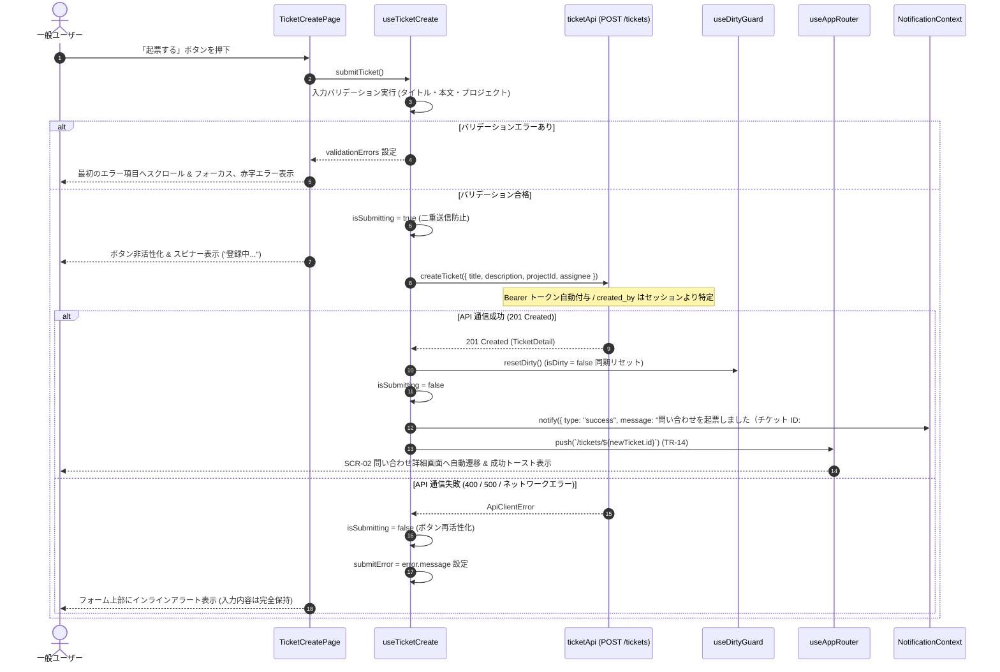

# 問い合わせ新規起票画面（SCR-03）内部設計

| 項目                | 内容                                                                                                                                                                                                                                                                                                                                                                                                                                                                                                                                                                                                                                                                                                                                                                                                                                                                                                                                                                                                                                                                                                                                                                                                                                                                                                                                                                                                                   |
| ------------------- | ---------------------------------------------------------------------------------------------------------------------------------------------------------------------------------------------------------------------------------------------------------------------------------------------------------------------------------------------------------------------------------------------------------------------------------------------------------------------------------------------------------------------------------------------------------------------------------------------------------------------------------------------------------------------------------------------------------------------------------------------------------------------------------------------------------------------------------------------------------------------------------------------------------------------------------------------------------------------------------------------------------------------------------------------------------------------------------------------------------------------------------------------------------------------------------------------------------------------------------------------------------------------------------------------------------------------------------------------------------------------------------------------------------------------- |
| 状態                | `Approved (Step 3)`                                                                                                                                                                                                                                                                                                                                                                                                                                                                                                                                                                                                                                                                                                                                                                                                                                                                                                                                                                                                                                                                                                                                                                                                                                                                                                                                                                                                    |
| 更新日              | `2026-10-18`                                                                                                                                                                                                                                                                                                                                                                                                                                                                                                                                                                                                                                                                                                                                                                                                                                                                                                                                                                                                                                                                                                                                                                                                                                                                                                                                                                                                           |
| 関連する ED/ID 項目 | `docs/rd/step3.md#21-ルーティングとコンポーネント移行方針`<br>`docs/rd/step3.md#32-ut単体テストの項目上げ作成ルール`<br>`docs/ed/01-system-overview.md#51-システム受け入れ条件一覧`<br>`docs/ed/02-screen-list.md#2-画面一覧`<br>`docs/ed/02-screen-list.md#35-scr-03-問い合わせ新規起票画面`<br>`docs/ed/03-screen-transition.md#22-一般ユーザー業務画面遷移`<br>`docs/ed/03-screen-transition.md#24-認可ガードdirty-state例外系遷移`<br>`docs/ed/03-screen-transition.md#42-ロール別認可ガードrole-guardと-403-フォールバック`<br>`docs/ed/03-screen-transition.md#43-画面離脱防止dirty-state-ガード`<br>`docs/ed/screens/ticket-create.md`<br>`docs/ed/api/openapi.yaml`<br>`docs/id/01-frontend-architecture.md#2-実装構成方針ディレクトリ構造と-client-components-境界`<br>`docs/id/01-frontend-architecture.md#31-全ルート定義一覧`<br>`docs/id/01-frontend-architecture.md#43-role-guardロール認可ガードの設計`<br>`docs/id/01-frontend-architecture.md#5-画面離脱防止dirty-state-ガードアーキテクチャ`<br>`docs/id/01-frontend-architecture.md#7-コンポーネントツリーと責務境界依存方向`<br>`docs/id/state-management.md#5-dirty-state未保存変更検知と離脱防止ガード設計`<br>`docs/id/state-management.md#64-問い合わせ新規起票画面scr-03の状態管理`<br>`docs/id/state-management.md#74-useticketcreate-仕様`<br>`docs/id/api-client.md#44-チケットコメント-api-クライアント-srcfeaturesticketsapiticketapits` |

このドキュメントでは、承認済み外部設計 SCR-03（問い合わせ新規起票画面）を Next.js 15+ (App Router) 環境において実装するための内部設計として、一般ユーザー専用の起票フォーム、App Router `page.tsx` と Feature Client Components の階層・責務分離、全 `.tsx` に対する `.stories.tsx` 必須作成および親子分離規約、管理者アクセス時の Role Guard（403 フォールバック、確定文言 TR-17）、複数プロジェクト所属時の初期未選択（プレースホルダー強制）と担当者候補連動、3 層 Dirty State ガード、起票成功（HTTP 201）時の Dirty State 即時解除と `/tickets/[id]` への自動遷移（TR-14）、完了トースト引き継ぎ、および画面受け入れ条件（AC-01 〜 AC-10）とのトレーサビリティを定義します。

---

## 1. 設計方針とスコープ

1. **ルーティングとアクセス制御（Role Guard）**:
   - Next.js App Router ファイルベースルーティング（`/tickets/new`）を採用し、ファイル配置先を `src/app/(authenticated)/tickets/new/page.tsx` とする。
   - 本画面は**一般ユーザー専用（`role === "general"`）**であり、管理者ユーザー（`role === "admin"`）の利用は職務分掌（SoD）に基づき禁止される。
   - 管理者が直接 URL やブックマークからアクセスした場合は、`(authenticated)/layout.tsx` の Role Guard により画面描画を遮断し、SCR-00 ダッシュボード（`/dashboard`）へ即時フォールバックリダイレクト（TR-17）した上で、確定通知文言「**管理者ロールでは新規起票機能は利用できません（403 Forbidden）**」を表示する。
2. **所属プロジェクト自動判定と担当者候補連動**:
   - **単一プロジェクト所属時**: `draft.projectId = currentUser.projects[0].id` として自動初期化し、UI 上は固定テキスト（変更不可）として描画する。
   - **複数プロジェクト所属時**: 誤起票を防止するため初期状態は `draft.projectId = ""`（未選択プレースホルダー「プロジェクトを選択してください」）とし、利用者に明示選択を強制する（未選択送信時はバリデーションエラー）。
   - プロジェクト選択変更時、`assigneeApi.getAssignees({ projectId: draft.projectId })` により担当者候補を動的に再取得する。直前の選択担当者が新プロジェクトに含まれない場合は `draft.assignee = null` に自動リセットする。
3. **画面離脱防止（Dirty State ガード）**:
   - 入力ドラフト（タイトル、本文、プロジェクト選択、担当者選択）のいずれかに初期状態からの変更が存在する場合に `isDirty = true` とする。
   - 3 層インターセプト（Capture 相 click、`useAppRouter`、`popstate` Revert&Replay、`beforeunload`）により、誤操作によるデータ消失を防止する。
   - キャンセルボタン（TR-15）押下時も Dirty ガードが作動し、未保存入力がある場合は確認ダイアログを表示する。
4. **起票成功（HTTP 201）時の自動遷移と完了通知（TR-14）**:
   - `POST /tickets` 成功時、画面遷移直前に `resetDirty()` を同期実行してガードを解除する。
   - 返却された `TicketDetail`（起票されたチケット詳細オブジェクト）の `id` を用いて、SCR-02 問い合わせ詳細画面（`/tickets/[id]`）へ `useAppRouter().push` で自動遷移する。
   - 起票完了の成功トースト（「問い合わせを起票しました（チケット ID: #XX）」）は `NotificationContext.notify` で発行し、Root Layout を経由して遷移先詳細画面で確実に表示する。
5. **全 `.tsx` の `.stories.tsx` 必須化および親子分離規約**:
   - `page.tsx` を含むすべての `.tsx` ファイルと同階層に同名の `.stories.tsx` および `.test.tsx` を必ず作成する。
   - 親コンポーネント（`TicketCreatePage`）は状態管理・Props 配分・レイアウト責務のみを検証し、各フィールドの境界値やバリデーション表示は子コンポーネント自身の Storybook / 単体テストで網羅する。

---

## 2. コンポーネント構成とディレクトリ構造

### 2.1 ディレクトリ構造とファイル配置

```text
src/
├── app/(authenticated)/tickets/new/
│   ├── page.tsx                     # SCR-03 App Router 薄いラッパー
│   ├── page.stories.tsx             # page.tsx 専用 Story
│   └── page.test.tsx                # page.tsx 単体テスト（composeStories 実行）
└── features/tickets/
    ├── components/
    │   ├── TicketCreatePage.tsx     # SCR-03 Feature 最上位コンポーネント ("use client")
    │   ├── TicketCreatePage.stories.tsx
    │   ├── TicketCreatePage.test.tsx
    │   ├── TicketCreateForm.tsx     # 起票フォーム全体のラッパー ("use client")
    │   ├── TicketCreateForm.stories.tsx
    │   ├── TicketCreateForm.test.tsx
    │   ├── ProjectSelectField.tsx   # 所属プロジェクト選択（単一固定 / 複数セレクト） ("use client")
    │   ├── ProjectSelectField.stories.tsx
    │   ├── ProjectSelectField.test.tsx
    │   ├── CreatorField.tsx         # 起票者固定表示 ("use client")
    │   ├── CreatorField.stories.tsx
    │   ├── CreatorField.test.tsx
    │   ├── TitleInputField.tsx      # タイトル入力欄・autofocus・文字数カウンター ("use client")
    │   ├── TitleInputField.stories.tsx
    │   ├── TitleInputField.test.tsx
    │   ├── AssigneeSelectField.tsx  # 担当者候補選択（プロジェクト連動・任意） ("use client")
    │   ├── AssigneeSelectField.stories.tsx
    │   ├── AssigneeSelectField.test.tsx
    │   ├── DescriptionTextareaField.tsx # 本文入力欄・残り文字数カウンター ("use client")
    │   ├── DescriptionTextareaField.stories.tsx
    │   ├── DescriptionTextareaField.test.tsx
    │   ├── FormActionButtons.tsx    # 起票する / キャンセル ボタン ("use client")
    │   ├── FormActionButtons.stories.tsx
    │   └── FormActionButtons.test.tsx
    └── hooks/
        ├── useTicketCreate.ts       # 起票フォームドラフト、バリデーション、送信、Dirty State
        └── useAssignees.ts          # 担当者候補取得（projectId 連動）
```

### 2.2 コンポーネント階層ツリー

```text
src/app/(authenticated)/tickets/new/page.tsx (Thin Wrapper)
└─ TicketCreatePage (Feature Root: 一般専用オーケストレーター)
   ├─ Breadcrumbs (ホーム > 問い合わせ一覧 > 新規起票)
   ├─ BackToListAction (< 問い合わせ一覧へ戻る導線: Dirty ガード連動)
   ├─ PageHeading (タイトル: 新規問い合わせ起票)
   ├─ ApiErrorAlert (API 送信失敗時のインラインエラーアラート)
   └─ TicketCreateForm (フォームラッパー)
      ├─ ProjectSelectField (単一所属: 固定テキスト / 複数所属: セレクトボックス)
      ├─ CreatorField (起票者: ログインユーザー名固定表示)
      ├─ TitleInputField (件名入力: 必須、最大 100 文字、初期 autofocus、エラー表示)
      ├─ AssigneeSelectField (担当者選択: 任意、プロジェクト連動、未設定オプション)
      ├─ DescriptionTextareaField (本文入力: 必須、最大 2000 文字、リアルタイム文字数カウンター)
      └─ FormActionButtons (ボタン群)
         ├─ SubmitTicketButton (起票する: プライマリボタン、二重送信防止スピナー)
         └─ CancelTicketButton (キャンセル: セカンダリボタン、一覧復帰、Dirty ガード連動)
```

### 2.3 コンポーネント責務マトリクス（親子分離）

| コンポーネント             | 主責務（Must Do）                                                                                                                                                 | 非責務（Must NOT Do）                                    |
| :------------------------- | :---------------------------------------------------------------------------------------------------------------------------------------------------------------- | :------------------------------------------------------- |
| `page.tsx`                 | ・Next.js ルーティングエントリポイント<br>・Feature 最上位コンポーネント `TicketCreatePage` のマウント                                                            | 業務ロジックの実行、API 通信、状態管理                   |
| `TicketCreatePage`         | ・`useAuth`、`useTicketCreate`、`useAssignees`、`useNotification` の統合オーケストレーション<br>・各子コンポーネントへの Props 配分、送信エラーアラート表示制御   | 個別入力要素の DOM レンダリング、低レベル通信            |
| `TicketCreateForm`         | ・フォーム全体のレイアウトとサブミットイベント（`onSubmit`）ハンドリング<br>・子フィールドへのドラフト値・バリデーションエラー配分                                | ルーティング遷移、ブラウザ履歴の操作                     |
| `ProjectSelectField`       | ・単一所属時: 固定テキスト描画（変更不可）<br>・複数所属時: セレクトボックス描画（未選択プレースホルダー表示）<br>・未選択バリデーションエラーのインライン表示    | プロジェクトマスタのフェッチ、担当者候補の再取得トリガー |
| `CreatorField`             | ・ログイン中ユーザー名（`currentUser.name`）の固定表示（編集不可）                                                                                                | セッション情報の検証、ユーザー情報の更新                 |
| `TitleInputField`          | ・タイトル入力（最大 100 文字）の受付<br>・マウント時の初期 `autofocus`<br>・文字数カウンター（現在文字数 / 100）およびインラインバリデーションエラーの表示       | 他フィールドの状態管理、API 送信                         |
| `AssigneeSelectField`      | ・選択中プロジェクトに紐づく担当者候補ドロップダウン表示<br>・「未設定」選択肢の提供<br>・プロジェクト未選択時の非活性表示および候補取得中スケルトン/スピナー表示 | 担当者マスタの直接取得、プロジェクト変更判定             |
| `DescriptionTextareaField` | ・本文入力（最大 2,000 文字）の受付<br>・リアルタイム残り文字数カウンター（`残り XXX 文字 / 最大 2000 文字`）表示<br>・インラインバリデーションエラーの表示       | 他フィールドの状態管理、API 送信                         |
| `FormActionButtons`        | ・「起票する」「キャンセル」ボタンの描画<br>・送信処理中のスピナー表示（「登録中...」）および全ボタン非活性化                                                     | バリデーション実行、離脱判定ロジック                     |

---

## 3. App Router ラッパー設計

```tsx
// src/app/(authenticated)/tickets/new/page.tsx
"use client";

import type { FC } from "react";
import { TicketCreatePage } from "@/features/tickets/components/TicketCreatePage";

/**
 * SCR-03 問い合わせ新規起票画面 App Router Page
 * 認可ガード（Role Guard）は (authenticated)/layout.tsx が担い、本コンポーネントは
 * 薄いラッパーとして TicketCreatePage をマウントする
 */
const Page: FC = () => {
  return <TicketCreatePage />;
};

export default Page;
```

---

## 4. コンポーネント Props およびインターフェース定義

```typescript
// -------------------------------------------------------------
// TicketCreateDraft 型
// -------------------------------------------------------------
export interface TicketCreateDraft {
  projectId: string; // 起票先プロジェクト ID (必須)
  title: string; // 問い合わせ件名 (必須, 1〜100文字)
  assignee: string | null; // 担当者名 (任意, null または プロジェクト所属メンバー名)
  description: string; // 問い合わせ本文 (必須, 1〜2000文字)
}

export interface TicketCreateValidationErrors {
  projectId?: string;
  title?: string;
  assignee?: string;
  description?: string;
}

// -------------------------------------------------------------
// TicketCreateForm Props
// -------------------------------------------------------------
export interface TicketCreateFormProps {
  draft: TicketCreateDraft;
  errors: TicketCreateValidationErrors;
  isSubmitting: boolean;
  userProjects: ProjectSummary[];
  creatorName: string;
  assignees: Assignee[];
  isAssigneesLoading: boolean;
  assigneesError: string | null;
  onChangeField: <K extends keyof TicketCreateDraft>(
    field: K,
    value: TicketCreateDraft[K],
  ) => void;
  onSubmit: (e: React.FormEvent) => void;
  onCancel: () => void;
  onRetryAssignees?: () => void;
}

// -------------------------------------------------------------
// ProjectSelectField Props
// -------------------------------------------------------------
export interface ProjectSelectFieldProps {
  value: string;
  userProjects: ProjectSummary[];
  error?: string;
  disabled?: boolean;
  onChange: (projectId: string) => void;
}

// -------------------------------------------------------------
// CreatorField Props
// -------------------------------------------------------------
export interface CreatorFieldProps {
  creatorName: string;
}

// -------------------------------------------------------------
// TitleInputField Props
// -------------------------------------------------------------
export interface TitleInputFieldProps {
  value: string;
  error?: string;
  disabled?: boolean;
  onChange: (value: string) => void;
}

// -------------------------------------------------------------
// AssigneeSelectField Props
// -------------------------------------------------------------
export interface AssigneeSelectFieldProps {
  value: string | null;
  assignees: Assignee[];
  isLoading: boolean;
  error?: string | null;
  disabled?: boolean;
  onChange: (assignee: string | null) => void;
  onRetry?: () => void;
}

// -------------------------------------------------------------
// DescriptionTextareaField Props
// -------------------------------------------------------------
export interface DescriptionTextareaFieldProps {
  value: string;
  error?: string;
  disabled?: boolean;
  onChange: (value: string) => void;
}

// -------------------------------------------------------------
// FormActionButtons Props
// -------------------------------------------------------------
export interface FormActionButtonsProps {
  isSubmitting: boolean;
  onCancel: () => void;
}
```

---

## 5. 管理者アクセス認可ガード（Role Guard / TR-17）

### 5.1 職務分掌とガードポリシー

- 一般ユーザー（`role === "general"`）: 新規起票画面へのアクセスを許可。
- 管理者ユーザー（`role === "admin"`）: 職務分掌（SoD）に基づき起票機能の利用禁止（403 Forbidden）。

### 5.2 フォールバックリダイレクト仕様

1. **アクセス遮断とリダイレクト**:
   - `src/app/(authenticated)/layout.tsx` の Role Guard により、`currentUser.role === "admin"` のユーザーが `/tickets/new` にアクセスした場合は画面描画を行わず直ちにブロックする。
   - 安全なポータルである SCR-00 ダッシュボードへ即座にフォールバックリダイレクト（`router.replace("/dashboard")`）する（TR-17）。
2. **確定通知文言の表示（Issue #220 準拠）**:
   - リダイレクト処理と同時に、`NotificationContext.notify` を通じて以下の警告トーストを発行する:
     - `type: "error"`
     - `message: "管理者ロールでは新規起票機能は利用できません（403 Forbidden）"`
   - 遷移後のダッシュボード画面上部に赤色警告バナー/トーストとして表示する。

---

## 6. 所属プロジェクト自動判定と担当者候補連動設計

### 6.1 所属プロジェクトの初期判定ルール

```typescript
const initialProjectId = useMemo(() => {
  if (!currentUser || currentUser.projects.length === 0) return "";
  // 所属プロジェクトが1件のみの場合は自動固定
  if (currentUser.projects.length === 1) return currentUser.projects[0].id;
  // 複数所属時は初期未選択（プレースホルダー強制）
  return "";
}, [currentUser]);
```

1. **単一プロジェクト所属時**:
   - `draft.projectId = currentUser.projects[0].id` として初期化。
   - `ProjectSelectField` はテキストラベル（例: `プロジェクトA (固定)`）として描画され、ユーザーによる変更操作は不可（AC-01）。
   - マウント直後に当該プロジェクトを対象とした担当者候補取得（`GET /assignees?projectId={id}`）を即時開始する。
2. **複数プロジェクト所属時**:
   - 誤起票を防止するため、初期状態は `draft.projectId = ""`（未選択状態）とする。
   - ドロップダウン内にプレースホルダー「`プロジェクトを選択してください`」を表示し、利用者に明示選択を強制する（AC-02）。
   - プロジェクトが未選択の間は、担当者セレクターは `disabled`（非活性）とし、「プロジェクトを選択してください」とガイダンスを表示する。

### 6.2 プロジェクト変更と担当者候補の連動リセット

1. **担当者候補の動的再取得**:
   - プロジェクトが選択・変更された際、`useAssignees({ projectId: draft.projectId })` により新プロジェクトの所属メンバー一覧を再取得する。
2. **旧担当者の連動リセット**:
   - 直前に選択されていた担当者名（`draft.assignee`）が新プロジェクトの候補一覧に含まれていない場合、または新プロジェクト取得中の場合、不整合な担当者割り当てを防止するため、直ちに `draft.assignee = null`（未設定）にリセットする。

---

## 7. 画面離脱防止（Dirty State ガード）設計

### 7.1 Dirty 状態の判定式（Derived State）

`docs/id/state-management.md` §5.1 に準拠し、初期状態からの変更有無を以下の計算式で厳格に導出します。

```typescript
const isDirty = useMemo(() => {
  const isTitleDirty = draft.title.trim().length > 0;
  const isDescriptionDirty = draft.description.trim().length > 0;
  const isProjectDirty = draft.projectId !== initialProjectId;
  const isAssigneeDirty = draft.assignee !== null;

  return (
    isTitleDirty || isDescriptionDirty || isProjectDirty || isAssigneeDirty
  );
}, [draft, initialProjectId]);
```

### 7.2 離脱防止制御と確認ダイアログ仕様

- **確認ダイアログ仕様**:
  - タイトル: `⚠️ 未保存の変更があります`
  - メッセージ: `編集中の内容が破棄されます。この画面を離れてもよろしいですか？`（`docs/id/state-management.md` §5.5 に準拠）
  - アクションボタン: `留まる（キャンセル）` / `破棄して移動（OK）`
- **監視対象の離脱経路**:
  - サイドバーの他画面リンク（📊 ダッシュボード、📋 問い合わせ一覧）のクリック（TR-08）
  - パンくずリストリンクおよび「< 問い合わせ一覧へ戻る」ボタンのクリック
  - ヘッダーのログアウトボタンのクリック（TR-05）
  - フォームの「キャンセル」ボタンのクリック（TR-15）
  - ブラウザの「戻る」「進む」ボタン操作（TR-18）
  - ブラウザのタブ閉じ・リロード・外部サイト移動（`beforeunload`）
- **利用者の選択と振る舞い**:
  - 「留まる」選択時: 遷移を中止しダイアログを閉じ、直前の入力フォームへフォーカスを復帰する（入力内容は完全維持）。
  - 「破棄して移動」選択時: 未保存入力を破棄して `isDirty` を解除し、要求されていた遷移先へ移動する。

---

## 8. 起票 API 連携・二重送信防止・詳細自動遷移フロー（TR-14）



1. **二重送信防止（Submitting Guard）**:
   - 「起票する」押下後、API 通信中は `isSubmitting = true` とし、「起票する」ボタンを `disabled` にしてスピナーと「登録中...」テキストを表示する。
   - キャンセルボタンおよび各入力フィールドも非活性化し、連打や重複送信を防止する（AC-05）。
2. **正常登録完了時の自動遷移（TR-14）**:
   - `POST /tickets` が HTTP 201 を返却した直後、画面遷移を開始する前に `resetDirty()` を明示的に実行し、`isDirty = false` にリセットする。
   - これにより、直後の `router.push('/tickets/' + newTicket.id)` において離脱確認ダイアログが誤作動することなく、スムーズに詳細画面へ遷移する（AC-06）。
3. **完了トーストの引き継ぎ**:
   - `NotificationContext.notify({ type: "success", message: '問い合わせを起票しました（チケット ID: #' + newTicket.id + '）' })` を実行する。
   - 通知状態は Root Layout の `NotificationProvider` で保持されるため、画面遷移後の SCR-02 でも確実に表示される。
4. **エラー発生時の入力保護**:
   - サーバー内部エラーやネットワーク障害が発生した場合、入力中ドラフト（`title`, `description`, `projectId`, `assignee`）は破棄せず完全に保持する。
   - フォーム上部に「問い合わせの起票に失敗しました。時間をおいて再度お試しください。」というインラインアラートを表示し、再試行を可能とする（AC-10）。

---

## 9. 画面受け入れ条件（AC-01 〜 AC-10）トレーサビリティマトリクス

| ED 受入条件 ID | 条件名称・概要                             | 本設計で担保する実装仕様                                                                                                                   | 参照セクション | 対応 API / 契約                     | システム受入条件                          |
| :------------- | :----------------------------------------- | :----------------------------------------------------------------------------------------------------------------------------------------- | :------------- | :---------------------------------- | :---------------------------------------- |
| **AC-01**      | 初期表示およびセッション・所属自動バインド | タイトル入力欄へのマウント時 `autofocus` 設定。起票者欄に `currentUser.name` 固定表示。単一所属時の `projectId` 自動設定・固定表示。       | 2.3, 6.1       | `GET /auth/me`<br>`GET /projects`   | `SYS-AC-12`                               |
| **AC-02**      | 複数プロジェクト所属時の選択機能           | 複数所属時のセレクトボックス描画および未選択プレースホルダー初期化。プロジェクト変更時の `draft.assignee` リセットと担当者候補再取得。     | 2.3, 6.1, 6.2  | `GET /projects`<br>`GET /assignees` | `SYS-AC-12`                               |
| **AC-03**      | 担当者任意選択機能                         | 「未設定（null）」およびプロジェクト所属メンバーの選択肢提示。未選択のままでも起票可能。                                                   | 2.3, 4, 6.2    | `GET /assignees?projectId={id}`     | `SYS-AC-12`                               |
| **AC-04**      | 入力バリデーション                         | 送信時にタイトル（必須・100字）、本文（必須・2000字）、プロジェクト（必須）を検証。最初のエラー項目へフォーカス移動。入力開始時に解除。    | 2.3, 8         | クライアント側入力検証              | `SYS-AC-05`<br>`SYS-AC-12`                |
| **AC-05**      | 起票登録実行および二重送信防止             | `POST /tickets` 送信。送信中のボタン非活性＋スピナー表示による多重クリック抑止。起票者はセッションより特定（ボディに含めず）。             | 2.3, 8         | `POST /tickets`                     | `SYS-AC-05`<br>`SYS-AC-07`<br>`SYS-AC-12` |
| **AC-06**      | 起票完了後の自動遷移および完了通知         | 登録成功（201 Created）時の `resetDirty()` 実行。SCR-02（`/tickets/[id]`）への自動遷移（TR-14）および成功トースト表示。                    | 8              | 画面遷移 `TR-14`                    | `SYS-AC-12`<br>`SYS-AC-15`                |
| **AC-07**      | キャンセル操作による一覧復帰               | キャンセルボタン押下時の SCR-01 一覧画面遷移（TR-15）。未保存入力がある場合は離脱確認ダイアログを表示し、承認時のみ遷移。                  | 2.3, 7.2       | 画面遷移 `TR-15`                    | `SYS-AC-12`<br>`SYS-AC-14`                |
| **AC-08**      | 画面離脱防止（Dirty State ガード）         | タイトル/本文/プロジェクト/担当者の変更検知による `isDirty` 算出。3 層インターセプトによる離脱確認ダイアログおよび `beforeunload` ガード。 | 7.1, 7.2       | 内部状態判定 / `beforeunload`       | `SYS-AC-14`<br>`SYS-AC-15`                |
| **AC-09**      | 管理者ロールアクセスガード（403）          | 管理者（`admin`）アクセス時に画面描画を遮断し、SCR-00 ダッシュボードへフォールバックリダイレクト（TR-17）。確定 403 警告通知を表示。       | 1, 5           | ロール認可制御 (`currentUser.role`) | `SYS-AC-09`<br>`SYS-AC-12`                |
| **AC-10**      | API エラーハンドリング                     | 500 / ネットワークエラー時のインラインアラート表示。入力中ドラフトの完全保持と再試行導線提供。                                             | 2.3, 8         | HTTP 500 系応答                     | `SYS-AC-05`<br>`SYS-AC-12`                |

---

## 10. 保留事項および将来検討課題

1. **問い合わせ本文の最大文字数仕様（解決済み）**:
   - 外部設計および OpenAPI 契約（`maxLength: 2000`）に基づき、本文上限を最大 2,000 文字として確定（Step 1 のコメント上限 1,000 文字の 2 倍を許容）。
2. **複数プロジェクト所属時の初期選択方針（解決済み）**:
   - 誤起票を防止するため、複数所属時はプレースホルダー（未選択）を初期状態とし、利用者に明示選択を強制する仕様として確定。単一所属時のみ自動固定とする。
3. **担当者識別の ID ベース統一（将来検討課題）**:
   - 現行は名前文字列（`assignee`）で連携しているが、将来的なユーザー ID ベース（`Assignee.id`）への統一を考慮し、API クライアントおよび状態モデルの変換境界を最小限に抑える設計を維持する。

---

## 11. C・UT への申し送り事項

1. **全 `.tsx` に対する `.stories.tsx` 必須作成とテスト実行**:
   - `src/app/(authenticated)/tickets/new/page.tsx`、`TicketCreatePage.tsx`、`TicketCreateForm.tsx`、`ProjectSelectField.tsx`、`CreatorField.tsx`、`TitleInputField.tsx`、`AssigneeSelectField.tsx`、`DescriptionTextareaField.tsx`、`FormActionButtons.tsx` のすべてに `.stories.tsx` および `.test.tsx` を同階層に作成します。
   - テスト記述（`it`）および Story 表示名・説明は日本語で記述します。
2. **親子コンポーネント分離原則**:
   - `TicketCreatePage.test.tsx` ではフック統合、Role Guard によるリダイレクトトリガー、送信成功時の画面遷移トリガーのみを検証します。
   - 各入力項目の文字数カウンター挙動、文字数境界値バリデーション（タイトル100文字、本文2000文字）、単一所属/複数所属の表示分岐、ボタンのスピナー描画等は、各子コンポーネント単体のテストで独立して網羅検証します。
3. **C0（命令/行）・C1（分岐）カバレッジ 100% 達成**:
   - 単一/複数所属判定、プロジェクト変更時の担当者候補リセット、バリデーションエラー時の先頭フォーカス移動、二重送信防止、API エラー時の入力保持、キャンセル時の Dirty ガード発火/キャンセルの全条件分岐パスを漏れなく検証します。
4. **管理者ロールアクセス拒否（Role Guard）の検証**:
   - 管理者（`role === "admin"`）でのアクセス時に画面描画が遮断され、ダッシュボードへのフォールバックリダイレクトおよび確定文言「管理者ロールでは新規起票機能は利用できません（403 Forbidden）」が表示されることを検証します。
