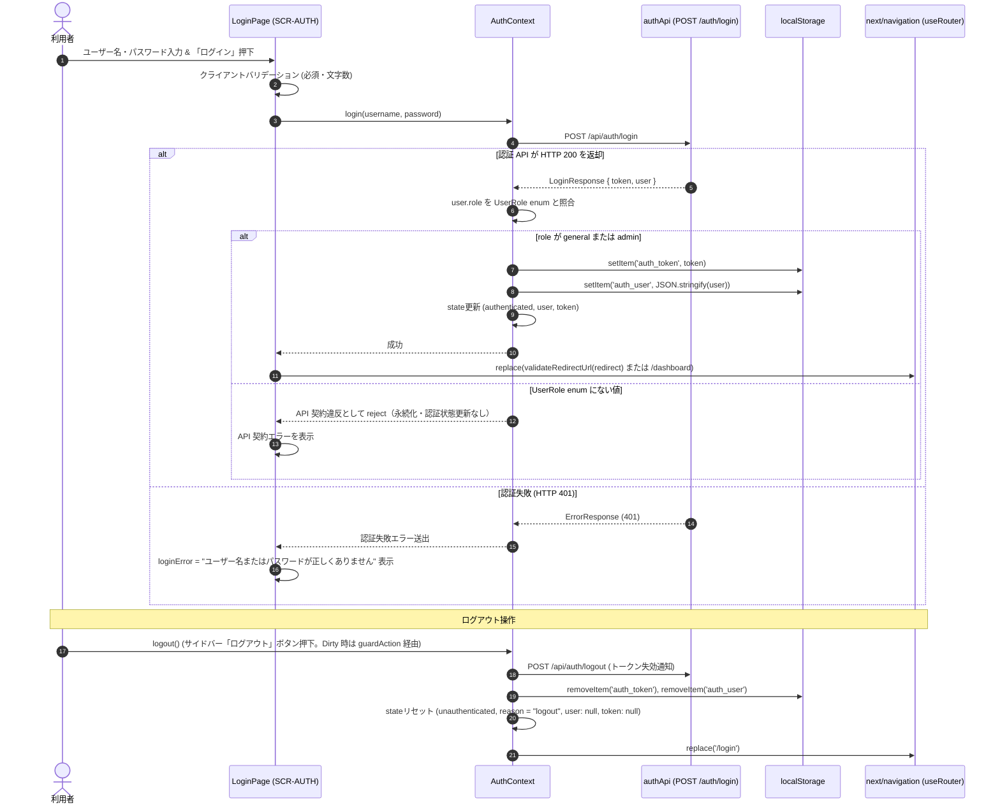
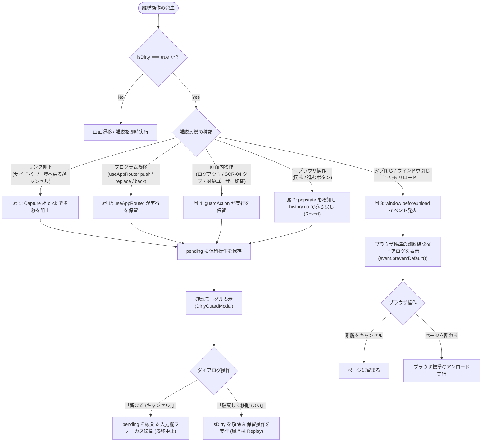
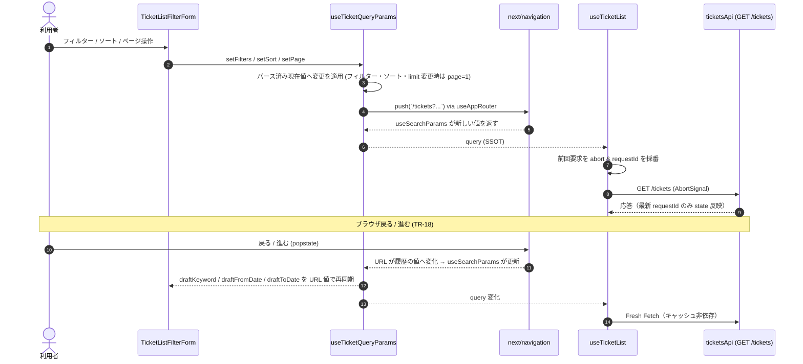
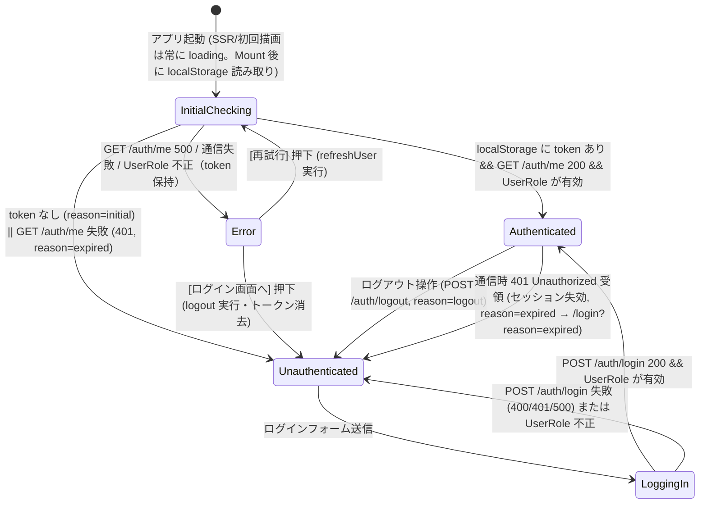
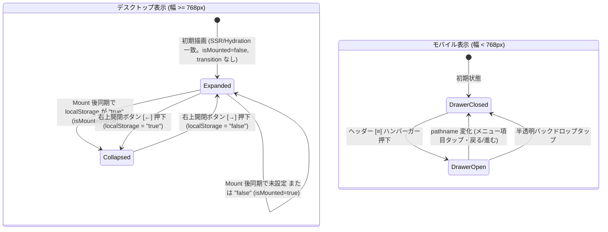
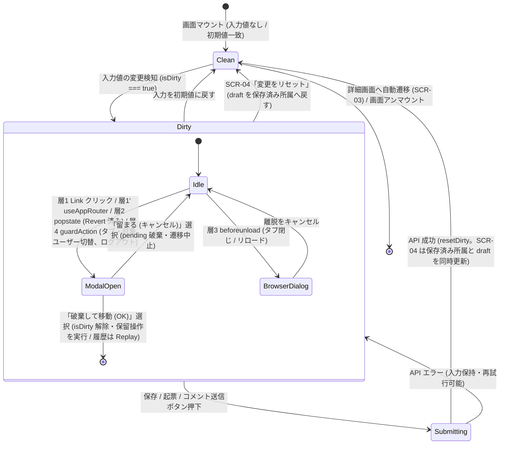

# 状態管理内部設計

| 項目                | 内容                                                                                                                                                                                                                                                                                                                                                                                                                                                                                                                                                                                                                                                                                                                                                                                                                                                                                                                                                                                                                                                        |
| ------------------- | ----------------------------------------------------------------------------------------------------------------------------------------------------------------------------------------------------------------------------------------------------------------------------------------------------------------------------------------------------------------------------------------------------------------------------------------------------------------------------------------------------------------------------------------------------------------------------------------------------------------------------------------------------------------------------------------------------------------------------------------------------------------------------------------------------------------------------------------------------------------------------------------------------------------------------------------------------------------------------------------------------------------------------------------------------------- |
| 状態                | `Approved (Step 3)`                                                                                                                                                                                                                                                                                                                                                                                                                                                                                                                                                                                                                                                                                                                                                                                                                                                                                                                                                                                                                                         |
| 更新日              | `2026-10-18`                                                                                                                                                                                                                                                                                                                                                                                                                                                                                                                                                                                                                                                                                                                                                                                                                                                                                                                                                                                                                                                |
| 関連する ED/ID 項目 | `docs/rd/step2.md#41-含む機能in-scope`<br>`docs/rd/step2.md#5-ロール責務と画面アクセス制御マトリクス`<br>`docs/rd/step3.md#2-nextjs-移行およびコンテナ提供方針`<br>`docs/rd/step3.md#3-ut--it--pt-の切り分けとテスト規約の詳細`<br>`docs/ed/01-system-overview.md#5-システム全体の受け入れ条件`<br>`docs/ed/02-screen-list.md#2-画面一覧`<br>`docs/ed/02-screen-list.md#7-確認事項未確定事項`<br>`docs/ed/03-screen-transition.md#2-画面遷移一覧遷移表`<br>`docs/ed/03-screen-transition.md#4-遷移制約および例外業務上の振る舞い`<br>`docs/ed/03-screen-transition.md#5-確認事項未確定事項`<br>`docs/ed/screens/login.md`<br>`docs/id/screens/login.md`<br>`docs/ed/screens/dashboard.md`<br>`docs/ed/screens/ticket-list.md`<br>`docs/ed/screens/ticket-detail.md`<br>`docs/ed/screens/ticket-create.md`<br>`docs/ed/screens/admin-management.md`<br>`docs/ed/api/openapi.yaml`<br>`docs/id/01-frontend-architecture.md`<br>`docs/id/tech-verification.md`<br>`docs/id/api-client.md`<br>`docs/id/screens/admin-management.md`<br>`docs/id/test-design.md` |

このドキュメントでは、問い合わせ・チケット管理システムにおいて、Step 2 で導入された「プロジェクト制」および「ロールベースアクセス制御（RBAC）」を含む承認済み外部設計（ED）と、Next.js (App Router) を前提に確定した上位内部設計（[フロントエンド構成設計](01-frontend-architecture.md)、[技術検証](tech-verification.md)）を実現するためのフロントエンド状態管理方針、状態の分類と所有権（State Colocation）、Provider 配置とライフサイクル、認証セッション管理と Hydration 整合、開閉式サイドバー永続化、`next/navigation` による URL クエリ同期、画面離脱防止（Dirty State ガード）、各画面の入力ドラフト管理、API 通信との同期・非同期制御、およびカスタムフックの内部インターフェース仕様を定義します。

---

## 1. 概要と基本方針

### 1.1 目的

本ドキュメントの目的は以下のとおりです。

1. **状態の分類と所有者の明確化 (State Colocation)**:
   - サーバーデータ、画面表示状態、入力ドラフト状態、URL/ナビゲーション状態、およびアプリケーション横断状態（認証セッション、サイドバー、通知、Dirty State ガード）を明確に分類し、どのレイヤー（Context、カスタムフック、ページ、コンポーネント）が状態を所有するかを確定する。
2. **Next.js App Router における Provider 配置とライフサイクルの確立**:
   - Root Layout と認証保護 Layout（`(authenticated)/layout.tsx`）への Context 配置を、フロントエンド構成設計 §7.1 のコンポーネントツリーと矛盾なく定義する。
3. **認証セッションおよびアクセス制御状態の確立**:
   - ログインユーザー情報（`CurrentUser`）、ロール（`UserRole: general | admin`）、認証トークン、セッション永続化（`localStorage`）と Hydration 整合、未認証ガード（Auth Guard）およびロール認可ガード（Role Guard / 403 フォールバック）の状態管理基盤を定義する。
4. **開閉式サイドバーナビゲーションの状態管理と永続化**:
   - デスクトップでの展開（幅約240px）/ 折りたたみ（幅約60px）のトグル状態および `localStorage`（キー: `sidebar_collapsed`）への永続化・Hydration 安全な復元フロー、ならびにモバイル幅（375px）におけるオーバーレイドロワー開閉状態を定義する。
5. **URL クエリ同期と履歴復元**:
   - `next/navigation` を用いた一覧（SCR-01）の URL クエリ双方向同期、ダッシュボードからのドリルダウン、詳細からの一覧復帰、ブラウザ戻る/進むでの状態復元を定義する。
6. **画面離脱防止（Dirty State ガード）の統一制御**:
   - SCR-02（コメント入力）、SCR-03（新規起票フォーム）、SCR-04（所属紐づけタブ）の未保存変更を検知し、Link クリック、`useAppRouter` 経由の遷移、ブラウザ履歴移動、画面内操作（タブ切替等）、およびタブ閉じ/リロード（`beforeunload`）において未保存破棄確認ダイアログを確実に発動させる制御機構を定義する。
7. **API 通信との同期および非同期競合制御 (Race Condition 対策)**:
   - Client Component からのデータ取得、更新、エラー時の状態遷移、および `AbortController` と要求連番（Request ID）による通信順序逆転防止の仕様を確立する。
8. **画面間の状態連携と復元仕様の整理**:
   - ダッシュボード（SCR-00）からのドリルダウン遷移、一覧（SCR-01）の復元、詳細（SCR-02）の更新反映、新規起票（SCR-03）後の自動遷移、および管理画面（SCR-04）のタブ・マスタ管理の整合性を定義する。

### 1.2 基本設計原則

- **OpenAPI 契約および ED の SSOT 厳守**:
  - API から取得・送信するデータ構造は `docs/ed/api/openapi.yaml` の定義に厳密に準拠し、未合意のプロパティや状態を勝手に作成しません。
  - セキュリティ要件（Bearer 認証トークン、一般ユーザーのプロジェクト所属制約 `minItems: 1`、管理者の閲覧専用 SoD 原則など）を忠実に反映します。
- **状態の最小化と正規化 (Minimal State)**:
  - 既存の状態から純粋関数で算出可能な値（例: 総ページ数、変更有無判定 `isDirty`、フォームバリデーション通過判定、未完了チケット件数など）は独立した state として保持せず、レンダー時の計算値（Derived State）として扱います。
- **適切な状態配置 (State Colocation & Context 最小化)**:
  - アプリケーション全体で共有が真に必要な関心事（認証セッション、サイドバー開閉永続化、通知、Dirty State 離脱防止ガード）のみを React Context（`AuthContext`, `SidebarContext`, `NotificationContext`, `DirtyGuardContext`）として提供します。
  - 画面固有の状態（一覧のフィルター、詳細の更新ドラフト、管理画面のモーダル表示など）は各機能（`features/*`）のカスタムフックやページ・コンポーネント内に閉じ込め、不要なグローバル再レンダリングを防止します。
- **Client Component 前提の状態管理**:
  - 状態を持つ Context・フック・ページコンテンツは Client Component（`"use client"`）とし、Server Component は `page.tsx` / `layout.tsx` の薄いラッパーに限定します（[フロントエンド構成設計](01-frontend-architecture.md) §2.2, §9）。
  - サーバー状態は Client Component 内のフックが API クライアント経由で取得し、Next.js の Router Cache / RSC キャッシュ / `fetch` 拡張に依存しません（§6.8）。
- **非同期通信の整合性担保 (Race Condition 対策)**:
  - 一覧検索、ダッシュボード集計、担当者候補取得などの非同期処理において、連続した操作やパラメータ変更による遅延レスポンスの到着を防ぐため、`AbortController` による通信キャンセルと要求連番（Request ID）による破棄機構を標準適用します（§6.8）。
- **未解決事項の仮定排除**:
  - ED および上位 ID で未確定・確認中となっている事項は独断で確定させず、選択肢・推奨案を提示した上で未解決事項として記録します（§10）。

---

## 2. 状態の分類と所有者定義（Taxonomy & Ownership）

### 2.1 5 つの状態分類

Step 2 において扱う状態は、そのライフサイクルと適用スコープに基づき以下の 5 つに分類します。

```text
+--------------------------------------------------------------------------+
| 1. アプリケーション共通状態 (App Global / Context State)                  |
|    - アプリケーション全体で共有され、ライフサイクルがセッション全体に及ぶ基盤状態 |
|    - 例: authState (user, role, token), sidebarCollapsed, mobileDrawerOpen, |
|          notification, dirtyGuardState (isDirty, pending, isDialogOpen)    |
+--------------------------------------------------------------------------+
| 2. サーバー状態 (Server State)                                            |
|    - サーバー（MSW Mock）が正本であり、クライアントはキャッシュ/スナップショットを |
|      一時保持するデータ                                                   |
|    - 例: TicketListItem[], TicketDetail, Assignee[], Project[], User[],   |
|          DashboardSummaryResponse, total, totalPages                      |
+--------------------------------------------------------------------------+
| 3. 画面・表示状態 (UI / View State)                                       |
|    - 画面全体の表示モード、通信中フラグ、モーダル開閉、ユーザー通知メッセージなど |
|    - 例: viewState (initialLoading / ready / empty / error / notFound),   |
|          isFetching, isUpdating, isSubmitting, feedback, activeTab        |
+--------------------------------------------------------------------------+
| 4. 入力・ドラフト状態 (Form / Draft State)                                |
|    - ユーザーの操作によって一時的に変更される未確定の入力データや検証結果   |
|    - 例: loginDraft, draftKeyword, updateDraft, commentDraft, ticketCreateDraft, |
|          projectCreateDraft, userCreateDraft, affiliationDraft, validationErrors |
+--------------------------------------------------------------------------+
| 5. URL / ナビゲーション状態 (URL / Navigation State)                      |
|    - URL パスやクエリパラメータに保持される、画面遷移・再読み込みで復元可能な状態 |
|    - 例: パス (/login, /dashboard, /tickets, /tickets/[id], /tickets/new, |
|          /admin/management),                                              |
|          クエリ (?redirect=, ?reason=, ?status=, ?projectId=, ?assignee=,  |
|          ?stale=, ?q=, ?from=, ?to=, ?sort=, ?order=, ?page=, ?limit=)     |
+--------------------------------------------------------------------------+
```

URL / ナビゲーション状態は `next/navigation`（`useRouter` / `usePathname` / `useSearchParams` / `useParams`）を唯一の入口として読み書きします（§6.6）。`window.location` や `window.history` を状態の読み書きに直接使いません（Dirty ガード層 2 の `popstate` 巻き戻しのみ例外。§5.2）。

### 2.2 全状態一覧と所有者マトリクス (State Ownership Matrix)

各画面および機能が保持する状態、その型、初期値、および所有者（Context / フック / コンポーネント）を下表に定義します。

#### アプリケーション共通・グローバル基盤

| 状態カテゴリ | 状態名                            | 型 / 値の範囲                                                  | 初期値                                        | 所有者 (`Colocation`)       | 責務・配置理由                                                                                                                                   |
| :----------- | :-------------------------------- | :------------------------------------------------------------- | :-------------------------------------------- | :-------------------------- | :----------------------------------------------------------------------------------------------------------------------------------------------- |
| アプリ共通   | `authState.status`                | `"loading" \| "authenticated" \| "unauthenticated" \| "error"` | `"loading"`（SSR/CSR 共通）                   | `AuthContext`               | アプリ初期起動時のトークン検証中、認証済み、未認証、復元エラーの状態を表現。`localStorage` は Mount 後に読むため、初期描画は常に `"loading"`     |
| アプリ共通   | `authState.error`                 | `ApiClientError \| Error \| null`                              | `null`                                        | `AuthContext`               | セッション初期化・復元失敗時のエラー情報（再試行・ログイン画面誘導で使用）                                                                       |
| アプリ共通   | `authState.unauthenticatedReason` | `"initial" \| "logout" \| "expired"`                           | `"initial"`                                   | `AuthContext`（メモリのみ） | 未認証に至った経緯。`/login` 遷移先 URL の決定（`?redirect=` / `?reason=expired`）に使う。永続化しない                                           |
| アプリ共通   | `currentUser`                     | `CurrentUser \| null`                                          | `null`                                        | `AuthContext`               | ログイン中ユーザーのプロファイル情報（ID、氏名、ロール、所属プロジェクト）                                                                       |
| アプリ共通   | `authToken`                       | `string \| null`                                               | `null`（Mount 後に `localStorage` から復元）  | `AuthContext`               | API 通信の `Authorization: Bearer <token>` ヘッダーに設定するセッショントークン                                                                  |
| アプリ共通   | `sidebarCollapsed`                | `boolean`                                                      | `false`（Mount 後に `localStorage` から同期） | `SidebarContext`            | デスクトップサイドバーの開閉状態（展開 240px ↔ 折りたたみ 60px）。`localStorage` に永続化                                                        |
| アプリ共通   | `isMounted`                       | `boolean`                                                      | `false`                                       | `SidebarContext`            | Mount 後の `localStorage` 同期完了フラグ。`false` の間は開閉アニメーションを無効化し、Hydration 後のちらつきを防ぐ                               |
| アプリ共通   | `mobileDrawerOpen`                | `boolean`                                                      | `false`                                       | `SidebarContext`            | モバイル幅（375px）におけるオーバーレイドロワーの開閉状態。`pathname` 変化で自動クローズ                                                         |
| アプリ共通   | `notification`                    | `{ type: "success" \| "error"; message: string } \| null`      | `null`                                        | `NotificationContext`       | 403 権限エラーフォールバック通知や完了トースト（TR-14 の起票完了等）。Root Layout に置き、レイアウトをまたぐ遷移後も残す。単一スロット（後勝ち） |
| アプリ共通   | `dirtyGuard.isDirty`              | `boolean`（`isDirtyRef` を同期更新）                           | `false`                                       | `DirtyGuardContext`         | 登録された画面の未保存状態。`resetDirty()` 直後の遷移でガードが誤発動しないよう ref を同期更新する                                               |
| アプリ共通   | `dirtyGuard.pending`              | `PendingTransition \| null`                                    | `null`                                        | `DirtyGuardContext`         | 確認モーダルの結果待ちの保留操作（`push` / `replace` / `history` / `callback`）                                                                  |
| アプリ共通   | `isDirtyModalOpen`                | `boolean`（`pending !== null` から導出）                       | `false`                                       | `DirtyGuardContext`         | 未保存変更破棄確認モーダル（`DirtyGuardModal`）の表示フラグ                                                                                      |

#### ログイン画面（SCR-AUTH）

| 状態カテゴリ | 状態名             | 型 / 値の範囲                              | 初期値         | 所有者 (`Colocation`)            | 責務・配置理由                                                                 |
| :----------- | :----------------- | :----------------------------------------- | :------------- | :------------------------------- | :----------------------------------------------------------------------------- |
| URL 状態     | `redirect`         | `string`（`validateRedirectUrl` 検証後）   | `"/dashboard"` | `LoginPage`（`useSearchParams`） | `?redirect=` の遷移先。検証失敗時は `/dashboard`                               |
| URL 状態     | `reason`           | `"expired" \| null`                        | `null`         | `LoginPage`（`useSearchParams`） | `?reason=expired`（401 失効）時にセッション切れ情報バナーを表示                |
| 入力ドラフト | `loginDraft`       | `{ username: string; password: string }`   | 空文字         | `useLogin` (フック)              | ユーザー名・パスワード入力値の一時保持                                         |
| 入力検証     | `validationErrors` | `{ username?: string; password?: string }` | `{}`           | `useLogin` (フック)              | 必須未入力や文字数超過時のクライアント側エラーメッセージ                       |
| 通信制御     | `isSubmitting`     | `boolean`                                  | `false`        | `useLogin` (フック)              | `POST /auth/login` 通信中フラグ（ボタン非活性化、二重送信抑止、スピナー表示）  |
| 画面表示状態 | `loginError`       | `string \| null`                           | `null`         | `useLogin` (フック)              | 認証失敗（401: ユーザー名またはパスワード不一致）または 500 系エラーメッセージ |

#### ダッシュボード画面（SCR-00）

| 状態カテゴリ | 状態名                  | 型 / 値の範囲                      | 初期値      | 所有者 (`Colocation`)                | 責務・配置理由                                                                            |
| :----------- | :---------------------- | :--------------------------------- | :---------- | :----------------------------------- | :---------------------------------------------------------------------------------------- |
| サーバー状態 | `summary`               | `DashboardSummaryResponse \| null` | `null`      | `useDashboardSummary` (フック)       | `dashboardApi.getDashboardSummary` で取得されたロール別サマリーデータ                     |
| サーバー状態 | `myTickets`             | `TicketListItem[]`                 | `[]`        | `useDashboardSummary` (フック)       | 一般ユーザー向け一覧。`summary.data.myAssignedTickets` から導出し、管理者では空配列とする |
| 画面表示状態 | `viewState`             | `"loading" \| "ready" \| "error"`  | `"loading"` | `useDashboardSummary` (フック)       | ダッシュボード全体の読み込み・表示状態                                                    |
| 画面表示状態 | `error`                 | `string \| null`                   | `null`      | `useDashboardSummary` (フック)       | サマリー取得失敗時のエラーメッセージおよび再試行導線                                      |
| 画面表示状態 | `lastFetchedAt`         | `string \| null`                   | `null`      | `useDashboardSummary` (フック)       | 最後にサマリー取得が成功した日時。再取得失敗時は直前の成功時刻を維持する                  |
| 通信制御     | `isRefreshing`          | `boolean`                          | `false`     | `useDashboardSummary` (フック)       | 再読み込みボタン押下時の更新中インジケーター表示                                          |
| 通信制御     | `dashboardRequestIdRef` | `number`                           | `0`         | `useDashboardSummary` (フック内 ref) | 非同期競合防止用リクエスト連番（`AbortController` と併用。§6.8）                          |

#### 問い合わせ一覧画面（SCR-01）

| 状態カテゴリ     | 状態名                                  | 型 / 値の範囲                                                                | 初期値             | 所有者 (`Colocation`)          | 責務・配置理由                                                                                           |
| :--------------- | :-------------------------------------- | :--------------------------------------------------------------------------- | :----------------- | :----------------------------- | :------------------------------------------------------------------------------------------------------- |
| 入力ドラフト     | `draftKeyword`                          | `string` (最大 100 文字)                                                     | `""`               | `TicketListFilterForm`         | キーワード入力欄の一時保持（確定操作まで URL 反映・API 呼び出しを行わない）                              |
| 入力ドラフト     | `draftFromDate`                         | `string \| null` (`YYYY-MM-DD`)                                              | `null`             | `TicketListFilterForm`         | 起票日 From 入力欄の一時保持                                                                             |
| 入力ドラフト     | `draftToDate`                           | `string \| null` (`YYYY-MM-DD`)                                              | `null`             | `TicketListFilterForm`         | 起票日 To 入力欄の一時保持                                                                               |
| 入力検証         | `inputError`                            | `string \| null`                                                             | `null`             | `TicketListFilterForm`         | 日付範囲逆転（`From > To`）または文字数違反時のバリデーションメッセージ                                  |
| 確定済み検索条件 | `filters.status`                        | `"all" \| "open" \| "in_progress" \| "closed"`                               | `"all"`            | `useTicketQueryParams` (URL)   | URL クエリ `status` と同期されるステータス条件。変更時に `page=1` リセット                               |
| 確定済み検索条件 | `filters.projectId`                     | `"all" \| string`                                                            | `"all"`            | `useTicketQueryParams` (URL)   | URL クエリ `projectId` と同期されるプロジェクト条件（Step 2 拡張）。変更時 `page=1` リセット             |
| 確定済み検索条件 | `filters.assignee`                      | `"all" \| "unassigned" \| string`                                            | `"all"`            | `useTicketQueryParams` (URL)   | URL クエリ `assignee` と同期される担当者条件。変更時 `page=1` リセット                                   |
| 確定済み検索条件 | `filters.keyword`                       | `string` (trim 後の文字列)                                                   | `""`               | `useTicketQueryParams` (URL)   | URL クエリ `q` と同期される検索キーワード。Enter / 検索ボタン押下で反映                                  |
| 確定済み検索条件 | `filters.from`                          | `string \| null` (`YYYY-MM-DD`)                                              | `null`             | `useTicketQueryParams` (URL)   | URL クエリ `from` と同期される起票日 From                                                                |
| 確定済み検索条件 | `filters.to`                            | `string \| null` (`YYYY-MM-DD`)                                              | `null`             | `useTicketQueryParams` (URL)   | URL クエリ `to` と同期される起票日 To                                                                    |
| 確定済み検索条件 | `filters.stale`                         | `boolean`                                                                    | `false`            | `useTicketQueryParams` (URL)   | URL クエリ `stale=true` の滞留アラート絞り込み（ダッシュボードのドリルダウン専用。TR-11M）               |
| ソート条件       | `sort.field`                            | `"id" \| "projectName" \| "title" \| "status" \| "assignee" \| "created_at"` | `"created_at"`     | `useTicketQueryParams` (URL)   | URL クエリ `sort`。ソート対象列（Step 2 で `projectName` を追加）。変更時 `page=1` リセット              |
| ソート条件       | `sort.order`                            | `"asc" \| "desc"`                                                            | `"desc"`           | `useTicketQueryParams` (URL)   | URL クエリ `order`。ソート方向。変更時に `page=1` リセット                                               |
| ページング       | `page`                                  | `number` (1 以上の整数)                                                      | `1`                | `useTicketQueryParams` (URL)   | URL クエリ `page`。各種フィルター・ソート・limit 変更時に `1` にリセット                                 |
| ページング       | `limit`                                 | `10 \| 20 \| 50`                                                             | `10`               | `useTicketQueryParams` (URL)   | URL クエリ `limit`。1 ページあたり表示件数。変更時 `page=1` リセット                                     |
| サーバー状態     | `tickets`                               | `TicketListItem[]`                                                           | `[]`               | `useTicketList` (フック)       | `GET /tickets` から取得された一覧データ配列                                                              |
| サーバー状態     | `total`                                 | `number` (0 以上の整数)                                                      | `0`                | `useTicketList` (フック)       | 該当総件数                                                                                               |
| サーバー状態     | `totalPages`                            | `number` (0 以上の整数)                                                      | `0`                | `useTicketList` (フック)       | 総ページ数                                                                                               |
| サーバー状態     | `assignees`                             | `Assignee[]`                                                                 | `[]`               | `useAssignees` (フック)        | `GET /assignees` から取得された担当者候補マスタ                                                          |
| サーバー状態     | `projects`                              | `Project[]`                                                                  | `[]`               | `useProjects` (フック)         | `GET /projects` から取得されたプロジェクトマスタ（管理者または複数所属フィルター用）                     |
| 画面表示状態     | `viewState`                             | `"initialLoading" \| "ready" \| "empty" \| "error"`                          | `"initialLoading"` | `useTicketList` (フック)       | 一覧領域全体の表示状態                                                                                   |
| 画面表示状態     | `apiError`                              | `string \| null`                                                             | `null`             | `useTicketList` (フック)       | 一覧取得失敗時のエラーメッセージ                                                                         |
| 通信制御         | `isFetching`                            | `boolean`                                                                    | `false`            | `useTicketList` (フック)       | 一覧再取得中フラグ（テーブル半透明オーバーレイ、操作非活性化用）                                         |
| 通信制御         | `ticketsRequestId`                      | `number`                                                                     | `0`                | `useTicketList` (フック内 ref) | 最新一覧取得要求の連番（Race Condition 防止用。`AbortController` と併用）                                |
| ナビゲーション   | `ticket_list_query`（`sessionStorage`） | `string`（正規化済み search 文字列）                                         | 未設定             | `useTicketQueryParams`         | 詳細画面からの一覧復帰用に直前の絞り込みクエリを保持（§6.7）。URL が SSOT であり、本値は復帰用キャッシュ |

#### 問い合わせ詳細画面（SCR-02）

| 状態カテゴリ | 状態名                 | 型 / 値の範囲                                             | 初期値               | 所有者 (`Colocation`)       | 責務・配置理由                                                                                           |
| :----------- | :--------------------- | :-------------------------------------------------------- | :------------------- | :-------------------------- | :------------------------------------------------------------------------------------------------------- |
| ルート情報   | `ticketId`             | `number \| null`                                          | `useParams` から解釈 | `TicketDetailPage`          | ルートパラメータ `[id]` の正の整数検証結果。不正時は TR-06 フォールバックへ                              |
| サーバー状態 | `ticketDetail`         | `TicketDetail \| null`                                    | `null`               | `useTicketDetail` (フック)  | `GET /tickets/{id}` で取得されたチケット詳細・コメント一覧                                               |
| サーバー状態 | `assignees`            | `Assignee[]`                                              | `[]`                 | `useAssignees` (フック)     | `GET /assignees?projectId={ticket.projectId}` で取得された更新用担当者選択肢                             |
| 画面表示状態 | `viewState`            | `"loading" \| "ready" \| "notFound" \| "error"`           | `"loading"`          | `useTicketDetail` (フック)  | 詳細領域全体の表示状態（404 は `notFound` へ遷移）                                                       |
| 画面表示状態 | `assigneeFetchState`   | `"loading" \| "ready" \| "error"`                         | `"loading"`          | `useAssignees` (フック)     | 担当者候補取得の並行表示制御（失敗時は現在値維持・セレクター非活性・再取得ボタン）                       |
| 画面表示状態 | `detailError`          | `string \| null`                                          | `null`               | `useTicketDetail` (フック)  | 詳細取得失敗時のエラーメッセージ                                                                         |
| 入力ドラフト | `updateDraft.status`   | `TicketStatus`                                            | 取得値準拠           | `TicketUpdateSection`       | 一般ユーザー用: ステータス選択セレクトボックスの編集値（管理者は非表示）                                 |
| 入力ドラフト | `updateDraft.assignee` | `string \| null`                                          | 取得値準拠           | `TicketUpdateSection`       | 一般ユーザー用: 担当者選択セレクトボックスの編集値（未設定時は `null`）                                  |
| 画面表示状態 | `isUpdating`           | `boolean`                                                 | `false`              | `useTicketUpdate` (フック)  | `PATCH /tickets/{id}` 送信中フラグ（保存ボタン非活性、二重送信防止）                                     |
| 画面表示状態 | `feedback`             | `{ type: "success" \| "error"; message: string } \| null` | `null`               | `TicketDetailPage`          | 更新・投稿成功通知または失敗エラー通知（画面内インライン。画面遷移をまたぐ通知は `NotificationContext`） |
| 入力ドラフト | `commentDraft.body`    | `string` (最大 1000 文字)                                 | `""`                 | `CommentComposerSection`    | 一般ユーザー用: コメント本文の入力中テキスト（1000文字超で送信ボタン即時非活性）。Dirty ガードの対象     |
| 入力検証     | `commentValidation`    | `{ body?: string }`                                       | `{}`                 | `CommentComposerSection`    | コメント投稿バリデーションエラーメッセージ（※author はセッションから自動設定）                           |
| 画面表示状態 | `isSubmittingComment`  | `boolean`                                                 | `false`              | `useCommentCreate` (フック) | `POST /tickets/{id}/comments` 送信中フラグ（送信ボタン非活性、二重送信防止）                             |

#### 問い合わせ新規起票画面（SCR-03）

| 状態カテゴリ | 状態名                    | 型 / 値の範囲                                                                     | 初期値                           | 所有者 (`Colocation`)      | 責務・配置理由                                                                                     |
| :----------- | :------------------------ | :-------------------------------------------------------------------------------- | :------------------------------- | :------------------------- | :------------------------------------------------------------------------------------------------- |
| 入力ドラフト | `createDraft.title`       | `string` (最大 100 文字)                                                          | `""`                             | `useTicketCreate` (フック) | 問い合わせタイトルの入力中テキスト                                                                 |
| 入力ドラフト | `createDraft.description` | `string` (最大 2000 文字)                                                         | `""`                             | `useTicketCreate` (フック) | 問い合わせ詳細本文の入力中テキスト                                                                 |
| 入力ドラフト | `createDraft.projectId`   | `string`                                                                          | 単一所属時は自動固定、複数時は空 | `useTicketCreate` (フック) | 所属プロジェクト選択値（必須）                                                                     |
| 入力ドラフト | `createDraft.assignee`    | `string \| null`                                                                  | `null`                           | `useTicketCreate` (フック) | 担当者候補選択値（任意、自プロジェクト所属メンバーから選択）                                       |
| 入力検証     | `validationErrors`        | `{ title?: string; description?: string; projectId?: string; assignee?: string }` | `{}`                             | `useTicketCreate` (フック) | タイトル/本文必須、文字数上限、プロジェクト必須の検証エラーメッセージ                              |
| 画面表示状態 | `isSubmitting`            | `boolean`                                                                         | `false`                          | `useTicketCreate` (フック) | `POST /tickets` 送信中フラグ（起票ボタン非活性化、二重送信防止、スピナー表示）                     |
| 画面表示状態 | `submitError`             | `string \| null`                                                                  | `null`                           | `useTicketCreate` (フック) | API 起票失敗時のエラーメッセージ                                                                   |
| サーバー状態 | `assignees`               | `Assignee[]`                                                                      | `[]`                             | `useAssignees` (フック)    | 選択中プロジェクトに所属する担当者候補一覧（`GET /assignees?projectId={selectedProject}`）         |
| 算出値       | `isDirty`                 | `boolean`                                                                         | `false`                          | `useTicketCreate` (フック) | タイトル/本文の入力またはプロジェクト/担当者変更の有無（`useDirtyGuard` へ登録する Derived State） |

#### ユーザー・プロジェクト管理画面（SCR-04）

| 状態カテゴリ | 状態名                 | 型 / 値の範囲                                                               | 初期値           | 所有者 (`Colocation`)           | 責務・配置理由                                                                                                                              |
| :----------- | :--------------------- | :-------------------------------------------------------------------------- | :--------------- | :------------------------------ | :------------------------------------------------------------------------------------------------------------------------------------------ |
| 画面表示状態 | `activeTab`            | `"projects" \| "users" \| "affiliations"`                                   | `"projects"`     | `AdminManagementPage`           | 表示中の管理タブ（プロジェクト管理 / ユーザー管理 / 所属紐づけ管理）。URL には反映しない画面内 UI 状態                                      |
| サーバー状態 | `projects`             | `Project[]`                                                                 | `[]`             | `useAdminProjects` (フック)     | `GET /projects` から取得したプロジェクト一覧（チケット紐づき件数含む）                                                                      |
| サーバー状態 | `users`                | `User[]`                                                                    | `[]`             | `useAdminUsers` (フック)        | `GET /users` から取得したユーザー一覧（ロール・所属プロジェクト含む）                                                                       |
| 画面表示状態 | `isCreateProjectModal` | `boolean`                                                                   | `false`          | `ProjectTabSection`             | 新規プロジェクト追加モーダルの表示フラグ                                                                                                    |
| 入力ドラフト | `projectDraft`         | `{ name: string; description: string }`                                     | 空文字           | `ProjectTabSection`             | プロジェクト名（1〜50文字）・説明（最大200文字）の入力一時保持                                                                              |
| 画面表示状態 | `isCreateUserModal`    | `boolean`                                                                   | `false`          | `UserTabSection`                | 新規ユーザー追加モーダルの表示フラグ                                                                                                        |
| 入力ドラフト | `userDraft`            | `{ username: ""; name: ""; password: ""; role: "general"; projectIds: [] }` | 初期値           | `UserTabSection`                | 新規ユーザー登録フォームの入力一時保持                                                                                                      |
| 画面表示状態 | `deleteConfirm`        | `{ type: "project" \| "user"; id: string; name: string } \| null`           | `null`           | `AdminManagementPage`           | プロジェクト・ユーザー削除確認ダイアログの対象情報                                                                                          |
| 入力ドラフト | `selectedUserId`       | `string \| null`                                                            | 先頭ユーザー     | `useAdminAffiliations` (フック) | 所属紐づけ管理タブで選択中の一般ユーザー ID                                                                                                 |
| サーバー状態 | `savedProjectIds`      | `string[]`                                                                  | 選択ユーザー準拠 | `useAdminAffiliations` (フック) | 選択ユーザーの API 確定済み所属 ID（ID 順に正規化）                                                                                         |
| 入力ドラフト | `affiliationDraft`     | `string[]` (選択プロジェクト ID 配列)                                       | 選択ユーザー準拠 | `useAdminAffiliations` (フック) | ユーザーに紐づけるプロジェクト ID チェックボックス状態（1つ以上必須）。保存成功時のみ確定値で置換                                           |
| 算出値       | `isAffiliationDirty`   | `boolean`                                                                   | `false`          | `useAdminAffiliations` (フック) | `savedProjectIds` と `affiliationDraft` を集合比較して算出（チェック順の違いは変更と見なさない）。保存ボタン活性化と Dirty ガード登録に使う |
| 通信制御     | `isMutating`           | `boolean`                                                                   | `false`          | 各管理フック                    | 追加・削除・紐づけ更新 API 実行中フラグ（ボタン非活性化）                                                                                   |

### 2.3 Provider 配置とライフサイクル

Context Provider は [フロントエンド構成設計](01-frontend-architecture.md) §7.1 のコンポーネントツリーに従い、Root Layout と認証保護 Layout の 2 箇所に配置します。いずれも Client Component です。

```text
RootLayout                         src/app/layout.tsx（Server Component。Provider は子の Client Component）
└── MSWProvider                    開発・プレビュー時のみ Mock Service Worker を起動してから子を描画
    └── AuthProvider               AuthContext（セッション復元・login/logout・401 コールバック登録）
        └── NotificationProvider   NotificationContext（403 通知・完了トースト）
            ├── /login ほか公開ルート
            └── (authenticated)/layout.tsx   Auth Guard + Role Guard（<Suspense> で包む）
                └── DirtyGuardProvider       DirtyGuardContext（登録・保留操作・DirtyGuardModal 制御）
                    └── AppLayout            SidebarProvider（SidebarContext）+ Sidebar + Header + DirtyGuardModal
                        └── {children}       各画面の Page Content
```

| Context               | 配置                                                      | ライフサイクル                                                                                              | 配置理由                                                                                                                            |
| :-------------------- | :-------------------------------------------------------- | :---------------------------------------------------------------------------------------------------------- | :---------------------------------------------------------------------------------------------------------------------------------- |
| `AuthContext`         | Root Layout（`AuthProvider`）                             | アプリ起動から終了まで。ログイン画面を含む全ルートで保持                                                    | `/login` でも認証状態（認証済みアクセス TR-07、ログイン成功後の更新）を参照するため                                                 |
| `NotificationContext` | Root Layout（`NotificationProvider`）                     | アプリ起動から終了まで。単一スロットで後勝ち。成功通知は 5 秒で自動消滅し、エラー通知は手動で閉じるまで保持 | Role Guard のリダイレクト（TR-16/17）や起票完了（TR-14）でレイアウトをまたぐ遷移後も通知を残すため。旧記述の `AppLayout` 所有を置換 |
| `DirtyGuardContext`   | `(authenticated)/layout.tsx` 配下（`DirtyGuardProvider`） | 認証後画面の間。ログアウトで破棄                                                                            | 未保存ガードの対象画面（SCR-02/03/04）がすべて認証保護 Layout 配下のため。公開ルートには不要                                        |
| `SidebarContext`      | `AppLayout` 内（`SidebarProvider`）                       | 認証後画面の間。画面遷移では破棄しない（Layout は再マウントされない）                                       | サイドバーとヘッダー（ハンバーガー）のみが利用するため、最小スコープに限定                                                          |

- **通知の重複防止**: Role Guard が発行する 403 通知は、React StrictMode の Effect 二重実行でも一度だけ発行されるよう ref で発行済みを管理します。
- **通知表示と自動消滅**: 単一スロットの内製トーストを使い、外部ライブラリは導入しません。`type: "success"` は表示中の累積時間が 5 秒に達すると自動消滅し、`type: "error"`（403 通知を含む）は手動で閉じるまで保持します。閉じる操作を常に提供し、ポインターが乗っている間または通知内にキーボードフォーカスがある間は成功通知のタイマーを停止します。新しい通知への置換時は旧タイマーを解除し、Provider のアンマウント時にもタイマーを破棄します。
- **通知のアクセシビリティ**: 通知を支援技術へ適切に通知し、閉じる操作をキーボードから利用できるようにします。
- **ログアウト時**: `AuthProvider` は認証情報に加えて `sessionStorage` の `ticket_list_query` を削除します。Layout が破棄されるため `DirtyGuardContext` の状態も初期化されます。
- **ログイン画面**: `/login` は `(authenticated)` 外のため Guard、`DirtyGuardProvider`、`AppLayout` は適用されません。

---

## 3. 認証セッション状態管理とライフサイクル設計

### 3.1 認証状態のデータ構造と保持方式

認証状態は、アプリケーション全体で単一の正本を共有するため、Root Layout の `AuthProvider`（`src/features/auth/context/AuthContext.tsx`）が提供する `AuthContext` で管理します。

```typescript
// AuthState インターフェース
export type UnauthenticatedReason = "initial" | "logout" | "expired";

export interface AuthState {
  status: "loading" | "authenticated" | "unauthenticated" | "error";
  user: CurrentUser | null;
  token: string | null;
  error: ApiClientError | Error | null;
  unauthenticatedReason: UnauthenticatedReason; // メモリのみ。永続化しない
}
```

- **セッション永続化 (Persistence)**:
  - `LoginResponse` 受信時、`AuthContext` は `user.role` を OpenAPI の `UserRole`（`general` / `admin`）にランタイム検証します。定義外の値は API 契約違反として reject し、`localStorage` および認証 state を更新しません。
  - ロール検証に成功した場合だけ、`token` および `user` をブラウザの `localStorage`（キー: `auth_token`, `auth_user`）に書き込み、認証 state を更新します。書き込みに失敗した場合は部分的な認証情報を除去して reject し、認証済み state へ遷移しません。`auth_token` は ED 申し送り（`login.md` §10.2、`02-screen-list.md` §7.2）の保存キー、`auth_user` は ID 画面設計（`docs/id/screens/login.md`）が定める補助キーです。
  - **セッション復元（Hydration 安全）**: SSR 時と Hydration 時の初期描画を一致させるため、`AuthProvider` の初期 `status` は常に `"loading"` とし、`localStorage` は Mount 後の `useEffect` 内でのみ読み取ります（レンダー中に `localStorage` / `window` を参照しない）。`token` が存在する場合に `GET /auth/me` を呼び出してサーバー（MSW）の最新セッション状態を検証します。
  - `GET /auth/me` が 200 を返した場合も、`CurrentUser.role` を OpenAPI の `UserRole` にランタイム検証します。有効な場合だけ最新の `CurrentUser` を state に格納して `status = "authenticated"`, `error = null` に遷移します。
  - `GET /auth/me` が 500 サーバーエラー、通信失敗、または 200 応答の `UserRole` 不正（API 契約違反）となった場合、トークンを勝手に破棄せず `status = "error"` に遷移し、`error` にエラー詳細を保持します。これにより画面が無期限ローディングでフリーズするのを防ぎ、フルスクリーンのエラー画面から `refreshUser()` による再試行導線を提供します。また利用者が明示的に「ログイン画面へ」を選択した場合は `logout()` を実行してトークンを破棄し `status = "unauthenticated"` へ遷移します。
  - トークンが存在しない場合、または `GET /auth/me` が 401 Unauthorized を返却した場合は、`localStorage` の認証情報を破棄し、`status = "unauthenticated"`, `error = null` に遷移します。トークン不在は `unauthenticatedReason = "initial"`、401 は `"expired"` とします。
  - **401 失効（セッション切れ）**: 認証済み画面での API 通信が 401 を返した場合、API クライアントの 401 コールバック（[API クライアント設計](api-client.md)）を `AuthProvider` が登録して処理します。認証情報を破棄し `status = "unauthenticated"`, `unauthenticatedReason = "expired"` に遷移します。ログイン操作の 401（認証情報不一致）はこの経路ではなく、`useLogin` の `loginError` として扱います。
  - Effect は StrictMode の二重実行でも `GET /auth/me` の結果が重複反映されないよう、§6.8 の `AbortController` / Request ID パターンで保護します。

### 3.2 ログインおよびログアウトの同期フロー



ログイン成功後の遷移と、認証済みユーザーによる `/login` 直接アクセス（TR-07: `/dashboard` へ）は、ログイン画面を履歴に残さないため `router.replace` を使います。

### 3.3 未認証ガード（Auth Guard）とロール認可ガード（Role Guard）

ガードは `(authenticated)/layout.tsx` 内の Client Component（`AuthGuard` / `RoleGuard`）で実装し、配下の画面を描画する前に判定します（[フロントエンド構成設計](01-frontend-architecture.md) §4）。Next.js の `middleware.ts` は不採用とし、全ガードをクライアント保護レイアウトに一元化します（認証トークンが `localStorage` に保持されており、Edge/Server からは参照できないため）。旧記述の `RequireAuth` / `RequireRole` ルートコンポーネントおよび自前ルーターは廃止します。

1. **未認証ガード (Auth Guard)**:
   - `authState.status` を評価します。
   - `status === "loading"` の間は、共通の全画面ローディングスピナーを表示し、画面のちらつき（FOUC）を防止します。保護画面の内容は認証確定まで描画しません。
   - `status === "unauthenticated"` の場合、`unauthenticatedReason` に応じて `router.replace` で `/login` へ遷移します（TR-01, TR-06）。遷移先は §3.4 のとおりです。
   - `status === "error"` の場合はフルスクリーンのエラー画面を表示します（§3.1）。
   - ガードは `usePathname` / `useSearchParams` から現在の URL を組み立てるため、`(authenticated)/layout.tsx` 全体を `<Suspense>` で包みます（fallback は全画面スピナー。§6.6）。
2. **ロール認可ガード (Role Guard)**:
   - パスごとの必要権限（`allowedRoles: UserRole[]`）を、構成設計 §4.3 のロール別ルート許可表に従って判定します。
   - **一般ユーザーによる SCR-04（管理画面 `/admin/management`）へのアクセス**: アクセスを遮断し、SCR-00（ダッシュボード）へ `router.replace` した上で、`NotificationContext` に 403 エラー通知を発行します（TR-16: `管理者権限が必要です（403 Forbidden）`、Issue #220 確定文言）。
   - **管理者ユーザーによる SCR-03（新規起票画面 `/tickets/new`）へのアクセス**: アクセスを遮断し、SCR-00（ダッシュボード）へ `router.replace` した上で、`NotificationContext` に 403 エラー通知を発行します（TR-17: `管理者ロールでは新規起票機能は利用できません（403 Forbidden）`、Issue #220 確定文言）。
   - 通知文言の正本は承認済み ED（Issue #220 是正反映済み）と一致させ、画面設計・テスト設計と完全に同期します。
   - 通知は Root Layout の `NotificationContext` に置くため、Guard による `replace` 遷移後のダッシュボードでも表示されます。

### 3.4 ログイン遷移先の決定とオープンリダイレクト対策

| 発生契機                                                           | `unauthenticatedReason` | `/login` への遷移先                                                      | LoginPage の表示                                                                                             |
| :----------------------------------------------------------------- | :---------------------- | :----------------------------------------------------------------------- | :----------------------------------------------------------------------------------------------------------- |
| 未認証での保護画面アクセス（TR-01, TR-06）、トークン不在・復元失敗 | `initial`               | `/login?redirect=<encodeURIComponent(現在のパス+クエリ)>`                | 通常表示                                                                                                     |
| 401 によるセッション失効                                           | `expired`               | `/login?reason=expired&redirect=<encodeURIComponent(現在のパス+クエリ)>` | 情報バナー「セッションの有効期限が切れました。再度ログインしてください」を表示（`docs/id/screens/login.md`） |
| ログアウト操作（TR-02）                                            | `logout`                | `/login`（`redirect` なし）                                              | 通常表示                                                                                                     |

- **`validateRedirectUrl(value: string \| null): string`**（`src/shared/lib`）: Auth Guard が組み立てた `redirect` の復号結果および LoginPage が受け取る `?redirect=` の双方で使います。以下をすべて満たす値のみ許可し、それ以外は `/dashboard` を返します。
  - 先頭が単一の `/` で、`//` で始まらない。
  - バックスラッシュと制御文字を含まない。
  - `new URL(value, location.origin)` で解析でき、`origin` が現在のオリジンと一致する。
- `reason=expired` と `redirect` は LoginPage 内で `useSearchParams` を使って読み取るため、`page.tsx` で `LoginPage` を `<Suspense>` で包みます（§6.6）。
- ログイン成功後は検証済み URL へ `router.replace` します。ログイン成功後のクエリ文字列から `reason` を除去する必要はありません（`replace` で `/login` ごと置換されるため）。

---

## 4. 共通レイアウト・サイドバー開閉状態と永続化設計

### 4.1 デスクトップ開閉トグルと永続化仕様

- **状態**: `sidebarCollapsed: boolean`
  - `false` (展開時): 幅約 240px。システム名、各メニューアイコン＋テキストラベル、ユーザー詳細情報、ログアウトボタンを表示。
  - `true` (折りたたみ時): 幅約 60px。各メニューアイコンのみ、ユーザーアバターアイコンのみを表示。ツールチップで名称を案内。
- **永続化キーと同期ルール**:
  - `localStorage` キー: `sidebar_collapsed`
  - **Hydration 安全な初期化（マウント後同期パターン）**: SSR 時の HTML とクライアント初回描画の不一致（Hydration Mismatch）を避けるため、`collapsed` の初期値は常に `false`、`isMounted` の初期値は常に `false` とします。`SidebarProvider` は Mount 後の `useEffect` で `localStorage.getItem("sidebar_collapsed") === "true"` を読み取って `collapsed` を同期し、同じ Effect で `isMounted = true` にします。初期未設定時は `false`（展開）のままです。
  - `isMounted === false` の間は、サイドバー幅の `transition` を `none` にし、同期時に折りたたみ状態へ瞬間的に切り替えます（展開→折りたたみのアニメーションが再生されるちらつきを防止）。`isMounted` は `UseSidebarReturn` で公開します。
  - トグル押下時: `toggleCollapse()` が次の状態を算出して `setCollapsed` を実行し、**同じハンドラ内で** `localStorage.setItem("sidebar_collapsed", String(nextState))` を呼び出します。Mount 時の同期で初期値 `false` を `localStorage` に書き戻して上書きしないよう、永続化は Effect ではなくトグルのハンドラ内で行います。
  - `localStorage` の読み書きで例外（プライベートモード等）が発生した場合は握りつぶし、メモリ上の状態のみで動作します。
  - 画面遷移（App Router のクライアント遷移）では `AppLayout` が再マウントされないため状態は維持され、ブラウザ再読み込み（F5）後は Mount 後の同期により直前の開閉状態が復元されます。

### 4.2 モバイルオーバーレイドロワーの制御仕様

- **状態**: `mobileDrawerOpen: boolean`（初期値: `false`）
- **ブレークポイント**: 画面幅 768px 未満（モバイル・タブレット幅）
- **振る舞い**:
  - モバイル幅では、デスクトップ用サイドバーは非表示となり、ヘッダーにハンバーガーメニューボタン（`[≡]`）が表示されます。
  - ハンバーガーボタン押下時: `mobileDrawerOpen = true` となり、画面左からオーバーレイドロワーがスライドインし、背景に半透明バックドロップが表示されます。
  - ドロワー内メニュー項目タップ時: 当該画面へ遷移すると同時にドロワーを自動クローズします。実装は `usePathname` の変化を検知する Effect で `mobileDrawerOpen = false` を設定します（Link クリックハンドラに依存しないため、ブラウザ戻る/進むや Dirty ガード承認後の遷移でも閉じる）。Dirty ガードで遷移が保留された間はパスが変わらないためドロワーは開いたままです。
  - バックドロップタップ時: 画面遷移を行わずに `mobileDrawerOpen = false` のみを実行します。
- サイドバーのアクティブ表示は `usePathname` で判定します。サイドバーの「問い合わせ一覧」リンクは常に `/tickets`（クエリなし）です（§6.7）。

---

## 5. Dirty State（未保存変更検知）と離脱防止ガード設計

Dirty State ガードは、技術検証で確定した 3 層インターセプト方式（[技術検証](tech-verification.md) §3、[フロントエンド構成設計](01-frontend-architecture.md) §5）を前提に、状態遷移と対象画面ごとの仕様を定義します。

### 5.1 対象画面と Dirty 判定仕様

ユーザーが入力した重要な業務データを誤操作で失うことを防ぐため、以下の 3 画面を Dirty State ガードの対象とします。

1. **問い合わせ新規起票画面（SCR-03）**:
   - フォーム各項目の変更有無を以下の計算式（Derived State）で判定します。
   - `isDirty = (draft.title.trim() !== "") || (draft.description.trim() !== "") || (draft.projectId !== initialProjectId) || (draft.assignee !== null)`
   - 初期値（単一プロジェクト所属時の自動選択値、担当者 `null`、タイトル/本文空文字）から何らかの入力・変更が行われている場合に `isDirty = true` となります。
2. **問い合わせ詳細画面（SCR-02）**:
   - コメント入力テキストエリアの変更有無を判定します。
   - `isDirty = draftCommentBody.trim().length > 0`
   - コメント本文に 1 文字以上の入力がある状態で未送信の場合に `isDirty = true` となります。
   - ※ステータスおよび担当者の更新フォームにおける `isDirty`（`draftStatus !== originalStatus || draftAssignee !== originalAssignee`）は、詳細画面内の「更新を保存」ボタンの活性/非活性および二重送信抑止として機能し、Dirty ガードの対象にはしません。
3. **ユーザー・プロジェクト管理画面（SCR-04）の所属紐づけ管理タブ**:
   - `isAffiliationDirty`（`savedProjectIds` と `affiliationDraft` の集合比較。§2.2）を判定に使います。
   - 破棄確認の契機は、**タブ切替**、**対象ユーザー切替**、および画面離脱（Link クリック、ブラウザ履歴移動、`beforeunload`）です。

### 5.2 3 層インターセプトと離脱契機別の制御

SPA 内の遷移経路は Next.js の `<Link>` / `router.push` / ブラウザ履歴 API と複数あり、いずれも単一のフックでは捕捉できないため、以下の 3 層で捕捉します。SCR-04 のタブ切替等の画面内操作は URL 遷移ではなく、これらの層を通らないため `guardAction` で専用に扱います（層 4）。

| 層                               | 捕捉対象                                                                            | 方式                                                                                                                                                                                                                                                              | 保留する操作（`PendingTransition`）                                                                            |
| :------------------------------- | :---------------------------------------------------------------------------------- | :---------------------------------------------------------------------------------------------------------------------------------------------------------------------------------------------------------------------------------------------------------------- | :------------------------------------------------------------------------------------------------------------- |
| 層 1: Capture 相 click           | 同一オリジンの `<a>` / `<Link>` クリック（サイドバー、一覧へ戻る、キャンセル等）    | `document` に Capture 相の `click` リスナーを登録し、dirty なら `preventDefault` + `stopPropagation` で Next.js の遷移を止める。`target="_blank"`、修飾キー付きクリック、`download` 属性、現在 URL と同一の遷移は除外                                             | `{ kind: "push", url }`                                                                                        |
| 層 1': `useAppRouter`            | プログラム遷移（`router.push` / `replace` / `back` / `forward`）                    | ガード付きラッパー。dirty なら実行せず保留。承認後に素の `useRouter` で実行                                                                                                                                                                                       | `push` / `replace` は `{ kind: "push" \| "replace", url }`、`back` / `forward` は `{ kind: "history", delta }` |
| 層 2: `popstate` Revert & Replay | ブラウザの戻る/進むボタン                                                           | `window.history.state.historyIndex`（単調増加の連番）から移動量を算出し、dirty なら `history.go(source - target)` で元位置へ巻き戻す（`isReverting` フラグで自身の `popstate` を無視）。承認後はバイパスフラグ付きで `history.go(target - source)` をリプレイする | `{ kind: "history", delta: target - source }`                                                                  |
| 層 3: `beforeunload`             | タブ/ウィンドウ閉じ、F5 リロード、外部 URL への遷移                                 | `event.preventDefault()` と `event.returnValue = ""` でブラウザ標準の確認ダイアログを表示                                                                                                                                                                         | なし（ブラウザ標準）                                                                                           |
| 層 4: `guardAction`              | SPA 遷移ではない画面内操作（ログアウトボタン、SCR-04 のタブ切替・対象ユーザー切替） | `guardAction(run)`。dirty なら `run` を保留してモーダルを開き、そうでなければ即実行                                                                                                                                                                               | `{ kind: "callback", run }`                                                                                    |

- `historyIndex` の付番は `HistoryIndexTracker`（`(authenticated)/layout.tsx` 内の Client Component。`usePathname` / `useSearchParams` の変化を検知し、`<Suspense fallback={null}>` で包む）が `history.replaceState({ ...history.state, historyIndex }, "")` で行います。Next.js が保持する既存の `history.state` のキーを壊さないよう必ずマージします。
- `historyIndex` が未付番の履歴エントリ（外部サイトからの戻り等）では Revert できないため、層 3（`beforeunload`）に委ねます。
- 層 2 は `window.history` / `popstate` の直接利用を許可する唯一の箇所です。それ以外の状態の読み書きでは `window.history` を使いません。
- 保留操作の承認（`proceedTransition`）時は `isDirtyRef` を解除してから保留操作を実行し、実行した遷移を再度ガードしません。`cancelTransition` は `pending` を破棄してモーダルを閉じ、入力欄へフォーカスを戻します。



### 5.3 正常完了時のガード解除制御

- SCR-03 において「起票する」ボタンを押下し、登録 API（`POST /tickets`）が成功（201 Created）した場合、遷移直前に `resetDirty()` を呼び出して `isDirty = false` にリセットします。`resetDirty()` は `isDirtyRef` を同期的に更新するため、直後の `router.push("/tickets/${id}")`（TR-14）でガードダイアログが誤作動することはありません。
- SCR-02 において「コメントを送信」ボタンを押下し、投稿 API（`POST /tickets/{id}/comments`）が成功（201 Created）した場合、同様にコメント入力欄をクリアし `isDirty = false` にリセットします。
- SCR-04 において「紐づけ設定を保存」が成功した場合は、`savedProjectIds` と `affiliationDraft` を応答値で同時に更新して `isAffiliationDirty = false` に戻します。「変更をリセット」では `affiliationDraft` を `savedProjectIds` に戻します。いずれも導出値が `false` になることでガードが解除されます。
- `resetDirty()` は、draft の初期化または画面遷移とセットで呼び出す場合にのみ使います。draft が dirty のまま残る用途には使いません（登録 Effect は `isDirty` の変化時にのみ再実行されるため、`resetDirty()` 後に draft が dirty のままだと再登録されません）。

### 5.4 SCR-04 の所属紐づけ管理タブにおけるガード

- 所属紐づけ管理タブの Dirty は、SCR-04 全体ではなく**所属紐づけ管理タブがアクティブな間**だけ `useDirtyGuard` へ登録します（ED `admin-management.md` §5.5、`docs/id/screens/admin-management.md`）。
- **タブ切替**と**対象ユーザー切替**は SPA 内遷移ではなくコンポーネント内の状態更新のため、層 1〜3 の対象外です。`AdminManagementPage` は切替ハンドラを `guardAction` で包みます。
  - 未保存変更がなければ即座に切り替えます。
  - 未保存変更があれば確認モーダル（専用メッセージ。§5.5）を開き、「破棄して移動」で切替を実行し `affiliationDraft` を切替先の確定値へ初期化します。「留まる」では現在のタブ・ユーザーと draft を維持します。
- 他画面への離脱（サイドバー、ブラウザ戻る、リロード等）は層 1〜3 が同じ確認モーダル/ブラウザ標準ダイアログで処理します。

### 5.5 確認ダイアログの文言

| 対象                    | メッセージ                                                         | 根拠                              |
| :---------------------- | :----------------------------------------------------------------- | :-------------------------------- |
| SCR-02 / SCR-03（既定） | 編集中の内容が破棄されます。この画面を離れてもよろしいですか？     | ED `03-screen-transition.md` §4.3 |
| SCR-04 所属紐づけ管理   | 編集中の所属紐づけ内容が破棄されます。切り替えてもよろしいですか？ | ED `admin-management.md` §5.5     |

- ボタン名は「留まる（キャンセル）」「破棄して移動（OK）」とします。
- 共通確認モーダルは `DirtyGuardModal`（`src/shared/layout/DirtyGuardModal.tsx`）を使用し、操作メソッドは `proceedTransition()`（破棄して移動）および `cancelTransition()`（留まる）で全設計書を統一します。`useDirtyGuard` の `confirmMessage` で画面ごとに本文を上書きできます。

---

## 6. 各画面の状態管理と同期詳細

### 6.1 ダッシュボード画面（SCR-00）の状態同期

1. **ロール別サマリーデータの取得**:
   - Mount 時、`useDashboardSummary` が `GET /dashboard/summary` を呼び出します（§6.8 のパターンに従う）。
   - 一般ユーザーの場合: `DashboardSummaryResponse` の `general` 応答から主所属プロジェクトの集計と `myAssignedTickets` を取得します。担当チケットは同じ応答から表示し、ダッシュボード初期表示時に `GET /tickets` を重複実行しません。
   - 管理者ユーザーの場合: `admin` 応答から全社横断集計、プロジェクト別集計、未割り当て・滞留アラートを取得します。
   - 応答のロールが認証済みユーザーのロールと一致しない場合は、いずれのロールのデータも画面に表示しません。
2. **サマリーカードからのドリルダウン遷移パラメータ生成**:
   - カードクリック時、`buildTicketListHref`（`shared/lib`。§6.6）で URL クエリを組み立て、SCR-01（`/tickets`）へ `useAppRouter().push` で遷移します（TR-11, TR-11M）。ダッシュボードは Dirty ガード対象外のため通常は即時遷移です。
   - 例: 一般ユーザーが「対応中」カードを押下 $\rightarrow$ `/tickets?status=in_progress&projectId=PRJ-01`
   - 例: 管理者がプロジェクトAの「未対応」を押下 $\rightarrow$ `/tickets?status=open&projectId=PRJ-01`
   - 例: 管理者が「未割り当て」を押下 $\rightarrow$ `/tickets?assignee=unassigned`、「滞留」を押下 $\rightarrow$ `/tickets?stale=true`
   - ドリルダウンは新しい絞り込みの開始であり、直前の一覧クエリ（`ticket_list_query`）は引き継がず、一覧が URL 変更に応じて保存値を上書きします。
   - 担当チケットの「詳細を確認」押下時 $\rightarrow$ `/tickets/[id]` へ直接遷移（TR-10）。
3. **再描画整合性**: ダッシュボードに戻るたびに Mount 時の Fresh Fetch を行い、他画面での更新（ステータス変更・起票等）を集計へ反映します（§6.8）。

### 6.2 問い合わせ一覧画面（SCR-01）の拡張

1. **プロジェクト絞り込み（`filters.projectId`）の URL 同期**:
   - URL クエリパラメータに `projectId`（例: `?projectId=PRJ-01`）を追加。
   - 一般ユーザー:
     - 単一プロジェクト所属の場合、フィルターは自プロジェクトに固定（変更不可）。URL に `projectId` が無い、または自所属以外の場合は `replace` で自プロジェクトへ正規化します（§6.6）。
     - 複数プロジェクト所属の場合、自所属プロジェクト間のみを選択可能なドロップダウンを表示。
   - 管理者ユーザー:
     - 全社プロジェクトマスタ（`GET /projects`）から全プロジェクトを選択肢として表示。
   - プロジェクト変更時も、ステータス変更と同様に `page = 1` にリセットして再取得を実行します。
2. **テーブル列への「プロジェクト」追加とソート対応**:
   - テーブルヘッダーに「プロジェクト」列を追加。
   - 列クリックによるソート（`sort=projectName`, `order=asc|desc`）をサポートし、変更時は `page = 1` にリセットします。

### 6.3 問い合わせ詳細画面（SCR-02）の拡張

1. **管理者ユーザー閲覧専用（Read-only）モード**:
   - `currentUser.role === "admin"` の場合、ステータス/担当者更新セレクター・保存ボタン、およびコメント入力フォームは非表示（または非活性）となります。
   - 管理者表示時は `updateDraft` や `commentDraft` の状態保持および変更監視をスキップし、不要なメモリ確保や再レンダリングを削減します。Dirty ガードも登録しません。
2. **コメント投稿者名のセッション自動バインド**:
   - 一般ユーザーによるコメント投稿時、投稿者名（`author`）の入力欄は廃止され、ログイン中ユーザー情報（`currentUser.name`）が自動的に適用されます。
   - `POST /tickets/{id}/comments` のリクエストボディには `{ body }` のみを含め、サーバー側でセッショントークンから起票者を特定します（OpenAPI 契約準拠）。
3. **担当者候補取得のプロジェクト連動**:
   - チケット詳細取得成功後、当該チケットの所属プロジェクトに限定した担当者候補を `GET /assignees?projectId={ticket.projectId}` で取得します。取得失敗時は現在値を維持し、セレクターを非活性にして再取得導線を表示します。
4. **ルートパラメータ**:
   - `src/app/(authenticated)/tickets/[id]/page.tsx` の薄いラッパーが `useParams` で `id` を取得し、正の整数でなければ API を呼ばず TR-06 の不正 ID フォールバックを表示します。`useParams` は `<Suspense>` を必要としません。
5. **一覧への復帰**: 「一覧へ戻る」は §6.7 の `useTicketListReturnHref` で組み立てた URL へ `useAppRouter().push` で遷移します（TR-13, TR-13M）。コメント入力が dirty の場合は §5 のガードが働きます。

### 6.4 問い合わせ新規起票画面（SCR-03）の状態管理

1. **初期値の設定とセッションバインド**:
   - `createDraft`: `{ title: "", description: "", projectId: "", assignee: null }`
   - 所属プロジェクトの初期判定:
     - `currentUser.projects.length === 1` の場合: `projectId = currentUser.projects[0].id`（固定表示、変更不可）。
     - `currentUser.projects.length > 1` の場合: `projectId = ""`（未選択状態。ユーザーに自所属プロジェクトから選択させる）。
   - 起票者（`created_by`）: 画面上は `currentUser.name` を固定表示。リクエストボディには含めず、セッションから自動解決。
2. **プロジェクト変更と担当者候補の連動取得**:
   - プロジェクトが変更された際、`useAssignees({ projectId: draft.projectId })` により、選択されたプロジェクトに所属するメンバー候補を再取得します。
   - 直前に選択されていた担当者が新プロジェクトに所属していない場合、`assignee` を `null` にリセットします。
3. **起票完了後の自動遷移**:
   - `POST /tickets` 成功時、`resetDirty()` でガードを解除したうえで、返却された `CreatedTicketResponse` の `id` を用いて `/tickets/${newTicket.id}` へ `useAppRouter().push` で遷移します（TR-14）。
   - 起票完了の成功トースト（「問い合わせを起票しました（チケット ID: #XX）」）は `NotificationContext.notify` で発行します。通知は Root Layout に置かれるため、画面遷移後の SCR-02 でも表示されます（`state` による画面間受け渡しは使わない）。

### 6.5 ユーザー・プロジェクト管理画面（SCR-04）の状態管理

1. **タブ切り替え状態**:
   - `activeTab: "projects" | "users" | "affiliations"`
   - タブ切り替え時は URL パス（`/admin/management`）を変更せず、画面内の UI 状態として切り替えます。`/admin` は `/admin/management` へリダイレクトされる別名です。
2. **プロジェクト管理タブ**:
   - `projects: Project[]`: `GET /projects` の結果を保持。
   - 新規作成モーダル: `name`, `description` のドラフトとバリデーション（名前必須・重複不可・50文字以内）。成功時は API の返却 `Project` を一覧に反映。
   - 削除制御: `ticket_count > 0`、唯一の所属先となる一般ユーザーが存在する場合、またはユーザー一覧を取得できず所属を確認できない場合は削除ボタンを非活性化。削除できる場合のみ確認ダイアログを表示し `DELETE /projects/{id}` を実行する。この事前確認は UX 上の補助であり、現行 OpenAPI にサーバー側の原子的な所属保護・カスケード契約はない。契約が確定するまでプロジェクト削除の実装はブロックする（詳細は [`docs/id/screens/admin-management.md`](./screens/admin-management.md)）。
   - 削除後の同期: DELETE が 204 を返した後に `GET /users` を再取得する。成功時は一覧を置き換え、選択中ユーザーが返却された一般ユーザーに含まれれば、その `User.projects` の ID で `savedProjectIds` と `affiliationDraft` の両方を再初期化する。選択対象が存在しない場合は先頭の一般ユーザーを選び直し、該当者がいなければ選択・所属状態をクリアする。再取得中・失敗時は古い一覧を表示用に保持しても所属保存を無効にし、再取得成功まで古い所属 ID の `PUT` を禁止する。
3. **ユーザー管理タブ**:
   - `users: User[]`: `GET /users` の結果を保持。
   - 新規作成モーダル: `username`, `name`, `password`, `role`, `projectIds`。一般ロール選択時は 1 つ以上のプロジェクト選択を必須検証。
   - 削除制御: ログイン中自身のユーザー ID（`admin`）は削除ボタンを非活性化。
4. **所属紐づけ管理タブ**:
   - 対象一般ユーザー選択: `selectedUserId`
   - チェックボックスドラフト: `affiliationDraft: string[]`（選択中ユーザーの現在所属を初期値とする）。`savedProjectIds` と比較して `isAffiliationDirty` を算出する。プロジェクト削除後の `GET /users` が成功した場合は、選択ユーザーの返却 `User.projects` から両方の配列を正規化して再設定し、古い所属 ID と dirty 状態を残さない。再取得が失敗した場合は所属保存を無効にし、再試行を提供する。
   - バリデーション: 選択数が 0 件の場合は保存ボタンを非活性化（「一般ユーザーは 1 つ以上のプロジェクト所属が必須」という業務契約）。
   - 変更検知と画面内ガード: 所属に未保存変更があるときだけ「紐づけ設定を保存」ボタンを活性化し、タブまたは対象ユーザーの切替時に破棄確認を行う（§5.4）。
   - 保存実行: `PUT /users/{id}/projects` を呼び出し、成功レスポンスの `User` を一覧と保存済み所属へ反映する。ユーザー個別取得 API は OpenAPI にないため `GET /users` の `User.projects` を使う（詳細は [`docs/id/screens/admin-management.md`](./screens/admin-management.md)）。

### 6.6 URL クエリ同期（`next/navigation`）と `useTicketQueryParams`

一覧画面（SCR-01）の確定済み検索条件・ソート・ページングは URL クエリを SSOT とし、`useRouter` / `usePathname` / `useSearchParams` で双方向に同期します。React state に二重保持しません（キーワード等の入力ドラフトを除く）。

#### 6.6.1 `next/navigation` の利用方針

| API               | 用途                                                                                                              | 配置                                                             |
| :---------------- | :---------------------------------------------------------------------------------------------------------------- | :--------------------------------------------------------------- |
| `useSearchParams` | 一覧の絞り込みクエリ、`?redirect=` / `?reason=` の読み取り                                                        | `useTicketQueryParams`、`LoginPage`、`AuthGuard`                 |
| `usePathname`     | Sidebar のアクティブ表示、モバイルドロワー自動クローズ、Guard の現在パス取得、`historyIndex` 付番                 | `Sidebar`、`SidebarProvider`、`AuthGuard`、`HistoryIndexTracker` |
| `useRouter`       | `push` / `replace` / `back` / `forward`。画面コードからは直接使わず `useAppRouter` 経由（Dirty ガード適用）とする | `useAppRouter`、`AuthProvider`（ログアウト/失効の遷移）          |
| `useParams`       | `/tickets/[id]` の `id`                                                                                           | `tickets/[id]/page.tsx` の薄いラッパー                           |

- **`<Suspense>` 境界が必須の理由**: `useSearchParams` を使う Client Component は、静的プリレンダー時にクエリを持たないため、Suspense 境界がないと `next build` がエラーになる（クライアントサイドレンダリングへのバイルアウト）。境界を置くことでその部分だけを CSR に切り離し、周辺の静的シェルを維持します。
- **Suspense の配置**:
  - `tickets/page.tsx`: `<Suspense fallback={<ListSkeleton />}><TicketListPage /></Suspense>`
  - `login/page.tsx`: `<Suspense fallback={<FullScreenSpinner />}><LoginPage /></Suspense>`
  - `(authenticated)/layout.tsx`: Guard が `useSearchParams` を使うため全体を包む（fallback は全画面スピナー）。
  - `HistoryIndexTracker`: `fallback={null}` で包む。
  - ダッシュボード、詳細（`useParams` のみ）、起票、管理画面は `useSearchParams` を使わないため不要です。

#### 6.6.2 URL キーと既定値

| URL キー    | 状態名      | 型                                                                           | 既定値（省略時） | 不正値のフォールバック                                                                    |
| :---------- | :---------- | :--------------------------------------------------------------------------- | :--------------- | :---------------------------------------------------------------------------------------- |
| `status`    | `status`    | `"all" \| "open" \| "in_progress" \| "closed"`                               | `all`            | `all`                                                                                     |
| `projectId` | `projectId` | `"all" \| string`                                                            | `all`            | `all`（所属外の ID は API 側で 403/空として扱う。単一所属ユーザーは自プロジェクトへ固定） |
| `assignee`  | `assignee`  | `"all" \| "unassigned" \| string`                                            | `all`            | そのまま使用（空文字は `all`）                                                            |
| `q`         | `keyword`   | `string`                                                                     | `""`             | trim して最大 100 文字に切り詰め                                                          |
| `from`      | `from`      | `string \| null`                                                             | `null`           | `YYYY-MM-DD` として不正なら `null`                                                        |
| `to`        | `to`        | `string \| null`                                                             | `null`           | `YYYY-MM-DD` として不正なら `null`                                                        |
| `stale`     | `stale`     | `boolean`                                                                    | `false`          | `"true"` のみ `true`、他は `false`                                                        |
| `sort`      | `sort`      | `"id" \| "projectName" \| "title" \| "status" \| "assignee" \| "created_at"` | `created_at`     | `created_at`                                                                              |
| `order`     | `order`     | `"asc" \| "desc"`                                                            | `desc`           | `desc`                                                                                    |
| `page`      | `page`      | `number`                                                                     | `1`              | 1 以上の整数でなければ `1`                                                                |
| `limit`     | `limit`     | `10 \| 20 \| 50`                                                             | `10`             | `10`                                                                                      |

- 同一キーが複数ある場合は先頭の値のみを使います（`searchParams.get`）。未知のキーは無視し、正規化時に除去します。
- **`from > to`（開始日 > 終了日）の逆転時の動作（承認済み ED `ticket-list.md` AC-06 準拠）**:
  - URL クエリおよびパース後の `TicketQueryState` では入力値（`from`, `to`）をそのまま保持します（無条件の `null` 補正は行いません）。
  - 画面表示（`TicketListFilterForm` / `DateRangeFilter`）において、「開始日は終了日以前の日付を指定してください」というバリデーションメッセージを赤字表示します。
  - 検索 API（`GET /tickets`）の呼び出しは**即座に抑止（送信スキップ）**し、不整合なリクエスト送信を防ぎます。
  - 日付入力が正常範囲に修正されるか、日付クリアボタンが押下されるまで検索実行を保留します。
- シリアライズ時は既定値と等しいキーを省略し、キー順は表の順に固定します（同一状態から常に同じ文字列を得て、`replace` のループを防ぐ）。

#### 6.6.3 純粋関数と `useTicketQueryParams` の内部インターフェース

```typescript
// src/shared/lib/ticketListQuery.ts（Feature 間の直接 import を避けるため shared に置く。構成設計 §7.3）
export interface TicketQueryState {
  status: "all" | TicketStatus;
  projectId: "all" | string;
  assignee: "all" | "unassigned" | string;
  keyword: string;
  from: string | null;
  to: string | null;
  stale: boolean;
  sort: TicketSortField;
  order: "asc" | "desc";
  page: number;
  limit: 10 | 20 | 50;
}

/** URLSearchParams をパースし、既定値補完と不正値フォールバックを適用する */
export function parseTicketListQuery(
  params: URLSearchParams | ReadonlyURLSearchParams,
): TicketQueryState;

/** 既定値を省略して正規化したクエリ文字列を返す（先頭の "?" を含まない） */
export function serializeTicketListQuery(state: TicketQueryState): string;

/** `/tickets` またはクエリ付き href を返す。ダッシュボードのドリルダウンでも使う */
export function buildTicketListHref(
  partial?: Partial<TicketQueryState>,
): string;
```

```typescript
// src/features/tickets/hooks/useTicketQueryParams.ts
export type TicketQueryFilterPatch = Partial<
  Pick<
    TicketQueryState,
    "status" | "projectId" | "assignee" | "keyword" | "from" | "to" | "stale"
  >
>;

export interface UseTicketQueryParamsReturn {
  query: TicketQueryState; // useSearchParams をパースした現在値（SSOT）
  setFilters: (patch: TicketQueryFilterPatch) => void; // page=1 + push
  setSort: (field: TicketSortField, order: "asc" | "desc") => void; // page=1 + push
  setLimit: (limit: 10 | 20 | 50) => void; // page=1 + push
  setPage: (page: number) => void; // push
  clampPage: (totalPages: number) => void; // 範囲外補正（replace）
  resetFilters: () => void; // 既定値へ戻す。page=1 + push
}

export function useTicketQueryParams(options?: {
  fixedProjectId?: string; // 単一所属の一般ユーザーは自プロジェクトに固定
}): UseTicketQueryParamsReturn;
```

- **`push` と `replace` の使い分け**:
  - **`push`（ブラウザ履歴に積む）**: ユーザーの明示操作による変更。フィルター確定（ステータス、プロジェクト、担当者、キーワード検索、日付、`stale`）、ソート、limit、ページ移動。戻る/進むで各状態に戻れます（TR-18）。
  - **`replace`（履歴を積まない）**: ユーザー操作に起因しない補正。Mount 時の不正 URL の正規化（不正値の除去や既定値の明示キー削除）、`page` が `totalPages` を超えた場合の最終ページへの補正、単一所属ユーザーのプロジェクト固定。補正後の正規化文字列が現在の URL と異なる場合にのみ実行します（ループ防止）。
- **フィルター変更時の `page=1` リセット**: `setFilters` / `setSort` / `setLimit` / `resetFilters` は必ず `page = 1` にして URL を更新します。`setPage` のみ他の条件を保持します。
- **キーワード入力のドラフト**: 入力欄の値は `TicketListFilterForm` の `draftKeyword` に保持し、Enter / 検索ボタンの確定操作で `setFilters({ keyword })` を呼ぶまで URL にも API にも反映しません。URL が外部要因（戻る/進む）で変わったら、ドラフトを URL の値で上書きします。
- **副作用**: URL が変わるたびに、正規化済みクエリ文字列を `sessionStorage` の `ticket_list_query` に保存します（§6.7）。

#### 6.6.4 状態同期フロー（ブラウザ戻る/進む含む）



- 戻る/進むは URL を履歴の値へ変えるだけで、`useTicketQueryParams` は URL から状態を再導出します（独自の履歴スタックは持たない）。
- Dirty ガードは SCR-01 に登録しないため、一覧上の戻る/進むでは確認は発生しません。

### 6.7 一覧への復帰（ダッシュボードからのドリルダウンと詳細からの戻り）

- **ED の規定と採用方式の確定**:
  TR-13/13M は「一覧へ戻る」で遷移直前の絞り込み状態を維持して SCR-01 を表示すると定めています。内部設計として **`sessionStorage` キー `ticket_list_query` を唯一の正本方式（SSOT）として確定採用**し、履歴依存で破綻しやすい `router.back()` や URL 肥大化・情報漏洩を招く `?returnTo=` 案は正式に不採用とします。
- **アクセス・操作パターン別の動作契約**:
  1. **正常遷移（一覧 → 詳細 → 「一覧へ戻る」）**:
     一覧画面でのクエリ更新時、正規化された search 文字列（既定値省略）が `sessionStorage.setItem("ticket_list_query", searchString)` に保存されます。詳細画面の「一覧へ戻る」ボタンは `useTicketListReturnHref()` が返す `/tickets?<保存値>` へ `useAppRouter().push` で遷移し、直前のフィルター・ソート・ページ位置を 100% 復元します。
  2. **詳細画面への直接アクセス（URL 直打ち・ブックマーク・外部リンク）**:
     同一タブ内に `ticket_list_query` が存在しないため、フォールバックとしてクエリなしの `/tickets`（1 ページ目、全条件デフォルト）へ安全に遷移します。
  3. **複数タブ操作**:
     Web 標準の `sessionStorage` はタブ（Browsing Context）ごとに完全分離されているため、別タブでの一覧操作と相互干渉しません。別タブで直接詳細を開いた場合は上記 2 と同様に `/tickets` へフォールバックします。
  4. **ブラウザの「戻る・進む」操作（TR-18）**:
     ブラウザの History スタック上の URL がそのまま `popstate` により復元されるため、`sessionStorage` は関与せず URL が SSOT として直接反映されます。
  5. **Dirty Guard 経由の復帰**:
     詳細画面で未保存コメントがある状態で「一覧へ戻る」を押下した場合、DirtyGuardModal で「破棄して移動」を選択した時点で上記 1 または 2 の遷移先へ移動します（「留まる」では詳細画面に留まり入力維持）。
  6. **保存・削除ライフサイクル**:
     - **保存・更新**: 一覧画面での URL クエリ確定時、およびダッシュボードからのドリルダウン遷移時（TR-11, TR-11M: 遷移先 URL が新しい `ticket_list_query` に更新）。
     - **削除・破棄**: ログアウト操作（TR-05）、401 セッション失効時、およびサイドバーの「問い合わせ一覧」メニュー押下時（ユーザーの意図的な初期一覧リセット操作）。
  - **Hydration 安全性**: 保存値は Mount 後（Effect またはクリック時）にのみ読み取り、SSR / 初期描画時の href は `/tickets` とすることで、サーバー/クライアント間の HTML 不一致を防止します。

### 6.8 データ取得・キャッシュ整合と非同期競合制御

ダッシュボード（`useDashboardSummary`）、一覧（`useTicketList`）、詳細（`useTicketDetail`）、担当者・プロジェクトマスタ（`useAssignees` / `useProjects`）、管理画面（`useAdmin*`）、セッション復元（`AuthProvider`）に適用する共通仕様です（ED `dashboard.md` §9.4）。

1. **取得場所とキャッシュ方針**:
   - 取得は Client Component 内のカスタムフックが `useEffect` で行い、API クライアント（[API クライアント設計](api-client.md)）を呼び出します。Server Component / Route Handler でのデータ取得や、Next.js の Router Cache / RSC キャッシュ / `fetch` 拡張（`revalidate` 等）に依存しません。`router.refresh()` も不要です。
   - 画面へ遷移（Mount）するたびに、または依存値（クエリ、`ticketId`、`projectId`）が変わるたびに常に Fresh Fetch します。Router Cache で再利用された画面でも、状態は Mount 時の取得で整合します。
   - **HTTP キャッシュ制御**: 共通 API クライアント（`src/shared/api/client.ts`）において `RequestInit` の既定オプションに `cache: "no-store"` を指定します。これにより、一覧・詳細・ダッシュボードの再取得時や更新後の画面遷移時にブラウザキャッシュの古いレスポンスが再利用されることを完全に防ぎ、Fresh Fetch とテスト期待値の再現性を保証します。
2. **`AbortController` ＋ Request ID パターン**:
   - フックは `abortRef: useRef<AbortController \| null>` と `requestIdRef: useRef<number>` を持ちます。
   - 新しい取得の開始時に、前回の `abortRef.current?.abort()` を呼び、`const id = ++requestIdRef.current` を採番し、新しい `AbortController` の `signal` を API クライアントへ渡します。
   - 応答受信時、`id !== requestIdRef.current` なら結果を破棄し、state（データ、`viewState`、エラー）を更新しません。
   - `AbortError`（`error.name === "AbortError"`）は握りつぶし、エラー表示や `error` state にしません（API クライアントは native 例外として再スローするため、フック側で判定）。
   - `isFetching` / `isRefreshing` などの終了処理（`finally`）は最新要求（`id === requestIdRef.current`）のみが行います。古い要求が新しい要求のローディング表示を消さないためです。
   - アンマウント時のクリーンアップで `abort()` を呼び、`requestIdRef.current++` で保留中の応答を無効化します（アンマウント後の state 更新を防止）。
   - React StrictMode（開発時の Mount → Unmount → Mount）でも、1 回目の要求が abort され 2 回目のみが反映されるため、二重反映や古い応答の上書きは起こりません。
3. **更新系（`PATCH` / `POST` / `DELETE` / `PUT`）**: 取得ではなくユーザー操作を起点とするため、Request ID による破棄は行わず、`isUpdating` / `isSubmitting` / `isMutating` による二重送信防止（ボタン非活性）で順序を保証します。アンマウント後に完了した場合は state を更新しません。

---

## 7. カスタムフック設計（Hooks Interface Specification）

状態管理ロジックと UI 描画を疎結合に保つため、以下のカスタムフック構成を設計します。配置は [フロントエンド構成設計](01-frontend-architecture.md) §2.1 のディレクトリ構成に従います。状態を持つモジュールはすべて Client Component 側（ファイル先頭に `"use client"`）に置きます。

```text
src/
├── app/                                  # ルーティングのみ（薄い page.tsx / layout.tsx）
├── features/
│   ├── auth/
│   │   ├── context/
│   │   │   └── AuthContext.tsx           # 認証状態、ログイン・ログアウト、トークン永続化、401 コールバック登録
│   │   └── hooks/
│   │       ├── useAuth.ts                # AuthContext の利用フック
│   │       └── useLogin.ts               # ログインフォーム入力、検証、送信
│   ├── dashboard/
│   │   └── hooks/
│   │       └── useDashboardSummary.ts    # ロール別サマリー取得、更新（旧 useDashboard）
│   ├── tickets/
│   │   └── hooks/
│   │       ├── useTicketList.ts          # 一覧取得（useTicketQueryParams の query を入力）
│   │       ├── useTicketQueryParams.ts   # URL クエリ ⇄ 一覧条件の双方向同期
│   │       ├── useTicketListReturnHref.ts # 詳細からの一覧復帰 href
│   │       ├── useTicketDetail.ts        # 詳細取得、404ハンドリング、再取得
│   │       ├── useTicketUpdate.ts        # ステータス・担当者更新（一般専用）
│   │       ├── useTicketCreate.ts        # 新規起票、プロジェクト・担当者連動、Dirty State
│   │       ├── useCommentCreate.ts       # コメント投稿、セッション連動、Dirty State
│   │       ├── useAssignees.ts           # 担当者候補取得（projectId 絞り込み対応）
│   │       └── useProjects.ts            # プロジェクトマスタ一覧取得フック（フィルター・起票用）
│   └── admin/
│       └── hooks/
│           ├── useAdminProjects.ts       # プロジェクト一覧・追加・削除
│           ├── useAdminUsers.ts          # ユーザー一覧・追加・削除
│           └── useAdminAffiliations.ts   # 所属紐づけ編集・リセット・保存（旧 useAdminAssignments）
└── shared/
    ├── layout/
    │   ├── SidebarContext.tsx            # サイドバー開閉 Context（SidebarProvider）
    │   └── useSidebar.ts                 # SidebarContext 利用フック
    ├── ui/
    │   ├── NotificationContext.tsx       # 403 通知・完了トースト Context（NotificationProvider）
    │   └── useNotification.ts            # NotificationContext 利用フック
    └── lib/
        ├── DirtyGuardContext.tsx         # 離脱防止ガード Context（DirtyGuardProvider、3 層インターセプトの登録）
        ├── useDirtyGuard.ts              # 画面からのガード登録・guardAction
        ├── useAppRouter.ts               # ガード付き router（push / replace / back / forward）
        ├── ticketListQuery.ts            # parse/serialize/buildTicketListHref（純粋関数）
        └── validateRedirectUrl.ts        # オープンリダイレクト検証（純粋関数）
```

### 7.0 旧名称と新名称の対応

| 旧名称（Approved 版）                                                                                                           | 新名称・扱い                                                 | 備考                                                                                          |
| :------------------------------------------------------------------------------------------------------------------------------ | :----------------------------------------------------------- | :-------------------------------------------------------------------------------------------- |
| `useAdminAssignments`                                                                                                           | **`useAdminAffiliations`**                                   | 構成設計 §2.1 の命名に合わせて改名。`docs/id/screens/admin-management.md` は旧名のまま（§10） |
| `useDashboard`                                                                                                                  | **`useDashboardSummary`**                                    | 構成設計 §2.1 の命名。Issue 本文の `useDashboard` との差異は §10                              |
| `useTicketList`（URL 同期を内包）                                                                                               | `useTicketList` ＋ **`useTicketQueryParams`**                | URL 同期を分離。`useTicketList` は取得のみ                                                    |
| （なし）                                                                                                                        | `useTicketListReturnHref`、`useAppRouter`、`useNotification` | 新規                                                                                          |
| `useAssignees`、`useProjects`、`useTicketUpdate`、`useCommentCreate`                                                            | 名称維持                                                     | 構成設計 §2.1 のコメントには記載がないが代表例の列挙と解釈し維持（§10）                       |
| `useAdminProjects`、`useAdminUsers`、`useAuth`、`useLogin`、`useTicketDetail`、`useTicketCreate`、`useSidebar`、`useDirtyGuard` | 名称維持                                                     |                                                                                               |
| `AppRouter`（自前 SPA ルーター）、`RequireAuth`、`RequireRole`、`navigate()`                                                    | 廃止                                                         | Next.js App Router、`(authenticated)/layout.tsx` の Guard、`useAppRouter` に置換              |

### 7.1 `useAuth` 仕様

配置: `src/features/auth/hooks/useAuth.ts`（`AuthContext` の利用フック）。`AuthProvider` 外で呼ぶとエラーを送出します。

```typescript
export interface UseAuthReturn {
  status: "loading" | "authenticated" | "unauthenticated" | "error";
  user: CurrentUser | null;
  token: string | null;
  error: ApiClientError | Error | null;
  unauthenticatedReason: UnauthenticatedReason;
  isAuthenticated: boolean;
  isAdmin: boolean;
  isGeneral: boolean;
  login: (credentials: LoginRequest) => Promise<void>;
  logout: () => Promise<void>;
  refreshUser: () => Promise<void>;
}

export function useAuth(): UseAuthReturn;
```

- **副作用（`AuthProvider` 側）**: Mount 後の `localStorage` 読み取りと `GET /auth/me`、API クライアントへの 401 コールバック登録（アンマウントで解除）、`login` / `logout` による `localStorage` / `sessionStorage` の更新と遷移（`router.replace`）。

### 7.2 `useSidebar` 仕様

配置: `src/shared/layout/useSidebar.ts`（`SidebarContext` の利用フック）。

```typescript
export interface UseSidebarReturn {
  collapsed: boolean;
  isMounted: boolean; // Mount 後の localStorage 同期完了。false の間は transition を無効化
  mobileOpen: boolean;
  toggleCollapse: () => void; // ハンドラ内で localStorage へ永続化
  openMobile: () => void;
  closeMobile: () => void;
  toggleMobile: () => void;
}

export function useSidebar(): UseSidebarReturn;
```

- **副作用（`SidebarProvider` 側）**: Mount 後に `sidebar_collapsed` を読み取り同期、`usePathname` 変化でモバイルドロワーを閉じる。

### 7.3 `useDirtyGuard` / `useAppRouter` / `useDirtyGuardDialog` 仕様

配置: `src/shared/lib/`（`DirtyGuardContext.tsx`、`useDirtyGuard.ts`、`useAppRouter.ts`）。`DirtyGuardProvider` が 3 層インターセプト（§5.2）のイベントリスナーと保留操作を所有します。

```typescript
export type PendingTransition =
  | { kind: "push"; url: string }
  | { kind: "replace"; url: string }
  | { kind: "history"; delta: number }
  | { kind: "callback"; run: () => void };

/** 画面（フォーム）が自身の未保存状態を登録するためのフック */
export interface UseDirtyGuardOptions {
  isDirty: boolean;
  confirmMessage?: string; // 省略時は既定文言（§5.5）
}

export interface UseDirtyGuardReturn {
  isDirty: boolean;
  setDirty: (value: boolean) => void;
  resetDirty: () => void; // isDirtyRef を同期的に false へ
  guardAction: (action: () => void) => void; // dirty なら保留してモーダル、そうでなければ即実行
}

export function useDirtyGuard(
  options: UseDirtyGuardOptions,
): UseDirtyGuardReturn;

/** DirtyGuardModal ホスト（AppLayout）が確認モーダルを描画するためのフック */
export interface UseDirtyGuardDialogReturn {
  isOpen: boolean;
  message: string;
  proceedTransition: () => void; // 保留操作を実行（isDirty を解除してから）
  cancelTransition: () => void; // 保留操作を破棄してモーダルを閉じる
}

export function useDirtyGuardDialog(): UseDirtyGuardDialogReturn;

/** ガード付き router。Dirty 時は保留し、承認後に素の useRouter で実行する */
export interface GuardedRouter {
  push: (href: string) => void;
  replace: (href: string) => void;
  back: () => void;
  forward: () => void;
}

export function useAppRouter(): GuardedRouter;
```

- **副作用**: `useDirtyGuard` は `isDirty` の変化時に Provider へ登録/解除し（アンマウントで解除）、層 1〜3 のリスナーは Provider の dirty 登録中のみ有効にします。
- 操作メソッド名は構成設計 §5 および技術検証・ID 画面設計と整合し `proceedTransition` / `cancelTransition`、共通確認モーダルを `DirtyGuardModal` に統一しています。

### 7.4 `useTicketCreate` 仕様

配置: `src/features/tickets/hooks/useTicketCreate.ts`。

```typescript
export interface TicketCreateDraft {
  title: string;
  description: string;
  projectId: string;
  assignee: string | null;
}

export interface UseTicketCreateReturn {
  draft: TicketCreateDraft;
  validationErrors: {
    title?: string;
    description?: string;
    projectId?: string;
    assignee?: string;
  };
  isDirty: boolean;
  isSubmitting: boolean;
  submitError: string | null;
  setTitle: (title: string) => void;
  setDescription: (description: string) => void;
  setProjectId: (projectId: string) => void;
  setAssignee: (assignee: string | null) => void;
  submitTicket: () => Promise<TicketDetail | null>;
  resetDraft: () => void;
}

export function useTicketCreate(): UseTicketCreateReturn;
```

- **副作用**: `isDirty` を `useDirtyGuard` へ登録。`submitTicket` は 201 で `resetDirty()` → `useAppRouter().push("/tickets/{id}")` → `notify({ type: "success", ... })`（§6.4）。

### 7.5 `useDashboardSummary` 仕様

配置: `src/features/dashboard/hooks/useDashboardSummary.ts`（旧 `useDashboard`）。

```typescript
export interface UseDashboardSummaryReturn {
  summary: DashboardSummaryResponse | null;
  myTickets: TicketListItem[];
  lastFetchedAt: string | null;
  viewState: "loading" | "ready" | "error";
  error: string | null;
  isRefreshing: boolean;
  reload: () => Promise<void>;
}

export function useDashboardSummary(): UseDashboardSummaryReturn;
```

- **副作用**: Mount 時の `GET /dashboard/summary`（§6.8 の `AbortController` + Request ID。アンマウントで abort）。

### 7.6 `useAssignees` 仕様（Step 2 拡張）

配置: `src/features/tickets/hooks/useAssignees.ts`。

```typescript
export interface UseAssigneesOptions {
  projectId?: string;
}

export interface UseAssigneesReturn {
  assignees: Assignee[];
  isLoading: boolean;
  error: string | null;
  reload: () => Promise<void>;
}

export function useAssignees(options?: UseAssigneesOptions): UseAssigneesReturn;
```

- **副作用**: `projectId` の変化ごとに `GET /assignees` を再取得（§6.8）。

### 7.7 `useProjects` 仕様（F-07 対応）

配置: `src/features/tickets/hooks/useProjects.ts`。

```typescript
export interface UseProjectsReturn {
  projects: Project[];
  isLoading: boolean;
  error: string | null;
  reload: () => Promise<void>;
}

/**
 * チケット一覧画面（SCR-01）のプロジェクト絞り込みフィルターおよび新規起票画面（SCR-03）の
 * プロジェクト選択肢として利用する全社プロジェクトマスタの取得・状態管理フック
 */
export function useProjects(): UseProjectsReturn;
```

### 7.8 `useAdminAffiliations` 仕様（F-05 対応）

配置: `src/features/admin/hooks/useAdminAffiliations.ts`（旧 `useAdminAssignments`）。

```typescript
export interface UseAdminAffiliationsReturn {
  users: User[];
  projects: Project[];
  selectedUserId: string | null;
  assignedProjectIds: string[]; // affiliationDraft
  isDirty: boolean; // isAffiliationDirty（savedProjectIds と集合比較）
  isLoading: boolean;
  isSaving: boolean;
  error: string | null;
  selectUser: (userId: string) => void; // 呼び出し側が guardAction で包む
  toggleProject: (projectId: string) => void;
  saveAssignments: () => Promise<boolean>;
  resetDraft: () => void;
}

export function useAdminAffiliations(): UseAdminAffiliationsReturn;
```

- **副作用**: 所属紐づけ管理タブがアクティブな間 `isDirty` を `useDirtyGuard` へ登録（§5.4）。`saveAssignments` 成功時に保存済み所属と draft を同時更新（§5.3）。

### 7.9 `useTicketQueryParams` / `useTicketListReturnHref` 仕様

配置: `src/features/tickets/hooks/`。型・パース規則・`push`/`replace` の使い分けは §6.6.3、復帰方式は §6.7 に定義します。

```typescript
/** 詳細画面の「一覧へ戻る」の遷移先。Mount 前は "/tickets"、Mount 後は sessionStorage の保存値を反映 */
export function useTicketListReturnHref(): string;
```

- **副作用（`useTicketQueryParams`）**: URL 変更のたびに `sessionStorage.ticket_list_query` へ保存。補正が必要な場合のみ `replace`。

### 7.10 `useTicketList` 仕様

配置: `src/features/tickets/hooks/useTicketList.ts`。

```typescript
export interface UseTicketListReturn {
  tickets: TicketListItem[];
  total: number;
  totalPages: number;
  viewState: "initialLoading" | "ready" | "empty" | "error";
  apiError: string | null;
  isFetching: boolean;
  reload: () => Promise<void>;
}

export function useTicketList(query: TicketQueryState): UseTicketListReturn;
```

- **副作用**: `query` の変化ごとに `GET /tickets`（§6.8）。`totalPages` を超える `page` は `useTicketQueryParams.clampPage` で補正（`replace`）。

### 7.11 `useTicketDetail` / `useTicketUpdate` / `useCommentCreate` 仕様

配置: `src/features/tickets/hooks/`。

```typescript
export interface UseTicketDetailReturn {
  ticketDetail: TicketDetail | null;
  viewState: "loading" | "ready" | "notFound" | "error";
  detailError: string | null;
  reload: () => Promise<void>;
  applyUpdated: (detail: TicketDetail) => void; // 更新・コメント投稿成功後の反映
}
export function useTicketDetail(ticketId: number | null): UseTicketDetailReturn;

export interface UseTicketUpdateReturn {
  isUpdating: boolean;
  updateTicket: (patch: {
    status?: TicketStatus;
    assignee?: string | null;
  }) => Promise<TicketDetail | null>;
}
export function useTicketUpdate(ticketId: number): UseTicketUpdateReturn;

export interface UseCommentCreateReturn {
  body: string;
  isDirty: boolean;
  isSubmitting: boolean;
  validationError: string | null;
  setBody: (body: string) => void;
  submitComment: () => Promise<boolean>;
}
export function useCommentCreate(ticketId: number): UseCommentCreateReturn;
```

- **副作用**: `useTicketDetail` は `ticketId` ごとに Fresh Fetch（§6.8）。`useCommentCreate` は `isDirty` を `useDirtyGuard` へ登録し、201 で本文クリアと `resetDirty()`（§5.3）。

### 7.12 `useLogin` 仕様

配置: `src/features/auth/hooks/useLogin.ts`。

```typescript
export interface UseLoginReturn {
  draft: { username: string; password: string };
  validationErrors: { username?: string; password?: string };
  isSubmitting: boolean;
  loginError: string | null;
  redirectTo: string; // validateRedirectUrl(?redirect=) の結果
  isExpired: boolean; // ?reason=expired
  setUsername: (value: string) => void;
  setPassword: (value: string) => void;
  submit: () => Promise<void>; // 成功時は router.replace(redirectTo)
}

export function useLogin(): UseLoginReturn;
```

- **副作用**: `useSearchParams` で `redirect` / `reason` を読む（`LoginPage` を `<Suspense>` で包む前提。§6.6.1）。認証済みで `/login` を直接開いた場合は `/dashboard` へ `replace`（TR-07）。

### 7.13 `useAdminProjects` / `useAdminUsers` 仕様

配置: `src/features/admin/hooks/`。

```typescript
export interface UseAdminProjectsReturn {
  projects: Project[];
  loadState: "idle" | "loading" | "success" | "error";
  isMutating: boolean;
  error: string | null;
  reload: () => Promise<void>;
  createProject: (input: {
    name: string;
    description: string;
  }) => Promise<Project | null>;
  deleteProject: (projectId: string) => Promise<boolean>;
}
export function useAdminProjects(): UseAdminProjectsReturn;

export interface UseAdminUsersReturn {
  users: User[];
  loadState: "idle" | "loading" | "success" | "error";
  isMutating: boolean;
  error: string | null;
  reload: () => Promise<void>;
  createUser: (input: CreateUserRequest) => Promise<User | null>;
  deleteUser: (userId: string) => Promise<boolean>;
  replaceUser: (user: User) => void; // 所属更新結果の一覧反映
}
export function useAdminUsers(): UseAdminUsersReturn;
```

- **副作用**: Mount 時の `GET /projects` / `GET /users`（§6.8）。成功時の通知は `NotificationContext` 経由。プロジェクト削除成功後は `GET /users` を再取得（§6.5）。

### 7.14 `useNotification` 仕様

配置: `src/shared/ui/useNotification.ts`（`NotificationContext` の利用フック）。

```typescript
export interface Notification {
  type: "success" | "error";
  message: string;
}

export interface UseNotificationReturn {
  notification: Notification | null;
  notify: (notification: Notification) => void; // 後勝ちで上書き
  dismiss: () => void;
}

export function useNotification(): UseNotificationReturn;
```

---

## 8. 状態遷移図（State Transition Diagrams）

### 8.1 認証・セッションライフサイクル状態遷移



### 8.2 開閉サイドバーおよびモバイルドロワー状態遷移



### 8.3 Dirty State ガード制御フロー



---

## 9. トレーサビリティマトリクス

### 9.1 システム受け入れ条件との対応

Step 3 システム受け入れ条件（`docs/ed/01-system-overview.md#51-システム受け入れ条件一覧`）と、本状態管理設計の対応関係は以下のとおりです。

| 受入条件 ID   | 条件名                                                                       | 本ドキュメントにおける対応内容                                                                                                                                                                                               | 参照章                                                                                                        |
| :------------ | :--------------------------------------------------------------------------- | :--------------------------------------------------------------------------------------------------------------------------------------------------------------------------------------------------------------------------- | :------------------------------------------------------------------------------------------------------------ |
| **SYS-AC-01** | 一覧表示・検索・プロジェクト列・ソート                                       | `filters.projectId`, `filters.status`, `sort.field` 等の URL クエリ同期（`useTicketQueryParams`）、条件変更時の `page=1` リセット、一般/管理者のデータスコープ分離                                                           | 2.2, 6.2, 6.6                                                                                                 |
| **SYS-AC-02** | 詳細・コメント閲覧                                                           | `useTicketDetail` によるチケット基本情報・所属プロジェクト・時系列コメントの取得と `viewState = "ready"` での展開                                                                                                            | 2.2, 6.3, 7.11                                                                                                |
| **SYS-AC-03** | ステータス・担当者更新（一般/管理者分離）                                    | 一般ユーザー: `updateDraft` の変更検知、差分送信、悲観的更新、二重送信抑止。<br>管理者: 閲覧専用（Read-only）モードによるフォーム非表示と状態保持のスキップ                                                                  | 2.2, 6.3                                                                                                      |
| **SYS-AC-04** | コメント追加（一般専用・投稿者自動付与）                                     | 一般ユーザー: `commentDraft.body` のみ送信、投稿者名は `currentUser.name` から自動バインド。<br>管理者: 閲覧専用（Read-only）モードによるコメントフォーム非表示                                                              | 2.2, 6.3                                                                                                      |
| **SYS-AC-05** | 共通画面状態・フィードバック表示                                             | `viewState`（loading, ready, empty, error, notFound）、通信中インジケーター、`AbortController` + Request ID による競合防止、`NotificationContext` によるトースト・403 通知表示                                               | 1.2, 2.2, 2.3, 6.8                                                                                            |
| **SYS-AC-06** | チケット未存在時の適切なハンドリング                                         | URL パスパラメータ形式検証、API 404 レスポンス検知時の `viewState = "notFound"` 遷移と一覧復帰導線（`useTicketListReturnHref`）の提供                                                                                        | 2.2, 6.3, 6.7                                                                                                 |
| **SYS-AC-07** | OpenAPI 契約（SSOT）への完全準拠                                             | `docs/ed/api/openapi.yaml` の全スキーマ・パラメータに完全準拠した状態モデル定義、Bearer 認証トークン付与、入出力型の整合                                                                                                     | 1.2, 3.1, 7                                                                                                   |
| **SYS-AC-08** | ユーザー認証およびセッション管理                                             | `AuthContext` による `CurrentUser`, `token` 管理、`localStorage` 永続化、Mount 後の `GET /auth/me` 検証（Hydration 整合）、401 失効（`?reason=expired`）、ログイン/ログアウトフロー                                          | 2.2, 2.3, 3.1, 3.2, 3.4                                                                                       |
| **SYS-AC-09** | 未認証ガード & ロールアクセス制御                                            | 未認証時の `/login?redirect=` リダイレクト（`validateRedirectUrl` によるオープンリダイレクト検証付き）、Role Guard による 403 権限エラーフォールバックリダイレクトと `NotificationContext` 通知                              | 3.3, 3.4                                                                                                      |
| **SYS-AC-10** | 開閉式サイドバーおよびレイアウト制御                                         | `SidebarContext` による `sidebarCollapsed`（展開 ↔ 折りたたみ）トグル、`localStorage`（`sidebar_collapsed`）の Hydration 安全な永続化（`isMounted`）、モバイルドロワー（`mobileDrawerOpen`）制御                             | 2.2, 4.1, 4.2                                                                                                 |
| **SYS-AC-11** | ダッシュボードのロール別表示制御                                             | `useDashboardSummary` によるロール別サマリー取得（一般: 自プロジェクト＋担当チケット、管理者: 全社横断＋プロジェクト別＋滞留アラート）、サマリーカードからのドリルダウン遷移                                                 | 2.2, 6.1, 7.5                                                                                                 |
| **SYS-AC-12** | 問い合わせ新規起票機能                                                       | 一般専用、所属プロジェクト自動固定/選択、起票者セッションバインド、バリデーション、二重送信防止、登録成功時の詳細画面自動遷移と完了通知                                                                                      | 2.2, 6.4, 7.4                                                                                                 |
| **SYS-AC-13** | ユーザーおよびプロジェクト管理機能                                           | 管理者専用、3 タブ切り替え（プロジェクト/ユーザー/所属紐づけ）、モーダル状態管理、削除可否制御、所属紐づけの Dirty 検知と 1 件以上必須バリデーション                                                                         | 2.2, 6.5, 7.8                                                                                                 |
| **SYS-AC-14** | 画面離脱防止（Dirty State ガード）                                           | SCR-03 起票フォーム、SCR-02 コメント入力、SCR-04 所属紐づけの `isDirty` 検知、3 層インターセプト（Capture click / `useAppRouter` / `popstate` Revert & Replay / `beforeunload`）と画面内操作 `guardAction`、正常登録時の解除 | 5.1〜5.5, 7.3, 8.3                                                                                            |
| **SYS-AC-15** | Next.js (App Router) ルーティングおよびクライアント画面遷移                  | Auth/Role Guard、`next/navigation` による画面遷移、一覧クエリ同期、戻る/進む時の URL・表示復元を状態管理の観点から定義                                                                                                       | 3.2〜3.4, 6.1, 6.6〜6.7, 8.1, 8.3                                                                             |
| **SYS-AC-16** | コンテナ提供および別コンテナ Mock API 接続                                   | 本書の直接範囲外。接続構成は構成設計・API クライアント設計で扱う。別コンテナ、`/api` 通信、Mock API ログの PT ケース・証跡の担当は、テスト設計（`docs/id/test-design.md`、Issue #214）で明記する                             | `docs/id/01-frontend-architecture.md` §8, `docs/id/api-client.md`, `docs/id/tech-verification.md`, Issue #211 |
| **SYS-AC-17** | 非機能品質検証（アクセシビリティ・レスポンシブ・Lighthouse・バンドルサイズ） | 通知・Dirty Guard のキーボード操作と支援技術対応を設計。本番バンドル、Lighthouse、全画面のレスポンシブ検証は本書の直接範囲外                                                                                                 | 2.3, 5.3, 5.5, `docs/id/01-frontend-architecture.md` §8.4, `docs/id/test-design.md`, `docs/pt/test-plan.md`   |

### 9.2 Issue #210 完了条件との対応

| 完了条件 | 内容                                                                                                            | 本ドキュメントの対応章   |
| :------- | :-------------------------------------------------------------------------------------------------------------- | :----------------------- |
| 1        | Next.js App Router の状態分類と Provider 配置                                                                   | 2.1, 2.2, 2.3            |
| 2        | 認証セッション永続化・復元と Hydration 整合                                                                     | 3.1〜3.4, 4.1, 8.1, 8.2  |
| 3        | `next/navigation` による URL クエリ双方向同期と履歴復元                                                         | 6.1, 6.6, 6.7, 7.9, 7.10 |
| 4        | Dirty State ガードの状態遷移                                                                                    | 5, 7.3, 8.3              |
| 5        | データフェッチ・キャッシュ整合と非同期競合制御                                                                  | 6.8                      |
| 6        | カスタムフックの内部インターフェース（Step 3 改修済み ED/ID を正本とし、未改修画面 ID は #212/#213 へ申し送る） | 7（7.0〜7.14）, 10.6     |

Step 3 反映前の画面別 ID の旧記述はこの Issue の正本とせず、Issue #212/#213 で本書および改修済み構成設計へ整合させます。これらの画面設計更新は Issue #210 の完了を阻害しません。

### 9.3 ED / 上位 ID 申し送り事項の解決状況

| 申し送り元                            | セクション             | 内容                                                                          | 本書での解決箇所      |
| :------------------------------------ | :--------------------- | :---------------------------------------------------------------------------- | :-------------------- |
| `docs/ed/screens/login.md`            | §10.2                  | 認証トークンの保存先・保存キー（`auth_token`）、復元、失効時の扱い            | 3.1, 2.2              |
| `docs/ed/screens/login.md`            | §10.3                  | `?redirect=` の検証、401 失効時の `?reason=expired` 通知                      | 3.4, 7.12             |
| `docs/ed/02-screen-list.md`           | §7.2                   | `localStorage` によるセッション保持とサイドバー状態（`sidebar_collapsed`）    | 3.1, 4.1              |
| `docs/ed/03-screen-transition.md`     | §5.3                   | 一覧の URL クエリ同期、ドリルダウン・復帰時の絞り込み保持（TR-11/11M/13/13M） | 6.1, 6.6, 6.7         |
| `docs/ed/03-screen-transition.md`     | §5.4                   | ブラウザ戻る/進む（TR-18）での状態復元                                        | 6.6.4, 6.7            |
| `docs/ed/03-screen-transition.md`     | TR-06/07/16/17         | 不正 ID フォールバック、認証済み `/login`、ロール 403 通知                    | 3.2, 3.3, 6.3         |
| `docs/ed/screens/dashboard.md`        | §9.4                   | 非同期競合制御、再描画整合性                                                  | 6.8, 6.1              |
| `docs/ed/screens/ticket-list.md`      | §9.2                   | URL クエリ同期・非同期競合制御                                                | 6.6, 6.8              |
| `docs/ed/screens/ticket-detail.md`    | §9.4                   | コメント未保存ガード、一覧復帰                                                | 5.1, 6.3, 6.7         |
| `docs/ed/screens/ticket-create.md`    | §10.3                  | 起票フォームの未保存ガード、起票完了後の遷移（TR-14）と通知                   | 5.1, 5.3, 6.4         |
| `docs/ed/screens/admin-management.md` | §5.5, §10.6            | 所属紐づけ管理タブの未保存検知・タブ切替ガード                                | 5.1, 5.4, 5.5, 6.5    |
| `docs/id/01-frontend-architecture.md` | §4, §5, §6.4, §7.1, §9 | Auth/Role Guard、3 層 Dirty ガード、Hydration、Provider ツリー、状態管理境界  | 2.3, 3.3, 4.1, 5.2, 7 |
| `docs/id/tech-verification.md`        | §3, §6 No.2            | Dirty ガード PoC（Revert & Replay）、Next.js 移行                             | 5.2, 6.6.1            |

---

## 10. 保留事項および将来検討事項（全件解決・確定記録）

1. **OpenAPI 型定義自動生成の適用**:
   - `docs/ed/api/openapi.yaml` から TypeScript 型定義（`openapi-typescript` 等）を自動生成するツールチェーンを C・UT 工程のビルドスクリプトに組み込むことを推奨します。
2. **将来的な担当者識別子（`Assignee.id`）への移行**:
   - 担当者候補 API（`GET /assignees`）において、現在は氏名（`name`）での割り当てを基本としていますが、将来的な ID ベース（`Assignee.id`）への移行時にもフック側のインターフェース変更を最小限に抑える設計を維持します。
3. **一覧復帰時の絞り込み保持方式（TR-13/13M）（確定・解決済み）**:
   - `sessionStorage` キー `ticket_list_query` を唯一の正本方式（SSOT）として確定採用しました（§6.7）。詳細画面への直接アクセスや複数タブ分離、ブラウザ戻る/進む（`popstate`）時の動作も一意の契約として明文化し、`router.back()` や `?returnTo=` 案は正式に不採用としました。
4. **一覧の `from > to` の扱い（確定・解決済み）**:
   - 承認済み ED `ticket-list.md` AC-06 に準拠し、URL クエリは保持したまま、画面上にバリデーションエラーメッセージ「開始日は終了日以前の日付を指定してください」を表示し、検索 API（`GET /tickets`）の送信を即座に抑止する仕様として確定しました（§6.6.2）。
5. **ブラウザ HTTP キャッシュ対策（確定・解決済み）**:
   - 共通 API クライアント（`src/shared/api/client.ts`）において、全リクエストの既定オプションに `cache: "no-store"` を指定し、ブラウザキャッシュによる古いレスポンスの再利用を遮断して Fresh Fetch を保証する仕様として確定しました（§6.8）。
6. **Step 3 文書間の不整合解消記録（全件解決済み）**:
   - **403 通知文言**: Issue #220（PR #223）で確定・承認された文言（TR-16: `管理者権限が必要です（403 Forbidden）`、TR-17: `管理者ロールでは新規起票機能は利用できません（403 Forbidden）`）を全ドキュメント（構成設計、状態管理設計、画面設計、テスト設計）で完全同期しました。
   - **確認ダイアログ文言**: 承認済み ED および全 ID 成果物で「`編集中の内容が破棄されます。この画面を離れてもよろしいですか？`」に統一しました。
   - **Dirty Guard 名称・メソッド名**: 共通確認モーダルを `DirtyGuardModal`（`src/shared/layout/DirtyGuardModal.tsx`）、操作メソッドを `proceedTransition()` / `cancelTransition()` に統一しました。
   - **Guard 配置の確定**: 認証トークンが `localStorage` に保持されるアーキテクチャを踏まえ、`middleware.ts` は不採用とし、全認証・認可ガードを保護レイアウト `src/app/(authenticated)/layout.tsx` 内の Client Guard（`AuthGuard` / `RoleGuard`）に一元化することを確定しました。
   - **画面内部設計・テスト設計・フック配置の同期**: `useProjects.ts` の正本配置（`src/features/tickets/hooks/useProjects.ts`）への統一、MSW ハンドラー分割（`projects.ts`, `users.ts`, `testing.ts`）、共有ユーティリティ（`validateRedirectUrl.ts`, `ticketListQuery.ts`）のテスト対象化を含め、全 ID 成果物間の整合性を確保しました。
