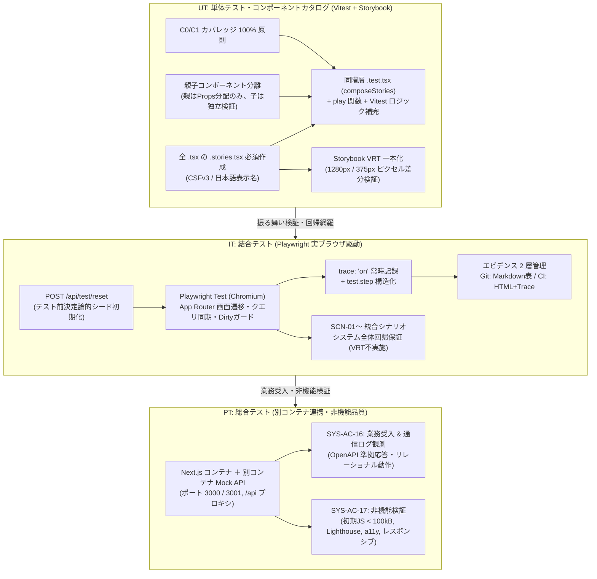
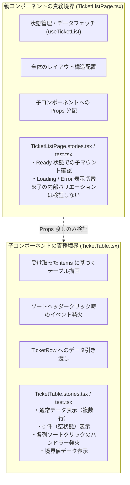

# テスト設計（UT / IT / PT）

| 項目                | 内容                                                                                                                                                                                                                                                                                                                                                                                                                                                                                                                                                                                                                                                                                                                                                                                                                                                                                                                                                                                                                                                                                                                                    |
| ------------------- | --------------------------------------------------------------------------------------------------------------------------------------------------------------------------------------------------------------------------------------------------------------------------------------------------------------------------------------------------------------------------------------------------------------------------------------------------------------------------------------------------------------------------------------------------------------------------------------------------------------------------------------------------------------------------------------------------------------------------------------------------------------------------------------------------------------------------------------------------------------------------------------------------------------------------------------------------------------------------------------------------------------------------------------------------------------------------------------------------------------------------------------- |
| 状態                | `Approved (Step 3)`                                                                                                                                                                                                                                                                                                                                                                                                                                                                                                                                                                                                                                                                                                                                                                                                                                                                                                                                                                                                                                                                                                                     |
| 更新日              | `2026-10-18`                                                                                                                                                                                                                                                                                                                                                                                                                                                                                                                                                                                                                                                                                                                                                                                                                                                                                                                                                                                                                                                                                                                            |
| 関連する ED/ID 項目 | `docs/rd/step3.md#3-ut--it--pt-の切り分けとテスト規約の詳細`<br>`docs/ed/01-system-overview.md#5-システム全体の受け入れ条件`<br>`docs/ed/01-system-overview.md#62-未確定事項後続確認事項`<br>`docs/ed/02-screen-list.md`<br>`docs/ed/03-screen-transition.md`<br>`docs/ed/screens/login.md#9-画面受け入れ条件`<br>`docs/ed/screens/dashboard.md#8-画面受け入れ条件`<br>`docs/ed/screens/ticket-list.md#8-画面受け入れ条件`<br>`docs/ed/screens/ticket-detail.md#8-画面受け入れ条件`<br>`docs/ed/screens/ticket-create.md#9-画面受け入れ条件`<br>`docs/ed/screens/admin-management.md#9-画面受け入れ条件`<br>`docs/ed/api/openapi.yaml`<br>`docs/id/tech-verification.md`<br>`docs/id/01-frontend-architecture.md`<br>`docs/id/state-management.md`<br>`docs/id/api-client.md`<br>`docs/id/screens/login.md`<br>`docs/id/screens/dashboard.md`<br>`docs/id/screens/ticket-list.md`<br>`docs/id/screens/ticket-detail.md`<br>`docs/id/screens/ticket-create.md`<br>`docs/id/screens/admin-management.md`<br>`docs/it/quality/step2.md#5-今後の標準化次期-step-への提言`<br>`docs/pt/quality/step2.md#62-次期-step-3-への技術申し送り事項` |

このドキュメントでは、Step 3 要件定義（`docs/rd/step3.md`）、承認済み外部設計（`docs/ed/`）、技術検証結果（`docs/id/tech-verification.md`）、および Next.js App Router 構成に改修された内部設計書（`docs/id/01-frontend-architecture.md`, `state-management.md`, `api-client.md`, `screens/*.md`）に基づき、単体テスト（UT）、結合テスト（IT）、総合テスト（PT）の 3 層品質保証体系、テスト観点・ケース、全 `.tsx` の Story 必須化・親子分離・C0/C1 100% 規約、Playwright 実ブラウザ IT（`trace: "on"`、エビデンス 2 層管理、シード同期）、および全受け入れ条件（`SYS-AC-01`〜`SYS-AC-17`）とのトレーサビリティを定義します。本書を含む ID 成果物の人による承認後に C・UT の実装・実行を開始します。

---

## 1. テスト設計方針と品質保証アーキテクチャ

### 1.1 刷新の目的と背景

Step 3 において、本システムは Vite SPA から **Next.js (App Router)** へ移行し、リリース相当環境での **別コンテナ Mock API サーバー接続**、および厳格な **新 UT/IT 規約** を導入しました。これに伴い、テスト設計も以下の通り全面的に刷新します。

1. **UT（単体テスト）の項目上げ・作成ルールの厳格化**:
   - `src/app/**/page.tsx`（薄いラッパー）、`layout.tsx`、`not-found.tsx` を含む **全 `.tsx` ファイルに対する `.stories.tsx` 必須作成** と、同階層 `.test.tsx` での `composeStories` 実行 ＋ ロジック補完。
   - 親コンポーネントのテストで子コンポーネントのバリエーションを兼ねることを禁止する **親子コンポーネント間の独立性ルール（親子分離）**。
   - 全コードパスを漏れなく検証する **C0（命令/行）・C1（分岐）カバレッジ 100% 原則**。
   - Visual Regression Testing（VRT）の **UT（Storybook）への一本化**。
2. **IT（結合テスト）の実ブラウザ駆動（Playwright）移行と監査性向上**:
   - 従来の Vitest + JSDOM から **Playwright Test（実ブラウザ駆動）** への移行（画面単位のふるまい網羅、App Router 画面遷移・URL クエリ同期・履歴復元・Dirty State ガード、API 401/403/404/500 異常系挙動）。
   - **IT での VRT 不実施**（UT の Storybook VRT に一本化し、重複排除・フレーキー防止）。
   - 全テストケース（成功時含む）における **`trace: "on"` 常時記録** と、Git コミット対象（Markdown サマリー）および CI Artifact（HTML レポート / トレース一式）の **エビデンス 2 層管理**。
   - ED 申し送り（`docs/ed/01-system-overview.md` §6.2 No.3）および Issue #208（技術検証）に基づく、テスト前 **`POST /api/test/reset` による決定論的シードデータ初期化**。
   - Step 2 IT 品質分析レポート（`docs/it/quality/step2.md` §5.1）申し送りに基づく、**`src/mocks/db/seed.ts` 正本同期の義務化**、および **`SCN-01`〜 統合シナリオ体系によるシステム全体回帰保証方針**。
3. **PT（総合テスト）連携とトレーサビリティの確立**:
   - **SYS-AC-16**（コンテナイメージ提供および別コンテナ Mock API 接続）を、承認済み ED に定める別コンテナ起動、`/api` 経由の到達、Mock API ログでの観測、OpenAPI 準拠応答およびリレーショナル動作を検証する PT ケースに割り当て、後続 PT 計画・証跡の担当成果物へ追跡可能とする。
   - **SYS-AC-17**（初期ロード JS バンドルサイズ < 100.0 kB、Lighthouse 90点以上、a11y WCAG 2.1 AA、キーボード操作性、1280px/375px レスポンシブ）との責務境界を定義。



### 1.2 3層テスト体系（UT / IT / PT）の基本原則と責務境界

| 区分                 | UT（単体テスト）                                                           | IT（結合テスト）                                                                            | PT（総合テスト）                                                                       |
| :------------------- | :------------------------------------------------------------------------- | :------------------------------------------------------------------------------------------ | :------------------------------------------------------------------------------------- |
| **実行環境**         | Node.js（`happy-dom` / `jsdom`）＋ Storybook 10                            | Chromium 実ブラウザ（Playwright Test）                                                      | Docker コンテナ環境（Next.js 画面コンテナ ＋ Mock API コンテナ）                       |
| **モック・API**      | MSW `setupServer`（Node.js インプロセス）                                  | ローカル開発サーバー（Next.js）＋ MSW Browser Worker（または Mock API）                     | 別コンテナ Mock API サーバー（Node.js HTTP Server ＋ `@mswjs/http-middleware`）        |
| **テスト粒度**       | モジュール、フック、コンポーネント、Thin Wrapper Page                      | 画面内の複数操作フロー、画面間遷移、URL クエリ同期、Dirty ガード                            | エンドツーエンド業務受入シナリオ（SYS-AC-01〜16）、非機能検証（SYS-AC-17）             |
| **テストツール**     | Vitest, `@testing-library/react`, Storybook CSFv3, `@storybook/react`      | `@playwright/test`                                                                          | ブラウザ手動検証、Playwright 監査スクリプト、Lighthouse CLI、`next build` アナライザー |
| **ビジュアル (VRT)** | **実施（UT に一本化）**: Storybook 全 Story を対象に 1280px / 375px で実施 | **不実施**: 画面遷移・ふるまい検証に特化し、VRT は行わない                                  | **目視確認**: 1280px / 375px での最終レイアウト・アニメーション証跡取得                |
| **エビデンス**       | Vitest カバレッジレポート（C0/C1 100%）、VRT スナップショット差分なし      | `docs/it/evidence/it-test-result.md`（サマリー表）、CI Artifact（HTML レポート / トレース） | `docs/pt/evidence/` 配下の操作証跡、Lighthouse レポート、バンドルサイズ計測証跡        |
| **データ初期化**     | テストケース単位で `resetMockDb()` 同期呼出                                | 各テスト前に `POST /api/test/reset` 発行（決定論的初期化）                                  | コンテナ起動時初期化（初期シードデータ状態）                                           |

### 1.3 SSOT 原則と OpenAPI 契約遵守

- **OpenAPI 契約（`docs/ed/api/openapi.yaml`）の厳格遵守**: テストデータ、モックレスポンス、パラメータ検証、エラーコード（400, 401, 403, 404, 500）はすべて OpenAPI 定義を唯一の正本（SSOT）とします。
- **推測の排除**: 仕様に存在しないプロパティや独自の振る舞いをテストコード側で捏造してはなりません。未決事項を発見した場合は推測で確定せず、未解決事項としてエスカレーションします。
- **ロール値の正本**: ロール判定は OpenAPI の `UserRole`（`general` / `admin`）に厳格に準拠し、UI 表示ラベル（「一般」「管理者」）では判定しません。
- **認可ガード 403 通知文言の正本（PR #223 確定準拠）**:
  - **TR-16**（一般ユーザーが管理者画面へアクセス時）: `管理者権限が必要です（403 Forbidden）`
  - **TR-17**（管理者ユーザーが新規起票画面へアクセス時）: `管理者ロールでは新規起票機能は利用できません（403 Forbidden）`

### 1.4 日本語によるテスト記述規約

1. **テストケース名（`it` / `test` ブロック）**:
   - 「〜すること」「〜する」等の自然な日本語で明瞭に記述します。
   - 画面受け入れ条件や仕様番号と紐づくケースには、末尾に `(SCR-02 AC-06)` 等の識別子を付与してトレーサビリティを確保します。
   - 例: `it("フォーム要素および文字数カウンターを正しく描画する (SCR-03 AC-01)", ...)`
2. **Storybook カタログ記述**:
   - Story の表示名（`name` プロパティ）および JSDoc 説明文は日本語で記述し、カタログ画面（Storybook UI）の可読性を高めます（エクスポート変数名は英語識別子を維持）。
3. **Playwright IT ステップ名（`test.step`）**:
   - `test.step("1. ログインして問い合わせ一覧画面を開く", async () => { ... })` のように、日本語で操作意図と期待動作を明記します。

---

## 2. UT（単体テスト）の対象範囲と作成規約

### 2.1 例外なしの 1 対 1 対応ルール

`docs/rd/step3.md` §3.2 の要求に基づき、テスト対象ファイルとテスト・ストーリーファイルを 1 対 1 で完全に同期させます。

1. **全 `*.tsx` ファイルに対する `*.stories.tsx` 必須作成**:
   - 薄い Page ラッパー（`src/app/**/page.tsx`）、Root Layout（`src/app/layout.tsx`）、認証保護レイアウト（`src/app/(authenticated)/layout.tsx`）、共通 404（`src/app/not-found.tsx`）、Feature コンポーネント、共有 UI コンポーネントを含む **すべての `.tsx` ファイルと同階層に同名の `.stories.tsx` を例外なく作成** します。
   - Story では、コンポーネントが取りうるすべての状態（Loading, Empty, Error, Validation Error, ロール別表示, 活性/非活性など）を CSFv3 で網羅します。
2. **全 `*.tsx` に対する `*.test.tsx` 補完作成**:
   - すべての `.tsx` ファイルと同階層に同名の `.test.tsx` を作成します。
   - `@storybook/react` の `composeStories` を用いて全 Story の描画および `play` 関数を自動実行し、UI 状態バリエーションの二重管理を防止します。
   - Story 単体では表現・検証しきれない細かなイベント分岐、キーボード操作の特殊キー、Unmount クリーンアップ、AbortSignal 連動等の内部ロジックを Vitest テストケースで補完します。
3. **全 `*.ts` ファイルに対する `*.test.ts` 必須作成**:
   - カスタムフック（`hooks/*.ts`）、API クライアント関数（`api/*.ts`）、共通ユーティリティ（`lib/*.ts`）、MSW ハンドラー（`mocks/handlers/*.ts`）、モック DB（`mocks/db/*.ts`）、別コンテナ Mock API サーバー（`server/*.ts`）に対する `.test.ts` を同階層に例外なく作成します。

### 2.2 親子コンポーネント間の独立性ルール（親子分離原則・省略禁止）

コンポーネントのテストにおいて、「親コンポーネントのテストで子コンポーネントのバリエーションを兼ねる」といったテストの省略・相乗りを厳格に禁止します。



1. **親コンポーネントの検証範囲**:
   - 親コンポーネント（例: `TicketListPage`）の Story / テストでは、「親自身が所有する状態管理（フック呼び出し）」、「状態ごとのレイアウト・コンポーネント切り替え（Loading / Error / Ready）」、および「子コンポーネントへの Props 受け渡し」のみを検証します。
2. **子コンポーネントの検証範囲**:
   - 子コンポーネント（例: `TicketTable`, `TicketListFilterForm`, `Pagination`）固有の表示バリエーション（空データ、境界値データ、バリデーションエラー、ボタン活性/非活性、イベント発火）は、**必ず子自身の `.stories.tsx` および `.test.tsx` で独立して網羅** します。
3. **レビュー性の担保**:
   - 人間レビュアーが「対象の `.tsx`」と「同階層の `.stories.tsx`（＋`.test.tsx`）」の 2 つを並べるだけで、当該コンポーネントの仕様・分岐網羅性を 1 対 1 で即座に確認できる構成を維持します。

### 2.3 `next/navigation` のモック・設定方針（技術検証 テーマ 1-C 採用）

Next.js App Router 固有フック（`useRouter`, `usePathname`, `useSearchParams`, `useParams`, `notFound`）に依存するコンポーネントを Storybook および Vitest で安全にテストするため、`docs/id/tech-verification.md` §2.1 で採用された **方式 1-C（Storybook Decorator ＋ Vitest 統合 Mock Navigation Provider）** を適用します。

1. **Storybook CSF `parameters.nextNavigation` 仕様**:
   - Story ごとにルーティング状態をパラメータとして定義します。
   ```tsx
   export const FilteredPage: Story = {
     parameters: {
       nextNavigation: {
         pathname: "/tickets",
         query: { status: "in_progress", page: "2" },
         params: { id: "1" },
       },
     },
   };
   ```
2. **`useSearchParams` の仕様準拠**:
   - Next.js の `ReadonlyURLSearchParams` 互換インスタンスを生成し、`get()`, `getAll()`, `has()`, `toString()` を完全再現します。
3. **`useRouter` / `notFound` のスパイ・呼び出し追跡**:
   - `router.push`, `router.replace`, `notFound()` を `vi.fn()` / `fn()` として公開し、インタラクションテストや `play` 関数で遷移先 URL や呼び出し有無を厳密にアサーションします。

### 2.4 テスト対象レイヤーと対象モジュール

| レイヤー                           | 配置先                                                           | UT 対象 | 主なテスト内容                                                                                                                                                                                                                                     |
| :--------------------------------- | :--------------------------------------------------------------- | :-----: | :------------------------------------------------------------------------------------------------------------------------------------------------------------------------------------------------------------------------------------------------- |
| **App Router ルーティング層**      | `src/app/**/page.tsx`                                            |   ✅    | 薄いラッパーのパラメータ受領、Suspense 境界、Feature マウント、不正 ID 時の `notFound()` 呼出（Storybook ＋ `composeStories`）                                                                                                                     |
| **App Router レイアウト・共通層**  | `src/app/layout.tsx`, `(authenticated)/layout.tsx`               |   ✅    | `globals.css` 読み込み、Provider 階層マウント、Auth Guard（未認証 `/login` 誘導）、Role Guard（403 警告通知 ＋ `/dashboard` 遷移、TR-16/17 文言検証）                                                                                              |
| **共通 404 層**                    | `src/app/not-found.tsx`                                          |   ✅    | 未定義パス・`notFound()` 時の描画、認証状態に応じた復帰リンク（認証済: `/dashboard`、未認証: `/login`）                                                                                                                                            |
| **Feature 画面コンテナ層**         | `src/features/*/components/*Page.tsx` 等                         |   ✅    | 最上位 Feature コンポーネントの状態統合（Loading/Ready/Error）、子コンポーネント配置、Props 分配（MSW 併用、Storybook ＋ `composeStories`）                                                                                                        |
| **Feature 子コンポーネント層**     | `src/features/*/components/`                                     |   ✅    | 個別 UI（表、フォーム、モーダル、カード等）の Props 駆動描画、イベント発火、バリデーション表示、ボタン活性/非活性（Storybook ＋ `composeStories`）                                                                                                 |
| **カスタムフック層**               | `src/features/*/hooks/`, `src/shared/layout/`, `src/shared/lib/` |   ✅    | データフェッチ、URL クエリ同期、Dirty 判定、競合制御、状態遷移、二重送信防止ロジック（MSW 併用）                                                                                                                                                   |
| **共通 UI 層**                     | `src/shared/ui/`                                                 |   ✅    | 純粋 UI コンポーネント（Button, Modal, Toast, Input, Select, Badge, Spinner 等）の描画、アクセシビリティ属性、クリック・入力イベント                                                                                                               |
| **共通レイアウト層**               | `src/shared/layout/`                                             |   ✅    | AppLayout, Header, Sidebar の描画、開閉トグル（240px / 60px）、ロール別メニュー表示、`localStorage` 永続化                                                                                                                                         |
| **共通 API 基盤層**                | `src/shared/api/`                                                |   ✅    | `client.ts`（共通 fetch ラッパー、クエリパラメータ除外、エラー変換）、`errors.ts`（`ApiClientError` のプロパティ判定）                                                                                                                             |
| **ドメイン API クライアント層**    | `src/features/*/api/`, `src/shared/api/projectApi.ts`            |   ✅    | 認証、チケット CRUD、担当者、ダッシュボード、管理（プロジェクト/ユーザー/所属）の各リクエスト構築、レスポンスパース、エラー伝播（MSW 併用）                                                                                                        |
| **汎用ライブラリ層**               | `src/shared/lib/`                                                |   ✅    | 日付フォーマット（`dateUtils.ts`）、サニタイズ（`stringUtils.ts`）、オープンリダイレクト検証（`validateRedirectUrl.ts`）、一覧クエリ退避（`ticketListQuery.ts`）、Dirty ガード（`DirtyGuardContext.tsx` / `useDirtyGuard.ts` / `useAppRouter.ts`） |
| **MSW ハンドラー層**               | `src/mocks/handlers/`                                            |   ✅    | 認証、プロジェクト、ユーザー、チケット、担当者、ダッシュボード、テスト用リセット（`POST /api/test/reset`）ハンドラーのフィルタリング、ソート、ページング、OpenAPI 契約準拠検証                                                                     |
| **MSW データストア層**             | `src/mocks/db/`                                                  |   ✅    | `store.ts`（CRUD 操作、`resetMockDb`、参照整合性チェック、カスケード更新）、`seed.ts`（初期シードデータ検証）                                                                                                                                      |
| **別コンテナ Mock API サーバー層** | `server/mock-api.ts`                                             |   ✅    | Node.js HTTP サーバー起動、`@mswjs/http-middleware` 適用、リセット API `POST /api/test/reset` のルーティング・正常応答                                                                                                                             |

---

## 3. テスト観点と主要テストケース

### 3.1 App Router ルーティング・レイアウト・ガード層（`src/app/`）

#### 3.1.1 Root Layout（`src/app/layout.tsx`）

| テスト観点            | 主要ケース             | 期待結果                                                                                                              |
| :-------------------- | :--------------------- | :-------------------------------------------------------------------------------------------------------------------- |
| Provider 階層マウント | アプリケーション起動時 | `MSWProvider`, `AuthProvider`, `NotificationProvider`, `SidebarProvider`, `DirtyGuardProvider` が正常にマウントされる |
| グローバル CSS 適用   | レンダリング時         | `src/app/globals.css` がインポートされ、基本スタイルクラスが適用される                                                |
| メタデータ・言語設定  | HTML 構造確認          | `<html lang="ja">` および指定されたタイトル・メタタグが正しく設定される                                               |

#### 3.1.2 ルートパスリダイレクト（`src/app/page.tsx`）

| テスト観点               | 主要ケース                     | 期待結果                                                               | 関連 ED 受入条件 |
| :----------------------- | :----------------------------- | :--------------------------------------------------------------------- | :--------------- |
| 未認証時の遷移 (TR-01)   | `status === "unauthenticated"` | `router.replace("/login")` が実行される                                | SCR-AUTH AC-01   |
| 認証済み時の遷移 (TR-02) | `status === "authenticated"`   | `router.replace("/dashboard")` が実行される                            | SCR-00 AC-01     |
| セッション判定中         | `status === "loading"`         | ちらつき防止のローディングスピナーが描画され、リダイレクトは保留される | SYS-AC-09        |

#### 3.1.3 共通 404（`src/app/not-found.tsx`）

| テスト観点             | 主要ケース                                    | 期待結果                                                                       | 関連 ED 受入条件 |
| :--------------------- | :-------------------------------------------- | :----------------------------------------------------------------------------- | :--------------- |
| 未定義パス表示         | 定義外 URL アクセスまたは `notFound()` 呼出時 | 「ページが見つかりませんでした」の案内メッセージが表示される                   | SYS-AC-06        |
| 認証済みユーザーの復帰 | `status === "authenticated"` で 404 表示      | 「ダッシュボードへ戻る」ボタンが表示され、クリック時に `/dashboard` へ遷移する | SYS-AC-06        |
| 未認証ユーザーの復帰   | `status === "unauthenticated"` で 404 表示    | 「ログイン画面へ」ボタンが表示され、クリック時に `/login` へ遷移する           | SYS-AC-06        |

#### 3.1.4 保護ルートレイアウト・認可ガード（`src/app/(authenticated)/layout.tsx`）

| テスト観点                           | 主要ケース                                                                      | 期待結果                                                                                                                                                   | 関連 ED 受入条件          |
| :----------------------------------- | :------------------------------------------------------------------------------ | :--------------------------------------------------------------------------------------------------------------------------------------------------------- | :------------------------ |
| セッション初期化待機                 | `status === "loading"`                                                          | 保護画面を描画せずフルスクリーンスピナーを表示する                                                                                                         | SYS-AC-09                 |
| 未認証アクセス遮断 (TR-06)           | `status === "unauthenticated"` で保護ルート（`/tickets?status=open`）へアクセス | 要求先 URL を保持した `/login?redirect=%2Ftickets%3Fstatus%3Dopen` へリダイレクトされる                                                                    | SYS-AC-09                 |
| オープンリダイレクト検証             | 単一 `/` 相対パス、`//evil.com`、絶対 URL、制御文字を指定                       | 同一オリジンの相対パスのみ許可し、不正値は `/dashboard` へ安全にフォールバックする                                                                         | SCR-AUTH AC-04, SYS-AC-09 |
| **一般の管理者画面アクセス (TR-16)** | `role === "general"` で `/admin/management`（または `/admin`）へアクセス        | 管理画面を描画せず、**`管理者権限が必要です（403 Forbidden）`** の警告通知を発行して `/dashboard` へフォールバックリダイレクトする                         | SCR-04 AC-01, SYS-AC-09   |
| **管理者の新規起票アクセス (TR-17)** | `role === "admin"` で `/tickets/new` へアクセス                                 | 起票画面を描画せず、**`管理者ロールでは新規起票機能は利用できません（403 Forbidden）`** の警告通知を発行して `/dashboard` へフォールバックリダイレクトする | SCR-03 AC-09, SYS-AC-09   |
| 権限適合時の画面描画                 | 各画面で許可されたロールでアクセス                                              | `AppLayout` 内に対象画面コンポーネントが正常に描画される                                                                                                   | SYS-AC-09                 |

#### 3.1.5 各画面 Thin Wrapper Page（`src/app/**/page.tsx`）

| ファイル配置                                        | テスト観点                  | 主要ケース                                 | 期待結果                                                                         |
| :-------------------------------------------------- | :-------------------------- | :----------------------------------------- | :------------------------------------------------------------------------------- |
| `src/app/login/page.tsx`                            | クエリパラメータ委譲        | `?redirect=/tickets&reason=expired`        | `<Suspense>` 境界を配し、`LoginPageContent` に Props として正確に引き渡す        |
| `src/app/(authenticated)/dashboard/page.tsx`        | Feature マウント            | 正常表示                                   | `DashboardContent` をマウントして描画する                                        |
| `src/app/(authenticated)/tickets/page.tsx`          | Feature マウントと Suspense | 正常表示、ローディング中                   | `<Suspense>` フォールバック（スケルトン）を配し、`TicketListPage` をマウントする |
| `src/app/(authenticated)/tickets/[id]/page.tsx`     | 動的パラメータ検証          | 正の整数 ID（`1`, `24`）                   | `TicketDetailPage` に数値 `ticketId` を引き渡してマウントする                    |
| `src/app/(authenticated)/tickets/[id]/page.tsx`     | 不正形式 ID 遮断            | 非数値（`abc`）、ゼロ（`0`）、負数（`-1`） | `notFound()` を呼び出して共通 404 へ遷移させる                                   |
| `src/app/(authenticated)/tickets/new/page.tsx`      | Feature マウント            | 一般ユーザーでアクセス                     | `TicketCreatePage` をマウントして描画する                                        |
| `src/app/(authenticated)/admin/management/page.tsx` | Feature マウント            | 管理者ユーザーでアクセス                   | `AdminManagementContent` をマウントして描画する                                  |

---

### 3.2 画面別コンポーネントツリーと親子分離テスト観点（`src/features/**/components/`）

#### 3.2.1 ログイン画面（SCR-AUTH）

- **`LoginPageContent`**: 認証状態評価、認証済み時の自動スキップ（TR-07）、失効理由アラート（`reason=expired`）表示、`LoginForm` のマウントとコールバック処理。
- **`LoginForm`**: ユーザー名・パスワード入力状態管理、クライアントバリデーション、送信中スピナー、二重送信防止、`CredentialField` / `LoginSubmitButton` / `CredentialHelper` の配置。
- **`CredentialField`**: 単一入力欄（ラベル、必須マーク、エラーメッセージ、プレースホルダー、入力制御）。
- **`LoginSubmitButton`**: ログイン送信ボタン（通常表示、送信中スピナー描画、非活性化・二重送信防止制御、variant 適用）。
- **`CredentialHelper`**: 開発・テスト用アカウント情報表示、ワンクリックでのユーザー名・パスワード自動入力コールバック発火。
- **`AuthFeedback`**: 401 認証失敗メッセージ、アカウントロック（将来拡張）、失効警告バナー表示。

#### 3.2.2 ダッシュボード画面（SCR-00）

- **`DashboardContent`**: `useDashboardSummary` 接続、Loading スケルトン / Error / Ready の状態分岐、再取得イベント伝播。
- **`DashboardHeader`**: ロール別タイトル、スコープ表示（「所属: PRJ-01」/「全社横断」）、最終取得日時、再読み込みボタン。
- **`DashboardSkeleton`**: 4枚カードおよびテーブルのスケルトンアニメーション表示。
- **`DashboardErrorView`**: 取得エラーメッセージ、再試行ボタン押下イベント発火。
- **`GeneralDashboardView`**: 一般ユーザー向けサマリーカード（自プロジェクト集計）および自分宛て未完了チケットテーブル（最大 5 件）の配置。
- **`AdminDashboardView`**: 管理者向けサマリーカード（全社集計）、プロジェクト別稼働状況テーブル、未割当・長期滞留アラートセクションの配置。
- **`SummaryMetricGrid` / `SummaryMetricCard`**: 指標カード（ラベル、数値、クリック時のドリルダウン遷移パラメータ発火）。
- **`MyTicketsSection` / `MyTicketsTable` / `MyTicketRow` / `MyTicketsEmptyState`**: 担当チケット行（優先度バッジ、ステータス、詳細リンク）、0 件時の良好ガイダンス表示。
- **`ProjectActivityTable` / `ProjectActivityRow`**: プロジェクト別チケット件数内訳行、各ステータス数値リンククリック時のドリルダウン遷移。
- **`AdminAlertSection` / `UnassignedAlertTable` / `StaleAlertTable`**: 未割り当て案件（7日以内未対応含む）、長期滞留案件（7日超未完了）の表表示、0 件時「良好」表示。

#### 3.2.3 問い合わせ一覧画面（SCR-01）

- **`TicketListPage`**: Feature ルート。`useTicketList` / `useTicketQueryParams` 接続、FilterForm, Toolbar, Table, Pagination のオーケストレーション。
- **`TicketListFilterForm`**: フィルター条件（ステータス、担当者、プロジェクト、キーワード、起票日範囲）の統合管理と検索実行イベント。
- **`ProjectFilterSelect`**: ロールに応じたプロジェクト選択肢（管理者: 全プロジェクト、一般: 自プロジェクト固定または選択肢制限）。
- **`TitleSearchInput`**: キーワード入力欄、100 文字バリデーション、リアルタイム文字数カウンター。
- **`DateRangeFilter`**: 開始日・終了日ピッカー、開始日 > 終了日の逆転バリデーションエラー表示。
- **`StatusFilterSelect` / `AssigneeFilterSelect`**: ステータス・担当者セレクトボックス（「未設定」オプション含む）。
- **`TicketListToolbar` / `PageSizeSelect` / `ResultCount`**: 表示件数切替（10/20/50）、検索結果総件数・表示範囲のテキスト表示。
- **`TicketListStatePanel`**: 初期ローディングスピナー、0 件空状態メッセージ、API エラー時の再試行パネル。
- **`TicketTable` / `SortableHeader` / `TicketRow`**: 一覧表描画、ソート可能列ヘッダーのクリックイベント（昇順/降順トグル）、行クリックによる詳細画面遷移イベント。
- **`TicketPagination`**: ページネーションコントロール（1 ページ目での「前へ」非活性、最終ページでの「次へ」非活性、ページ番号クリック）。

#### 3.2.4 問い合わせ詳細画面（SCR-02）

- **`TicketDetailPage`**: Feature ルート。`ticketId` 受領、`useTicketDetail` 接続、Loading / 404 NotFound / 500 Error の統合パネル表示、Ready コンテンツのレイアウト。
- **`TicketDetailHeader`**: 詳細ヘッダー、一覧へ戻るボタン（直前クエリ復元、Dirty ガード連動）。
- **`TicketSummarySection`**: チケット基本情報（件名、本文、起票者、起票日時、所属プロジェクト名）。
- **`TicketUpdateSection`**:
  - 一般ユーザー表示時: ステータスセレクト、担当者セレクト（自プロジェクト所属者）、更新保存ボタン（差分検知、二重送信防止スピナー）。
  - 管理者表示時（Read-only）: ステータスバッジ、担当者名テキスト、閲覧専用ガイダンス（「※管理者ロールは閲覧専用のため、ステータス・担当者の変更はできません。」）。
- **`CommentListSection`**: コメント履歴一覧（時系列ソート、投稿者名、投稿日時、本文、0 件時ガイダンス）。
- **`CommentComposerSection`**:
  - 一般ユーザー表示時: ログインユーザー名固定表示、本文入力 Textarea（1〜1000文字）、リアルタイム文字数カウンター、送信ボタン（1000文字超非活性、二重送信防止）。
  - 管理者表示時（Read-only）: コメント不可ガイダンス（「※管理者ロールは閲覧専用（Read-only）のため、コメントの投稿は行えません。」）。
- **`TicketDetailStatePanel`**: 詳細専用状態パネル（チケット未存在時の SCR-02 内 404 表示「指定された問い合わせは見つかりませんでした」＋一覧復帰ボタン含む）。

#### 3.2.5 新規起票画面（SCR-03）

- **`TicketCreatePage`**: 一般専用 Feature ルート。パンくずリスト、戻るボタン、`TicketCreateForm` のマウント。
- **`TicketCreateForm`**: 起票フォーム全体。送信中制御、Dirty 状態検知。
- **`ProjectSelectField`**: 単一所属時は固定テキスト、複数所属時はセレクトボックス表示。
- **`CreatorField`**: ログインユーザー名固定表示。
- **`TitleInputField`**: 件名入力欄、autofocus、必須チェック、最大 100 文字チェック、リアルタイムカウンター。
- **`AssigneeSelectField`**: 選択プロジェクトに所属する担当者候補セレクトボックス（「未設定」許容）。
- **`DescriptionTextareaField`**: 本文入力欄、必須チェック、最大 2000 文字チェック、リアルタイム文字数カウンター。
- **`FormActionButtons`**: 「起票する」ボタン（プライマリ、送信中スピナー）、「キャンセル」ボタン（Dirty ガード連動）。

#### 3.2.6 管理者画面（SCR-04）

- **`AdminManagementContent`**: 管理者専用 Feature ルート。タブ切り替え状態管理、各タブセクションの条件付き描画、削除確認モーダル・所属破棄ダイアログの制御。
- **`AdminPageHeading`**: 画面タイトル（「マスタ管理」）および説明テキスト。
- **`AdminManagementTabs`**: タブバー（「プロジェクト管理」「ユーザー管理」「所属紐づけ管理」）、所属編集 Dirty 時の切替ガード連動。
- **`ProjectManagementSection` / `ProjectTable` / `ProjectRow` / `CreateProjectModal`**:
  - プロジェクト新規登録モーダル（プロジェクト名 1〜50文字、説明 200文字以下、重複チェック）。
  - プロジェクト一覧テーブル（ID, 名前, 説明, チケット件数, 所属人数, アクション）。
  - 削除制御: チケット件数 > 0、または唯一所属一般ユーザーが存在する場合の削除ボタン非活性化と理由ツールチップ表示。
  - 削除確認モーダル（削除実行 / キャンセルによる API 抑止）。
- **`UserManagementSection` / `UserTable` / `UserRow` / `CreateUserModal`**:
  - ユーザー新規登録モーダル（ユーザー名 3〜50文字英数字、初期パスワード 4〜100文字可視文字、表示名 1〜50文字、ロール選択）。
  - ユーザー一覧テーブル（ID, ユーザー名, 表示名, ロール, 所属プロジェクト一覧, アクション）。
  - 削除制御: ログイン中管理者自身の削除非活性化（自己削除防止）、システム内最後の管理者の削除非活性化（最後の管理者保護）。
  - 削除確認モーダル（削除実行 / キャンセルによる API 抑止）。
- **`UserProjectAssignmentSection` / `AssignmentUserSelect` / `AssignmentUserSummary` / `ProjectAssignmentChecklist` / `AssignmentValidationMessage` / `UnsavedAssignmentConfirmDialog`**:
  - 対象一般ユーザー選択セレクター（所属編集 Dirty 時の切替ガード連動）。
  - 選択ユーザー情報サマリー表示。
  - プロジェクト所属チェックボックス一覧（複数選択可能、全解除時は 0 件バリデーションエラー表示）。
  - 保存ボタン（差分検知、二重送信防止）。
  - 所属破棄確認ダイアログ（「留まる」で入力維持、「破棄して移動」で変更破棄してユーザー切替/タブ切替実行）。

---

### 3.3 共通レイアウト & UI コンポーネント（`src/shared/layout/`, `src/shared/ui/`）

| コンポーネント                | テスト観点                   | 主要ケース                                                                                                            |
| :---------------------------- | :--------------------------- | :-------------------------------------------------------------------------------------------------------------------- |
| `AppLayout`                   | レイアウト骨格               | Header, Sidebar, メインコンテンツ領域の配置、モバイルドロワー開閉時のオーバーレイ表示                                 |
| `Header`                      | ヘッダー情報表示・ログアウト | システム名、ログイン中ユーザー名・ロールバッジの表示、ログアウトボタン押下によるセッション破棄・遷移                  |
| `Sidebar`                     | 開閉トグル・ロール別メニュー | デスクトップ展開（幅 240px）/ 折りたたみ（幅 60px）切替、`localStorage` 永続化、ロールに応じたメニュー表示            |
| `DirtyGuardModal`             | 未保存変更破棄確認           | 未保存変更がある状態での離脱時にダイアログ表示、「留まる」「破棄して移動」の各ボタン操作（`src/shared/layout/` 配置） |
| `Button`                      | ボタン共通                   | variant（primary, secondary, danger）、size、disabled 状態、loading スピナー表示、クリックイベント発火                |
| `Input` / `Select`            | 入力フォーム共通             | 値バインド、onChange イベント、エラー状態スタイル、aria 属性（`aria-invalid`, `aria-describedby`）                    |
| `Badge`                       | ステータス・ロールバッジ     | ステータス（未対応: 灰、対応中: 青、完了: 緑）、ロール（一般: 青、管理者: 紫）の適切なクラス適用                      |
| `Spinner` / `Modal` / `Toast` | フィードバック共通           | アクセシビリティ（`role="status"`, `role="dialog"`, `role="alert"`）、表示/非表示アニメーション、タイマー消去         |
| `NotificationContext`         | アプリ共通通知コンテキスト   | 通知発行（info, success, error）、単一スロット後勝ち更新、自動消去タイマー、閉じるボタン操作                          |

---

### 3.4 カスタムフック層（`src/features/**/hooks/`, `src/shared/layout/`, `src/shared/lib/`, `src/shared/ui/`）

| フック名                  | テスト観点                   | 主要ケース                                                                                                                    |
| :------------------------ | :--------------------------- | :---------------------------------------------------------------------------------------------------------------------------- |
| `useAuth`                 | セッション初期化・復元・破棄 | トークン読み込み、`GET /auth/me` 成功によるセッション確立、401 による自動破棄、ネットワークエラー時の `error` 遷移            |
| `useLogin`                | ログイン実行・状態管理       | バリデーション、`POST /auth/login` 成功・失敗ハンドリング、送信中フラグ制御、オープンリダイレクト検証連動                     |
| `useNotification`         | 通知発行フック               | `showNotification` 呼出による通知発行、403 エラー通知（TR-16/TR-17）および起票成功通知（TR-14）のコンテキスト連携             |
| `useDashboardSummary`     | サマリー集計データ取得       | ロールに応じた集計取得、再読み込み（リフレッシュ）、AbortController によるアンマウント時リクエスト中断                        |
| `useTicketList`           | 一覧データ取得・競合制御     | 検索クエリ連動、ページネーション、ソート変更時の `page=1` リセット、連続リクエスト時の最新応答優先反映（Race Condition 防止） |
| `useTicketQueryParams`    | URL クエリ双方向同期         | `useSearchParams` との双方向バインド、URL 反映（`router.replace`）、不正クエリパラメータのサニタイズ・初期値復元              |
| `useTicketListReturnHref` | 詳細からの一覧復帰 URL 解決  | 直前の一覧検索クエリを保持した復帰 URL の生成、クエリ未保持時の既定 `/tickets` フォールバック                                 |
| `useTicketDetail`         | 詳細データ取得・404 判定     | チケットおよびコメント履歴の取得、HTTP 404 時のエラーフラグ設定、自所属外チケット参照時の 404 ハンドリング                    |
| `useTicketUpdate`         | ステータス・担当者更新       | `PATCH /tickets/{id}` 呼出、変更差分検知、二重送信防止、成功時のキャッシュ/状態更新                                           |
| `useCommentCreate`        | コメント投稿・Dirty 連動     | 本文バリデーション（1〜1000文字）、投稿成功時のフォームクリア、Dirty 解除、二重送信防止                                       |
| `useTicketCreate`         | 新規起票フォーム・Dirty 連動 | 入力ドラフト保持、全項目バリデーション、Dirty 判定、起票成功時の詳細画面遷移先 URL 解決                                       |
| `useAssignees`            | 担当者候補取得               | `projectId` 変更に連動した担当者一覧の再取得、キャッシュ、取得失敗時のエラーハンドリング                                      |
| `useProjects`             | 全社プロジェクトマスタ取得   | `GET /projects` による一覧取得、キャッシュ、再試行処理                                                                        |
| `useAdminProjects`        | プロジェクト CRUD 管理       | プロジェクト一覧取得、新規作成、削除可否判定（チケット/唯一所属者チェック）、削除実行                                         |
| `useAdminUsers`           | ユーザー CRUD 管理           | ユーザー一覧取得、新規登録、自己削除防止・最後の管理者削除防止判定、削除実行                                                  |
| `useAdminAffiliations`    | 所属チェックボックスドラフト | 選択中ユーザーの所属ドラフト編集、Dirty 検知、0 件バリデーション、`PUT /users/{id}/projects` による一括更新                   |
| `useSidebar`              | サイドバー開閉状態永続化     | 開閉トグル、デスクトップ/モバイル判定、`localStorage` への読み書きと同期                                                      |
| `useDirtyGuard`           | 3 層離脱防止ガード           | `isDirty` 登録、画面内リンク横取り（Capture 相）、`popstate` Revert & Replay、`beforeunload` 登録/解除                        |
| `useAppRouter`            | ナビゲーションラッパー       | `router.push`, `router.replace` 発行時の Dirty ガード評価と保留遷移制御                                                       |

---

### 3.5 API クライアント基盤 & 別コンテナ Mock API サーバー

#### 3.5.1 `ApiClientError`（`src/shared/api/errors.ts`）

- status=400 で `isValidationError === true`、status=404 で `isNotFound === true`、status=500/502/503 で `isServerError === true` を判定すること。
- code 未指定時のデフォルトフォールバック（400: `VALIDATION_ERROR`, 404: `NOT_FOUND`, 500: `INTERNAL_SERVER_ERROR`, その他: `API_ERROR`）を検証すること。
- レスポンスの `details` 配列が正確にインスタンスプロパティへ保持されること。

#### 3.5.2 共通 fetch ラッパー（`src/shared/api/client.ts`）

- GET/POST/PATCH/DELETE リクエストの構築、`Accept: application/json`、`Content-Type: application/json` ヘッダー付与を検証すること。
- クエリパラメータにおける `undefined`, `null`, `""`（空文字）の自動除外ロジックを検証すること。
- HTTP 2xx 応答時の JSON レスポンスパース、HTTP 4xx/5xx 応答時の `ApiClientError` への正確な変換を検証すること。
- ネットワークエラー（Fetch 失敗）時の適切なエラーラップを検証すること。

#### 3.5.3 ドメイン別 API クライアント関数

- `authApi.login`, `authApi.getMe`, `authApi.logout`: 認証ヘッダー、リクエスト/レスポンス型の整合性を検証。
- `dashboardApi.getSummary`: ロール別サマリーレスポンスのパースとエラーハンドリングを検証。
- `ticketApi.getTickets`, `getTicketById`, `createTicket`, `updateTicket`, `addComment`: チケット CRUD のパラメータシリアライズとエラー伝播を検証。
- `assigneeApi.getAssignees`: `projectId` クエリの付与と担当者リストのパースを検証。
- `projectApi.getProjects`: プロジェクトマスタ取得を検証。
- `adminProjectApi.createProject`, `deleteProject`: プロジェクト登録・削除 API 通信を検証。
- `adminUserApi.getUsers`, `createUser`, `deleteUser`, `updateUserProjects`: ユーザー登録・削除・所属更新 API 通信を検証。

#### 3.5.4 別コンテナ Mock API サーバー（`server/mock-api.ts`）

- Node.js `http.createServer` 上で `@mswjs/http-middleware` が正常にマウントされ、HTTP リクエストをハンドリングできること。
- テスト用シードデータリセットエンドポイント（`POST /api/test/reset`）が呼び出された際、`resetMockDb()` が同期実行され、`HTTP 200 OK` `{ success: true, message: "Mock DB reset to initial seed data" }` が返却されること。
- 未定義の API パスにアクセスされた場合、`HTTP 404 Not Found` `{ code: "NOT_FOUND", message: "API エンドポイントが存在しません" }` が返却されること。

---

### 3.6 MSW ハンドラー & モック DB

#### 3.6.1 MSW ハンドラー（`src/mocks/handlers/`）

- **`tickets.ts`**:
  - フィルタリング（`status`, `assignee`, `projectId`, `keyword`, `from`, `to`, `stale`）の網羅。
  - ソート（`id`, `updated_at`, `created_at` の昇順/降順）およびページング（`page`, `per_page`）。
  - 一般ユーザーによる自所属外 `projectId` 指定時の空配列応答（HTTP 200, items: [], total: 0）。
  - 自所属外チケットへの GET/PATCH/POST 時の 404 エラー応答（情報隠蔽）。
  - 管理者による PATCH / コメント POST 時の 403 権限エラー応答。
- **`auth.ts`**:
  - `POST /auth/login`: 正当な認証情報でのトークン返却、無効情報での 401 応答。
  - `GET /auth/me`: Bearer トークン検証、ロール別ユーザー情報返却、無効トークン時の 401 応答。
  - `POST /auth/logout`: 正常ログアウト応答。
- **`dashboard.ts`**:
  - `GET /dashboard/summary`: 一般ユーザー用集計（自所属チケットベース）、管理者用集計（全社・プロジェクト別・未割当・長期滞留）の返却。
- **`projects.ts`**:
  - `GET /projects`: 全社プロジェクト一覧返却。
  - `POST /projects`: 管理者専用プロジェクト登録、同名重複時の 400 エラー。
  - `DELETE /projects/{id}`: プロジェクト削除（チケット紐づき存在時 / 唯一所属者存在時の 400 エラー）、カスケード解除。
- **`users.ts`**:
  - `GET /users`: 管理者専用全ユーザー一覧返却。
  - `POST /users`: 管理者専用ユーザー登録（一般ユーザー所属0件時 400 エラー）。
  - `DELETE /users/{id}`: ユーザー削除（自己削除 / 最後の管理者削除保護時の 400 エラー）。
  - `PUT /users/{id}/projects`: 所属紐づけ更新（0件拒否 400 エラー）。
- **`assignees.ts`**:
  - `GET /assignees`: 担当者一覧返却、`projectId` クエリによる所属メンバー絞り込み。
- **`testing.ts`**:
  - `POST /api/test/reset`: ストア初期化呼び出しと 200 応答。

#### 3.6.2 MSW データストア（`src/mocks/db/`）

- **`store.ts`**:
  - インメモリストアの CRUD 操作、トランザクション整合性。
  - `resetMockDb()` 呼び出しによる全テーブル（プロジェクト、ユーザー、チケット、コメント）の完全リセットと初期シードデータ復元。
  - プロジェクト削除時の所属カスケード解除、チケット参照整合性チェック。
- **`seed.ts`**:
  - シードデータのスキーマ整合性、外部キー参照整合性（チケットが実在プロジェクト・起票者を参照していること、コメントが実在チケット・投稿者を参照していること）。

---

### 3.7 汎用ライブラリ層（`src/shared/lib/`）

- **`dateUtils.ts`**:
  - `formatDateTime`: ISO 8601 文字列（`YYYY-MM-DDTHH:mm:ssZ` 等）を `YYYY-MM-DD HH:mm` に整形、無効日付時の安全なフォールバック。
  - `formatDate`: `YYYY-MM-DD` 形式への整形。
  - `isStale`: 7日以上経過（長期滞留）の判定ロジック。
- **`stringUtils.ts`**:
  - CodePoint 単位でのサロゲートペア対応文字数カウント（絵文字等）。
  - XSS を防止する文字列トリミングおよびサニタイズ。
- **`validateRedirectUrl.ts`**:
  - オープンリダイレクト脆弱性防止: `//evil.com`, `/\evil.com`, `https://evil.com`, `javascript:`, 空文字の拒否とデフォルト `/dashboard` へのフォールバック。
  - 同一オリジン内の安全な相対パス（例: `/tickets?page=2`）の正常通過。
- **`ticketListQuery.ts`**:
  - 一覧検索条件の `sessionStorage`（キー: `ticket_list_query`）への退避・復元・サニタイズ。
  - 不正クエリ形式やパース失敗時の安全なデフォルト復元。

---

## 4. テストデータとシードデータ同期

### 4.1 MSW シードデータ正本同期（`src/mocks/db/seed.ts`）

Step 2 IT 品質分析レポート（`docs/it/quality/step2.md` §5.1）の申し送りに基づき、初期仕様策定時から `src/mocks/db/seed.ts` の実データを直接参照してテストケース・シナリオを記述することを義務化し、仮 ID や仮名による不整合を完全に排除します。

#### (1) プロジェクトマスタ

| プロジェクト ID | プロジェクト名     | 説明                                    | 初期チケット件数 | 削除可否理由                       |
| :-------------- | :----------------- | :-------------------------------------- | :--------------- | :--------------------------------- |
| `PRJ-01`        | コアシステム開発   | 基幹業務システムの刷新および API 開発   | 15 件            | チケット参照が存在するため削除不可 |
| `PRJ-02`        | モバイルアプリ開発 | iOS/Android 向けネイティブアプリ開発    | 10 件            | チケット参照が存在するため削除不可 |
| `PRJ-03`        | クラウド移行基盤   | AWS クラウドインフラ構築および IaC 整備 | 0 件             | チケット参照なし（削除検証可能）   |

#### (2) ユーザーマスタおよび初期所属

| ユーザー ID  | ユーザー名 (`username`) | 氏名（表示名） | ロール (`UserRole`) | 所属プロジェクト (`project_ids`) | 備考                                          |
| :----------- | :---------------------- | :------------- | :------------------ | :------------------------------- | :-------------------------------------------- |
| `user-admin` | `admin`                 | システム管理者 | `admin`             | （全社横断・所属なし）           | 管理者（自己削除・最後の管理者削除保護）      |
| `user-1`     | `user1`                 | 山田 太郎      | `general`           | `["PRJ-01"]`                     | 一般ユーザー（PRJ-01 単一所属・唯一メンバー） |
| `user-2`     | `user2`                 | 佐藤 次郎      | `general`           | `["PRJ-01", "PRJ-02"]`           | 一般ユーザー（複数所属）                      |
| `user-3`     | `user3`                 | 鈴木 花子      | `general`           | `["PRJ-02"]`                     | 一般ユーザー（PRJ-02 単一所属・唯一メンバー） |

#### (3) チケット・コメントの代表データ（計 25 件）

| チケット ID | 件名（タイトル）             | プロジェクト | ステータス    | 担当者     | 起票者    | 作成日     | 更新日     | 備考・アラート対象                    |
| :---------- | :--------------------------- | :----------- | :------------ | :--------- | :-------- | :--------- | :--------- | :------------------------------------ |
| `#1`        | ログイン機能の不具合         | `PRJ-01`     | `open`        | 未割り当て | 佐藤 次郎 | 2026-09-01 | 2026-09-01 | コメント2件、未割り当て・長期滞留案件 |
| `#12`       | データベース接続エラー       | `PRJ-01`     | `in_progress` | 山田 太郎  | 佐藤 次郎 | 2026-09-10 | 2026-09-10 | 長期滞留アラート対象（7日超未完了）   |
| `#15`       | プッシュ通知配信遅延         | `PRJ-02`     | `in_progress` | 鈴木 花子  | 佐藤 次郎 | 2026-09-12 | 2026-09-12 | 長期滞留アラート対象（7日超未完了）   |
| `#24`       | パスワード再設定メール不達   | `PRJ-01`     | `in_progress` | 山田 太郎  | 佐藤 次郎 | 2026-09-20 | 2026-09-21 | 直近アクティブ案件                    |
| `#32`       | セキュリティパッチ適用検証   | `PRJ-01`     | `open`        | 未割り当て | 佐藤 次郎 | 2026-09-22 | 2026-09-22 | 未割り当てアラート対象（PRJ-01）      |
| `#34`       | バックアップスクリプトの修正 | `PRJ-02`     | `open`        | 未割り当て | 佐藤 次郎 | 2026-09-23 | 2026-09-23 | 未割り当てアラート対象（PRJ-02）      |

### 4.2 テスト前シードデータリセット方式（`POST /api/test/reset`）

- **課題**: Playwright 実ブラウザ IT においては、テスト実行プロセス（Playwright ランナー）、ブラウザ、および API サーバーが別プロセスとして動作するため、同一メモリ空間での直接関数呼び出しが不可能です。
- **採用方式**: テスト用 HTTP エンドポイント `POST /api/test/reset` を設け、各テストケース開始前（`test.beforeEach`）に呼び出します。
- **効果**: 各テストが他テストの更新・削除操作の影響を受けず、100% 決定論的かつ並列安全に実行されます。

### 4.3 境界値・エッジケーステストデータ

| テスト対象項目                   | 境界値種別              | 検証用テストデータ                                                                       | 期待される振る舞い                                          |
| :------------------------------- | :---------------------- | :--------------------------------------------------------------------------------------- | :---------------------------------------------------------- |
| 問い合わせ件名（タイトル）       | 最小有効長 / 最大有効長 | 1 文字（`"A"`）/ 100 文字（ASCII, 日本語, Unicode サロゲートペア）                       | 正常受付・登録可能                                          |
| 問い合わせ件名（タイトル）       | 空文字 / 最大超過       | `""`（空文字）, `"   "`（空白のみ）/ 101 文字                                            | バリデーションエラー（必須エラー / 100文字以内）            |
| 問い合わせ本文（新規起票）       | 最小有効長 / 最大有効長 | 1 文字 / 2000 文字                                                                       | 正常受付・登録可能                                          |
| 問い合わせ本文（新規起票）       | 空文字 / 最大超過       | `""`（空文字）/ 2001 文字                                                                | バリデーションエラー（必須エラー / 2000文字以内）           |
| コメント本文                     | 最小有効長 / 最大有効長 | 1 文字 / 1000 文字                                                                       | 正常受付・投稿可能                                          |
| コメント本文                     | 空文字 / 最大超過       | `""`（空文字）/ 1001 文字                                                                | バリデーションエラー（送信ボタン非活性またはエラー）        |
| 起票日フィルター (`from` / `to`) | 同日指定                | `from="2026-09-15"`, `to="2026-09-15"`                                                   | 有効（当日 00:00:00〜23:59:59 のチケットを抽出）            |
| 起票日フィルター (`from` / `to`) | 日付逆転                | `from="2026-09-16"`, `to="2026-09-15"`                                                   | バリデーションエラー表示（API 送信抑止）                    |
| URL チケット ID (`:id`)          | 有効最小値              | `"1"`（正の整数）                                                                        | SCR-02 正常描画                                             |
| URL チケット ID (`:id`)          | 不正形式                | `"0"`, `"-1"`, `"abc"`, `"1.5"`, `"1a"`                                                  | `notFound()` 発動 → 共通 404 画面表示                       |
| URL チケット ID (`:id`)          | 未存在 ID               | `"9999"`（正の整数だが存在しない）                                                       | API 404 応答 → SCR-02 詳細画面内 404 エラー表示             |
| 管理画面 ユーザー名 (`username`) | 最小 / 最大 / 形式      | 3 文字 / 50 文字かつ `^[a-zA-Z0-9_-]+$`（有効）、2 文字 / 51 文字 / 記号スペース（無効） | バリデーションエラー                                        |
| 管理画面 パスワード (`password`) | 最小 / 最大 / 形式      | 4 文字 / 100 文字かつ ASCII 可視文字（有効）、3 文字 / 101 文字 / 全角・空白（無効）     | バリデーションエラー                                        |
| 管理画面 プロジェクト名          | 最小 / 最大長           | 1 文字 / 50 文字（有効）、空文字 / 51 文字（無効）                                       | バリデーションエラー                                        |
| 管理画面 プロジェクト説明        | 最大長                  | 200 文字（有効）、201 文字（無効）                                                       | バリデーションエラー                                        |
| ユーザー所属プロジェクト更新     | 0 件選択                | チェックボックス全解除（`project_ids: []`）                                              | バリデーションエラー（「1つ以上の所属を選択してください」） |

---

## 5. カバレッジ方針と Storybook VRT 一本化

### 5.1 カバレッジ受け入れ基準（C0 / C1 100% 原則）

C・UT 工程における単体テストの受け入れ基準として、**C0（命令/行カバレッジ）100%** および **C1（分岐カバレッジ）100%** を原則とします。

| 指標                        | 目標基準 | 対象ファイル範囲                                     | 判定方法                                                         |
| :-------------------------- | :------: | :--------------------------------------------------- | :--------------------------------------------------------------- |
| **C0（命令/行カバレッジ）** | **100%** | `src/` 配下の全 `.ts` / `.tsx`、`server/mock-api.ts` | Vitest Coverage（`v8`）レポートによる機械的判定                  |
| **C1（分岐カバレッジ）**    | **100%** | `src/` 配下の全 `.ts` / `.tsx`、`server/mock-api.ts` | 条件分岐（`if`, `switch`, 三項演算子, nullish 合体）の全パス網羅 |
| **関数カバレッジ**          | **100%** | 同上                                                 | 全定義関数の実行確認                                             |

### 5.2 許容される除外理由の厳格化

100% 未達を許容するケースは、以下の「実行不可能なコード」に限定し、勝手な除外コメント（`/* v8 ignore next */`）の乱用を禁止します。除外する場合は設計書またはレビューコメントに理由を明記します。

1. **TypeScript コンパイラによる到達不能コード**: TypeScript の型チェックで網羅されている `switch-case` の `default: const _exhaustiveCheck: never = ...` など。
2. **型定義専用ファイル**: `types.ts` 等の純粋な型定義ファイル（実行可能 JavaScript を一切含まないもの）。

### 5.3 Storybook VRT（`npm run test:vrt`）への一本化と IT での VRT 廃止

`docs/id/tech-verification.md` §5.4 で実証された通り、**Visual Regression Testing（VRT）は UT（Storybook）に一本化し、結合テスト（IT）では実施しません**。

1. **一本化の根拠**:
   - UT において全 `.tsx` の表示状態が Storybook CSF として 100% 網羅され、Storybook VRT によりピクセル差分が完全に検知されます。
   - IT でスクリーンショット比較を行うと、動的な API 通信や CSS アニメーション起因のフレーキーテストが多発し、画像二重管理コストが増大するためです。
2. **Storybook VRT の実行基準**:
   - 対象: 全 `.stories.tsx` に定義された全 Story（`tags: ["skip-vrt"]` を除く）。
   - Viewport:
     - デスクトップ（1280x720）: 全 Story の基本表示検証。
     - モバイル（375x812）: モバイル向け Story（`tags: ["mobile"]` の `Sidebar/MobileDrawerOpen` 等）、実ブラウザレスポンシブシナリオ（`SCN-02-03` ドロワー開閉）、および主要画面コンテナ（ログイン、ダッシュボード、問い合わせ一覧、問い合わせ詳細、問い合わせ新規作成、ユーザー・プロジェクト管理）の 375px 幅レスポンシブ表示スナップショット比較。
   - 状態網羅: 通常表示、ローディング、空状態、バリデーションエラー、API エラー、モーダル表示、非活性状態。

---

## 6. ED/ID 受け入れ条件とテストレベルのトレーサビリティ

### 6.1 システム受け入れ条件（`SYS-AC-01`〜`SYS-AC-17`）トレーサビリティマトリクス

全 17 系統のシステム受け入れ条件に対する UT / IT / PT の検証責務マトリクスを以下のように定義します。

| 受入条件 ID   | 業務要件・仕様                                         | 対象コンポーネント / モジュール                                                | UT での検証（単体・Storybook）                                                                        | IT での検証（Playwright 実ブラウザ）                                                      | PT での検証（別コンテナ・非機能受入）                                                                                                                                                                                                           |
| :------------ | :----------------------------------------------------- | :----------------------------------------------------------------------------- | :---------------------------------------------------------------------------------------------------- | :---------------------------------------------------------------------------------------- | :---------------------------------------------------------------------------------------------------------------------------------------------------------------------------------------------------------------------------------------------- |
| **SYS-AC-01** | 問い合わせ一覧機能                                     | `TicketListPage`, `TicketTable`, `TicketListFilterForm`, `useTicketList`       | フィルター条件（`stale` 含む）、ソート、ページング、プロジェクト表示制御の網羅                        | 画面上の複合フィルター操作、ページ移動、ソート変更、URL クエリ同期の連動検証              | 業務受入シナリオにおける一覧表示・検索の整合性確認                                                                                                                                                                                              |
| **SYS-AC-02** | 問い合わせ詳細・コメント閲覧機能                       | `TicketDetailPage`, `TicketSummarySection`, `CommentListSection`               | チケット詳細項目表示、担当者未設定表示、コメント時系列表示、自所属外 404 の検証                       | 一覧から詳細への画面遷移、URL 直指定アクセス、コメント履歴の閲覧検証                      | 業務受入シナリオにおける詳細・コメント閲覧の整合性確認                                                                                                                                                                                          |
| **SYS-AC-03** | 問い合わせ更新機能（一般専用・管理者 ReadOnly）        | `TicketDetailPage`, `TicketUpdateSection`, `useTicketUpdate`                   | ステータス/担当者変更、未変更時非活性、二重送信防止、管理者閲覧専用（操作不可）の検証                 | 一般ユーザーによる更新操作と詳細画面への即時反映、一覧への反映検証                        | 業務受入シナリオにおけるステータス変更・担当者変更の完了確認                                                                                                                                                                                    |
| **SYS-AC-04** | コメント追加機能（一般専用・管理者 ReadOnly）          | `TicketDetailPage`, `CommentComposerSection`, `useCommentCreate`               | 1〜1000文字バリデーション、送信中スピナー、二重送信防止、管理者閲覧専用（投稿不可）の検証             | 一般ユーザーによるコメント投稿、履歴への即時追加表示、フォームクリアの検証                | 業務受入シナリオにおけるコメント投稿完了と永続性の確認                                                                                                                                                                                          |
| **SYS-AC-05** | 共通画面状態・フィードバック表示                       | 全画面, `Toast`, `Spinner`, 各画面 StatePanel                                  | 各画面の Loading / Empty / Error / Validation Error 表示および再試行ボタンの検証                      | ネットワーク遅延時のローディング表示、API エラー時のエラーバナーおよび再試行復旧の検証    | 業務受入シナリオにおける障害系フィードバックの確認                                                                                                                                                                                              |
| **SYS-AC-06** | チケット未存在・不正アクセス時のハンドリング           | `src/app/not-found.tsx`, `TicketDetailPage` (SCR-02 内 404)                    | 不正形式 ID（`abc`）での `notFound()` 発動、存在しない ID（`9999`）での詳細画面内 404                 | 不正 URL アクセス時の共通 404 遷移および一覧復帰、存在しないチケット時の詳細 404 復帰検証 | 業務受入シナリオにおける 404 画面導線の確認                                                                                                                                                                                                     |
| **SYS-AC-07** | モック API 連携（OpenAPI 完全準拠）                    | `src/shared/api/`, `src/mocks/handlers/`, `src/mocks/db/`                      | MSW ハンドラーの入出力型検証、全エンドポイントの OpenAPI 契約準拠検証                                 | 実ブラウザからの全 API 通信の捕捉および期待レスポンス検証                                 | 別コンテナ Mock API サーバーを介した全通信の OpenAPI 契約整合性確認                                                                                                                                                                             |
| **SYS-AC-08** | 認証・セッション管理基盤                               | `LoginPage`, `useLogin`, `useAuth`, `AuthContext`                              | ログイン認証、トークン保持・復元、ログアウト時のセッション破棄、401 失効ハンドリング                  | ログイン画面からのログイン成功、画面遷移、ブラウザリロード後のセッション維持、ログアウト  | 業務受入シナリオにおけるセッション確立・維持の確認                                                                                                                                                                                              |
| **SYS-AC-09** | 未認証ガード & ロールアクセス制御                      | `src/app/(authenticated)/layout.tsx`, `AuthContext`                            | 未認証アクセス遮断、元 URL 退避、一般の `/admin` 遮断（TR-16）、管理者の `/tickets/new` 遮断（TR-17） | URL 直接アクセス時の Auth Guard / Role Guard 発動、403 通知表示、ダッシュボード遷移検証   | 業務受入シナリオにおける未認証・権限外アクセスの遮断確認                                                                                                                                                                                        |
| **SYS-AC-10** | 共通レイアウト & 開閉式サイドバー                      | `AppLayout`, `Sidebar`, `useSidebar`                                           | デスクトップ開閉トグル（240px / 60px）、`localStorage` 永続化、ロール別ナビゲーション                 | サイドバー開閉操作、画面遷移時の状態維持、モバイル表示時のドロワー開閉検証                | 業務受入シナリオにおけるレイアウト操作性の確認                                                                                                                                                                                                  |
| **SYS-AC-11** | ダッシュボード機能                                     | `DashboardPage`, `GeneralDashboardView`, `AdminDashboardView`                  | ロールに応じた指標集計カード、自分宛てチケット（最大5件）、全社・プロジェクト別集計表示               | ダッシュボード各カード・テーブルからの問い合わせ一覧へのドリルダウン遷移検証              | 業務受入シナリオにおける集計数値の一貫性確認                                                                                                                                                                                                    |
| **SYS-AC-12** | 問い合わせ新規起票機能                                 | `TicketCreatePage`, `TicketCreateForm`, `useTicketCreate`                      | 所属プロジェクト自動バインド、件名・本文バリデーション、二重送信防止、起票 API 呼出                   | 一般ユーザーによる新規起票操作、起票成功後の詳細画面自動遷移、一覧反映検証                | 業務受入シナリオにおける起票から一覧・ダッシュボード反映までの通し確認                                                                                                                                                                          |
| **SYS-AC-13** | ユーザー・プロジェクト管理機能                         | `AdminManagementContent`, `ProjectTable`, `UserTable`, `UserProjectAssignment` | プロジェクト CRUD、ユーザー CRUD、所属紐づけ更新、自己削除・最後の管理者削除防止                      | 管理者によるプロジェクト追加・削除、ユーザー追加、所属変更の画面操作と反映検証            | 業務受入シナリオにおけるマスタ管理機能の通し確認                                                                                                                                                                                                |
| **SYS-AC-14** | 画面離脱防止（Dirty State ガード）                     | `useDirtyGuard`, `DirtyGuardModal`, 各編集フォーム                             | フォーム未保存変更検知、遷移横取り、確認ダイアログの「留まる」「破棄して移動」ロジック                | 起票中・コメント入力中・所属編集中に別メニュークリック/ブラウザ戻る操作時のダイアログ検証 | 業務受入シナリオにおける誤操作離脱防止の確認                                                                                                                                                                                                    |
| **SYS-AC-15** | Next.js (App Router) 移行基盤                          | `src/app/**`, `next.config.mjs`                                                | Client Components 境界、Thin Wrapper 委譲、`parameters.nextNavigation` 適合性                         | App Router によるクライアントサイドナビゲーション、URL 履歴・クエリ整合性検証             | 業務受入シナリオにおける全画面の円滑なルーティング確認                                                                                                                                                                                          |
| **SYS-AC-16** | **コンテナイメージ提供および別コンテナ Mock API 接続** | **システム全体（Next.js コンテナ ＋ Mock API コンテナ）**                      | **UT 対象外**（モジュール・単体レベルは MSW Node で代替検証）                                         | **IT 対象外**（ローカル開発環境での Playwright 実ブラウザ IT で代替検証）                 | **PT 専任検証**: 承認済み ED に沿い、別コンテナ起動、`/api` 経由の到達、Mock API ログでの観測、OpenAPI 準拠応答およびリレーショナル動作を検証する PT ケースに割り当て、後続 PT 計画・証跡の担当成果物へ追跡する                                 |
| **SYS-AC-17** | **UT/IT/PT 責務分離と品質保証（PT 非機能品質検証）**   | **システム全体（本番ビルド / コンテナ環境）**                                  | **UT 対象外**（C0/C1 100% カバレッジおよび Storybook VRT を達成）                                     | **IT 対象外**（Playwright 実ブラウザでの振る舞い 100% PASS を達成）                       | **PT 専任検証**: 初期ロード JS バンドルサイズ（画面固有 < 100.0 kB、ルート初期ロード < 130.0 kB）、Lighthouse（Accessibility/Best Practices 各90点以上）、WCAG 2.1 AA コントラスト比、キーボード操作性、1280px/375px レスポンシブ表示と証跡取得 |

### 6.2 各画面受け入れ条件と UT / IT / PT トレーサビリティ

#### 6.2.1 SCR-AUTH（ログイン画面）

| 画面受入条件 | 条件名                         | UT テスト対象                                | IT テスト対象                | 主なテスト観点                                                    |
| :----------- | :----------------------------- | :------------------------------------------- | :--------------------------- | :---------------------------------------------------------------- |
| **AC-01**    | 初期表示                       | `LoginPageContent`, `LoginForm`              | ログイン画面表示シナリオ     | ユーザー名・パスワード入力欄、ログインボタンの初期描画            |
| **AC-02**    | 入力検証                       | `useLogin`, `LoginForm`                      | クライアント入力検証シナリオ | 必須未入力、文字数・文字種エラー表示                              |
| **AC-03**    | ログイン成功                   | `useLogin`, `useAuth`, `authApi`             | 認証成功・画面遷移シナリオ   | 認証成功によるセッション確立、ロール判定、`/dashboard` 遷移       |
| **AC-04**    | 元 URL 復帰 / リダイレクト検証 | `LoginPageContent`, `useLogin`               | クエリ保持ログインシナリオ   | `?redirect=` 指定パスへの復帰、オープンリダイレクト遮断           |
| **AC-05**    | 認証失敗                       | `useLogin`, `authApi`, `AuthFeedback`        | 認証失敗シナリオ             | 401 Unauthorized エラーメッセージ表示、入力値保持                 |
| **AC-06**    | 二重送信防止                   | `useLogin`, `LoginForm`                      | 連続クリックシナリオ         | 送信中スピナー表示、ボタン非活性化、1 回のみ API 呼出             |
| **AC-07**    | 認証済みアクセスの自動スキップ | `src/app/login/page.tsx`, `src/app/page.tsx` | 認証済み直接アクセスシナリオ | 認証済みセッション存在時の `/dashboard` 即時リダイレクト（TR-07） |

#### 6.2.2 SCR-00（ダッシュボード）

| 画面受入条件 | 条件名                  | UT テスト対象                                 | IT テスト対象                    | 主なテスト観点                                                         |
| :----------- | :---------------------- | :-------------------------------------------- | :------------------------------- | :--------------------------------------------------------------------- |
| **AC-01**    | 一般ユーザーの集計      | `GeneralDashboardView`, `useDashboardSummary` | 一般ダッシュボード表示シナリオ   | 自プロジェクトのサマリー件数（未対応、対応中、完了、合計）表示         |
| **AC-02**    | 自分宛てチケット        | `MyTicketsSection`, `MyTicketsTable`          | 担当チケット一覧シナリオ         | 自分宛て未完了チケット（最大 5 件）の表示、0 件時良好表示              |
| **AC-03**    | 管理者の全社集計        | `AdminDashboardView`, `useDashboardSummary`   | 管理者ダッシュボード表示シナリオ | 全社サマリー件数（未対応、対応中、完了、合計）表示                     |
| **AC-04**    | プロジェクト別集計      | `ProjectActivityTable`, `ProjectActivityRow`  | プロジェクト稼働一覧シナリオ     | プロジェクト別のステータス内訳テーブル表示                             |
| **AC-05**    | 未割当・滞留案件        | `AdminAlertSection`, `UnassignedAlertTable`   | アラート表示シナリオ             | 未割り当て案件・長期滞留案件（7日超）のアラート表表示                  |
| **AC-06**    | 一覧へのドリルダウン    | `SummaryMetricCard`, `ProjectActivityRow`     | ドリルダウン遷移シナリオ         | 各カード・テーブル数値クリック時のクエリパラメータ付き `/tickets` 遷移 |
| **AC-07**    | Loading / Empty / Error | `DashboardSkeleton`, `DashboardErrorView`     | 異常系・再試行シナリオ           | ローディングスケルトン、取得失敗時エラービュー、再試行ボタン動作       |

#### 6.2.3 SCR-01（問い合わせ一覧画面）

| 画面受入条件 | 条件名                         | UT テスト対象                           | IT テスト対象            | 主なテスト観点                                                                  |
| :----------- | :----------------------------- | :-------------------------------------- | :----------------------- | :------------------------------------------------------------------------------ |
| **AC-01**    | 一覧表示と既定状態             | `TicketListPage`, `TicketTable`         | 一覧初期表示シナリオ     | 既定（1ページ目、表示件数20件、更新日時降順）での一覧描画                       |
| **AC-02**    | ステータス絞り込み             | `TicketListFilterForm`, `useTicketList` | ステータス検索シナリオ   | 「未対応」「対応中」「完了」「すべて」での絞り込み                              |
| **AC-03**    | 担当者絞り込み                 | `AssigneeFilterSelect`, `useTicketList` | 担当者検索シナリオ       | 担当者名での絞り込み、「未割り当て」絞り込み                                    |
| **AC-04**    | タイトルキーワード検索         | `TitleSearchInput`, `useTicketList`     | キーワード検索シナリオ   | 部分一致検索、大文字小文字無視、全角半角区別なし、100文字制限                   |
| **AC-05**    | 起票日フィルタリング           | `DateRangeFilter`, `useTicketList`      | 起票日検索シナリオ       | 開始日・終了日による範囲絞り込み                                                |
| **AC-06**    | 日付入力バリデーション         | `DateRangeFilter`                       | 日付入力エラーシナリオ   | 開始日 > 終了日の逆転エラー表示、検索実行抑止                                   |
| **AC-07**    | 複合絞り込み                   | `TicketListFilterForm`, `useTicketList` | 複合検索シナリオ         | 複数フィルター条件の AND 結合検索                                               |
| **AC-08**    | 1ページ上限切り替え            | `PageSizeSelect`, `useTicketList`       | 表示件数切替シナリオ     | 10, 20, 50 件切替時のテーブル行数変更、`page=1` リセット                        |
| **AC-09**    | ページネーション操作           | `TicketPagination`, `useTicketList`     | ページネーションシナリオ | ページ送り、前後ボタン活性/非活性、総件数表示                                   |
| **AC-10**    | ソート機能                     | `SortableHeader`, `useTicketList`       | 列ソートシナリオ         | 列クリックによる昇順/降順トグル、ソートアイコン表示、`page=1` リセット          |
| **AC-11**    | 詳細画面遷移                   | `TicketRow`, `useAppRouter`             | 詳細遷移シナリオ         | 行クリックによる `/tickets/[id]` 遷移                                           |
| **AC-12**    | 画面状態表示                   | `TicketListStatePanel`                  | 状態表示シナリオ         | ローディング中、検索結果 0 件空状態、API エラー時の再試行表示                   |
| **AC-13**    | ロール別プロジェクト表示・制御 | `ProjectFilterSelect`, `useTicketList`  | ロール別スコープシナリオ | 一般: 自所属プロジェクト固定/制限、管理者: 全プロジェクト横断選択               |
| **AC-14**    | URL クエリ同期・復元           | `useTicketQueryParams`                  | ブラウザ履歴同期シナリオ | 検索条件の URL クエリ反映、URL 直アクセス時の検索条件復元、ブラウザ「戻る」復元 |

#### 6.2.4 SCR-02（問い合わせ詳細画面）

| 画面受入条件 | 条件名                             | UT テスト対象                                   | IT テスト対象              | 主なテスト観点                                                                                                |
| :----------- | :--------------------------------- | :---------------------------------------------- | :------------------------- | :------------------------------------------------------------------------------------------------------------ |
| **AC-01**    | 詳細情報表示                       | `TicketSummarySection`, `useTicketDetail`       | 詳細初期表示シナリオ       | ID, タイトル, 本文, ステータス, 担当者, 起票者, 所属プロジェクトの表示                                        |
| **AC-02**    | コメント一覧表示                   | `CommentListSection`, `useTicketDetail`         | コメント閲覧シナリオ       | コメント時系列一覧表示、投稿者名、投稿日時、本文表示、0 件時案内                                              |
| **AC-03**    | ステータス更新                     | `TicketUpdateSection`, `useTicketUpdate`        | ステータス更新シナリオ     | 一般ユーザーによるステータス変更・保存、画面即時反映                                                          |
| **AC-04**    | 担当者更新                         | `TicketUpdateSection`, `useTicketUpdate`        | 担当者更新シナリオ         | 一般ユーザーによる自プロジェクト所属者への変更、「未設定」への変更・保存                                      |
| **AC-05**    | コメント追加                       | `CommentComposerSection`, `useCommentCreate`    | コメント投稿シナリオ       | 一般ユーザーによるコメント投稿、履歴への即時追加、フォームクリア                                              |
| **AC-06**    | 入力バリデーション                 | `CommentComposerSection`                        | 入力境界値シナリオ         | 空文字・1000文字超過のバリデーション、リアルタイムカウンター                                                  |
| **AC-07**    | 二重送信抑止                       | `TicketUpdateSection`, `CommentComposerSection` | 連続送信抑止シナリオ       | 更新・コメント投稿送信中のボタン非活性化、スピナー表示                                                        |
| **AC-08**    | 一覧へ戻る操作                     | `TicketDetailHeader`, `useTicketListReturnHref` | 一覧復帰シナリオ           | 「一覧へ戻る」クリック時の直前検索クエリ復元遷移                                                              |
| **AC-09**    | チケット未存在時の振る舞い         | `TicketDetailStatePanel`                        | 未存在アクセスシナリオ     | 存在しない ID または自所属外 ID アクセス時の詳細画面内 404 表示「指定された問い合わせは見つかりませんでした」 |
| **AC-10**    | API エラーハンドリング             | `TicketDetailStatePanel`, `useTicketDetail`     | API 異常系シナリオ         | 詳細取得・更新・投稿失敗時のエラーバナー、再試行表示                                                          |
| **AC-11**    | 初期読み込み中表示                 | `TicketDetailStatePanel`                        | ローディングシナリオ       | 詳細取得中のスケルトン・ローディング表示                                                                      |
| **AC-12**    | 画面離脱防止（Dirty State ガード） | `useDirtyGuard`, `DirtyGuardModal`              | 離脱防止シナリオ           | コメント未保存変更がある状態での離脱時に確認ダイアログ表示、「留まる」「破棄して移動」                        |
| **AC-13**    | 管理者ロール閲覧専用               | `TicketUpdateSection`, `CommentComposerSection` | 管理者 Read-only シナリオ  | 管理者アクセス時、更新セクションおよびコメントセクションが閲覧専用ガイダンス表示となること                    |
| **AC-14**    | 不正 URL パラメータ検証            | `src/app/(authenticated)/tickets/[id]/page.tsx` | 不正 ID パラメータシナリオ | 非正整数 ID（`abc`, `-1`）アクセス時の `notFound()` 発動 → 共通 404 画面表示                                  |

#### 6.2.5 SCR-03（新規起票画面）

| 画面受入条件 | 条件名                 | UT テスト対象                                 | IT テスト対象              | 主なテスト観点                                                                                        |
| :----------- | :--------------------- | :-------------------------------------------- | :------------------------- | :---------------------------------------------------------------------------------------------------- |
| **AC-01**    | 初期表示・自動バインド | `TicketCreatePage`, `CreatorField`            | 起票画面初期表示シナリオ   | ログインユーザー名の起票者自動表示、件名欄への初期フォーカス                                          |
| **AC-02**    | 複数プロジェクト選択   | `ProjectSelectField`, `useTicketCreate`       | プロジェクト選択シナリオ   | 単一所属時は固定表示、複数所属時は選択セレクトボックス表示                                            |
| **AC-03**    | 担当者選択             | `AssigneeSelectField`, `useAssignees`         | 担当者連動シナリオ         | 選択プロジェクト所属担当者の候補表示、「未設定」選択肢                                                |
| **AC-04**    | 入力バリデーション     | `TitleInputField`, `DescriptionTextareaField` | 起票バリデーションシナリオ | 件名（必須、100文字）、本文（必須、2000文字）のエラー表示、カウンター                                 |
| **AC-05**    | 起票・二重送信防止     | `TicketCreateForm`, `useTicketCreate`         | 起票実行シナリオ           | 送信中スピナー表示、二重送信防止、起票 API 呼出                                                       |
| **AC-06**    | 完了後遷移             | `useTicketCreate`, `useAppRouter`             | 起票成功遷移シナリオ       | 起票成功時、Dirty 警告なしで作成されたチケット詳細画面（`/tickets/[id]`）へ自動遷移                   |
| **AC-07**    | キャンセル操作         | `FormActionButtons`, `useDirtyGuard`          | キャンセル離脱シナリオ     | キャンセルボタン押下時の一覧画面（`/tickets`）への復帰                                                |
| **AC-08**    | Dirty State ガード     | `useDirtyGuard`, `DirtyGuardModal`            | 起票画面離脱防止シナリオ   | フォーム入力中のメニュー移動・戻る操作時の確認ダイアログ表示                                          |
| **AC-09**    | **管理者アクセス拒否** | `src/app/(authenticated)/layout.tsx`          | 管理者遮断シナリオ         | 管理者アクセス時、**`管理者ロールでは新規起票機能は利用できません（403 Forbidden）`** で遮断（TR-17） |
| **AC-10**    | API エラー             | `TicketCreatePage`, `useTicketCreate`         | 起票エラーシナリオ         | API 500 等の失敗時に入力ドラフトを維持し、インラインエラーアラートを表示                              |

#### 6.2.6 SCR-04（ユーザー・プロジェクト管理画面）

| 画面受入条件 | 条件名                     | UT テスト対象                                            | IT テスト対象            | 主なテスト観点                                                                                        |
| :----------- | :------------------------- | :------------------------------------------------------- | :----------------------- | :---------------------------------------------------------------------------------------------------- |
| **AC-01**    | **管理者専用アクセス制御** | `src/app/(authenticated)/layout.tsx`                     | 一般遮断シナリオ         | 一般アクセス時、**`管理者権限が必要です（403 Forbidden）`** の警告通知で `/dashboard` へ遷移（TR-16） |
| **AC-02**    | プロジェクト一覧・ソート   | `ProjectTable`, `useAdminProjects`                       | プロジェクト一覧シナリオ | プロジェクト一覧表示、列ソート（名前、チケット件数、所属人数）                                        |
| **AC-03**    | プロジェクト登録           | `CreateProjectModal`, `useAdminProjects`                 | プロジェクト登録シナリオ | 新規作成モーダル、文字数・重複バリデーション、登録成功時の即時一覧反映                                |
| **AC-04**    | プロジェクト削除制御       | `ProjectRow`, `ConfirmDialog`                            | プロジェクト削除シナリオ | チケット存在時 / 唯一所属者存在時の削除非活性、空プロジェクト削除確認モーダルと削除反映               |
| **AC-05**    | ユーザー一覧・ソート       | `UserTable`, `useAdminUsers`                             | ユーザー一覧シナリオ     | ユーザー一覧表示、列ソート（ユーザー名、氏名、ロール）                                                |
| **AC-06**    | ユーザー登録               | `CreateUserModal`, `useAdminUsers`                       | ユーザー登録シナリオ     | 新規登録モーダル、入力バリデーション（英数字、可視文字）、登録成功時の即時一覧反映                    |
| **AC-07**    | ユーザー削除・保護制御     | `UserRow`, `ConfirmDialog`                               | ユーザー削除シナリオ     | ログイン中管理者（自己削除防止）、最後の管理者削除保護の非活性化、一般ユーザー削除実行                |
| **AC-08**    | 所属プロジェクト紐づけ     | `UserProjectAssignmentSection`, `useAdminAffiliations`   | 所属紐づけシナリオ       | チェックボックスでの所属編集、0 件バリデーション、保存成功反映                                        |
| **AC-09**    | Loading / Empty / Error    | `AdminManagementContent`                                 | 管理画面状態表示シナリオ | データ取得中スケルトン、空状態表示、API エラー時の再試行表示                                          |
| **AC-10**    | 所属編集 Dirty ガード      | `useAdminAffiliations`, `UnsavedAssignmentConfirmDialog` | 所属離脱防止シナリオ     | 所属未保存変更がある状態でのタブ切替・ユーザー切替時の確認ダイアログ制御                              |

---

## 7. 単体テスト（UT）と結合テスト（IT）の責務境界と Playwright 実ブラウザ IT 設計

### 7.1 責務境界マトリクス（UT vs IT vs PT）

| 検証項目                                                                        | UT  | IT  | PT  | 判定根拠・担当ツール                                                                             |
| :------------------------------------------------------------------------------ | :-: | :-: | :-: | :----------------------------------------------------------------------------------------------- |
| コンポーネント単体の描画・Props バリエーション                                  | ✅  |  —  |  —  | Storybook CSFv3 ＋ `composeStories` により独立検証                                               |
| UI ピクセル差分検証（VRT）                                                      | ✅  |  —  |  —  | **UT（Storybook VRT）に一本化**。1280px / 375px で実施                                           |
| フックの内部状態遷移・競合制御・二重送信防止                                    | ✅  |  —  |  —  | Vitest ＋ MSW `setupServer` により高速・網羅的に検証                                             |
| API クライアント関数のリクエスト構築・エラー変換                                | ✅  |  —  |  —  | Vitest 単体テストで網羅                                                                          |
| MSW ハンドラーの OpenAPI 契約準拠検証                                           | ✅  |  —  |  —  | Vitest ＋ MSW ハンドラー単体テストで網羅                                                         |
| Thin Wrapper Page のパラメータ委譲・Suspense 境界                               | ✅  |  —  |  —  | Storybook ＋ `composeStories` で検証                                                             |
| 動的 URL パラメータ検証（不正 ID 時の `notFound()`）                            | ✅  |  —  |  —  | Vitest で `notFound()` 呼出を検証                                                                |
| **実ブラウザでの画面遷移フロー（App Router 制御）**                             |  —  | ✅  |  —  | **Playwright 実ブラウザ IT**（Chromium で `next/navigation` を駆動）                             |
| **URL クエリパラメータ双方向同期（履歴復元）**                                  |  —  | ✅  |  —  | **Playwright 実ブラウザ IT**（実ブラウザのアドレスバー・戻る/進む履歴と連動）                    |
| **3 層 Dirty State ガード（離脱防止モーダル）**                                 |  —  | ✅  |  —  | **Playwright 実ブラウザ IT**（リンククリック横取り、`popstate` リバート、`beforeunload`）        |
| **画面間のデータ更新反映（詳細更新→一覧最新化等）**                             |  —  | ✅  |  —  | **Playwright 実ブラウザ IT**（シナリオを通じたデータ一貫性検証）                                 |
| **権限ガードによる 403 通知フォールバック**                                     |  —  | ✅  |  —  | **Playwright 実ブラウザ IT**（実ルーター直接アクセスとトースト通知・URL 解決）                   |
| **コンテナ間通信（Next.js Rewrites プロキシ）**                                 |  —  |  —  | ✅  | **PT（総合テスト）**: Next.js コンテナ ＋ Mock API コンテナ環境での `/api` 到達検証（SYS-AC-16） |
| **Mock API サーバーの独立動作・通信ログ観測**                                   |  —  |  —  | ✅  | **PT（総合テスト）**: コンテナログでの OpenAPI 準拠リクエスト観測（SYS-AC-16）                   |
| **初期ロード JS バンドルサイズ（画面固有 < 100.0 kB / ルート合計 < 130.0 kB）** |  —  |  —  | ✅  | **PT（非機能検証）**: 本番ビルド静的成果物の Gzip サイズ測定（SYS-AC-17）                        |
| **Lighthouse 監査（a11y / Best Practices 各90点）**                             |  —  |  —  | ✅  | **PT（非機能検証）**: 本番ビルドコンテナに対する Lighthouse CLI 実行（SYS-AC-17）                |
| **1280px / 375px レスポンシブ実機目視証跡**                                     |  —  |  —  | ✅  | **PT（非機能検証）**: 全画面の PC / モバイル実ブラウザキャプチャ証跡取得（SYS-AC-17）            |

### 7.2 Playwright 実ブラウザ IT 設計

#### 7.2.1 実行構成と設定仕様（`playwright.it.config.ts`）

結合テスト（IT）は、Node.js の仮想 DOM ではなく、Chromium 実ブラウザを駆動して Next.js App Router アプリケーションを実行します。

```typescript
// playwright.it.config.ts
import { defineConfig, devices } from "@playwright/test";

export default defineConfig({
  testDir: "./test/it",
  timeout: 30000,
  fullyParallel: false, // 決定論的実行を担保するため並列実行はオフ（ファイル単位直列）
  workers: 1,
  forbidOnly: !!process.env.CI,
  retries: process.env.CI ? 1 : 0,
  use: {
    baseURL: process.env.BASE_URL || "http://localhost:3000",
    trace: "on", // 全テストケース（成功・失敗とも）で常時記録
    screenshot: "on", // 各アクション・終了時のスクリーンショット記録
    video: "off",
  },
  projects: [
    {
      name: "chromium",
      use: { ...devices["Desktop Chrome"] },
    },
  ],
  reporter: [
    ["html", { open: "never", outputFolder: "playwright-report/it" }],
    ["json", { outputFile: "playwright-report/it-results.json" }],
    ["list"],
  ],
});
```

#### 7.2.2 `trace: "on"` 常時記録と Trace Viewer 監査

- **常時記録**: CI およびローカル実行時の全テストケースにおいて `trace: "on"` を適用します。
- **監査証跡**: 各ステップの直前・直後の DOM スナップショット、ユーザーアクション（click, fill 等）、ネットワーク API 通信（URL, Method, Status, Request/Response JSON）、およびブラウザコンソールログが 1 つの `trace.zip` に完全に記録され、Trace Viewer で事後監査可能です。

#### 7.2.3 `test.step` による構造化エビデンス

外部設計（ED）の画面操作手順および受け入れ条件に対応する日本語ステップ名を定義します。

```typescript
test("SCN-01-01: 問い合わせ一覧の検索・絞り込みと詳細遷移", async ({
  page,
  request,
}) => {
  await test.step("前処理: テスト用シードデータを初期化する", async () => {
    const res = await request.post("/api/test/reset");
    expect(res.ok()).toBeTruthy();
  });

  await test.step("1. 一般ユーザーでログインする", async () => {
    await page.goto("/login");
    await page.getByLabel("ユーザー名").fill("user1");
    await page.getByLabel("パスワード").fill("password123");
    await page.getByRole("button", { name: "ログイン" }).click();
    await expect(page).toHaveURL("/dashboard");
  });

  await test.step("2. 問い合わせ一覧画面へ遷移する", async () => {
    await page.getByRole("link", { name: "問い合わせ一覧" }).click();
    await expect(page).toHaveURL(/\/tickets/);
  });

  await test.step("3. ステータス『未対応』で絞り込みを実行する", async () => {
    await page.getByLabel("ステータス").selectOption("open");
    await page.getByRole("button", { name: "検索" }).click();
    await expect(page).toHaveURL(/status=open/);
  });

  await test.step("4. 検索結果行をクリックして詳細画面へ遷移する", async () => {
    await page.getByRole("link", { name: /ログイン機能の不具合/ }).click();
    await expect(page).toHaveURL("/tickets/1");
  });
});
```

#### 7.2.4 エビデンスの 2 層管理方針

1. **Git コミット対象（永続証跡・軽量サマリー）**:
   - `docs/it/evidence/it-test-result.md`: `it-results.json` から生成したテストケース合否・実行時間・網羅条件のサマリー表（Markdown）。
   - `docs/it/evidence/it-bug-record.md`: 結合テストバグ記録シート。
2. **CI Artifact / ローカル保持対象（リッチ監査証跡）**:
   - `playwright-report/it/` 一式（HTML レポート ＋ 全ケースの `trace.zip`）。GitHub Actions の Artifact に 30 日間保存し、PR レビューや工程承認時の監査証跡とします（Git リポジトリの肥大化を防止）。

#### 7.2.5 決定論的シードデータ初期化方式

各テストケース実行前（`test.beforeEach`）に、Playwright 標準フィクスチャの `request` を用いて `POST /api/test/reset` を発行します。これにより、先行テストのデータ変更が後続テストに影響を与えない独立性を保証します。

#### 7.2.6 システム全体回帰保証方針（`SCN-01`〜 統合シナリオ体系）

Step 3 の結合テスト（IT）では、新機能のみを検証するのではなく、Step 1 および Step 2 で開発された全機能（認証、レイアウト、一覧、詳細、起票、管理）を Step 3 の Next.js App Router アーキテクチャに適合させた統合シナリオスイート（`SCN-01`〜`SCN-07`）として再構築し、システム全体の 100% 回帰保護を保証します。

### 7.3 主要 IT 統合シナリオ体系（概要）

- **`SCN-01`（認証・認可ガード・セッション復元フロー）**:
  - 未認証アクセス時の元 URL 保持ログイン、オープンリダイレクト遮断、ログイン後の元 URL 復帰、リロード後のセッション復元、ログアウト。
  - 一般ユーザーの `/admin` 直接アクセス遮断（TR-16: `管理者権限が必要です（403 Forbidden）`）。
  - 管理者ユーザーの `/tickets/new` 直接アクセス遮断（TR-17: `管理者ロールでは新規起票機能は利用できません（403 Forbidden）`）。
- **`SCN-02`（ダッシュボード・ドリルダウンフロー）**:
  - 一般 / 管理者でのダッシュボード表示、各指標カード・アラートからの URL クエリ付き `/tickets` ドリルダウン遷移。
- **`SCN-03`（問い合わせ一覧・検索・クエリ同期・詳細遷移フロー）**:
  - 複合検索（ステータス、担当者、プロジェクト、キーワード、起票日範囲）、URL クエリ同期、ブラウザ「戻る」復元、ソート・ページング、詳細遷移。
- **`SCN-04`（問い合わせ詳細・更新・コメント・一覧復帰フロー）**:
  - 一般ユーザーによるステータス変更・担当者変更、コメント追加、直前検索クエリを保持した一覧復帰、管理者での閲覧専用（Read-only）制御。
- **`SCN-05`（問い合わせ新規起票フロー）**:
  - 一般ユーザーによる新規起票、バリデーション、起票成功後の詳細画面自動遷移、一覧への反映確認。
- **`SCN-06`（管理者マスタ管理フロー）**:
  - プロジェクト新規登録、削除可否制御、ユーザー新規登録、自己削除防止、所属紐づけ変更と一覧・起票画面への反映。
- **`SCN-07`（3層 Dirty State ガード・画面離脱防止フロー）**:
  - 新規起票画面、コメント入力中、所属紐づけ編集中におけるメニュー遷移横取り、ブラウザ「戻る」（`popstate`）の Revert & Replay、離脱ダイアログの「留まる」「破棄して移動」動作。

---

## 8. テストファイル・Storybook ファイルの配置方針と全対象ファイル一覧

### 8.1 配置方針

1. **Co-location（同階層配置）原則**:
   - テストファイル（`.test.ts` / `.test.tsx`）および Storybook ファイル（`.stories.tsx`）は、テスト対象ファイルと同一ディレクトリに配置します。
2. **命名規約**:
   - `ComponentName.tsx` に対し、`ComponentName.stories.tsx` および `ComponentName.test.tsx` を作成します。
   - `moduleName.ts` に対し、`moduleName.test.ts` を作成します。

### 8.2 全対象ファイル一覧と Story / テスト 1 対 1 対応マトリクス

Step 3 におけるプロダクションコード全ファイルと、それぞれに対応する Storybook ファイル・テストファイルの完全な対応表を以下に定義します。

#### (1) Next.js App Router 層（`src/app/`）

| 対象プロダクションファイル                          | 種別               | 対応 Storybook ファイル (`.stories.tsx`)                    | 対応テストファイル (`.test.tsx` / `.test.ts`)            | 主なテスト観点                                                        |
| :-------------------------------------------------- | :----------------- | :---------------------------------------------------------- | :------------------------------------------------------- | :-------------------------------------------------------------------- |
| `src/app/layout.tsx`                                | Root Layout        | `src/app/layout.stories.tsx`                                | `src/app/layout.test.tsx`                                | Provider 階層マウント、`globals.css` 適用                             |
| `src/app/MSWProvider.tsx`                           | MSW 初期化待機     | `src/app/MSWProvider.stories.tsx`                           | `src/app/MSWProvider.test.tsx`                           | 開発環境での worker.start 待機、バイパス防止、children マウント制御   |
| `src/app/page.tsx`                                  | ルートリダイレクト | `src/app/page.stories.tsx`                                  | `src/app/page.test.tsx`                                  | 未認証時 `/login`、認証時 `/dashboard`、ローディング時スピナー        |
| `src/app/not-found.tsx`                             | 共通 404           | `src/app/not-found.stories.tsx`                             | `src/app/not-found.test.tsx`                             | 未定義パス描画、認証状態に応じた復帰ボタン（`/dashboard` / `/login`） |
| `src/app/login/page.tsx`                            | Thin Wrapper Page  | `src/app/login/page.stories.tsx`                            | `src/app/login/page.test.tsx`                            | クエリ受領（`redirect`, `reason`）、`<Suspense>` 境界                 |
| `src/app/(authenticated)/layout.tsx`                | 認可保護レイアウト | `src/app/(authenticated)/layout.stories.tsx`                | `src/app/(authenticated)/layout.test.tsx`                | Auth Guard、Role Guard（TR-16/17 文言検証）、AppLayout マウント       |
| `src/app/(authenticated)/dashboard/page.tsx`        | Thin Wrapper Page  | `src/app/(authenticated)/dashboard/page.stories.tsx`        | `src/app/(authenticated)/dashboard/page.test.tsx`        | `DashboardContent` のマウント                                         |
| `src/app/(authenticated)/tickets/page.tsx`          | Thin Wrapper Page  | `src/app/(authenticated)/tickets/page.stories.tsx`          | `src/app/(authenticated)/tickets/page.test.tsx`          | `<Suspense>` 境界、`TicketListPage` のマウント                        |
| `src/app/(authenticated)/tickets/[id]/page.tsx`     | Thin Wrapper Page  | `src/app/(authenticated)/tickets/[id]/page.stories.tsx`     | `src/app/(authenticated)/tickets/[id]/page.test.tsx`     | 正の整数 ID 検証、不正 ID 時の `notFound()` 呼出                      |
| `src/app/(authenticated)/tickets/new/page.tsx`      | Thin Wrapper Page  | `src/app/(authenticated)/tickets/new/page.stories.tsx`      | `src/app/(authenticated)/tickets/new/page.test.tsx`      | `TicketCreatePage` のマウント                                         |
| `src/app/(authenticated)/admin/management/page.tsx` | Thin Wrapper Page  | `src/app/(authenticated)/admin/management/page.stories.tsx` | `src/app/(authenticated)/admin/management/page.test.tsx` | `AdminManagementContent` のマウント                                   |

※ `/admin` から `/admin/management` へのリダイレクトは `next.config.mjs` の redirects 設定に一元化して実装し、Route Handler（`src/app/admin/route.ts`）は作成しません。リダイレクト動作は結合テスト（Playwright IT）において実ブラウザ駆動で網羅検証します（R1-15）。

#### (2) 認証機能層（`src/features/auth/`）

| 対象プロダクションファイル                           | 種別           | 対応 Storybook ファイル (`.stories.tsx`)       | 対応テストファイル (`.test.tsx` / `.test.ts`) | 主なテスト観点                                                        |
| :--------------------------------------------------- | :------------- | :--------------------------------------------- | :-------------------------------------------- | :-------------------------------------------------------------------- |
| `src/features/auth/components/LoginPageContent.tsx`  | 画面コンテナ   | `.../LoginPageContent.stories.tsx`             | `.../LoginPageContent.test.tsx`               | 認証済み自動スキップ、失効アラート、LoginForm マウント                |
| `src/features/auth/components/LoginForm.tsx`         | フォーム       | `.../LoginForm.stories.tsx`                    | `.../LoginForm.test.tsx`                      | フォーム入力制御、バリデーション表示、送信中非活性                    |
| `src/features/auth/components/CredentialField.tsx`   | 入力欄         | `.../CredentialField.stories.tsx`              | `.../CredentialField.test.tsx`                | 単一フィールド描画、エラーメッセージ、プレースホルダー                |
| `src/features/auth/components/LoginSubmitButton.tsx` | ボタン部品     | `.../LoginSubmitButton.stories.tsx`            | `.../LoginSubmitButton.test.tsx`              | 通常表示、送信中スピナー描画、非活性・二重送信防止制御                |
| `src/features/auth/components/CredentialHelper.tsx`  | 補助部品       | `.../CredentialHelper.stories.tsx`             | `.../CredentialHelper.test.tsx`               | テストアカウント情報表示、クリック自動入力コールバック発火            |
| `src/features/auth/components/AuthFeedback.tsx`      | フィードバック | `.../AuthFeedback.stories.tsx`                 | `.../AuthFeedback.test.tsx`                   | 401 認証失敗、アカウントロック、失効警告バナー表示                    |
| `src/features/auth/hooks/useAuth.ts`                 | フック         | —                                              | `.../useAuth.test.ts`                         | セッション初期化・復元・破棄、ロール判定                              |
| `src/features/auth/hooks/useLogin.ts`                | フック         | —                                              | `.../useLogin.test.ts`                        | 入力ドラフト、バリデーション、ログイン API 呼出、オープンリダイレクト |
| `src/features/auth/context/AuthContext.tsx`          | Context        | `.../AuthContext.stories.tsx` (または Preview) | `.../AuthContext.test.tsx`                    | 認証プロバイダー状態共有、イベント発火                                |
| `src/features/auth/api/authApi.ts`                   | API 関数       | —                                              | `.../authApi.test.ts`                         | `login`, `getMe`, `logout` API リクエスト構築とエラーハンドリング     |

#### (3) ダッシュボード機能層（`src/features/dashboard/`）

| 対象プロダクションファイル                                   | 種別         | 対応 Storybook ファイル (`.stories.tsx`) | 対応テストファイル (`.test.tsx` / `.test.ts`) | 主なテスト観点                                                       |
| :----------------------------------------------------------- | :----------- | :--------------------------------------- | :-------------------------------------------- | :------------------------------------------------------------------- |
| `src/features/dashboard/components/DashboardContent.tsx`     | 画面コンテナ | `.../DashboardContent.stories.tsx`       | `.../DashboardContent.test.tsx`               | Loading/Error/Ready 状態分岐、再読み込みイベント伝播                 |
| `src/features/dashboard/components/DashboardHeader.tsx`      | ヘッダー     | `.../DashboardHeader.stories.tsx`        | `.../DashboardHeader.test.tsx`                | タイトル、所属スコープ、最終取得日時、再読み込みボタン               |
| `src/features/dashboard/components/DashboardSkeleton.tsx`    | スケルトン   | `.../DashboardSkeleton.stories.tsx`      | `.../DashboardSkeleton.test.tsx`              | 初期ローディング時のプレースホルダー描画                             |
| `src/features/dashboard/components/DashboardErrorView.tsx`   | エラー表示   | `.../DashboardErrorView.stories.tsx`     | `.../DashboardErrorView.test.tsx`             | エラーメッセージ、再試行ボタンクリック                               |
| `src/features/dashboard/components/GeneralDashboardView.tsx` | ロール別画面 | `.../GeneralDashboardView.stories.tsx`   | `.../GeneralDashboardView.test.tsx`           | 一般向けカード配置、担当チケットセクションマウント                   |
| `src/features/dashboard/components/AdminDashboardView.tsx`   | ロール別画面 | `.../AdminDashboardView.stories.tsx`     | `.../AdminDashboardView.test.tsx`             | 管理者向けカード配置、プロジェクト稼働表、アラートセクションマウント |
| `src/features/dashboard/components/SummaryMetricGrid.tsx`    | グリッド     | `.../SummaryMetricGrid.stories.tsx`      | `.../SummaryMetricGrid.test.tsx`              | 4枚カードのレスポンシブグリッド配置                                  |
| `src/features/dashboard/components/SummaryMetricCard.tsx`    | カード       | `.../SummaryMetricCard.stories.tsx`      | `.../SummaryMetricCard.test.tsx`              | 指標数値、ラベル、ドリルダウンクリックイベント発火                   |
| `src/features/dashboard/components/MyTicketsSection.tsx`     | セクション   | `.../MyTicketsSection.stories.tsx`       | `.../MyTicketsSection.test.tsx`               | セクションヘッダー、テーブル/空状態の切り替え                        |
| `src/features/dashboard/components/MyTicketsTable.tsx`       | テーブル     | `.../MyTicketsTable.stories.tsx`         | `.../MyTicketsTable.test.tsx`                 | 最大 5 件のチケット行描画                                            |
| `src/features/dashboard/components/MyTicketRow.tsx`          | 行アイテム   | `.../MyTicketRow.stories.tsx`            | `.../MyTicketRow.test.tsx`                    | チケット情報描画、行クリック時の詳細画面遷移イベント                 |
| `src/features/dashboard/components/MyTicketsEmptyState.tsx`  | 空状態表示   | `.../MyTicketsEmptyState.stories.tsx`    | `.../MyTicketsEmptyState.test.tsx`            | 担当チケット 0 件時の良好ガイダンス表示                              |
| `src/features/dashboard/components/ProjectActivityTable.tsx` | テーブル     | `.../ProjectActivityTable.stories.tsx`   | `.../ProjectActivityTable.test.tsx`           | プロジェクト別稼働テーブル描画                                       |
| `src/features/dashboard/components/ProjectActivityRow.tsx`   | 行アイテム   | `.../ProjectActivityRow.stories.tsx`     | `.../ProjectActivityRow.test.tsx`             | ステータス別件数描画、数値クリック時のドリルダウン遷移               |
| `src/features/dashboard/components/AdminAlertSection.tsx`    | セクション   | `.../AdminAlertSection.stories.tsx`      | `.../AdminAlertSection.test.tsx`              | 未割当・滞留アラートテーブルの配置                                   |
| `src/features/dashboard/components/UnassignedAlertTable.tsx` | テーブル     | `.../UnassignedAlertTable.stories.tsx`   | `.../UnassignedAlertTable.test.tsx`           | 未割り当て案件一覧、0 件時良好表示                                   |
| `src/features/dashboard/components/StaleAlertTable.tsx`      | テーブル     | `.../StaleAlertTable.stories.tsx`        | `.../StaleAlertTable.test.tsx`                | 長期滞留案件一覧（7日超）、0 件時良好表示                            |
| `src/features/dashboard/hooks/useDashboardSummary.ts`        | フック       | —                                        | `.../useDashboardSummary.test.ts`             | サマリー取得、ロール別判定、再読み込み、競合制御                     |
| `src/features/dashboard/api/dashboardApi.ts`                 | API 関数     | —                                        | `.../dashboardApi.test.ts`                    | `getSummary` リクエスト構築とエラーハンドリング                      |

#### (4) 問い合わせ機能層（`src/features/tickets/`）

| 対象プロダクションファイル                                     | 種別         | 対応 Storybook ファイル (`.stories.tsx`)   | 対応テストファイル (`.test.tsx` / `.test.ts`) | 主なテスト観点                                                     |
| :------------------------------------------------------------- | :----------- | :----------------------------------------- | :-------------------------------------------- | :----------------------------------------------------------------- |
| `src/features/tickets/components/TicketListPage.tsx`           | 画面コンテナ | `.../TicketListPage.stories.tsx`           | `.../TicketListPage.test.tsx`                 | フィルター・ツールバー・テーブル・ページネーションの統合           |
| `src/features/tickets/components/TicketListFilterForm.tsx`     | フォーム     | `.../TicketListFilterForm.stories.tsx`     | `.../TicketListFilterForm.test.tsx`           | 検索フォーム入力、検索ボタン押下、クリア動作                       |
| `src/features/tickets/components/ProjectFilterSelect.tsx`      | 入力部品     | `.../ProjectFilterSelect.stories.tsx`      | `.../ProjectFilterSelect.test.tsx`            | ロールに応じたプロジェクト選択肢（管理者: 全社、一般: 自所属）     |
| `src/features/tickets/components/TitleSearchInput.tsx`         | 入力部品     | `.../TitleSearchInput.stories.tsx`         | `.../TitleSearchInput.test.tsx`               | タイトル入力、100文字カウンター、バリデーション                    |
| `src/features/tickets/components/DateRangeFilter.tsx`          | 入力部品     | `.../DateRangeFilter.stories.tsx`          | `.../DateRangeFilter.test.tsx`                | 日付ピッカー、開始日 > 終了日の逆転エラー表示                      |
| `src/features/tickets/components/StatusFilterSelect.tsx`       | 入力部品     | `.../StatusFilterSelect.stories.tsx`       | `.../StatusFilterSelect.test.tsx`             | ステータス絞り込みセレクトボックス                                 |
| `src/features/tickets/components/AssigneeFilterSelect.tsx`     | 入力部品     | `.../AssigneeFilterSelect.stories.tsx`     | `.../AssigneeFilterSelect.test.tsx`           | 担当者絞り込みセレクトボックス（「未設定」含む）                   |
| `src/features/tickets/components/TicketListToolbar.tsx`        | ツールバー   | `.../TicketListToolbar.stories.tsx`        | `.../TicketListToolbar.test.tsx`              | 件数切替と総件数表示の配置                                         |
| `src/features/tickets/components/PageSizeSelect.tsx`           | 入力部品     | `.../PageSizeSelect.stories.tsx`           | `.../PageSizeSelect.test.tsx`                 | 10/20/50 件切替セレクター                                          |
| `src/features/tickets/components/ResultCount.tsx`              | 表示部品     | `.../ResultCount.stories.tsx`              | `.../ResultCount.test.tsx`                    | 「該当 15 件中 1〜15 件を表示」テキスト表示                        |
| `src/features/tickets/components/TicketListStatePanel.tsx`     | パネル       | `.../TicketListStatePanel.stories.tsx`     | `.../TicketListStatePanel.test.tsx`           | 初期ローディング、0件空状態、エラー再試行表示                      |
| `src/features/tickets/components/TicketTable.tsx`              | テーブル     | `.../TicketTable.stories.tsx`              | `.../TicketTable.test.tsx`                    | 一覧テーブル描画、ソートヘッダー、行マウント                       |
| `src/features/tickets/components/SortableHeader.tsx`           | テーブル部品 | `.../SortableHeader.stories.tsx`           | `.../SortableHeader.test.tsx`                 | ソート列ヘッダー、昇順/降順トグルクリック                          |
| `src/features/tickets/components/TicketRow.tsx`                | 行アイテム   | `.../TicketRow.stories.tsx`                | `.../TicketRow.test.tsx`                      | チケット情報描画、ステータスバッジ、行クリック詳細遷移             |
| `src/features/tickets/components/TicketPagination.tsx`         | コントロール | `.../TicketPagination.stories.tsx`         | `.../TicketPagination.test.tsx`               | 前後ボタン活性/非活性、ページ番号クリック                          |
| `src/features/tickets/components/TicketDetailPage.tsx`         | 画面コンテナ | `.../TicketDetailPage.stories.tsx`         | `.../TicketDetailPage.test.tsx`               | 詳細・更新・コメントセクション統合、404 表示                       |
| `src/features/tickets/components/TicketDetailHeader.tsx`       | ヘッダー     | `.../TicketDetailHeader.stories.tsx`       | `.../TicketDetailHeader.test.tsx`             | 一覧へ戻るボタン（クエリ復元）                                     |
| `src/features/tickets/components/TicketSummarySection.tsx`     | セクション   | `.../TicketSummarySection.stories.tsx`     | `.../TicketSummarySection.test.tsx`           | チケット件名、本文、起票者、プロジェクト名表示                     |
| `src/features/tickets/components/TicketUpdateSection.tsx`      | セクション   | `.../TicketUpdateSection.stories.tsx`      | `.../TicketUpdateSection.test.tsx`            | 一般: ステータス/担当者更新、管理者: Read-only 閲覧専用ガイダンス  |
| `src/features/tickets/components/CommentListSection.tsx`       | セクション   | `.../CommentListSection.stories.tsx`       | `.../CommentListSection.test.tsx`             | コメント履歴一覧描画、時系列順、0 件時ガイダンス                   |
| `src/features/tickets/components/CommentComposerSection.tsx`   | フォーム     | `.../CommentComposerSection.stories.tsx`   | `.../CommentComposerSection.test.tsx`         | 一般: 本文入力・文字数カウンター・送信、管理者: 閲覧専用ガイダンス |
| `src/features/tickets/components/TicketDetailStatePanel.tsx`   | パネル       | `.../TicketDetailStatePanel.stories.tsx`   | `.../TicketDetailStatePanel.test.tsx`         | 詳細ローディング、SCR-02 内 404 表示、エラー再試行                 |
| `src/features/tickets/components/TicketCreatePage.tsx`         | 画面コンテナ | `.../TicketCreatePage.stories.tsx`         | `.../TicketCreatePage.test.tsx`               | 起票フォーム全体のオーケストレーション                             |
| `src/features/tickets/components/TicketCreateForm.tsx`         | フォーム     | `.../TicketCreateForm.stories.tsx`         | `.../TicketCreateForm.test.tsx`               | フォーム入力制御、送信中制御、Dirty State 連携                     |
| `src/features/tickets/components/ProjectSelectField.tsx`       | 入力部品     | `.../ProjectSelectField.stories.tsx`       | `.../ProjectSelectField.test.tsx`             | 単一所属固定表示 / 複数所属セレクトボックス                        |
| `src/features/tickets/components/CreatorField.tsx`             | 表示部品     | `.../CreatorField.stories.tsx`             | `.../CreatorField.test.tsx`                   | ログインユーザー名起票者固定表示                                   |
| `src/features/tickets/components/TitleInputField.tsx`          | 入力部品     | `.../TitleInputField.stories.tsx`          | `.../TitleInputField.test.tsx`                | 件名入力、autofocus、100文字バリデーション                         |
| `src/features/tickets/components/AssigneeSelectField.tsx`      | 入力部品     | `.../AssigneeSelectField.stories.tsx`      | `.../AssigneeSelectField.test.tsx`            | 担当者候補セレクトボックス（「未設定」含む）                       |
| `src/features/tickets/components/DescriptionTextareaField.tsx` | 入力部品     | `.../DescriptionTextareaField.stories.tsx` | `.../DescriptionTextareaField.test.tsx`       | 本文入力、2000文字バリデーション、リアルタイムカウンター           |
| `src/features/tickets/components/FormActionButtons.tsx`        | ボタン群     | `.../FormActionButtons.stories.tsx`        | `.../FormActionButtons.test.tsx`              | 「起票する」ボタン（スピナー）、「キャンセル」ボタン               |
| `src/features/tickets/hooks/useTicketList.ts`                  | フック       | —                                          | `.../useTicketList.test.ts`                   | 一覧取得、クエリ連動、ソート変更時 page=1 リセット、競合制御       |
| `src/features/tickets/hooks/useTicketQueryParams.ts`           | フック       | —                                          | `.../useTicketQueryParams.test.ts`            | URL クエリ双方向同期、サニタイズ                                   |
| `src/features/tickets/hooks/useTicketListReturnHref.ts`        | フック       | —                                          | `.../useTicketListReturnHref.test.ts`         | 直前検索クエリ復元 URL 解決                                        |
| `src/features/tickets/hooks/useTicketDetail.ts`                | フック       | —                                          | `.../useTicketDetail.test.ts`                 | 詳細・コメント取得、自所属外 404 ハンドリング                      |
| `src/features/tickets/hooks/useTicketUpdate.ts`                | フック       | —                                          | `.../useTicketUpdate.test.ts`                 | ステータス・担当者更新、差分検知、二重送信防止                     |
| `src/features/tickets/hooks/useCommentCreate.ts`               | フック       | —                                          | `.../useCommentCreate.test.ts`                | コメント投稿、バリデーション、Dirty 解除、二重送信防止             |
| `src/features/tickets/hooks/useTicketCreate.ts`                | フック       | —                                          | `.../useTicketCreate.test.ts`                 | 起票入力ドラフト、全項目検証、起票 API 呼出、Dirty State 連携      |
| `src/features/tickets/hooks/useAssignees.ts`                   | フック       | —                                          | `.../useAssignees.test.ts`                    | `projectId` 連動担当者候補取得                                     |
| `src/features/tickets/hooks/useProjects.ts`                    | フック       | —                                          | `.../useProjects.test.ts`                     | 全社プロジェクト一覧取得・キャッシュ                               |
| `src/features/tickets/api/ticketApi.ts`                        | API 関数     | —                                          | `.../ticketApi.test.ts`                       | チケット CRUD、コメント API リクエスト構築とエラーハンドリング     |
| `src/features/tickets/api/assigneeApi.ts`                      | API 関数     | —                                          | `.../assigneeApi.test.ts`                     | 担当者 API リクエスト構築とエラーハンドリング                      |
| `src/features/tickets/model/ticket.ts`                         | モデル・型   | —                                          | `.../ticket.test.ts` (変換ロジック等ある場合) | モデル型ガード、ドメインバリデーション                             |

#### (5) 管理者機能層（`src/features/admin/`）

| 対象プロダクションファイル                                         | 種別         | 対応 Storybook ファイル (`.stories.tsx`)         | 対応テストファイル (`.test.tsx` / `.test.ts`) | 主なテスト観点                                                    |
| :----------------------------------------------------------------- | :----------- | :----------------------------------------------- | :-------------------------------------------- | :---------------------------------------------------------------- |
| `src/features/admin/components/AdminManagementContent.tsx`         | 画面コンテナ | `.../AdminManagementContent.stories.tsx`         | `.../AdminManagementContent.test.tsx`         | タブ切替、モーダル制御、所属 Dirty ガードダイアログ統合           |
| `src/features/admin/components/AdminPageHeading.tsx`               | 見出し部品   | `.../AdminPageHeading.stories.tsx`               | `.../AdminPageHeading.test.tsx`               | 管理画面タイトル・説明テキスト描画                                |
| `src/features/admin/components/AdminManagementTabs.tsx`            | タブバー     | `.../AdminManagementTabs.stories.tsx`            | `.../AdminManagementTabs.test.tsx`            | タブ切り替え（プロジェクト/ユーザー/所属）、Dirty 連動            |
| `src/features/admin/components/ProjectManagementSection.tsx`       | タブ画面     | `.../ProjectManagementSection.stories.tsx`       | `.../ProjectManagementSection.test.tsx`       | プロジェクト一覧と追加ボタン配置                                  |
| `src/features/admin/components/ProjectTable.tsx`                   | テーブル     | `.../ProjectTable.stories.tsx`                   | `.../ProjectTable.test.tsx`                   | プロジェクト一覧テーブル描画、列ソート                            |
| `src/features/admin/components/ProjectRow.tsx`                     | 行アイテム   | `.../ProjectRow.stories.tsx`                     | `.../ProjectRow.test.tsx`                     | プロジェクト情報、削除不可判定（チケット/唯一所属者）、削除ボタン |
| `src/features/admin/components/CreateProjectModal.tsx`             | モーダル     | `.../CreateProjectModal.stories.tsx`             | `.../CreateProjectModal.test.tsx`             | プロジェクト登録入力、バリデーション、二重送信防止                |
| `src/features/admin/components/UserManagementSection.tsx`          | タブ画面     | `.../UserManagementSection.stories.tsx`          | `.../UserManagementSection.test.tsx`          | ユーザー一覧と追加ボタン配置                                      |
| `src/features/admin/components/UserTable.tsx`                      | テーブル     | `.../UserTable.stories.tsx`                      | `.../UserTable.test.tsx`                      | ユーザー一覧テーブル描画、列ソート                                |
| `src/features/admin/components/UserRow.tsx`                        | 行アイテム   | `.../UserRow.stories.tsx`                        | `.../UserRow.test.tsx`                        | ユーザー情報、自己削除防止・最後の管理者削除防止判定              |
| `src/features/admin/components/CreateUserModal.tsx`                | モーダル     | `.../CreateUserModal.stories.tsx`                | `.../CreateUserModal.test.tsx`                | ユーザー登録入力、文字種バリデーション、二重送信防止              |
| `src/features/admin/components/UserProjectAssignmentSection.tsx`   | タブ画面     | `.../UserProjectAssignmentSection.stories.tsx`   | `.../UserProjectAssignmentSection.test.tsx`   | ユーザー選択、所属チェックリスト、保存ボタン配置                  |
| `src/features/admin/components/AssignmentUserSelect.tsx`           | 入力部品     | `.../AssignmentUserSelect.stories.tsx`           | `.../AssignmentUserSelect.test.tsx`           | 一般ユーザー選択セレクター、Dirty 連動                            |
| `src/features/admin/components/AssignmentUserSummary.tsx`          | 表示部品     | `.../AssignmentUserSummary.stories.tsx`          | `.../AssignmentUserSummary.test.tsx`          | 選択中ユーザー情報（氏名、ユーザー名、ロール）表示                |
| `src/features/admin/components/ProjectAssignmentChecklist.tsx`     | 入力部品     | `.../ProjectAssignmentChecklist.stories.tsx`     | `.../ProjectAssignmentChecklist.test.tsx`     | プロジェクトチェックボックス一覧、トグル操作                      |
| `src/features/admin/components/AssignmentValidationMessage.tsx`    | 表示部品     | `.../AssignmentValidationMessage.stories.tsx`    | `.../AssignmentValidationMessage.test.tsx`    | 0 件バリデーションエラー表示                                      |
| `src/features/admin/components/ConfirmDialog.tsx`                  | ダイアログ   | `.../ConfirmDialog.stories.tsx`                  | `.../ConfirmDialog.test.tsx`                  | 削除確認ダイアログ（削除実行 / キャンセル）                       |
| `src/features/admin/components/UnsavedAssignmentConfirmDialog.tsx` | ダイアログ   | `.../UnsavedAssignmentConfirmDialog.stories.tsx` | `.../UnsavedAssignmentConfirmDialog.test.tsx` | 所属破棄確認ダイアログ（留まる / 破棄して移動）                   |
| `src/features/admin/hooks/useAdminProjects.ts`                     | フック       | —                                                | `.../useAdminProjects.test.ts`                | プロジェクト一覧取得、新規登録、削除可否判定、削除実行            |
| `src/features/admin/hooks/useAdminUsers.ts`                        | フック       | —                                                | `.../useAdminUsers.test.ts`                   | ユーザー一覧取得、新規登録、自己削除防止判定、削除実行            |
| `src/features/admin/hooks/useAdminAffiliations.ts`                 | フック       | —                                                | `.../useAdminAffiliations.test.ts`            | 所属チェックボックスドラフト、Dirty 判定、0 件検証、一括更新      |
| `src/features/admin/api/adminProjectApi.ts`                        | API 関数     | —                                                | `.../adminProjectApi.test.ts`                 | プロジェクト作成・削除 API 通信とエラーハンドリング               |
| `src/features/admin/api/adminUserApi.ts`                           | API 関数     | —                                                | `.../adminUserApi.test.ts`                    | ユーザー取得・登録・削除・所属更新 API 通信                       |

#### (6) 共有レイアウト & UI & ライブラリ層（`src/shared/`）

| 対象プロダクションファイル              | 種別           | 対応 Storybook ファイル (`.stories.tsx`) | 対応テストファイル (`.test.tsx` / `.test.ts`) | 主なテスト観点                                                             |
| :-------------------------------------- | :------------- | :--------------------------------------- | :-------------------------------------------- | :------------------------------------------------------------------------- |
| `src/shared/layout/AppLayout.tsx`       | レイアウト     | `.../AppLayout.stories.tsx`              | `.../AppLayout.test.tsx`                      | Header, Sidebar, メインコンテンツ配置                                      |
| `src/shared/layout/Header.tsx`          | ヘッダー       | `.../Header.stories.tsx`                 | `.../Header.test.tsx`                         | タイトル、ユーザー名、ロールバッジ、ログアウトボタン                       |
| `src/shared/layout/Sidebar.tsx`         | サイドバー     | `.../Sidebar.stories.tsx`                | `.../Sidebar.test.tsx`                        | 開閉トグル（240px / 60px）、ロール別メニュー表示                           |
| `src/shared/layout/SidebarContext.tsx`  | Context        | —                                        | `.../SidebarContext.test.tsx`                 | 開閉状態共有、トグルアクション                                             |
| `src/shared/layout/DirtyGuardModal.tsx` | 共通 UI        | `.../DirtyGuardModal.stories.tsx`        | `.../DirtyGuardModal.test.tsx`                | 未保存変更破棄ダイアログ（留まる / 破棄して移動）                          |
| `src/shared/ui/Button.tsx`              | 共通 UI        | `.../Button.stories.tsx`                 | `.../Button.test.tsx`                         | バリアント（primary, secondary, danger）、disabled、スピナー               |
| `src/shared/ui/Input.tsx`               | 共通 UI        | `.../Input.stories.tsx`                  | `.../Input.test.tsx`                          | 入力イベント、エラー表示、aria 属性                                        |
| `src/shared/ui/Select.tsx`              | 共通 UI        | `.../Select.stories.tsx`                 | `.../Select.test.tsx`                         | 選択イベント、オプション描画、disabled 状態                                |
| `src/shared/ui/Badge.tsx`               | 共通 UI        | `.../Badge.stories.tsx`                  | `.../Badge.test.tsx`                          | ステータス色（未対応:灰、対応中:青、完了:緑）、ロール色                    |
| `src/shared/ui/Spinner.tsx`             | 共通 UI        | `.../Spinner.stories.tsx`                | `.../Spinner.test.tsx`                        | ローディングアニメーション描画、アクセシビリティ                           |
| `src/shared/ui/Modal.tsx`               | 共通 UI        | `.../Modal.stories.tsx`                  | `.../Modal.test.tsx`                          | モーダル表示、フォーカストラップ、Escape キー・オーバーレイ押下閉止        |
| `src/shared/ui/Toast.tsx`               | 共通 UI        | `.../Toast.stories.tsx`                  | `.../Toast.test.tsx`                          | 成功/エラー通知表示、自動消去タイマー                                      |
| `src/shared/ui/NotificationContext.tsx` | Context        | —                                        | `.../NotificationContext.test.tsx`            | 通知発行（info, success, error）、単一スロット後勝ち更新、自動消去タイマー |
| `src/shared/ui/useNotification.ts`      | フック         | —                                        | `.../useNotification.test.ts`                 | 403 警告通知および起票完了通知発行フック                                   |
| `src/shared/lib/DirtyGuardContext.tsx`  | Context        | —                                        | `.../DirtyGuardContext.test.tsx`              | Dirty 状態プロバイダー、ダイアログ表示制御                                 |
| `src/shared/layout/useSidebar.ts`       | フック         | —                                        | `.../useSidebar.test.ts`                      | 開閉状態、`localStorage` 永続化同期                                        |
| `src/shared/lib/useDirtyGuard.ts`       | フック         | —                                        | `.../useDirtyGuard.test.ts`                   | 3 層離脱防止ガード（リンク横取り、`popstate` リバート、`beforeunload`）    |
| `src/shared/lib/useAppRouter.ts`        | フック         | —                                        | `.../useAppRouter.test.ts`                    | Dirty ガード連携ナビゲーションラッパー                                     |
| `src/shared/api/client.ts`              | API 基盤       | —                                        | `.../client.test.ts`                          | 共通 fetch ラッパー、クエリパラメータ除外、エラーパース                    |
| `src/shared/api/errors.ts`              | エラー定義     | —                                        | `.../errors.test.ts`                          | `ApiClientError` プロパティ判定、ステータス別判定                          |
| `src/shared/api/projectApi.ts`          | API 関数       | —                                        | `.../projectApi.test.ts`                      | `getProjects` API 通信                                                     |
| `src/shared/lib/dateUtils.ts`           | ユーティリティ | —                                        | `.../dateUtils.test.ts`                       | 日付フォーマット（YYYY-MM-DD HH:mm 等）、相対日時計算                      |
| `src/shared/lib/stringUtils.ts`         | ユーティリティ | —                                        | `.../stringUtils.test.ts`                     | CodePoint サロゲートペア文字数カウント、入力文字列サニタイズ               |
| `src/shared/lib/validateRedirectUrl.ts` | ユーティリティ | —                                        | `.../validateRedirectUrl.test.ts`             | オープンリダイレクト脆弱性防止、相対 URL 検証                              |
| `src/shared/lib/ticketListQuery.ts`     | ユーティリティ | —                                        | `.../ticketListQuery.test.ts`                 | 一覧検索条件の sessionStorage 退避・復元・サニタイズ                       |

#### (7) モック資産 & 別コンテナ Mock API サーバー層（`src/mocks/`, `server/`）

| 対象プロダクションファイル        | 種別           | 対応テストファイル (`.test.ts`) | 主なテスト観点                                                      |
| :-------------------------------- | :------------- | :------------------------------ | :------------------------------------------------------------------ |
| `src/mocks/handlers/auth.ts`      | MSW ハンドラー | `.../auth.test.ts`              | `POST /auth/login`, `GET /auth/me`, `POST /auth/logout`             |
| `src/mocks/handlers/dashboard.ts` | MSW ハンドラー | `.../dashboard.test.ts`         | `GET /dashboard/summary`（ロール別集計）                            |
| `src/mocks/handlers/tickets.ts`   | MSW ハンドラー | `.../tickets.test.ts`           | チケット CRUD、コメント追加、権限エラー、フィルタリング、ソート     |
| `src/mocks/handlers/assignees.ts` | MSW ハンドラー | `.../assignees.test.ts`         | `GET /assignees`（プロジェクト所属連動）                            |
| `src/mocks/handlers/projects.ts`  | MSW ハンドラー | `.../projects.test.ts`          | プロジェクト一覧・作成・削除、カスケード所属解除                    |
| `src/mocks/handlers/users.ts`     | MSW ハンドラー | `.../users.test.ts`             | ユーザー一覧・作成・削除・所属更新、削除保護制約                    |
| `src/mocks/handlers/testing.ts`   | MSW ハンドラー | `.../testing.test.ts`           | `POST /api/test/reset` によるモックストア初期化                     |
| `src/mocks/db/store.ts`           | モック DB      | `.../store.test.ts`             | 全 CRUD 操作、参照整合性チェック、カスケード所属解除、`resetMockDb` |
| `src/mocks/db/seed.ts`            | シードデータ   | `.../seed.test.ts`              | 初期データのスキーマ整合性、外部キー参照関係の健全性                |
| `server/mock-api.ts`              | Mock サーバー  | `server/mock-api.test.ts`       | Node.js HTTP サーバー起動、リセットエンドポイント、未定義 404       |

---

## 9. 後続工程申し送り事項・未解決事項

### 9.1 C・UT 工程開始に向けた反映事項

1. **`.github/skills/c-ut-workflow/SKILL.md` の更新**:
   - 本書で確定した「全 `.tsx` に対する `.stories.tsx` 必須作成規約」および「親子コンポーネント分離ルール（親は Props 受け渡しのみ、子は独立テスト）」を C・UT 作業標準へ正式に反映する。
   - テストファイル配置表（§8.2）をチェックリストとして活用し、漏れのない TDD Red-Green 実装を徹底する。
2. **認可ガード 403 通知確定文言の遵守**:
   - Issue #220（PR #223）で承認・マージされた確定文言（TR-16: `管理者権限が必要です（403 Forbidden）`、TR-17: `管理者ロールでは新規起票機能は利用できません（403 Forbidden）`）をテスト期待値および実装コードで一貫して使用する。
3. **OpenAPI 型定義の自動生成（ED 申し送り No.4）**:
   - C・UT 工程開始時に `openapi-typescript` 等のツール導入を評価・検討し、手動型定義の二重管理リスクを低減する。

### 9.2 IT 工程への申し送り事項

1. **テスト前シードデータリセットの自動化**:
   - Playwright の `test.beforeEach` で `POST /api/test/reset` を発行する共通フィクスチャを整備し、全シナリオの決定論的実行を保証する。
2. **`trace: "on"` 常時記録とエビデンス 2 層管理の実装**:
   - `playwright.it.config.ts` に `trace: "on"` および構造化 JSON / HTML レポーターを設定し、CI Artifact 連携を構築する。
   - `docs/it/evidence/it-test-result.md` の自動生成スクリプトを準備する。
3. **シードデータ正本同期（Step 2 IT 申し送り §5.1）の遵守**:
   - `docs/it/test-scenario.md` 策定時、`src/mocks/db/seed.ts` の実データ（PRJ-01〜03, user-admin, user-1〜3, チケット #1〜#34）を直接参照してシナリオを記述する。

### 9.3 PT 工程への申し送り事項（SYS-AC-16 / SYS-AC-17）

1. **SYS-AC-16（別コンテナ Mock API 接続）の受入検証**:
   - Next.js 画面コンテナと Mock API コンテナを同一ネットワーク上で起動し、`/api` 経由のリバースプロキシ通信が正常に導通することを確認する。
   - Mock API サーバー側のコンソールログを観測し、ブラウザ操作に連動して OpenAPI 契約準拠の HTTP リクエストが到達・処理されていることを証跡として記録する。
2. **SYS-AC-17（非機能品質検証）の測定手順**:
   - 本番クリーンビルド（`next build`）成果物に対し、初期ロード JavaScript バンドルサイズ（画面固有チャンク < 100.0 kB、ルート初期ロード合計 < 130.0 kB）であることを測定・記録する。
   - Lighthouse CLI による Accessibility / Best Practices 各 90 点以上の達成を確認する。
   - キーボード操作（フォーカストラップ、Tab 遷移、Enter/Space 押下）および WCAG 2.1 AA コントラスト比を検証する。
   - 1280px（デスクトップ）および 375px（モバイル）の実ブラウザスクリーンショットを取得し、レイアウト破綻がないことを確認する。

### 9.4 未解決事項の整理

現時点で設計上の未決事項はなく、すべての要件・アーキテクチャが確定しています。
将来課題（監査ログ永続化、チケット物理削除、コメント編集・削除、MFA 等）は Step 3 の受入対象外として維持します。
本書を含む内部設計（ID）成果物一式の人間承認をもって、次期 C・UT（コーディング＋単体テスト）工程へ進みます。
